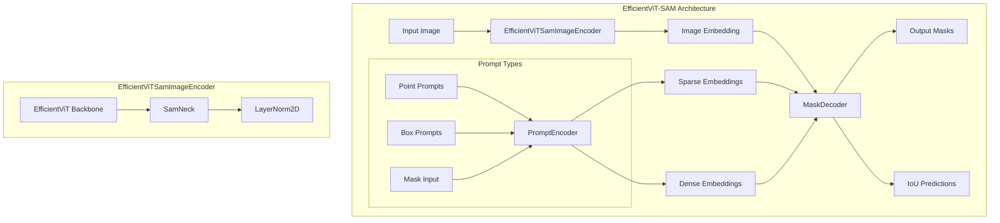
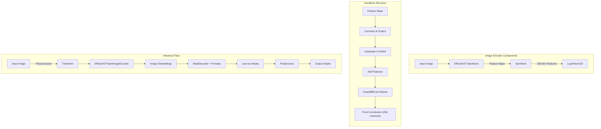
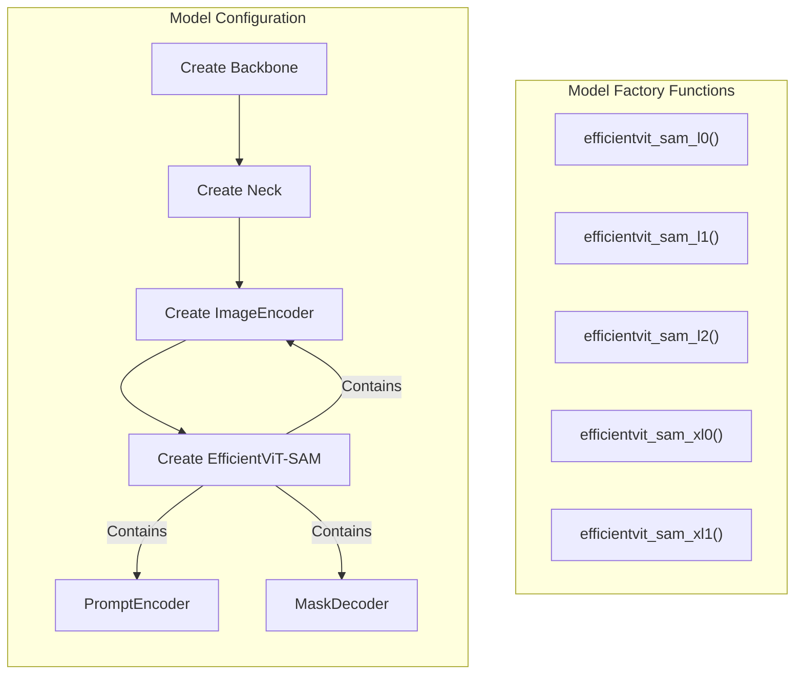
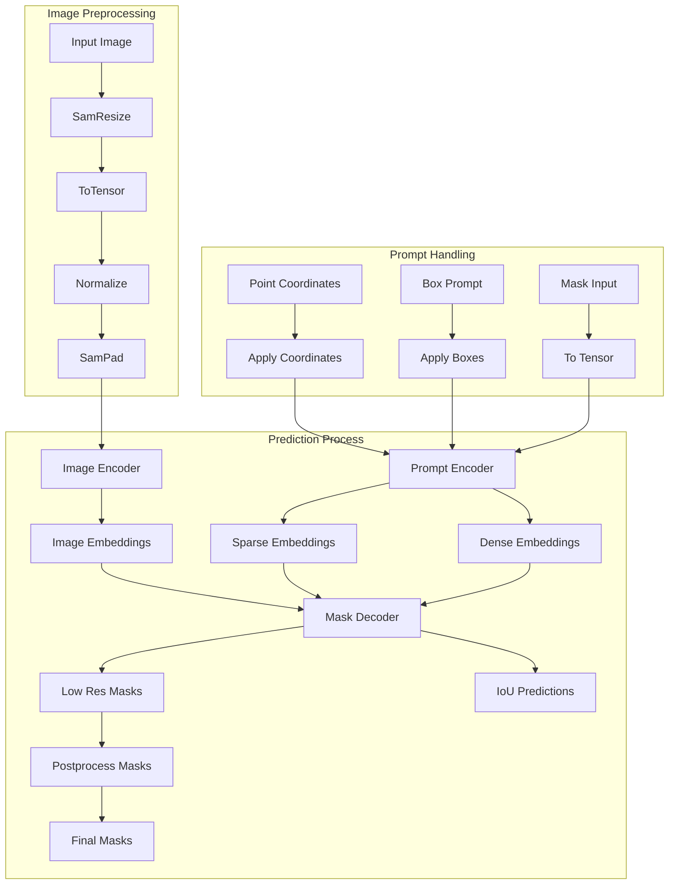

<!-- source: DeepWiki mcp.deepwiki.com · repo mit-han-lab/efficientvit · page 6.3 EfficientViT-SAM · fetched 2026-10-30 -->

# EfficientViT-SAM

<details>
<summary>Relevant source files</summary>

The following files were used as context for generating this wiki page:

- [applications/efficientvit_cls/README.md](applications/efficientvit_cls/README.md)
- [applications/efficientvit_sam/README.md](applications/efficientvit_sam/README.md)
- [assets/dc_ae_diffusion_example.png](assets/dc_ae_diffusion_example.png)
- [efficientvit/models/efficientvit/sam.py](efficientvit/models/efficientvit/sam.py)

</details>


## Purpose and Scope

This document covers EfficientViT-SAM, an accelerated version of the Segment Anything Model (SAM) that delivers high-performance segmentation capabilities without sacrificing accuracy. It offers efficient multi-scale attention and optimized architecture for interactive segmentation and can operate on a wide range of inputs including point prompts, box prompts, or without any prompts (automatic segmentation).

For information about the core EfficientViT architecture that serves as the backbone, see [EfficientViT Backbone](#2.1). For semantic segmentation capabilities, see [Semantic Segmentation](#6.2).

## Architecture Overview

EfficientViT-SAM builds upon the original SAM architecture but replaces the heavyweight image encoder with an efficient EfficientViT backbone while retaining the original prompt encoder and mask decoder components from the SAM model.



Sources: [efficientvit/models/efficientvit/sam.py:173-187](), [efficientvit/models/efficientvit/sam.py:190-271]()

### Key Components

The EfficientViT-SAM architecture consists of three main components:

1. **Image Encoder**: Utilizes the EfficientViT backbone for feature extraction and a specialized SamNeck for feature aggregation.
2. **Prompt Encoder**: Converts various input prompts (points, boxes, masks) into embeddings.
3. **Mask Decoder**: Generates segmentation masks based on the image and prompt embeddings.



Sources: [efficientvit/models/efficientvit/sam.py:102-170](), [efficientvit/models/efficientvit/sam.py:556-578]()

## Model Variants

EfficientViT-SAM comes in multiple variants optimized for different performance and accuracy trade-offs:

| Model | Resolution | Parameters | MACs | Inference (A100) | COCO mAP | LVIS mAP |
|-------|------------|------------|------|------------------|----------|----------|
| EfficientViT-SAM-L0 | 512×512 | 34.8M | 35G | 762 img/s | 45.7 | 41.8 |
| EfficientViT-SAM-L1 | 512×512 | 47.7M | 49G | 638 img/s | 46.2 | 42.1 |
| EfficientViT-SAM-L2 | 512×512 | 61.3M | 69G | 538 img/s | 46.6 | 42.7 |
| EfficientViT-SAM-XL0 | 1024×1024 | 117.0M | 185G | 278 img/s | 47.5 | 43.9 |
| EfficientViT-SAM-XL1 | 1024×1024 | 203.3M | 322G | 182 img/s | 47.8 | 44.4 |

Each variant has a different backbone architecture and neck configuration. The L-series models operate at 512×512 resolution, while XL-series models operate at 1024×1024 resolution for higher accuracy.

Sources: [applications/efficientvit_sam/README.md:43-51](), [efficientvit/models/efficientvit/sam.py:581-682]()

### Model Construction

The model construction functions create variants with different backbone configurations and neck depths:



Sources: [efficientvit/models/efficientvit/sam.py:556-682]()

## Usage

### Basic Usage

To use EfficientViT-SAM for segmentation tasks:

```python
from efficientvit.sam_model_zoo import create_efficientvit_sam_model

# Load a pretrained model
efficientvit_sam = create_efficientvit_sam_model(name="efficientvit-sam-xl1", pretrained=True)
efficientvit_sam = efficientvit_sam.cuda().eval()
```

Sources: [applications/efficientvit_sam/README.md:59-65]()

### Using the Predictor Interface

The `EfficientViTSamPredictor` class provides a convenient interface for making predictions with different types of prompts:

```python
from efficientvit.models.efficientvit.sam import EfficientViTSamPredictor

# Create a predictor for the model
predictor = EfficientViTSamPredictor(efficientvit_sam)

# Set an image for processing
predictor.set_image(image_rgb)

# Predict with a point prompt
masks, scores, logits = predictor.predict(
    point_coords=np.array([[500, 375]]),  # x,y coordinates
    point_labels=np.array([1]),           # 1=foreground, 0=background
    multimask_output=True                 # Return multiple mask options
)
```

The predictor handles the image preprocessing, prompt encoding, and postprocessing of masks to match the original image dimensions.

Sources: [efficientvit/models/efficientvit/sam.py:274-501]()

### Automatic Mask Generation

For generating masks across an entire image without prompts:

```python
from efficientvit.models.efficientvit.sam import EfficientViTSamAutomaticMaskGenerator

# Create a mask generator
mask_generator = EfficientViTSamAutomaticMaskGenerator(
    efficientvit_sam,
    points_per_side=32,                # Controls mask density
    pred_iou_thresh=0.88,              # Filtering based on predicted IoU
    stability_score_thresh=0.95,       # Filtering based on mask stability
    box_nms_thresh=0.7                 # NMS threshold for box filtering
)

# Generate masks for an image
masks = mask_generator.generate(image_rgb)
```

Sources: [efficientvit/models/efficientvit/sam.py:504-553]()

## Inference Pipeline



Sources: [efficientvit/models/efficientvit/sam.py:352-425](), [efficientvit/models/efficientvit/sam.py:48-99]()

## Deployment Options

EfficientViT-SAM supports deployment through ONNX and TensorRT for accelerated inference in production environments.

### ONNX Export

The model can be exported to ONNX format with separate encoder and decoder components:

```bash
# Export Encoder
python applications/efficientvit_sam/deployment/onnx/export_encoder.py --model efficientvit-sam-xl1 --output encoder.onnx 

# Export Decoder
python applications/efficientvit_sam/deployment/onnx/export_decoder.py --model efficientvit-sam-xl1 --output decoder.onnx --return-single-mask
```

### TensorRT Export

For maximum performance, the model can be converted to TensorRT:

```bash
# Convert Encoder to TensorRT
trtexec --onnx=encoder.onnx --minShapes=input_image:1x3x1024x1024 --optShapes=input_image:4x3x1024x1024 --maxShapes=input_image:4x3x1024x1024 --saveEngine=encoder.engine

# Convert Decoder to TensorRT
trtexec --onnx=decoder.onnx --minShapes=point_coords:1x1x2,point_labels:1x1 --optShapes=point_coords:16x2x2,point_labels:16x2 --maxShapes=point_coords:16x2x2,point_labels:16x2 --fp16 --saveEngine=decoder.engine
```

Sources: [applications/efficientvit_sam/README.md:152-187]()

## Performance and Evaluation

EfficientViT-SAM has been evaluated on standard benchmarks including COCO and LVIS datasets for zero-shot segmentation. The evaluation encompasses:

1. **Box-prompted segmentation**: Using either ground truth or detected boxes
2. **Point-prompted segmentation**: Using one or more point prompts
3. **Automatic segmentation**: Without any prompts

The XL1 model variant achieves 47.8 mAP on COCO and 44.4 mAP on LVIS using box prompts from a detector, making it competitive with the original SAM model while being significantly faster.

Sources: [applications/efficientvit_sam/README.md:80-130]()

In summary, EfficientViT-SAM provides an efficient implementation of the Segment Anything Model by leveraging the EfficientViT architecture, delivering up to 48.9x speedup over the original SAM-ViT-H model without sacrificing segmentation performance.

---

