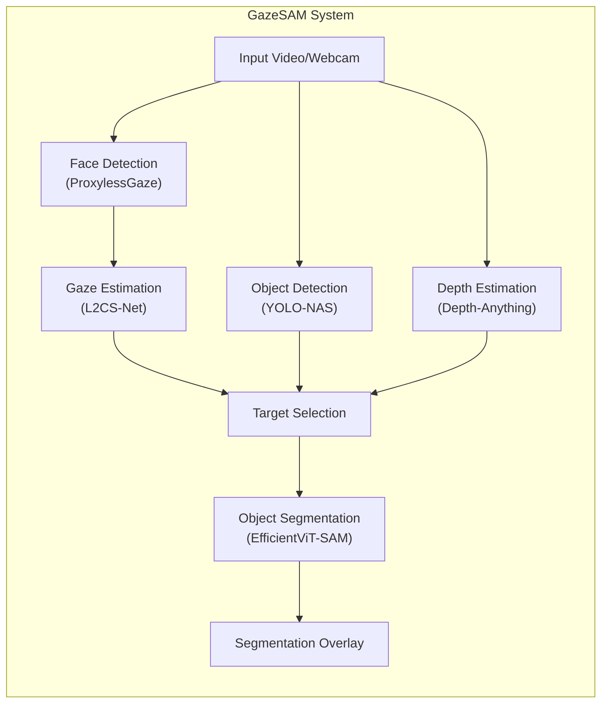
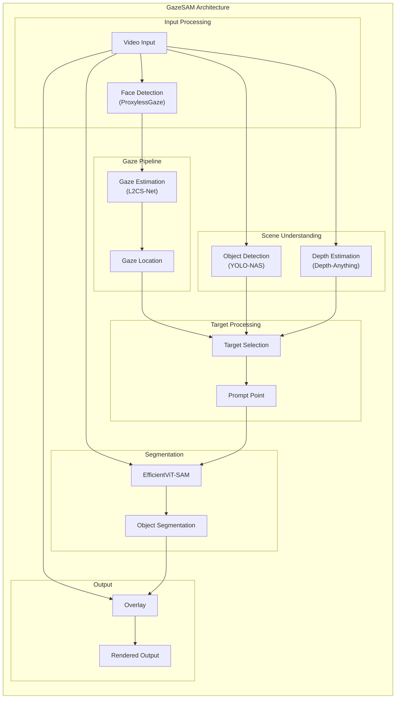
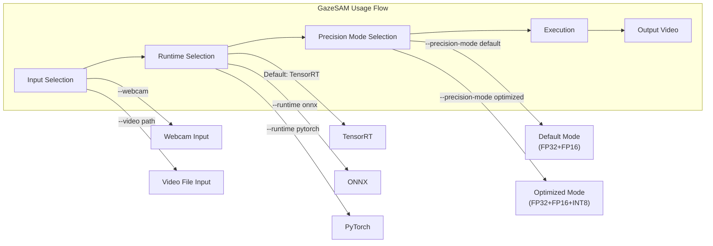

<!-- source: DeepWiki mcp.deepwiki.com · repo mit-han-lab/efficientvit · page 6.4 GazeSAM · fetched 2026-10-30 -->

# GazeSAM

<details>
<summary>Relevant source files</summary>

The following files were used as context for generating this wiki page:

- [applications/efficientvit_gazesam/README.md](applications/efficientvit_gazesam/README.md)

</details>


## Purpose and Scope

This document provides a comprehensive guide to GazeSAM, a gaze-prompted image segmentation system built on EfficientViT. GazeSAM enables real-time segmentation of objects that a user is looking at, creating an intuitive interaction method for visual content. For information about the general EfficientViT-SAM framework, see [EfficientViT-SAM](#6.3).

## Overview

GazeSAM is a multimodal system that combines gaze tracking with segmentation technologies to identify and segment objects a user is looking at in real-time. The system achieves real-time performance (30+ FPS) when running with TensorRT on an NVIDIA RTX 4070 GPU.



Sources: [applications/efficientvit_gazesam/README.md:3-5]()

## System Architecture

GazeSAM integrates five key components that work together to deliver gaze-prompted segmentation:



Sources: [applications/efficientvit_gazesam/README.md:3-5]()

### Component Roles

1. **Face Detection (ProxylessGaze)**: Identifies the user's face in the webcam feed
2. **Gaze Estimation (L2CS-Net)**: Determines where the user is looking based on facial features
3. **Object Detection (YOLO-NAS)**: Detects potential objects in the scene
4. **Depth Estimation (Depth-Anything)**: Provides depth information to help with object selection
5. **Image Segmentation (EfficientViT-SAM)**: Segments the object the user is looking at

## Installation and Setup

GazeSAM supports three runtime options, with TensorRT being the recommended option for real-time performance.

### Prerequisites

Before setting up any specific runtime, you must install the base requirements:

```bash
# install extra packages
pip install -r extra_requirements.txt
```

Sources: [applications/efficientvit_gazesam/README.md:9-14]()

### TensorRT Setup (Recommended)

TensorRT is the recommended runtime for real-time performance. Setup requires:

1. Install required packages:
   - TensorRT
   - torch2trt
   - cuda-python

2. Create TensorRT engines following instructions in the models directory.

3. Choose between two precision modes:
   - Default: FP32 + FP16 engines
   - Optimized: FP32, FP16, and INT8 engines (approximately 5ms faster per frame)

Sources: [applications/efficientvit_gazesam/README.md:16-26]()

### ONNX Setup

For ONNX runtime:

1. Install onnxruntime-gpu
2. Download ONNX model components and save them to the `models/onnx` directory

Sources: [applications/efficientvit_gazesam/README.md:28-34]()

### PyTorch Setup

PyTorch setup involves:

1. Setting up EfficientViT-SAM model
2. Setting up Depth-Anything model
3. Setting up L2CS-Net gaze estimation model 
4. Downloading ONNX model components

Sources: [applications/efficientvit_gazesam/README.md:36-52]()

## Usage Guide



Sources: [applications/efficientvit_gazesam/README.md:54-64]()

### Command Line Examples

GazeSAM provides a simple command-line interface:

- To run with webcam input:
  ```bash
  python gazesam_demo.py --webcam
  ```

- To run with video file input:
  ```bash
  python gazesam_demo.py --video <path>
  ```

- For webcam with optimized engines:
  ```bash
  python gazesam_demo.py --webcam --precision-mode optimized
  ```

- For video with default engines:
  ```bash
  python gazesam_demo.py --video input_videos/example.mp4 --precision-mode default
  ```

By default, the system:
- Uses TensorRT runtime (fastest)
- Saves results to the `output_videos` directory (customizable with `--output-dir`)

Sources: [applications/efficientvit_gazesam/README.md:56-64]()

## Performance Considerations

| Runtime | Real-time Capable | Notes |
|---------|-------------------|-------|
| TensorRT | Yes | Recommended for actual usage |
| ONNX | No | Slower but easier to set up |
| PyTorch | No | Slowest, useful for development |

TensorRT precision modes:
- Default mode (FP32+FP16): Good performance
- Optimized mode (FP32+FP16+INT8): ~5ms faster per frame on RTX 4070

Sources: [applications/efficientvit_gazesam/README.md:17-27](), [applications/efficientvit_gazesam/README.md:58-59]()

## Technical Implementation

GazeSAM leverages the EfficientViT architecture to achieve real-time performance while maintaining high-quality segmentation. The system creates a prompt point based on the user's gaze direction, which is then processed by EfficientViT-SAM to generate the segmentation mask.

The integration of multiple models (gaze estimation, object detection, depth estimation, and segmentation) is carefully balanced to maintain real-time performance while providing accurate results.

Sources: [applications/efficientvit_gazesam/README.md:3-5]()

---

