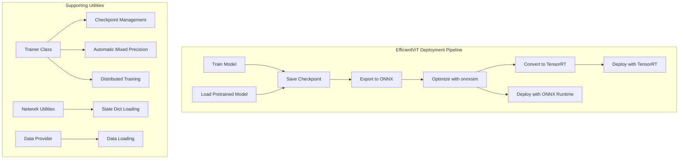
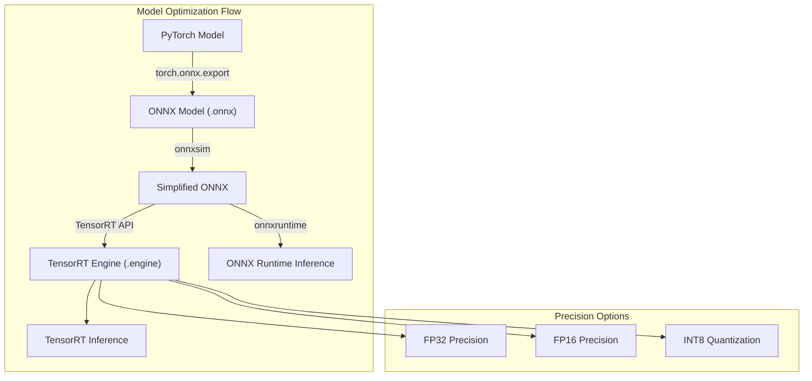
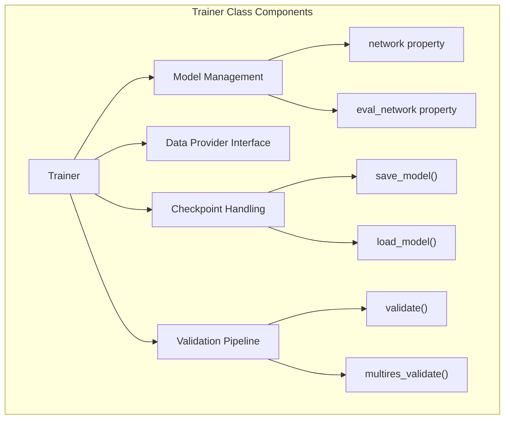
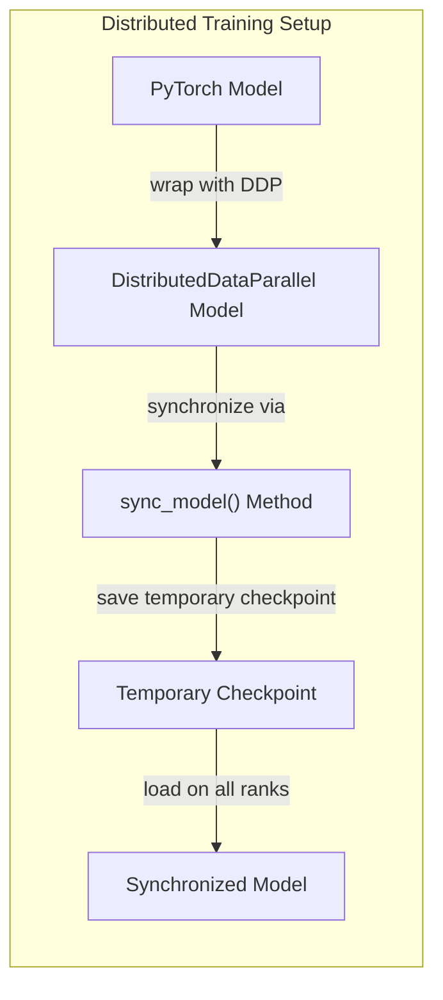

<!-- source: DeepWiki mcp.deepwiki.com · repo mit-han-lab/efficientvit · page 7 Deployment and Utilities · fetched 2026-10-30 -->

# Deployment and Utilities

<details>
<summary>Relevant source files</summary>

The following files were used as context for generating this wiki page:

- [efficientvit/apps/trainer/base.py](efficientvit/apps/trainer/base.py)
- [efficientvit/models/utils/network.py](efficientvit/models/utils/network.py)
- [setup.py](setup.py)

</details>


This document covers the deployment options and utility tools available in the EfficientViT framework. It focuses on how to deploy EfficientViT models efficiently across different platforms and describes the key utilities for training, model management, and inference optimization. For information about specific model architectures and their implementations, see [Core Components](#2).

## Deployment Pipeline Overview

The EfficientViT framework provides a complete pipeline for training, optimizing, and deploying models. This pipeline encompasses everything from model training to production deployment with hardware-specific optimizations.



Sources: [efficientvit/apps/trainer/base.py:15-44](), [setup.py:24-27]()

## ONNX and TensorRT Deployment

EfficientViT supports deployment through ONNX (Open Neural Network Exchange) and NVIDIA TensorRT for optimized inference. The framework includes dependencies for these deployment pathways as shown in the setup file.

### ONNX Export and Optimization

ONNX export allows EfficientViT models to be platform-independent and deployable in various environments. The models can be further optimized using the ONNX simplifier (`onnxsim`) to remove redundant operations and improve inference performance.

### TensorRT Conversion

For NVIDIA GPU deployments, EfficientViT models can be converted to TensorRT format after ONNX export. This enables significant acceleration through platform-specific optimizations including kernel fusion, precision calibration, and dynamic tensor memory management.



Sources: [setup.py:24-27]()

## Training Infrastructure

EfficientViT provides a robust training infrastructure centered around the `Trainer` class that handles model training, validation, checkpointing, and distributed training support.

### Trainer Class Architecture

The `Trainer` class provides the foundation for all training operations. It manages the complete training lifecycle including setup, execution, validation, and model saving.



Sources: [efficientvit/apps/trainer/base.py:16-172]()

### Checkpointing System

The checkpointing system allows for saving and loading model states, which is crucial for both resuming training and deploying trained models. The system saves comprehensive state information:

| Component | Description |
|-----------|-------------|
| `state_dict` | Model weights |
| `epoch` | Current training epoch |
| `best_val` | Best validation score |
| `optimizer` | Optimizer state |
| `lr_scheduler` | Learning rate scheduler state |
| `ema` | Exponential Moving Average state (if enabled) |
| `scaler` | Gradient scaler state (for mixed precision) |

Sources: [efficientvit/apps/trainer/base.py:54-82](), [efficientvit/apps/trainer/base.py:84-126]()

### Automatic Mixed Precision (AMP)

The `Trainer` class supports Automatic Mixed Precision training, which can significantly accelerate training while maintaining model accuracy. EfficientViT supports multiple precision options:

```python
@property
def amp_dtype(self) -> torch.dtype:
    if self.amp == "fp16":
        return torch.float16
    elif self.amp == "bf16":
        return torch.bfloat16
    else:
        return torch.float32
```

Sources: [efficientvit/apps/trainer/base.py:222-236]()

### Distributed Training Support

EfficientViT provides built-in support for distributed training across multiple GPUs using PyTorch's DistributedDataParallel (DDP). The framework includes utilities for model synchronization and efficient gradient communication.



Sources: [efficientvit/apps/trainer/base.py:204-209](), [efficientvit/apps/trainer/base.py:238-257]()

## Data Provider Infrastructure

The data provider infrastructure in EfficientViT abstracts the details of data loading and preprocessing, enabling consistent data handling across different model types and training scenarios.

### Multi-resolution Support

The data provider supports multi-resolution inputs, enabling validation and inference at different image sizes. This is useful for evaluating the model's performance across different resolution configurations:

```python
def multires_validate(
    self,
    model=None,
    data_loader=None,
    is_test=True,
    epoch=0,
    eval_image_size=None,
) -> dict[str, dict[str, Any]]:
    eval_image_size = self.run_config.eval_image_size if eval_image_size is None else eval_image_size
    eval_image_size = self.data_provider.image_size if eval_image_size is None else eval_image_size
    
    if not isinstance(eval_image_size, list):
        eval_image_size = [eval_image_size]
    
    output_dict = {}
    for r in eval_image_size:
        self.data_provider.assign_active_image_size(parse_image_size(r))
        if self.run_config.reset_bn:
            self.reset_bn(
                network=model,
                subset_size=self.run_config.reset_bn_size,
                subset_batch_size=self.run_config.reset_bn_batch_size,
                progress_bar=True,
            )
        output_dict[f"r{r}"] = self.validate(model, data_loader, is_test, epoch)
    return output_dict
```

Sources: [efficientvit/apps/trainer/base.py:173-199]()

### Batch Normalization Reset

EfficientViT provides a mechanism to reset batch normalization statistics, which is important for adapting models to new input distributions or resolutions:

```python
def reset_bn(
    self,
    network: Optional[nn.Module] = None,
    subset_size: int = 16000,
    subset_batch_size: int = 100,
    data_loader=None,
    progress_bar=False,
) -> None:
    network = self.network if network is None else network
    if data_loader is None:
        data_loader = []
        for data in self.data_provider.build_sub_train_loader(subset_size, subset_batch_size):
            if isinstance(data, list):
                data_loader.append(data[0])
            elif isinstance(data, dict):
                data_loader.append(data["data"])
            elif isinstance(data, torch.Tensor):
                data_loader.append(data)
            else:
                raise NotImplementedError

    network.eval()
    reset_bn(
        network,
        data_loader,
        sync=True,
        progress_bar=progress_bar,
    )
```

Sources: [efficientvit/apps/trainer/base.py:130-157]()

## Network Utilities

EfficientViT includes various network utilities that facilitate model deployment and management.

### State Dictionary Management

The framework provides utilities for loading state dictionaries from files, which is crucial for model deployment and weight transfer:

```python
def load_state_dict_from_file(file: str, only_state_dict=True) -> dict[str, torch.Tensor]:
    file = os.path.realpath(os.path.expanduser(file))
    checkpoint = torch.load(file, map_location="cpu", weights_only=True)
    if only_state_dict and "state_dict" in checkpoint:
        checkpoint = checkpoint["state_dict"]
    return checkpoint
```

Sources: [efficientvit/models/utils/network.py:71-76]()

### Model Parallel Detection

A key utility function detects whether a model is wrapped in a parallel processing container, which affects how model parameters are accessed:

```python
def is_parallel(model: nn.Module) -> bool:
    return isinstance(model, (nn.parallel.DataParallel, nn.parallel.DistributedDataParallel))
```

Sources: [efficientvit/models/utils/network.py:21-22]()

## Required Dependencies

The EfficientViT framework has several deployment-related dependencies specified in the setup file:

| Dependency | Purpose |
|------------|---------|
| `onnx` | Core ONNX functionality for model export |
| `onnxsim` | ONNX model simplification tool |
| `onnxruntime` | Runtime for ONNX model inference |
| `torch` | PyTorch framework |
| `torchvision` | Computer vision utilities for PyTorch |
| `tinyneuralnetwork` | Mobile deployment optimizations |

Sources: [setup.py:6-33]()

---

