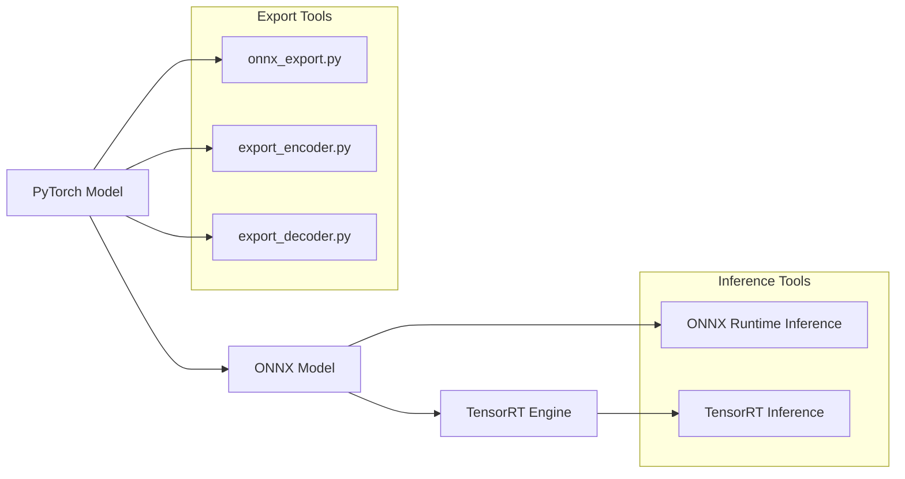
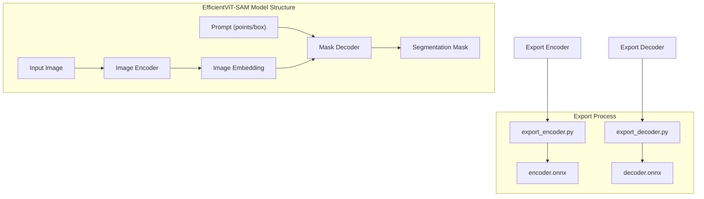
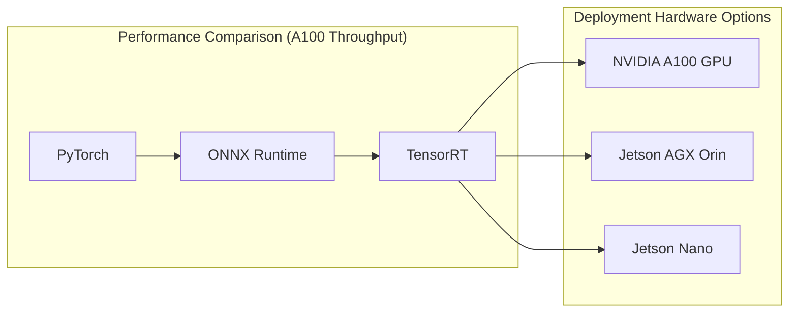
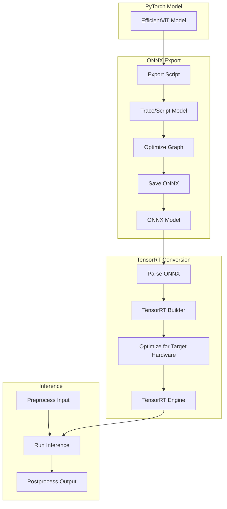

<!-- source: DeepWiki mcp.deepwiki.com · repo mit-han-lab/efficientvit · page 7.1 ONNX and TensorRT Deployment · fetched 2026-10-30 -->

# ONNX and TensorRT Deployment

<details>
<summary>Relevant source files</summary>

The following files were used as context for generating this wiki page:

- [applications/efficientvit_cls/README.md](applications/efficientvit_cls/README.md)
- [applications/efficientvit_sam/README.md](applications/efficientvit_sam/README.md)
- [assets/dc_ae_diffusion_example.png](assets/dc_ae_diffusion_example.png)
- [setup.py](setup.py)

</details>


This document explains how to deploy EfficientViT models using ONNX and TensorRT to achieve accelerated inference performance. The guide covers exporting models to ONNX format, converting them to TensorRT engines, and running inference with these optimized representations. By following these deployment strategies, you can significantly improve throughput and reduce latency when running EfficientViT models in production environments.

## Deployment Workflow Overview

The deployment process generally follows these steps:



Sources:
- [applications/efficientvit_cls/README.md:84-102]()
- [applications/efficientvit_sam/README.md:154-168]()
- [applications/efficientvit_sam/README.md:172-187]()

## Model Export to ONNX

### Classification Models

For EfficientViT classification models, use the `onnx_export.py` script:

```bash
python assets/onnx_export.py --export_path assets/export_models/efficientvit_cls_l3_r224.onnx --model efficientvit-l3 --resolution 224 224 --bs 1
```

This exports the specified model with the given input resolution and batch size. All EfficientViT classification variants (B0-B3, L1-L3) are supported with different resolutions.

### SAM Models

EfficientViT-SAM models require a two-step export process since they consist of an encoder and a decoder:

1. First, export the encoder:

```bash
python applications/efficientvit_sam/deployment/onnx/export_encoder.py --model efficientvit-sam-xl1 --output assets/export_models/efficientvit_sam/onnx/efficientvit_sam_xl1_encoder.onnx
```

2. Then, export the decoder:

```bash
python applications/efficientvit_sam/deployment/onnx/export_decoder.py --model efficientvit-sam-xl1 --output assets/export_models/efficientvit_sam/onnx/efficientvit_sam_xl1_decoder.onnx --return-single-mask
```

The `--return-single-mask` flag is optional and optimizes the model when only a single mask output is needed.



Sources:
- [applications/efficientvit_sam/README.md:154-162]()
- [applications/efficientvit_cls/README.md:86-92]()

## Converting to TensorRT

### TensorRT Export for SAM Models

ONNX models can be converted to TensorRT engines for further acceleration:

1. Convert the encoder:
```bash
trtexec --onnx=assets/export_models/efficientvit_sam/onnx/efficientvit_sam_xl1_encoder.onnx --minShapes=input_image:1x3x1024x1024 --optShapes=input_image:4x3x1024x1024 --maxShapes=input_image:4x3x1024x1024 --saveEngine=assets/export_models/efficientvit_sam/tensorrt/efficientvit_sam_xl1_encoder.engine
```

2. Convert the decoder:
```bash
trtexec --onnx=assets/export_models/efficientvit_sam/onnx/efficientvit_sam_xl1_decoder.onnx --minShapes=point_coords:1x1x2,point_labels:1x1 --optShapes=point_coords:16x2x2,point_labels:16x2 --maxShapes=point_coords:16x2x2,point_labels:16x2 --fp16 --saveEngine=assets/export_models/efficientvit_sam/tensorrt/efficientvit_sam_xl1_decoder.engine
```

Key parameters include:
- `--minShapes`, `--optShapes`, `--maxShapes`: Define the range of input shapes (necessary for dynamic shape support)
- `--fp16`: Enable half-precision for faster inference
- `--saveEngine`: Specify the output TensorRT engine file path

Sources:
- [applications/efficientvit_sam/README.md:172-182]()

## Running Inference

### ONNX Inference

For EfficientViT-SAM models, run inference with the exported ONNX models:

```bash
python applications/efficientvit_sam/run_efficientvit_sam_onnx.py --model efficientvit-sam-xl1 --encoder_model assets/export_models/efficientvit_sam/onnx/efficientvit_sam_xl1_encoder.onnx --decoder_model assets/export_models/efficientvit_sam/onnx/efficientvit_sam_xl1_decoder.onnx --mode point
```

### TensorRT Inference

For EfficientViT-SAM models, run inference with the TensorRT engines:

```bash
python applications/efficientvit_sam/run_efficientvit_sam_trt.py --model efficientvit-sam-xl1 --encoder_engine assets/export_models/efficientvit_sam/tensorrt/efficientvit_sam_xl1_encoder.engine --decoder_engine assets/export_models/efficientvit_sam/tensorrt/efficientvit_sam_xl1_decoder.engine --mode point
```

The `--mode` parameter can be set to `point`, `box`, or `all` for different prompt types.

Sources:
- [applications/efficientvit_sam/README.md:166-168]()
- [applications/efficientvit_sam/README.md:186-187]()

## Performance Comparison

The table below shows the performance improvements achieved through TensorRT deployment for EfficientViT-SAM models:

| Model | Resolution | Parameters | MACs | Latency on Jetson Orin (bs1) | A100 Throughput (bs16) |
|-------|------------|------------|------|------------------------------|-------------------------|
| EfficientViT-SAM-L0 | 512×512 | 34.8M | 35G | 8.2ms | 762 images/s |
| EfficientViT-SAM-L1 | 512×512 | 47.7M | 49G | 10.2ms | 638 images/s |
| EfficientViT-SAM-L2 | 512×512 | 61.3M | 69G | 12.9ms | 538 images/s |
| EfficientViT-SAM-XL0 | 1024×1024 | 117.0M | 185G | 22.5ms | 278 images/s |
| EfficientViT-SAM-XL1 | 1024×1024 | 203.3M | 322G | 37.2ms | 182 images/s |

For classification models, similar improvements are observed:

| Model | Resolution | A100 Throughput (TensorRT, fp16) |
|-------|------------|----------------------------------|
| EfficientViT-L1 | 224×224 | 6207 images/s |
| EfficientViT-L2 | 384×384 | 1784 images/s |
| EfficientViT-L3 | 384×384 | 724 images/s |



Sources:
- [applications/efficientvit_sam/README.md:43-51]()
- [applications/efficientvit_cls/README.md:29-46]()

## Deployment Pipeline Components

This diagram illustrates the components involved in the deployment pipeline for EfficientViT models:



Sources:
- [applications/efficientvit_sam/README.md:154-187]()
- [applications/efficientvit_cls/README.md:84-102]()

## Dependencies and Requirements

The following packages are required for ONNX and TensorRT deployment:

- ONNX: `onnx`, `onnxsim`, `onnxruntime`
- TensorRT: NVIDIA TensorRT must be installed separately
- Python libraries: Common dependencies like PyTorch, NumPy, etc.

You can install the ONNX-related dependencies using pip:

```bash
pip install onnx onnxsim onnxruntime
```

For TensorRT, follow NVIDIA's installation instructions for your specific system.

Sources:
- [setup.py:25-27]()

## Best Practices and Troubleshooting

### Best Practices

1. **Optimize batch size**: Choose batch sizes that maximize throughput on your target hardware.
2. **Use precision settings wisely**: For TensorRT, use FP16 mode for most applications to balance performance and accuracy.
3. **Set appropriate dynamic shapes**: Define min/opt/max shapes according to your expected input sizes.
4. **Memory management**: Large models may require specific GPU memory settings.

### Common Issues and Solutions

- **Unsupported operations**: Some PyTorch operations might not be directly supported in ONNX. Use `torch.onnx.export` with custom symbolic functions if needed.
- **Shape inference issues**: Explicitly define input shapes to avoid problems with dynamic dimensions.
- **Performance bottlenecks**: Profile your model to identify and optimize the slowest parts of the pipeline.
- **Numerical precision**: If you encounter accuracy issues with FP16, consider using FP32 for critical layers.

Sources:
- [applications/efficientvit_sam/README.md:154-187]()

## Example Use Cases

The optimized deployment with ONNX and TensorRT is particularly beneficial for:

1. **Edge devices**: Jetson Nano or Orin, where TensorRT provides significant speedups.
2. **Server deployments**: A100 GPUs for high-throughput applications.
3. **Real-time applications**: Where low latency is critical, like interactive segmentation.
4. **Batch processing**: For scenarios requiring high throughput, like video analysis.

Sources:
- [applications/efficientvit_sam/README.md:43-51]()
- [applications/efficientvit_cls/README.md:29-46]()

---

