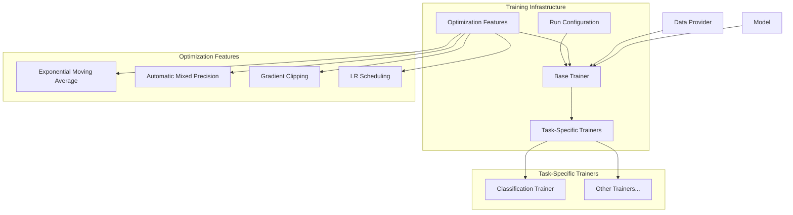
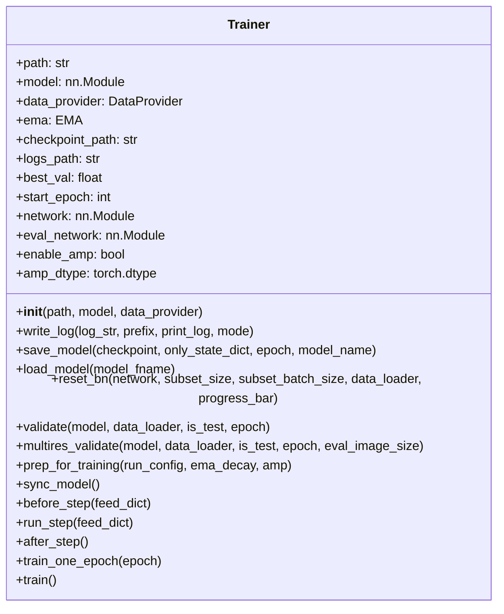
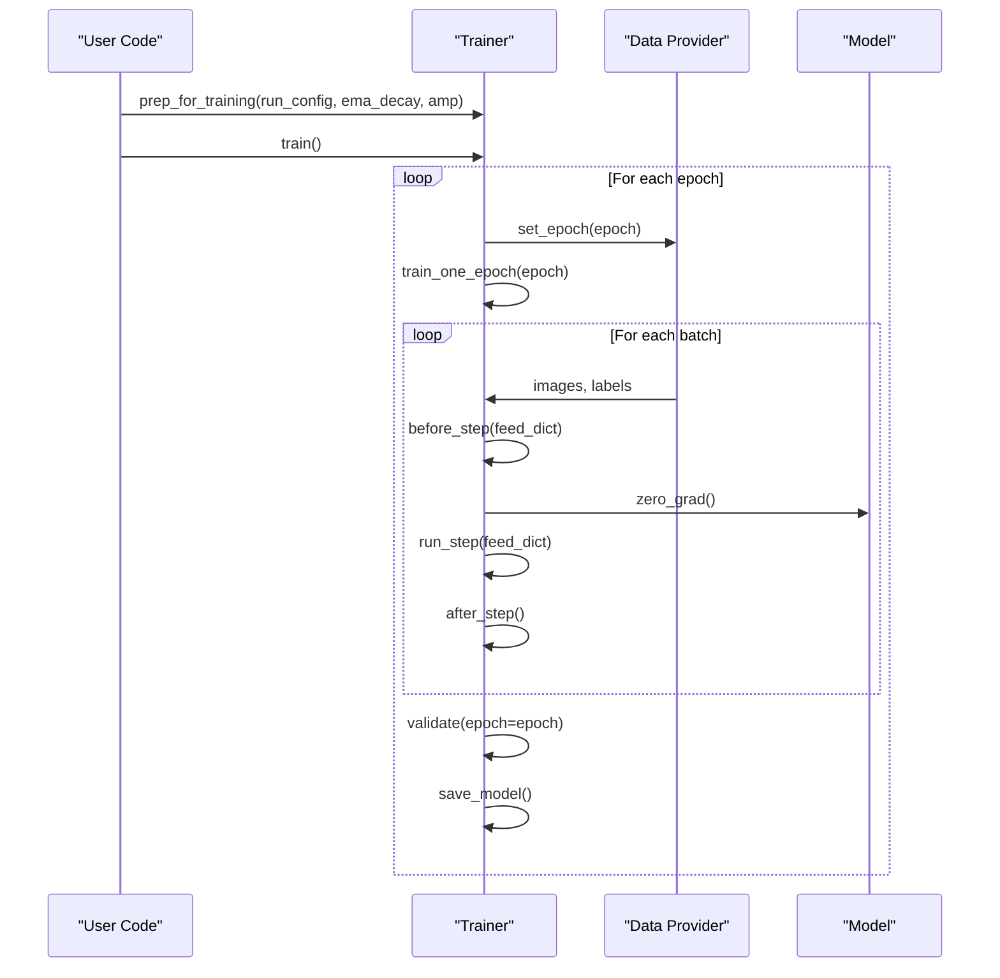
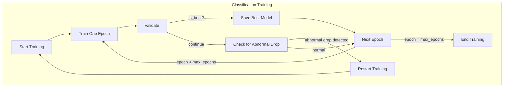

<!-- source: DeepWiki mcp.deepwiki.com · repo mit-han-lab/efficientvit · page 7.2 Training Infrastructure · fetched 2026-10-30 -->

# Training Infrastructure

<details>
<summary>Relevant source files</summary>

The following files were used as context for generating this wiki page:

- [efficientvit/apps/trainer/base.py](efficientvit/apps/trainer/base.py)
- [efficientvit/clscore/trainer/cls_trainer.py](efficientvit/clscore/trainer/cls_trainer.py)
- [efficientvit/models/utils/network.py](efficientvit/models/utils/network.py)

</details>


This document explains the training infrastructure in the EfficientViT repository, which provides a framework for training various models including classification, segmentation, and SAM models. For information about specific data providers used during training, see [Data Providers](#7.3).

## Overview

The EfficientViT training infrastructure provides a structured approach to model training with support for distributed training, checkpointing, mixed precision, and other optimization techniques. It follows a modular design with a base `Trainer` class that can be extended for specific model types.

### Training Infrastructure Architecture



Sources: [efficientvit/apps/trainer/base.py:1-297]()

## Base Trainer Class

The training infrastructure is built around the `Trainer` class defined in `efficientvit/apps/trainer/base.py`. This class provides common functionality for all training pipelines.

### Key Components



Sources: [efficientvit/apps/trainer/base.py:16-296]()

### Initialization and Setup

The `Trainer` class is initialized with:
- `path`: Directory for saving checkpoints and logs
- `model`: The neural network model to train
- `data_provider`: Provides data loaders for training, validation, and testing

Training preparation is done through the `prep_for_training` method, which:
1. Sets up the run configuration
2. Wraps the model in DistributedDataParallel for distributed training
3. Builds the optimizer and learning rate scheduler
4. Initializes Exponential Moving Average (EMA) if specified
5. Sets up Automatic Mixed Precision (AMP) training

Sources: [efficientvit/apps/trainer/base.py:17-27](), [efficientvit/apps/trainer/base.py:203-223]()

### Model Checkpointing

The infrastructure provides functionality to save and load model checkpoints:

- `save_model`: Saves the model state, optimizer state, learning rate scheduler state, and other training states to a checkpoint file
- `load_model`: Loads a saved checkpoint to resume training from a previous state

This allows training to be interrupted and resumed without losing progress.

Sources: [efficientvit/apps/trainer/base.py:54-83](), [efficientvit/apps/trainer/base.py:84-126]()

### Distributed Training Support

The infrastructure includes support for distributed training:

- Models are wrapped in `DistributedDataParallel` during preparation
- The `sync_model` method ensures model weights are synchronized across all distributed processes
- Training metrics are properly synchronized using methods like `sync_tensor`

Sources: [efficientvit/apps/trainer/base.py:205-209](), [efficientvit/apps/trainer/base.py:238-257]()

## Training Process Flow

The training process follows a structured flow with abstract methods that must be implemented by task-specific trainers.



Sources: [efficientvit/apps/trainer/base.py:283-296](), [efficientvit/clscore/trainer/cls_trainer.py:188-230]()

### Training Cycle

The main training cycle is structured as follows:

1. `train()`: The main entry point for training
2. For each epoch:
   - `train_one_epoch(epoch)`: Trains for one epoch
   - `validate(epoch=epoch)`: Validates model performance
   - Saves model checkpoint if needed

Within each epoch, the training follows this pattern:
1. For each batch:
   - `before_step(feed_dict)`: Preprocessing (e.g., moving data to GPU)
   - `run_step(feed_dict)`: Forward and backward passes
   - `after_step()`: Parameter updates, learning rate updates, EMA updates

Sources: [efficientvit/apps/trainer/base.py:283-293](), [efficientvit/clscore/trainer/cls_trainer.py:141-186]()

## Task-Specific Trainers

The base `Trainer` class defines abstract methods that must be implemented by task-specific trainers.

### Classification Trainer

The `ClsTrainer` class extends the base `Trainer` for image classification tasks:

- Implements classification-specific validation with top-1 and top-5 accuracy metrics
- Adds support for label smoothing and mixup data augmentation
- Provides automated restart mechanism when validation accuracy drops significantly



Sources: [efficientvit/clscore/trainer/cls_trainer.py:19-230]()

### Training Step Implementation

The `ClsTrainer` implements the abstract methods from the base `Trainer`:

- `_validate`: Computes validation loss and accuracy metrics
- `before_step`: Applies preprocessing like label smoothing and mixup
- `run_step`: Performs forward and backward passes for classification
- `_train_one_epoch`: Runs training for one epoch and collects metrics
- `train`: Main entry point that sets up criteria and runs the training loop

Sources: [efficientvit/clscore/trainer/cls_trainer.py:35-75](), [efficientvit/clscore/trainer/cls_trainer.py:77-139](), [efficientvit/clscore/trainer/cls_trainer.py:141-186](), [efficientvit/clscore/trainer/cls_trainer.py:188-230]()

## Advanced Training Features

The training infrastructure includes several advanced features to optimize training performance.

### Automatic Mixed Precision (AMP)

AMP allows for faster training with reduced memory usage by using lower precision formats (FP16 or BF16) where possible while maintaining FP32 precision where needed:

- Controlled through the `amp` parameter in `prep_for_training`
- Uses PyTorch's `torch.cuda.amp.GradScaler` to prevent underflow issues
- Supports different precision modes: "fp32", "fp16", "bf16"

Sources: [efficientvit/apps/trainer/base.py:221-223](), [efficientvit/apps/trainer/base.py:225-236](), [efficientvit/clscore/trainer/cls_trainer.py:121-128]()

### Exponential Moving Average (EMA)

EMA maintains a moving average of model weights, typically resulting in better generalization:

- Initialized with an optional decay rate in `prep_for_training`
- Updated after each training step in `after_step`
- Used for evaluation through the `eval_network` property

Sources: [efficientvit/apps/trainer/base.py:219-220](), [efficientvit/apps/trainer/base.py:279-281]()

### Gradient Clipping

Gradient clipping prevents exploding gradients by limiting their magnitudes:

- Controlled through the `grad_clip` parameter in `RunConfig`
- Applied in the `after_step` method before optimizer updates

Sources: [efficientvit/apps/trainer/base.py:270-272]()

### Learning Rate Scheduling

The infrastructure supports dynamic learning rate scheduling:

- Created during preparation with `build_optimizer` from `RunConfig`
- Updated after each training step in `after_step`
- State saved and loaded with checkpoints

Sources: [efficientvit/apps/trainer/base.py:216](), [efficientvit/apps/trainer/base.py:277]()

## Usage Example

To use the training infrastructure for a custom model, follow these steps:

1. Create a data provider that yields training, validation, and test data
2. Instantiate your model
3. Create a subclass of `Trainer` that implements the abstract methods
4. Set up a run configuration
5. Initialize the trainer and start training

For classification models, you can directly use the `ClsTrainer`:

```python
# Create data provider and model
data_provider = create_data_provider(...)
model = create_model(...)

# Create trainer
trainer = ClsTrainer(
    path="./output_dir",
    model=model,
    data_provider=data_provider,
    auto_restart_thresh=5.0  # Restart if accuracy drops by more than 5%
)

# Set up run configuration
run_config = RunConfig(...)

# Prepare for training and train
trainer.prep_for_training(
    run_config=run_config,
    ema_decay=0.9999,
    amp="fp16"  # Use mixed precision
)
trainer.train()
```

Sources: [efficientvit/apps/trainer/base.py:16-27](), [efficientvit/clscore/trainer/cls_trainer.py:19-32](), [efficientvit/clscore/trainer/cls_trainer.py:188-230]()

## Multi-Resolution Validation

The training infrastructure supports validating models at multiple input resolutions:

- The `multires_validate` method takes a list of image sizes to evaluate
- For each resolution, it validates the model and collects metrics
- Useful for evaluating performance across different deployment scenarios

Sources: [efficientvit/apps/trainer/base.py:173-199]()

## Important Utilities

Several utility functions support the training process:

### Model State Management

- `is_parallel`: Detects if a model is wrapped for parallel processing
- `load_state_dict_from_file`: Loads model weights from a checkpoint file
- `network` and `eval_network` properties: Provide access to the unwrapped model and evaluation model (with EMA if available)

Sources: [efficientvit/models/utils/network.py:21-22](), [efficientvit/models/utils/network.py:71-76](), [efficientvit/apps/trainer/base.py:32-43]()

### Batch Normalization Reset

- `reset_bn`: Recalculates batch normalization statistics on a subset of training data
- Useful when changing input resolution or after significant model updates

Sources: [efficientvit/apps/trainer/base.py:130-157]()

## Summary

The EfficientViT training infrastructure provides a comprehensive framework for training various models with support for distributed training, mixed precision, checkpointing, and other optimization techniques. The modular design allows for easy extension to new tasks while maintaining a consistent training workflow.

---

