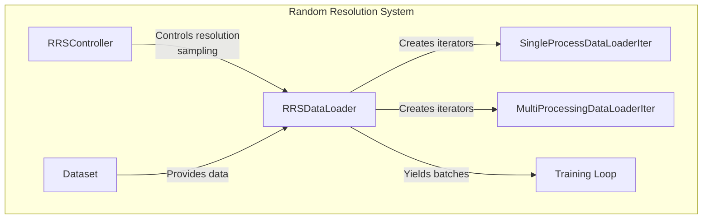
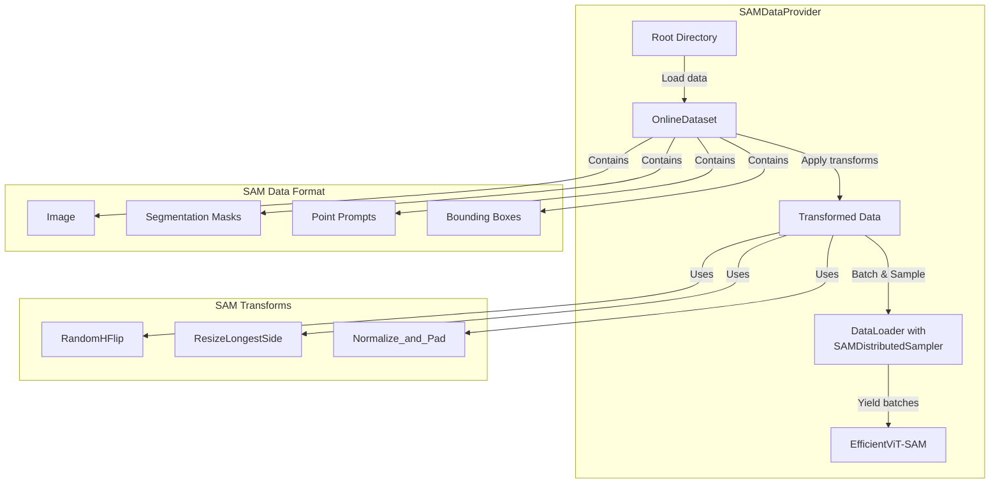
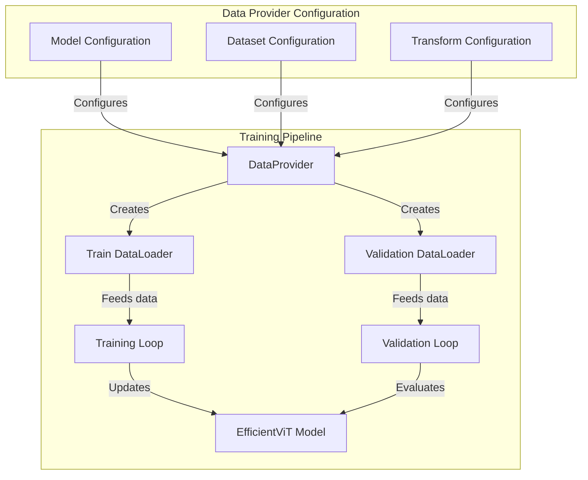

<!-- source: DeepWiki mcp.deepwiki.com · repo mit-han-lab/efficientvit · page 7.3 Data Providers · fetched 2026-10-30 -->

# Data Providers

<details>
<summary>Relevant source files</summary>

The following files were used as context for generating this wiki page:

- [efficientvit/apps/data_provider/random_resolution/__init__.py](efficientvit/apps/data_provider/random_resolution/__init__.py)
- [efficientvit/apps/data_provider/random_resolution/_data_loader.py](efficientvit/apps/data_provider/random_resolution/_data_loader.py)
- [efficientvit/models/efficientvit/seg.py](efficientvit/models/efficientvit/seg.py)
- [efficientvit/samcore/data_provider/__init__.py](efficientvit/samcore/data_provider/__init__.py)
- [efficientvit/samcore/data_provider/sam.py](efficientvit/samcore/data_provider/sam.py)
- [efficientvit/samcore/data_provider/utils.py](efficientvit/samcore/data_provider/utils.py)

</details>


The Data Providers module in EfficientViT provides infrastructure for loading, transforming, and batching data for training and evaluation. It includes specialized components for handling various data requirements across different model types, with particular support for distributed training, random resolution training, and specific data needs for the Segment Anything Model (SAM).

This page documents the data provider components used across the EfficientViT codebase. For information about training infrastructure, see [Training Infrastructure](#7.2).

## 1. Data Provider Architecture

The EfficientViT framework implements specialized data providers to serve different model types and training scenarios. The core architecture consists of base data provider classes that are extended for specific use cases.

```mermaid
classDiagram
    class "DataProvider" {
        +build_train_transform()
        +build_valid_transform()
        +build_datasets()
        +build_dataloader()
    }
    
    class "SAMDataProvider" {
        +build_train_transform()
        +build_valid_transform()
        +build_datasets()
        +build_dataloader()
        +set_epoch_and_sub_epoch()
    }
    
    class "RRSDataLoader" {
        +__init__()
        +_get_iterator()
    }
    
    class "torch.utils.data.DataLoader" {
    }
    
    "DataProvider" <|-- "SAMDataProvider"
    "torch.utils.data.DataLoader" <|-- "RRSDataLoader"
```

Sources: [efficientvit/samcore/data_provider/sam.py:93-171](), [efficientvit/apps/data_provider/random_resolution/_data_loader.py:124-591]()

## 2. Random Resolution Support

One of the key features in EfficientViT's data loading system is random resolution support, which allows training models at varying resolutions for better generalization and adaptability.

### 2.1 Random Resolution Data Loader

The Random Resolution System (RRS) enables dynamic resolution changes during training. This is implemented through the `RRSDataLoader` class, which extends PyTorch's standard DataLoader.



The `RRSDataLoader` is designed to be a drop-in replacement for PyTorch's DataLoader with added capabilities for handling resolution changes during training iterations.

Sources: [efficientvit/apps/data_provider/random_resolution/__init__.py:1-8](), [efficientvit/apps/data_provider/random_resolution/_data_loader.py:124-591]()

## 3. SAM Data Provider

The SAM (Segment Anything Model) data provider is specialized for loading and processing image segmentation data with point prompts and bounding boxes.

### 3.1 SAM Data Pipeline



The `SAMDataProvider` handles loading data for training the EfficientViT-SAM model, which requires specialized handling for segmentation masks, point prompts, and bounding boxes.

Sources: [efficientvit/samcore/data_provider/sam.py:23-91](), [efficientvit/samcore/data_provider/sam.py:93-171]()

### 3.2 SAM Dataset and Transforms

The SAM data pipeline includes several specialized components:

1. **OnlineDataset**: Loads image and annotation data from disk
2. **Transform Pipeline**:
   - **RandomHFlip**: Random horizontal flipping with appropriate coordinate transformation
   - **ResizeLongestSide**: Resizes images while maintaining aspect ratio
   - **Normalize_and_Pad**: Normalizes pixel values and pads to target size

#### SAM Data Sample Format

```
{
    "image": torch.Tensor,       # Image tensor (3, H, W)
    "masks": torch.Tensor,       # Binary masks tensor (N, H, W)
    "points": torch.Tensor,      # Point coordinates tensor (N, 2)
    "bboxs": torch.Tensor,       # Bounding box coordinates tensor (N, 4)
    "shape": torch.Tensor        # Original image shape
}
```

Sources: [efficientvit/samcore/data_provider/sam.py:23-91](), [efficientvit/samcore/data_provider/utils.py:90-197]()

## 4. Distributed Training Support

EfficientViT's data providers include robust support for distributed training, which is essential for scaling to multiple GPUs or nodes.

### 4.1 Distributed Samplers

```mermaid
classDiagram
    class "torch.utils.data.distributed.DistributedSampler" {
        +__init__()
        +__iter__()
        +__len__()
        +set_epoch()
    }
    
    class "SAMDistributedSampler" {
        +__init__()
        +__iter__()
        +__len__()
        +set_epoch_and_sub_epoch()
        +set_sub_num_samples()
        -sub_epoch
        -sub_epochs_per_epoch
    }
    
    "torch.utils.data.distributed.DistributedSampler" <|-- "SAMDistributedSampler"
```

The `SAMDistributedSampler` extends PyTorch's `DistributedSampler` to add support for sub-epochs, which allows dividing each epoch into multiple smaller passes through subsets of the data.

Sources: [efficientvit/samcore/data_provider/utils.py:15-87]()

### 4.2 Sub-Epoch Training

The sub-epoch training mechanism is particularly useful for SAM models, as it allows:

1. More frequent model updates
2. More varied exposure to training samples
3. Flexibility in defining epoch boundaries

The implementation ensures each worker in a distributed setting gets a fair and non-overlapping portion of the dataset for each sub-epoch.

```python
# Key attributes in SAMDistributedSampler
self.sub_epoch = 0                # Current sub-epoch
self.sub_epochs_per_epoch = sub_epochs_per_epoch  # Number of sub-epochs per epoch
self.sub_num_samples = self.num_samples // self.sub_epochs_per_epoch  # Samples per sub-epoch
```

Sources: [efficientvit/samcore/data_provider/utils.py:29-72](), [efficientvit/samcore/data_provider/sam.py:168-171]()

## 5. Integration with Model Training

The data providers integrate with the model training infrastructure to deliver appropriately formatted data to the models during training and evaluation.



### 5.1 Dataset-Specific Handling

Different models in the EfficientViT family require different data handling approaches. For example, segmentation models need special datasets with pixel-level annotations:

```python
# Example from EfficientViT Segmentation Model
if dataset == "cityscapes":
    head = SegHead(
        fid_list=["stage4", "stage3", "stage2"],
        in_channel_list=[128, 64, 32],
        stride_list=[32, 16, 8],
        head_stride=8,
        head_width=32,
        head_depth=1,
        expand_ratio=4,
        middle_op="mbconv",
        final_expand=4,
        n_classes=19,  # Cityscapes-specific class count
        **build_kwargs_from_config(kwargs, SegHead),
    )
```

Sources: [efficientvit/models/efficientvit/seg.py:120-142]()

## Summary

The Data Providers in EfficientViT provide a flexible and extensible framework for loading and processing data for different models and training scenarios. Key features include:

1. **Random resolution support** for training at varying resolutions
2. **Specialized data handling** for different model types (classification, segmentation, SAM)
3. **Distributed training support** with custom samplers
4. **Sub-epoch training** for more frequent model updates
5. **Comprehensive transformation pipelines** for data augmentation and normalization

These components work together to enable efficient and effective training of EfficientViT models across a variety of tasks and deployment scenarios.