# Page: Overview

# Overview

<details>
<summary>Relevant source files</summary>

The following files were used as context for generating this wiki page:

- [README.md](README.md)
- [applications/dc_ae/README.md](applications/dc_ae/README.md)

</details>


The EfficientViT repository provides a comprehensive ecosystem of efficient vision foundation models designed for high-resolution image generation and perception tasks. This document gives an overview of the architecture, components, and capabilities of the EfficientViT framework, serving as a gateway to more detailed documentation on specific subsystems.

## Core Components and Architecture

EfficientViT is built around a modular architecture that enables efficient vision models for various tasks. The framework consists of several key components:

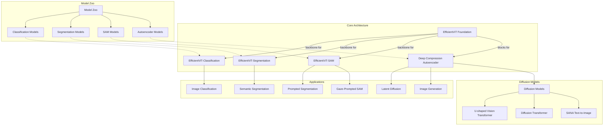

Sources: [README.md:1-157]()

### EfficientViT Foundation

The foundation of the ecosystem is the EfficientViT architecture, which implements lightweight multi-scale attention mechanisms designed for efficient processing of visual data. This serves as the backbone for various task-specific models and provides building blocks for the Deep Compression Autoencoder.

For more detailed information about the EfficientViT architecture, see [EfficientViT Architecture](#1.1).

Sources: [README.md:22](), [README.md:74-87]()

### Deep Compression Autoencoder (DC-AE)

The Deep Compression Autoencoder is a key innovation that enables efficient high-resolution image generation. It provides high spatial compression ratios (up to 128×) while maintaining reconstruction quality, accelerating latent diffusion models regardless of their architecture.

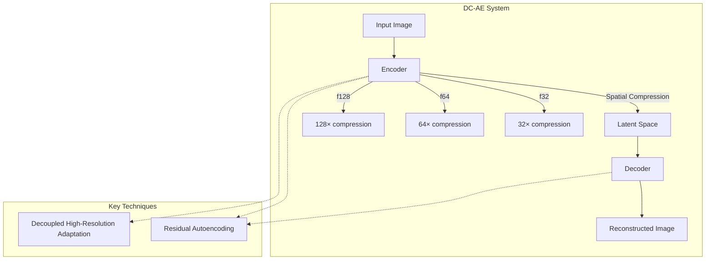

For more detailed information about the Deep Compression Autoencoder, see [DC-AE](#1.2).

Sources: [README.md:26-56](), [applications/dc_ae/README.md:1-31]()

### Diffusion Models

The repository includes implementations of diffusion models that operate in the latent space provided by DC-AE, enabling efficient image generation. These include:

1. **UViT (U-shaped Vision Transformer)**: A U-Net-style vision transformer for diffusion
2. **DiT (Diffusion Transformer)**: A transformer-based diffusion model
3. **SANA**: A text-to-image diffusion model that uses DC-AE and EfficientViT blocks

For more detailed information about the diffusion models, see [Diffusion Models](#1.3).

Sources: [README.md:39-48](), [applications/dc_ae/README.md:120-134]()

### Model Zoo

The EfficientViT framework includes a comprehensive model zoo with pre-trained models for various tasks, sizes, and computational constraints:

| Model Family | Variants | Application |
|--------------|----------|-------------|
| EfficientViT-Classification | B0, B1, B2, B3, L1, L2, L3 | Image classification |
| EfficientViT-Segmentation | B0-B3, L1-L2 (Cityscapes/ADE20K) | Semantic segmentation |
| EfficientViT-SAM | L0, L1, L2, XL0, XL1 | Prompted segmentation |
| DC-AE | f32c32, f64c128, f128c512 | Latent diffusion |

Sources: [README.md:60-102](), [applications/dc_ae/README.md:70-80]()

## Code Organization and Model Creation

The codebase is organized in a modular fashion, with a factory-based approach for creating models from configurations. The following diagram illustrates the model creation workflow:

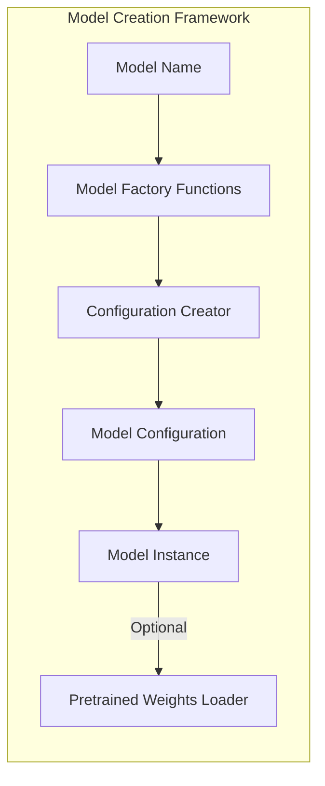

This architecture allows for flexible creation of models with different sizes and capabilities, facilitating usage across different computational constraints.

Sources: [README.md:108-114]()

## Performance and Efficiency Characteristics

A key focus of the EfficientViT ecosystem is the balance between performance and computational efficiency. The various models offer different trade-offs:

1. **EfficientViT-Classification**: Provides efficient image classification with state-of-the-art accuracy-efficiency trade-offs.
2. **EfficientViT-Segmentation**: Enables real-time semantic segmentation with high accuracy.
3. **EfficientViT-SAM**: Delivers up to 48.9× speedup over SAM-ViT-H without sacrificing accuracy.
4. **DC-AE**: Accelerates latent diffusion models significantly (up to 19.1× inference speedup and 17.9× training speedup on H100 GPU for UViT-H).

Sources: [README.md:58-70](), [README.md:26-29]()

## Diffusion Model Pipeline

The diffusion models in the repository follow a standard latent diffusion approach, leveraging the DC-AE for efficient processing:


This pipeline enables efficient high-resolution image generation by operating in a compressed latent space.

Sources: [applications/dc_ae/README.md:136-169](), [applications/dc_ae/README.md:255-331]()

## EfficientViT Block Architecture

At the heart of the EfficientViT models is the EfficientViT block architecture, which efficiently processes visual information through parallel local and context paths:

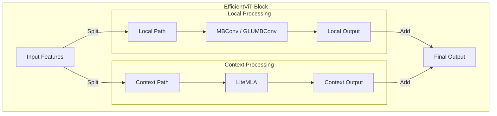

The block combines local processing for spatial features with lightweight multi-scale attention (LiteMLA) for capturing long-range dependencies, creating an efficient foundation for vision tasks.

For more detailed information about the EfficientViT blocks, see [EfficientViT Backbone](#2.1).

Sources: [README.md:74-87]()

## Applications and Use Cases

The EfficientViT ecosystem supports a wide range of vision applications:

1. **Image Classification**: Using EfficientViT-Classification models
2. **Semantic Segmentation**: Using EfficientViT-Segmentation models
3. **Prompted Segmentation**: Using EfficientViT-SAM models
4. **Gaze-Prompted Segmentation**: Using EfficientViT-GazeSAM
5. **High-Resolution Image Generation**: Using DC-AE with diffusion models
6. **Text-to-Image Generation**: Using DC-AE with SANA

For detailed guides on each application, see [Applications](#6).

Sources: [README.md:102-106](), [README.md:30-48]()

## Getting Started

To get started with the EfficientViT ecosystem, you can set up the environment using:

```
conda create -n efficientvit python=3.10
conda activate efficientvit
pip install -U -r requirements.txt
```

For specific usage instructions for each component, refer to the corresponding sections in this wiki.

Sources: [README.md:108-114]()

## Next Steps

For more detailed information about specific components of the EfficientViT ecosystem, refer to:

- [EfficientViT Architecture](#1.1) - Detailed overview of the core architecture
- [DC-AE (Deep Compression Autoencoder)](#1.2) - In-depth explanation of the compression autoencoder
- [Diffusion Models](#1.3) - Details about the UViT and DiT models
- [Core Components](#2) - Comprehensive documentation of the framework's building blocks
- [Applications](#6) - Guides for specific use cases and applications

---

# Page: EfficientViT Architecture

# EfficientViT Architecture

<details>
<summary>Relevant source files</summary>

The following files were used as context for generating this wiki page:

- [.gitignore](.gitignore)
- [README.md](README.md)
- [applications/dc_ae/README.md](applications/dc_ae/README.md)
- [efficientvit/apps/data_provider/base.py](efficientvit/apps/data_provider/base.py)
- [efficientvit/models/efficientvit/backbone.py](efficientvit/models/efficientvit/backbone.py)
- [efficientvit/models/efficientvit/cls.py](efficientvit/models/efficientvit/cls.py)
- [efficientvit/models/nn/act.py](efficientvit/models/nn/act.py)
- [efficientvit/models/nn/norm.py](efficientvit/models/nn/norm.py)
- [efficientvit/models/nn/ops.py](efficientvit/models/nn/ops.py)

</details>


This document provides a technical overview of the EfficientViT architecture, which serves as the foundation for various vision models in the efficientvit repository. This page focuses on the core architectural components and design principles of EfficientViT. For information about specific applications of EfficientViT, see [EfficientViT-Classification](#6.1), [EfficientViT-Segmentation](#6.2), [EfficientViT-SAM](#6.3), or [Deep Compression Autoencoder](#1.2).

## 1. Architecture Overview

EfficientViT is a family of vision models designed for efficient high-resolution dense prediction tasks. It combines the efficiency of convolutional neural networks with the expressiveness of vision transformers through a lightweight multi-scale attention mechanism.

The key architectural innovation is the combination of local processing (using variants of MBConv) with global context modeling (using lightweight multi-scale attention) in a modular design that can be scaled to different model sizes.

### EfficientViT High-Level Architecture

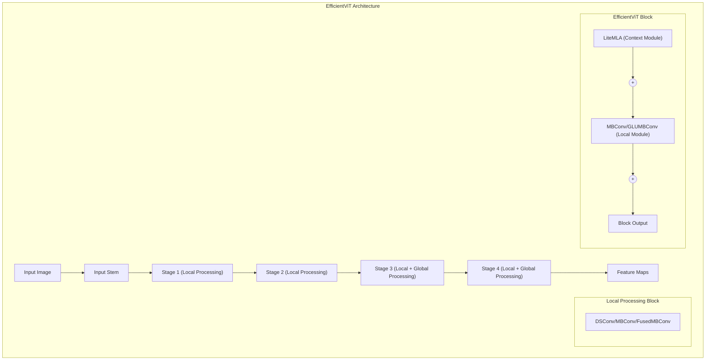

Sources: [efficientvit/models/efficientvit/backbone.py:33-375](), [efficientvit/models/nn/ops.py:671-729]()

## 2. Core Components

### 2.1 Backbone Architecture

EfficientViT provides two main backbone architectures:

1. **EfficientViTBackbone**: The standard backbone used in the B-series models (B0-B3)
2. **EfficientViTLargeBackbone**: An enhanced backbone with more configuration options used in L-series models (L0-L3)

Both backbones organize the network into a series of stages with progressively increasing feature dimensions and reduced spatial resolutions.

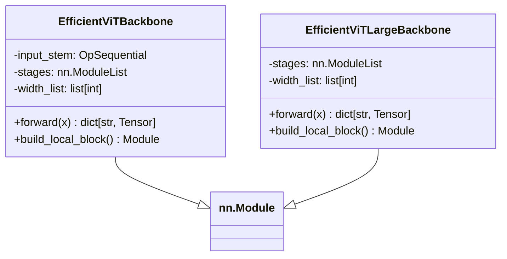

Sources: [efficientvit/models/efficientvit/backbone.py:33-156](), [efficientvit/models/efficientvit/backbone.py:199-338]()

#### Backbone Stage Structure

The backbone consists of several stages:
1. **Input Stem**: Initial processing using convolution followed by local blocks
2. **Early Stages**: Primarily using local processing (DSConv/MBConv)
3. **Later Stages**: Combining local processing with global context modeling through EfficientViT blocks

This progressive structure allows the network to efficiently capture both local details and global context.

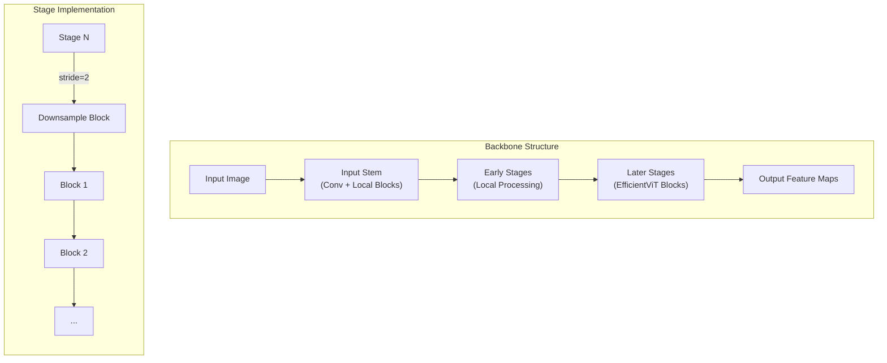

Sources: [efficientvit/models/efficientvit/backbone.py:72-117](), [efficientvit/models/efficientvit/backbone.py:245-287]()

### 2.2 EfficientViT Block

The EfficientViT Block is a key component that combines local processing with global context modeling. It consists of two main modules:

1. **Context Module**: Implements the LiteMLA (Lightweight Multi-scale Linear Attention)
2. **Local Module**: Uses MBConv or GLUMBConv for local feature processing

Each module is wrapped in a residual connection to facilitate gradient flow during training.

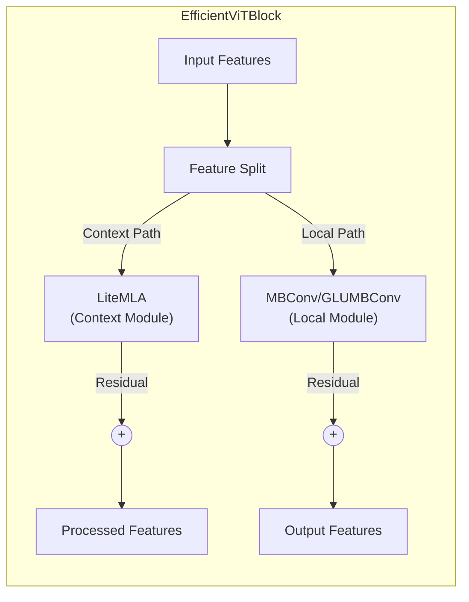

Sources: [efficientvit/models/nn/ops.py:671-729]()

### 2.3 Lightweight Multi-scale Linear Attention (LiteMLA)

The LiteMLA module is a crucial component that enables efficient attention computation. It uses a combination of multi-scale processing and linear attention to capture global context with reduced computational complexity.

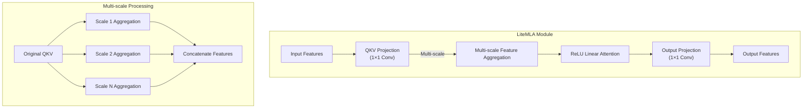

Sources: [efficientvit/models/nn/ops.py:518-568]()

Key aspects of LiteMLA:
- Projects input to query, key, and value tensors
- Applies multi-scale aggregation to capture features at different scales
- Uses efficient attention computation with ReLU kernel function
- Adaptively switches between linear attention and quadratic attention based on feature map size

```python
def relu_linear_att(self, qkv: torch.Tensor) -> torch.Tensor:
    # Linear attention implementation (see source code for details)
    # Used for larger feature maps (H*W > dim)

def relu_quadratic_att(self, qkv: torch.Tensor) -> torch.Tensor:
    # Quadratic attention implementation (see source code for details)
    # Used for smaller feature maps (H*W <= dim)
```

Sources: [efficientvit/models/nn/ops.py:581-667]()

### 2.4 Local Processing Modules

EfficientViT uses several variants of local processing modules:

#### MBConv (Mobile Inverted Bottleneck Conv)

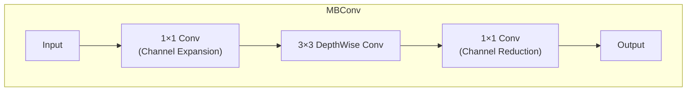

Sources: [efficientvit/models/nn/ops.py:312-364]()

#### GLUMBConv (Gated Linear Unit MBConv)

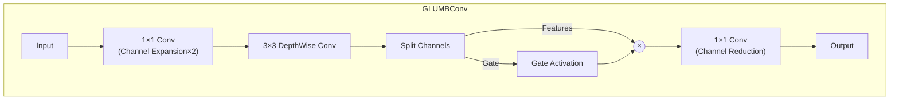

Sources: [efficientvit/models/nn/ops.py:413-470]()

#### DSConv (Depthwise Separable Conv)

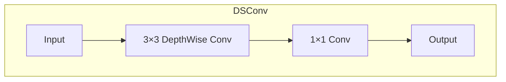

Sources: [efficientvit/models/nn/ops.py:270-309]()

#### FusedMBConv

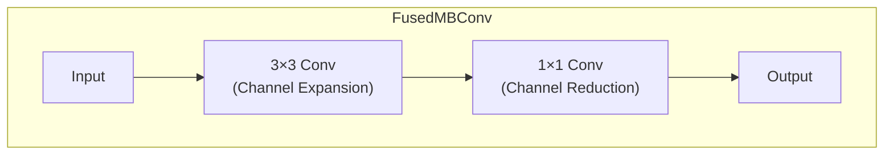

Sources: [efficientvit/models/nn/ops.py:367-410]()

## 3. Model Variants

EfficientViT comes in two main series, each with different model sizes:

1. **B-Series Models** (B0, B1, B2, B3): Basic variants using the EfficientViTBackbone
2. **L-Series Models** (L0, L1, L2, L3): Large variants using the EfficientViTLargeBackbone

### 3.1 B-Series Models

The B-series models scale in width (channel dimension) and depth (number of blocks) from B0 (smallest) to B3 (largest).

| Model | Width List | Depth List | Dimension | Primary Use Cases |
|-------|------------|------------|-----------|-------------------|
| B0    | [8, 16, 32, 64, 128] | [1, 2, 2, 2, 2] | 16 | Resource-constrained environments |
| B1    | [16, 32, 64, 128, 256] | [1, 2, 3, 3, 4] | 16 | Mobile devices |
| B2    | [24, 48, 96, 192, 384] | [1, 3, 4, 4, 6] | 32 | Edge devices |
| B3    | [32, 64, 128, 256, 512] | [1, 4, 6, 6, 9] | 32 | Standard deployment |

Sources: [efficientvit/models/efficientvit/backbone.py:159-196]()

### 3.2 L-Series Models

The L-series models use more sophisticated block combinations and generally have higher capacity than B-series.

| Model | Width List | Depth List | Primary Use Cases |
|-------|------------|------------|-------------------|
| L0    | [32, 64, 128, 256, 512] | [1, 1, 1, 4, 4] | High-performance with moderate size |
| L1    | [32, 64, 128, 256, 512] | [1, 1, 1, 6, 6] | High-performance tasks |
| L2    | [32, 64, 128, 256, 512] | [1, 2, 2, 8, 8] | Accuracy-critical applications |
| L3    | [64, 128, 256, 512, 1024] | [1, 2, 2, 8, 8] | Maximum accuracy scenarios |

The L-series models also use different block types at different stages, including residual blocks, fused mobile inverted bottleneck convolutions, and attention blocks.

Sources: [efficientvit/models/efficientvit/backbone.py:341-374]()

## 4. Architecture Flow and Feature Maps

### 4.1 Forward Pass Flow

During a forward pass, the input image flows through the backbone, producing feature maps at each stage. These feature maps are collected in a dictionary for use in task-specific heads.

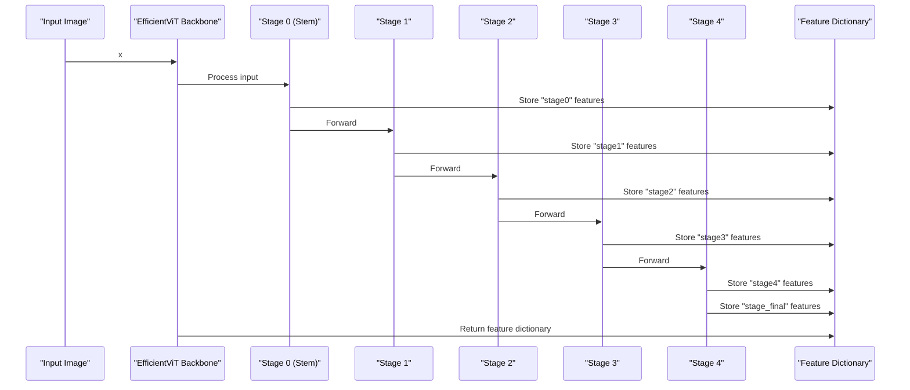

Sources: [efficientvit/models/efficientvit/backbone.py:150-156](), [efficientvit/models/efficientvit/backbone.py:333-338]()

### 4.2 Feature Resolution Characteristics

The EfficientViT architecture progressively reduces spatial resolution while increasing channel dimension:

- **Input**: Original image resolution (H×W×3)
- **Stage 0**: H/2×W/2×C₀ (after initial downsampling)
- **Stage 1**: H/4×W/4×C₁ (after downsampling)
- **Stage 2**: H/8×W/8×C₂ (after downsampling)
- **Stage 3**: H/16×W/16×C₃ (after downsampling)
- **Stage 4**: H/32×W/32×C₄ (after downsampling)

Where C₀, C₁, C₂, C₃, and C₄ correspond to the channel dimensions specified in the width_list parameter for each model variant.

Sources: [efficientvit/models/efficientvit/backbone.py:72-117]()

## 5. Integration with Task-Specific Models

The EfficientViT backbone is designed to be modular and can be integrated with various task-specific heads:

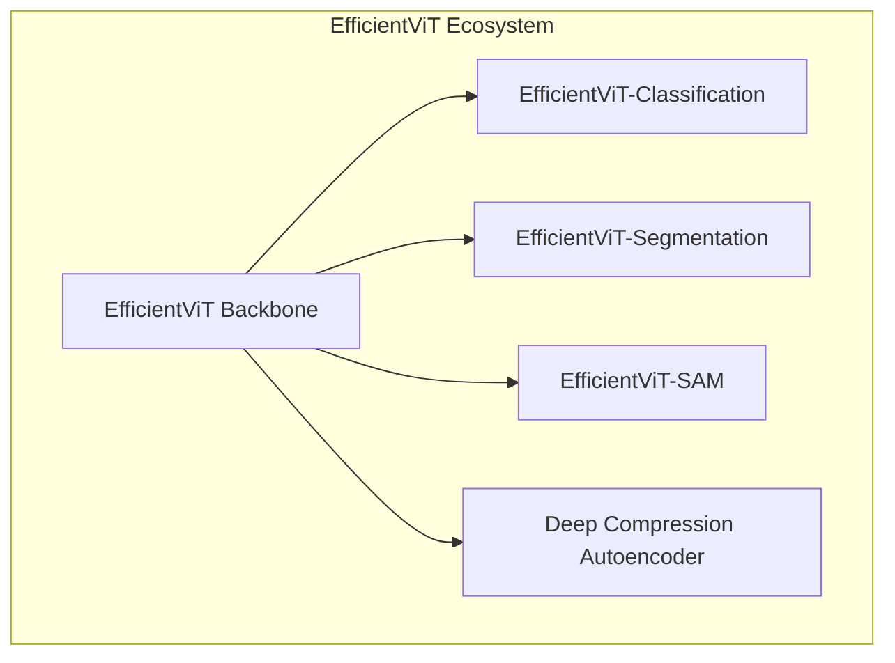

Sources: [efficientvit/models/efficientvit/cls.py:48-57](), [README.md:24-156]()

### 5.1 Classification Model Structure

For image classification, the EfficientViT backbone is combined with a classification head:

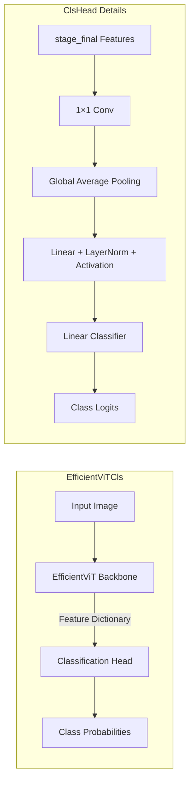

Sources: [efficientvit/models/efficientvit/cls.py:22-45](), [efficientvit/models/efficientvit/cls.py:48-57]()

## 6. Conclusion

The EfficientViT architecture provides a flexible foundation for efficient vision models. Its key strengths include:

1. **Efficiency**: The architecture is designed for computational efficiency while maintaining high accuracy
2. **Scalability**: Multiple model variants allow deployment across different computational budgets
3. **Versatility**: The backbone can be used for various vision tasks including classification, segmentation, and prompted segmentation
4. **Lightweight Attention**: The LiteMLA module captures global context with reduced computational requirements

For more information about specific applications of EfficientViT, refer to the related pages on [EfficientViT-Classification](#6.1), [EfficientViT-Segmentation](#6.2), [EfficientViT-SAM](#6.3), and [Deep Compression Autoencoder](#1.2).

Sources: [README.md:1-157]()

---

# Page: DC-AE (Deep Compression Autoencoder)

# DC-AE (Deep Compression Autoencoder)

<details>
<summary>Relevant source files</summary>

The following files were used as context for generating this wiki page:

- [README.md](README.md)
- [applications/dc_ae/README.md](applications/dc_ae/README.md)
- [applications/dc_ae/dc_ae_generate_latent.py](applications/dc_ae/dc_ae_generate_latent.py)
- [assets/cityscapes_l1.gif](assets/cityscapes_l1.gif)
- [assets/dc_ae_diffusion_demo.gif](assets/dc_ae_diffusion_demo.gif)
- [efficientvit/ae_model_zoo.py](efficientvit/ae_model_zoo.py)
- [efficientvit/models/efficientvit/dc_ae.py](efficientvit/models/efficientvit/dc_ae.py)
- [pyproject.toml](pyproject.toml)

</details>


This page provides a technical overview of the Deep Compression Autoencoder (DC-AE) system, a high-spatial compression autoencoder designed to efficiently compress images for latent diffusion models. For information about diffusion models that use DC-AE, see [Diffusion Models](#1.3).

## Purpose and Overview

DC-AE addresses the challenge of compressing high-resolution images into compact latent representations while maintaining reconstruction quality. It enables:

- Spatial compression ratios of 32×, 64×, and 128×
- Significant acceleration of both training and inference of diffusion models
- High-quality image generation at reduced computational cost

DC-AE incorporates two key innovations:

1. **Residual Autoencoding**: Learning residuals based on space-to-channel transformed features to alleviate optimization difficulties at high compression ratios
2. **Decoupled High-Resolution Adaptation**: A three-phase training strategy that mitigates generalization penalties

Sources: [README.md:24-56](), [applications/dc_ae/README.md:29-31]()

## System Architecture

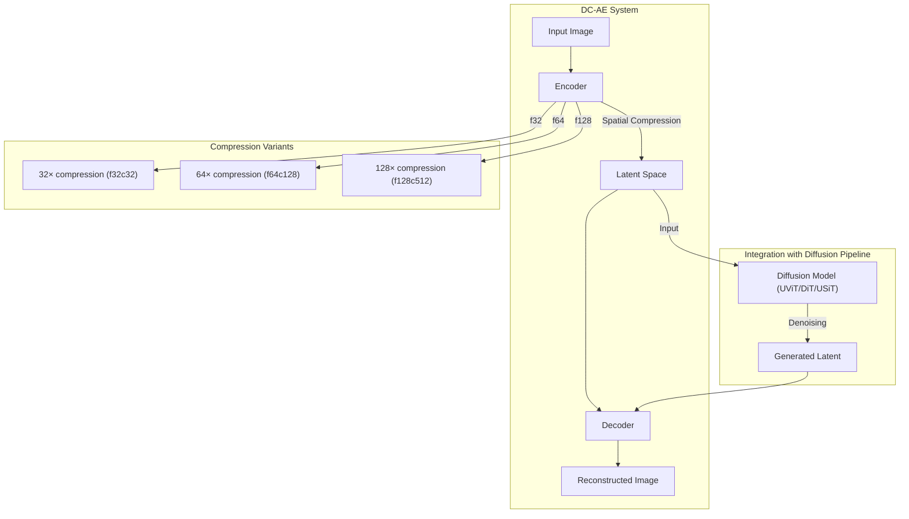

DC-AE functions as both a standalone autoencoder for image compression and a component in latent diffusion models. In the latter case, the diffusion model operates in the compressed latent space, significantly reducing computational requirements.

Sources: [efficientvit/models/efficientvit/dc_ae.py:401-434](), [applications/dc_ae/README.md:69-112]()

## Implementation Details

### Core Classes

The DC-AE implementation is based on three primary classes:

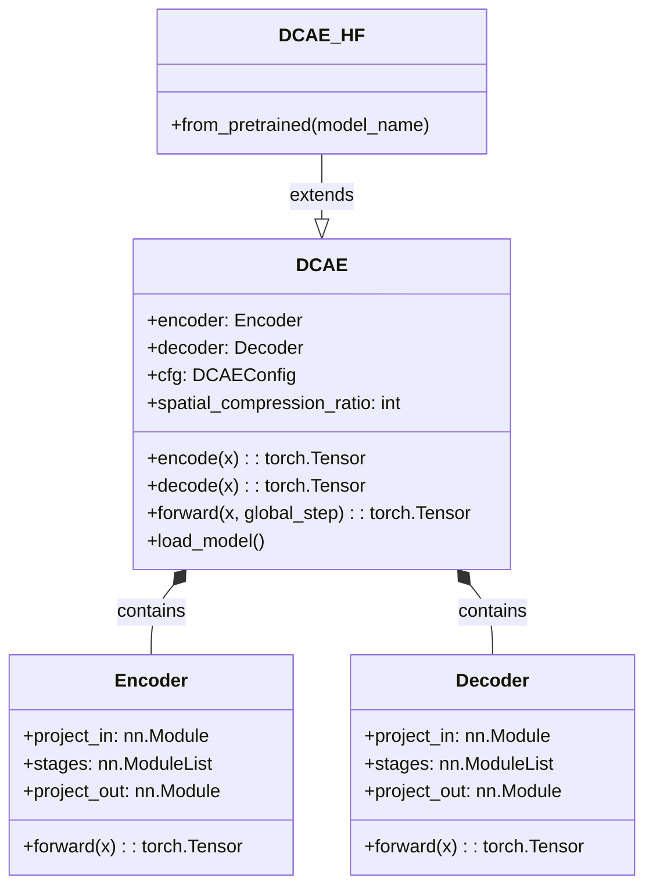

The `DCAE` class is the main implementation, containing an encoder and decoder. `DCAE_HF` extends it with HuggingFace integration for loading pretrained models.

Sources: [efficientvit/models/efficientvit/dc_ae.py:278-399](), [efficientvit/models/efficientvit/dc_ae.py:402-434](), [efficientvit/ae_model_zoo.py:34-37]()

### Configuration System

DC-AE uses a nested configuration system with three main dataclasses:

```mermaid
graph TD
    subgraph "Configuration Hierarchy"
        DCAEConfig["DCAEConfig
        - in_channels
        - latent_channels
        - use_quant_conv
        - pretrained_path
        - scaling_factor"]
        
        EncoderConfig["EncoderConfig
        - width_list
        - depth_list
        - block_type
        - norm/act
        - downsample settings"]
        
        DecoderConfig["DecoderConfig
        - width_list
        - depth_list
        - block_type
        - norm/act
        - upsample settings"]
        
        DCAEConfig --> EncoderConfig: contains
        DCAEConfig --> DecoderConfig: contains
    end
```

These configurations control all aspects of the model including network width, depth, block types, and compression ratio.

Sources: [efficientvit/models/efficientvit/dc_ae.py:27-77]()

### Encoder Architecture

```mermaid
graph TD
    Input["Input Image"] --> ProjectIn["project_in
    (ConvLayer/DownsampleBlock)"]
    
    ProjectIn --> Stage1["stages[0]
    (ResBlocks/EfficientViTBlocks)"]
    
    Stage1 --> |"Downsample"| Stage2["stages[1]"]
    Stage2 --> |"Downsample"| Stage3["..."]
    Stage3 --> |"Downsample"| StageN["stages[n-1]"]
    
    StageN --> ProjectOut["project_out
    (Norm + Act + Conv)"]
    
    ProjectOut --> Latent["Latent Representation"]
```

The encoder processes the input through multiple stages with progressive downsampling, reducing spatial dimensions while increasing channel count.

Sources: [efficientvit/models/efficientvit/dc_ae.py:278-331]()

### Decoder Architecture

```mermaid
graph TD
    Latent["Latent Representation"] --> ProjectIn["project_in
    (Conv + Optional Shortcut)"]
    
    ProjectIn --> StageN["stages[0]
    (Originally stages[n-1])"]
    
    StageN --> |"Upsample"| StageNMinus1["stages[1]"]
    StageNMinus1 --> |"Upsample"| StageNMinus2["..."]
    StageNMinus2 --> |"Upsample"| Stage1["stages[n-1]"]
    
    Stage1 --> ProjectOut["project_out
    (Norm + Act + Conv/Upsample)"]
    
    ProjectOut --> Output["Reconstructed Image"]
```

The decoder mirrors the encoder structure in reverse, with upsampling operations restoring spatial dimensions and reducing channel count.

Sources: [efficientvit/models/efficientvit/dc_ae.py:333-399]()

## Model Variants

DC-AE comes in three main variants, differing in compression ratio and latent channel count:

| Model | Latent Shape | Compression Ratio | Configuration Function |
|-------|--------------|-------------------|------------------------|
| dc-ae-f32c32 | 32×(H/32)×(W/32) | 32× | `dc_ae_f32c32()` |
| dc-ae-f64c128 | 128×(H/64)×(W/64) | 64× | `dc_ae_f64c128()` |
| dc-ae-f128c512 | 512×(H/128)×(W/128) | 128× | `dc_ae_f128c512()` |

These variants represent different trade-offs between compression ratio, reconstruction quality, and computational efficiency when used with diffusion models.

Sources: [efficientvit/models/efficientvit/dc_ae.py:24](), [applications/dc_ae/README.md:71-80]()

## Key Building Blocks

DC-AE uses several neural network building blocks:

1. **ResBlock**: Residual blocks with convolutions, normalization, and activation
2. **EfficientViTBlock**: Blocks from the EfficientViT architecture that incorporate efficient attention
3. **ConvPixelUnshuffleDownSampleLayer**: Downsampling using pixel unshuffle followed by convolution
4. **ConvPixelShuffleUpSampleLayer**: Upsampling using convolution followed by pixel shuffle

These building blocks are combined to create the encoder and decoder networks, with specific configurations determining the network's behavior.

Sources: [efficientvit/models/efficientvit/dc_ae.py:80-104](), [efficientvit/models/efficientvit/dc_ae.py:8-22]()

## Usage Examples

### Basic Encoding and Decoding

```python
from efficientvit.ae_model_zoo import DCAE_HF
import torch
import torchvision.transforms as transforms
from PIL import Image

# Load pretrained model
device = torch.device("cuda")
dc_ae = DCAE_HF.from_pretrained("mit-han-lab/dc-ae-f64c128-in-1.0").to(device).eval()

# Prepare input image
transform = transforms.Compose([
    transforms.ToTensor(),
    transforms.Normalize(0.5, 0.5),
])
image = Image.open("image.png")
x = transform(image)[None].to(device)

# Encode to latent space
latent = dc_ae.encode(x)
print(f"Latent shape: {latent.shape}")  # Shows compression effect

# Decode back to image
y = dc_ae.decode(latent)
```

Sources: [applications/dc_ae/README.md:82-112]()

### Integration with Diffusion Models

```python
from efficientvit.diffusion_model_zoo import DCAE_Diffusion_HF
import torch

# Load pretrained DC-AE-Diffusion model
device = torch.device("cuda")
dc_ae_diffusion = DCAE_Diffusion_HF.from_pretrained(
    "mit-han-lab/dc-ae-f64c128-in-1.0-uvit-h-in-512px"
).to(device).eval()

# Set up for inference
torch.manual_seed(0)
eval_generator = torch.Generator(device=device).manual_seed(0)

# Class prompts for ImageNet classes (example)
prompts = torch.tensor([279, 333, 979], dtype=torch.int, device=device)
prompts_null = 1000 * torch.ones_like(prompts)

# Generate latent samples
latent_samples = dc_ae_diffusion.diffusion_model.generate(
    prompts, prompts_null, 6.0, eval_generator
)
latent_samples = latent_samples / dc_ae_diffusion.scaling_factor

# Decode to images
image_samples = dc_ae_diffusion.autoencoder.decode(latent_samples)
```

Sources: [applications/dc_ae/README.md:119-169]()

### Generating Latent Datasets

For training diffusion models, DC-AE can precompute latent representations for large datasets:

```python
# Example command using dc_ae_generate_latent.py
# torchrun --nnodes=1 --nproc_per_node=8 -m applications.dc_ae.dc_ae_generate_latent \
#     image_root_path=~/dataset/imagenet/train batch_size=64 \
#     model_name=dc-ae-f64c128-in-1.0 scaling_factor=0.2889 \
#     latent_root_path=assets/data/latent/dc_ae_f64c128_in_1.0/imagenet_512
```

This generates latent codes for each image and stores them for efficient training of diffusion models in the latent space.

Sources: [applications/dc_ae/dc_ae_generate_latent.py:57-142](), [applications/dc_ae/README.md:258-269]()

## Performance and Impact

### Reconstruction Quality

Despite high compression ratios, DC-AE maintains strong reconstruction quality:

| Model | FID | PSNR | SSIM | LPIPS |
|-------|-----|------|------|-------|
| dc-ae-f64c128-in-1.0 | 0.217 | 26.15 | 0.710 | 0.080 |

Sources: [applications/dc_ae/README.md:187-194]()

### Acceleration of Diffusion Models

When used with diffusion models, DC-AE significantly reduces computational requirements:

| Autoencoder | Diffusion Model | MACs (G) | FID (w/o cfg) | FID (with cfg) |
|-------------|-----------------|----------|---------------|----------------|
| DC-AE-f32 | UViT-H | 133.25 | 9.83 | 2.53 |
| DC-AE-f64 | UViT-H | 33.25 | 13.96 | 3.01 |
| DC-AE-f64 (train 2000k steps) | UViT-H | 33.25 | 12.26 | 2.66 |
| DC-AE-f32 | UViT-2B | 414.91 | 8.13 | 2.30 |
| DC-AE-f64 | UViT-2B | 104.65 | 7.78 | 2.47 |

At a 64× compression ratio, DC-AE provides up to 19× inference speedup and 18× training speedup compared to standard 8× compression autoencoders, while maintaining or improving generation quality.

Sources: [applications/dc_ae/README.md:122-134](), [README.md:24-56]()

## Summary

DC-AE represents a significant advancement in autoencoder technology for latent diffusion models. Through its innovations in residual autoencoding and decoupled training, it achieves much higher compression ratios than previous approaches while maintaining high reconstruction quality. This enables faster training and inference of diffusion models, particularly for high-resolution image generation.

DC-AE is also a core component of other systems in the EfficientViT ecosystem, including SANA for text-to-image generation.

Sources: [README.md:11-56](), [applications/dc_ae/README.md:29-31]()

---

# Page: Diffusion Models

# Diffusion Models

<details>
<summary>Relevant source files</summary>

The following files were used as context for generating this wiki page:

- [README.md](README.md)
- [applications/dc_ae/README.md](applications/dc_ae/README.md)
- [applications/dc_ae/demo_dc_ae_model.py](applications/dc_ae/demo_dc_ae_model.py)
- [applications/dc_ae/demo_dc_ae_model_diffusers.py](applications/dc_ae/demo_dc_ae_model_diffusers.py)
- [efficientvit/diffusion_model_zoo.py](efficientvit/diffusion_model_zoo.py)
- [efficientvit/diffusioncore/evaluator.py](efficientvit/diffusioncore/evaluator.py)
- [efficientvit/diffusioncore/models/dit.py](efficientvit/diffusioncore/models/dit.py)
- [efficientvit/diffusioncore/models/uvit.py](efficientvit/diffusioncore/models/uvit.py)
- [efficientvit/diffusioncore/trainer.py](efficientvit/diffusioncore/trainer.py)

</details>


This document provides a technical overview of the diffusion models implemented in the EfficientViT repository. These models serve as the generative component of the system, working in conjunction with the Deep Compression Autoencoder (DC-AE) for efficient high-resolution image generation. For details about the autoencoder architecture itself, see [DC-AE (Deep Compression Autoencoder)](#1.2).

## Overview of Diffusion Models in EfficientViT

Diffusion models in the EfficientViT ecosystem operate in the latent space provided by the Deep Compression Autoencoder (DC-AE). This architecture allows for significantly faster image generation compared to pixel-space diffusion models, while maintaining high image quality.

```mermaid
graph TD
    subgraph "High-Level Diffusion Pipeline"
        RandomNoise["Random Noise"] --> Diffusion["Diffusion Model\n(UViT/DiT)"]
        Diffusion --> LatentRepresentation["Denoised Latent Representation"]
        LatentRepresentation --> Decoder["DC-AE Decoder"]
        Decoder --> GeneratedImage["Generated Image"]
        
        ClassLabel["Class Label\n(Optional)"] --> |"Conditional Input"| Diffusion
    end
```

Sources: [efficientvit/diffusioncore/models/uvit.py:490-527](), [efficientvit/diffusioncore/models/dit.py:402-462]()

The repository implements two main types of diffusion models:

1. **UViT (U-shaped Vision Transformer)**: A U-Net-like architecture with Vision Transformer blocks, featuring skip connections between encoder and decoder
2. **DiT (Diffusion Transformer)**: A more straightforward transformer-based diffusion model with AdaLN (adaptive layer normalization)

Both models are designed to work efficiently with the latent representations produced by DC-AE autoencoders.

## Architecture Details

### UViT Architecture

UViT (U-shaped Vision Transformer) follows a U-Net-like structure but uses transformer blocks instead of convolutional layers. It features skip connections that connect encoder blocks to corresponding decoder blocks.

```mermaid
graph TD
    subgraph "UViT Architecture"
        Input["Latent Input"] --> Patching["Patch Embedding"]
        Patching --> TimePos["Time + Position Embeddings"]
        
        TimePos --> InBlocks["In Blocks\n(First Half Transformer Blocks)"]
        InBlocks --> MidBlock["Mid Block"]
        MidBlock --> OutBlocks["Out Blocks\n(Second Half Transformer Blocks)"]
        
        InBlocks -.-> |"Skip Connections"| OutBlocks
        
        OutBlocks --> Norm["Layer Normalization"]
        Norm --> PredOut["Decoder Prediction"]
        PredOut --> Unpatch["Unpatchify"]
        Unpatch --> Output["Latent Output"]
        
        TimeEmbed["Timestep Embedding"] --> |"Condition"| TimePos
        LabelEmbed["Label Embedding"] --> |"Condition"| TimePos
    end
```

Sources: [efficientvit/diffusioncore/models/uvit.py:265-380](), [efficientvit/diffusioncore/models/uvit.py:430-459]()

Key components of UViT:

- **Patch Embedding**: Splits the input latent into patches
- **Timestep Embedding**: Encodes the diffusion timestep
- **Label Embedding**: Encodes the class label for conditional generation
- **In Blocks**: Transformer blocks for the encoder path
- **Mid Block**: Central transformer block
- **Out Blocks**: Transformer blocks for the decoder path with skip connections
- **Final Layer**: Unpatchifies the output back to the latent space format

### DiT Architecture

DiT (Diffusion Transformer) is an adaptation of the Vision Transformer for diffusion models, using adaptive layer normalization (AdaLN) for conditioning.

```mermaid
graph TD
    subgraph "DiT Architecture"
        Input["Latent Input"] --> Patching["Patch Embedding"]
        Patching --> PosEmbed["Position Embedding"]
        
        PosEmbed --> Blocks["DiT Blocks with AdaLN"]
        Blocks --> FinalLayer["Final Layer"]
        FinalLayer --> Unpatch["Unpatchify"]
        Unpatch --> Output["Latent Output"]
        
        TimeEmbed["Timestep Embedding"] --> |"AdaLN Modulation"| Blocks
        LabelEmbed["Label Embedding"] --> |"AdaLN Modulation"| Blocks
        
        TimeEmbed --> |"AdaLN Modulation"| FinalLayer
        LabelEmbed --> |"AdaLN Modulation"| FinalLayer
    end
```

Sources: [efficientvit/diffusioncore/models/dit.py:229-383](), [efficientvit/diffusioncore/models/dit.py:358-383]()

Key components of DiT:

- **Patch Embedding**: Splits the input latent into patches
- **Timestep Embedder**: Encodes the diffusion timestep
- **Label Embedder**: Encodes the class label for conditional generation
- **DiT Blocks**: Transformer blocks with AdaLN conditioning
- **Final Layer**: Produces the output latent representation

## Sampling and Training Schedulers

The models support different sampling and training schedulers to balance speed and quality:

### Training Schedulers
- **DPM Solver**: Default scheduler for UViT training
- **GaussianDiffusion**: Default scheduler for DiT training
- **SiTSampler**: Stochastic Interpolant Transport sampler for SiT models

### Evaluation/Inference Schedulers
- **DPM Solver**: Efficient ODE solver for UViT models
- **GaussianDiffusion**: Standard diffusion scheduler for DiT models
- **ODE_dopri5/ODE_heun2**: Advanced ODE solvers for SiT models 
- **UniPC**: UniPC multistep scheduler for DiT models

The choice of scheduler significantly impacts both training time and inference speed.

```mermaid
graph TD
    subgraph "Diffusion Sampling Process"
        Noise["Random Noise"] --> |"Sampling Steps"| Step1["Initial Denoising Step"]
        Step1 --> Step2["Intermediate Denoising Steps"]
        Step2 --> StepN["Final Denoising Step"]
        StepN --> Latent["Clean Latent Representation"]
        
        Scheduler["Scheduler\n(DPM_Solver/GaussianDiffusion/ODE)"] --> |"Controls Denoising Process"| Step1
        Scheduler --> |"Controls Denoising Process"| Step2
        Scheduler --> |"Controls Denoising Process"| StepN
        
        CFG["Classifier-Free Guidance\n(cfg_scale parameter)"] --> |"Enhances Sample Quality"| Step1
        CFG --> |"Enhances Sample Quality"| Step2
        CFG --> |"Enhances Sample Quality"| StepN
    end
```

Sources: [efficientvit/diffusioncore/models/uvit.py:490-527](), [efficientvit/diffusioncore/models/dit.py:402-462]()

## Model Variants and Performance

The repository provides multiple pre-trained diffusion models with varying parameter counts and performance characteristics:

| Model | DC-AE Variant | Parameters (M) | MACs (G) | ImageNet 512×512 FID (w/o CFG) | ImageNet 512×512 FID (w/ CFG) |
|-------|---------------|---------------|----------|--------------------------------|-------------------------------|
| UViT-S | f32c32 | 44.79 | 12.27 | 46.12 | 18.08 |
| DiT-XL | f32c32 | 674.89 | 118.68 | 9.56 | 2.84 |
| DiT-XL (bs=1024) | f32c32 | 674.89 | 118.68 | 6.88 | 2.41 |
| UViT-H | f32c32 | 500.87 | 133.25 | 9.83 | 2.53 |
| UViT-H | f64c128 | 500.87 | 33.25 | 13.96 | 3.01 |
| UViT-H (2000k steps) | f64c128 | 500.87 | 33.25 | 12.26 | 2.66 |
| UViT-2B | f32c32 | 1580.40 | 414.91 | 8.13 | 2.30 |
| UViT-2B | f64c128 | 1580.40 | 104.65 | 7.78 | 2.47 |
| UViT-2B (2000k steps) | f64c128 | 1580.40 | 104.65 | 6.50 | 2.25 |
| USiT-H | f32c32 | 500.87 | 33.25 | 3.80 | 1.89 |
| USiT-2B | f32c32 | 1580.40 | 414.91 | 2.90 | 1.72 |

Sources: [applications/dc_ae/README.md:122-134]()

Notes:
- "f32c32" refers to DC-AE with 32× spatial compression and 32 channels
- "f64c128" refers to DC-AE with 64× spatial compression and 128 channels
- FID (Fréchet Inception Distance) measures image quality (lower is better)
- CFG (Classifier-Free Guidance) uses a guidance scale to improve sample quality

## Integration with Deep Compression Autoencoder

The diffusion models are designed to work seamlessly with DC-AE to enable efficient high-resolution image generation:

```mermaid
graph TD
    subgraph "DC-AE + Diffusion Pipeline"
        Input["High-Res Image"] --> Encoder["DC-AE Encoder"]
        Encoder --> LatentSpace["Latent Space\n(32×/64×/128× compression)"]
        
        LatentSpace --> |"Training"| DiffusionTraining["Diffusion Model Training"]
        DiffusionTraining --> TrainedDiffusion["Trained Diffusion Model"]
        
        RandomNoise["Random Noise"] --> TrainedDiffusion
        TrainedDiffusion --> GeneratedLatent["Generated Latent"]
        GeneratedLatent --> Decoder["DC-AE Decoder"]
        Decoder --> GeneratedImage["Generated High-Res Image"]
    end
```

Sources: [applications/dc_ae/README.md:136-169](), [efficientvit/diffusion_model_zoo.py:1-123]()

## Model Zoo and Registration

The EfficientViT repository maintains a registry of pre-configured diffusion models that work with DC-AE. These models can be loaded using the `DCAE_Diffusion_HF` class:

```mermaid
graph TD
    subgraph "Diffusion Model Registry and Loading"
        ModelName["Model Name\n(e.g., 'dc-ae-f64c128-in-1.0-uvit-h-in-512px')"] --> ModelRegistry["REGISTERED_DCAE_DIFFUSION_MODEL"]
        ModelRegistry --> ModelFactory["create_dc_ae_diffusion_model_cfg()"]
        ModelFactory --> ModelConfig["EvaluatorConfig"]
        ModelConfig --> Evaluator["Evaluator"]
        Evaluator --> |"extracts components"| DCAE_Diffusion["DCAE_Diffusion_HF"]
        
        DCAE_Diffusion --> |"contains"| Autoencoder["autoencoder"]
        DCAE_Diffusion --> |"contains"| DiffusionModel["diffusion_model"]
        DCAE_Diffusion --> |"contains"| ScalingFactor["scaling_factor"]
    end
```

Sources: [efficientvit/diffusion_model_zoo.py:17-123]()

## Evaluation System

The repository includes a comprehensive evaluation system for diffusion models:

```mermaid
graph TD
    subgraph "Diffusion Model Evaluation"
        Evaluator["Evaluator"] --> DataProvider["Evaluation Data Provider"]
        Evaluator --> |"loads"| Autoencoder["Autoencoder (DC-AE)"]
        Evaluator --> |"loads"| DiffusionModel["Diffusion Model (UViT/DiT)"]
        
        Evaluator --> |"calls"| GenerateSamples["Generate Samples"]
        GenerateSamples --> ComputeMetrics["Compute Metrics"]
        
        ComputeMetrics --> FID["FID Score"]
        ComputeMetrics --> InceptionScore["Inception Score"]
        
        FID --> Results["Evaluation Results"]
        InceptionScore --> Results
    end
```

Sources: [efficientvit/diffusioncore/evaluator.py:68-232]()

## Usage Examples

### Loading and Using a Pre-trained Diffusion Model

```python
from efficientvit.diffusion_model_zoo import DCAE_Diffusion_HF

# Load a pre-trained DC-AE + Diffusion model
dc_ae_diffusion = DCAE_Diffusion_HF.from_pretrained("mit-han-lab/dc-ae-f64c128-in-1.0-uvit-h-in-512px-train2000k")

# Setup for generation
device = torch.device("cuda")
dc_ae_diffusion = dc_ae_diffusion.to(device).eval()

# Configure seed for reproducibility
seed = 0
torch.manual_seed(seed)
torch.cuda.manual_seed_all(seed)
eval_generator = torch.Generator(device=device)
eval_generator.manual_seed(seed)

# Generate samples with class conditioning
prompts = torch.tensor([279, 333, 979, 936], dtype=torch.int, device=device)
num_samples = prompts.shape[0]
# 1000 is the unconditional class ID for classifier-free guidance
prompts_null = 1000 * torch.ones((num_samples,), dtype=torch.int, device=device)

# Generate latent samples with classifier-free guidance (scale 6.0)
latent_samples = dc_ae_diffusion.diffusion_model.generate(prompts, prompts_null, 6.0, eval_generator)
latent_samples = latent_samples / dc_ae_diffusion.scaling_factor

# Decode latents to images
image_samples = dc_ae_diffusion.autoencoder.decode(latent_samples)
```

Sources: [applications/dc_ae/README.md:136-169]()

### Training a Diffusion Model

To train a diffusion model on the latent space of DC-AE, you first need to generate the latent representations of your training data:

```bash
# Generate latent representations using DC-AE-f64
torchrun --nnodes=1 --nproc_per_node=8 -m applications.dc_ae.dc_ae_generate_latent resolution=512 \
    image_root_path=~/dataset/imagenet/train batch_size=64 \
    model_name=dc-ae-f64c128-in-1.0 scaling_factor=0.2889 \
    latent_root_path=assets/data/latent/dc_ae_f64c128_in_1.0/imagenet_512
```

Then train a diffusion model on these latents:

```bash
# Train DC-AE-f64 + UViT-H on ImageNet 512x512
torchrun --nnodes=1 --nproc_per_node=8 -m applications.dc_ae.train_dc_ae_diffusion_model resolution=512 \
    train_dataset=latent_imagenet latent_imagenet.batch_size=128 latent_imagenet.data_dir=assets/data/latent/dc_ae_f64c128_in_1.0/imagenet_512 \
    evaluate_dataset=sample_class sample_class.num_samples=50000 \
    autoencoder=dc-ae-f64c128-in-1.0 scaling_factor=0.2889 \
    model=uvit uvit.depth=28 uvit.hidden_size=1152 uvit.num_heads=16 uvit.in_channels=128 uvit.patch_size=1 \
    uvit.train_scheduler=DPM_Solver uvit.eval_scheduler=DPM_Solver \
    optimizer.name=adamw optimizer.lr=2e-4 optimizer.weight_decay=0.03 optimizer.betas=[0.99,0.99] \
    lr_scheduler.name=constant_with_warmup lr_scheduler.warmup_steps=5000 amp=bf16 \
    max_steps=500000 ema_decay=0.9999 \
    fid.ref_path=assets/data/fid/imagenet_512_train.npz \
    run_dir=.exp/diffusion/imagenet_512/dc_ae_f64c128_in_1.0/uvit_h_1/bs_1024_lr_2e-4_bf16
```

Sources: [applications/dc_ae/README.md:255-303]()

### Evaluating Diffusion Models

```bash
# Evaluate a diffusion model without classifier-free guidance
torchrun --nnodes=1 --nproc_per_node=8 -m applications.dc_ae.eval_dc_ae_diffusion_model \
    dataset=imagenet_512 model=dc-ae-f64c128-in-1.0-uvit-h-in-512px cfg_scale=1.0 run_dir=tmp

# Evaluate with classifier-free guidance
torchrun --nnodes=1 --nproc_per_node=8 -m applications.dc_ae.eval_dc_ae_diffusion_model \
    dataset=imagenet_512 model=dc-ae-f64c128-in-1.0-uvit-h-in-512px cfg_scale=1.5 run_dir=tmp
```

Sources: [applications/dc_ae/README.md:220-251]()

## System Architecture Context

The diffusion models component plays a critical role in the broader EfficientViT ecosystem, particularly in generative applications:

```mermaid
graph TD
    subgraph "EfficientViT System Architecture"
        DCAE["Deep Compression Autoencoder\n(DC-AE)"] --> |"provides latent space"| DiffModels["Diffusion Models"]
        DiffModels --> |"UViT implementation"| UViT["U-shaped Vision Transformer"]
        DiffModels --> |"DiT implementation"| DiT["Diffusion Transformer"]
        DiffModels --> |"USiT implementation"| USiT["U-shaped SiT Transformer"]
        
        DCAE --> |"encoder"| LatentSpace["Latent Space"]
        LatentSpace --> |"input to"| DiffModels
        DiffModels --> |"output"| GeneratedLatent["Generated Latent"]
        GeneratedLatent --> |"decoded by"| DCDecoder["DC-AE Decoder"]
        DCDecoder --> |"produces"| GeneratedImage["Generated High-Resolution Image"]
        
        DiffModels --> |"evaluated by"| Evaluator["Diffusion Evaluator"]
        Evaluator --> |"computes"| Metrics["FID, Inception Score"]
        
        SANA["SANA Text-to-Image"] --> |"uses"| DCAE
        SANA --> |"uses"| DiffModels
    end
```

Sources: [README.md:1-157](), [applications/dc_ae/README.md:1-344]()

## Conclusion

The diffusion models in EfficientViT, particularly UViT and DiT, are designed to operate efficiently in the latent space provided by DC-AE. This architecture enables high-quality, high-resolution image generation while significantly reducing computational requirements compared to pixel-space diffusion models. The system supports classifier-free guidance for improved sample quality and provides comprehensive evaluation metrics.

The combination of Deep Compression Autoencoder with specialized diffusion models represents a significant advancement in efficient high-resolution image generation, enabling applications like SANA text-to-image generation to run efficiently even on laptop-grade hardware.

---

# Page: Core Components

# Core Components

<details>
<summary>Relevant source files</summary>

The following files were used as context for generating this wiki page:

- [.gitignore](.gitignore)
- [efficientvit/apps/data_provider/base.py](efficientvit/apps/data_provider/base.py)
- [efficientvit/models/efficientvit/backbone.py](efficientvit/models/efficientvit/backbone.py)
- [efficientvit/models/efficientvit/cls.py](efficientvit/models/efficientvit/cls.py)
- [efficientvit/models/nn/act.py](efficientvit/models/nn/act.py)
- [efficientvit/models/nn/norm.py](efficientvit/models/nn/norm.py)
- [efficientvit/models/nn/ops.py](efficientvit/models/nn/ops.py)

</details>


This document provides a detailed overview of the fundamental building blocks and neural network operations that make up the EfficientViT architecture. It covers the core components used across all EfficientViT variants, including the basic layers, attention mechanisms, and specialized blocks that enable efficient vision transformer functionality.

For information about specific model implementations built on these components, see [EfficientViT Backbone](#2.1) and [Neural Network Operations](#2.2).

## Basic Layers

The EfficientViT architecture relies on a set of fundamental layer implementations that serve as building blocks for more complex modules.

### ConvLayer

`ConvLayer` is a flexible convolutional layer that combines convolution, normalization, and activation in a single module. It provides a standardized interface for creating convolution layers with optional dropout, normalization, and activation functions.

```python
ConvLayer(
    in_channels: int,          # Number of input channels
    out_channels: int,         # Number of output channels
    kernel_size=3,             # Kernel size for the convolution
    stride=1,                  # Stride for the convolution
    dilation=1,                # Dilation rate for the convolution
    groups=1,                  # Number of groups for grouped convolution
    use_bias=False,            # Whether to use bias in the convolution
    dropout=0,                 # Dropout probability
    norm="bn2d",               # Normalization type
    act_func="relu",           # Activation function
)
```

Sources: [efficientvit/models/nn/ops.py:37-78]()

### LinearLayer

Similar to `ConvLayer`, `LinearLayer` provides a standardized interface for fully connected layers, combining linear transformation, normalization, and activation.

```python
LinearLayer(
    in_features: int,          # Number of input features
    out_features: int,         # Number of output features
    use_bias=True,             # Whether to use bias
    dropout=0,                 # Dropout probability
    norm=None,                 # Normalization type
    act_func=None,             # Activation function
)
```

Sources: [efficientvit/models/nn/ops.py:226-257]()

### Utility Layers

Additional utility layers provide specialized functionality:

- `UpSampleLayer`: Resizes feature maps to larger spatial dimensions
- `IdentityLayer`: Passes input through unchanged
- Various pixel shuffle up/downsampling layers for resolution changes

Sources: [efficientvit/models/nn/ops.py:81-262]()

## Building Blocks

Building on the basic layers, EfficientViT defines several higher-level building blocks that implement common neural network patterns.

```mermaid
graph TD
    subgraph "Basic Building Blocks"
        B1["DSConv"] --> |"Depthwise + Pointwise"| Simple["Simple Efficient Block"]
        B2["MBConv"] --> |"Inverted Bottleneck"| Medium["Medium Efficient Block"]
        B3["FusedMBConv"] --> |"Fused Inverted Bottleneck"| Medium
        B4["GLUMBConv"] --> |"Gated Linear Unit MBConv"| Medium
        B5["ResBlock"] --> |"Residual Connection"| Simple
    end
    
    subgraph "Attention Mechanism"
        A1["LiteMLA"] --> |"Multi-scale Linear Attention"| Complex["Complex Attention Block"]
    end
    
    subgraph "EfficientViT Block"
        Simple --> |"Local Processing"| E1["EfficientViTBlock"]
        Medium --> |"Local Processing"| E1
        Complex --> |"Context Processing"| E1
    end
```

### DSConv (Depthwise Separable Convolution)

`DSConv` implements depthwise separable convolution, which factorizes a standard convolution into a depthwise convolution (applying a single filter per input channel) followed by a pointwise convolution (1×1 convolution). This significantly reduces computation while maintaining representational power.

Sources: [efficientvit/models/nn/ops.py:270-309]()

### MBConv (Mobile Inverted Bottleneck Convolution)

`MBConv` implements the inverted bottleneck pattern from MobileNetV2. It expands the input channels, applies depthwise convolution, and then projects back to the output channels. This provides an efficient way to capture spatial information while maintaining a reasonable parameter count.

```python
MBConv(
    in_channels: int,          # Number of input channels
    out_channels: int,         # Number of output channels
    kernel_size=3,             # Kernel size for the convolution
    stride=1,                  # Stride for the convolution
    mid_channels=None,         # Number of channels in the expanded representation
    expand_ratio=6,            # Factor by which to expand input channels
    use_bias=False,            # Whether to use bias
    norm=("bn2d", "bn2d", "bn2d"),  # Normalization types
    act_func=("relu6", "relu6", None),  # Activation functions
)
```

Sources: [efficientvit/models/nn/ops.py:312-364]()

### FusedMBConv

`FusedMBConv` is a variant of `MBConv` that fuses the depthwise and expansion operations into a single convolution, reducing memory access costs in some hardware architectures.

Sources: [efficientvit/models/nn/ops.py:367-410]()

### GLUMBConv

`GLUMBConv` enhances the standard `MBConv` with a Gated Linear Unit, improving the expressiveness of the block by using a gating mechanism.

Sources: [efficientvit/models/nn/ops.py:413-470]()

## Attention Mechanism

### LiteMLA (Lightweight Multi-scale Linear Attention)

The `LiteMLA` module is a key innovation in EfficientViT, providing an efficient multi-scale attention mechanism. It processes inputs at multiple scales and uses a linear attention formulation to reduce computational complexity compared to standard self-attention.

```mermaid
flowchart TD
    Input["Input Feature Map"] --> QKV["QKV Projection"]
    QKV --> |"Original Scale"| S1["Scale 1 QKV"]
    QKV --> |"Apply Conv"| A1["Aggregation Block 1"]
    QKV --> |"Apply Conv"| A2["Aggregation Block 2"]
    
    A1 --> S2["Scale 2 QKV"]
    A2 --> S3["Scale 3 QKV"]
    
    S1 --> C["Concatenate Multi-scale QKV"]
    S2 --> C
    S3 --> C
    
    C --> |"Sequences < dim"| Q1["Quadratic Attention"]
    C --> |"Sequences > dim"| L1["Linear Attention"]
    
    Q1 --> Proj["Projection Layer"]
    L1 --> Proj
    
    Proj --> Output["Output Feature Map"]
```

Key features of `LiteMLA`:

1. Projects input features to query, key, and value representations
2. Applies multiple scales of processing through aggregation blocks
3. Uses a kernel-based linear attention mechanism for efficiency
4. Automatically switches between linear and quadratic attention based on sequence length
5. Projects the attended features back to the output space

The linear attention formulation is particularly important for efficiency:
- Traditional attention: O(n²) complexity with sequence length
- Linear attention: O(n) complexity with sequence length

Sources: [efficientvit/models/nn/ops.py:518-668]()

## EfficientViT Block

The `EfficientViTBlock` is the cornerstone of the EfficientViT architecture. It combines context processing (via `LiteMLA`) with local processing (via `MBConv` or `GLUMBConv`) in a parallel structure, followed by residual connections.

```mermaid
graph TD
    Input["Input Features"] --> Split["Split Processing"]
    
    Split --> |"Context Path"| LiteMLA["LiteMLA"]
    Split --> |"Local Path"| MBConv["MBConv/GLUMBConv"]
    
    LiteMLA --> |"Residual"| Add1["Add"]
    Input --> |"Identity"| Add1
    
    Add1 --> |"Context Output"| Add2["Add"]
    
    MBConv --> |"Residual"| Add3["Add"]
    Input --> |"Identity"| Add3
    
    Add3 --> |"Local Output"| Add2
    
    Add2 --> Output["Output Features"]
```

This dual-path design enables the block to efficiently capture both local patterns (through convolutions) and long-range dependencies (through attention), making it well-suited for vision tasks that require understanding both local details and global context.

Sources: [efficientvit/models/nn/ops.py:671-729]()

## Functional Blocks

### ResidualBlock

`ResidualBlock` implements a flexible residual connection pattern that can be applied to various modules. It supports optional pre-normalization, main path processing, shortcut path processing, and post-activation.

Sources: [efficientvit/models/nn/ops.py:737-767]()

### DAGBlock

`DAGBlock` implements a directed acyclic graph pattern for complex module connections. It allows for multiple inputs, different merging strategies, and multiple outputs, enabling complex network topologies.

Sources: [efficientvit/models/nn/ops.py:770-804]()

### OpSequential

`OpSequential` is a simple sequential processing module similar to `nn.Sequential` but with additional validation to filter out `None` modules.

Sources: [efficientvit/models/nn/ops.py:807-819]()

## Supporting Components

### Normalization Layers

EfficientViT supports multiple normalization strategies:

- `BatchNorm2d`: Standard batch normalization
- `LayerNorm`: Standard layer normalization
- `LayerNorm2d`: 2D variant of layer normalization
- `TritonRMSNorm2d`: Triton-optimized RMS normalization

Sources: [efficientvit/models/nn/norm.py:1-46]()

### Activation Functions

Various activation functions are supported:

- `ReLU`, `ReLU6`: Standard rectified linear units
- `Hardswish`: Memory-efficient alternative to Swish
- `SiLU`: Sigmoid linear unit (also known as Swish)
- `GELU`: Gaussian error linear unit

Sources: [efficientvit/models/nn/act.py:1-27]()

## Architecture Organization

EfficientViT organizes these components into a hierarchical structure with progressive stages of processing.

```mermaid
graph TD
    subgraph "EfficientViT Architecture"
        Input["Input Image"] --> IS["Input Stem"]
        IS --> S1["Stage 1"]
        S1 --> S2["Stage 2"]
        S2 --> S3["Stage 3"]
        S3 --> S4["Stage 4"]
        S4 --> |"For Classification"| CH["Classification Head"]
        S4 --> |"For Segmentation"| SH["Segmentation Head"]
        S4 --> |"For SAM"| SAM["SAM Decoder"]
    end
    
    subgraph "Blocks by Stage"
        SB1["Stages 1-2: DSConv/MBConv Blocks"]
        SB3["Stages 3-4: EfficientViT Blocks"]
    end
    
    S1 -.-> SB1
    S2 -.-> SB1
    S3 -.-> SB3
    S4 -.-> SB3
```

The backbone implementations (`EfficientViTBackbone` and `EfficientViTLargeBackbone`) organize these components into a coherent architecture with multiple stages:

1. **Input Stem**: Initial convolution and processing
2. **Early Stages**: Primarily convolutional blocks (`DSConv`, `MBConv`)
3. **Later Stages**: `EfficientViTBlock` combining attention and convolution

This progressive structure enables efficient feature extraction while maintaining a reasonable parameter count.

Sources: [efficientvit/models/efficientvit/backbone.py:33-374]()

## Model Variants

EfficientViT provides multiple model variants with different capacity and complexity:

| Variant | Width List | Depth List | Parameters | Notes |
|---------|------------|------------|------------|-------|
| B0 | [8, 16, 32, 64, 128] | [1, 2, 2, 2, 2] | Small | Mobile-friendly |
| B1 | [16, 32, 64, 128, 256] | [1, 2, 3, 3, 4] | Medium | Balanced |
| B2 | [24, 48, 96, 192, 384] | [1, 3, 4, 4, 6] | Medium-large | Performance |
| B3 | [32, 64, 128, 256, 512] | [1, 4, 6, 6, 9] | Large | High accuracy |
| L0-L3 | Varied | Varied | Larger | Enhanced variants |

The width list controls the number of channels in each stage, while the depth list controls the number of blocks in each stage.

Sources: [efficientvit/models/efficientvit/backbone.py:159-374]()

## Summary

The core components of EfficientViT work together to create an efficient and effective vision model:

1. **Basic Layers** provide the fundamental operations
2. **Building Blocks** combine these layers into functional units
3. **Attention Mechanisms** (particularly `LiteMLA`) enable efficient global context processing
4. **EfficientViT Blocks** combine attention and convolution for comprehensive feature capture
5. **Functional Blocks** enable complex network topologies
6. **Supporting Components** provide normalization and activation functionality
7. **Backbone Architectures** organize these components into a coherent whole

These components are designed with efficiency in mind, enabling EfficientViT to achieve strong performance with reasonable computational requirements.

---

# Page: EfficientViT Backbone

# EfficientViT Backbone

<details>
<summary>Relevant source files</summary>

The following files were used as context for generating this wiki page:

- [.gitignore](.gitignore)
- [efficientvit/apps/data_provider/base.py](efficientvit/apps/data_provider/base.py)
- [efficientvit/models/efficientvit/backbone.py](efficientvit/models/efficientvit/backbone.py)
- [efficientvit/models/efficientvit/cls.py](efficientvit/models/efficientvit/cls.py)
- [efficientvit/models/nn/act.py](efficientvit/models/nn/act.py)
- [efficientvit/models/nn/norm.py](efficientvit/models/nn/norm.py)

</details>


## Purpose and Scope

This document describes the EfficientViT backbone architecture, which serves as the foundation for various EfficientViT models in the repository. The backbone extracts hierarchical features from input images and can be configured in different sizes (B0-B3 and L0-L3 variants) to balance performance and computational efficiency. For information about task-specific models that use this backbone, see [Classification Models](#5.1), [Segmentation Models](#5.2), and [SAM Models](#5.3).

## Architecture Overview

The EfficientViT backbone consists of multiple stages that progressively process and downsample input images to extract features at different spatial resolutions. There are two main backbone variants:

1. **EfficientViTBackbone** (B0-B3 variants): The standard backbone implementation
2. **EfficientViTLargeBackbone** (L0-L3 variants): A more powerful variant with expanded capabilities

```mermaid
graph TD
    subgraph "EfficientViT Backbone Architecture"
        Input["Input Image"] --> InputStem["Input Stem
        - Conv + DSConv/ResBlocks"]
        InputStem --> Stage1["Stage 1
        - Local Processing Blocks"]
        Stage1 --> Stage2["Stage 2
        - Local Processing Blocks"]
        Stage2 --> Stage3["Stage 3
        - EfficientViT Blocks"]
        Stage3 --> Stage4["Stage 4
        - EfficientViT Blocks"]
        Stage4 --> Output["Feature Maps
        output_dict"]
    end
    
    classDef stage fill:white,stroke:#333,stroke-width:1px;
    class InputStem,Stage1,Stage2,Stage3,Stage4 stage;
```

Sources: [efficientvit/models/efficientvit/backbone.py:33-156]()

### Feature Extraction Process

1. **Input Stem**: Initial processing using ConvLayer followed by depth-wise separable convolutions
2. **Early Stages**: Primarily local processing using MBConv or DSConv blocks
3. **Later Stages**: Incorporate EfficientViT blocks that combine local and context processing

The backbone extracts multi-scale features and returns them in a dictionary where each key represents a different stage.

## Standard Backbone (B0-B3)

The `EfficientViTBackbone` class implements the standard backbone with configurable widths and depths:

```mermaid
classDiagram
    class EfficientViTBackbone {
        +width_list: list[int]
        +input_stem: OpSequential
        +stages: nn.ModuleList
        
        +__init__(width_list, depth_list, in_channels, dim, expand_ratio, norm, act_func)
        +build_local_block(in_channels, out_channels, stride, expand_ratio, norm, act_func)
        +forward(x): Dict[str, Tensor]
    }
    
    EfficientViTBackbone --> "Multiple Stages"
    EfficientViTBackbone --> "Local Blocks"
    EfficientViTBackbone --> "EfficientViT Blocks"
```

Sources: [efficientvit/models/efficientvit/backbone.py:33-156]()

### Backbone Configuration Variants

The B0-B3 variants differ in their width (number of channels) and depth (number of blocks), with larger variants providing better accuracy at the cost of more computation:

| Variant | Width List           | Depth List      | Dimension | Description               |
|---------|----------------------|-----------------|-----------|---------------------------|
| B0      | [8, 16, 32, 64, 128] | [1, 2, 2, 2, 2] | 16        | Smallest, most efficient  |
| B1      | [16, 32, 64, 128, 256] | [1, 2, 3, 3, 4] | 16      | Small but more capable    |
| B2      | [24, 48, 96, 192, 384] | [1, 3, 4, 4, 6] | 32      | Medium size and capacity  |
| B3      | [32, 64, 128, 256, 512] | [1, 4, 6, 6, 9] | 32     | Largest standard variant  |

Sources: [efficientvit/models/efficientvit/backbone.py:159-196]()

## Large Backbone (L0-L3)

The `EfficientViTLargeBackbone` class extends the capabilities of the standard backbone with more flexibility in block types:

```mermaid
classDiagram
    class EfficientViTLargeBackbone {
        +width_list: list[int]
        +stages: nn.ModuleList
        
        +__init__(width_list, depth_list, block_list, expand_list, fewer_norm_list, in_channels, qkv_dim, norm, act_func)
        +build_local_block(block, in_channels, out_channels, stride, expand_ratio, norm, act_func, fewer_norm)
        +forward(x): Dict[str, Tensor]
    }
    
    EfficientViTLargeBackbone --> "Multiple Stages"
    EfficientViTLargeBackbone --> "Res/FMB/MB Blocks"
    EfficientViTLargeBackbone --> "EfficientViT Blocks"
```

Sources: [efficientvit/models/efficientvit/backbone.py:199-338]()

### Large Backbone Configuration Variants

The L0-L3 variants use more sophisticated block types and generally have greater capacity:

| Variant | Width List              | Depth List      | Description                  |
|---------|-------------------------|-----------------|------------------------------|
| L0      | [32, 64, 128, 256, 512] | [1, 1, 1, 4, 4] | Entry-level large variant    |
| L1      | [32, 64, 128, 256, 512] | [1, 1, 1, 6, 6] | Medium large variant         |
| L2      | [32, 64, 128, 256, 512] | [1, 2, 2, 8, 8] | High-capacity large variant  |
| L3      | [64, 128, 256, 512, 1024] | [1, 2, 2, 8, 8] | Largest, most powerful     |

Sources: [efficientvit/models/efficientvit/backbone.py:341-374]()

## Building Blocks

The EfficientViT backbone utilizes several types of building blocks:

```mermaid
graph TD
    subgraph "EfficientViT Building Blocks"
        subgraph "Local Processing"
            DSConv["DSConv
            (Depthwise Separable Conv)"]
            MBConv["MBConv
            (Mobile Inverted Bottleneck)"]
            FMBConv["FusedMBConv
            (Fused Mobile Inverted Bottleneck)"]
            ResBlock["ResBlock
            (Residual Block)"]
        end
        
        subgraph "EfficientViT Block"
            EVBlock["EfficientViT Block"] --> |"Split"| LocalPath["Local Path"]
            EVBlock --> |"Split"| ContextPath["Context Path"]
            LocalPath --> |"MBConv"| LocalOut["Local Features"]
            ContextPath --> |"LiteMLA"| ContextOut["Context Features"]
            LocalOut --> |"Combine"| FinalOutput["Output Features"]
            ContextOut --> |"Combine"| FinalOutput
        end
    end
```

Sources: [efficientvit/models/efficientvit/backbone.py:120-148](), [efficientvit/models/efficientvit/backbone.py:290-331]()

### Local Processing Blocks

The backbone uses different local processing blocks depending on the stage and configuration:

1. **DSConv (Depthwise Separable Convolution)**: Used when `expand_ratio=1`, more efficient than standard convolutions
2. **MBConv (Mobile Inverted Bottleneck)**: Used when `expand_ratio>1`, expands channels before depthwise convolution
3. **FusedMBConv**: A variant of MBConv that fuses the expansion and depthwise convolution for efficiency
4. **ResBlock**: A simple residual block used in the large backbone variants

Sources: [efficientvit/models/efficientvit/backbone.py:120-148](), [efficientvit/models/efficientvit/backbone.py:290-331]()

### EfficientViT Block

In later stages, the backbone incorporates EfficientViT blocks that combine:

1. **Local Path**: Processes local features using MBConv/FusedMBConv
2. **Context Path**: Captures global context using LiteMLA (Lite Multi-scale Attention)

This dual-path design efficiently balances local details and global context, which is crucial for vision tasks.

Sources: [efficientvit/models/efficientvit/backbone.py:102-116]()

## Implementation Details

### Initialization and Forward Pass

The backbone is initialized with configuration parameters that determine its structure:

```python
# Example initialization of EfficientViT B0
backbone = EfficientViTBackbone(
    width_list=[8, 16, 32, 64, 128],
    depth_list=[1, 2, 2, 2, 2],
    dim=16,
    expand_ratio=4,
    norm="bn2d",
    act_func="hswish"
)
```

During the forward pass, the backbone processes input images through all stages and returns a dictionary containing feature maps at different resolutions:

```python
# Forward pass example
output_dict = backbone(input_image)
# output_dict contains: 'input', 'stage0', 'stage1', 'stage2', 'stage3', 'stage4', 'stage_final'
```

Sources: [efficientvit/models/efficientvit/backbone.py:150-156](), [efficientvit/models/efficientvit/backbone.py:333-338]()

### Normalization and Activation

The backbone supports different normalization and activation functions:

1. **Normalization**: Primarily uses batch normalization (`bn2d`) by default, but also supports layer normalization (`ln`, `ln2d`) and TritonRMSNorm (`trms2d`)
2. **Activation**: Uses hardswish (`hswish`) by default for standard backbone and GELU for large backbone, but also supports ReLU, ReLU6, and SiLU

Sources: [efficientvit/models/nn/norm.py:28-33](), [efficientvit/models/nn/act.py:12-18]()

## Usage in Models

The EfficientViT backbone serves as the foundation for:

1. **Classification Models**: Via `EfficientViTCls` which adds a classification head
2. **Segmentation Models**: Provides multi-scale features for semantic segmentation
3. **SAM Models**: Used in the efficient implementation of Segment Anything Model

```mermaid
graph TD
    Backbone["EfficientViT Backbone"] --> |"Features"| ClassHead["Classification Head"]
    Backbone --> |"Multi-scale Features"| SegHead["Segmentation Head"]
    Backbone --> |"Feature Pyramid"| SAMHead["SAM Head"]
    
    ClassHead --> |"Outputs"| ClassOutput["Class Predictions"]
    SegHead --> |"Outputs"| SegOutput["Segmentation Mask"]
    SAMHead --> |"Outputs"| SAMOutput["Prompted Segmentation"]
```

Sources: [efficientvit/models/efficientvit/cls.py:48-57]()

## Factory Functions

The repository provides factory functions to easily instantiate the backbone with predefined configurations:

```python
# Standard backbone variants
efficientvit_backbone_b0()  # Smallest variant
efficientvit_backbone_b1()
efficientvit_backbone_b2()
efficientvit_backbone_b3()  # Largest standard variant

# Large backbone variants
efficientvit_backbone_l0()  # Entry-level large variant
efficientvit_backbone_l1()
efficientvit_backbone_l2()
efficientvit_backbone_l3()  # Largest variant
```

These functions allow easy customization through keyword arguments that override the default configuration.

Sources: [efficientvit/models/efficientvit/backbone.py:159-196](), [efficientvit/models/efficientvit/backbone.py:341-374]()

---

# Page: Neural Network Operations

# Neural Network Operations

<details>
<summary>Relevant source files</summary>

The following files were used as context for generating this wiki page:

- [efficientvit/models/nn/ops.py](efficientvit/models/nn/ops.py)

</details>


This page documents the core neural network operations used throughout the EfficientViT framework. These operations serve as building blocks for constructing the various EfficientViT model architectures, including the backbone networks, segmentation models, and SAM models. For information about the overall EfficientViT architecture, see [EfficientViT Architecture](#1.1).

## Overview of Neural Network Operations

EfficientViT implements a collection of neural network operations that range from basic layers to complex attention mechanisms and specialized blocks. These operations are designed for efficiency and performance in vision transformer architectures.

```mermaid
graph TD
    subgraph "Neural Network Operations Hierarchy"
        NNOps["Neural Network Operations"]
        
        NNOps --> BasicLayers["Basic Layers"]
        NNOps --> BasicBlocks["Basic Blocks"]
        NNOps --> FunctionalBlocks["Functional Blocks"]
        
        BasicLayers --> ConvLayers["Convolution Layers"]
        BasicLayers --> LinearLayers["Linear Layers"]
        BasicLayers --> SamplingLayers["Sampling Layers"]
        
        BasicBlocks --> MobileBlocks["Mobile-inspired Blocks"]
        BasicBlocks --> AttentionBlocks["Attention Blocks"]
        BasicBlocks --> EfficientViTBlocks["EfficientViT Blocks"]
        
        FunctionalBlocks --> ResidualConn["Residual Connections"]
        FunctionalBlocks --> DAGOps["DAG Operations"]
        FunctionalBlocks --> SequentialOps["Sequential Operations"]
    end
```

Sources: [efficientvit/models/nn/ops.py:11-29]()

## Basic Layers

### Convolution and Linear Layers

The framework provides enhanced convolution and linear layers that integrate normalization and activation functions.

#### ConvLayer

`ConvLayer` extends the standard convolution operation with built-in normalization and activation. It handles padding automatically to maintain spatial dimensions.

```mermaid
graph LR
    subgraph "ConvLayer Flow"
        Input["Input Tensor"] --> Dropout["Optional Dropout"]
        Dropout --> Conv["Convolution (kernel_size, stride, groups)"]
        Conv --> Norm["Normalization (bn2d, ln2d, etc.)"]
        Norm --> Act["Activation (relu, relu6, hswish, etc.)"]
        Act --> Output["Output Tensor"]
    end
```

Sources: [efficientvit/models/nn/ops.py:37-78]()

#### LinearLayer

`LinearLayer` combines linear transformation with normalization and activation, and automatically handles tensor flattening.

```mermaid
graph LR
    subgraph "LinearLayer Flow"
        Input["Input Tensor"] --> Squeeze["Auto-squeeze if dim>2"]
        Squeeze --> Dropout["Optional Dropout"]
        Dropout --> Linear["Linear Transformation"]
        Linear --> Norm["Optional Normalization"]
        Norm --> Act["Optional Activation"]
        Act --> Output["Output Tensor"]
    end
```

Sources: [efficientvit/models/nn/ops.py:226-257]()

### Sampling Layers

EfficientViT implements various upsampling and downsampling layers to efficiently manipulate feature map resolutions.

#### UpSampleLayer

Provides resolution upsampling using interpolation methods like bicubic.

Sources: [efficientvit/models/nn/ops.py:81-101]()

#### Pixel Shuffle Operations

Several specialized layers implement efficient resolution changes using pixel shuffling:

- `ConvPixelUnshuffleDownSampleLayer`: Combines convolution with pixel unshuffle for downsampling
- `PixelUnshuffleChannelAveragingDownSampleLayer`: Unshuffle followed by channel averaging for downsampling
- `ConvPixelShuffleUpSampleLayer`: Combines convolution with pixel shuffle for upsampling
- `ChannelDuplicatingPixelUnshuffleUpSampleLayer`: Channel duplication with pixel unshuffle for upsampling

Sources: [efficientvit/models/nn/ops.py:104-223]()

## Basic Blocks

### Mobile-inspired Blocks

EfficientViT implements several blocks inspired by mobile-efficient architectures:

#### DSConv (Depthwise Separable Convolution)

Splits a standard convolution into a depthwise (spatial) convolution followed by a pointwise (1x1) convolution to reduce parameters and computation.

```mermaid
graph LR
    subgraph "DSConv"
        Input["Input"] --> DepthConv["Depthwise Conv (groups=in_channels)"]
        DepthConv --> DepthNorm["Normalization"]
        DepthNorm --> DepthAct["Activation"]
        DepthAct --> PointConv["Pointwise Conv (1x1)"]
        PointConv --> PointNorm["Normalization"]
        PointNorm --> PointAct["Optional Activation"]
        PointAct --> Output["Output"]
    end
```

Sources: [efficientvit/models/nn/ops.py:270-309]()

#### MBConv (Mobile Inverted Bottleneck Convolution)

Expands channels, applies depthwise convolution, then projects back to original or desired channel count. Used extensively in EfficientNet and EfficientViT architectures.

```mermaid
graph LR
    subgraph "MBConv"
        Input["Input"] --> InvConv["Inverted Conv (1x1, channels↑)"]
        InvConv --> InvNorm["Normalization"]
        InvNorm --> InvAct["Activation"]
        InvAct --> DepthConv["Depthwise Conv (spatial)"]
        DepthConv --> DepthNorm["Normalization"]
        DepthNorm --> DepthAct["Activation"]
        DepthAct --> PointConv["Pointwise Conv (1x1, channels↓)"]
        PointConv --> PointNorm["Normalization"]
        PointNorm --> PointAct["Optional Activation"]
        PointAct --> Output["Output"]
    end
```

Sources: [efficientvit/models/nn/ops.py:312-364]()

#### FusedMBConv

A more efficient variant of MBConv that fuses the expansion and depthwise operations into a single regular convolution.

```mermaid
graph LR
    subgraph "FusedMBConv"
        Input["Input"] --> SpatialConv["Spatial Conv (kernel_size, channels↑)"]
        SpatialConv --> SpatialNorm["Normalization"]
        SpatialNorm --> SpatialAct["Activation"]
        SpatialAct --> PointConv["Pointwise Conv (1x1, channels↓)"]
        PointConv --> PointNorm["Normalization"]
        PointNorm --> PointAct["Optional Activation"]
        PointAct --> Output["Output"]
    end
```

Sources: [efficientvit/models/nn/ops.py:367-410]()

#### GLUMBConv (Gated Linear Unit MBConv)

Adds gating mechanisms to the MBConv block, providing additional control over information flow.

```mermaid
graph LR
    subgraph "GLUMBConv"
        Input["Input"] --> InvConv["Inverted Conv (1x1, 2×channels↑)"]
        InvConv --> InvNorm["Normalization"]
        InvNorm --> InvAct["Activation"]
        InvAct --> DepthConv["Depthwise Conv (spatial)"]
        DepthConv --> DepthNorm["Normalization"]
        DepthNorm --> GatingSplit["Split into x and gate"]
        GatingSplit --> GateAct["Activation on gate"]
        GatingSplit --> X["Feature path x"]
        GateAct --> GateX["Multiply"]
        X --> GateX
        GateX --> PointConv["Pointwise Conv (1x1, channels↓)"]
        PointConv --> PointNorm["Normalization"]
        PointNorm --> PointAct["Optional Activation"]
        PointAct --> Output["Output"]
    end
```

Sources: [efficientvit/models/nn/ops.py:413-470]()

### Attention Blocks

#### LiteMLA (Lightweight Multi-scale Linear Attention)

A key innovation in EfficientViT, this lightweight attention mechanism processes features at multiple scales for global context modeling while maintaining computational efficiency.

```mermaid
graph TD
    subgraph "LiteMLA Attention"
        Input["Input Feature Map"] --> QKVProj["QKV Projection (1x1 Conv)"]
        QKVProj --> Scales["Multi-scale Processing"]
        
        Scales --> Scale1["Scale 1 (Original)"]
        Scales --> Scale2["Scale 2 (e.g., 5x5 kernel)"]
        Scales --> ScaleN["Scale N (other kernels)"]
        
        Scale1 --> Concat["Concatenate"]
        Scale2 --> Concat
        ScaleN --> Concat
        
        Concat --> Attention["Linear/Quadratic Attention"]
        Attention --> Proj["Output Projection"]
        Proj --> Output["Output Feature Map"]
    end
```

LiteMLA handles two attention modes:
- `relu_linear_att`: Used when feature map size is large (linear complexity)
- `relu_quadratic_att`: Used for small feature maps (quadratic complexity but more accurate)

Sources: [efficientvit/models/nn/ops.py:518-668]()

### EfficientViTBlock

The foundational building block of EfficientViT, combining context modeling and local processing.

```mermaid
graph TD
    subgraph "EfficientViTBlock"
        Input["Input Feature Map"] --> Split["Split Processing"]
        
        Split --> Context["Context Module (LiteMLA)"]
        Split --> Local["Local Module (MBConv/GLUMBConv)"]
        
        Context --> Residual1["Residual Connection"]
        Local --> Residual2["Residual Connection"]
        
        Residual1 --> Output["Output Feature Map"]
        Residual2 --> Output
    end
```

EfficientViTBlock processes features through two parallel paths:
1. **Context Module**: Captures global dependencies using LiteMLA
2. **Local Module**: Extracts local features using MBConv or GLUMBConv

Each path includes a residual connection, allowing for efficient gradient flow during training.

Sources: [efficientvit/models/nn/ops.py:671-729]()

## Functional Blocks

### ResidualBlock

Implements flexible residual connections with options for pre-normalization and post-activation.

```mermaid
graph LR
    subgraph "ResidualBlock"
        Input["Input"] --> PreNorm["Optional Pre-Norm"]
        PreNorm --> Main["Main Path"]
        Input --> Shortcut["Optional Shortcut Path"]
        Main --> Add{"+"}
        Shortcut --> Add
        Add --> PostAct["Optional Post-Activation"]
        PostAct --> Output["Output"]
    end
```

Sources: [efficientvit/models/nn/ops.py:737-767]()

### DAGBlock

Enables the creation of complex directed acyclic graph structures for flexible neural network architectures.

```mermaid
graph TD
    subgraph "DAGBlock"
        InputDict["Input Feature Dictionary"] --> InputOps["Input Operations"]
        InputOps --> Merge["Merge (add/cat)"]
        Merge --> PostInput["Optional Post-Input Processing"]
        PostInput --> Middle["Middle Operation"]
        Middle --> OutputOps["Output Operations"]
        OutputOps --> OutDict["Updated Feature Dictionary"]
    end
```

The DAGBlock allows operations on multiple input features from a dictionary, merges them, processes the result, and updates the feature dictionary with new outputs.

Sources: [efficientvit/models/nn/ops.py:770-804]()

### OpSequential

A variant of `nn.Sequential` that filters out None modules, making it easier to conditionally include or exclude operations in a sequence.

```mermaid
graph LR
    subgraph "OpSequential"
        Input["Input Tensor"] --> Op1["Operation 1"]
        Op1 --> Op2["Operation 2"]
        Op2 --> OpN["Operation N"]
        OpN --> Output["Output Tensor"]
    end
```

Sources: [efficientvit/models/nn/ops.py:807-819]()

## Relationships and Usage Patterns

The neural network operations in EfficientViT are designed to work together in specific patterns to achieve efficient vision processing:

```mermaid
graph TD
    subgraph "EfficientViT Architecture Component Relationships"
        Input["Input Image"] --> Backbone["EfficientViT Backbone"]
        
        subgraph "Backbone Components"
            Backbone --> Stages["Multiple Stages"]
            Stages --> EVBlock["EfficientViTBlock"]
            
            EVBlock --> LocalMB["Local Processing (MBConv/GLUMBConv)"]
            EVBlock --> CtxLiteMLA["Context Processing (LiteMLA)"]
            
            LocalMB --> DSConv1["DSConv/Depthwise Conv"]
            LocalMB --> ConvLayer1["ConvLayer"]
            
            CtxLiteMLA --> ConvLayer2["ConvLayer"]
            CtxLiteMLA --> MultiScale["Multi-scale Processing"]
        end
        
        Backbone --> TaskSpecific["Task-specific Heads"]
        TaskSpecific --> Classification["Classification"]
        TaskSpecific --> Segmentation["Segmentation"]
        TaskSpecific --> SAM["Segment Anything Model"]
    end
```

Sources: [efficientvit/models/nn/ops.py:671-729](), [efficientvit/models/nn/ops.py:312-364](), [efficientvit/models/nn/ops.py:518-668]()

## Implementation Considerations

### Parameter Efficiency

Many operations in EfficientViT are designed with parameter efficiency in mind:

| Operation | Parameter Efficiency Technique |
|-----------|--------------------------------|
| DSConv | Separates spatial and channel processing |
| MBConv | Uses inverted bottleneck for efficient feature extraction |
| LiteMLA | Employs linear attention to avoid quadratic complexity |
| FusedMBConv | Fuses operations to reduce memory transfers |
| GLUMBConv | Uses gating for controlled information flow |

Sources: [efficientvit/models/nn/ops.py:270-470]()

### Computational Efficiency

The operations are also optimized for computational efficiency:

| Operation | Computational Efficiency Feature |
|-----------|----------------------------------|
| LiteMLA | Switches between linear and quadratic attention based on feature size |
| Pixel Shuffle Operations | Efficient resolution changes without expensive interpolation |
| ResidualBlock | Optimizes gradient flow through residual connections |
| DSConv | Reduces computation by separating spatial and channel processing |

Sources: [efficientvit/models/nn/ops.py:518-668](), [efficientvit/models/nn/ops.py:104-223](), [efficientvit/models/nn/ops.py:737-767](), [efficientvit/models/nn/ops.py:270-309]()

---

# Page: Model Initialization and Training

# Model Initialization and Training

<details>
<summary>Relevant source files</summary>

The following files were used as context for generating this wiki page:

- [efficientvit/apps/data_provider/augment/color_aug.py](efficientvit/apps/data_provider/augment/color_aug.py)
- [efficientvit/apps/trainer/base.py](efficientvit/apps/trainer/base.py)
- [efficientvit/apps/utils/init.py](efficientvit/apps/utils/init.py)
- [efficientvit/clscore/data_provider/imagenet.py](efficientvit/clscore/data_provider/imagenet.py)
- [efficientvit/clscore/trainer/cls_run_config.py](efficientvit/clscore/trainer/cls_run_config.py)
- [efficientvit/clscore/trainer/cls_trainer.py](efficientvit/clscore/trainer/cls_trainer.py)
- [efficientvit/clscore/trainer/utils/mixup.py](efficientvit/clscore/trainer/utils/mixup.py)
- [efficientvit/models/nn/drop.py](efficientvit/models/nn/drop.py)
- [efficientvit/models/utils/network.py](efficientvit/models/utils/network.py)

</details>


This document describes the initialization and training process for EfficientViT models. It covers how models are initialized with proper weight distributions, configured for training, and the training infrastructure that supports various advanced techniques including mixed precision training, regularization methods, and ensemble self-adaptation.

For information about the specific neural network operations used in the models, see [Neural Network Operations](#2.2). For details on training infrastructure setup, see [Training Infrastructure](#7.2).

## Model Initialization

The EfficientViT framework provides systematic methods for initializing model weights to ensure stable training and good convergence properties.

### Weight Initialization

```mermaid
flowchart TD
    subgraph "Weight Initialization Process"
        Init["init_modules()"] --> TruncNormal["Truncated Normal Initialization"]
        TruncNormal --> |"for"| Layers["Conv2d, Linear, ConvTranspose2d, Embedding"]
        
        Init --> BNInit["Batch Norm Initialization"]
        BNInit --> |"weight=1.0, bias=0.0"| BNLayers["BatchNorm, GroupNorm, LayerNorm"]
        
        Init --> ZeroGamma["zero_last_gamma()"]
        ZeroGamma --> |"weight=0.0"| LastNorm["Last Norm Layer in Residual Blocks"]
    end
```

The initialization process involves:

1. **Truncated Normal Initialization**: Applied to convolutional, linear, and embedding layers with a configurable standard deviation (default: 0.02)
2. **Normalization Layer Initialization**: Sets normalization layer weights to 1.0 and biases to 0.0
3. **Zero Gamma Initialization**: Optionally initializes the final normalization layer in residual blocks to zero for improved training stability

Sources: [efficientvit/apps/utils/init.py:8-62]()

### Initialization Implementation

Model initialization is applied using utility functions that traverse the model's modules recursively and apply appropriate initialization based on the module type:

```python
# Example usage of initialization functions
from efficientvit.apps.utils import init_modules, zero_last_gamma

# Initialize all model weights
init_modules(model, init_type="trunc_normal@0.02")

# Zero-initialize last gamma in residual blocks for stable training
zero_last_gamma(model)
```

For special initialization parameters, the initialization type can be formatted as `"init_type@param_value"`, allowing for customized initialization strength.

Sources: [efficientvit/apps/utils/init.py:8-42](), [efficientvit/apps/utils/init.py:44-62]()

## Model Training Framework

EfficientViT provides a comprehensive training framework with a hierarchical class structure that supports various training configurations and techniques.

### Training Architecture

```mermaid
classDiagram
    class Trainer {
        +path: str
        +model: nn.Module
        +data_provider: DataProvider
        +ema: EMA
        +save_model()
        +load_model()
        +validate()
        +reset_bn()
        +prep_for_training()
        +train_one_epoch()
    }
    
    class ClsTrainer {
        +train_criterion: nn.CrossEntropyLoss
        +test_criterion: nn.CrossEntropyLoss
        +run_step()
        +train()
        +_validate()
        +before_step()
    }
    
    class RunConfig {
        +n_epochs: int
        +warmup_epochs: int
        +optimizer_config: dict
        +scheduler_config: dict
        +build_optimizer()
        +step()
    }
    
    class ClsRunConfig {
        +label_smooth: float
        +mixup_config: dict
        +bce: bool
        +mesa: dict
    }
    
    Trainer <|-- ClsTrainer
    RunConfig <|-- ClsRunConfig
    ClsTrainer --> ClsRunConfig: uses
    Trainer --> RunConfig: uses
```

The training framework consists of:

1. **Base Trainer**: Handles core training functions like model saving/loading and validation
2. **Specialized Trainers**: Extend the base trainer for specific tasks (e.g., ClsTrainer for classification)
3. **Run Configurations**: Define training hyperparameters and settings
4. **Task-Specific Configurations**: Extend base configurations with task-specific options

Sources: [efficientvit/apps/trainer/base.py:16-296](), [efficientvit/clscore/trainer/cls_trainer.py:19-230](), [efficientvit/clscore/trainer/cls_run_config.py:1-14]()

## Training Process

The training process in EfficientViT follows a standard but flexible workflow that incorporates several advanced techniques.

### Training Workflow

```mermaid
flowchart TD
    Start["Start Training"] --> LoadModel["Load Model\n(Optional)"]
    LoadModel --> PrepTraining["Prepare for Training:\n- Setup Optimizer\n- Setup LR Scheduler\n- Initialize EMA\n- Configure AMP"]
    
    PrepTraining --> |"For each epoch"| TrainEpoch["Train One Epoch"]
    
    subgraph "Single Epoch"
        TrainEpoch --> |"For each batch"| Preprocess["Preprocess Batch:\n- Apply Label Smoothing\n- Apply Mixup/CutMix"]
        Preprocess --> Forward["Forward Pass\n(with AMP)"]
        Forward --> Backward["Backward Pass\n(with Gradient Scaling)"]
        Backward --> Update["Parameter Update:\n- Gradient Clipping\n- Optimizer Step\n- LR Scheduler Step\n- EMA Update"]
    end
    
    TrainEpoch --> Validate["Multi-Resolution Validation"]
    Validate --> CheckBest["Check Best Performance"]
    CheckBest --> |"If abnormal drop"| Restart["Auto-Restart\n(Optional)"]
    CheckBest --> |"Otherwise"| SaveModel["Save Checkpoint"]
    
    SaveModel --> |"Next epoch"| TrainEpoch
    SaveModel --> |"Training complete"| End["End Training"]
    Restart --> LoadModel
```

The complete training process involves:

1. **Preparation**: Setting up the model, optimizer, learning rate scheduler, and training configurations
2. **Epoch Loop**: Training for a specified number of epochs
3. **Batch Processing**: Applying data preprocessing, forward/backward passes, and parameter updates
4. **Validation**: Evaluating model performance, potentially at multiple resolutions
5. **Checkpointing**: Saving model state and handling automatic restart if performance degrades unexpectedly

Sources: [efficientvit/apps/trainer/base.py:201-296](), [efficientvit/clscore/trainer/cls_trainer.py:188-230]()

## Advanced Training Features

EfficientViT incorporates several advanced techniques to enhance training efficiency and model performance.

### Automatic Mixed Precision (AMP)

The framework supports automatic mixed precision training to speed up computation while maintaining numerical stability:

```python
# AMP setup in the Trainer class
self.amp = amp  # Can be "fp16", "bf16", or "fp32"
self.scaler = torch.cuda.amp.GradScaler(enabled=self.enable_amp)

# Usage during training
with torch.autocast(device_type="cuda", dtype=self.amp_dtype, enabled=self.enable_amp):
    output = self.model(images)
    loss = self.train_criterion(output, labels)
self.scaler.scale(loss).backward()
```

This implementation allows for training in:
- Full precision (FP32)
- Half precision (FP16)
- Brain floating point (BF16)

Sources: [efficientvit/apps/trainer/base.py:223-236](), [efficientvit/clscore/trainer/cls_trainer.py:121-128]()

### Regularization Techniques

The framework supports multiple regularization techniques to improve generalization:

#### Label Smoothing

Label smoothing prevents the model from becoming overconfident in its predictions by softening the one-hot encoded labels.

#### Mixup and CutMix

```mermaid
flowchart LR
    subgraph "Mixup/CutMix Pipeline"
        Input["Input Batch"] --> MixConfig["Select Mixup Configuration"]
        MixConfig --> |"mixup_type, mixup_alpha"| GenLambda["Generate Lambda from Beta Distribution"]
        GenLambda --> Apply["Apply Mixup or CutMix"]
        Apply --> |"mixup"| Mixup["Linear Interpolation:\nλ·x1 + (1-λ)·x2\nλ·y1 + (1-λ)·y2"]
        Apply --> |"cutmix"| CutMix["Replace Random Rectangle:\nCombines images spatially"]
        Mixup --> Output["Modified Batch"]
        CutMix --> Output
    end
```

The framework supports mixup and cutmix augmentations:
- **Mixup**: Linearly interpolates between pairs of images and their labels
- **CutMix**: Replaces a random rectangle in one image with a patch from another image

Sources: [efficientvit/clscore/trainer/cls_trainer.py:77-105](), [efficientvit/clscore/trainer/utils/mixup.py:9-61]()

#### DropPath Regularization

```python
# Applied to residual blocks during model initialization
apply_drop_func(network, {
    "name": "droppath",
    "drop_prob": 0.2,
    "linear_decay": True,
    "scheduled": True
})
```

DropPath (also known as Stochastic Depth) randomly drops entire paths in residual networks during training:
- Implements a form of structured dropout for residual networks
- Can use linear decay with depth (deeper layers have higher drop probability)
- Can be scheduled to increase drop probability during training

Sources: [efficientvit/models/nn/drop.py:14-86]()

### Advanced Training Techniques

#### Exponential Moving Average (EMA)

```python
# EMA setup in prep_for_training
if ema_decay is not None:
    self.ema = EMA(self.network, ema_decay)

# EMA update after each training step
if self.ema is not None:
    self.ema.step(self.network, self.run_config.global_step)

# Using EMA model for evaluation
model = self.ema.shadows if self.ema is not None else self.model
```

EMA maintains a moving average of model weights during training:
- Produces more stable weights for evaluation
- Improves generalization by effectively ensemble averaging multiple training steps
- Used automatically during validation by default

Sources: [efficientvit/apps/trainer/base.py:219-220](), [efficientvit/apps/trainer/base.py:280-281](), [efficientvit/apps/trainer/base.py:37-43]()

#### MESA (Model-based Ensemble Self-Adaptation)

```python
# MESA implementation during training
if self.run_config.mesa is not None and self.run_config.mesa["thresh"] <= self.run_config.progress:
    ema_model = self.ema.shadows
    with torch.inference_mode():
        ema_output = ema_model(images).detach()
    ema_output = torch.clone(ema_output)
    ema_output = F.sigmoid(ema_output).detach()
    
    # Apply MESA loss
    mesa_loss = self.train_criterion(output, ema_output)
    loss = loss + self.run_config.mesa["ratio"] * mesa_loss
```

MESA is a self-distillation technique that:
- Uses the EMA model as a teacher for the current model
- Is activated after a certain training progress threshold
- Helps to stabilize training and improve generalization

Sources: [efficientvit/clscore/trainer/cls_trainer.py:112-127]()

## Model Checkpointing

The EfficientViT framework provides robust model checkpointing functionality to save and restore training state.

### Checkpoint Management

```python
# Saving a model checkpoint
self.save_model(
    only_state_dict=False,
    epoch=epoch,
    model_name="model_best.pt" if is_best else "checkpoint.pt",
)

# Checkpoint contents
checkpoint = {
    "state_dict": self.network.state_dict(),
    "epoch": epoch,
    "best_val": self.best_val,
    "optimizer": self.optimizer.state_dict(),
    "lr_scheduler": self.lr_scheduler.state_dict(),
    "ema": self.ema.state_dict() if self.ema is not None else None,
    "scaler": self.scaler.state_dict() if self.enable_amp else None,
}
```

Checkpoints in EfficientViT can store:
- Model weights (state dictionary)
- Training metadata (current epoch, best validation performance)
- Optimizer and learning rate scheduler states
- EMA model weights
- AMP scaler state

The checkpoint system also maintains pointers to the latest and best model checkpoints for easy resumption of training.

Sources: [efficientvit/apps/trainer/base.py:54-82](), [efficientvit/apps/trainer/base.py:84-126]()

### Auto-Restart Mechanism

```python
# Auto-restart logic in ClsTrainer
if self.auto_restart_thresh is not None:
    if self.best_val - avg_top1 > self.auto_restart_thresh:
        self.write_log(f"Abnormal accuracy drop: {self.best_val} -> {avg_top1}")
        self.load_model(os.path.join(self.checkpoint_path, "model_best.pt"))
        return self.train(trials + 1, save_freq)
```

The framework includes an auto-restart mechanism that:
- Monitors validation performance for abnormal drops
- Automatically restarts training from the best checkpoint if performance decreases beyond a threshold
- Helps recover from training instabilities or optimization difficulties

Sources: [efficientvit/clscore/trainer/cls_trainer.py:201-206]()

## Multi-Resolution Validation

EfficientViT supports validating models at multiple resolutions to assess performance across different input sizes.

```python
# Multi-resolution validation
def multires_validate(self, ..., eval_image_size=None):
    eval_image_size = self.run_config.eval_image_size if eval_image_size is None else eval_image_size
    
    output_dict = {}
    for r in eval_image_size:
        self.data_provider.assign_active_image_size(parse_image_size(r))
        if self.run_config.reset_bn:
            self.reset_bn(...)
        output_dict[f"r{r}"] = self.validate(...)
    return output_dict
```

This functionality enables:
- Testing model robustness at different resolutions
- Evaluating resolution-specific performance characteristics
- Optionally resetting batch normalization statistics for each resolution

Sources: [efficientvit/apps/trainer/base.py:173-199]()

## Conclusion

The EfficientViT initialization and training framework provides a comprehensive set of tools for effectively training vision transformer models. By integrating advanced techniques like mixed precision training, sophisticated regularization methods, and ensemble self-adaptation, the framework enables efficient and stable training while achieving strong performance across various tasks and resolutions.

---

# Page: Deep Compression Autoencoder

# Deep Compression Autoencoder

<details>
<summary>Relevant source files</summary>

The following files were used as context for generating this wiki page:

- [applications/dc_ae/dc_ae_generate_latent.py](applications/dc_ae/dc_ae_generate_latent.py)
- [assets/cityscapes_l1.gif](assets/cityscapes_l1.gif)
- [assets/dc_ae_diffusion_demo.gif](assets/dc_ae_diffusion_demo.gif)
- [efficientvit/ae_model_zoo.py](efficientvit/ae_model_zoo.py)
- [efficientvit/models/efficientvit/dc_ae.py](efficientvit/models/efficientvit/dc_ae.py)
- [pyproject.toml](pyproject.toml)

</details>


## Purpose and Scope

The Deep Compression Autoencoder (DC-AE) is a specialized neural network architecture within the EfficientViT framework designed to achieve high spatial compression of images while preserving essential visual information. It transforms images into a compact latent representation with spatial reduction factors of 32×, 64×, or 128×. These compressed latent representations serve as the foundation for various diffusion models, enabling efficient image generation and manipulation.

For information about diffusion models that use DC-AE latent representations, see [Diffusion Models](#4).

Sources:
- [efficientvit/models/efficientvit/dc_ae.py:402-434]()
- [efficientvit/ae_model_zoo.py:13-22]()

## Architecture Overview

The DC-AE follows an encoder-decoder architecture specifically tailored for achieving high compression ratios while maintaining reconstruction quality.

DC-AE Architecture
```mermaid
graph TD
    subgraph "DCAE Class"
        Input["Input Image"] --> Encoder["Encoder Class"]
        Encoder --> LatentSpace["Latent Representation"]
        LatentSpace --> Decoder["Decoder Class"]
        Decoder --> Output["Reconstructed Image"]
    end
    
    subgraph "Model Variants"
        F32["dc_ae_f32c32()"]
        F64["dc_ae_f64c128()"]
        F128["dc_ae_f128c512()"]
    end
    
    subgraph "Registration & Loading"
        Registry["REGISTERED_DCAE_MODEL Dictionary"]
        Create["create_dc_ae_model_cfg() Function"]
        HF["DCAE_HF Class for Loading"]
    end
    
    F32 --> Registry
    F64 --> Registry
    F128 --> Registry
    Registry --> Create
    Create --> HF
```

Sources:
- [efficientvit/models/efficientvit/dc_ae.py:402-434]()
- [efficientvit/ae_model_zoo.py:13-37]()

### Key Features

1. **High Spatial Compression**: DC-AE achieves compression ratios of 32×, 64×, or 128× in spatial dimensions, significantly reducing memory requirements and computational costs for downstream tasks.

2. **Hybrid Block Architecture**: Combines ResBlocks and EfficientViT blocks to balance computational efficiency and representation capability.

3. **Configurable Components**: Flexible configuration system for specifying block types, channel widths, and depths for different compression requirements.

4. **Integration with Diffusion Models**: Designed specifically to work with latent diffusion models for image generation tasks.

Sources:
- [efficientvit/models/efficientvit/dc_ae.py:80-103]()
- [efficientvit/models/efficientvit/dc_ae.py:27-77]()

### Model Variants

DC-AE comes in three main variants with different compression factors and latent space dimensions:

| Variant | Function | Spatial Compression | Latent Channels | Configuration Structure |
|---------|----------|---------------------|-----------------|------------------------|
| dc_ae_f32c32 | `dc_ae_f32c32()` | 32× | 32 | 6 stages, mix of ResBlock and EViT_GLU |
| dc_ae_f64c128 | `dc_ae_f64c128()` | 64× | 128 | 7 stages, mix of ResBlock and EViT_GLU |
| dc_ae_f128c512 | `dc_ae_f128c512()` | 128× | 512 | 8 stages, mix of ResBlock and EViT_GLU |

Sources:
- [efficientvit/ae_model_zoo.py:13-22]()
- [efficientvit/models/efficientvit/dc_ae.py:437-492]()

## Encoder-Decoder Architecture

The DC-AE consists of an encoder that progressively compresses the input image and a decoder that reconstructs the image from the compressed latent representation.

Encoder-Decoder Data Flow
```mermaid
graph TD
    subgraph "Encoder Data Flow"
        EIn["Input Image"] --> EProjectIn["project_in<br>(build_encoder_project_in_block)"]
        EProjectIn --> EStages["stages<br>(OpSequential Modules)"]
        EStages --> EProjectOut["project_out<br>(build_encoder_project_out_block)"]
        EProjectOut --> EOut["Latent Representation"]
    end
    
    subgraph "Decoder Data Flow"
        DIn["Latent Representation"] --> DProjectIn["project_in<br>(build_decoder_project_in_block)"]
        DProjectIn --> DStages["stages<br>(OpSequential Modules)"]
        DStages --> DProjectOut["project_out<br>(build_decoder_project_out_block)"]
        DProjectOut --> DOut["Reconstructed Image"]
    end
    
    EOut --> DIn
```

Sources:
- [efficientvit/models/efficientvit/dc_ae.py:323-330]()
- [efficientvit/models/efficientvit/dc_ae.py:392-399]()

### Encoder Implementation

The Encoder progressively compresses the input image through a series of configurable stages:

Block Structure and Flow
```mermaid
graph TD
    subgraph "Encoder Block Structure"
        EIn["Input Image"] --> EProjectIn["Project In Block"]
        
        subgraph "Multiple Stages"
            Stage1["Stage 1<br>(depth_list[0] blocks)"]
            Stage2["Stage 2<br>(depth_list[1] blocks)"]
            StageN["...<br>Additional Stages"]
            
            subgraph "Stage Internal Structure"
                Block1["Block 1<br>(ResBlock or EViT_GLU)"]
                Block2["Block 2<br>(ResBlock or EViT_GLU)"]
                BlockN["...<br>Additional Blocks"]
                DS["Downsample Block<br>(if not last stage)"]
                
                Block1 --> Block2
                Block2 --> BlockN
                BlockN --> DS
            end
        end
        
        EProjectIn --> Stage1
        Stage1 --> Stage2
        Stage2 --> StageN
        StageN --> EProjectOut["Project Out Block"]
        EProjectOut --> EOut["Latent Representation"]
    end
```

Sources:
- [efficientvit/models/efficientvit/dc_ae.py:278-331]()
- [efficientvit/models/efficientvit/dc_ae.py:290-312]()

### Decoder Implementation

The Decoder reconstructs the image from the latent representation through a similar series of stages:

```mermaid
graph TD
    subgraph "Decoder Block Structure"
        DIn["Latent Representation"] --> DProjectIn["Project In Block"]
        
        subgraph "Multiple Stages (Reversed Order)"
            Stage1["Last Stage<br>(depth_list[-1] blocks)"]
            Stage2["Second-to-Last Stage<br>(depth_list[-2] blocks)"]
            StageN["...<br>Earlier Stages"]
            
            subgraph "Stage Internal Structure"
                US["Upsample Block<br>(if not first stage)"]
                Block1["Block 1<br>(ResBlock or EViT_GLU)"]
                Block2["Block 2<br>(ResBlock or EViT_GLU)"]
                BlockN["...<br>Additional Blocks"]
                
                US --> Block1
                Block1 --> Block2
                Block2 --> BlockN
            end
        end
        
        DProjectIn --> Stage1
        Stage1 --> Stage2
        Stage2 --> StageN
        StageN --> DProjectOut["Project Out Block"]
        DProjectOut --> DOut["Reconstructed Image"]
    end
```

Sources:
- [efficientvit/models/efficientvit/dc_ae.py:333-399]()
- [efficientvit/models/efficientvit/dc_ae.py:354-380]()

### Block Types

DC-AE employs several types of building blocks implemented in the `build_block` function:

1. **ResBlock**: Residual blocks with convolutional layers, normalization, and activation functions
2. **EViT_GLU**: EfficientViT blocks with GLU-based MBConv local modules without multi-scale attention
3. **EViTS5_GLU**: EfficientViT blocks with GLU-based MBConv and scale-5 multi-scale attention

Sources:
- [efficientvit/models/efficientvit/dc_ae.py:80-103]()
- [efficientvit/models/efficientvit/dc_ae.py:106-121]()

## Implementation Details

The DC-AE is implemented in the `efficientvit/models/efficientvit/dc_ae.py` file, with model configurations and utilities in the `efficientvit/ae_model_zoo.py` file.

### Main Classes and Methods

Code Structure
```mermaid
graph TD
    subgraph "DCAE Class Structure"
        DCAE["DCAE Class"]
        Encoder["Encoder Class"]
        Decoder["Decoder Class"]
        
        EncoderConfig["EncoderConfig Dataclass"]
        DecoderConfig["DecoderConfig Dataclass"]
        DCAEConfig["DCAEConfig Dataclass"]
        
        BuildBlock["build_block()"]
        BuildStageMain["build_stage_main()"]
        BuildDownsample["build_downsample_block()"]
        BuildUpsample["build_upsample_block()"]
    end
    
    subgraph "Primary Methods"
        Encode["encode()"]
        Decode["decode()"]
        Forward["forward()"]
        SpatialCompressionRatio["spatial_compression_ratio Property"]
    end
    
    DCAEConfig --> DCAE
    EncoderConfig --> Encoder
    DecoderConfig --> Decoder
    
    DCAE --> Encoder
    DCAE --> Decoder
    
    BuildBlock --> BuildStageMain
    BuildStageMain --> Encoder
    BuildStageMain --> Decoder
    
    BuildDownsample --> Encoder
    BuildUpsample --> Decoder
    
    DCAE --> Encode
    DCAE --> Decode
    DCAE --> Forward
    DCAE --> SpatialCompressionRatio
```

Sources:
- [efficientvit/models/efficientvit/dc_ae.py:27-77]()
- [efficientvit/models/efficientvit/dc_ae.py:402-434]()

### Configuration System

The DC-AE configuration system is based on dataclasses with nested structures:

1. **DCAEConfig**: Top-level configuration containing:
   - `in_channels`: Input image channels (typically 3 for RGB)
   - `latent_channels`: Number of channels in the latent space
   - `encoder`: Nested EncoderConfig
   - `decoder`: Nested DecoderConfig
   - `pretrained_path`: Path to pretrained weights
   - `scaling_factor`: Optional scaling factor for latent representations

2. **EncoderConfig**: Configuration for the encoder with:
   - `width_list`: List of channel dimensions for each stage
   - `depth_list`: List of block depths for each stage
   - `block_type`: Type of blocks to use (ResBlock, EViT_GLU, etc.)
   - `norm`: Normalization type
   - `act`: Activation function
   - `downsample_block_type`: Type of downsampling block

3. **DecoderConfig**: Similar configuration for the decoder

Example configuration for the dc_ae_f32c32 variant:

```
latent_channels=32
encoder.block_type=[ResBlock,ResBlock,ResBlock,EViT_GLU,EViT_GLU,EViT_GLU]
encoder.width_list=[128,256,512,512,1024,1024] 
encoder.depth_list=[0,4,8,2,2,2]
decoder.block_type=[ResBlock,ResBlock,ResBlock,EViT_GLU,EViT_GLU,EViT_GLU]
decoder.width_list=[128,256,512,512,1024,1024] 
decoder.depth_list=[0,5,10,2,2,2]
decoder.norm=[bn2d,bn2d,bn2d,trms2d,trms2d,trms2d] 
decoder.act=[relu,relu,relu,silu,silu,silu]
```

Sources:
- [efficientvit/models/efficientvit/dc_ae.py:27-77]()
- [efficientvit/models/efficientvit/dc_ae.py:439-446]()

## Usage and Applications

### Generating Latent Representations

DC-AE can be used to generate latent representations of images for use with diffusion models or other generative tasks.

Latent Generation Process
```mermaid
graph TD
    subgraph "GenerateLatentConfig"
        Config["GenerateLatentConfig"]
        ModelName["model_name"]
        ImageRoot["image_root_path"]
        LatentRoot["latent_root_path"]
        Resolution["resolution"]
        ScalingFactor["scaling_factor"]
    end
    
    subgraph "Process Flow"
        LoadModel["Load Model<br>DCAE_HF.from_pretrained()"]
        LoadData["Load Dataset<br>CustomImageFolder"]
        ProcessBatch["Process Batch"]
        Encode["model.encode(images)"]
        Scale["latents * scaling_factor"]
        Save["np.save(latent_path, latent)"]
    end
    
    Config --> ModelName
    ModelName --> LoadModel
    Config --> ImageRoot
    ImageRoot --> LoadData
    Config --> Resolution
    Resolution --> LoadData
    Config --> ScalingFactor
    ScalingFactor --> Scale
    Config --> LatentRoot
    LatentRoot --> Save
    
    LoadModel --> ProcessBatch
    LoadData --> ProcessBatch
    ProcessBatch --> Encode
    Encode --> Scale
    Scale --> Save
```

Sources:
- [applications/dc_ae/dc_ae_generate_latent.py:30-46]()
- [applications/dc_ae/dc_ae_generate_latent.py:57-145]()

Example code for generating latent representations:

```python
# Load model
model = DCAE_HF.from_pretrained("mit-han-lab/dc-ae-f32c32-in-1.0").to(device=device, dtype=dtype)

# Process image
images = load_and_preprocess_images()  # Your preprocessing code

# Generate latent representation
latents = model.encode(images)
latents = latents * scaling_factor  # Apply scaling factor

# Save latent representation
np.save("latent.npy", latents.cpu().numpy())
```

Sources:
- [applications/dc_ae/dc_ae_generate_latent.py:111-134]()

### Integration with Diffusion Models

DC-AE is designed to work seamlessly with diffusion models in the EfficientViT ecosystem:

Integration with Diffusion Pipeline
```mermaid
graph TD
    subgraph "Latent Diffusion Pipeline"
        OriginalImage["Original Image"] --> DC_AE_Encoder["DC-AE Encoder"]
        DC_AE_Encoder --> LatentRepresentation["Latent Representation"]
        LatentRepresentation --> DiffusionModel["Diffusion Model<br>(UViT/DiT)"]
        DiffusionModel --> GeneratedLatent["Generated Latent"]
        GeneratedLatent --> DC_AE_Decoder["DC-AE Decoder"]
        DC_AE_Decoder --> GeneratedImage["Generated Image"]
    end
    
    subgraph "Alternative Autoencoders"
        DCAE_HF["DCAE_HF Class"]
        AutoencoderKL["AutoencoderKL Class<br>(SD-VAE, FLUX-VAE)"]
    end
    
    DCAE_HF -.-> DC_AE_Encoder
    DCAE_HF -.-> DC_AE_Decoder
    AutoencoderKL -.-> DC_AE_Encoder
    AutoencoderKL -.-> DC_AE_Decoder
```

Sources:
- [applications/dc_ae/dc_ae_generate_latent.py:70-77]()
- [efficientvit/ae_model_zoo.py:40-66]()

## Conclusion

The Deep Compression Autoencoder (DC-AE) is a key component in the EfficientViT ecosystem, providing efficient image compression for latent diffusion models. Its configurable architecture with varying compression ratios allows for flexibility in balancing reconstruction quality and computational efficiency. The integration of ResBlocks and EfficientViT blocks ensures effective feature extraction while maintaining a lightweight design.

---

# Page: Architecture and Implementation

# Architecture and Implementation

<details>
<summary>Relevant source files</summary>

The following files were used as context for generating this wiki page:

- [applications/dc_ae/dc_ae_generate_latent.py](applications/dc_ae/dc_ae_generate_latent.py)
- [efficientvit/ae_model_zoo.py](efficientvit/ae_model_zoo.py)
- [efficientvit/models/efficientvit/dc_ae.py](efficientvit/models/efficientvit/dc_ae.py)
- [pyproject.toml](pyproject.toml)

</details>


This document details the architecture and implementation of the Deep Compression Autoencoder (DC-AE) system within the EfficientViT framework. DC-AE is designed for high spatial compression of images into latent representations, which are particularly useful for diffusion models and image generation. For information about latent generation with DC-AE, see [Latent Generation](#3.2).

## High-Level Architecture

The DC-AE system consists of two primary components: an Encoder that compresses images into latent representations and a Decoder that reconstructs images from these latent representations.

```mermaid
graph TD
    subgraph "DCAE System"
        Input["Input Image"] --> Encoder
        Encoder --> |"Compressed Representation"| Latent["Latent Space"]
        Latent --> Decoder
        Decoder --> Output["Reconstructed Image"]
    end
```

Sources: [efficientvit/models/efficientvit/dc_ae.py:402-434]()

The DCAE class is defined with an encoder and decoder component, configured through `DCAEConfig`. This class handles model initialization and loading pretrained weights.

## Configuration Structure

The DC-AE system uses a hierarchical configuration structure to define all architectural parameters.

```mermaid
graph TD
    subgraph "Configuration Hierarchy"
        DCAEConfig["DCAEConfig"] --> EncoderConfig["EncoderConfig"]
        DCAEConfig --> DecoderConfig["DecoderConfig"]
        DCAEConfig --> |"Controls"| GenParams["General Parameters"]
        
        GenParams --> InChannels["in_channels"]
        GenParams --> LatentChannels["latent_channels"]
        GenParams --> PretrainedPath["pretrained_path"]
        GenParams --> ScalingFactor["scaling_factor"]
        
        EncoderConfig --> EWidth["width_list"]
        EncoderConfig --> EDepth["depth_list"]
        EncoderConfig --> EBlockType["block_type"]
        EncoderConfig --> ENorm["norm"]
        
        DecoderConfig --> DWidth["width_list"]
        DecoderConfig --> DDepth["depth_list"]
        DecoderConfig --> DBlockType["block_type"]
        DecoderConfig --> DNorm["norm"]
    end
```

Sources: [efficientvit/models/efficientvit/dc_ae.py:27-77]()

The configuration classes define all aspects of the network architecture:
- `DCAEConfig`: Top-level configuration containing encoder and decoder configs
- `EncoderConfig`: Controls encoder architecture details
- `DecoderConfig`: Controls decoder architecture details

## Encoder Architecture

The encoder transforms input images into compact latent representations through a series of stages with progressive downsampling.

```mermaid
graph TD
    subgraph "Encoder Architecture"
        Input["Input Image"] --> ProjectIn["Project In"]
        ProjectIn --> |"Initial Feature Map"| S1["Stage 1"]
        S1 --> |"Downsampled"| S2["Stage 2"]
        S2 --> |"..."| SN["Stage N"]
        SN --> ProjectOut["Project Out"]
        ProjectOut --> Latent["Latent Representation"]
        
        subgraph "Single Stage"
            StageIn["Stage Input"] --> B1["Block 1"]
            B1 --> B2["Block 2"]
            B2 --> |"..."| BM["Block M"]
            BM --> |"Optional"| DS["Downsampling"]
            DS --> StageOut["Stage Output"]
        end
    end
```

Sources: [efficientvit/models/efficientvit/dc_ae.py:278-331]()

Key encoder components:
- `project_in`: Initial feature extraction and optional downsampling
- `stages`: Sequential processing blocks organized in stages
- `project_out`: Final projection to latent space with specified channel dimensions

The encoder can be configured with various block types and downsampling operations.

## Decoder Architecture

The decoder reverses the encoding process to reconstruct images from latent representations.

```mermaid
graph TD
    subgraph "Decoder Architecture"
        Latent["Latent Representation"] --> ProjectIn["Project In"]
        ProjectIn --> |"Initial Feature Map"| S1["Stage 1 (Deepest)"]
        S1 --> |"Upsampled"| S2["Stage 2"]
        S2 --> |"..."| SN["Stage N (Shallowest)"]
        SN --> ProjectOut["Project Out"]
        ProjectOut --> Output["Reconstructed Image"]
        
        subgraph "Single Stage"
            StageIn["Stage Input"] --> |"Optional"| US["Upsampling"]
            US --> B1["Block 1"]
            B1 --> B2["Block 2"]
            B2 --> |"..."| BM["Block M"]
            BM --> StageOut["Stage Output"]
        end
    end
```

Sources: [efficientvit/models/efficientvit/dc_ae.py:333-399]()

Key decoder components:
- `project_in`: Initial projection from latent space
- `stages`: Sequential processing blocks with upsampling
- `project_out`: Final projection to image space with original dimensions

The decoder processes stages in reverse order compared to the encoder, gradually increasing spatial dimensions.

## Block Types

The DC-AE system supports multiple block types for feature processing:

```mermaid
graph TD
    subgraph "Supported Block Types"
        Block["Block"] --> ResBlock["ResBlock"]
        Block --> EViTGLU["EfficientViT GLU Block"]
        Block --> EViTS5GLU["EfficientViT S5 GLU Block"]
        
        subgraph "ResBlock Structure"
            RIn["Input"] --> Conv1["Conv 3x3"]
            Conv1 --> Activation["Activation"]
            Activation --> Conv2["Conv 3x3"]
            Conv2 --> Norm["Normalization"]
            RIn --> Add["+ (Addition)"]
            Norm --> Add
            Add --> ROut["Output"]
        end
        
        subgraph "EfficientViT Block Structure"
            EIn["Input"] --> Split["Split"]
            Split --> LocalPath["Local Path (GLUMBConv)"]
            Split --> ContextPath["Context Path (LiteMLA)"]
            LocalPath --> EAdd["+ (Addition)"]
            ContextPath --> EAdd
            EAdd --> EOut["Output"]
        end
    end
```

Sources: [efficientvit/models/efficientvit/dc_ae.py:80-103]()

The block types include:
- `ResBlock`: Standard residual blocks with convolutions
- `EViT_GLU`: EfficientViT blocks with Gated Linear Units
- `EViTS5_GLU`: EfficientViT blocks with scale-5 multi-scale attention

## Downsampling and Upsampling Operations

The DC-AE implements various methods for spatial dimension reduction and expansion:

| Operation Type | Description | Implementation | 
|----------------|-------------|----------------|
| `ConvPixelUnshuffleDownSampleLayer` | Downsampling using pixel unshuffle + convolution | [efficientvit/models/efficientvit/dc_ae.py:136-138]() |
| `PixelUnshuffleChannelAveragingDownSampleLayer` | Downsampling with channel averaging for shortcut connections | [efficientvit/models/efficientvit/dc_ae.py:144-146]() |
| `ConvPixelShuffleUpSampleLayer` | Upsampling using convolution + pixel shuffle | [efficientvit/models/efficientvit/dc_ae.py:155-157]() |
| `InterpolateConvUpSampleLayer` | Upsampling using interpolation + convolution | [efficientvit/models/efficientvit/dc_ae.py:159-161]() |
| `ChannelDuplicatingPixelUnshuffleUpSampleLayer` | Upsampling with channel duplication for shortcut connections | [efficientvit/models/efficientvit/dc_ae.py:167-169]() |

Sources: [efficientvit/models/efficientvit/dc_ae.py:124-173]()

## Model Variants

The DC-AE system provides multiple model variants with different compression ratios and channel configurations:

```mermaid
graph LR
    subgraph "DC-AE Model Variants"
        F32C32["dc_ae_f32c32
        32× spatial compression
        32 latent channels"]
        
        F64C128["dc_ae_f64c128
        64× spatial compression
        128 latent channels"]
        
        F128C512["dc_ae_f128c512
        128× spatial compression
        512 latent channels"]
    end
    
    subgraph "Model Configurations"
        InData["in-1.0 (ImageNet-trained)"]
        MixData["mix-1.0 (Mixed data-trained)"]
        SANAData["sana-1.0 (SANA-specific)"]
    end
    
    F32C32 --- InData
    F32C32 --- MixData
    F32C32 --- SANAData
    F64C128 --- InData
    F64C128 --- MixData
    F128C512 --- InData
    F128C512 --- MixData
```

Sources: [efficientvit/models/efficientvit/dc_ae.py:437-500](), [efficientvit/ae_model_zoo.py:13-23]()

Each model variant is defined with specific architectures through factory functions that create the appropriate configurations. The spatial compression ratio determines how much smaller the latent representation is compared to the original image.

## Configuration and Model Creation

The model creation process follows a structured pipeline:

```mermaid
graph TD
    subgraph "Model Creation Process"
        ModelName["Model Name (e.g., 'dc-ae-f64c128-in-1.0')"] --> ModelFactory["Model Factory Function"]
        ModelFactory --> |"e.g., dc_ae_f64c128()"| CfgString["Configuration String"]
        CfgString --> OmegaConf["OmegaConf Processing"]
        OmegaConf --> ModelConfig["DCAEConfig Instance"]
        ModelConfig --> DCAE["DCAE Class Constructor"]
        DCAE --> |"If pretrained_path provided"| LoadModel["Load Pretrained Weights"]
        DCAE --> ModelInstance["Initialized Model"]
    end
```

Sources: [efficientvit/models/efficientvit/dc_ae.py:402-417](), [efficientvit/ae_model_zoo.py:26-31]()

The `create_dc_ae_model_cfg` function serves as the entry point for creating model configurations, which are then used to instantiate DCAE models.

## Integration with HuggingFace

The DC-AE models can be accessed through HuggingFace's model hub via the `DCAE_HF` class, which extends DCAE with PyTorchModelHubMixin:

```mermaid
graph TD
    subgraph "HuggingFace Integration"
        ModelName["Model Name"] --> DCAE_HF["DCAE_HF Class"]
        DCAE_HF --> CreateCfg["create_dc_ae_model_cfg()"]
        CreateCfg --> Config["DCAEConfig"]
        Config --> DCAE["DCAE Constructor"]
        DCAE --> |"Initialized Model"| FromPretrained["from_pretrained()"]
        FromPretrained --> LoadedModel["Loaded Model"]
    end
```

Sources: [efficientvit/ae_model_zoo.py:34-37]()

## Latent Generation Pipeline

The DC-AE encoder is used to generate latent representations from images for use in diffusion models:

```mermaid
graph TD
    subgraph "Latent Generation Process"
        Image["Input Image"] --> Preprocessing["Preprocessing/Normalization"]
        Preprocessing --> Model["DC-AE/AutoencoderKL Model"]
        Model --> |"encode()"| Latent["Latent Representation"]
        Latent --> |"* scaling_factor"| ScaledLatent["Scaled Latent"]
        ScaledLatent --> |"Save as .npy"| Storage["Storage for Diffusion Training"]
    end
```

Sources: [applications/dc_ae/dc_ae_generate_latent.py:57-135]()

The latent generation process:
1. Loads images and applies normalization
2. Passes them through the DC-AE encoder
3. Applies a scaling factor to the latent representation
4. Saves the latent representations for later use in diffusion models

## Summary

The DC-AE architecture implements an efficient autoencoder system for image compression with the following key characteristics:

1. Configurable encoder-decoder architecture for different compression ratios
2. Support for multiple block types including ResBlocks and EfficientViT blocks
3. Various downsampling and upsampling operations with shortcut connections
4. Multiple pre-defined model variants with different compression capabilities
5. Integration with HuggingFace's model hub for easy access to pretrained models
6. Pipeline for generating latent representations for diffusion models

This architecture enables efficient image compression while maintaining the information needed for high-quality image reconstruction and generation.

---

# Page: Latent Generation

# Latent Generation

<details>
<summary>Relevant source files</summary>

The following files were used as context for generating this wiki page:

- [applications/dc_ae/dc_ae_generate_latent.py](applications/dc_ae/dc_ae_generate_latent.py)
- [applications/dc_ae/demo_dc_ae_diffusion_model.py](applications/dc_ae/demo_dc_ae_diffusion_model.py)
- [assets/train_diffusion_with_flux_vae_f8.md](assets/train_diffusion_with_flux_vae_f8.md)
- [assets/train_diffusion_with_sd_vae_f8.md](assets/train_diffusion_with_sd_vae_f8.md)
- [efficientvit/ae_model_zoo.py](efficientvit/ae_model_zoo.py)
- [efficientvit/diffusioncore/models/dit_sampler/__init__.py](efficientvit/diffusioncore/models/dit_sampler/__init__.py)
- [efficientvit/models/efficientvit/dc_ae.py](efficientvit/models/efficientvit/dc_ae.py)
- [pyproject.toml](pyproject.toml)

</details>


## Purpose and Scope

This document describes the latent representation generation process in the EfficientViT codebase, specifically focusing on how the Deep Compression Autoencoder (DC-AE) generates and processes latent representations of images. These latent representations are crucial for efficient diffusion model training and inference in the latent space. For information about the DC-AE architecture itself, see [DC-AE Architecture and Implementation](#3.1), and for details on diffusion models, see [Diffusion Models](#4).

## Latent Representation Basics

Latent representations in the DC-AE system are compressed versions of input images, where spatial dimensions are reduced and information is encoded in a higher-dimensional channel space. This compression enables efficient processing by downstream models like diffusion transformers.

```mermaid
flowchart LR
    subgraph "Latent Generation Pipeline"
        InputImage["Input Image
        (H×W×3)"] --> Encoder["DC-AE Encoder"]
        Encoder --> |"Spatial Compression"| LatentRep["Latent Representation
        (H/f×W/f×C)"]
        LatentRep --> |"For Diffusion"| DiffusionModel["Diffusion Model"]
        LatentRep --> |"For Reconstruction"| Decoder["DC-AE Decoder"]
        Decoder --> |"Spatial Decompression"| OutputImage["Reconstructed Image
        (H×W×3)"]
    end

    classDef process fill:none,stroke:#000,stroke-width:1px;
    classDef data fill:none,stroke:#000,stroke-width:1px;
    class Encoder,Decoder,DiffusionModel process;
    class InputImage,LatentRep,OutputImage data;
```

Sources: [efficientvit/models/efficientvit/dc_ae.py:402-434](), [efficientvit/ae_model_zoo.py:35-66]()

## DC-AE Compression Factors

The DC-AE models are available in different compression configurations, balancing between spatial compression and channel depth:

| Model | Spatial Compression Factor | Latent Channels | Use Case |
|-------|----------------------------|----------------|----------|
| f32c32 | 32× | 32 | Lightweight applications |
| f64c128 | 64× | 128 | Medium compression needs |
| f128c512 | 128× | 512 | High compression applications |

The spatial compression ratio is calculated as 2 raised to the power of (number of decoder stages - 1), implementing a progressive downsampling/upsampling approach.

Sources: [efficientvit/models/efficientvit/dc_ae.py:419-421](), [efficientvit/ae_model_zoo.py:13-22]()

## Latent Generation Process

### Core Components

```mermaid
classDiagram
    class DCAE {
        +encoder: Encoder
        +decoder: Decoder
        +spatial_compression_ratio: int
        +encode(x: Tensor) -> Tensor
        +decode(x: Tensor) -> Tensor
        +forward(x: Tensor, global_step: int) -> Tuple
    }
    
    class Encoder {
        +project_in: Module
        +stages: ModuleList
        +project_out: Module
        +forward(x: Tensor) -> Tensor
    }
    
    class Decoder {
        +project_in: Module
        +stages: ModuleList
        +project_out: Module
        +forward(x: Tensor) -> Tensor
    }
    
    DCAE --> Encoder : contains
    DCAE --> Decoder : contains
```

Sources: [efficientvit/models/efficientvit/dc_ae.py:278-399](), [efficientvit/models/efficientvit/dc_ae.py:402-434]()

### Encoding and Scaling

The latent generation process involves:

1. **Image Preprocessing**: Normalization of input images to [-1, 1] range
2. **Encoding**: Passing images through the encoder to obtain latent representations
3. **Scaling**: Applying a scaling factor to the latent representations to optimize for diffusion model training

```mermaid
flowchart TD
    subgraph "Latent Generation Workflow"
        Images["Input Images"] --> |"Normalize: mean=0.5, std=0.5"| NormalizedImages["Normalized Images"]
        NormalizedImages --> |"model.encode()"| RawLatents["Raw Latents"]
        RawLatents --> |"Multiply by scaling_factor"| ScaledLatents["Scaled Latents"]
        ScaledLatents --> |"Save as .npy files"| StoredLatents["Stored Latent Files"]
    end
```

Sources: [applications/dc_ae/dc_ae_generate_latent.py:79-134]()

## Latent Generation Script

The codebase provides a dedicated script for generating and storing latent representations from images, which:

1. Loads a specified autoencoder model (either DC-AE or compatible models like SD-VAE)
2. Processes a dataset of images
3. Extracts their latent representations
4. Saves these representations as `.npy` files for later use in diffusion model training

Key configuration parameters include:

- `image_root_path`: Source of input images
- `latent_root_path`: Destination for latent representations
- `model_name`: Autoencoder model to use
- `resolution`: Image resolution
- `scaling_factor`: Scaling applied to latent representations

Sources: [applications/dc_ae/dc_ae_generate_latent.py:30-46](), [applications/dc_ae/dc_ae_generate_latent.py:57-142]()

## Supported Autoencoder Models

The system supports multiple autoencoder architectures for latent generation:

```mermaid
flowchart TB
    subgraph "Autoencoder Models for Latent Generation"
        DCAE_Models["DCAE Models"] --> |"efficientvit.models.efficientvit.dc_ae.DCAE"| f32c32["dc-ae-f32c32"]
        DCAE_Models --> |"efficientvit.models.efficientvit.dc_ae.DCAE"| f64c128["dc-ae-f64c128"]
        DCAE_Models --> |"efficientvit.models.efficientvit.dc_ae.DCAE"| f128c512["dc-ae-f128c512"]
        
        ExternalModels["External Autoencoder Models"] --> |"diffusers.models.AutoencoderKL"| SDVAE["stabilityai/sd-vae-ft-ema"]
        ExternalModels --> |"diffusers.models.AutoencoderKL"| FluxVAE["flux-vae"]
    end
```

Sources: [efficientvit/ae_model_zoo.py:13-66]()

## Using Latent Representations with Diffusion Models

Latent representations generated by the DC-AE can be used with diffusion models in two main ways:

1. **Training Diffusion Models**: Using pre-extracted latent representations as training data
2. **Image Generation**: Using diffusion models to generate latent representations, which are then decoded to images

The demo script `demo_dc_ae_diffusion_model.py` demonstrates this second use case, where:

1. A diffusion model generates latent representations
2. These latents are scaled appropriately
3. The DC-AE decoder converts them back to images

Sources: [applications/dc_ae/demo_dc_ae_diffusion_model.py:27-58]()

## Training Workflows

The codebase includes example workflows for training diffusion models on latent representations from different autoencoder models:

1. **SD-VAE Workflow**:
   - Extract latents using SD-VAE (8× compression)
   - Train UViT model on these latents

2. **Flux-VAE Workflow**:
   - Extract latents using Flux-VAE (8× compression)
   - Train UViT model on these latents

These workflows demonstrate how the latent generation system integrates with various autoencoder architectures and diffusion models.

Sources: [assets/train_diffusion_with_sd_vae_f8.md](), [assets/train_diffusion_with_flux_vae_f8.md]()

## Technical Implementation Details

### Encoder Output Handling

For DC-AE models, the encoder output is processed through a `project_out` block that can optionally double the latent channels (when `double_latent=True`). This is particularly useful for diffusion models that predict both the mean and variance in the latent space.

```python
# In the DCAE Encoder
self.project_out = build_encoder_project_out_block(
    in_channels=cfg.width_list[-1],
    out_channels=2 * cfg.latent_channels if cfg.double_latent else cfg.latent_channels,
    norm=cfg.out_norm,
    act=cfg.out_act,
    shortcut=cfg.out_shortcut,
)
```

Sources: [efficientvit/models/efficientvit/dc_ae.py:315-321]()

### Latent Path Handling

When generating latents, the system maintains a parallel directory structure between source images and latent files, preserving the organization while changing the file extension to `.npy`:

```python
def image_path_to_latent_path(image_path: str, image_root_path: str, latent_root_path: str) -> str:
    relative_image_path = os.path.relpath(image_path, image_root_path)
    last_dot_pos = relative_image_path.rfind(".")
    relative_npz_path = relative_image_path[:last_dot_pos] + ".npy"
    latent_path = os.path.join(latent_root_path, relative_npz_path)
    return latent_path
```

Sources: [applications/dc_ae/dc_ae_generate_latent.py:49-54]()

## Summary

The Latent Generation system in EfficientViT provides a flexible framework for:

1. Generating compact latent representations from images using various autoencoder architectures
2. Supporting different compression ratios for different application needs
3. Preparing latent data for efficient diffusion model training
4. Enabling latent-space diffusion for high-quality image generation

This system forms a critical bridge between the raw image data and the diffusion models, enabling efficient training and generation workflows in the compressed latent space rather than the original high-dimensional pixel space.

---

# Page: Diffusion Models

# Diffusion Models

<details>
<summary>Relevant source files</summary>

The following files were used as context for generating this wiki page:

- [applications/dc_ae/demo_dc_ae_model.py](applications/dc_ae/demo_dc_ae_model.py)
- [applications/dc_ae/demo_dc_ae_model_diffusers.py](applications/dc_ae/demo_dc_ae_model_diffusers.py)
- [efficientvit/diffusion_model_zoo.py](efficientvit/diffusion_model_zoo.py)
- [efficientvit/diffusioncore/evaluator.py](efficientvit/diffusioncore/evaluator.py)
- [efficientvit/diffusioncore/models/dit.py](efficientvit/diffusioncore/models/dit.py)
- [efficientvit/diffusioncore/models/uvit.py](efficientvit/diffusioncore/models/uvit.py)
- [efficientvit/diffusioncore/trainer.py](efficientvit/diffusioncore/trainer.py)

</details>


This document provides a comprehensive overview of the diffusion models implemented in the EfficientViT codebase. It covers the architecture, training, evaluation, and inference processes of these models, which primarily operate in the latent space provided by the Deep Compression Autoencoder (DC-AE). For more information about DC-AE itself, see [Deep Compression Autoencoder](#3).

## 1. Overview

Diffusion models in the EfficientViT framework are designed to generate high-quality images by operating in the latent space provided by the Deep Compression Autoencoder (DC-AE). The codebase implements two main diffusion model architectures:

1. **UViT (U-shaped Vision Transformer)** - A transformer-based diffusion model with a U-shaped architecture that has skip connections
2. **DiT (Diffusion Transformer)** - A transformer-based diffusion model following the original DiT architecture from Facebook/Meta

These models form a core part of the generative pipeline, enabling high-resolution image generation while maintaining computational efficiency.

```mermaid
graph TD
    subgraph "Diffusion Models Overview"
        Input["Random Noise"] --> DiffusionModel["Diffusion Models"]
        DiffusionModel --> |"Two main architectures"| ModelTypes["Model Architectures"]
        ModelTypes --> UViT["UViT (U-shaped Vision Transformer)"]
        ModelTypes --> DiT["DiT (Diffusion Transformer)"]
        DiffusionModel --> LatentSampling["Latent Space Sampling"]
        LatentSampling --> DenoiseLatent["Denoised Latent"]
        DenoiseLatent --> Decoder["DC-AE Decoder"]
        Decoder --> GeneratedImage["Generated Image"]
    end
```

Sources: [efficientvit/diffusioncore/models/uvit.py:265-527](), [efficientvit/diffusioncore/models/dit.py:229-462](), [efficientvit/diffusion_model_zoo.py:1-123]()

## 2. Architecture Components

### 2.1 UViT (U-shaped Vision Transformer)

UViT is a U-shaped Vision Transformer with a design inspired by U-Net but implemented with transformer blocks. Its key characteristics include:

- Skip connections between encoder and decoder blocks
- Timestep embeddings for conditioning
- Class embeddings for conditional generation
- Customizable depth, width, and number of attention heads

The UViT architecture is defined by the `UViT` class and configured using the `UViTConfig` dataclass:

```mermaid
graph TD
    subgraph "UViT Architecture"
        Input["Input Latents"] --> PatchEmbed["Patch Embedding"]
        PatchEmbed --> |"Add"| PosEmbed["Position Embedding"]
        TimeStep["Timestep"] --> TimeEmbed["Time Embedding"]
        TimeEmbed --> |"Concat"| PosEmbed
        ClassLabel["Class Label"] --> LabelEmbed["Label Embedding"] 
        LabelEmbed --> |"Concat (optional)"| PosEmbed
        
        PosEmbed --> InBlocks["In Blocks (Encoding)"]
        InBlocks --> |"Store Skip Connections"| MidBlock["Mid Block"]
        MidBlock --> OutBlocks["Out Blocks (Decoding)"]
        
        subgraph "Skip Connections"
            InBlocks -.-> |"Skip to"| OutBlocks
        end
        
        OutBlocks --> Norm["Layer Normalization"]
        Norm --> DecoderPred["Decoder Prediction"]
        DecoderPred --> Unpatchify["Unpatchify"]
        Unpatchify --> Output["Output Latents"]
    end
```

Sources: [efficientvit/diffusioncore/models/uvit.py:265-527]()

Key components of the UViT implementation include:

1. **Patch Embedding**: Converts input latents into patch embeddings
   ```python
   self.patch_embed = PatchEmbed(patch_size=cfg.patch_size, in_chans=cfg.in_channels, embed_dim=cfg.hidden_size)
   ```

2. **Position and Time Embeddings**: Adds positional information and time step conditioning
   ```python
   self.pos_embed = nn.Parameter(torch.zeros(1, self.extras + num_patches, cfg.hidden_size))
   self.time_embed = nn.Sequential(...) if cfg.mlp_time_embed else nn.Identity()
   ```

3. **Transformer Blocks**: Arranged in U-shape with in_blocks, mid_block, and out_blocks
   ```python
   self.in_blocks = nn.ModuleList([Block(...) for _ in range(cfg.depth // 2)])
   self.mid_block = Block(...)
   self.out_blocks = nn.ModuleList([Block(..., skip=True) for _ in range(cfg.depth // 2)])
   ```

4. **Decoding and Output**: Final normalization and projection layers
   ```python
   self.norm = nn.LayerNorm(cfg.hidden_size)
   self.decoder_pred = nn.Linear(cfg.hidden_size, self.patch_dim, bias=True)
   ```

### 2.2 DiT (Diffusion Transformer)

DiT is an implementation of the Diffusion Transformer architecture, which uses a series of transformer blocks with AdaLN (Adaptive Layer Normalization) conditioning. Its key characteristics include:

- Flat (non U-shaped) transformer architecture
- AdaLN conditioning for all transformer blocks
- Support for classifier-free guidance
- Customizable depth, width, and number of attention heads

The DiT architecture is defined by the `DiT` class and configured using the `DiTConfig` dataclass:

```mermaid
graph TD
    subgraph "DiT Architecture"
        Input["Input Latents"] --> PatchEmbed["Patch Embedding"]
        PatchEmbed --> |"Add"| PosEmbed["Position Embedding"]
        TimeStep["Timestep"] --> TimeEmbed["Timestep Embedder"]
        ClassLabel["Class Label"] --> LabelEmbed["Label Embedder"] 
        
        TimeEmbed --> |"+"| Condition["Conditioning Signal c"]
        LabelEmbed --> |"+"| Condition
        
        PosEmbed --> DiTBlocks["DiT Blocks (1...N)"]
        Condition --> |"AdaLN Modulation"| DiTBlocks
        
        DiTBlocks --> FinalLayer["Final AdaLN Layer"]
        Condition --> FinalLayer
        FinalLayer --> Unpatchify["Unpatchify"]
        Unpatchify --> Output["Output Latents"]
    end
```

Sources: [efficientvit/diffusioncore/models/dit.py:229-462]()

Key components of the DiT implementation include:

1. **Patch Embedding**: Similar to UViT, converts input latents to patch embeddings
   ```python
   self.x_embedder = PatchEmbed(cfg.input_size, cfg.patch_size, cfg.in_channels, cfg.hidden_size, bias=True)
   ```

2. **Embedders**: For timesteps and class labels
   ```python
   self.t_embedder = TimestepEmbedder(cfg.hidden_size)
   self.y_embedder = LabelEmbedder(cfg.num_classes, cfg.hidden_size, cfg.class_dropout_prob)
   ```

3. **DiT Blocks**: Series of transformer blocks with AdaLN conditioning
   ```python
   self.blocks = nn.ModuleList([
       DiTBlock(cfg.hidden_size, cfg.num_heads, mlp_ratio=cfg.mlp_ratio, post_norm=cfg.post_norm)
       for _ in range(cfg.depth)
   ])
   ```

4. **Final Layer**: Final AdaLN layer and output projection
   ```python
   self.final_layer = FinalLayer(cfg.hidden_size, cfg.patch_size, self.out_channels)
   ```

## 3. Diffusion Processes and Schedulers

The diffusion models support multiple noise schedulers for both training and inference:

### 3.1 Training Schedulers

- **UViT Schedulers**:
  - `DPM_Solver`: Default scheduler with predefined beta schedule
  - `SiTSampler`: An alternative scheduler used for continuous-time models

- **DiT Schedulers**:
  - `GaussianDiffusion`: Standard diffusion process with predefined beta schedule

```mermaid
graph LR
    subgraph "Diffusion Training Process"
        x0["Original Image x₀"] --> Encoder["DC-AE Encoder"]
        Encoder --> Latent["Latent z"]
        
        Latent --> |"Add Noise at time t"| NoisyLatent["Noisy Latent zₜ"]
        NoisyLatent --> DiffModel["Diffusion Model"]
        t["Timestep t"] --> DiffModel
        y["Class Label y"] --> DiffModel
        
        DiffModel --> PredictedNoise["Predicted Noise ε"]
        ActualNoise["Actual Noise ε"] --> |"Compare"| Loss["MSE Loss"]
        PredictedNoise --> |"Compare"| Loss
    end
```

Sources: [efficientvit/diffusioncore/models/uvit.py:460-488](), [efficientvit/diffusioncore/models/dit.py:389-400]()

### 3.2 Sampling Schedulers

- **UViT Sampling**:
  - `DPM_Solver`: Fast sampling with few steps
  - `ODE_dopri5`: ODE-based sampling for SiT model
  - `ODE_heun2`: Alternative ODE solver for SiT model

- **DiT Sampling**:
  - `GaussianDiffusion`: Standard reverse diffusion process
  - `UniPC`: UniPC multistep scheduler for faster sampling

```mermaid
graph TD
    subgraph "Diffusion Sampling Process"
        RandomNoise["Random Noise z₁"] --> DiffModel["Diffusion Model"]
        t["Decreasing Timesteps t"] --> DiffModel
        y["Class Label y"] --> DiffModel
        
        DiffModel --> |"Iterative Denoising"| Denoised["Denoised Latent z₀"]
        Denoised --> Decoder["DC-AE Decoder"]
        Decoder --> Image["Generated Image"]
    end
```

Sources: [efficientvit/diffusioncore/models/uvit.py:490-527](), [efficientvit/diffusioncore/models/dit.py:402-462]()

## 4. Classifier-Free Guidance

Both UViT and DiT support classifier-free guidance, a technique that enables controlling the trade-off between sample quality and diversity. This is implemented by:

1. During training, randomly dropping class labels with probability `class_dropout_prob`
2. During sampling, computing both conditional and unconditional outputs and combining them with a guidance scale

The implementation of classifier-free guidance is handled in the `forward_with_cfg` methods:

```mermaid
graph TD
    subgraph "Classifier-Free Guidance"
        Inputs["Input Batch"] --> Split["Split Batch"]
        Split --> |"Duplicate"| Combined["Combined Batch"]
        
        Combined --> ModelFwd["Model Forward Pass"]
        t["Timestep t"] --> ModelFwd
        y["Real + Null Labels"] --> ModelFwd
        
        ModelFwd --> SplitOutputs["Split Outputs"]
        SplitOutputs --> CondOutput["Conditional Output"]
        SplitOutputs --> UncondOutput["Unconditional Output"]
        
        CondOutput --> |"Mix with scale"| GuidedOutput["Guided Output = uncond + scale×(cond - uncond)"]
        UncondOutput --> |"Mix with scale"| GuidedOutput
        cfg_scale["Guidance Scale"] --> |"Controls mixing"| GuidedOutput
    end
```

Sources: [efficientvit/diffusioncore/models/uvit.py:461-473](), [efficientvit/diffusioncore/models/dit.py:375-387]()

## 5. Evaluation Framework

The evaluation of diffusion models is handled by the `Evaluator` class, which provides methods for generating samples and computing metrics like FID (Fréchet Inception Distance) and Inception Score.

```mermaid
graph TD
    subgraph "Diffusion Model Evaluation"
        Config["Evaluator Config"] --> Evaluator["Evaluator"]
        Evaluator --> LoadModel["Load Model & Autoencoder"]
        
        LoadModel --> GenerateImages["Generate Images"]
        GenerateImages --> ComputeMetrics["Compute Metrics"]
        
        ComputeMetrics --> FID["FID Score"]
        ComputeMetrics --> InceptionScore["Inception Score"]
        
        GenerateImages --> SaveImages["Save Generated Images"]
    end
```

Sources: [efficientvit/diffusioncore/evaluator.py:68-232]()

Key aspects of the evaluation framework include:

1. **Configuration**: Defined by `EvaluatorConfig` dataclass with parameters for model, dataset, metrics, etc.

2. **Autoencoder Integration**: Loads a pre-trained DC-AE model for converting between pixel and latent space:
   ```python
   self.autoencoder = DCAE_HF.from_pretrained(f"mit-han-lab/{cfg.autoencoder}").eval().to(device=device, dtype=dtype)
   ```

3. **Model Loading**: Loads a pre-trained diffusion model (UViT or DiT):
   ```python
   if cfg.model == "dit":
       model = DiT(cfg.dit)
   elif cfg.model == "uvit":
       model = UViT(cfg.uvit)
   ```

4. **Evaluation Process**:
   - Generate samples with the diffusion model
   - Decode samples with the autoencoder
   - Compute FID and Inception Score

## 6. Training Pipeline

The training process is managed by the `Trainer` class, which extends the `Evaluator` class with additional training functionality.

```mermaid
graph TD
    subgraph "Diffusion Model Training"
        Config["Trainer Config"] --> Trainer["Trainer"]
        Trainer --> LoadData["Load Latent Dataset"]
        
        LoadData --> TrainLoop["Training Loop"]
        TrainLoop --> |"For each batch"| ForwardPass["Forward Pass"]
        ForwardPass --> |"Compute Loss"| Backward["Backward Pass"]
        Backward --> |"Update Model"| Optimize["Optimizer Step"]
        
        TrainLoop --> |"Periodically"| Evaluate["Evaluate Model"]
        TrainLoop --> |"Periodically"| SaveCheckpoint["Save Checkpoint"]
        
        Evaluate --> Metrics["FID & Inception Score"]
    end
```

Sources: [efficientvit/diffusioncore/trainer.py:72-427]()

Key aspects of the training pipeline include:

1. **Data Provider**: For training on latent representations:
   ```python
   self.train_data_provider = LatentImageNetDataProvider(cfg.latent_imagenet)
   ```

2. **Optimizer and LR Scheduler**: Setup for training:
   ```python
   self.optimizer = torch.optim.AdamW(...)
   self.lr_scheduler = torch.optim.lr_scheduler.CosineAnnealingLR(...)
   ```

3. **EMA**: Exponential Moving Average of model weights:
   ```python
   self.ema = EMA(self.network.get_trainable_modules(), cfg.ema_decay, cfg.ema_warmup_steps)
   ```

4. **Training Loop**: Processes batches, computes losses, and updates model parameters:
   ```python
   loss, info = self.model(images, labels)
   self.after_step(loss)  # backward pass and optimizer step
   ```

5. **Periodic Evaluation**: Measures model quality during training:
   ```python
   valid_info_dict = self.evaluate(self.global_step, network=network, f_log=self.f_log)
   ```

## 7. Model Zoo

The repository provides a collection of pre-trained diffusion models through the `diffusion_model_zoo.py` module, which defines configurations for various UViT and DiT models.

```mermaid
graph TD
    subgraph "Diffusion Model Zoo"
        ModelName["Model Name"] --> ModelFactory["Create Model Function"]
        ModelFactory --> ModelConfig["Model Configuration"]
        
        ModelConfig --> Evaluator["Evaluator / Trainer"]
        
        subgraph "Available Models"
            UVIT_Models["UViT Models
            - dc-ae-f32c32-in-1.0-uvit-s-in-512px
            - dc-ae-f32c32-in-1.0-uvit-h-in-512px
            - dc-ae-f64c128-in-1.0-uvit-h-in-512px
            - dc-ae-f64c128-in-1.0-uvit-2b-in-512px"]
            
            DiT_Models["DiT Models
            - dc-ae-f32c32-in-1.0-dit-xl-in-512px"]
            
            SiT_Models["SiT Models (UViT with SiT scheduler)
            - dc-ae-f32c32-in-1.0-usit-h-in-512px
            - dc-ae-f32c32-in-1.0-usit-2b-in-512px"]
        end
    end
```

Sources: [efficientvit/diffusion_model_zoo.py:20-123]()

The model naming convention follows this pattern:
- `dc-ae-{compression_factor}-{dataset}-{model_type}-{model_size}-{resolution}`

For example, `dc-ae-f64c128-in-1.0-uvit-h-in-512px` indicates:
- DC-AE with 64× spatial compression and 128 channels
- Trained on ImageNet
- UViT architecture
- "h" (huge) model size
- 512px resolution

The `create_dc_ae_diffusion_model_cfg` function is used to create model configurations:
```python
def create_dc_ae_diffusion_model_cfg(name: str, pretrained_path: Optional[str] = None) -> EvaluatorConfig:
    diffusion_cls, ae_name, scaling_factor, in_channels, default_pt = REGISTERED_DCAE_DIFFUSION_MODEL[name]
    pretrained_path = default_pt if pretrained_path is None else pretrained_path
    cfg_str = diffusion_cls(ae_name, scaling_factor, in_channels, pretrained_path)
    cfg = OmegaConf.from_dotlist(cfg_str.split(" ") + ["run_dir=tmp"])
    cfg: EvaluatorConfig = OmegaConf.to_object(OmegaConf.merge(OmegaConf.structured(EvaluatorConfig), cfg))
    return cfg
```

## 8. Usage Examples

### 8.1 Sample Generation

To generate samples using a pre-trained diffusion model:

```python
from efficientvit.diffusion_model_zoo import DCAE_Diffusion_HF

# Load model
model = DCAE_Diffusion_HF("dc-ae-f64c128-in-1.0-uvit-h-in-512px")

# Generate random class labels
device = torch.device("cuda")
batch_size = 4
class_labels = torch.randint(0, 1000, (batch_size,), device=device)
null_labels = torch.ones_like(class_labels) * 1000  # For classifier-free guidance

# Generate samples with classifier-free guidance
with torch.no_grad():
    # Generate latents
    latents = model.diffusion_model.generate(
        class_labels, null_labels, scale=3.0, generator=torch.Generator(device=device).manual_seed(0)
    )
    # Decode latents to images
    images = model.autoencoder.decode(latents / model.scaling_factor)
```

### 8.2 Integration with DC-AE

The diffusion models are designed to work with the Deep Compression Autoencoder:

```mermaid
graph LR
    subgraph "DC-AE and Diffusion Integration"
        Input["Input Image"] --> DCEncoder["DC-AE Encoder"]
        DCEncoder --> |"Latent Space"| Latent["Latent Representation"]
        
        RandomNoise["Random Noise"] --> DiffusionModel["Diffusion Model (UViT/DiT)"]
        ClassLabel["Class Label"] --> DiffusionModel
        
        DiffusionModel --> |"Denoised Latent"| GeneratedLatent["Generated Latent"]
        GeneratedLatent --> DCDecoder["DC-AE Decoder"]
        DCDecoder --> Output["Generated Image"]
    end
```

Sources: [efficientvit/diffusioncore/evaluator.py:185-193](), [applications/dc_ae/demo_dc_ae_model.py:1-52]()

## 9. Conclusion

The diffusion models in EfficientViT provide a powerful framework for high-quality image generation, operating in the compressed latent space provided by DC-AE. With support for different architectures (UViT and DiT) and sampling methods, they offer flexibility and efficiency for various generative tasks.

Key takeaways:
- Two main architectures: UViT (U-shaped) and DiT (flat)
- Integration with DC-AE for latent space diffusion
- Multiple training and sampling schedulers
- Support for classifier-free guidance
- Comprehensive evaluation framework
- Ready-to-use model zoo with pre-trained models

For practical image generation applications, these diffusion models can be used together with DC-AE to generate high-resolution, high-quality images with controlled properties.

---

# Page: UViT and DiT Models

# UViT and DiT Models

<details>
<summary>Relevant source files</summary>

The following files were used as context for generating this wiki page:

- [efficientvit/diffusioncore/models/dit.py](efficientvit/diffusioncore/models/dit.py)
- [efficientvit/diffusioncore/models/uvit.py](efficientvit/diffusioncore/models/uvit.py)
- [efficientvit/diffusioncore/trainer.py](efficientvit/diffusioncore/trainer.py)

</details>


This document describes the U-shaped Vision Transformer (UViT) and Diffusion Transformer (DiT) models implemented in the EfficientViT repository. These models serve as diffusion-based generators that operate in the latent space provided by the Deep Compression Autoencoder (DC-AE). For information about the autoencoder component, see [Deep Compression Autoencoder](#1.2).

## Overview

UViT and DiT are transformer-based diffusion models that generate images by progressively denoising random noise in the latent space. They work with the highly compressed latent representations produced by the DC-AE to enable efficient, high-quality image generation.

```mermaid
graph TD
    subgraph "Diffusion Models"
        Input["Random Noise"] --> UViT["UViT Model"]
        Input --> DiT["DiT Model"]
        UViT --> LatentOutput["Denoised Latent"]
        DiT --> LatentOutput
        LatentOutput --> Decoder["DC-AE Decoder"]
        Decoder --> GeneratedImage["Generated Image"]
    end

    subgraph "Key Features"
        CF["Classifier-Free Guidance"]
        TS["Timestep Embedding"]
        LE["Label Embedding"]
        Schedulers["Multiple Sampling Schedulers"]
    end

    UViT --> |"uses"| CF
    UViT --> |"uses"| TS
    UViT --> |"uses"| LE
    UViT --> |"supports"| Schedulers
    DiT --> |"uses"| CF
    DiT --> |"uses"| TS
    DiT --> |"uses"| LE
    DiT --> |"supports"| Schedulers
```

Sources:
- [efficientvit/diffusioncore/models/uvit.py:1-579]()
- [efficientvit/diffusioncore/models/dit.py:1-472]()

## UViT Model

The UViT (U-shaped Vision Transformer) implements a transformer-based architecture with a U-Net-like structure. It features skip connections that bridge the encoder and decoder paths, allowing information to flow more effectively through the network.

### Architecture

UViT consists of three main components:
- Input blocks: First half of the transformer blocks (encoder path)
- Middle block: A central transformer block
- Output blocks: Second half of the transformer blocks with skip connections (decoder path)

```mermaid
graph TD
    subgraph "UViT Architecture"
        Input["Input Latent"] --> PatchEmbed["Patch Embedding"]
        Time["Timestep"] --> TimeEmbed["Time Embedding"]
        Label["Class Label"] --> LabelEmbed["Label Embedding"]
        
        PatchEmbed --> Concat["Concatenate"]
        TimeEmbed --> Concat
        LabelEmbed --> Concat
        
        Concat --> InBlocks["In Blocks (Encoder Path)"]
        InBlocks --> MidBlock["Mid Block"]
        MidBlock --> OutBlocks["Out Blocks (Decoder Path)"]
        
        InBlocks --> |"Skip Connections"| OutBlocks
        
        OutBlocks --> Norm["LayerNorm"]
        Norm --> Pred["Linear Projection"]
        Pred --> Unpatchify["Unpatchify"]
        Unpatchify --> Output["Output Latent"]
    end
```

Sources:
- [efficientvit/diffusioncore/models/uvit.py:265-459]()
- [efficientvit/diffusioncore/models/uvit.py:100-133]()

### Key Components

#### Blocks
Each block in UViT consists of self-attention and multilayer perceptron (MLP) layers with skip connections:

```mermaid
graph TD
    subgraph "UViT Block"
        Input["Input Features"] --> Norm1["LayerNorm"]
        Norm1 --> Attn["Self-Attention"]
        Attn --> SkipConn1["Skip Connection"]
        Input --> SkipConn1
        
        SkipConn1 --> Norm2["LayerNorm"]
        Norm2 --> MLP["MLP"]
        MLP --> SkipConn2["Skip Connection"]
        SkipConn1 --> SkipConn2
        
        SkipConn2 --> Output["Output Features"]
    end
```

Sources:
- [efficientvit/diffusioncore/models/uvit.py:100-133]()

#### Embeddings

UViT uses three types of embeddings:
1. Patch embeddings: Convert input latents to token embeddings
2. Timestep embeddings: Encode diffusion timesteps 
3. Label embeddings: Encode class labels for conditional generation

Sources:
- [efficientvit/diffusioncore/models/uvit.py:30-48]() (Timestep embedding)
- [efficientvit/diffusioncore/models/uvit.py:136-148]() (Patch embedding)
- [efficientvit/diffusioncore/models/uvit.py:151-179]() (Label embedding)

## DiT Model

The DiT (Diffusion Transformer) model is based on the Facebook Research implementation of DiT. It uses a standard transformer architecture with adaptive layer normalization for conditioning.

### Architecture

DiT consists of a series of transformer blocks with adaptive layer norm zero (adaLN-Zero) conditioning, which modulates the layer normalization parameters based on timestep and class embeddings.

```mermaid
graph TD
    subgraph "DiT Architecture"
        Input["Input Latent"] --> PatchEmbed["Patch Embedding + Pos Embed"]
        Time["Timestep"] --> TimeEmbed["Time Embedding"]
        Label["Class Label"] --> LabelEmbed["Label Embedding"]
        
        TimeEmbed --> Add["Add"]
        LabelEmbed --> Add
        
        PatchEmbed --> DiTBlocks["DiT Blocks"]
        Add --> |"Conditioning"| DiTBlocks
        
        DiTBlocks --> FinalLayer["Final Layer"]
        Add --> |"Conditioning"| FinalLayer
        
        FinalLayer --> Unpatchify["Unpatchify"]
        Unpatchify --> Output["Output Latent"]
    end
```

Sources:
- [efficientvit/diffusioncore/models/dit.py:229-372]()

### Key Components

#### DiT Block

The DiT block uses adaptive layer normalization (adaLN-Zero) for conditioning:

```mermaid
graph TD
    subgraph "DiT Block with adaLN-Zero"
        Input["Input Features"] --> Norm1["LayerNorm"]
        Norm1 --> Attn["Self-Attention"]
        
        Cond["Conditioning"] --> Modulation["adaLN Modulation"]
        Modulation --> |"shift_msa, scale_msa, gate_msa"| ModAttn["Modulate Attention"]
        
        Attn --> ModAttn
        ModAttn --> SkipConn1["Skip Connection"]
        Input --> SkipConn1
        
        SkipConn1 --> Norm2["LayerNorm"]
        Norm2 --> MLP["MLP"]
        
        Modulation --> |"shift_mlp, scale_mlp, gate_mlp"| ModMLP["Modulate MLP"]
        MLP --> ModMLP
        ModMLP --> SkipConn2["Skip Connection"]
        SkipConn1 --> SkipConn2
        
        SkipConn2 --> Output["Output Features"]
    end
```

Sources:
- [efficientvit/diffusioncore/models/dit.py:180-208]()

#### Embedders

DiT has specialized embedders for timesteps and class labels:

1. **TimestepEmbedder**: Converts scalar timesteps to vector representations using sinusoidal embeddings
2. **LabelEmbedder**: Embeds class labels and handles label dropout for classifier-free guidance

Sources:
- [efficientvit/diffusioncore/models/dit.py:103-141]() (TimestepEmbedder)
- [efficientvit/diffusioncore/models/dit.py:144-172]() (LabelEmbedder)

## Diffusion Schedulers and Sampling

Both UViT and DiT support various diffusion schedulers for training and inference:

### UViT Schedulers
- **Training**: 
  - DPM_Solver: Using predefined noise schedules
  - SiTSampler: For SiT-based training
- **Inference**: 
  - DPM_Solver: For efficient sampling
  - ODE-based: Including ODE_dopri5 and ODE_heun2 for higher quality sampling

### DiT Schedulers
- **Training**: 
  - GaussianDiffusion: Standard diffusion training
- **Inference**: 
  - GaussianDiffusion: Standard diffusion sampling
  - UniPC: UniPCMultistepScheduler for faster sampling with comparable quality

```mermaid
graph TD
    subgraph "Sampling Process"
        RandomNoise["Random Noise"] --> Scheduler["Diffusion Scheduler"]
        Scheduler --> |"Forward Diffusion Steps"| Model["UViT/DiT Model"]
        Model --> DenoisedLatent["Denoised Latent"]
        
        subgraph "Classifier-Free Guidance"
            CF{{"Use CFG?"}}
            CF --> |"Yes"| CFGModel["Conditional + Unconditional Forward Pass"]
            CF --> |"No"| SingleModel["Single Forward Pass"]
            CFGModel --> |"x_uncond + scale * (x_cond - x_uncond)"| Interpolate["Interpolated Prediction"]
        end
        
        DenoisedLatent --> DCDecoder["DC-AE Decoder"]
        DCDecoder --> GeneratedImage["Generated Image"]
    end
```

Sources:
- [efficientvit/diffusioncore/models/uvit.py:362-390]() (UViT schedulers)
- [efficientvit/diffusioncore/models/uvit.py:490-527]() (UViT sampling)
- [efficientvit/diffusioncore/models/dit.py:261-275]() (DiT schedulers)
- [efficientvit/diffusioncore/models/dit.py:402-462]() (DiT sampling)

## Model Configurations

The codebase provides several predefined configurations for both UViT and DiT models:

### UViT Configurations

UViT has several variants with different sizes:

1. **UViT-S (Small)**:
   - Depth: 12 transformer blocks
   - Hidden size: 512
   - Number of heads: 8

2. **UViT-H (Huge)**:
   - Depth: 28 transformer blocks
   - Hidden size: 1152
   - Number of heads: 16

3. **UViT-2B (2 Billion)**:
   - Depth: 28 transformer blocks
   - Hidden size: 2048
   - Number of heads: 32

These configurations can be created through helper functions such as:
- `dc_ae_uvit_s_in_512px`
- `dc_ae_uvit_h_in_512px`
- `dc_ae_uvit_2b_in_512px`

Sources:
- [efficientvit/diffusioncore/models/uvit.py:530-578]()

### DiT Configuration

DiT has the XL configuration:

- Depth: 28 transformer blocks
- Hidden size: 1152
- Number of heads: 16

This can be created through the helper function `dc_ae_dit_xl_in_512px`.

Sources:
- [efficientvit/diffusioncore/models/dit.py:465-471]()

## Usage with DC-AE

Both UViT and DiT are designed to work with the latent representations from the Deep Compression Autoencoder (DC-AE). The typical workflow is:

1. Encode input images to the latent space using DC-AE encoder
2. Train the diffusion model (UViT/DiT) on these latent representations
3. For inference, sample from random noise using the diffusion model
4. Decode the generated latent representation using the DC-AE decoder

```mermaid
graph TB
    subgraph "Training Pipeline"
        TrainImages["Training Images"] --> Encoder["DC-AE Encoder"]
        Encoder --> Latents["Latent Representation"]
        Latents --> DiffTrainer["Diffusion Trainer"]
        DiffTrainer --> TrainedModel["Trained UViT/DiT Model"]
    end
    
    subgraph "Inference Pipeline"
        Noise["Random Noise"] --> DiffModel["UViT/DiT Model"]
        DiffModel --> |"Sampling Steps"| Denoised["Denoised Latent"]
        Denoised --> DCDecoder["DC-AE Decoder"]
        DCDecoder --> GeneratedImage["Generated Image"]
    end
    
    subgraph "Code Integration"
        TrainerClass["Trainer Class"]
        EvaluatorClass["Evaluator Class"]
        ModelClass["UViT/DiT Class"]
        
        TrainerClass --> |"Training Loop"| ModelClass
        EvaluatorClass --> |"Evaluation"| ModelClass
        ModelClass --> |"forward/generate"| DiffOutput["Diffusion Output"]
    end
```

Sources:
- [efficientvit/diffusioncore/trainer.py:72-425]()
- [efficientvit/diffusioncore/models/uvit.py:490-527]() (UViT generate method)
- [efficientvit/diffusioncore/models/dit.py:402-462]() (DiT generate method)

## Implementation Details

### Common Features

Both UViT and DiT implement:

1. **Classifier-free guidance**: Allows controlling the influence of class conditioning during sampling
2. **EMA model tracking**: Training uses an exponential moving average of model weights for better stability
3. **Multiple sampling strategies**: Different schedulers optimized for quality or speed
4. **Pretrained model loading**: Support for loading pretrained weights

### Configuration Options

The models are configured through dataclasses:

| Parameter | UViT | DiT | Description |
|-----------|------|-----|-------------|
| input_size | ✓ | ✓ | Size of input latent feature maps |
| patch_size | ✓ | ✓ | Size of patches for the patch embedding |
| in_channels | ✓ | ✓ | Number of input channels |
| hidden_size | ✓ | ✓ | Dimension of transformer features |
| depth | ✓ | ✓ | Number of transformer blocks |
| num_heads | ✓ | ✓ | Number of attention heads |
| mlp_ratio | ✓ | ✓ | Multiplier for MLP hidden dimension |
| class_dropout_prob | ✓ | ✓ | Probability of dropping class labels for CFG |
| num_classes | ✓ | ✓ | Number of class labels |
| eval_scheduler | ✓ | ✓ | Scheduler to use for inference |
| train_scheduler | ✓ | ✓ | Scheduler to use for training |
| post_norm | ✗ | ✓ | Whether to use post-layer normalization |
| mlp_time_embed | ✓ | ✗ | Whether to use MLP for time embedding |

Sources:
- [efficientvit/diffusioncore/models/uvit.py:182-208]() (UViT configuration)
- [efficientvit/diffusioncore/models/dit.py:18-41]() (DiT configuration)

## Summary

UViT and DiT represent two different approaches to transformer-based diffusion models in the EfficientViT ecosystem:

1. **UViT**: Uses a U-shaped architecture with skip connections, similar to U-Net but with transformer blocks
2. **DiT**: Uses a standard transformer architecture with specialized adaptive layer normalization for conditioning

Both models operate on the latent space provided by the DC-AE component, enabling efficient generation of high-quality images. They support various training and inference schedulers, classifier-free guidance, and can be configured with different model sizes to balance performance and computational requirements.

---

# Page: Samplers and Evaluation

# Samplers and Evaluation

<details>
<summary>Relevant source files</summary>

The following files were used as context for generating this wiki page:

- [applications/dc_ae/demo_dc_ae_model.py](applications/dc_ae/demo_dc_ae_model.py)
- [applications/dc_ae/demo_dc_ae_model_diffusers.py](applications/dc_ae/demo_dc_ae_model_diffusers.py)
- [efficientvit/diffusion_model_zoo.py](efficientvit/diffusion_model_zoo.py)
- [efficientvit/diffusioncore/evaluator.py](efficientvit/diffusioncore/evaluator.py)
- [efficientvit/diffusioncore/models/sit_sampler/__init__.py](efficientvit/diffusioncore/models/sit_sampler/__init__.py)
- [efficientvit/diffusioncore/models/sit_sampler/integrators.py](efficientvit/diffusioncore/models/sit_sampler/integrators.py)
- [efficientvit/diffusioncore/models/sit_sampler/path.py](efficientvit/diffusioncore/models/sit_sampler/path.py)
- [efficientvit/diffusioncore/models/sit_sampler/transport.py](efficientvit/diffusioncore/models/sit_sampler/transport.py)
- [efficientvit/diffusioncore/models/sit_sampler/utils.py](efficientvit/diffusioncore/models/sit_sampler/utils.py)
- [efficientvit/diffusioncore/models/uvit_sampler/dpm_solver_pp.py](efficientvit/diffusioncore/models/uvit_sampler/dpm_solver_pp.py)

</details>


This page documents the sampling methods and evaluation framework for diffusion models in the EfficientViT repository. It covers the different samplers available, their configuration options, and the evaluation system used to assess the quality of generated images.

## 1. Overview of Samplers and Evaluation

Diffusion models require specialized sampling algorithms to generate high-quality images, and robust evaluation metrics to assess generation quality. The EfficientViT codebase implements multiple samplers with different characteristics and an evaluation framework focused on industry-standard metrics.

```mermaid
flowchart TD
    subgraph "Diffusion Model Ecosystem"
        DiffModel["Diffusion Model"]
        Sampler["Samplers"]
        Evaluator["Evaluator"]
        DCAE["Deep Compression Autoencoder"]
        
        DiffModel -- "Predicts noise/score/velocity" --> Sampler
        Sampler -- "Generates latents" --> DCAE
        DCAE -- "Decodes to images" --> Output["Generated Images"]
        Output --> Evaluator
        Evaluator -- "Calculates metrics" --> Metrics["FID/Inception Score"]
    end
```

Sources: [efficientvit/diffusioncore/evaluator.py:28-233](), [efficientvit/diffusion_model_zoo.py:1-123]()

## 2. Sampler Architecture

The EfficientViT codebase implements two main sampling frameworks:

1. **SiT Sampler**: Based on the Stable Image Transformer approach, implementing various coupling plans and transport methods
2. **DPM Solver**: A high-order solver for diffusion models that enables fast sampling with fewer steps

### 2.1 SiT Sampler Architecture

The SiT Sampler framework is organized around the concept of transport between a noise distribution and the data distribution:

```mermaid
classDiagram
    class Transport {
        +model_type: ModelType
        +path_type: PathType
        +loss_type: WeightType
        +path_sampler
        +sample()
        +training_losses()
        +get_drift()
        +get_score()
    }
    
    class Sampler {
        +transport: Transport
        +drift
        +score
        +sample_sde()
        +sample_ode()
        +sample_ode_likelihood()
    }
    
    class PathType {
        <<enumeration>>
        LINEAR
        GVP
        VP
    }
    
    class ModelType {
        <<enumeration>>
        NOISE
        SCORE
        VELOCITY
    }
    
    class WeightType {
        <<enumeration>>
        NONE
        VELOCITY
        LIKELIHOOD
    }
    
    class ICPlan {
        +compute_alpha_t()
        +compute_sigma_t()
        +compute_drift()
        +compute_diffusion()
        +plan()
    }
    
    class VPCPlan {
        +sigma_min
        +sigma_max
    }
    
    class GVPCPlan {
    }
    
    Transport --> PathType
    Transport --> ModelType
    Transport --> WeightType
    Sampler --> Transport
    ICPlan <|-- VPCPlan
    ICPlan <|-- GVPCPlan
    Transport --> ICPlan
```

Sources: [efficientvit/diffusioncore/models/sit_sampler/transport.py:1-434](), [efficientvit/diffusioncore/models/sit_sampler/path.py:1-199](), [efficientvit/diffusioncore/models/sit_sampler/__init__.py:1-65]()

### 2.2 DPM Solver Architecture

The DPM Solver is a high-order ordinary differential equation (ODE) solver designed specifically for diffusion probabilistic models:

```mermaid
classDiagram
    class DPM_Solver {
        +model_fn
        +noise_schedule
        +predict_x0
        +thresholding
        +max_val
        +denoise_fn()
        +dpm_solver_first_update()
        +dpm_solver_second_update()
        +dpm_solver_third_update()
        +dpm_multistep_update()
        +sample()
    }
    
    class NoiseScheduleVP {
        +schedule: str
        +total_N: int
        +beta_0: float
        +beta_1: float
        +marginal_log_mean_coeff()
        +marginal_alpha()
        +marginal_std()
        +marginal_lambda()
        +inverse_lambda()
    }
    
    class model_wrapper {
        <<function>>
        +get_model_input_time()
        +cond_fn()
        +model_fn()
    }
    
    DPM_Solver --> NoiseScheduleVP
    model_wrapper --> DPM_Solver
```

Sources: [efficientvit/diffusioncore/models/uvit_sampler/dpm_solver_pp.py:9-1096]()

## 3. Sampling Methods

The EfficientViT codebase implements multiple sampling techniques with different tradeoffs between speed and quality.

### 3.1 SDE-based Sampling

Stochastic Differential Equation (SDE) sampling introduces noise during the generation process, which can improve sample diversity:

```mermaid
flowchart LR
    Init["Initial Noise"] --> SDE["SDE Solver"]
    SDE -- "Sampler Steps" --> Loop["Iterative Denoising"]
    Loop -- "Final Sample" --> Latent["Latent Code"]
    
    subgraph "SDE Parameters"
        DiffForm["Diffusion Form"]
        DiffNorm["Diffusion Norm"]
        LastStep["Last Step Method"]
        NumSteps["Number of Steps"]
    end
    
    DiffForm --> SDE
    DiffNorm --> SDE
    LastStep --> SDE
    NumSteps --> SDE
```

Sources: [efficientvit/diffusioncore/models/sit_sampler/integrators.py:1-81](), [efficientvit/diffusioncore/models/sit_sampler/transport.py:213-329]()

### 3.2 ODE-based Sampling

Ordinary Differential Equation (ODE) sampling is deterministic and often faster than SDE sampling:

```mermaid
flowchart LR
    Init["Initial Noise"] --> ODE["ODE Solver"]
    ODE -- "Sampling Steps" --> Latent["Latent Code"]
    
    subgraph "ODE Parameters"
        Method["Solver Method"]
        NumSteps["Number of Steps"]
        Tol["Tolerance Levels"]
    end
    
    Method --> ODE
    NumSteps --> ODE
    Tol --> ODE
```

Sources: [efficientvit/diffusioncore/models/sit_sampler/integrators.py:83-119](), [efficientvit/diffusioncore/models/sit_sampler/transport.py:329-375]()

### 3.3 DPM-Solver Techniques

DPM-Solver provides multiple high-order solvers with different acceleration capabilities:

- **Single-step methods**: Apply one solver step at a time
- **Multi-step methods**: Reuse previous computations for efficiency
- **Adaptive step size**: Dynamically adjust step size based on error estimates
- **Fast version**: Combines different orders of solvers for optimal performance

```mermaid
flowchart TD
    DPM["DPM-Solver"] --> First["First Order"]
    DPM --> Second["Second Order"]
    DPM --> Third["Third Order"]
    DPM --> Fast["Fast Version"]
    DPM --> Adaptive["Adaptive"]
    
    subgraph "Method Types"
        First --> Single1["Single Step"]
        Second --> Single2["Single Step"]
        Second --> Multi2["Multi Step"]
        Third --> Single3["Single Step"]
        Third --> Multi3["Multi Step"]
        Fast --> Combined["Combined Orders"]
        Adaptive --> Dynamic["Dynamic Steps"]
    end
```

Sources: [efficientvit/diffusioncore/models/uvit_sampler/dpm_solver_pp.py:324-1095]()

## 4. Evaluation Framework

The `Evaluator` class provides a comprehensive framework for assessing the quality of generated images from diffusion models.

### 4.1 Evaluator Architecture

```mermaid
classDiagram
    class EvaluatorConfig {
        +run_dir: str
        +seed: int
        +resolution: int
        +amp: str
        +cfg_scale: float
        +evaluate_split: str
        +num_save_images: int
        +autoencoder: Optional[str]
        +model: str
        +compute_fid: bool
        +compute_inception_score: bool
    }
    
    class Evaluator {
        +cfg: EvaluatorConfig
        +evaluate_data_provider
        +autoencoder
        +model
        +setup_seed()
        +setup_dist_env()
        +evaluate()
    }
    
    class FIDStats {
        +compute_fid()
    }
    
    class InceptionScoreStats {
        +compute()
    }
    
    Evaluator --> EvaluatorConfig
    Evaluator --> FIDStats
    Evaluator --> InceptionScoreStats
```

Sources: [efficientvit/diffusioncore/evaluator.py:32-66](), [efficientvit/diffusioncore/evaluator.py:68-138]()

### 4.2 Evaluation Process

The evaluation process generates samples from the diffusion model and computes quality metrics:

```mermaid
flowchart LR
    Config["EvaluatorConfig"] --> Evaluator
    DataProvider["Data Provider"] --> Evaluator
    Model["Diffusion Model"] --> Evaluator
    Autoencoder["Autoencoder"] --> Evaluator
    
    Evaluator -- "Generate samples" --> Samples["Sample Images"]
    Samples --> FID["FID Calculation"]
    Samples --> IS["Inception Score Calculation"]
    
    FID --> Metrics["Quality Metrics"]
    IS --> Metrics
```

Sources: [efficientvit/diffusioncore/evaluator.py:139-232]()

## 5. Evaluation Metrics

### 5.1 Fréchet Inception Distance (FID)

FID measures the distance between the feature representations of real and generated images using the Inception v3 network. Lower FID scores indicate better quality and diversity of generated images.

The evaluator computes FID by:
1. Generating batches of images
2. Extracting features using the Inception network
3. Computing mean and covariance statistics
4. Calculating the Fréchet distance between real and generated distributions

```
FID = ||μ_r - μ_g||² + Tr(Σ_r + Σ_g - 2(Σ_r Σ_g)^(1/2))
```

Where:
- μ_r, μ_g are the mean feature vectors for real and generated images
- Σ_r, Σ_g are the covariance matrices

Sources: [efficientvit/diffusioncore/evaluator.py:156-158](), [efficientvit/diffusioncore/evaluator.py:227-228]()

### 5.2 Inception Score

Inception Score measures both the quality and diversity of generated images. Higher scores indicate better generation quality.

The computation involves:
1. Passing generated images through the Inception network
2. Obtaining class probability predictions
3. Computing the KL divergence between conditional and marginal distributions

```
IS = exp(E[KL(p(y|x) || p(y))])
```

Where:
- p(y|x) is the conditional class distribution for a generated image
- p(y) is the marginal class distribution across all generated images

Sources: [efficientvit/diffusioncore/evaluator.py:159-160](), [efficientvit/diffusioncore/evaluator.py:229-231]()

## 6. Using Samplers and Evaluation

### 6.1 Configuring Samplers

Each sampler type requires specific configuration parameters:

| Sampler Type | Key Parameters | Use Case |
|--------------|----------------|----------|
| SiT SDE | `diffusion_form`, `diffusion_norm`, `steps` | Better diversity, can be slower |
| SiT ODE | `solver_type`, `steps`, `atol`, `rtol` | Faster, deterministic sampling |
| DPM-Solver Fast | `steps`, `order`, `skip_type` | Best speed-quality tradeoff |
| DPM-Solver Adaptive | `order`, `atol`, `rtol` | Dynamic quality control |

Sources: [efficientvit/diffusioncore/models/sit_sampler/transport.py:286-329](), [efficientvit/diffusioncore/models/uvit_sampler/dpm_solver_pp.py:937-1095]()

### 6.2 Evaluation Configuration

The `EvaluatorConfig` class allows customization of the evaluation process:

```python
# Example configuration
config = EvaluatorConfig(
    run_dir="./results",           # Directory to save results
    resolution=512,                # Image resolution
    amp="fp16",                    # Mixed precision mode (fp16, fp32)
    cfg_scale=1.0,                 # Classifier-free guidance scale
    num_save_images=64,            # Number of images to save
    compute_fid=True,              # Enable FID computation
    compute_inception_score=True,  # Enable Inception Score computation
    autoencoder="dc-ae-f64c128",   # Autoencoder model
    model="uvit"                   # Diffusion model type
)
```

Sources: [efficientvit/diffusioncore/evaluator.py:32-66](), [efficientvit/diffusion_model_zoo.py:104-110]()

### 6.3 Integration with Model Zoo

The repository provides pre-configured diffusion models through the model zoo:

```mermaid
flowchart TD
    ModelName["Model Name"] --> Factory["Model Factory"]
    Factory --> Config["Configuration Creator"]
    Config --> Evaluator["Evaluator Instance"]
    
    subgraph "Example Models"
        Model1["dc-ae-f32c32-in-1.0-dit-xl-in-512px"]
        Model2["dc-ae-f32c32-in-1.0-uvit-s-in-512px"]
        Model3["dc-ae-f64c128-in-1.0-uvit-h-in-512px"]
    end
    
    Model1 --- ModelName
    Model2 --- ModelName
    Model3 --- ModelName
```

Sources: [efficientvit/diffusion_model_zoo.py:20-101](), [efficientvit/diffusion_model_zoo.py:113-122]()

## 7. Performance and Quality Tradeoffs

Different sampling methods offer tradeoffs between computational efficiency and generation quality:

| Sampling Method | Steps Needed | Quality | Speed | Memory |
|-----------------|--------------|---------|-------|--------|
| First-order methods | Many (50+) | Good | Slower | Lower |
| Second-order methods | Moderate (20-30) | Better | Medium | Medium |
| Third-order methods | Few (10-15) | Best | Faster | Higher |
| Fast method | Very few (10) | Good | Fastest | Medium |
| Adaptive method | Variable | Controlled | Variable | Medium |

For most applications, the DPM-Solver Fast method with 10-20 steps provides an excellent balance between speed and quality.

Sources: [efficientvit/diffusioncore/models/uvit_sampler/dpm_solver_pp.py:937-1007]()

---

# Page: Inference and Demo

# Inference and Demo

<details>
<summary>Relevant source files</summary>

The following files were used as context for generating this wiki page:

- [applications/dc_ae/demo_dc_ae_diffusion_model.py](applications/dc_ae/demo_dc_ae_diffusion_model.py)
- [assets/cityscapes_l1.gif](assets/cityscapes_l1.gif)
- [assets/dc_ae_diffusion_demo.gif](assets/dc_ae_diffusion_demo.gif)
- [assets/train_diffusion_with_flux_vae_f8.md](assets/train_diffusion_with_flux_vae_f8.md)
- [assets/train_diffusion_with_sd_vae_f8.md](assets/train_diffusion_with_sd_vae_f8.md)
- [efficientvit/diffusioncore/models/dit_sampler/__init__.py](efficientvit/diffusioncore/models/dit_sampler/__init__.py)

</details>


This page provides a technical guide for running inference and demonstrations with the diffusion models in the EfficientViT framework. It focuses specifically on using the Deep Compression Autoencoder (DC-AE) based diffusion models for image generation. For information about the diffusion model architectures, see [UViT and DiT Models](#4.1), and for details on the sampling methods, see [Samplers and Evaluation](#4.2).

## Diffusion Model Inference Pipeline

The EfficientViT diffusion model inference pipeline combines a pretrained autoencoder with a diffusion model to generate images. The process involves:

1. Generating random noise or conditioning inputs
2. Running the diffusion model to produce latent representations
3. Decoding the latents with the autoencoder to obtain high-quality images

```mermaid
flowchart TD
    subgraph "Diffusion Model Inference Pipeline"
        A["Random Noise/Input"] --> B["Diffusion Model"]
        B --> C["Latent Representations"]
        C --> D["Autoencoder Decoder"]
        D --> E["Generated Images"]
    end

    subgraph "Key Components"
        F["DCAE_Diffusion_HF"] --> |"Contains"| G["Autoencoder"]
        F --> |"Contains"| H["Diffusion Model"]
        I["DPM Solver / DDIM / etc."] --> |"Used by"| H
    end

    B -.-> H
    D -.-> G
```

Sources: [applications/dc_ae/demo_dc_ae_diffusion_model.py:34-53]()

## Running the Demo Script

The EfficientViT repository provides a demo script for generating images with pretrained diffusion models.

### Prerequisites

- PyTorch installed with CUDA support
- OmegaConf for configuration management
- The EfficientViT repository cloned and set up

### Using the Demo Script

The demo script is located at `applications/dc_ae/demo_dc_ae_diffusion_model.py` and can be used to generate images with a pretrained diffusion model.

```mermaid
flowchart LR
    subgraph "Demo Script Workflow"
        A["Configuration Setup"] --> B["Load Pretrained Models"]
        B --> C["Initialize Random Seeds"]
        C --> D["Prepare Input Tensors"]
        D --> E["Generate Latent Samples"]
        E --> F["Decode to Images"]
        F --> G["Save Results"]
    end
```

Sources: [applications/dc_ae/demo_dc_ae_diffusion_model.py:27-57]()

### Demo Configuration Parameters

The demo script accepts the following parameters:

| Parameter | Description | Default |
|-----------|-------------|---------|
| `model` | Pretrained model name (will be used as `mit-han-lab/{model}`) | Required |
| `diffusion_model_dtype` | Data type for the diffusion model (`fp32`, `fp16`, `bf16`) | `fp32` |
| `autoencoder_dtype` | Data type for the autoencoder model | `fp32` |
| `cfg_scale` | Classifier-free guidance scale | `6.0` |
| `run_dir` | Directory to save generated images | Required |

Sources: [applications/dc_ae/demo_dc_ae_diffusion_model.py:18-24]()

### Example Usage

To run the demo script:

```bash
python -m applications.dc_ae.demo_dc_ae_diffusion_model \
    model=dcae-diffusion-imagenet-512 \
    diffusion_model_dtype=fp16 \
    autoencoder_dtype=fp32 \
    cfg_scale=6.0 \
    run_dir=./demo_output
```

This will download the pretrained models from the Hugging Face Hub (from the `mit-han-lab` organization), generate images, and save them to the specified directory.

Sources: [applications/dc_ae/demo_dc_ae_diffusion_model.py]()

## Understanding the Generation Process

The demo script performs the following steps:

1. Loads the pretrained diffusion model and autoencoder from Hugging Face Hub
2. Sets both models to evaluation mode and moves them to the appropriate device and data type
3. Initializes random seeds for reproducibility
4. Prepares input tensors for class-conditional generation
5. Generates latent samples using the diffusion model
6. Decodes the latent samples into images using the autoencoder
7. Saves the generated images

```python
# Key components of the generation process
dc_ae_diffusion = DCAE_Diffusion_HF.from_pretrained(f"mit-han-lab/{cfg.model}")
# Generate latent samples with classifier-free guidance
latent_samples = dc_ae_diffusion.diffusion_model.generate(inputs, inputs_null, cfg.cfg_scale, eval_generator)
# Decode latents to images
image_samples = dc_ae_diffusion.autoencoder.decode(latent_samples)
```

Sources: [applications/dc_ae/demo_dc_ae_diffusion_model.py:34-53]()

## Customizing Inference

### Model Precision Options

The diffusion model and autoencoder can be run with different precision settings to optimize the speed-accuracy tradeoff:

| Precision | Description | Best For |
|-----------|-------------|----------|
| `fp32` | 32-bit floating point | Highest accuracy, slower inference |
| `fp16` | 16-bit floating point | Good balance of speed and accuracy |
| `bf16` | 16-bit brain floating point | Newer hardware, better numerical stability than fp16 |

Sources: [applications/dc_ae/demo_dc_ae_diffusion_model.py:18-24](), [applications/dc_ae/demo_dc_ae_diffusion_model.py:35-40]()

### Diffusion Sampler Options

The diffusion models in EfficientViT use a configurable sampling system, which can be customized for different inference needs:

```mermaid
flowchart TD
    subgraph "Diffusion Sampler Configuration"
        A["create_diffusion()"] --> B["Noise Schedule Selection"]
        A --> C["Timestep Respacing"]
        A --> D["Model Mean/Variance Type"]
        A --> E["Loss Type Selection"]
        
        B --> |"linear/cosine/etc."| F["Beta Schedule"]
        C --> |"Fast/Slow Sampling"| G["Inference Steps"]
        D --> H["Prediction Target"]
        E --> I["KL/MSE/Rescaled MSE"]
        
        F --> J["SpacedDiffusion"]
        G --> J
        H --> J
        I --> J
    end
```

Sources: [efficientvit/diffusioncore/models/dit_sampler/__init__.py:12-42]()

### Classifier-Free Guidance

The `cfg_scale` parameter controls the strength of classifier-free guidance, which balances between:

- Lower values (e.g., 1.0): More diversity but potentially less quality
- Higher values (e.g., 7.5+): Higher quality but less diversity

The default value of 6.0 provides a good balance for most use cases.

Sources: [applications/dc_ae/demo_dc_ae_diffusion_model.py:18-24](), [applications/dc_ae/demo_dc_ae_diffusion_model.py:51]()

## Available Pretrained Models

The EfficientViT framework provides several pretrained diffusion models:

| Model ID | Description | Resolution | VAE Type |
|----------|-------------|------------|----------|
| `dcae-diffusion-imagenet-512` | ImageNet-trained diffusion model | 512×512 | DC-AE |
| `dcae-diffusion-sd-vae-ft-ema` | Stable Diffusion VAE-based diffusion | 512×512 | SD VAE |
| `dcae-diffusion-flux-vae` | FLUX VAE-based diffusion model | 512×512 | FLUX VAE |

Sources: [assets/train_diffusion_with_flux_vae_f8.md](), [assets/train_diffusion_with_sd_vae_f8.md]()

## Visualizing Results

The demo script saves the generated images as a grid in PNG format. The results should look similar to the demonstration GIF below:


For custom visualization or further processing, you can modify the script to:

- Save individual images instead of a grid
- Apply additional post-processing
- Integrate with interactive visualization tools

Sources: [applications/dc_ae/demo_dc_ae_diffusion_model.py:54-57](), [assets/dc_ae_diffusion_demo.gif]()

## Example Pipeline Integration

To integrate the diffusion models into your own application:

```python
# Load model
dc_ae_diffusion = DCAE_Diffusion_HF.from_pretrained("mit-han-lab/dcae-diffusion-imagenet-512")
dc_ae_diffusion.to(device="cuda")

# Set up generator for reproducibility
generator = torch.Generator(device="cuda").manual_seed(seed)

# Define class conditioning (can be random or specific ImageNet classes)
class_labels = torch.tensor([232, 508, 933], dtype=torch.int, device="cuda")  # Example classes
null_labels = 1000 * torch.ones_like(class_labels)  # For classifier-free guidance

# Generate latents
latents = dc_ae_diffusion.diffusion_model.generate(
    class_labels, 
    null_labels,
    guidance_scale=6.0,
    generator=generator
)

# Scale latents and decode to images
latents = latents / dc_ae_diffusion.scaling_factor
images = dc_ae_diffusion.autoencoder.decode(latents)

# Process images (convert from [-1, 1] to [0, 1] range)
images = (images * 0.5 + 0.5).clamp(0, 1)
```

Sources: [applications/dc_ae/demo_dc_ae_diffusion_model.py:34-53]()

---

# Page: Model Zoo

# Model Zoo

<details>
<summary>Relevant source files</summary>

The following files were used as context for generating this wiki page:

- [applications/dc_ae/dc_ae_generate_latent.py](applications/dc_ae/dc_ae_generate_latent.py)
- [efficientvit/ae_model_zoo.py](efficientvit/ae_model_zoo.py)
- [efficientvit/cls_model_zoo.py](efficientvit/cls_model_zoo.py)
- [efficientvit/models/efficientvit/dc_ae.py](efficientvit/models/efficientvit/dc_ae.py)
- [efficientvit/sam_model_zoo.py](efficientvit/sam_model_zoo.py)
- [efficientvit/seg_model_zoo.py](efficientvit/seg_model_zoo.py)
- [pyproject.toml](pyproject.toml)

</details>


The EfficientViT Model Zoo provides a comprehensive collection of pre-trained models across several vision tasks. This page documents the available models, their configurations, and how to use them in your applications. The Model Zoo is designed to make it easy to select and instantiate appropriate models based on your specific requirements for accuracy, efficiency, and task.

For information about the core EfficientViT architecture, see [EfficientViT Architecture](#1.1).

## Model Zoo Overview

The Model Zoo contains four main categories of models, each tailored for different vision tasks:

```mermaid
graph TD
    subgraph "EfficientViT Model Zoo"
        ModelZoo["Model Zoo"] --> ClassificationModels["Classification Models"]
        ModelZoo --> SegmentationModels["Segmentation Models"]
        ModelZoo --> SAMModels["SAM Models"]
        ModelZoo --> DCAEModels["Deep Compression Autoencoder Models"]
    end
    
    subgraph "Model Creation Flow"
        ModelName["Model Name"] --> Factory["Factory Function"]
        Factory --> ModelConfig["Model Configuration"]
        ModelConfig --> ModelInstance["Model Instance"]
        ModelInstance --> |"Optional"| WeightLoader["Pretrained Weights Loader"]
    end
    
    ClassificationModels --> |"e.g. efficientvit-b3-r224"| ModelName
    SegmentationModels --> |"e.g. efficientvit-seg-l2-cityscapes"| ModelName
    SAMModels --> |"e.g. efficientvit-sam-xl1"| ModelName
    DCAEModels --> |"e.g. dc-ae-f64c128-mix-1.0"| ModelName
```

Sources: [efficientvit/cls_model_zoo.py](), [efficientvit/seg_model_zoo.py](), [efficientvit/sam_model_zoo.py](), [efficientvit/ae_model_zoo.py]()

## Classification Models

EfficientViT Classification models are designed for image classification tasks. They come in various sizes (B0-B3, L1-L3) and support different input resolutions.

### Available Classification Models

| Model Name | Size | Resolution | Checkpoint Path |
|------------|------|------------|-----------------|
| efficientvit-b0 | B0 | Default | None |
| efficientvit-b0-r224 | B0 | 224×224 | assets/checkpoints/efficientvit_cls/efficientvit_b0_r224.pt |
| efficientvit-b1-r224 | B1 | 224×224 | assets/checkpoints/efficientvit_cls/efficientvit_b1_r224.pt |
| efficientvit-b1-r256 | B1 | 256×256 | assets/checkpoints/efficientvit_cls/efficientvit_b1_r256.pt |
| efficientvit-b1-r288 | B1 | 288×288 | assets/checkpoints/efficientvit_cls/efficientvit_b1_r288.pt |
| efficientvit-b2-r224 | B2 | 224×224 | assets/checkpoints/efficientvit_cls/efficientvit_b2_r224.pt |
| ... | ... | ... | ... |
| efficientvit-l3-r384 | L3 | 384×384 | assets/checkpoints/efficientvit_cls/efficientvit_l3_r384.pt |

For a complete list of available models, see [efficientvit/cls_model_zoo.py:19-54]()

### Using Classification Models

Classification models can be easily created using the `create_efficientvit_cls_model` function:

```python
from efficientvit.cls_model_zoo import create_efficientvit_cls_model

# Create a model with pretrained weights
model = create_efficientvit_cls_model(name="efficientvit-b3-r224", pretrained=True)

# Create a model without pretrained weights
model = create_efficientvit_cls_model(name="efficientvit-b1", pretrained=False)

# Create a model with custom pretrained weights
model = create_efficientvit_cls_model(
    name="efficientvit-l2", 
    pretrained=True, 
    weight_url="path/to/weights.pt"
)
```

Sources: [efficientvit/cls_model_zoo.py:57-76]()

## Segmentation Models

EfficientViT Segmentation models are designed for semantic segmentation tasks. They come in different sizes (B0-B3, L1-L2) and are pre-trained on specific datasets (Cityscapes, ADE20K).

```mermaid
graph LR
    subgraph "Segmentation Model Structure"
        Input["Input Image"] --> Backbone["EfficientViT Backbone"]
        Backbone --> SegHead["Segmentation Head"]
        SegHead --> Output["Segmentation Mask"]
    end
    
    subgraph "Segmentation Model Variants"
        Variants["Model Variants"] --> Sizes["Sizes (B0-B3, L1-L2)"]
        Variants --> Datasets["Datasets (Cityscapes, ADE20K)"]
    end
```

Sources: [efficientvit/seg_model_zoo.py]()

### Available Segmentation Models

| Model Name | Size | Dataset | Checkpoint Path |
|------------|------|---------|-----------------|
| efficientvit-seg-b0-cityscapes | B0 | Cityscapes | assets/checkpoints/efficientvit_seg/efficientvit_seg_b0_cityscapes.pt |
| efficientvit-seg-b1-cityscapes | B1 | Cityscapes | assets/checkpoints/efficientvit_seg/efficientvit_seg_b1_cityscapes.pt |
| efficientvit-seg-b2-cityscapes | B2 | Cityscapes | assets/checkpoints/efficientvit_seg/efficientvit_seg_b2_cityscapes.pt |
| efficientvit-seg-b3-cityscapes | B3 | Cityscapes | assets/checkpoints/efficientvit_seg/efficientvit_seg_b3_cityscapes.pt |
| efficientvit-seg-l1-cityscapes | L1 | Cityscapes | assets/checkpoints/efficientvit_seg/efficientvit_seg_l1_cityscapes.pt |
| efficientvit-seg-l2-cityscapes | L2 | Cityscapes | assets/checkpoints/efficientvit_seg/efficientvit_seg_l2_cityscapes.pt |
| efficientvit-seg-b1-ade20k | B1 | ADE20K | assets/checkpoints/efficientvit_seg/efficientvit_seg_b1_ade20k.pt |
| ... | ... | ... | ... |

For a complete list of segmentation models, see [efficientvit/seg_model_zoo.py:19-77]()

### Using Segmentation Models

Segmentation models can be created using the `create_efficientvit_seg_model` function:

```python
from efficientvit.seg_model_zoo import create_efficientvit_seg_model

# Create a model with pretrained weights
model = create_efficientvit_seg_model(name="efficientvit-seg-b3-cityscapes", pretrained=True)

# Create a model with custom pretrained weights
model = create_efficientvit_seg_model(
    name="efficientvit-seg-l2-ade20k", 
    pretrained=True, 
    weight_url="path/to/weights.pt"
)
```

Sources: [efficientvit/seg_model_zoo.py:81-100]()

## SAM Models

EfficientViT SAM (Segment Anything Model) provides efficient implementations of the SAM architecture using EfficientViT backbones. These models support prompt-based segmentation for interactive applications.

### Available SAM Models

| Model Name | Size | Checkpoint Path |
|------------|------|-----------------|
| efficientvit-sam-l0 | L0 | assets/checkpoints/efficientvit_sam/efficientvit_sam_l0.pt |
| efficientvit-sam-l1 | L1 | assets/checkpoints/efficientvit_sam/efficientvit_sam_l1.pt |
| efficientvit-sam-l2 | L2 | assets/checkpoints/efficientvit_sam/efficientvit_sam_l2.pt |
| efficientvit-sam-xl0 | XL0 | assets/checkpoints/efficientvit_sam/efficientvit_sam_xl0.pt |
| efficientvit-sam-xl1 | XL1 | assets/checkpoints/efficientvit_sam/efficientvit_sam_xl1.pt |

Sources: [efficientvit/sam_model_zoo.py:17-23]()

### Using SAM Models

SAM models can be created using the `create_efficientvit_sam_model` function:

```python
from efficientvit.sam_model_zoo import create_efficientvit_sam_model

# Create a SAM model with pretrained weights
model = create_efficientvit_sam_model(name="efficientvit-sam-l2", pretrained=True)

# Create a SAM model with custom pretrained weights
model = create_efficientvit_sam_model(
    name="efficientvit-sam-xl1", 
    pretrained=True, 
    weight_url="path/to/weights.pt"
)
```

Sources: [efficientvit/sam_model_zoo.py:26-45]()

## Deep Compression Autoencoder Models

The Deep Compression Autoencoder (DC-AE) models are designed for high spatial compression of images, primarily used for latent diffusion models. These models vary in compression ratio and channel depths.

```mermaid
graph TD
    subgraph "Deep Compression Autoencoder Structure"
        Input["Input Image"] --> Encoder["Encoder"]
        Encoder --> |"Compression"| LatentSpace["Latent Space"]
        LatentSpace --> Decoder["Decoder"]
        Decoder --> Output["Reconstructed Image"]
    end
    
    subgraph "DC-AE Model Naming"
        ModelName["Model Name (e.g. dc-ae-f64c128-mix-1.0)"]
        ModelName --> |"f64"| CompressionRatio["Spatial Compression Ratio (64×)"]
        ModelName --> |"c128"| ChannelDepth["Channel Depth (128)"]
        ModelName --> |"mix-1.0"| TrainingVariant["Training Variant (mix-1.0)"]
    end
```

Sources: [efficientvit/models/efficientvit/dc_ae.py](), [efficientvit/ae_model_zoo.py]()

### Available DC-AE Models

| Model Name | Compression Ratio | Channel Depth | Training Variant |
|------------|-------------------|---------------|------------------|
| dc-ae-f32c32-in-1.0 | 32× | 32 | ImageNet 1.0 |
| dc-ae-f64c128-in-1.0 | 64× | 128 | ImageNet 1.0 |
| dc-ae-f128c512-in-1.0 | 128× | 512 | ImageNet 1.0 |
| dc-ae-f32c32-mix-1.0 | 32× | 32 | Mixed 1.0 |
| dc-ae-f64c128-mix-1.0 | 64× | 128 | Mixed 1.0 |
| dc-ae-f128c512-mix-1.0 | 128× | 512 | Mixed 1.0 |
| dc-ae-f32c32-sana-1.0 | 32× | 32 | SANA 1.0 |

Sources: [efficientvit/ae_model_zoo.py:13-23]()

### Using DC-AE Models

DC-AE models can be created using the `create_dc_ae_model_cfg` function or directly using the `DCAE_HF` class:

```python
from efficientvit.ae_model_zoo import create_dc_ae_model_cfg, DCAE_HF
from efficientvit.models.efficientvit.dc_ae import DCAE

# Create a model configuration
model_cfg = create_dc_ae_model_cfg(name="dc-ae-f64c128-mix-1.0", 
                                   pretrained_path="path/to/weights.pt")
model = DCAE(model_cfg)

# Or load directly from Hugging Face Hub
model = DCAE_HF.from_pretrained("mit-han-lab/dc-ae-f64c128-mix-1.0")
```

### Generating Latents with DC-AE

DC-AE models can be used to generate latent representations for diffusion models:

```python
# Sample code for encoding an image to latent space
latent = model.encode(image)  # Compress the image to latent space
reconstructed = model.decode(latent)  # Decode back to image space
```

For batch processing of datasets, the repository provides a script for generating latents:
[applications/dc_ae/dc_ae_generate_latent.py]()

Sources: [efficientvit/ae_model_zoo.py:26-32](), [applications/dc_ae/dc_ae_generate_latent.py]()

## Model Creation Pattern

All model zoo implementations follow a consistent pattern for creating and loading models:

```mermaid
flowchart LR
    subgraph "Model Creation Process"
        ModelName["Model Name String"] --> CheckRegistry["Check Registry"]
        CheckRegistry --> |"Found"| GetFactory["Get Factory Function"]
        CheckRegistry --> |"Not Found"| RaiseError["Raise Error"]
        GetFactory --> CreateModel["Create Model Instance"]
        CreateModel --> SetNorm["Set Normalization Parameters"]
        SetNorm --> |"pretrained=True"| LoadWeights["Load Pretrained Weights"]
        SetNorm --> |"pretrained=False"| ReturnModel["Return Model"]
        LoadWeights --> ReturnModel
    end
```

Each model category (classification, segmentation, SAM, DC-AE) follows this pattern with specific registry dictionaries and factory functions:

1. Classification models: `REGISTERED_EFFICIENTVIT_CLS_MODEL` and `create_efficientvit_cls_model`
2. Segmentation models: `REGISTERED_EFFICIENTVIT_SEG_MODEL` and `create_efficientvit_seg_model`
3. SAM models: `REGISTERED_EFFICIENTVIT_SAM_MODEL` and `create_efficientvit_sam_model`
4. DC-AE models: `REGISTERED_DCAE_MODEL` and `create_dc_ae_model_cfg`

Sources: [efficientvit/cls_model_zoo.py:57-76](), [efficientvit/seg_model_zoo.py:81-100](), [efficientvit/sam_model_zoo.py:26-45](), [efficientvit/ae_model_zoo.py:26-31]()

---

# Page: Classification Models

# Classification Models

<details>
<summary>Relevant source files</summary>

The following files were used as context for generating this wiki page:

- [.gitignore](.gitignore)
- [efficientvit/apps/data_provider/base.py](efficientvit/apps/data_provider/base.py)
- [efficientvit/cls_model_zoo.py](efficientvit/cls_model_zoo.py)
- [efficientvit/models/efficientvit/backbone.py](efficientvit/models/efficientvit/backbone.py)
- [efficientvit/models/efficientvit/cls.py](efficientvit/models/efficientvit/cls.py)
- [efficientvit/models/nn/act.py](efficientvit/models/nn/act.py)
- [efficientvit/models/nn/norm.py](efficientvit/models/nn/norm.py)
- [efficientvit/sam_model_zoo.py](efficientvit/sam_model_zoo.py)
- [efficientvit/seg_model_zoo.py](efficientvit/seg_model_zoo.py)

</details>


This documentation provides a detailed overview of the EfficientViT Classification Models available in the repository. These models are designed for efficient image classification tasks with various sizes and performance trade-offs. For information about segmentation models, see [Segmentation Models](#5.2), and for SAM (Segment Anything Models), see [SAM Models](#5.3).

## Overview

EfficientViT Classification Models are a family of vision transformer-based models optimized for image classification tasks. They combine the strong representational power of vision transformers with efficient neural network design principles, making them suitable for deployment on a range of hardware from mobile devices to high-performance servers.

```mermaid
graph TD
    subgraph "EfficientViT Classification Architecture"
        Input["Input Image"] --> Backbone["EfficientViT Backbone"]
        Backbone --> |"Features"| Head["Classification Head"]
        Head --> Output["Class Probabilities"]

        subgraph "Backbone Components"
            Backbone --> InputStem["Input Stem"]
            Backbone --> Stages["Multiple Stages"]
            Stages --> LocalBlocks["Local Processing Blocks"]
            Stages --> EfficientViTBlocks["EfficientViT Blocks"]
            EfficientViTBlocks --> LiteMLA["Lightweight Multi-scale Attention"]
        end

        subgraph "Classification Head"
            Head --> Conv["Conv Layer"]
            Conv --> Pool["Adaptive Avg Pooling"]
            Pool --> Linear1["Linear Layer w/ LayerNorm"]
            Linear1 --> Linear2["Final Linear Layer"]
        end
    end
```

Sources: [efficientvit/models/efficientvit/cls.py:1-159](), [efficientvit/models/efficientvit/backbone.py:1-375]()

## Model Family

EfficientViT classification models are available in two main families - the B-series (Base) and the L-series (Large), with increasing computational complexity and performance:

### B-Series
- **B0**: Smallest model for extremely resource-constrained environments
- **B1**: Small model with good accuracy-efficiency tradeoff 
- **B2**: Medium-sized model with better accuracy
- **B3**: Largest model in the B-series with the highest accuracy

### L-Series
- **L1**: Improved performance over B-series with moderate size increase
- **L2**: Higher capacity model with strong performance
- **L3**: Largest model with the highest accuracy in the EfficientViT family

Each model variant is available in multiple input resolutions (224×224, 256×256, 288×288, and for some models 320×320 and 384×384).

```mermaid
graph LR
    subgraph "EfficientViT Classification Models"
        direction LR
        subgraph "Base Models"
            direction TB
            B0["B0 (8-128 channels)"] --> B1["B1 (16-256 channels)"]
            B1 --> B2["B2 (24-384 channels)"]
            B2 --> B3["B3 (32-512 channels)"]
        end
        
        subgraph "Large Models"
            direction TB
            L1["L1 (32-512 channels)"] --> L2["L2 (32-512 channels, deeper)"]
            L2 --> L3["L3 (64-1024 channels)"]
        end
    end
```

Sources: [efficientvit/cls_model_zoo.py:1-77](), [efficientvit/models/efficientvit/backbone.py:159-374]()

## Model Architecture

The EfficientViT classification models consist of two main components:

1. **EfficientViT Backbone**: Responsible for feature extraction
2. **Classification Head**: Processes backbone features for classification tasks

### Backbone Architecture

There are two backbone types:

1. **EfficientViTBackbone**: Used for B0-B3 models
2. **EfficientViTLargeBackbone**: Used for L1-L3 models

Both backbones follow a similar structure:
- Input stem: Initial convolution and processing stages
- Multiple stages with increasing channel width
- Earlier stages use lightweight local blocks (MBConv, FusedMBConv, DSConv)
- Later stages incorporate EfficientViT blocks with lightweight multi-scale attention

Key architectural details for each model variant:

| Model | Width List | Depth List | Dim | Primary Blocks |
|-------|------------|------------|-----|----------------|
| B0    | [8, 16, 32, 64, 128] | [1, 2, 2, 2, 2] | 16 | MBConv, DSConv, EfficientViT Block |
| B1    | [16, 32, 64, 128, 256] | [1, 2, 3, 3, 4] | 16 | MBConv, DSConv, EfficientViT Block |
| B2    | [24, 48, 96, 192, 384] | [1, 3, 4, 4, 6] | 32 | MBConv, DSConv, EfficientViT Block |
| B3    | [32, 64, 128, 256, 512] | [1, 4, 6, 6, 9] | 32 | MBConv, DSConv, EfficientViT Block |
| L1    | [32, 64, 128, 256, 512] | [1, 1, 1, 6, 6] | 32 | Res, FMB, MB, EfficientViT Block |
| L2    | [32, 64, 128, 256, 512] | [1, 2, 2, 8, 8] | 32 | Res, FMB, MB, EfficientViT Block |
| L3    | [64, 128, 256, 512, 1024] | [1, 2, 2, 8, 8] | 32 | Res, FMB, MB, EfficientViT Block |

Sources: [efficientvit/models/efficientvit/backbone.py:33-374]()

### Classification Head

The classification head (`ClsHead`) transforms features from the backbone into class predictions:

1. Initial 1×1 convolution that projects backbone features to a wider dimension
2. Global average pooling to reduce spatial dimensions (H×W → 1×1)
3. First linear layer with layer normalization and activation function
4. Final linear projection to class logits

Head configurations for each model:

| Model | Input Channels | Width List | Activation |
|-------|---------------|------------|------------|
| B0    | 128 | [1024, 1280] | hswish |
| B1    | 256 | [1536, 1600] | hswish |
| B2    | 384 | [2304, 2560] | hswish |
| B3    | 512 | [2304, 2560] | hswish |
| L1    | 512 | [3072, 3200] | gelu |
| L2    | 512 | [3072, 3200] | gelu |
| L3    | 1024 | [6144, 6400] | gelu |

Sources: [efficientvit/models/efficientvit/cls.py:22-46](), [efficientvit/models/efficientvit/cls.py:60-158]()

## Model Zoo

The EfficientViT model zoo provides pre-configured classification models with optional pre-trained weights. All registered models are accessible through the `create_efficientvit_cls_model` function.

```mermaid
flowchart TD
    subgraph "Classification Model Creation Flow"
        ModelName["Model Name\n(e.g., 'efficientvit-b3-r224')"] --> CreateModel["create_efficientvit_cls_model()"]
        CreateModel --> LookupRegistry["Look up in REGISTERED_EFFICIENTVIT_CLS_MODEL"]
        LookupRegistry --> ModelComponents["Get model function, norm_eps, and checkpoint path"]
        ModelComponents --> Instantiate["Instantiate model using function"]
        Instantiate --> SetNormEps["Set normalization epsilon"]
        SetNormEps --> PretrainedCheck["Check if pretrained=True"]
        PretrainedCheck --> |"Yes"| LoadWeights["Load pretrained weights"]
        PretrainedCheck --> |"No"| Return["Return Model"]
        LoadWeights --> Return
    end
```

Sources: [efficientvit/cls_model_zoo.py:19-76]()

### Available Models

The model zoo includes the following pre-trained classification models:

| Model Name | Resolution | Feature | Checkpoint Path |
|------------|------------|---------|----------------|
| efficientvit-b0 | - | Base model | None |
| efficientvit-b0-r224 | 224×224 | Pretrained | Available |
| efficientvit-b1 | - | Base model | None |
| efficientvit-b1-r224/r256/r288 | 224×224, 256×256, 288×288 | Pretrained | Available |
| efficientvit-b2 | - | Base model | None |
| efficientvit-b2-r224/r256/r288 | 224×224, 256×256, 288×288 | Pretrained | Available |
| efficientvit-b3 | - | Base model | None |
| efficientvit-b3-r224/r256/r288 | 224×224, 256×256, 288×288 | Pretrained | Available |
| efficientvit-l1 | - | Large model | None |
| efficientvit-l1-r224 | 224×224 | Pretrained | Available |
| efficientvit-l2 | - | Large model | None |
| efficientvit-l2-r224/r256/r288/r320/r384 | Multiple resolutions | Pretrained | Available |
| efficientvit-l3 | - | Large model | None |
| efficientvit-l3-r224/r256/r288/r320/r384 | Multiple resolutions | Pretrained | Available |

Sources: [efficientvit/cls_model_zoo.py:19-54]()

## Using Classification Models

### Basic Usage

To create and use an EfficientViT classification model:

```python
from efficientvit.cls_model_zoo import create_efficientvit_cls_model

# Create a model with pretrained weights
model = create_efficientvit_cls_model("efficientvit-b1-r224", pretrained=True)

# For inference
model.eval()
output = model(input_tensor)  # shape: [batch_size, 1000] for ImageNet classification
```

### Model Creation Parameters

The `create_efficientvit_cls_model` function accepts the following parameters:

- `name`: Model name from the registry
- `pretrained`: Whether to load pretrained weights (default: True)
- `weight_url`: Optional custom weight URL/path
- `**kwargs`: Additional arguments passed to model constructor

Sources: [efficientvit/cls_model_zoo.py:57-76]()

### Normalization and Training

All models use specific normalization epsilon values:
- B-series models: `norm_eps=1e-5`
- L-series models: `norm_eps=1e-7`

The standard ImageNet normalization parameters are used:
- Mean: [0.485, 0.456, 0.406]
- Standard deviation: [0.229, 0.224, 0.225]

Sources: [efficientvit/cls_model_zoo.py:19-54](), [efficientvit/apps/data_provider/base.py:39-39](), [efficientvit/models/nn/norm.py:138-143]()

## Technical Details

### Implementation Notes

1. **Activation Functions**:
   - B-series models use hardswish (hswish) activation 
   - L-series models use GELU activation

2. **Normalization**:
   - Models primarily use BatchNorm2D for normalization
   - The classification head uses LayerNorm for the penultimate layer

3. **Residual Connections**:
   - Used extensively throughout the network to improve gradient flow
   - Local blocks implement residual connections through the ResidualBlock wrapper

Sources: [efficientvit/models/nn/act.py:12-18](), [efficientvit/models/efficientvit/cls.py:22-46]()

### Architecture Diagram

```mermaid
graph TD
    subgraph "EfficientViTCls Model Structure"
        Input["Input Image"] --> Backbone["EfficientViTBackbone/LargeBackbone"]
        Backbone --> |"Feature Dict"| Head["ClsHead"]
        Head --> Output["Classification Output"]
        
        subgraph "Backbone Internals"
            Backbone --> S0["Stage 0 (Input Stem)"]
            S0 --> S1["Stage 1 (Local Blocks)"]
            S1 --> S2["Stage 2 (Local Blocks)"]
            S2 --> S3["Stage 3 (EfficientViT Blocks)"]
            S3 --> S4["Stage 4 (EfficientViT Blocks)"]
            
            S3 --> |"Contains"| EVB["EfficientViT Block"]
            EVB --> |"Split"| LocalPath["Local Path (MBConv)"]
            EVB --> |"Split"| ContextPath["Context Path (LiteMLA)"]
            LocalPath --> |"Add"| Combined["Combined Features"]
            ContextPath --> |"Add"| Combined
        end
        
        subgraph "Classification Head Internals"
            Head --> |"Extract stage_final"| StageFeatures["Stage Final Features"]
            StageFeatures --> Conv1x1["1x1 Conv Layer"]
            Conv1x1 --> AvgPool["Global Average Pooling"]
            AvgPool --> Linear1["Linear + LayerNorm + Activation"]
            Linear1 --> Linear2["Final Classification Linear Layer"]
        end
    end
```

Sources: [efficientvit/models/efficientvit/cls.py:48-57](), [efficientvit/models/efficientvit/backbone.py:150-156](), [efficientvit/models/efficientvit/backbone.py:333-338]()

## Summary

EfficientViT Classification Models provide a range of efficient vision transformers for image classification tasks. The family includes both smaller models (B-series) optimized for mobile and edge devices, as well as larger models (L-series) designed for higher accuracy in less constrained environments. The model zoo offers pretrained weights for multiple resolutions, making it easy to select the right model for specific performance and efficiency requirements.

Sources: [efficientvit/cls_model_zoo.py:1-77]()

---

# Page: Segmentation Models

# Segmentation Models

<details>
<summary>Relevant source files</summary>

The following files were used as context for generating this wiki page:

- [applications/efficientvit_seg/README.md](applications/efficientvit_seg/README.md)
- [efficientvit/cls_model_zoo.py](efficientvit/cls_model_zoo.py)
- [efficientvit/sam_model_zoo.py](efficientvit/sam_model_zoo.py)
- [efficientvit/seg_model_zoo.py](efficientvit/seg_model_zoo.py)

</details>


This document provides a technical overview of the EfficientViT Segmentation Models, which are designed for semantic segmentation tasks. These models are based on the core EfficientViT architecture, optimized for efficient inference while maintaining high accuracy. This page covers the available segmentation model variants, their architecture, performance metrics, and usage.

For information about classification models, see [Classification Models](#5.1).
For information about SAM (Segment Anything) models, see [SAM Models](#5.3).

## Available Models and Variants

EfficientViT provides segmentation models in two series, each with several variants, and pre-trained weights for two popular datasets.

### Model Series and Architecture

```mermaid
graph TD
    EVSeg["EfficientViTSeg"] --> BSeries["B-Series Models"]
    EVSeg --> LSeries["L-Series Models"]
    
    BSeries --> B0["efficientvit_seg_b0()"]
    BSeries --> B1["efficientvit_seg_b1()"]
    BSeries --> B2["efficientvit_seg_b2()"]
    BSeries --> B3["efficientvit_seg_b3()"]
    
    LSeries --> L1["efficientvit_seg_l1()"]
    LSeries --> L2["efficientvit_seg_l2()"]
    
    DS["Datasets"] --> City["Cityscapes (19 classes)"]
    DS --> ADE["ADE20K (150 classes)"]
    
    B0 & B1 & B2 & B3 & L1 & L2 --> ModelZoo["REGISTERED_EFFICIENTVIT_SEG_MODEL"]
```

Sources: [efficientvit/seg_model_zoo.py:3-12](), [efficientvit/seg_model_zoo.py:19-78]()

## Model Zoo Implementation

The segmentation models are implemented in the model zoo pattern, where:

1. Available variants are registered in a dictionary 
2. Each dictionary entry contains the model constructor, normalization epsilon, and checkpoint path
3. A factory function creates and loads the appropriate model

```mermaid
sequenceDiagram
    participant User
    participant Factory as "create_efficientvit_seg_model"
    participant Registry as "REGISTERED_EFFICIENTVIT_SEG_MODEL"
    participant ModelCls as "efficientvit_seg_X() Constructor"
    participant Checkpoint as "Pretrained Weights"
    
    User->>Factory: create_efficientvit_seg_model(name="efficientvit-seg-l2-cityscapes")
    Factory->>Registry: Look up model configuration
    Registry-->>Factory: Return (constructor, norm_eps, checkpoint_path)
    Factory->>ModelCls: Instantiate model
    Factory->>Factory: set_norm_eps(model, norm_eps)
    alt pretrained=True
        Factory->>Checkpoint: load_state_dict_from_file(checkpoint_path)
        Checkpoint-->>Factory: Return weights
        Factory->>Factory: model.load_state_dict(weights)
    end
    Factory-->>User: Return initialized model
```

Sources: [efficientvit/seg_model_zoo.py:81-100]()

## Performance and Specifications

### Cityscapes Dataset Models

| Model | Resolution | mIoU | Parameters | MACs | Jetson Orin Latency | A100 Throughput |
|-------|------------|------|------------|------|---------------------|----------------|
| EfficientViT-L1 | 1024x2048 | 82.72% | 40M | 282G | 45.9ms | 122 img/s |
| EfficientViT-L2 | 1024x2048 | 83.23% | 53M | 396G | 60.0ms | 102 img/s |
| EfficientViT-B0 | 1024x2048 | 75.65% | 0.7M | 4.4G | 9.9ms | - |
| EfficientViT-B1 | 1024x2048 | 80.55% | 4.8M | 25G | 24.3ms | - |
| EfficientViT-B2 | 1024x2048 | 82.07% | 15M | 74G | 46.5ms | - |
| EfficientViT-B3 | 1024x2048 | 83.02% | 40M | 179G | 81.8ms | - |

### ADE20K Dataset Models

| Model | Resolution | mIoU | Parameters | MACs | Jetson Orin Latency | A100 Throughput |
|-------|------------|------|------------|------|---------------------|----------------|
| EfficientViT-L1 | 512x512 | 49.19% | 40M | 36G | 7.2ms | 947 img/s (bs16) |
| EfficientViT-L2 | 512x512 | 50.70% | 51M | 45G | 9.0ms | 758 img/s (bs16) |
| EfficientViT-B1 | 512x512 | 42.84% | 4.8M | 3.1G | 4.0ms | - |
| EfficientViT-B2 | 512x512 | 45.94% | 15M | 9.1G | 7.3ms | - |
| EfficientViT-B3 | 512x512 | 49.01% | 39M | 22G | 12.5ms | - |

Sources: [applications/efficientvit_seg/README.md:54-86]()

## Model Architecture

EfficientViT segmentation models follow an encoder-decoder architecture optimized for semantic segmentation tasks:

```mermaid
graph LR
    Input["Input Image"] --> Backbone["EfficientViT Backbone"]
    
    Backbone --> Features["Multi-scale Feature Maps"]
    Features --> Decoder["Segmentation Decoder"]
    Decoder --> Upsampling["Progressive Upsampling"]
    Upsampling --> Logits["Class Logits (19 or 150 classes)"]
    Logits --> Output["Segmentation Map"]
```

Sources: [efficientvit/models/efficientvit.py]() (reference to file mentioned in imports)

## Usage Guide

### Loading Pretrained Models

```python
from efficientvit.seg_model_zoo import create_efficientvit_seg_model

# For Cityscapes dataset
model = create_efficientvit_seg_model(name="efficientvit-seg-l2-cityscapes", pretrained=True)

# For ADE20K dataset
model = create_efficientvit_seg_model(name="efficientvit-seg-l2-ade20k", pretrained=True)
```

Sources: [applications/efficientvit_seg/README.md:92-98]()

### Available Model Names

All models follow the naming convention `efficientvit-seg-{series}{size}-{dataset}`:

| Series | Sizes | Datasets |
|--------|-------|----------|
| b | 0, 1, 2, 3 | cityscapes, ade20k (except b0) |
| l | 1, 2 | cityscapes, ade20k |

Examples: 
- `efficientvit-seg-b0-cityscapes`
- `efficientvit-seg-l2-ade20k`

Sources: [efficientvit/seg_model_zoo.py:19-77]()

## Evaluation and Demo

### Model Evaluation

EfficientViT provides an evaluation script to measure performance on the validation sets:

```bash
python applications/efficientvit_seg/eval_efficientvit_seg_model.py \
  --model efficientvit-seg-l2-cityscapes \
  --dataset cityscapes \
  --data_dir /path/to/cityscapes
```

Sources: [applications/efficientvit_seg/README.md:101-105]()

### Demo Visualization

To visualize segmentation on custom images:

```bash
# For ADE20K model
python applications/efficientvit_seg/demo_efficientvit_seg_model.py \
  --image_path assets/fig/indoor.jpg \
  --dataset ade20k \
  --crop_size 512 \
  --model efficientvit-seg-l2-ade20k

# For Cityscapes model
python applications/efficientvit_seg/demo_efficientvit_seg_model.py \
  --image_path assets/fig/city.png \
  --dataset cityscapes \
  --crop_size 1024 \
  --model efficientvit-seg-l2-cityscapes
```

Sources: [applications/efficientvit_seg/README.md:107-117]()

## Model Export

### ONNX Export

```bash
python assets/onnx_export.py \
  --export_path assets/export_models/efficientvit_seg_l2_cityscapes_r1024x2048.onnx \
  --task seg \
  --model efficientvit-seg-l2-cityscapes \
  --resolution 1024 2048 \
  --bs 1
```

Sources: [applications/efficientvit_seg/README.md:121-129]()

### TFLite Export

```bash
python assets/tflite_export.py \
  --export_path assets/export_models/efficientvit_seg_l2_ade20k_r512x512.tflite \
  --task seg \
  --model efficientvit-seg-l2-ade20k \
  --resolution 512 512
```

Sources: [applications/efficientvit_seg/README.md:131-139]()

## Dataset Requirements

### Cityscapes

The code expects the Cityscapes dataset to be organized as follows:

```
cityscapes/
├── gtFine/
│   ├── train/
│   ├── val/
├── leftImg8bit/
    ├── train/
    ├── val/
```

### ADE20K

The code expects the ADE20K dataset to be organized as follows:

```
ade20k/
├── annotations/
│   ├── training/
│   ├── validation/
├── images/
    ├── training/
    ├── validation/
```

Sources: [applications/efficientvit_seg/README.md:13-47]()

---

# Page: SAM Models

# SAM Models

<details>
<summary>Relevant source files</summary>

The following files were used as context for generating this wiki page:

- [applications/efficientvit_cls/README.md](applications/efficientvit_cls/README.md)
- [applications/efficientvit_sam/README.md](applications/efficientvit_sam/README.md)
- [assets/dc_ae_diffusion_example.png](assets/dc_ae_diffusion_example.png)
- [efficientvit/cls_model_zoo.py](efficientvit/cls_model_zoo.py)
- [efficientvit/models/efficientvit/sam.py](efficientvit/models/efficientvit/sam.py)
- [efficientvit/sam_model_zoo.py](efficientvit/sam_model_zoo.py)
- [efficientvit/seg_model_zoo.py](efficientvit/seg_model_zoo.py)

</details>


This document provides a detailed overview of the EfficientViT-SAM models available in the repository. EfficientViT-SAM is an accelerated implementation of the Segment Anything Model (SAM) that replaces the heavy image encoder with EfficientViT while preserving the original prompt encoder and mask decoder architecture. For information about the core EfficientViT architecture, see [EfficientViT Architecture](#1.1).

## Introduction to EfficientViT-SAM

EfficientViT-SAM models deliver significant acceleration compared to the original SAM models while maintaining competitive performance. The design philosophy focuses on efficiency by:

1. Keeping SAM's prompt encoder and mask decoder components intact
2. Replacing the image encoder with EfficientViT backbones 
3. Adding a custom neck architecture to adapt features from the backbone

This approach offers up to 48.9x speedup on A100 GPUs compared to SAM-ViT-H without sacrificing segmentation quality.

```mermaid
graph TD
    subgraph "EfficientViT-SAM Architecture"
        Input["Input Image"] --> ImageEncoder["EfficientViT Image Encoder"]
        ImageEncoder --> FeatureMap["Image Embeddings"]
        
        UserPrompt["User Prompt (Points/Box)"] --> PromptEncoder["Prompt Encoder"]
        PromptEncoder --> PromptEmbeddings["Prompt Embeddings"]
        
        FeatureMap --> MaskDecoder["Mask Decoder"]
        PromptEmbeddings --> MaskDecoder
        MaskDecoder --> PredictedMasks["Predicted Masks"]
    end
```

Sources: [efficientvit/models/efficientvit/sam.py:173-187](), [applications/efficientvit_sam/README.md:9-10]()

## Model Variants and Performance

EfficientViT-SAM comes in 5 variants with different performance and efficiency trade-offs:

| Model | Resolution | COCO mAP | LVIS mAP | Parameters | MACs | A100 Throughput (bs16) |
|-------|------------|----------|----------|------------|------|------------------------|
| EfficientViT-SAM-L0 | 512×512 | 45.7 | 41.8 | 34.8M | 35G | 762 images/s |
| EfficientViT-SAM-L1 | 512×512 | 46.2 | 42.1 | 47.7M | 49G | 638 images/s |
| EfficientViT-SAM-L2 | 512×512 | 46.6 | 42.7 | 61.3M | 69G | 538 images/s |
| EfficientViT-SAM-XL0 | 1024×1024 | 47.5 | 43.9 | 117.0M | 185G | 278 images/s |
| EfficientViT-SAM-XL1 | 1024×1024 | 47.8 | 44.4 | 203.3M | 322G | 182 images/s |

The **L** models utilize 512×512 resolution and are optimized for faster inference, while the **XL** models use 1024×1024 resolution for higher accuracy at the cost of more computation.

Sources: [applications/efficientvit_sam/README.md:45-52](), [efficientvit/sam_model_zoo.py:17-23]()

## Architecture Details

The EfficientViT-SAM architecture consists of three main components:

```mermaid
flowchart TD
    subgraph "EfficientViT-SAM Components"
        subgraph "Image Encoder"
            Input["Input Image"] --> Backbone["EfficientViT Backbone"]
            Backbone --> Neck["SamNeck"]
            Neck --> ImageEmbeddings["Image Embeddings (64x64)"]
        end
        
        subgraph "Prompt Encoder"
            Points["Point Coordinates"] --> PE1["PositionalEncoding"]
            Box["Box Coordinates"] --> PE2["PositionalEncoding"]
            Mask["Mask Input"] --> MaskEncoder["MaskEncoder"]
            
            PE1 --> SparseEmbeddings["Sparse Embeddings"]
            PE2 --> SparseEmbeddings
            MaskEncoder --> DenseEmbeddings["Dense Embeddings"]
        end
        
        subgraph "Mask Decoder"
            ImageEmbeddings --> TwoWay["TwoWayTransformer"]
            SparseEmbeddings --> TwoWay
            DenseEmbeddings --> TwoWay
            TwoWay --> MaskPred["MaskPrediction"]
            TwoWay --> IoUPred["IoU Prediction"]
        end
    end
```

### Image Encoder

The Image Encoder consists of:

1. **EfficientViT Backbone**: Extracts multi-scale features from the input image
2. **SamNeck**: Adapts and fuses multi-scale features into a unified representation

The `EfficientViTSamImageEncoder` class combines these components and applies layer normalization to the output.

```python
class EfficientViTSamImageEncoder(nn.Module):
    def __init__(self, backbone: EfficientViTBackbone | EfficientViTLargeBackbone, neck: SamNeck):
        super().__init__()
        self.backbone = backbone
        self.neck = neck
        self.norm = build_norm("ln2d", 256)
```

The neck architecture is implemented as a Directed Acyclic Graph (DAG):

```mermaid
flowchart TD
    subgraph "SamNeck Architecture"
        S4["Stage 4 Features"] --> Conv1["1x1 Conv"] --> Upsample1["Upsample to 64x64"]
        S3["Stage 3 Features"] --> Conv2["1x1 Conv"] --> Upsample2["Upsample to 64x64"]
        S2["Stage 2 Features"] --> Conv3["1x1 Conv"] --> Upsample3["Upsample to 64x64"]
        
        Upsample1 --> Add(("+"))
        Upsample2 --> Add
        Upsample3 --> Add
        
        Add --> Middle["Middle Block (ResBlocks)"]
        Middle --> OutConv["1x1 Conv to 256 channels"]
        OutConv --> Output["Output (64x64x256)"]
    end
```

Sources: [efficientvit/models/efficientvit/sam.py:102-170](), [efficientvit/models/efficientvit/sam.py:173-187]()

### Model Factory Functions

The repository provides factory functions for creating different variants of EfficientViT-SAM models:

1. **L Series Models**: Use standard EfficientViT backbones
   - `efficientvit_sam_l0`: Smallest model with 512px resolution
   - `efficientvit_sam_l1`: Medium-sized model with 512px resolution
   - `efficientvit_sam_l2`: Largest L-series model with 512px resolution

2. **XL Series Models**: Use larger EfficientViT backbones with 1024px resolution
   - `efficientvit_sam_xl0`: Medium-large model
   - `efficientvit_sam_xl1`: Largest, most accurate model

Each factory function configures:
- The backbone architecture
- The SamNeck parameters
- The prompt encoder and mask decoder settings

Sources: [efficientvit/models/efficientvit/sam.py:580-682](), [efficientvit/sam_model_zoo.py:17-23]()

## Model Registry and Loading

The SAM models are registered in a model zoo dictionary for convenient access:

```python
REGISTERED_EFFICIENTVIT_SAM_MODEL: dict[str, tuple[Callable, float, str]] = {
    "efficientvit-sam-l0": (efficientvit_sam_l0, 1e-6, "assets/checkpoints/efficientvit_sam/efficientvit_sam_l0.pt"),
    "efficientvit-sam-l1": (efficientvit_sam_l1, 1e-6, "assets/checkpoints/efficientvit_sam/efficientvit_sam_l1.pt"),
    "efficientvit-sam-l2": (efficientvit_sam_l2, 1e-6, "assets/checkpoints/efficientvit_sam/efficientvit_sam_l2.pt"),
    "efficientvit-sam-xl0": (efficientvit_sam_xl0, 1e-6, "assets/checkpoints/efficientvit_sam/efficientvit_sam_xl0.pt"),
    "efficientvit-sam-xl1": (efficientvit_sam_xl1, 1e-6, "assets/checkpoints/efficientvit_sam/efficientvit_sam_xl1.pt"),
}
```

To create a model with pretrained weights, the `create_efficientvit_sam_model` function is used:

```python
from efficientvit.sam_model_zoo import create_efficientvit_sam_model

# Create a model with pretrained weights
model = create_efficientvit_sam_model(name="efficientvit-sam-xl1", pretrained=True)
```

This function:
1. Looks up the model creation function and default weights path
2. Sets appropriate normalization epsilon values 
3. Loads pretrained weights if requested

Sources: [efficientvit/sam_model_zoo.py:17-45]()

## Prediction Interfaces

EfficientViT-SAM provides two main interfaces for making predictions:

### 1. EfficientViTSamPredictor

For interactive, prompt-based segmentation:

```python
from efficientvit.models.efficientvit.sam import EfficientViTSamPredictor

# Create a predictor
predictor = EfficientViTSamPredictor(model)

# Set an image
predictor.set_image(image)

# Make predictions with point or box prompts
masks, scores, logits = predictor.predict(
    point_coords=[[500, 375]],  # [x, y] points
    point_labels=[1],           # 1 for foreground, 0 for background
    multimask_output=True       # Return multiple mask options
)
```

The predictor handles:
- Image preprocessing and embeddings caching
- Coordinate transformation between original and model resolution
- Running the mask decoder with provided prompts

### 2. EfficientViTSamAutomaticMaskGenerator

For automatic mask generation without user prompts:

```python
from efficientvit.models.efficientvit.sam import EfficientViTSamAutomaticMaskGenerator

# Create a mask generator
mask_generator = EfficientViTSamAutomaticMaskGenerator(model)

# Generate masks for an image
masks = mask_generator.generate(image)
```

The automatic mask generator:
- Creates a grid of point prompts across the image
- Filters and post-processes masks based on quality thresholds
- Handles NMS (Non-Maximum Suppression) to reduce redundancy

Sources: [efficientvit/models/efficientvit/sam.py:274-504](), [applications/efficientvit_sam/README.md:67-77]()

## Deployment and Optimization

The EfficientViT-SAM models support efficient deployment through export to:

1. **ONNX format**:
   ```bash
   # Export encoder
   python applications/efficientvit_sam/deployment/onnx/export_encoder.py \
       --model efficientvit-sam-xl1 \
       --output assets/export_models/efficientvit_sam/onnx/efficientvit_sam_xl1_encoder.onnx
   
   # Export decoder
   python applications/efficientvit_sam/deployment/onnx/export_decoder.py \
       --model efficientvit-sam-xl1 \
       --output assets/export_models/efficientvit_sam/onnx/efficientvit_sam_xl1_decoder.onnx \
       --return-single-mask
   ```

2. **TensorRT optimization**:
   ```bash
   # Convert encoder to TensorRT
   trtexec --onnx=assets/export_models/efficientvit_sam/onnx/efficientvit_sam_xl1_encoder.onnx \
       --minShapes=input_image:1x3x1024x1024 \
       --optShapes=input_image:4x3x1024x1024 \
       --maxShapes=input_image:4x3x1024x1024 \
       --saveEngine=assets/export_models/efficientvit_sam/tensorrt/efficientvit_sam_xl1_encoder.engine
   
   # Convert decoder to TensorRT
   trtexec --onnx=assets/export_models/efficientvit_sam/onnx/efficientvit_sam_xl1_decoder.onnx \
       --minShapes=point_coords:1x1x2,point_labels:1x1 \
       --optShapes=point_coords:16x2x2,point_labels:16x2 \
       --maxShapes=point_coords:16x2x2,point_labels:16x2 \
       --fp16 \
       --saveEngine=assets/export_models/efficientvit_sam/tensorrt/efficientvit_sam_xl1_decoder.engine
   ```

The architecture enables splitting the model into encoder and decoder components, allowing for efficient pipeline optimization:
1. The image encoder runs once per image
2. The prompt encoder + mask decoder run for each prompt interaction

This design is particularly beneficial for interactive segmentation applications.

Sources: [applications/efficientvit_sam/README.md:153-187]()

## Evaluation and Performance

EfficientViT-SAM models can be evaluated on standard benchmarks:

```mermaid
flowchart LR
    subgraph "Evaluation Modes"
        subgraph "Box-Prompted Evaluation"
            GTBox["Ground Truth Boxes"]
            DetectorBox["Detector Predicted Boxes"]
            GTBox --> BoxPrompt["Box Prompt"]
            DetectorBox --> BoxPrompt
            BoxPrompt --> SAM["EfficientViT-SAM"]
            SAM --> Masks["Predicted Masks"]
            Masks --> AP["AP Metrics"]
        end
        
        subgraph "Point-Prompted Evaluation"
            Points["Point Coordinates"] --> PointPrompt["Point Prompt"]
            PointPrompt --> SAM2["EfficientViT-SAM"]
            SAM2 --> PointMasks["Predicted Masks"]
            PointMasks --> PointAP["AP Metrics"]
        end
    end
```

The repository provides evaluation scripts for:

1. **Box-prompted zero-shot instance segmentation**:
   - Using ground truth bounding boxes
   - Using detector-predicted bounding boxes (ViTDet, YOLOv8, GroundingDINO)

2. **Point-prompted zero-shot instance segmentation**:
   - Using single or multiple point clicks

Key benchmarks show that EfficientViT-SAM-XL1 achieves:
- 47.8% COCO mAP with box prompts from ViTDet
- 44.4% LVIS mAP with box prompts from ViTDet
- 59.8% point-prompted segmentation with a single click

Sources: [applications/efficientvit_sam/README.md:81-131]()

## Conclusion

EfficientViT-SAM models provide an efficient alternative to the original SAM model, with:

1. Significantly faster inference speed (up to 48.9x on A100 GPUs)
2. Comparable segmentation quality to the original SAM
3. Multiple model variants for different efficiency-accuracy trade-offs
4. Deployment optimization through ONNX and TensorRT

These models are particularly suitable for real-time interactive segmentation applications, mobile deployment, and large-scale automatic segmentation tasks.

---

# Page: DC-AE Models

# DC-AE Models

<details>
<summary>Relevant source files</summary>

The following files were used as context for generating this wiki page:

- [README.md](README.md)
- [applications/dc_ae/README.md](applications/dc_ae/README.md)
- [applications/dc_ae/dc_ae_generate_latent.py](applications/dc_ae/dc_ae_generate_latent.py)
- [efficientvit/ae_model_zoo.py](efficientvit/ae_model_zoo.py)
- [efficientvit/models/efficientvit/dc_ae.py](efficientvit/models/efficientvit/dc_ae.py)
- [pyproject.toml](pyproject.toml)

</details>


## Purpose and Scope

This page documents the Deep Compression Autoencoder (DC-AE) models available in the EfficientViT framework. DC-AE models are designed for high spatial compression of images while maintaining reconstruction quality, with compression ratios of up to 128×. They serve as efficient encoders and decoders for latent diffusion models, significantly accelerating both training and inference of high-resolution image generation.

For information about using DC-AE models with diffusion models, see [Diffusion Models](#4). For a general overview of the DC-AE architecture, see [Deep Compression Autoencoder](#3).

## Model Architecture Overview

DC-AE models follow an encoder-decoder architecture designed specifically for high spatial compression ratios.

```mermaid
flowchart TD
    subgraph "DC-AE Model Architecture"
        Input["Input Image"] --> Encoder
        
        subgraph "Encoder"
            ProjectIn["project_in"] --> EncoderStages["Multiple Encoder Stages"]
            EncoderStages --> ProjectOut["project_out"]
        end
        
        subgraph "Latent Space"
            LatentRep["Latent Representation
            c×(H/f)×(W/f)"]
        end
        
        subgraph "Decoder"
            DecoderProjectIn["project_in"] --> DecoderStages["Multiple Decoder Stages"]
            DecoderStages --> DecoderProjectOut["project_out"]
        end
        
        Encoder --> |"Spatial Compression
        f = 32/64/128"| LatentRep
        LatentRep --> Decoder
        Decoder --> Output["Reconstructed Image"]
    end
```

Sources: [efficientvit/models/efficientvit/dc_ae.py:278-400](), [applications/dc_ae/README.md:29-31]()

## Available DC-AE Models

The EfficientViT framework provides three main variants of DC-AE models with different compression ratios and channel configurations:

```mermaid
flowchart LR
    subgraph "DC-AE Model Variants"
        direction TB
        
        subgraph "DCAE_f32c32"
            f32["Spatial Compression: 32×"]
            c32["Latent Channels: 32"]
            shape32["Latent Shape:
            32×(H/32)×(W/32)"]
        end
        
        subgraph "DCAE_f64c128"
            f64["Spatial Compression: 64×"]
            c128["Latent Channels: 128"]
            shape64["Latent Shape:
            128×(H/64)×(W/64)"]
        end
        
        subgraph "DCAE_f128c512"
            f128["Spatial Compression: 128×"]
            c512["Latent Channels: 512"]
            shape128["Latent Shape:
            512×(H/128)×(W/128)"]
        end
    end
```

Sources: [efficientvit/models/efficientvit/dc_ae.py:437-500](), [applications/dc_ae/README.md:73-80]()

Each model variant is available with different training datasets:

| Model Name | Compression | Latent Shape | Training Dataset | Purpose |
|------------|-------------|--------------|------------------|---------|
| dc-ae-f32c32-in-1.0 | 32× | 32×(H/32)×(W/32) | ImageNet | General purpose |
| dc-ae-f64c128-in-1.0 | 64× | 128×(H/64)×(W/64) | ImageNet | Higher compression |
| dc-ae-f128c512-in-1.0 | 128× | 512×(H/128)×(W/128) | ImageNet | Maximum compression |
| dc-ae-f32c32-mix-1.0 | 32× | 32×(H/32)×(W/32) | Mixed datasets | Better generalization |
| dc-ae-f64c128-mix-1.0 | 64× | 128×(H/64)×(W/64) | Mixed datasets | Better generalization |
| dc-ae-f128c512-mix-1.0 | 128× | 512×(H/128)×(W/128) | Mixed datasets | Better generalization |
| dc-ae-f32c32-sana-1.0 | 32× | 32×(H/32)×(W/32) | Mixed datasets | Used in SANA text-to-image model |
| dc-ae-f32c32-sana-1.1 | 32× | 32×(H/32)×(W/32) | Mixed datasets | Improved SANA decoder |

Sources: [efficientvit/ae_model_zoo.py:13-23](), [applications/dc_ae/README.md:73-80]()

## Model Registry and Factory Functions

The DC-AE models are registered in the `REGISTERED_DCAE_MODEL` dictionary in `ae_model_zoo.py`, which maps model names to their factory functions:

```mermaid
flowchart TD
    ModelName["Model Name
    e.g. 'dc-ae-f64c128-in-1.0'"] --> ModelRegistry["REGISTERED_DCAE_MODEL"]
    
    ModelRegistry --> FactoryFunction["Factory Function
    dc_ae_f32c32/dc_ae_f64c128/dc_ae_f128c512"]
    
    FactoryFunction --> ConfigCreation["Create DCAEConfig"]
    
    ConfigCreation --> EncoderConfig["EncoderConfig
    - width_list
    - depth_list
    - block_type
    - etc."]
    
    ConfigCreation --> DecoderConfig["DecoderConfig
    - width_list
    - depth_list
    - block_type
    - etc."]
    
    EncoderConfig --> ModelInstance["DCAE Instance"]
    DecoderConfig --> ModelInstance
    
    ModelInstance --> DCAE_HF["DCAE_HF
    (HuggingFace Integration)"]
```

Sources: [efficientvit/ae_model_zoo.py:1-36](), [efficientvit/models/efficientvit/dc_ae.py:437-500]()

## Model Components and Architecture Details

### Encoder Architecture

The encoder consists of multiple stages that progressively reduce spatial dimensions while increasing channel dimensions:

```mermaid
flowchart TD
    Input["Input Image"] --> ProjectIn["project_in
    Initial convolution"]
    
    ProjectIn --> Stage1["Stage 1
    ResBlock or EViT_GLU blocks"]
    
    Stage1 --> Downsample1["Downsample
    ConvPixelUnshuffleDownSampleLayer"]
    
    Downsample1 --> Stage2["Stage 2
    ResBlock or EViT_GLU blocks"]
    
    Stage2 --> DotDot["..."]
    
    DotDot --> StageN["Stage N
    ResBlock or EViT_GLU blocks"]
    
    StageN --> ProjectOut["project_out
    Final normalization and convolution"]
    
    ProjectOut --> LatentSpace["Latent Space
    c×(H/f)×(W/f)"]
```

Sources: [efficientvit/models/efficientvit/dc_ae.py:278-331]()

### Decoder Architecture

The decoder mirrors the encoder structure but in reverse, with upsampling layers instead of downsampling:

```mermaid
flowchart TD
    LatentSpace["Latent Space
    c×(H/f)×(W/f)"] --> ProjectIn["project_in
    Initial convolution"]
    
    ProjectIn --> StageN["Stage N
    ResBlock or EViT_GLU blocks"]
    
    StageN --> DotDot["..."]
    
    DotDot --> Stage2["Stage 2
    ResBlock or EViT_GLU blocks"]
    
    Stage2 --> Upsample1["Upsample
    ConvPixelShuffleUpSampleLayer"]
    
    Upsample1 --> Stage1["Stage 1
    ResBlock or EViT_GLU blocks"]
    
    Stage1 --> ProjectOut["project_out
    Final normalization and convolution"]
    
    ProjectOut --> Output["Reconstructed Image"]
```

Sources: [efficientvit/models/efficientvit/dc_ae.py:333-399]()

### Block Types

DC-AE models use two main types of blocks:

1. **ResBlock**: Traditional residual blocks with convolutions
2. **EViT_GLU/EViTS5_GLU**: EfficientViT blocks with Gated Linear Units for more powerful feature transformation

Sources: [efficientvit/models/efficientvit/dc_ae.py:80-103]()

## Configuration Details

The DC-AE models are configured through three main configuration classes:

1. **EncoderConfig**: Controls encoder structure and parameters
   - `width_list`: Channel dimensions for each stage
   - `depth_list`: Number of blocks in each stage
   - `block_type`: Types of blocks used (ResBlock or EViT variants)
   - Downsampling parameters

2. **DecoderConfig**: Controls decoder structure and parameters
   - `width_list`: Channel dimensions for each stage
   - `depth_list`: Number of blocks in each stage
   - `block_type`: Types of blocks used
   - Upsampling parameters

3. **DCAEConfig**: Top-level configuration that contains encoder and decoder configs
   - `in_channels`: Input image channels (typically 3)
   - `latent_channels`: Number of channels in latent space
   - `encoder`: EncoderConfig instance
   - `decoder`: DecoderConfig instance
   - `scaling_factor`: Optional scaling factor for latent space normalization

Sources: [efficientvit/models/efficientvit/dc_ae.py:27-78]()

## Usage Examples

### Loading a DC-AE Model

```python
from efficientvit.ae_model_zoo import DCAE_HF

# Load a DC-AE model from HuggingFace
dc_ae = DCAE_HF.from_pretrained("mit-han-lab/dc-ae-f64c128-in-1.0")
dc_ae = dc_ae.to("cuda").eval()
```

### Encoding and Decoding

```python
import torch
import torchvision.transforms as transforms
from PIL import Image
from efficientvit.apps.utils.image import DMCrop

# Prepare image preprocessing
transform = transforms.Compose([
    DMCrop(512),  # Target resolution
    transforms.ToTensor(),
    transforms.Normalize((0.5, 0.5, 0.5), (0.5, 0.5, 0.5)),
])

# Load and preprocess image
image = Image.open("image.png")
x = transform(image)[None].to("cuda")

# Encode to latent space
latent = dc_ae.encode(x)
print(f"Latent shape: {latent.shape}")  # [1, 128, 8, 8] for 512px input with f64c128

# Decode back to image space
reconstructed = dc_ae.decode(latent)
```

Sources: [applications/dc_ae/README.md:82-118]()

### Generating Latent Representations for Training

For training diffusion models on latent representations, DC-AE provides a utility to precompute and save latents:

```python
# Example command to generate latents for a dataset
torchrun --nnodes=1 --nproc_per_node=8 -m applications.dc_ae.dc_ae_generate_latent \
    resolution=512 \
    image_root_path=~/dataset/imagenet/train batch_size=64 \
    model_name=dc-ae-f64c128-in-1.0 scaling_factor=0.2889 \
    latent_root_path=assets/data/latent/dc_ae_f64c128_in_1.0/imagenet_512
```

Sources: [applications/dc_ae/README.md:255-269](), [applications/dc_ae/dc_ae_generate_latent.py:1-146]()

## Integration with Diffusion Models

DC-AE models are designed to work seamlessly with diffusion models for efficient high-resolution image generation:

```mermaid
flowchart LR
    subgraph "Image Generation Pipeline"
        direction LR
        RandomNoise["Random Noise"] --> DiffusionModel["Diffusion Model
        (UViT/DiT/USiT)"]
        
        DiffusionModel --> |"Denoised Latent"| DCDecoder["DC-AE Decoder"]
        
        DCDecoder --> GeneratedImage["Generated High-Resolution Image"]
    end
    
    subgraph "Latent Training Pipeline"
        direction TB
        TrainingImages["Training Images"] --> DCEncoder["DC-AE Encoder"]
        
        DCEncoder --> |"Compressed Latents"| LatentDataset["Latent Dataset"]
        
        LatentDataset --> DiffusionTraining["Diffusion Model Training"]
    end
```

Sources: [applications/dc_ae/README.md:120-134](), [applications/dc_ae/README.md:255-331]()

## Performance Comparisons

The following table shows the performance of DC-AE models with different diffusion backbones:

| Autoencoder | Diffusion Model | Params (M) | MACs (G) | ImageNet 512×512 FID (no cfg) | ImageNet 512×512 FID (with cfg) |
|-------------|-----------------|------------|----------|-------------------------------|--------------------------------|
| DC-AE-f32   | UViT-S          | 44.79      | 12.27    | 46.12                         | 18.08                          |
| DC-AE-f32   | DiT-XL          | 674.89     | 118.68   | 9.56                          | 2.84                           |
| DC-AE-f32   | UViT-H          | 500.87     | 133.25   | 9.83                          | 2.53                           |
| DC-AE-f64   | UViT-H          | 500.87     | 33.25    | 13.96                         | 3.01                           |
| DC-AE-f32   | UViT-2B         | 1580.40    | 414.91   | 8.13                          | 2.30                           |
| DC-AE-f64   | UViT-2B         | 1580.40    | 104.65   | 7.78                          | 2.47                           |
| DC-AE-f32   | USiT-H          | 500.87     | 33.25    | 3.80                          | 1.89                           |
| DC-AE-f32   | USiT-2B         | 1580.40    | 414.91   | 2.90                          | 1.72                           |

Sources: [applications/dc_ae/README.md:122-134]()

Compared to traditional VAE models with 8× compression (like the one used in Stable Diffusion), DC-AE provides significantly faster inference and training speeds, especially for high-resolution images. For example, DC-AE-f64 provides 19.1× inference speedup and 17.9× training speedup on H100 GPU for UViT-H while achieving better FID scores.

---

# Page: Applications

# Applications

<details>
<summary>Relevant source files</summary>

The following files were used as context for generating this wiki page:

- [README.md](README.md)
- [applications/dc_ae/README.md](applications/dc_ae/README.md)
- [applications/efficientvit_cls/README.md](applications/efficientvit_cls/README.md)
- [applications/efficientvit_sam/README.md](applications/efficientvit_sam/README.md)
- [applications/efficientvit_seg/README.md](applications/efficientvit_seg/README.md)
- [assets/dc_ae_diffusion_example.png](assets/dc_ae_diffusion_example.png)

</details>


This page provides an overview of the various applications and use cases for the EfficientViT model family. It covers how to use EfficientViT models for different vision tasks, including image classification, semantic segmentation, prompted segmentation with EfficientViT-SAM, and image generation with Deep Compression Autoencoder (DC-AE).

For information about the core architecture of EfficientViT, see [EfficientViT Architecture](#1.1). For details about the model zoo and available pre-trained models, see [Model Zoo](#5).

## Application Ecosystem Overview

EfficientViT provides a versatile foundation for various computer vision tasks, with specialized variants tailored for different applications.

```mermaid
flowchart TD
    subgraph "EfficientViT Applications"
        ClassApp["Image Classification"] --> ClassModels["EfficientViT-B0/B1/B2/B3\nEfficientViT-L1/L2/L3"]
        SegApp["Semantic Segmentation"] --> SegModels["EfficientViT-B0/B1/B2/B3\nEfficientViT-L1/L2"]
        SAMApp["Prompted Segmentation"] --> SAMModels["EfficientViT-SAM-L0/L1/L2\nEfficientViT-SAM-XL0/XL1"]
        GazeApp["GazeSAM (Gaze-prompted)"] --> GazeModels["Based on EfficientViT-SAM"]
        GenApp["Image Generation"] --> DCAEModels["DC-AE-f32/f64/f128 + Diffusion Models"]
    end
    
    subgraph "Backbone Architecture"
        EVCore["EfficientViT Core Blocks"] --> ClassApp
        EVCore --> SegApp
        EVCore --> SAMApp
        EVCore --> DCAEModels
    end
    
    subgraph "Deployment Options"
        Device["Hardware\n(Desktop, Mobile, Edge)"]
        ONNX["ONNX Export"]
        TRT["TensorRT"]
        TFLite["TFLite"]
        
        ClassApp -.-> ONNX & TFLite
        SegApp -.-> ONNX & TFLite
        SAMApp -.-> ONNX & TRT
        DCAEModels -.-> Device
    end
```

Sources: [README.md:13-100](), [applications/dc_ae/README.md:1-30](), [applications/efficientvit_sam/README.md:1-15](), [applications/efficientvit_seg/README.md:1-15](), [applications/efficientvit_cls/README.md:1-12]()

## Image Classification

EfficientViT offers efficient models for image classification through the EfficientViT-CLS family. These models provide strong accuracy while maintaining low computational requirements, making them suitable for deployment on both resource-constrained devices and high-performance servers.

### Available Models

EfficientViT classification models come in multiple variants with different size-performance tradeoffs:

| Model Family | Variants | Resolution Range | Parameter Range | Accuracy Range (Top-1) |
|--------------|----------|------------------|-----------------|------------------------|
| B Series | B1, B2, B3 | 224x224 - 288x288 | 9.1M - 49M | 79.39% - 84.15% |
| L Series | L1, L2, L3 | 224x224 - 384x384 | 53M - 246M | 84.48% - 86.41% |

The L series models provide higher accuracy with more parameters, while the B series models are more lightweight and suitable for edge devices.

### Basic Usage

```python
from efficientvit.cls_model_zoo import create_efficientvit_cls_model

# Load a pre-trained model
model = create_efficientvit_cls_model(name="efficientvit-l3-r384", pretrained=True)
model = model.eval()

# Process an image
import torch
import torchvision.transforms as transforms
from PIL import Image

transform = transforms.Compose([
    transforms.Resize(384),
    transforms.CenterCrop(384),
    transforms.ToTensor(),
    transforms.Normalize(mean=[0.485, 0.456, 0.406], std=[0.229, 0.224, 0.225]),
])

image = Image.open("path/to/image.jpg")
input_tensor = transform(image).unsqueeze(0)
with torch.no_grad():
    output = model(input_tensor)
```

### Performance Characteristics

The EfficientViT-L3 model at 384x384 resolution achieves 86.41% top-1 accuracy on ImageNet, comparable to or exceeding the performance of EfficientNetV2-M (85.2%), while offering much higher throughput.

```mermaid
graph LR
    subgraph "Classification Inference Pipeline"
        Input["Input Image"] --> Preprocessing["Resize, Normalize"]
        Preprocessing --> EVModel["EfficientViT-CLS Model"]
        EVModel --> ClassOutput["Class Probabilities"]
    end
    
    subgraph "Model Components"
        EVBackbone["EfficientViT Backbone"] --> LiteMLA["Lightweight Multi-scale\nAttention Blocks"]
        LiteMLA --> LocalPath["Local Path"]
        LiteMLA --> ContextPath["Context Path"]
        EVBackbone --> ClassHead["Classification Head"]
    end
    
    EVModel --> EVBackbone
```

Sources: [applications/efficientvit_cls/README.md:27-47](), [README.md:72-87]()

## Semantic Segmentation

EfficientViT-SEG models enable efficient semantic segmentation, which involves assigning a class label to each pixel in an image. These models are particularly useful for applications such as autonomous driving, scene understanding, and medical image analysis.

### Available Models

EfficientViT segmentation models are available for two popular datasets:

1. **Cityscapes** (urban scene understanding):

| Model | Resolution | mIoU | Parameters | MACs |
|-------|------------|------|------------|------|
| EfficientViT-L1 | 1024x2048 | 82.72% | 40M | 282G |
| EfficientViT-L2 | 1024x2048 | 83.23% | 53M | 396G |

2. **ADE20K** (diverse scene understanding with 150 classes):

| Model | Resolution | mIoU | Parameters | MACs |
|-------|------------|------|------------|------|
| EfficientViT-L1 | 512x512 | 49.19% | 40M | 36G |
| EfficientViT-L2 | 512x512 | 50.70% | 51M | 45G |

Lightweight B-series models (B0-B3) are also available for both datasets.

### Basic Usage

```python
from efficientvit.seg_model_zoo import create_efficientvit_seg_model

# Load a pre-trained segmentation model for Cityscapes
model = create_efficientvit_seg_model(name="efficientvit-seg-l2-cityscapes", pretrained=True)
model = model.eval()

# Or for ADE20K
# model = create_efficientvit_seg_model(name="efficientvit-seg-l2-ade20k", pretrained=True)
```

For inference on an image:

```python
import torch
import torchvision.transforms as transforms
from PIL import Image
import numpy as np

def preprocess(image, target_size):
    # Preprocessing for segmentation
    transform = transforms.Compose([
        transforms.Resize(target_size),
        transforms.ToTensor(),
        transforms.Normalize(mean=[0.485, 0.456, 0.406], std=[0.229, 0.224, 0.225]),
    ])
    return transform(image).unsqueeze(0)

# Load and preprocess image
image = Image.open("path/to/image.jpg")
input_tensor = preprocess(image, (1024, 2048))  # For Cityscapes

# Run inference
with torch.no_grad():
    output = model(input_tensor)

# Get predicted segmentation mask
predicted_mask = torch.argmax(output, dim=1).squeeze().cpu().numpy()
```

### Performance Characteristics

EfficientViT-SEG models achieve competitive segmentation performance while maintaining real-time inference capabilities, particularly on Jetson AGX Orin (45.9ms latency for L1 model) and NVIDIA A100 (122 images/s for L1 model).

```mermaid
graph TD
    subgraph "Segmentation Architecture"
        Input["Input Image"] --> EVBackbone["EfficientViT Backbone"]
        EVBackbone --> EncoderFeatures["Multi-scale Features"]
        EncoderFeatures --> SegHead["Segmentation Head"]
        SegHead --> OutputMask["Pixel-wise Class Predictions"]
    end
    
    subgraph "Feature Extraction"
        EVBackbone --> Stage1["Stage 1"]
        EVBackbone --> Stage2["Stage 2"] 
        EVBackbone --> Stage3["Stage 3"]
        EVBackbone --> Stage4["Stage 4"]
        
        Stage1 & Stage2 & Stage3 & Stage4 --> EncoderFeatures
    end
```

Sources: [applications/efficientvit_seg/README.md:54-87](), [README.md:89-100]()

## EfficientViT-SAM (Segment Anything Model)

EfficientViT-SAM is an accelerated version of the Segment Anything Model (SAM). It replaces the heavy image encoder of the original SAM with EfficientViT while retaining SAM's prompt encoder and mask decoder, enabling efficient prompted segmentation for interactive applications.

### Available Models

EfficientViT-SAM comes in several variants:

| Model | Resolution | COCO mAP | LVIS mAP | Parameters | MACs | 
|-------|------------|----------|----------|------------|------|
| EfficientViT-SAM-L0 | 512x512 | 45.7 | 41.8 | 34.8M | 35G |
| EfficientViT-SAM-L1 | 512x512 | 46.2 | 42.1 | 47.7M | 49G |
| EfficientViT-SAM-L2 | 512x512 | 46.6 | 42.7 | 61.3M | 69G |
| EfficientViT-SAM-XL0 | 1024x1024 | 47.5 | 43.9 | 117.0M | 185G |
| EfficientViT-SAM-XL1 | 1024x1024 | 47.8 | 44.4 | 203.3M | 322G |

### Key Features

1. **Prompt Types**: Supports multiple prompt types:
   - Bounding box prompts
   - Point prompts (single or multiple points)
   - Automatic segmentation (no prompt)

2. **Speed**: Delivers up to 48.9x measured TensorRT speedup on A100 GPU compared to the original SAM-ViT-H model without sacrificing accuracy.

3. **Zero-shot Capability**: Works well on unseen datasets without fine-tuning.

### Basic Usage

```python
# Import and initialize model
from efficientvit.sam_model_zoo import create_efficientvit_sam_model
from efficientvit.models.efficientvit.sam import EfficientViTSamPredictor

model = create_efficientvit_sam_model(name="efficientvit-sam-xl1", pretrained=True)
model = model.cuda().eval()
predictor = EfficientViTSamPredictor(model)

# Set the image
import numpy as np
from PIL import Image
image = np.array(Image.open("path/to/image.jpg"))
predictor.set_image(image)

# Box prompt
input_box = np.array([150, 70, 640, 400])  # [x1, y1, x2, y2]
masks, scores, logits = predictor.predict(
    point_coords=None,
    point_labels=None,
    box=input_box[None, :],
    multimask_output=True,
)

# Point prompt
input_point = np.array([[500, 375]])
input_label = np.array([1])  # 1 for foreground, 0 for background
masks, scores, logits = predictor.predict(
    point_coords=input_point,
    point_labels=input_label,
    multimask_output=True,
)

# Automatic mask generator
from efficientvit.models.efficientvit.sam import EfficientViTSamAutomaticMaskGenerator
mask_generator = EfficientViTSamAutomaticMaskGenerator(model)
masks = mask_generator.generate(image)
```

### Architecture

```mermaid
graph TD
    subgraph "EfficientViT-SAM Architecture"
        Input["Input Image"] --> ImageEncoder["EfficientViT Image Encoder"]
        ImageEncoder --> ImageEmbedding["Image Embedding"]
        
        UserPrompt["User Prompt\n(Box/Points/Text)"] --> PromptEncoder["Prompt Encoder"]
        PromptEncoder --> PromptEmbedding["Prompt Embedding"]
        
        ImageEmbedding & PromptEmbedding --> MaskDecoder["Mask Decoder"]
        MaskDecoder --> OutputMasks["Segmentation Masks"]
    end
    
    subgraph "Deployment Options"
        SAMPipeline["Complete Pipeline"] --> ONNXExport["ONNX Export"]
        SAMPipeline --> TRTExport["TensorRT Engine"]
        
        ONNXExport --> EncoderONNX["Image Encoder ONNX"]
        ONNXExport --> DecoderONNX["Mask Decoder ONNX"]
        
        TRTExport --> EncoderTRT["Image Encoder Engine"]
        TRTExport --> DecoderTRT["Mask Decoder Engine"]
    end
```

Sources: [applications/efficientvit_sam/README.md:42-77](), [applications/efficientvit_sam/README.md:157-187](), [README.md:58-72]()

## GazeSAM (Gaze-Prompted Segmentation)

EfficientViT-GazeSAM is a specialized application that uses gaze (eye tracking) as a prompt for segmentation. It leverages the EfficientViT-SAM architecture with a gaze-based prompting mechanism, enabling real-time interactive segmentation based on where the user is looking.

### Key Features

1. **Real-time Performance**: Runs in real-time with TensorRT on consumer GPUs like NVIDIA RTX 4070.
2. **Gaze Integration**: Uses eye tracking as a natural and intuitive way to specify regions of interest.
3. **Interactive Segmentation**: Automatically segments objects that the user is looking at.

### Implementation

GazeSAM combines EfficientViT-SAM with eye tracking technologies to create an intuitive segmentation interface. The system translates gaze points into prompts for the SAM model.

```mermaid
graph LR
    subgraph "GazeSAM Pipeline"
        EyeTracker["Eye Tracking System"] --> GazeCoordinates["Gaze Coordinates"]
        GazeCoordinates --> PointPrompt["Point Prompt"]
        InputImage["Input Image"] --> EVITSAM["EfficientViT-SAM Model"]
        PointPrompt --> EVITSAM
        EVITSAM --> SegmentationMask["Segmentation Mask"]
    end
    
    subgraph "Application"
        UserView["User Viewing Interface"] --> EyeTracker
        SegmentationMask --> DisplayResult["Real-time Display with Segmentation"]
        DisplayResult --> UserView
    end
```

Sources: [README.md:102-106]()

## Deep Compression Autoencoder (DC-AE) for Image Generation

The Deep Compression Autoencoder (DC-AE) is a family of high-spatial compression autoencoders that enable efficient latent diffusion models for high-resolution image generation. DC-AE achieves spatial compression ratios of up to 128× while maintaining reconstruction quality, significantly accelerating diffusion models.

### Available Models

DC-AE models come in several variants with different compression ratios:

| Model | Latent Shape | Compression Ratio | Training Dataset |
|-------|--------------|-------------------|------------------|
| dc-ae-f32c32 | 32×(H/32)×(W/32) | 32× | ImageNet/Mixed |
| dc-ae-f64c128 | 128×(H/64)×(W/64) | 64× | ImageNet/Mixed |
| dc-ae-f128c512 | 512×(H/128)×(W/128) | 128× | ImageNet/Mixed |

Additionally, these autoencoders can be paired with diffusion models:

| Autoencoder | Diffusion Model | Parameters | MACs | FID (with cfg) |
|-------------|-----------------|------------|------|---------------|
| DC-AE-f32 | UViT-H | 500.87M | 133.25G | 2.53 |
| DC-AE-f64 | UViT-H | 500.87M | 33.25G | 3.01 |
| DC-AE-f32 | DiT-XL | 674.89M | 118.68G | 2.84 |
| DC-AE-f32 | USiT-2B | 1580.40M | 414.91G | 1.72 |

### Key Features

1. **Residual Autoencoding**: Learns residuals based on space-to-channel transformed features, alleviating optimization difficulties in high spatial-compression autoencoders.

2. **Decoupled High-Resolution Adaptation**: Uses an efficient decoupled three-phase training strategy to mitigate the generalization penalty of high spatial-compression autoencoders.

3. **Efficiency Gains**: Provides up to 19.1× inference speedup and 17.9× training speedup on an H100 GPU while maintaining or improving quality (FID).

### Usage Example

```python
# Using DC-AE with diffusers
from diffusers import AutoencoderDC
import torch
from PIL import Image
import torchvision.transforms as transforms
from torchvision.utils import save_image

device = torch.device("cuda")
dc_ae = AutoencoderDC.from_pretrained(
    "mit-han-lab/dc-ae-f64c128-in-1.0-diffusers", 
    torch_dtype=torch.float32
).to(device).eval()

# Transform image
transform = transforms.Compose([
    transforms.ToTensor(),
    transforms.Normalize(0.5, 0.5),
])

# Load and encode image
image = Image.open("path/to/image.png")
x = transform(image)[None].to(device)
latent = dc_ae.encode(x).latent

# Decode latent
y = dc_ae.decode(latent).sample
save_image(y * 0.5 + 0.5, "reconstructed.png")
```

For diffusion model generation:

```python
from efficientvit.diffusion_model_zoo import DCAE_Diffusion_HF
import torch
import numpy as np
from torchvision.utils import save_image

# Load model
dc_ae_diffusion = DCAE_Diffusion_HF.from_pretrained(
    "mit-han-lab/dc-ae-f64c128-in-1.0-uvit-h-in-512px-train2000k"
).to(device).eval()

# Set up generation
torch.manual_seed(0)
eval_generator = torch.Generator(device=device)
eval_generator.manual_seed(0)

# Generate class-conditional samples
prompts = torch.tensor(
    [279, 333, 979, 936, 933, 145, 497], dtype=torch.int, device=device
)
prompts_null = 1000 * torch.ones((prompts.shape[0],), dtype=torch.int, device=device)

# Generate latents and decode
latent_samples = dc_ae_diffusion.diffusion_model.generate(
    prompts, prompts_null, 6.0, eval_generator
)
latent_samples = latent_samples / dc_ae_diffusion.scaling_factor
image_samples = dc_ae_diffusion.autoencoder.decode(latent_samples)

# Save generated images
save_image(image_samples * 0.5 + 0.5, "generated_samples.png", nrow=int(np.sqrt(len(prompts))))
```

### Architecture and Workflow

```mermaid
graph TD
    subgraph "Deep Compression Autoencoder"
        InputImage["Input Image"] --> Encoder["DC-AE Encoder"]
        Encoder --> LatentSpace["Compressed Latent Space"]
        LatentSpace --> Decoder["DC-AE Decoder"]
        Decoder --> ReconstructedImage["Reconstructed Image"]
    end
    
    subgraph "Diffusion Model Training"
        TrainingImages["Training Images"] --> TrainingEncoder["DC-AE Encoder"]
        TrainingEncoder --> LatentDataset["Latent Dataset"]
        LatentDataset --> DiffusionTrainer["Diffusion Model Training"]
        DiffusionTrainer --> TrainedDiffusion["Trained Diffusion Model"]
    end
    
    subgraph "Image Generation Pipeline"
        Noise["Random Noise"] --> DiffusionModel["Diffusion Model"]
        DiffusionModel --> DenoisedLatent["Denoised Latent"]
        DenoisedLatent --> GenerationDecoder["DC-AE Decoder"]
        GenerationDecoder --> GeneratedImage["Generated Image"]
    end
    
    DiffusionModel --> TrainedDiffusion
```

Sources: [applications/dc_ae/README.md:30-73](), [applications/dc_ae/README.md:122-169](), [README.md:26-56]()

## Integration and Deployment Options

The EfficientViT applications can be deployed in various environments using different export formats:

### ONNX Export

All EfficientViT models can be exported to ONNX format for deployment in various environments:

- Classification: `python assets/onnx_export.py --export_path <path> --task cls --model efficientvit-l3 --resolution 224 224 --bs 1`
- Segmentation: `python assets/onnx_export.py --export_path <path> --task seg --model efficientvit-seg-l2-cityscapes --resolution 1024 2048 --bs 1`
- SAM: Separate exporters for encoder and decoder components are provided in the SAM application directory.

### TensorRT

EfficientViT-SAM models in particular benefit from TensorRT optimization, with dedicated export scripts provided for both the image encoder and mask decoder components.

### TFLite

Lightweight models (especially B-series) can be exported to TFLite for mobile deployment.

```mermaid
graph LR
    subgraph "Deployment Workflow"
        Models["EfficientViT Models"] --> ExportTools["Export Tools"]
        ExportTools --> ONNX["ONNX Format"]
        ExportTools --> TensorRT["TensorRT Engine"]
        ExportTools --> TFLite["TFLite Format"]
        
        ONNX --> WebDeploy["Web/Cloud Deployment"]
        TensorRT --> EdgeDeploy["Edge AI Deployment"]
        TFLite --> MobileDeploy["Mobile Deployment"]
    end
    
    subgraph "Hardware Targets"
        WebDeploy --> CloudGPU["Cloud GPU"]
        EdgeDeploy --> JetsonDevices["NVIDIA Jetson Devices"]
        EdgeDeploy --> DesktopGPU["Desktop GPU"]
        MobileDeploy --> MobileDevices["Mobile Devices"]
    end
```

Sources: [applications/efficientvit_cls/README.md:84-102](), [applications/efficientvit_seg/README.md:122-139](), [applications/efficientvit_sam/README.md:152-187]()

## Summary

EfficientViT provides a versatile framework for computer vision applications, ranging from classification and segmentation to generative models. The key advantages across all applications include:

1. **Efficiency**: All models deliver significant performance with lower computational requirements compared to state-of-the-art alternatives.

2. **Scalability**: Each application offers a range of model sizes (B-series, L-series, etc.) to accommodate different computational budgets.

3. **Deployment Options**: Support for various export formats (ONNX, TensorRT, TFLite) enables deployment across different hardware platforms.

4. **State-of-the-Art Performance**: Despite being efficient, the models achieve competitive accuracy across different vision tasks.

Whether you need image classification for mobile applications, real-time segmentation for autonomous driving, or efficient high-resolution image generation, the EfficientViT ecosystem provides suitable solutions with optimal performance-efficiency trade-offs.

Sources: [README.md:1-157]()

---

# Page: Image Classification

# Image Classification

<details>
<summary>Relevant source files</summary>

The following files were used as context for generating this wiki page:

- [applications/efficientvit_cls/README.md](applications/efficientvit_cls/README.md)
- [applications/efficientvit_sam/README.md](applications/efficientvit_sam/README.md)
- [assets/dc_ae_diffusion_example.png](assets/dc_ae_diffusion_example.png)
- [efficientvit/cls_model_zoo.py](efficientvit/cls_model_zoo.py)
- [efficientvit/sam_model_zoo.py](efficientvit/sam_model_zoo.py)
- [efficientvit/seg_model_zoo.py](efficientvit/seg_model_zoo.py)

</details>


This page documents the image classification capabilities of the EfficientViT repository. It covers how to create, use, and evaluate EfficientViT classification models for tasks involving categorizing images into predefined classes. For other tasks like semantic segmentation, see [Semantic Segmentation](#6.2), or for prompted segmentation, see [EfficientViT-SAM](#6.3).

## Architecture Overview

EfficientViT classification models are based on the EfficientViT backbone architecture with an added classification head. These models are designed to be lightweight and efficient while maintaining high accuracy.

```mermaid
flowchart TD
    subgraph "EfficientViT Classification Model"
        Input["Input Image"] --> Backbone["EfficientViT Backbone"]
        Backbone --> AvgPool["Global Average Pooling"]
        AvgPool --> ClassHead["Classification Head"]
        ClassHead --> Output["Class Probabilities"]
    end

    subgraph "Backbone Architecture"
        direction TB
        Stage1["Stage 1: Stem + Early Blocks"] --> Stage2["Stage 2"]
        Stage2 --> Stage3["Stage 3"]
        Stage3 --> Stage4["Stage 4"]
        
        subgraph "Each Stage"
            LiteMLA["LiteMLA (Lightweight\nMulti-scale Attention)"]
            MBConv["MBConv/GLUMBConv"]
            EfficientBlock["EfficientViT Block"]
        end
    end

    subgraph "Model Variants"
        BModels["B Series (B0-B3)
        Mobile-Oriented"]
        LModels["L Series (L1-L3)
        Larger Models"]
    end
```

Sources: [efficientvit/cls_model_zoo.py:3-11](), [applications/efficientvit_cls/README.md:1-47]()

## Model Initialization

The EfficientViT repository offers a comprehensive model zoo for classification tasks. Models can be instantiated using the `create_efficientvit_cls_model` function:

```mermaid
flowchart LR
    Start["create_efficientvit_cls_model()"] --> CheckModel["Check if model name exists in registry"]
    CheckModel -->|"Yes"| GetConfig["Get model class, norm_eps, and default weight path"]
    GetConfig --> CreateModel["Instantiate model instance"]
    CreateModel --> SetNormEps["Set normalization epsilon"]
    SetNormEps --> CheckPretrained["Check if pretrained=True"]
    CheckPretrained -->|"Yes"| LoadWeights["Load pretrained weights"]
    CheckPretrained -->|"No"| ReturnModel["Return model"]
    LoadWeights --> ReturnModel
    
    CheckModel -->|"No"| RaiseError["Raise ValueError"]
```

The classification models are registered in a dictionary called `REGISTERED_EFFICIENTVIT_CLS_MODEL`, which maps model names to a tuple containing:
1. The model class function (e.g., `efficientvit_cls_b0`)
2. The normalization epsilon value
3. The default path to pretrained weights

Sources: [efficientvit/cls_model_zoo.py:19-54](), [efficientvit/cls_model_zoo.py:57-76]()

## Available Model Variants

EfficientViT classification models come in multiple variants:

1. **B Series (B0-B3)**: Mobile-oriented models with balanced performance and efficiency
2. **L Series (L1-L3)**: Larger models for higher accuracy

Each model variant is available in multiple resolution configurations (e.g., 224x224, 256x256, etc.), allowing users to choose the appropriate trade-off between accuracy and performance for their application.

| Model Series | Variants | Resolution Options | Parameters | Use Case |
|--------------|----------|-------------------|------------|----------|
| B Series | B0, B1, B2, B3 | 224, 256, 288 | 9.1M - 49M | Mobile/Edge devices |
| L Series | L1, L2, L3 | 224, 256, 288, 320, 384 | 53M - 246M | Higher accuracy requirements |

### Model Naming Convention

Model names follow the pattern:
- `efficientvit-{series}{number}[-r{resolution}]`

Examples:
- `efficientvit-b1`: B series, variant 1, no specific resolution
- `efficientvit-l3-r384`: L series, variant 3, 384x384 resolution with pretrained weights

Sources: [efficientvit/cls_model_zoo.py:19-54](), [applications/efficientvit_cls/README.md:22-66]()

## Using Classification Models

Here's how to use EfficientViT classification models in your Python code:

1. Import the model creation function:
```python
from efficientvit.cls_model_zoo import create_efficientvit_cls_model
```

2. Create a model instance:
```python
# Create with pretrained weights
model = create_efficientvit_cls_model(name="efficientvit-l3-r384", pretrained=True)

# Create without pretrained weights
model = create_efficientvit_cls_model(name="efficientvit-b1", pretrained=False)
```

3. Move the model to the desired device and set to evaluation mode (for inference):
```python
model = model.to(device).eval()
```

4. Process input images and get predictions:
```python
# For a normalized tensor of shape [batch_size, 3, height, width]
with torch.no_grad():
    logits = model(input_tensor)
    probabilities = torch.softmax(logits, dim=1)
    predicted_class = torch.argmax(probabilities, dim=1)
```

Sources: [applications/efficientvit_cls/README.md:67-74]()

## Performance and Benchmarks

The EfficientViT classification models have been benchmarked on the ImageNet dataset, with impressive accuracy-efficiency trade-offs:

### L Series Models

| Model | Resolution | Top-1 Acc (%) | Top-5 Acc (%) | Params | MACs | A100 Throughput |
|-------|------------|--------------|--------------|--------|------|----------------|
| EfficientViT-L1 | 224x224 | 84.484 | 96.862 | 53M | 5.3G | 6207 img/s |
| EfficientViT-L2 | 224x224 | 85.050 | 97.090 | 64M | 6.9G | 4998 img/s |
| EfficientViT-L2 | 384x384 | 85.978 | 97.518 | 64M | 20G | 1784 img/s |
| EfficientViT-L3 | 224x224 | 85.814 | 97.198 | 246M | 28G | 2081 img/s |
| EfficientViT-L3 | 384x384 | 86.408 | 97.632 | 246M | 81G | 724 img/s |

### B Series Models

| Model | Resolution | Top-1 Acc (%) | Top-5 Acc (%) | Params | MACs | Jetson Nano (ms) |
|-------|------------|--------------|--------------|--------|------|-----------------|
| EfficientViT-B1 | 224x224 | 79.390 | 94.346 | 9.1M | 0.52G | 24.8 |
| EfficientViT-B2 | 224x224 | 82.100 | 95.782 | 24M | 1.6G | 50.6 |
| EfficientViT-B3 | 224x224 | 83.468 | 96.356 | 49M | 4.0G | 101 |

The B series models are optimized for edge devices like NVIDIA Jetson Nano, while L series models offer higher accuracy and are still efficient on server-grade hardware like NVIDIA A100 GPUs.

Sources: [applications/efficientvit_cls/README.md:22-66]()

## Model Evaluation

To evaluate EfficientViT classification models on the ImageNet dataset or your custom dataset, you can use the provided evaluation script:

```bash
python applications/efficientvit_cls/eval_efficientvit_cls_model.py \
    --model efficientvit-l3-r384 \
    --data_path /path/to/imagenet/val \
    --batch_size 64
```

This will output the model's Top-1 and Top-5 accuracy on the validation set.

Sources: [applications/efficientvit_cls/README.md:76-80]()

## Model Export

For deployment, EfficientViT classification models can be exported to optimized formats:

### ONNX Export

```bash
python assets/onnx_export.py \
    --export_path assets/export_models/efficientvit_cls_l3_r224.onnx \
    --model efficientvit-l3 \
    --resolution 224 224 \
    --bs 1
```

### TFLite Export

```bash
python assets/tflite_export.py \
    --export_path assets/export_models/efficientvit_cls_b3_r224.tflite \
    --model efficientvit-b3 \
    --resolution 224 224
```

These exported models can be deployed on various hardware platforms for efficient inference.

Sources: [applications/efficientvit_cls/README.md:82-102]()

## Training Classification Models

EfficientViT classification models can be trained on ImageNet or custom datasets using the provided training script. Here's an example for training an EfficientViT-L1 model:

```bash
torchrun --nnodes 1 --nproc_per_node=8 \
python applications/efficientvit_cls/train_efficientvit_cls_model.py \
    applications/efficientvit_cls/configs/imagenet/efficientvit_l1.yaml \
    --amp bf16 \
    --data_provider.data_dir ~/dataset/imagenet \
    --path .exp/efficientvit_cls/imagenet/efficientvit_l1_r224/
```

The training process includes:
1. Data loading and augmentation
2. Model creation and initialization
3. Training with the specified optimizer and learning rate schedule
4. Evaluation on the validation set
5. Checkpointing the best models

For the B series models, you can also train with dynamic image sizes for better generalization:

```bash
torchrun --nnodes 1 --nproc_per_node=8 \
python applications/efficientvit_cls/train_efficientvit_cls_model.py \
    applications/efficientvit_cls/configs/imagenet/efficientvit_b1.yaml \
    --data_provider.image_size "[128,160,192,224,256,288]" \
    --data_provider.data_dir ~/dataset/imagenet \
    --run_config.eval_image_size "[288]" \
    --path .exp/efficientvit_cls/imagenet/efficientvit_b1_r288/
```

Sources: [applications/efficientvit_cls/README.md:104-171]()

## Conclusion

EfficientViT classification models offer an excellent balance of accuracy and efficiency for image classification tasks. With multiple variants and resolution options, you can choose the appropriate model for your specific requirements, from mobile/edge deployment to high-accuracy server applications.

When using these models, consider:
1. The resolution trade-off: higher resolutions generally provide better accuracy but require more computation
2. The model size trade-off: larger models (L series) offer better accuracy but require more memory and computation
3. The deployment environment: B series models are better suited for edge devices, while L series models can leverage server-grade hardware

For further customization, you can also fine-tune these models on your domain-specific datasets following the training guidelines provided.

---

# Page: Semantic Segmentation

# Semantic Segmentation

<details>
<summary>Relevant source files</summary>

The following files were used as context for generating this wiki page:

- [applications/efficientvit_seg/README.md](applications/efficientvit_seg/README.md)
- [efficientvit/apps/data_provider/random_resolution/__init__.py](efficientvit/apps/data_provider/random_resolution/__init__.py)
- [efficientvit/apps/data_provider/random_resolution/_data_loader.py](efficientvit/apps/data_provider/random_resolution/_data_loader.py)
- [efficientvit/models/efficientvit/seg.py](efficientvit/models/efficientvit/seg.py)

</details>


This document covers the semantic segmentation capabilities within the EfficientViT framework. It details the architecture, available models, and usage for performing pixel-level classification tasks where each pixel in an image is assigned to a specific class (such as road, pedestrian, or building).

For information about other vision tasks, see [Image Classification](#6.1) or the [EfficientViT-SAM](#6.3) implementation for prompt-based segmentation.

## 1. Semantic Segmentation Architecture

The EfficientViT semantic segmentation architecture combines an efficient backbone with a specialized segmentation head to create lightweight models with strong performance on standard benchmarks. The segmentation models are built from two main components:

1. **EfficientViT backbone**: Provides multi-scale feature extraction
2. **Segmentation head**: Combines and processes features to produce the final segmentation maps

```mermaid
flowchart TB
    subgraph "EfficientViT Segmentation Architecture"
        Input["Input Image"] --> Backbone["EfficientViT Backbone"]
        
        Backbone --"stage2 features"--> SH1["Segmentation Head Input 1"]
        Backbone --"stage3 features"--> SH2["Segmentation Head Input 2"]
        Backbone --"stage4 features"--> SH3["Segmentation Head Input 3"] 
        
        SH1 --> FeatureFusion["Feature Fusion (Addition)"]
        SH2 --> FeatureFusion
        SH3 --> FeatureFusion
        
        FeatureFusion --> HeadMiddle["Head Middle Processing\n(MBConv/FusedMBConv blocks)"]
        HeadMiddle --> FinalConv["Final Convolution"]
        FinalConv --> Output["Segmentation Output\n(Class probabilities per pixel)"]
    end
```

Sources: [efficientvit/models/efficientvit/seg.py:30-105](), [efficientvit/models/efficientvit/seg.py:107-118]()

The segmentation head fuses multi-scale features from the backbone using a Directed Acyclic Graph (DAG) block structure. It takes features from three stages of the backbone, processes them to a consistent resolution, and then combines them through addition. The fused features go through a series of convolutional blocks before producing the final pixel-wise class predictions.

```mermaid
flowchart TB
    subgraph "SegHead Implementation"
        direction TB
        
        subgraph "Inputs"
            Stage2["Stage2 Features\n(Stride 8)"] --> Conv2["1x1 Conv"]
            Stage3["Stage3 Features\n(Stride 16)"] --> Conv3["1x1 Conv + 2x Upsample"]
            Stage4["Stage4 Features\n(Stride 32)"] --> Conv4["1x1 Conv + 4x Upsample"]
        end
        
        Conv2 --> Addition(("+"))
        Conv3 --> Addition
        Conv4 --> Addition
        
        Addition --> Middle["Middle Blocks\n(MBConv/FusedMBConv\nx head_depth)"]
        
        Middle --> Output["Final Convolution\n(head_width → n_classes)"]
    end
```

Sources: [efficientvit/models/efficientvit/seg.py:30-105]()

## 2. Model Variants

EfficientViT provides multiple segmentation model variants with different size/performance trade-offs:

### 2.1 Model Series

- **B Series**: Smaller models (B0-B3) optimized for mobile and edge devices
- **L Series**: Larger models (L1-L2) with stronger performance for server deployments

### 2.2 Dataset Support

EfficientViT segmentation models are pre-trained on:

1. **Cityscapes**: Urban scene understanding with 19 classes
2. **ADE20K**: Scene parsing with 150 classes

### 2.3 Performance and Metrics

#### Cityscapes Models

| Model | Resolution | mIoU | Parameters | MACs | Latency (Jetson Orin) | Throughput (A100) |
|-------|------------|------|------------|------|-------------------|------------------|
| EfficientViT-L1 | 1024×2048 | 82.72% | 40M | 282G | 45.9ms | 122 img/s |
| EfficientViT-L2 | 1024×2048 | 83.23% | 53M | 396G | 60.0ms | 102 img/s |
| EfficientViT-B0 | 1024×2048 | 75.65% | 0.7M | 4.4G | 9.9ms | - |
| EfficientViT-B1 | 1024×2048 | 80.55% | 4.8M | 25G | 24.3ms | - |
| EfficientViT-B2 | 1024×2048 | 82.07% | 15M | 74G | 46.5ms | - |
| EfficientViT-B3 | 1024×2048 | 83.02% | 40M | 179G | 81.8ms | - |

#### ADE20K Models

| Model | Resolution | mIoU | Parameters | MACs | Latency (Jetson Orin) | Throughput (A100) |
|-------|------------|------|------------|------|-------------------|------------------|
| EfficientViT-L1 | 512×512 | 49.19% | 40M | 36G | 7.2ms | 947 img/s |
| EfficientViT-L2 | 512×512 | 50.70% | 51M | 45G | 9.0ms | 758 img/s |
| EfficientViT-B1 | 512×512 | 42.84% | 4.8M | 3.1G | 4.0ms | - |
| EfficientViT-B2 | 512×512 | 45.94% | 15M | 9.1G | 7.3ms | - |
| EfficientViT-B3 | 512×512 | 49.01% | 39M | 22G | 12.5ms | - |

Sources: [applications/efficientvit_seg/README.md:49-88]()

## 3. Model Implementation

The segmentation models are implemented as a combination of a backbone and a segmentation head. The `EfficientViTSeg` class manages this composition and defines the forward pass:

```mermaid
classDiagram
    class EfficientViTSeg {
        +backbone: EfficientViTBackbone
        +head: SegHead
        +forward(x: torch.Tensor) -> torch.Tensor
    }
    
    class SegHead {
        +fid_list: list[str]
        +in_channel_list: list[int]
        +stride_list: list[int]
        +head_width: int
        +head_depth: int
        +expand_ratio: float
        +middle_op: str
        +n_classes: int
    }
    
    class EfficientViTBackbone {
        +stage_configs: list
        +forward(x) -> dict
    }
    
    EfficientViTSeg --> EfficientViTBackbone: contains
    EfficientViTSeg --> SegHead: contains
```

Sources: [efficientvit/models/efficientvit/seg.py:107-118]()

The segmentation process works as follows:

1. The input image passes through the EfficientViT backbone
2. The backbone extracts multi-scale features
3. The segmentation head takes features from different scales, upsamples them as needed, and combines them
4. The combined features go through additional processing in the middle blocks
5. A final convolution produces the pixel-wise class predictions

Each model variant is defined by a specific function that creates the backbone and head with appropriate parameters:

- `efficientvit_seg_b0` to `efficientvit_seg_b3` for the B series models
- `efficientvit_seg_l1` and `efficientvit_seg_l2` for the L series models

These functions configure the architecture based on the target dataset, adjusting parameters like the number of output classes (19 for Cityscapes, 150 for ADE20K).

Sources: [efficientvit/models/efficientvit/seg.py:120-341]()

## 4. Usage

### 4.1 Basic Usage

Loading and using a pre-trained segmentation model is straightforward:

```python
from efficientvit.seg_model_zoo import create_efficientvit_seg_model

# Load a pre-trained Cityscapes model
model = create_efficientvit_seg_model(name="efficientvit-seg-l2-cityscapes", pretrained=True)

# Or load an ADE20K model
model = create_efficientvit_seg_model(name="efficientvit-seg-l2-ade20k", pretrained=True)
```

The model returns a tensor of shape `[batch_size, num_classes, height, width]`, where `num_classes` is 19 for Cityscapes or 150 for ADE20K.

Sources: [applications/efficientvit_seg/README.md:90-99]()

### 4.2 Visualization

EfficientViT provides a demo script to visualize segmentation results:

```bash
python applications/efficientvit_seg/demo_efficientvit_seg_model.py --image_path assets/fig/indoor.jpg --dataset ade20k --crop_size 512 --model efficientvit-seg-l2-ade20k

python applications/efficientvit_seg/demo_efficientvit_seg_model.py --image_path assets/fig/city.png --dataset cityscapes --crop_size 1024 --model efficientvit-seg-l2-cityscapes
```

Sources: [applications/efficientvit_seg/README.md:107-117]()

### 4.3 Evaluation

To evaluate a model's performance on a dataset:

```bash
# Example from the evaluation script
python applications/efficientvit_seg/eval_efficientvit_seg_model.py
```

Refer to the evaluation script for specific options and parameters.

Sources: [applications/efficientvit_seg/README.md:101-105]()

## 5. Dataset Configuration

The segmentation models expect datasets to be organized in specific directory structures:

### 5.1 Cityscapes Dataset

```
cityscapes/
├── gtFine/
│   ├── train/
│   ├── val/
├── leftImg8bit/
│   ├── train/
│   ├── val/
```

### 5.2 ADE20K Dataset

```
ade20k/
├── annotations/
│   ├── training/
│   ├── validation/
├── images/
│   ├── training/
│   ├── validation/
```

Sources: [applications/efficientvit_seg/README.md:13-47]()

## 6. Advanced Features

### 6.1 Random Resolution Sampling

EfficientViT supports training with random resolution sampling for improved scale robustness:

```mermaid
flowchart LR
    subgraph "Random Resolution Training"
        Original["Original Images"] --> RRS["Random Resolution\nSampling"]
        RRS --> RRSLoader["RRSDataLoader"]
        RRSLoader --> BatchProcess["Model Training"]
    end
```

The `RRSDataLoader` class extends PyTorch's standard `DataLoader` to support dynamic resolution changes during training, which helps the model learn to handle various input scales more effectively.

Sources: [efficientvit/apps/data_provider/random_resolution/__init__.py:1-7](), [efficientvit/apps/data_provider/random_resolution/_data_loader.py:124-591]()

### 6.2 Model Export

For deployment, models can be exported to optimized formats:

#### 6.2.1 ONNX Export

```bash
python assets/onnx_export.py --export_path assets/export_models/efficientvit_seg_l2_cityscapes_r1024x2048.onnx --task seg --model efficientvit-seg-l2-cityscapes --resolution 1024 2048 --bs 1
```

#### 6.2.2 TFLite Export

```bash
python assets/tflite_export.py --export_path assets/export_models/efficientvit_seg_l2_ade20k_r512x512.onnx --task seg --model efficientvit-seg-l2-ade20k --resolution 512 512
```

These export options enable deployment on a variety of platforms, from mobile devices to edge computing hardware.

Sources: [applications/efficientvit_seg/README.md:120-139]()

## 7. Conclusion

EfficientViT semantic segmentation models provide an excellent balance of accuracy and efficiency for pixel-level classification tasks. The architecture's multi-scale feature fusion and lightweight design make it well-suited for both resource-constrained environments and high-throughput server applications. 

The availability of model variants spanning from tiny (B0) to large (L2) allows users to select the appropriate trade-off between performance and computational requirements for their specific use case, whether it's real-time segmentation on embedded devices or high-quality scene parsing on servers.

---

# Page: EfficientViT-SAM

# EfficientViT-SAM

<details>
<summary>Relevant source files</summary>

The following files were used as context for generating this wiki page:

- [applications/efficientvit_cls/README.md](applications/efficientvit_cls/README.md)
- [applications/efficientvit_sam/README.md](applications/efficientvit_sam/README.md)
- [assets/dc_ae_diffusion_example.png](assets/dc_ae_diffusion_example.png)
- [efficientvit/models/efficientvit/sam.py](efficientvit/models/efficientvit/sam.py)

</details>


## Purpose and Scope

This document covers EfficientViT-SAM, an accelerated version of the Segment Anything Model (SAM) that delivers high-performance segmentation capabilities without sacrificing accuracy. It offers efficient multi-scale attention and optimized architecture for interactive segmentation and can operate on a wide range of inputs including point prompts, box prompts, or without any prompts (automatic segmentation).

For information about the core EfficientViT architecture that serves as the backbone, see [EfficientViT Backbone](#2.1). For semantic segmentation capabilities, see [Semantic Segmentation](#6.2).

## Architecture Overview

EfficientViT-SAM builds upon the original SAM architecture but replaces the heavyweight image encoder with an efficient EfficientViT backbone while retaining the original prompt encoder and mask decoder components from the SAM model.

```mermaid
graph TD
    subgraph "EfficientViT-SAM Architecture"
        Input["Input Image"] --> Encoder["EfficientViTSamImageEncoder"]
        Encoder --> ImageEmbedding["Image Embedding"]
        
        subgraph "Prompt Types"
            Points["Point Prompts"] --> PE
            Boxes["Box Prompts"] --> PE
            Mask["Mask Input"] --> PE
        end
        
        PE["PromptEncoder"] --> SparseEmbed["Sparse Embeddings"]
        PE --> DenseEmbed["Dense Embeddings"]
        
        ImageEmbedding --> MD["MaskDecoder"]
        SparseEmbed --> MD
        DenseEmbed --> MD
        
        MD --> Masks["Output Masks"]
        MD --> IoUPred["IoU Predictions"]
    end
    
    subgraph "EfficientViTSamImageEncoder"
        EBB["EfficientViT Backbone"] --> Neck["SamNeck"]
        Neck --> NormLayer["LayerNorm2D"]
    end
```

Sources: [efficientvit/models/efficientvit/sam.py:173-187](), [efficientvit/models/efficientvit/sam.py:190-271]()

### Key Components

The EfficientViT-SAM architecture consists of three main components:

1. **Image Encoder**: Utilizes the EfficientViT backbone for feature extraction and a specialized SamNeck for feature aggregation.
2. **Prompt Encoder**: Converts various input prompts (points, boxes, masks) into embeddings.
3. **Mask Decoder**: Generates segmentation masks based on the image and prompt embeddings.

```mermaid
graph TD
    subgraph "Image Encoder Components"
        direction LR
        IMG["Input Image"] --> BB["EfficientViT Backbone"]
        BB --> |"Feature Maps"| SN["SamNeck"]
        SN --> |"256-dim Features"| LN["LayerNorm2D"]
    end
    
    subgraph "SamNeck Structure"
        direction TB
        FM["Feature Maps"] --> CP["Convolve & Project"] 
        CP --> UP["Upsample to 64x64"]
        UP --> ADD["Add Features"]
        ADD --> MB["FusedMBConv Blocks"]
        MB --> CON["Final Convolution (256 channels)"]
    end
    
    subgraph "Inference Flow"
        direction LR
        I["Input Image"] --> |"Preprocessed"| T["Transform"]
        T --> ENC["EfficientViTSamImageEncoder"]
        ENC --> EMB["Image Embeddings"]
        EMB --> DEC["MaskDecoder + Prompts"]
        DEC --> M["Low-res Masks"]
        M --> POST["Postprocess"]
        POST --> OUT["Output Masks"]
    end
```

Sources: [efficientvit/models/efficientvit/sam.py:102-170](), [efficientvit/models/efficientvit/sam.py:556-578]()

## Model Variants

EfficientViT-SAM comes in multiple variants optimized for different performance and accuracy trade-offs:

| Model | Resolution | Parameters | MACs | Inference (A100) | COCO mAP | LVIS mAP |
|-------|------------|------------|------|------------------|----------|----------|
| EfficientViT-SAM-L0 | 512×512 | 34.8M | 35G | 762 img/s | 45.7 | 41.8 |
| EfficientViT-SAM-L1 | 512×512 | 47.7M | 49G | 638 img/s | 46.2 | 42.1 |
| EfficientViT-SAM-L2 | 512×512 | 61.3M | 69G | 538 img/s | 46.6 | 42.7 |
| EfficientViT-SAM-XL0 | 1024×1024 | 117.0M | 185G | 278 img/s | 47.5 | 43.9 |
| EfficientViT-SAM-XL1 | 1024×1024 | 203.3M | 322G | 182 img/s | 47.8 | 44.4 |

Each variant has a different backbone architecture and neck configuration. The L-series models operate at 512×512 resolution, while XL-series models operate at 1024×1024 resolution for higher accuracy.

Sources: [applications/efficientvit_sam/README.md:43-51](), [efficientvit/models/efficientvit/sam.py:581-682]()

### Model Construction

The model construction functions create variants with different backbone configurations and neck depths:

```mermaid
graph TD
    subgraph "Model Factory Functions"
        L0["efficientvit_sam_l0()"]
        L1["efficientvit_sam_l1()"]
        L2["efficientvit_sam_l2()"]
        XL0["efficientvit_sam_xl0()"]
        XL1["efficientvit_sam_xl1()"]
    end
    
    subgraph "Model Configuration"
        direction TB
        BB["Create Backbone"] --> NK["Create Neck"]
        NK --> IE["Create ImageEncoder"]
        IE --> SAM["Create EfficientViT-SAM"]
        
        SAM --> |"Contains"| PE["PromptEncoder"]
        SAM --> |"Contains"| MD["MaskDecoder"]
        SAM --> |"Contains"| IE
    end
```

Sources: [efficientvit/models/efficientvit/sam.py:556-682]()

## Usage

### Basic Usage

To use EfficientViT-SAM for segmentation tasks:

```python
from efficientvit.sam_model_zoo import create_efficientvit_sam_model

# Load a pretrained model
efficientvit_sam = create_efficientvit_sam_model(name="efficientvit-sam-xl1", pretrained=True)
efficientvit_sam = efficientvit_sam.cuda().eval()
```

Sources: [applications/efficientvit_sam/README.md:59-65]()

### Using the Predictor Interface

The `EfficientViTSamPredictor` class provides a convenient interface for making predictions with different types of prompts:

```python
from efficientvit.models.efficientvit.sam import EfficientViTSamPredictor

# Create a predictor for the model
predictor = EfficientViTSamPredictor(efficientvit_sam)

# Set an image for processing
predictor.set_image(image_rgb)

# Predict with a point prompt
masks, scores, logits = predictor.predict(
    point_coords=np.array([[500, 375]]),  # x,y coordinates
    point_labels=np.array([1]),           # 1=foreground, 0=background
    multimask_output=True                 # Return multiple mask options
)
```

The predictor handles the image preprocessing, prompt encoding, and postprocessing of masks to match the original image dimensions.

Sources: [efficientvit/models/efficientvit/sam.py:274-501]()

### Automatic Mask Generation

For generating masks across an entire image without prompts:

```python
from efficientvit.models.efficientvit.sam import EfficientViTSamAutomaticMaskGenerator

# Create a mask generator
mask_generator = EfficientViTSamAutomaticMaskGenerator(
    efficientvit_sam,
    points_per_side=32,                # Controls mask density
    pred_iou_thresh=0.88,              # Filtering based on predicted IoU
    stability_score_thresh=0.95,       # Filtering based on mask stability
    box_nms_thresh=0.7                 # NMS threshold for box filtering
)

# Generate masks for an image
masks = mask_generator.generate(image_rgb)
```

Sources: [efficientvit/models/efficientvit/sam.py:504-553]()

## Inference Pipeline

```mermaid
flowchart TD
    subgraph "Image Preprocessing"
        IMG["Input Image"] --> RS["SamResize"]
        RS --> TT["ToTensor"]
        TT --> NM["Normalize"]
        NM --> PAD["SamPad"]
    end
    
    subgraph "Prompt Handling"
        PC["Point Coordinates"] --> AC["Apply Coordinates"]
        BX["Box Prompt"] --> AB["Apply Boxes"]
        MI["Mask Input"] --> TT2["To Tensor"]
    end
    
    subgraph "Prediction Process"
        PAD --> ENC["Image Encoder"]
        ENC --> EMB["Image Embeddings"]
        
        AC --> PE["Prompt Encoder"]
        AB --> PE
        TT2 --> PE
        
        PE --> SE["Sparse Embeddings"]
        PE --> DE["Dense Embeddings"]
        
        EMB --> MD["Mask Decoder"]
        SE --> MD
        DE --> MD
        
        MD --> LRM["Low Res Masks"]
        MD --> IOU["IoU Predictions"]
        
        LRM --> PM["Postprocess Masks"]
        PM --> Final["Final Masks"]
    end
```

Sources: [efficientvit/models/efficientvit/sam.py:352-425](), [efficientvit/models/efficientvit/sam.py:48-99]()

## Deployment Options

EfficientViT-SAM supports deployment through ONNX and TensorRT for accelerated inference in production environments.

### ONNX Export

The model can be exported to ONNX format with separate encoder and decoder components:

```bash
# Export Encoder
python applications/efficientvit_sam/deployment/onnx/export_encoder.py --model efficientvit-sam-xl1 --output encoder.onnx 

# Export Decoder
python applications/efficientvit_sam/deployment/onnx/export_decoder.py --model efficientvit-sam-xl1 --output decoder.onnx --return-single-mask
```

### TensorRT Export

For maximum performance, the model can be converted to TensorRT:

```bash
# Convert Encoder to TensorRT
trtexec --onnx=encoder.onnx --minShapes=input_image:1x3x1024x1024 --optShapes=input_image:4x3x1024x1024 --maxShapes=input_image:4x3x1024x1024 --saveEngine=encoder.engine

# Convert Decoder to TensorRT
trtexec --onnx=decoder.onnx --minShapes=point_coords:1x1x2,point_labels:1x1 --optShapes=point_coords:16x2x2,point_labels:16x2 --maxShapes=point_coords:16x2x2,point_labels:16x2 --fp16 --saveEngine=decoder.engine
```

Sources: [applications/efficientvit_sam/README.md:152-187]()

## Performance and Evaluation

EfficientViT-SAM has been evaluated on standard benchmarks including COCO and LVIS datasets for zero-shot segmentation. The evaluation encompasses:

1. **Box-prompted segmentation**: Using either ground truth or detected boxes
2. **Point-prompted segmentation**: Using one or more point prompts
3. **Automatic segmentation**: Without any prompts

The XL1 model variant achieves 47.8 mAP on COCO and 44.4 mAP on LVIS using box prompts from a detector, making it competitive with the original SAM model while being significantly faster.

Sources: [applications/efficientvit_sam/README.md:80-130]()

In summary, EfficientViT-SAM provides an efficient implementation of the Segment Anything Model by leveraging the EfficientViT architecture, delivering up to 48.9x speedup over the original SAM-ViT-H model without sacrificing segmentation performance.

---

# Page: GazeSAM

# GazeSAM

<details>
<summary>Relevant source files</summary>

The following files were used as context for generating this wiki page:

- [applications/efficientvit_gazesam/README.md](applications/efficientvit_gazesam/README.md)

</details>


## Purpose and Scope

This document provides a comprehensive guide to GazeSAM, a gaze-prompted image segmentation system built on EfficientViT. GazeSAM enables real-time segmentation of objects that a user is looking at, creating an intuitive interaction method for visual content. For information about the general EfficientViT-SAM framework, see [EfficientViT-SAM](#6.3).

## Overview

GazeSAM is a multimodal system that combines gaze tracking with segmentation technologies to identify and segment objects a user is looking at in real-time. The system achieves real-time performance (30+ FPS) when running with TensorRT on an NVIDIA RTX 4070 GPU.

```mermaid
flowchart LR
    subgraph "GazeSAM System"
        A["Input Video/Webcam"] --> B["Face Detection
        (ProxylessGaze)"]
        B --> C["Gaze Estimation
        (L2CS-Net)"]
        A --> D["Object Detection
        (YOLO-NAS)"]
        A --> E["Depth Estimation
        (Depth-Anything)"]
        C --> F["Target Selection"]
        D --> F
        E --> F
        F --> G["Object Segmentation
        (EfficientViT-SAM)"]
        G --> H["Segmentation Overlay"]
    end
```

Sources: [applications/efficientvit_gazesam/README.md:3-5]()

## System Architecture

GazeSAM integrates five key components that work together to deliver gaze-prompted segmentation:

```mermaid
graph TD
    subgraph "GazeSAM Architecture"
        direction TB
        
        subgraph "Input Processing"
            I["Video Input"] --> FD["Face Detection
            (ProxylessGaze)"]
        end
        
        subgraph "Gaze Pipeline"
            FD --> GE["Gaze Estimation
            (L2CS-Net)"]
            GE --> GL["Gaze Location"]
        end
        
        subgraph "Scene Understanding"
            I --> OD["Object Detection
            (YOLO-NAS)"]
            I --> DE["Depth Estimation
            (Depth-Anything)"]
        end
        
        subgraph "Target Processing"
            GL --> TS["Target Selection"]
            OD --> TS
            DE --> TS
            TS --> PP["Prompt Point"]
        end
        
        subgraph "Segmentation"
            I --> SM["EfficientViT-SAM"]
            PP --> SM
            SM --> OS["Object Segmentation"]
        end
        
        subgraph "Output"
            I --> OV["Overlay"]
            OS --> OV
            OV --> R["Rendered Output"]
        end
    end
```

Sources: [applications/efficientvit_gazesam/README.md:3-5]()

### Component Roles

1. **Face Detection (ProxylessGaze)**: Identifies the user's face in the webcam feed
2. **Gaze Estimation (L2CS-Net)**: Determines where the user is looking based on facial features
3. **Object Detection (YOLO-NAS)**: Detects potential objects in the scene
4. **Depth Estimation (Depth-Anything)**: Provides depth information to help with object selection
5. **Image Segmentation (EfficientViT-SAM)**: Segments the object the user is looking at

## Installation and Setup

GazeSAM supports three runtime options, with TensorRT being the recommended option for real-time performance.

### Prerequisites

Before setting up any specific runtime, you must install the base requirements:

```bash
# install extra packages
pip install -r extra_requirements.txt
```

Sources: [applications/efficientvit_gazesam/README.md:9-14]()

### TensorRT Setup (Recommended)

TensorRT is the recommended runtime for real-time performance. Setup requires:

1. Install required packages:
   - TensorRT
   - torch2trt
   - cuda-python

2. Create TensorRT engines following instructions in the models directory.

3. Choose between two precision modes:
   - Default: FP32 + FP16 engines
   - Optimized: FP32, FP16, and INT8 engines (approximately 5ms faster per frame)

Sources: [applications/efficientvit_gazesam/README.md:16-26]()

### ONNX Setup

For ONNX runtime:

1. Install onnxruntime-gpu
2. Download ONNX model components and save them to the `models/onnx` directory

Sources: [applications/efficientvit_gazesam/README.md:28-34]()

### PyTorch Setup

PyTorch setup involves:

1. Setting up EfficientViT-SAM model
2. Setting up Depth-Anything model
3. Setting up L2CS-Net gaze estimation model 
4. Downloading ONNX model components

Sources: [applications/efficientvit_gazesam/README.md:36-52]()

## Usage Guide

```mermaid
graph LR
    subgraph "GazeSAM Usage Flow"
        direction LR
        A["Input Selection"] --> B["Runtime Selection"]
        B --> C["Precision Mode Selection"]
        C --> D["Execution"]
        D --> E["Output Video"]
    end
    
    A --> |"--webcam"| F["Webcam Input"]
    A --> |"--video path"| G["Video File Input"]
    
    B --> |"Default: TensorRT"| H["TensorRT"]
    B --> |"--runtime onnx"| I["ONNX"]
    B --> |"--runtime pytorch"| J["PyTorch"]
    
    C --> |"--precision-mode default"| K["Default Mode
    (FP32+FP16)"]
    C --> |"--precision-mode optimized"| L["Optimized Mode
    (FP32+FP16+INT8)"]
```

Sources: [applications/efficientvit_gazesam/README.md:54-64]()

### Command Line Examples

GazeSAM provides a simple command-line interface:

- To run with webcam input:
  ```bash
  python gazesam_demo.py --webcam
  ```

- To run with video file input:
  ```bash
  python gazesam_demo.py --video <path>
  ```

- For webcam with optimized engines:
  ```bash
  python gazesam_demo.py --webcam --precision-mode optimized
  ```

- For video with default engines:
  ```bash
  python gazesam_demo.py --video input_videos/example.mp4 --precision-mode default
  ```

By default, the system:
- Uses TensorRT runtime (fastest)
- Saves results to the `output_videos` directory (customizable with `--output-dir`)

Sources: [applications/efficientvit_gazesam/README.md:56-64]()

## Performance Considerations

| Runtime | Real-time Capable | Notes |
|---------|-------------------|-------|
| TensorRT | Yes | Recommended for actual usage |
| ONNX | No | Slower but easier to set up |
| PyTorch | No | Slowest, useful for development |

TensorRT precision modes:
- Default mode (FP32+FP16): Good performance
- Optimized mode (FP32+FP16+INT8): ~5ms faster per frame on RTX 4070

Sources: [applications/efficientvit_gazesam/README.md:17-27](), [applications/efficientvit_gazesam/README.md:58-59]()

## Technical Implementation

GazeSAM leverages the EfficientViT architecture to achieve real-time performance while maintaining high-quality segmentation. The system creates a prompt point based on the user's gaze direction, which is then processed by EfficientViT-SAM to generate the segmentation mask.

The integration of multiple models (gaze estimation, object detection, depth estimation, and segmentation) is carefully balanced to maintain real-time performance while providing accurate results.

Sources: [applications/efficientvit_gazesam/README.md:3-5]()

---

# Page: Deployment and Utilities

# Deployment and Utilities

<details>
<summary>Relevant source files</summary>

The following files were used as context for generating this wiki page:

- [efficientvit/apps/trainer/base.py](efficientvit/apps/trainer/base.py)
- [efficientvit/models/utils/network.py](efficientvit/models/utils/network.py)
- [setup.py](setup.py)

</details>


This document covers the deployment options and utility tools available in the EfficientViT framework. It focuses on how to deploy EfficientViT models efficiently across different platforms and describes the key utilities for training, model management, and inference optimization. For information about specific model architectures and their implementations, see [Core Components](#2).

## Deployment Pipeline Overview

The EfficientViT framework provides a complete pipeline for training, optimizing, and deploying models. This pipeline encompasses everything from model training to production deployment with hardware-specific optimizations.

```mermaid
graph TD
    subgraph "EfficientViT Deployment Pipeline"
        TrainModel["Train Model"] --> SaveModel["Save Checkpoint"]
        LoadModel["Load Pretrained Model"] --> SaveModel
        SaveModel --> ExportONNX["Export to ONNX"]
        ExportONNX --> OptimizeONNX["Optimize with onnxsim"]
        OptimizeONNX --> TRTConvert["Convert to TensorRT"]
        OptimizeONNX --> ONNXRuntime["Deploy with ONNX Runtime"]
        TRTConvert --> TRTInference["Deploy with TensorRT"]
    end

    subgraph "Supporting Utilities"
        Trainer["Trainer Class"] --> CheckpointMgmt["Checkpoint Management"]
        Trainer --> AMP["Automatic Mixed Precision"]
        Trainer --> DistTraining["Distributed Training"]
        NetworkUtils["Network Utilities"] --> StateDict["State Dict Loading"]
        DataProvider["Data Provider"] --> DataLoading["Data Loading"]
    end
```

Sources: [efficientvit/apps/trainer/base.py:15-44](), [setup.py:24-27]()

## ONNX and TensorRT Deployment

EfficientViT supports deployment through ONNX (Open Neural Network Exchange) and NVIDIA TensorRT for optimized inference. The framework includes dependencies for these deployment pathways as shown in the setup file.

### ONNX Export and Optimization

ONNX export allows EfficientViT models to be platform-independent and deployable in various environments. The models can be further optimized using the ONNX simplifier (`onnxsim`) to remove redundant operations and improve inference performance.

### TensorRT Conversion

For NVIDIA GPU deployments, EfficientViT models can be converted to TensorRT format after ONNX export. This enables significant acceleration through platform-specific optimizations including kernel fusion, precision calibration, and dynamic tensor memory management.

```mermaid
graph TD
    subgraph "Model Optimization Flow"
        PyTorchModel["PyTorch Model"] --> |"torch.onnx.export"| ONNXModel["ONNX Model (.onnx)"]
        ONNXModel --> |"onnxsim"| SimplifiedONNX["Simplified ONNX"]
        SimplifiedONNX --> |"TensorRT API"| TRTEngine["TensorRT Engine (.engine)"]
        SimplifiedONNX --> |"onnxruntime"| ONNXInference["ONNX Runtime Inference"]
        TRTEngine --> TRTInference["TensorRT Inference"]
    end

    subgraph "Precision Options"
        FP32["FP32 Precision"]
        FP16["FP16 Precision"]
        INT8["INT8 Quantization"]
    end

    TRTEngine --> FP32
    TRTEngine --> FP16
    TRTEngine --> INT8
```

Sources: [setup.py:24-27]()

## Training Infrastructure

EfficientViT provides a robust training infrastructure centered around the `Trainer` class that handles model training, validation, checkpointing, and distributed training support.

### Trainer Class Architecture

The `Trainer` class provides the foundation for all training operations. It manages the complete training lifecycle including setup, execution, validation, and model saving.

```mermaid
graph TD
    subgraph "Trainer Class Components"
        Trainer["Trainer"] --> Model["Model Management"]
        Trainer --> DataProv["Data Provider Interface"]
        Trainer --> Checkpoints["Checkpoint Handling"]
        Trainer --> Validation["Validation Pipeline"]
        
        Model --> Network["network property"]
        Model --> EvalNetwork["eval_network property"]
        
        Checkpoints --> SaveModel["save_model()"]
        Checkpoints --> LoadModel["load_model()"]
        
        Validation --> ValidateMethod["validate()"]
        Validation --> MultiResValidate["multires_validate()"]
    end
```

Sources: [efficientvit/apps/trainer/base.py:16-172]()

### Checkpointing System

The checkpointing system allows for saving and loading model states, which is crucial for both resuming training and deploying trained models. The system saves comprehensive state information:

| Component | Description |
|-----------|-------------|
| `state_dict` | Model weights |
| `epoch` | Current training epoch |
| `best_val` | Best validation score |
| `optimizer` | Optimizer state |
| `lr_scheduler` | Learning rate scheduler state |
| `ema` | Exponential Moving Average state (if enabled) |
| `scaler` | Gradient scaler state (for mixed precision) |

Sources: [efficientvit/apps/trainer/base.py:54-82](), [efficientvit/apps/trainer/base.py:84-126]()

### Automatic Mixed Precision (AMP)

The `Trainer` class supports Automatic Mixed Precision training, which can significantly accelerate training while maintaining model accuracy. EfficientViT supports multiple precision options:

```python
@property
def amp_dtype(self) -> torch.dtype:
    if self.amp == "fp16":
        return torch.float16
    elif self.amp == "bf16":
        return torch.bfloat16
    else:
        return torch.float32
```

Sources: [efficientvit/apps/trainer/base.py:222-236]()

### Distributed Training Support

EfficientViT provides built-in support for distributed training across multiple GPUs using PyTorch's DistributedDataParallel (DDP). The framework includes utilities for model synchronization and efficient gradient communication.

```mermaid
graph LR
    subgraph "Distributed Training Setup"
        PyTorchModel["PyTorch Model"] --> |"wrap with DDP"| DDPModel["DistributedDataParallel Model"]
        DDPModel --> |"synchronize via"| SyncModel["sync_model() Method"]
        SyncModel --> |"save temporary checkpoint"| TempCheckpoint["Temporary Checkpoint"]
        TempCheckpoint --> |"load on all ranks"| SyncedModel["Synchronized Model"]
    end
```

Sources: [efficientvit/apps/trainer/base.py:204-209](), [efficientvit/apps/trainer/base.py:238-257]()

## Data Provider Infrastructure

The data provider infrastructure in EfficientViT abstracts the details of data loading and preprocessing, enabling consistent data handling across different model types and training scenarios.

### Multi-resolution Support

The data provider supports multi-resolution inputs, enabling validation and inference at different image sizes. This is useful for evaluating the model's performance across different resolution configurations:

```python
def multires_validate(
    self,
    model=None,
    data_loader=None,
    is_test=True,
    epoch=0,
    eval_image_size=None,
) -> dict[str, dict[str, Any]]:
    eval_image_size = self.run_config.eval_image_size if eval_image_size is None else eval_image_size
    eval_image_size = self.data_provider.image_size if eval_image_size is None else eval_image_size
    
    if not isinstance(eval_image_size, list):
        eval_image_size = [eval_image_size]
    
    output_dict = {}
    for r in eval_image_size:
        self.data_provider.assign_active_image_size(parse_image_size(r))
        if self.run_config.reset_bn:
            self.reset_bn(
                network=model,
                subset_size=self.run_config.reset_bn_size,
                subset_batch_size=self.run_config.reset_bn_batch_size,
                progress_bar=True,
            )
        output_dict[f"r{r}"] = self.validate(model, data_loader, is_test, epoch)
    return output_dict
```

Sources: [efficientvit/apps/trainer/base.py:173-199]()

### Batch Normalization Reset

EfficientViT provides a mechanism to reset batch normalization statistics, which is important for adapting models to new input distributions or resolutions:

```python
def reset_bn(
    self,
    network: Optional[nn.Module] = None,
    subset_size: int = 16000,
    subset_batch_size: int = 100,
    data_loader=None,
    progress_bar=False,
) -> None:
    network = self.network if network is None else network
    if data_loader is None:
        data_loader = []
        for data in self.data_provider.build_sub_train_loader(subset_size, subset_batch_size):
            if isinstance(data, list):
                data_loader.append(data[0])
            elif isinstance(data, dict):
                data_loader.append(data["data"])
            elif isinstance(data, torch.Tensor):
                data_loader.append(data)
            else:
                raise NotImplementedError

    network.eval()
    reset_bn(
        network,
        data_loader,
        sync=True,
        progress_bar=progress_bar,
    )
```

Sources: [efficientvit/apps/trainer/base.py:130-157]()

## Network Utilities

EfficientViT includes various network utilities that facilitate model deployment and management.

### State Dictionary Management

The framework provides utilities for loading state dictionaries from files, which is crucial for model deployment and weight transfer:

```python
def load_state_dict_from_file(file: str, only_state_dict=True) -> dict[str, torch.Tensor]:
    file = os.path.realpath(os.path.expanduser(file))
    checkpoint = torch.load(file, map_location="cpu", weights_only=True)
    if only_state_dict and "state_dict" in checkpoint:
        checkpoint = checkpoint["state_dict"]
    return checkpoint
```

Sources: [efficientvit/models/utils/network.py:71-76]()

### Model Parallel Detection

A key utility function detects whether a model is wrapped in a parallel processing container, which affects how model parameters are accessed:

```python
def is_parallel(model: nn.Module) -> bool:
    return isinstance(model, (nn.parallel.DataParallel, nn.parallel.DistributedDataParallel))
```

Sources: [efficientvit/models/utils/network.py:21-22]()

## Required Dependencies

The EfficientViT framework has several deployment-related dependencies specified in the setup file:

| Dependency | Purpose |
|------------|---------|
| `onnx` | Core ONNX functionality for model export |
| `onnxsim` | ONNX model simplification tool |
| `onnxruntime` | Runtime for ONNX model inference |
| `torch` | PyTorch framework |
| `torchvision` | Computer vision utilities for PyTorch |
| `tinyneuralnetwork` | Mobile deployment optimizations |

Sources: [setup.py:6-33]()

---

# Page: ONNX and TensorRT Deployment

# ONNX and TensorRT Deployment

<details>
<summary>Relevant source files</summary>

The following files were used as context for generating this wiki page:

- [applications/efficientvit_cls/README.md](applications/efficientvit_cls/README.md)
- [applications/efficientvit_sam/README.md](applications/efficientvit_sam/README.md)
- [assets/dc_ae_diffusion_example.png](assets/dc_ae_diffusion_example.png)
- [setup.py](setup.py)

</details>


This document explains how to deploy EfficientViT models using ONNX and TensorRT to achieve accelerated inference performance. The guide covers exporting models to ONNX format, converting them to TensorRT engines, and running inference with these optimized representations. By following these deployment strategies, you can significantly improve throughput and reduce latency when running EfficientViT models in production environments.

## Deployment Workflow Overview

The deployment process generally follows these steps:

```mermaid
flowchart LR
    PyTorch["PyTorch Model"] --> ONNX["ONNX Model"]
    ONNX --> TRT["TensorRT Engine"]
    
    subgraph "Export Tools"
        ONNX_CLS["onnx_export.py"]
        ONNX_SAM_ENC["export_encoder.py"]
        ONNX_SAM_DEC["export_decoder.py"]
    end
    
    subgraph "Inference Tools"
        RUN_ONNX["ONNX Runtime Inference"]
        RUN_TRT["TensorRT Inference"]
    end
    
    PyTorch --> ONNX_CLS & ONNX_SAM_ENC & ONNX_SAM_DEC
    ONNX --> RUN_ONNX
    TRT --> RUN_TRT
```

Sources:
- [applications/efficientvit_cls/README.md:84-102]()
- [applications/efficientvit_sam/README.md:154-168]()
- [applications/efficientvit_sam/README.md:172-187]()

## Model Export to ONNX

### Classification Models

For EfficientViT classification models, use the `onnx_export.py` script:

```bash
python assets/onnx_export.py --export_path assets/export_models/efficientvit_cls_l3_r224.onnx --model efficientvit-l3 --resolution 224 224 --bs 1
```

This exports the specified model with the given input resolution and batch size. All EfficientViT classification variants (B0-B3, L1-L3) are supported with different resolutions.

### SAM Models

EfficientViT-SAM models require a two-step export process since they consist of an encoder and a decoder:

1. First, export the encoder:

```bash
python applications/efficientvit_sam/deployment/onnx/export_encoder.py --model efficientvit-sam-xl1 --output assets/export_models/efficientvit_sam/onnx/efficientvit_sam_xl1_encoder.onnx
```

2. Then, export the decoder:

```bash
python applications/efficientvit_sam/deployment/onnx/export_decoder.py --model efficientvit-sam-xl1 --output assets/export_models/efficientvit_sam/onnx/efficientvit_sam_xl1_decoder.onnx --return-single-mask
```

The `--return-single-mask` flag is optional and optimizes the model when only a single mask output is needed.

```mermaid
flowchart TD
    subgraph "EfficientViT-SAM Model Structure"
        input["Input Image"] --> encoder["Image Encoder"]
        encoder --> embedding["Image Embedding"]
        
        prompt["Prompt (points/box)"] --> decoder["Mask Decoder"]
        embedding --> decoder
        decoder --> mask["Segmentation Mask"]
    end
    
    subgraph "Export Process"
        encoder_py["export_encoder.py"] --> encoder_onnx["encoder.onnx"]
        decoder_py["export_decoder.py"] --> decoder_onnx["decoder.onnx"]
    end
    
    encoder_export["Export Encoder"] --> encoder_py
    decoder_export["Export Decoder"] --> decoder_py
```

Sources:
- [applications/efficientvit_sam/README.md:154-162]()
- [applications/efficientvit_cls/README.md:86-92]()

## Converting to TensorRT

### TensorRT Export for SAM Models

ONNX models can be converted to TensorRT engines for further acceleration:

1. Convert the encoder:
```bash
trtexec --onnx=assets/export_models/efficientvit_sam/onnx/efficientvit_sam_xl1_encoder.onnx --minShapes=input_image:1x3x1024x1024 --optShapes=input_image:4x3x1024x1024 --maxShapes=input_image:4x3x1024x1024 --saveEngine=assets/export_models/efficientvit_sam/tensorrt/efficientvit_sam_xl1_encoder.engine
```

2. Convert the decoder:
```bash
trtexec --onnx=assets/export_models/efficientvit_sam/onnx/efficientvit_sam_xl1_decoder.onnx --minShapes=point_coords:1x1x2,point_labels:1x1 --optShapes=point_coords:16x2x2,point_labels:16x2 --maxShapes=point_coords:16x2x2,point_labels:16x2 --fp16 --saveEngine=assets/export_models/efficientvit_sam/tensorrt/efficientvit_sam_xl1_decoder.engine
```

Key parameters include:
- `--minShapes`, `--optShapes`, `--maxShapes`: Define the range of input shapes (necessary for dynamic shape support)
- `--fp16`: Enable half-precision for faster inference
- `--saveEngine`: Specify the output TensorRT engine file path

Sources:
- [applications/efficientvit_sam/README.md:172-182]()

## Running Inference

### ONNX Inference

For EfficientViT-SAM models, run inference with the exported ONNX models:

```bash
python applications/efficientvit_sam/run_efficientvit_sam_onnx.py --model efficientvit-sam-xl1 --encoder_model assets/export_models/efficientvit_sam/onnx/efficientvit_sam_xl1_encoder.onnx --decoder_model assets/export_models/efficientvit_sam/onnx/efficientvit_sam_xl1_decoder.onnx --mode point
```

### TensorRT Inference

For EfficientViT-SAM models, run inference with the TensorRT engines:

```bash
python applications/efficientvit_sam/run_efficientvit_sam_trt.py --model efficientvit-sam-xl1 --encoder_engine assets/export_models/efficientvit_sam/tensorrt/efficientvit_sam_xl1_encoder.engine --decoder_engine assets/export_models/efficientvit_sam/tensorrt/efficientvit_sam_xl1_decoder.engine --mode point
```

The `--mode` parameter can be set to `point`, `box`, or `all` for different prompt types.

Sources:
- [applications/efficientvit_sam/README.md:166-168]()
- [applications/efficientvit_sam/README.md:186-187]()

## Performance Comparison

The table below shows the performance improvements achieved through TensorRT deployment for EfficientViT-SAM models:

| Model | Resolution | Parameters | MACs | Latency on Jetson Orin (bs1) | A100 Throughput (bs16) |
|-------|------------|------------|------|------------------------------|-------------------------|
| EfficientViT-SAM-L0 | 512×512 | 34.8M | 35G | 8.2ms | 762 images/s |
| EfficientViT-SAM-L1 | 512×512 | 47.7M | 49G | 10.2ms | 638 images/s |
| EfficientViT-SAM-L2 | 512×512 | 61.3M | 69G | 12.9ms | 538 images/s |
| EfficientViT-SAM-XL0 | 1024×1024 | 117.0M | 185G | 22.5ms | 278 images/s |
| EfficientViT-SAM-XL1 | 1024×1024 | 203.3M | 322G | 37.2ms | 182 images/s |

For classification models, similar improvements are observed:

| Model | Resolution | A100 Throughput (TensorRT, fp16) |
|-------|------------|----------------------------------|
| EfficientViT-L1 | 224×224 | 6207 images/s |
| EfficientViT-L2 | 384×384 | 1784 images/s |
| EfficientViT-L3 | 384×384 | 724 images/s |

```mermaid
flowchart LR
    subgraph "Performance Comparison (A100 Throughput)"
        PyTorch["PyTorch"] --> ONNX["ONNX Runtime"]
        ONNX --> TensorRT["TensorRT"]
    end
    
    subgraph "Deployment Hardware Options"
        A100["NVIDIA A100 GPU"]
        Orin["Jetson AGX Orin"]
        Nano["Jetson Nano"]
    end
    
    TensorRT --> A100 & Orin & Nano
```

Sources:
- [applications/efficientvit_sam/README.md:43-51]()
- [applications/efficientvit_cls/README.md:29-46]()

## Deployment Pipeline Components

This diagram illustrates the components involved in the deployment pipeline for EfficientViT models:

```mermaid
flowchart TB
    subgraph "PyTorch Model"
        pt_model["EfficientViT Model"]
    end
    
    subgraph "ONNX Export"
        export_script["Export Script"] --> trace["Trace/Script Model"]
        trace --> optimize["Optimize Graph"]
        optimize --> save["Save ONNX"]
        
        save --> onnx_model["ONNX Model"]
    end
    
    subgraph "TensorRT Conversion"
        parser["Parse ONNX"] --> builder["TensorRT Builder"]
        builder --> optimize_trt["Optimize for Target Hardware"]
        optimize_trt --> engine["TensorRT Engine"]
    end
    
    subgraph "Inference"
        preprocess["Preprocess Input"] --> infer["Run Inference"]
        infer --> postprocess["Postprocess Output"]
    end
    
    pt_model --> export_script
    onnx_model --> parser
    engine --> infer
```

Sources:
- [applications/efficientvit_sam/README.md:154-187]()
- [applications/efficientvit_cls/README.md:84-102]()

## Dependencies and Requirements

The following packages are required for ONNX and TensorRT deployment:

- ONNX: `onnx`, `onnxsim`, `onnxruntime`
- TensorRT: NVIDIA TensorRT must be installed separately
- Python libraries: Common dependencies like PyTorch, NumPy, etc.

You can install the ONNX-related dependencies using pip:

```bash
pip install onnx onnxsim onnxruntime
```

For TensorRT, follow NVIDIA's installation instructions for your specific system.

Sources:
- [setup.py:25-27]()

## Best Practices and Troubleshooting

### Best Practices

1. **Optimize batch size**: Choose batch sizes that maximize throughput on your target hardware.
2. **Use precision settings wisely**: For TensorRT, use FP16 mode for most applications to balance performance and accuracy.
3. **Set appropriate dynamic shapes**: Define min/opt/max shapes according to your expected input sizes.
4. **Memory management**: Large models may require specific GPU memory settings.

### Common Issues and Solutions

- **Unsupported operations**: Some PyTorch operations might not be directly supported in ONNX. Use `torch.onnx.export` with custom symbolic functions if needed.
- **Shape inference issues**: Explicitly define input shapes to avoid problems with dynamic dimensions.
- **Performance bottlenecks**: Profile your model to identify and optimize the slowest parts of the pipeline.
- **Numerical precision**: If you encounter accuracy issues with FP16, consider using FP32 for critical layers.

Sources:
- [applications/efficientvit_sam/README.md:154-187]()

## Example Use Cases

The optimized deployment with ONNX and TensorRT is particularly beneficial for:

1. **Edge devices**: Jetson Nano or Orin, where TensorRT provides significant speedups.
2. **Server deployments**: A100 GPUs for high-throughput applications.
3. **Real-time applications**: Where low latency is critical, like interactive segmentation.
4. **Batch processing**: For scenarios requiring high throughput, like video analysis.

Sources:
- [applications/efficientvit_sam/README.md:43-51]()
- [applications/efficientvit_cls/README.md:29-46]()

---

# Page: Training Infrastructure

# Training Infrastructure

<details>
<summary>Relevant source files</summary>

The following files were used as context for generating this wiki page:

- [efficientvit/apps/trainer/base.py](efficientvit/apps/trainer/base.py)
- [efficientvit/clscore/trainer/cls_trainer.py](efficientvit/clscore/trainer/cls_trainer.py)
- [efficientvit/models/utils/network.py](efficientvit/models/utils/network.py)

</details>


This document explains the training infrastructure in the EfficientViT repository, which provides a framework for training various models including classification, segmentation, and SAM models. For information about specific data providers used during training, see [Data Providers](#7.3).

## Overview

The EfficientViT training infrastructure provides a structured approach to model training with support for distributed training, checkpointing, mixed precision, and other optimization techniques. It follows a modular design with a base `Trainer` class that can be extended for specific model types.

### Training Infrastructure Architecture

```mermaid
flowchart TD
    subgraph "Training Infrastructure"
        BaseTrainer["Base Trainer"]
        TaskTrainers["Task-Specific Trainers"]
        RunConfig["Run Configuration"]
        Optimization["Optimization Features"]
        
        BaseTrainer --> TaskTrainers
        RunConfig --> BaseTrainer
        Optimization --> BaseTrainer
    end
    
    subgraph "Task-Specific Trainers"
        ClsTrainer["Classification Trainer"]
        OtherTrainers["Other Trainers..."]
        
        TaskTrainers --> ClsTrainer
        TaskTrainers --> OtherTrainers
    end
    
    subgraph "Optimization Features"
        EMA["Exponential Moving Average"]
        AMP["Automatic Mixed Precision"]
        GradClip["Gradient Clipping"]
        LRScheduler["LR Scheduling"]
        
        Optimization --> EMA
        Optimization --> AMP
        Optimization --> GradClip
        Optimization --> LRScheduler
    end
    
    DataProvider["Data Provider"] --> BaseTrainer
    Model["Model"] --> BaseTrainer
```

Sources: [efficientvit/apps/trainer/base.py:1-297]()

## Base Trainer Class

The training infrastructure is built around the `Trainer` class defined in `efficientvit/apps/trainer/base.py`. This class provides common functionality for all training pipelines.

### Key Components

```mermaid
classDiagram
    class Trainer {
        +path: str
        +model: nn.Module
        +data_provider: DataProvider
        +ema: EMA
        +checkpoint_path: str
        +logs_path: str
        +best_val: float
        +start_epoch: int
        +network: nn.Module
        +eval_network: nn.Module
        +enable_amp: bool
        +amp_dtype: torch.dtype
        +__init__(path, model, data_provider)
        +write_log(log_str, prefix, print_log, mode)
        +save_model(checkpoint, only_state_dict, epoch, model_name)
        +load_model(model_fname)
        +reset_bn(network, subset_size, subset_batch_size, data_loader, progress_bar)
        +validate(model, data_loader, is_test, epoch)
        +multires_validate(model, data_loader, is_test, epoch, eval_image_size)
        +prep_for_training(run_config, ema_decay, amp)
        +sync_model()
        +before_step(feed_dict)
        +run_step(feed_dict)
        +after_step()
        +train_one_epoch(epoch)
        +train()
    }
```

Sources: [efficientvit/apps/trainer/base.py:16-296]()

### Initialization and Setup

The `Trainer` class is initialized with:
- `path`: Directory for saving checkpoints and logs
- `model`: The neural network model to train
- `data_provider`: Provides data loaders for training, validation, and testing

Training preparation is done through the `prep_for_training` method, which:
1. Sets up the run configuration
2. Wraps the model in DistributedDataParallel for distributed training
3. Builds the optimizer and learning rate scheduler
4. Initializes Exponential Moving Average (EMA) if specified
5. Sets up Automatic Mixed Precision (AMP) training

Sources: [efficientvit/apps/trainer/base.py:17-27](), [efficientvit/apps/trainer/base.py:203-223]()

### Model Checkpointing

The infrastructure provides functionality to save and load model checkpoints:

- `save_model`: Saves the model state, optimizer state, learning rate scheduler state, and other training states to a checkpoint file
- `load_model`: Loads a saved checkpoint to resume training from a previous state

This allows training to be interrupted and resumed without losing progress.

Sources: [efficientvit/apps/trainer/base.py:54-83](), [efficientvit/apps/trainer/base.py:84-126]()

### Distributed Training Support

The infrastructure includes support for distributed training:

- Models are wrapped in `DistributedDataParallel` during preparation
- The `sync_model` method ensures model weights are synchronized across all distributed processes
- Training metrics are properly synchronized using methods like `sync_tensor`

Sources: [efficientvit/apps/trainer/base.py:205-209](), [efficientvit/apps/trainer/base.py:238-257]()

## Training Process Flow

The training process follows a structured flow with abstract methods that must be implemented by task-specific trainers.

```mermaid
sequenceDiagram
    participant Client as "User Code"
    participant Trainer as "Trainer"
    participant DataProvider as "Data Provider"
    participant Model as "Model"
    
    Client->>Trainer: prep_for_training(run_config, ema_decay, amp)
    Client->>Trainer: train()
    
    loop For each epoch
        Trainer->>DataProvider: set_epoch(epoch)
        Trainer->>Trainer: train_one_epoch(epoch)
        
        loop For each batch
            DataProvider->>Trainer: images, labels
            Trainer->>Trainer: before_step(feed_dict)
            Trainer->>Model: zero_grad()
            Trainer->>Trainer: run_step(feed_dict)
            Trainer->>Trainer: after_step()
        end
        
        Trainer->>Trainer: validate(epoch=epoch)
        Trainer->>Trainer: save_model()
    end
```

Sources: [efficientvit/apps/trainer/base.py:283-296](), [efficientvit/clscore/trainer/cls_trainer.py:188-230]()

### Training Cycle

The main training cycle is structured as follows:

1. `train()`: The main entry point for training
2. For each epoch:
   - `train_one_epoch(epoch)`: Trains for one epoch
   - `validate(epoch=epoch)`: Validates model performance
   - Saves model checkpoint if needed

Within each epoch, the training follows this pattern:
1. For each batch:
   - `before_step(feed_dict)`: Preprocessing (e.g., moving data to GPU)
   - `run_step(feed_dict)`: Forward and backward passes
   - `after_step()`: Parameter updates, learning rate updates, EMA updates

Sources: [efficientvit/apps/trainer/base.py:283-293](), [efficientvit/clscore/trainer/cls_trainer.py:141-186]()

## Task-Specific Trainers

The base `Trainer` class defines abstract methods that must be implemented by task-specific trainers.

### Classification Trainer

The `ClsTrainer` class extends the base `Trainer` for image classification tasks:

- Implements classification-specific validation with top-1 and top-5 accuracy metrics
- Adds support for label smoothing and mixup data augmentation
- Provides automated restart mechanism when validation accuracy drops significantly

```mermaid
flowchart TD
    subgraph "Classification Training"
        Start["Start Training"] --> TrainEpoch["Train One Epoch"]
        TrainEpoch --> Validate["Validate"]
        Validate --> |"is_best?"| SaveBest["Save Best Model"]
        Validate --> |"continue"| CheckAbnormal["Check for Abnormal Drop"]
        CheckAbnormal --> |"abnormal drop detected"| Restart["Restart Training"]
        CheckAbnormal --> |"normal"| NextEpoch["Next Epoch"]
        SaveBest --> NextEpoch
        NextEpoch --> |"epoch < max_epochs"| TrainEpoch
        NextEpoch --> |"epoch = max_epochs"| End["End Training"]
        Restart --> Start
    end
```

Sources: [efficientvit/clscore/trainer/cls_trainer.py:19-230]()

### Training Step Implementation

The `ClsTrainer` implements the abstract methods from the base `Trainer`:

- `_validate`: Computes validation loss and accuracy metrics
- `before_step`: Applies preprocessing like label smoothing and mixup
- `run_step`: Performs forward and backward passes for classification
- `_train_one_epoch`: Runs training for one epoch and collects metrics
- `train`: Main entry point that sets up criteria and runs the training loop

Sources: [efficientvit/clscore/trainer/cls_trainer.py:35-75](), [efficientvit/clscore/trainer/cls_trainer.py:77-139](), [efficientvit/clscore/trainer/cls_trainer.py:141-186](), [efficientvit/clscore/trainer/cls_trainer.py:188-230]()

## Advanced Training Features

The training infrastructure includes several advanced features to optimize training performance.

### Automatic Mixed Precision (AMP)

AMP allows for faster training with reduced memory usage by using lower precision formats (FP16 or BF16) where possible while maintaining FP32 precision where needed:

- Controlled through the `amp` parameter in `prep_for_training`
- Uses PyTorch's `torch.cuda.amp.GradScaler` to prevent underflow issues
- Supports different precision modes: "fp32", "fp16", "bf16"

Sources: [efficientvit/apps/trainer/base.py:221-223](), [efficientvit/apps/trainer/base.py:225-236](), [efficientvit/clscore/trainer/cls_trainer.py:121-128]()

### Exponential Moving Average (EMA)

EMA maintains a moving average of model weights, typically resulting in better generalization:

- Initialized with an optional decay rate in `prep_for_training`
- Updated after each training step in `after_step`
- Used for evaluation through the `eval_network` property

Sources: [efficientvit/apps/trainer/base.py:219-220](), [efficientvit/apps/trainer/base.py:279-281]()

### Gradient Clipping

Gradient clipping prevents exploding gradients by limiting their magnitudes:

- Controlled through the `grad_clip` parameter in `RunConfig`
- Applied in the `after_step` method before optimizer updates

Sources: [efficientvit/apps/trainer/base.py:270-272]()

### Learning Rate Scheduling

The infrastructure supports dynamic learning rate scheduling:

- Created during preparation with `build_optimizer` from `RunConfig`
- Updated after each training step in `after_step`
- State saved and loaded with checkpoints

Sources: [efficientvit/apps/trainer/base.py:216](), [efficientvit/apps/trainer/base.py:277]()

## Usage Example

To use the training infrastructure for a custom model, follow these steps:

1. Create a data provider that yields training, validation, and test data
2. Instantiate your model
3. Create a subclass of `Trainer` that implements the abstract methods
4. Set up a run configuration
5. Initialize the trainer and start training

For classification models, you can directly use the `ClsTrainer`:

```python
# Create data provider and model
data_provider = create_data_provider(...)
model = create_model(...)

# Create trainer
trainer = ClsTrainer(
    path="./output_dir",
    model=model,
    data_provider=data_provider,
    auto_restart_thresh=5.0  # Restart if accuracy drops by more than 5%
)

# Set up run configuration
run_config = RunConfig(...)

# Prepare for training and train
trainer.prep_for_training(
    run_config=run_config,
    ema_decay=0.9999,
    amp="fp16"  # Use mixed precision
)
trainer.train()
```

Sources: [efficientvit/apps/trainer/base.py:16-27](), [efficientvit/clscore/trainer/cls_trainer.py:19-32](), [efficientvit/clscore/trainer/cls_trainer.py:188-230]()

## Multi-Resolution Validation

The training infrastructure supports validating models at multiple input resolutions:

- The `multires_validate` method takes a list of image sizes to evaluate
- For each resolution, it validates the model and collects metrics
- Useful for evaluating performance across different deployment scenarios

Sources: [efficientvit/apps/trainer/base.py:173-199]()

## Important Utilities

Several utility functions support the training process:

### Model State Management

- `is_parallel`: Detects if a model is wrapped for parallel processing
- `load_state_dict_from_file`: Loads model weights from a checkpoint file
- `network` and `eval_network` properties: Provide access to the unwrapped model and evaluation model (with EMA if available)

Sources: [efficientvit/models/utils/network.py:21-22](), [efficientvit/models/utils/network.py:71-76](), [efficientvit/apps/trainer/base.py:32-43]()

### Batch Normalization Reset

- `reset_bn`: Recalculates batch normalization statistics on a subset of training data
- Useful when changing input resolution or after significant model updates

Sources: [efficientvit/apps/trainer/base.py:130-157]()

## Summary

The EfficientViT training infrastructure provides a comprehensive framework for training various models with support for distributed training, mixed precision, checkpointing, and other optimization techniques. The modular design allows for easy extension to new tasks while maintaining a consistent training workflow.

---

# Page: Data Providers

# Data Providers

<details>
<summary>Relevant source files</summary>

The following files were used as context for generating this wiki page:

- [efficientvit/apps/data_provider/random_resolution/__init__.py](efficientvit/apps/data_provider/random_resolution/__init__.py)
- [efficientvit/apps/data_provider/random_resolution/_data_loader.py](efficientvit/apps/data_provider/random_resolution/_data_loader.py)
- [efficientvit/models/efficientvit/seg.py](efficientvit/models/efficientvit/seg.py)
- [efficientvit/samcore/data_provider/__init__.py](efficientvit/samcore/data_provider/__init__.py)
- [efficientvit/samcore/data_provider/sam.py](efficientvit/samcore/data_provider/sam.py)
- [efficientvit/samcore/data_provider/utils.py](efficientvit/samcore/data_provider/utils.py)

</details>


The Data Providers module in EfficientViT provides infrastructure for loading, transforming, and batching data for training and evaluation. It includes specialized components for handling various data requirements across different model types, with particular support for distributed training, random resolution training, and specific data needs for the Segment Anything Model (SAM).

This page documents the data provider components used across the EfficientViT codebase. For information about training infrastructure, see [Training Infrastructure](#7.2).

## 1. Data Provider Architecture

The EfficientViT framework implements specialized data providers to serve different model types and training scenarios. The core architecture consists of base data provider classes that are extended for specific use cases.

```mermaid
classDiagram
    class "DataProvider" {
        +build_train_transform()
        +build_valid_transform()
        +build_datasets()
        +build_dataloader()
    }
    
    class "SAMDataProvider" {
        +build_train_transform()
        +build_valid_transform()
        +build_datasets()
        +build_dataloader()
        +set_epoch_and_sub_epoch()
    }
    
    class "RRSDataLoader" {
        +__init__()
        +_get_iterator()
    }
    
    class "torch.utils.data.DataLoader" {
    }
    
    "DataProvider" <|-- "SAMDataProvider"
    "torch.utils.data.DataLoader" <|-- "RRSDataLoader"
```

Sources: [efficientvit/samcore/data_provider/sam.py:93-171](), [efficientvit/apps/data_provider/random_resolution/_data_loader.py:124-591]()

## 2. Random Resolution Support

One of the key features in EfficientViT's data loading system is random resolution support, which allows training models at varying resolutions for better generalization and adaptability.

### 2.1 Random Resolution Data Loader

The Random Resolution System (RRS) enables dynamic resolution changes during training. This is implemented through the `RRSDataLoader` class, which extends PyTorch's standard DataLoader.

```mermaid
flowchart TD
    subgraph "Random Resolution System"
        RRSController["RRSController"] -->|"Controls resolution\nsampling"| RRSDataLoader["RRSDataLoader"]
        RRSDataLoader -->|"Creates iterators"| SingleProcess["SingleProcessDataLoaderIter"]
        RRSDataLoader -->|"Creates iterators"| MultiProcess["MultiProcessingDataLoaderIter"]
        Dataset["Dataset"] -->|"Provides data"| RRSDataLoader
        RRSDataLoader -->|"Yields batches"| TrainingLoop["Training Loop"]
    end
```

The `RRSDataLoader` is designed to be a drop-in replacement for PyTorch's DataLoader with added capabilities for handling resolution changes during training iterations.

Sources: [efficientvit/apps/data_provider/random_resolution/__init__.py:1-8](), [efficientvit/apps/data_provider/random_resolution/_data_loader.py:124-591]()

## 3. SAM Data Provider

The SAM (Segment Anything Model) data provider is specialized for loading and processing image segmentation data with point prompts and bounding boxes.

### 3.1 SAM Data Pipeline

```mermaid
flowchart TD
    subgraph "SAMDataProvider"
        RootDir["Root Directory"] -->|"Load data"| OnlineDataset["OnlineDataset"]
        OnlineDataset -->|"Apply transforms"| TransformedData["Transformed Data"]
        TransformedData -->|"Batch & Sample"| DataLoader["DataLoader with\nSAMDistributedSampler"]
        DataLoader -->|"Yield batches"| Model["EfficientViT-SAM"]
    end
    
    subgraph "SAM Data Format"
        Image["Image"]
        Masks["Segmentation Masks"]
        Points["Point Prompts"]
        Bboxs["Bounding Boxes"]
    end
    
    subgraph "SAM Transforms"
        RandomHFlip["RandomHFlip"]
        ResizeLongestSide["ResizeLongestSide"]
        NormalizePad["Normalize_and_Pad"]
    end
    
    OnlineDataset -->|"Contains"| Image
    OnlineDataset -->|"Contains"| Masks
    OnlineDataset -->|"Contains"| Points
    OnlineDataset -->|"Contains"| Bboxs
    
    TransformedData -->|"Uses"| RandomHFlip
    TransformedData -->|"Uses"| ResizeLongestSide
    TransformedData -->|"Uses"| NormalizePad
```

The `SAMDataProvider` handles loading data for training the EfficientViT-SAM model, which requires specialized handling for segmentation masks, point prompts, and bounding boxes.

Sources: [efficientvit/samcore/data_provider/sam.py:23-91](), [efficientvit/samcore/data_provider/sam.py:93-171]()

### 3.2 SAM Dataset and Transforms

The SAM data pipeline includes several specialized components:

1. **OnlineDataset**: Loads image and annotation data from disk
2. **Transform Pipeline**:
   - **RandomHFlip**: Random horizontal flipping with appropriate coordinate transformation
   - **ResizeLongestSide**: Resizes images while maintaining aspect ratio
   - **Normalize_and_Pad**: Normalizes pixel values and pads to target size

#### SAM Data Sample Format

```
{
    "image": torch.Tensor,       # Image tensor (3, H, W)
    "masks": torch.Tensor,       # Binary masks tensor (N, H, W)
    "points": torch.Tensor,      # Point coordinates tensor (N, 2)
    "bboxs": torch.Tensor,       # Bounding box coordinates tensor (N, 4)
    "shape": torch.Tensor        # Original image shape
}
```

Sources: [efficientvit/samcore/data_provider/sam.py:23-91](), [efficientvit/samcore/data_provider/utils.py:90-197]()

## 4. Distributed Training Support

EfficientViT's data providers include robust support for distributed training, which is essential for scaling to multiple GPUs or nodes.

### 4.1 Distributed Samplers

```mermaid
classDiagram
    class "torch.utils.data.distributed.DistributedSampler" {
        +__init__()
        +__iter__()
        +__len__()
        +set_epoch()
    }
    
    class "SAMDistributedSampler" {
        +__init__()
        +__iter__()
        +__len__()
        +set_epoch_and_sub_epoch()
        +set_sub_num_samples()
        -sub_epoch
        -sub_epochs_per_epoch
    }
    
    "torch.utils.data.distributed.DistributedSampler" <|-- "SAMDistributedSampler"
```

The `SAMDistributedSampler` extends PyTorch's `DistributedSampler` to add support for sub-epochs, which allows dividing each epoch into multiple smaller passes through subsets of the data.

Sources: [efficientvit/samcore/data_provider/utils.py:15-87]()

### 4.2 Sub-Epoch Training

The sub-epoch training mechanism is particularly useful for SAM models, as it allows:

1. More frequent model updates
2. More varied exposure to training samples
3. Flexibility in defining epoch boundaries

The implementation ensures each worker in a distributed setting gets a fair and non-overlapping portion of the dataset for each sub-epoch.

```python
# Key attributes in SAMDistributedSampler
self.sub_epoch = 0                # Current sub-epoch
self.sub_epochs_per_epoch = sub_epochs_per_epoch  # Number of sub-epochs per epoch
self.sub_num_samples = self.num_samples // self.sub_epochs_per_epoch  # Samples per sub-epoch
```

Sources: [efficientvit/samcore/data_provider/utils.py:29-72](), [efficientvit/samcore/data_provider/sam.py:168-171]()

## 5. Integration with Model Training

The data providers integrate with the model training infrastructure to deliver appropriately formatted data to the models during training and evaluation.

```mermaid
flowchart TD
    subgraph "Training Pipeline"
        DataProvider["DataProvider"] -->|"Creates"| TrainLoader["Train DataLoader"]
        DataProvider -->|"Creates"| ValLoader["Validation DataLoader"]
        
        TrainLoader -->|"Feeds data"| TrainingLoop["Training Loop"]
        ValLoader -->|"Feeds data"| ValidationLoop["Validation Loop"]
        
        TrainingLoop -->|"Updates"| Model["EfficientViT Model"]
        ValidationLoop -->|"Evaluates"| Model
    end
    
    subgraph "Data Provider Configuration"
        ModelConfig["Model Configuration"] -->|"Configures"| DataProvider
        DatasetConfig["Dataset Configuration"] -->|"Configures"| DataProvider
        TransformConfig["Transform Configuration"] -->|"Configures"| DataProvider
    end
```

### 5.1 Dataset-Specific Handling

Different models in the EfficientViT family require different data handling approaches. For example, segmentation models need special datasets with pixel-level annotations:

```python
# Example from EfficientViT Segmentation Model
if dataset == "cityscapes":
    head = SegHead(
        fid_list=["stage4", "stage3", "stage2"],
        in_channel_list=[128, 64, 32],
        stride_list=[32, 16, 8],
        head_stride=8,
        head_width=32,
        head_depth=1,
        expand_ratio=4,
        middle_op="mbconv",
        final_expand=4,
        n_classes=19,  # Cityscapes-specific class count
        **build_kwargs_from_config(kwargs, SegHead),
    )
```

Sources: [efficientvit/models/efficientvit/seg.py:120-142]()

## Summary

The Data Providers in EfficientViT provide a flexible and extensible framework for loading and processing data for different models and training scenarios. Key features include:

1. **Random resolution support** for training at varying resolutions
2. **Specialized data handling** for different model types (classification, segmentation, SAM)
3. **Distributed training support** with custom samplers
4. **Sub-epoch training** for more frequent model updates
5. **Comprehensive transformation pipelines** for data augmentation and normalization

These components work together to enable efficient and effective training of EfficientViT models across a variety of tasks and deployment scenarios.