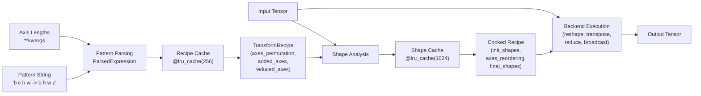
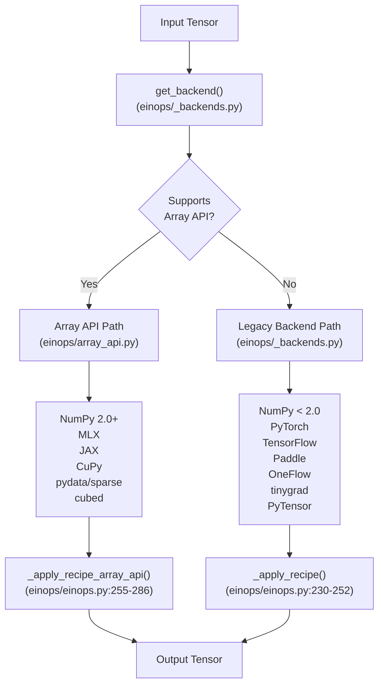

<!-- source: DeepWiki mcp.deepwiki.com · repo arogozhnikov/einops · page 1 Overview · fetched 2026-10-21 -->

# Overview

<details>
<summary>Relevant source files</summary>

The following files were used as context for generating this wiki page:

- [README.md](README.md)
- [einops/__init__.py](einops/__init__.py)
- [einops/einops.py](einops/einops.py)
- [einops/parsing.py](einops/parsing.py)
- [scripts/setup.py](scripts/setup.py)

</details>


This page introduces the einops library, its core philosophy, architecture, and capabilities. For detailed API documentation of specific operations, see [Core API Reference](#2). For framework-specific layer implementations, see [Layer Integration](#3). For internal implementation details, see [Internal Architecture](#4).

## Purpose and Scope

einops is a Python library that provides flexible and powerful tensor operations through readable, declarative patterns. It enables clear and reliable tensor manipulations across multiple deep learning frameworks using Einstein-inspired notation. This overview covers the library's structure, core operations, pattern language, and framework support.

**Sources:** [README.md:20-28]()

## What is einops?

einops (Einstein-Inspired Notation for Operations) is a tensor manipulation library that replaces framework-specific operations with a unified, readable pattern-based syntax. Instead of remembering different APIs for reshape, transpose, squeeze, unsqueeze, stack, and concatenate across frameworks, einops provides three core operations (`rearrange`, `reduce`, `repeat`) plus additional utilities (`pack`, `unpack`, `einsum`) that work identically across numpy, pytorch, tensorflow, jax, mlx, and other frameworks.

The library emphasizes:
- **Semantic information**: Patterns explicitly describe input/output structure
- **Runtime validation**: Automatic shape checking prevents silent errors  
- **Framework independence**: Identical behavior across all backends
- **Readability**: Self-documenting code through named axes

**Sources:** [README.md:27-28](), [README.md:191-298]()

## Installation

```bash
pip install einops
```

The library has zero runtime dependencies and supports Python 3.10+.

**Sources:** [README.md:83-90](), [README.md:379-381]()

## Core Architecture

einops consists of three main architectural layers that cleanly separate user interface, transformation logic, and framework-specific execution:

```mermaid
graph TB
    subgraph "User-Facing API Layer"
        rearrange["rearrange()<br/>(einops/einops.py:561-616)"]
        reduce["reduce()<br/>(einops/einops.py:468-550)"]
        repeat["repeat()<br/>(einops/einops.py:627-674)"]
        pack["pack()<br/>(einops/packing.py)"]
        unpack["unpack()<br/>(einops/packing.py)"]
        einsum["einsum()<br/>(einops/einops.py:865-939)"]
        parse_shape["parse_shape()<br/>(einops/einops.py:677-736)"]
        asnumpy["asnumpy()<br/>(einops/einops.py:766-776)"]
    end
    
    subgraph "Core Processing Engine"
        ParsedExpression["ParsedExpression<br/>(einops/parsing.py:25-159)"]
        TransformRecipe["TransformRecipe<br/>(einops/einops.py:114-153)"]
        prepare_recipe["_prepare_transformation_recipe()<br/>(einops/einops.py:289-442)"]
        apply_recipe["_apply_recipe()<br/>(einops/einops.py:230-252)"]
        reconstruct["_reconstruct_from_shape()<br/>(einops/einops.py:155-224)"]
        optimize["_optimize_transformation()<br/>(einops/einops.py:50-102)"]
    end
    
    subgraph "Backend Abstraction Layer"
        get_backend["get_backend()<br/>(einops/_backends.py)"]
        AbstractBackend["AbstractBackend<br/>(einops/_backends.py)"]
        array_api["array_api.py<br/>(Array API Standard)"]
    end
    
    subgraph "Framework Implementations"
        numpy_backend["NumPy Backend"]
        torch_backend["PyTorch Backend"]
        tf_backend["TensorFlow Backend"]
        jax_backend["JAX Backend"]
        mlx_backend["MLX Backend"]
    end
    
    rearrange --> prepare_recipe
    reduce --> prepare_recipe
    repeat --> prepare_recipe
    einsum --> ParsedExpression
    pack --> ParsedExpression
    parse_shape --> ParsedExpression
    
    prepare_recipe --> ParsedExpression
    prepare_recipe --> TransformRecipe
    
    rearrange --> apply_recipe
    reduce --> apply_recipe
    repeat --> apply_recipe
    
    apply_recipe --> reconstruct
    apply_recipe --> get_backend
    reconstruct --> optimize
    
    get_backend --> AbstractBackend
    AbstractBackend --> numpy_backend
    AbstractBackend --> torch_backend
    AbstractBackend --> tf_backend
    AbstractBackend --> jax_backend
    AbstractBackend --> mlx_backend
    AbstractBackend --> array_api
```



**Architecture Description:**

The three-layer architecture ensures clean separation of concerns:

1. **User-Facing API Layer** ([einops/__init__.py:14]()): Exports nine public functions that provide the primary interface. All operations accept tensor inputs and pattern strings, delegating to the processing engine.

2. **Core Processing Engine**: Transforms patterns into executable recipes through a two-stage compilation:
   - Pattern parsing via `ParsedExpression` extracts axis names, composite axes, and ellipsis
   - Recipe compilation via `TransformRecipe` generates optimized transformation instructions
   - Dual-level LRU caching (256 recipe entries, 1024 shape entries) at [einops/einops.py:227]() and [einops/einops.py:289]()

3. **Backend Abstraction Layer**: Provides framework-agnostic execution through dynamic backend detection (`get_backend`) and the `AbstractBackend` interface, with a dual-path implementation for Array API-compliant frameworks.

**Sources:** [einops/__init__.py:14](), [einops/einops.py:114-153](), [einops/einops.py:289-442](), [einops/parsing.py:25-159]()

## Core Operations

einops provides six primary operations, all sharing the same pattern-based syntax:

| Operation | Purpose | Pattern Example | Description |
|-----------|---------|-----------------|-------------|
| `rearrange` | Reshape/transpose | `'b c h w -> b (c h w)'` | Reorder and combine axes |
| `reduce` | Aggregation | `'b c (h h2) (w w2) -> b c h w'` | Reduce with pooling operations |
| `repeat` | Broadcasting | `'h w -> h w c'` | Duplicate along new axes |
| `pack` | Concatenation | `'b * c'` | Reversibly pack multiple tensors |
| `unpack` | Splitting | `'b * c'` | Unpack previously packed tensors |
| `einsum` | Tensor contraction | `'b t1 c, b t2 c -> b t1 t2'` | Generalized dot products |

### Pattern-to-Implementation Flow



The flow demonstrates the two-stage caching strategy: patterns are parsed once and cached at [einops/einops.py:289](), while shape-specific transformations are cached separately at [einops/einops.py:227](). This allows a single pattern like `'b c h w -> b c'` to work efficiently across varying batch sizes.

**Sources:** [einops/einops.py:468-674](), [einops/einops.py:227](), [einops/einops.py:289]()

## Pattern Language

The pattern language is einops' core innovation. Patterns consist of axis identifiers connected by arrows (`->`):

### Pattern Components

| Component | Syntax | Example | Description |
|-----------|--------|---------|-------------|
| Named axes | `a-z`, `A-Z`, identifiers | `batch height width` | Semantic axis names |
| Composite axes | `(...)` | `(h h2)` | Decompose/compose axes |
| Anonymous axes | Integers | `2`, `3` | Fixed-size dimensions |
| Ellipsis | `...` | `batch ... channel` | Variable number of axes |
| Empty composition | `()` | `b c () ()` | Dimension of size 1 |
| Wildcard | `*` | `b * c` | For pack/unpack only |

### Pattern Examples

```python
# Transpose: channels-last to channels-first
rearrange(images, 'b h w c -> b c h w')

# Flatten spatial dimensions
rearrange(features, 'b c h w -> b c (h w)')

# Split into patches
rearrange(image, '(h p1) (w p2) c -> (h w) (p1 p2 c)', p1=16, p2=16)

# 2D pooling with reduction
reduce(x, 'b c (h h2) (w w2) -> b c h w', 'max', h2=2, w2=2)

# Repeat along new channel axis
repeat(grayscale, 'h w -> h w c', c=3)
```

**Pattern Parsing:** The `ParsedExpression` class at [einops/parsing.py:25-159]() tokenizes patterns, validates identifiers, and extracts structural information (parentheses, ellipsis). Pattern validation occurs at [einops/einops.py:304-329](), ensuring axis consistency between left and right sides.

**Sources:** [einops/parsing.py:25-159](), [einops/einops.py:289-442](), [README.md:110-137]()

## Framework Support

einops supports two execution paths for maximum compatibility:



### Supported Frameworks

**Array API Compliant** (via [einops/array_api.py]()):
- NumPy 2.0+
- MLX (Apple's framework)
- JAX
- CuPy  
- pydata/sparse (sparse tensors)
- cubed (distributed tensors)

**Legacy Frameworks** (custom backends):
- NumPy < 2.0
- PyTorch (with torch.compile support)
- TensorFlow/Keras (eager + graph modes)
- Paddle
- OneFlow
- tinygrad
- PyTensor

The dual-path architecture introduced in version 0.7 allows einops to maintain a single API across 10+ frameworks while leveraging standardization where possible.

**Sources:** [README.md:301-335](), [einops/einops.py:230-286]()

## Layer Integration

einops provides neural network layer implementations for major frameworks:

```python
from einops.layers.torch import Rearrange, Reduce, EinMix
from einops.layers.tensorflow import Rearrange, Reduce, EinMix
from einops.layers.flax import Rearrange, Reduce, EinMix
from einops.layers.paddle import Rearrange, Reduce, EinMix
```

Layers encapsulate einops operations as framework-specific modules (e.g., `torch.nn.Module`, `tf.keras.layers.Layer`), enabling use within `Sequential` models and supporting features like serialization, torch.jit.script, and torch.compile.

**Example:**
```python
model = torch.nn.Sequential(
    torch.nn.Conv2d(3, 64, kernel_size=3),
    Rearrange('b c h w -> b (c h w)'),
    torch.nn.Linear(64 * 28 * 28, 10)
)
```

For detailed layer documentation, see [Layer Integration](#3).

**Sources:** [README.md:144-179](), [einops/__init__.py:1-18]()

## Key Implementation Details

### Caching Strategy

einops employs two-level LRU caching for performance:

1. **Recipe Cache** ([einops/einops.py:289]()): 256 entries, caches compiled `TransformRecipe` objects keyed by `(pattern, operation, axes_names, ndim)`
2. **Shape Cache** ([einops/einops.py:227]()): 1024 entries, caches shape-specific parameters within `_reconstruct_from_shape_uncached`

This strategy allows patterns to be parsed once but applied to tensors of varying shapes efficiently.

### Optimization Pipeline

The `_optimize_transformation` function at [einops/einops.py:50-102]() collapses consecutive axes that appear in the same order in both input and output patterns, reducing the number of reshape/transpose operations needed.

### Error Handling

All operations raise `EinopsError` ([einops/__init__.py:8-11]()) with detailed context including pattern, tensor shape, and axis specifications. Shape mismatches are detected during recipe reconstruction at [einops/einops.py:183-192]().

**Sources:** [einops/einops.py:50-102](), [einops/einops.py:227](), [einops/einops.py:289]()

## Related Documentation

This overview provides a high-level introduction. For deeper exploration:

- **[Installation and Quick Start](#1.1)**: Detailed setup and first examples
- **[Core Concepts and Design Philosophy](#1.2)**: Einstein notation philosophy and semantic benefits  
- **[Quick Examples](#1.3)**: Practical code snippets for common patterns
- **[Core API Reference](#2)**: Comprehensive operation documentation
- **[Pattern Syntax Guide](#2.4)**: Complete pattern language specification
- **[Layer Integration](#3)**: Framework-specific layer implementations
- **[Internal Architecture](#4)**: Backend system, recipe compilation, parsing
- **[Tutorials and Examples](#7)**: Step-by-step guides and real-world applications

**Sources:** [README.md:1-382](), Table of Contents JSON

## Version and Maintenance

Current version: 0.9.0dev ([einops/__init__.py:5]())

The library is actively maintained with:
- Continuous integration testing across Python 3.10, 3.11, 3.13
- Automated framework compatibility testing (numpy, pytorch, tensorflow, jax, mlx, pytensor)
- Documentation hosted at https://einops.rocks
- Source repository at https://github.com/arogozhnikov/einops

For development setup and contribution guidelines, see [Development and Testing](#6).

**Sources:** [einops/__init__.py:5](), [README.md:20-24]()

---

