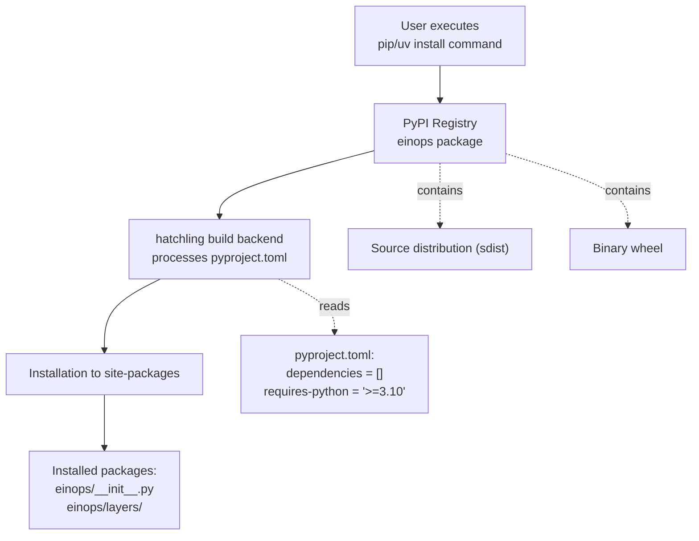
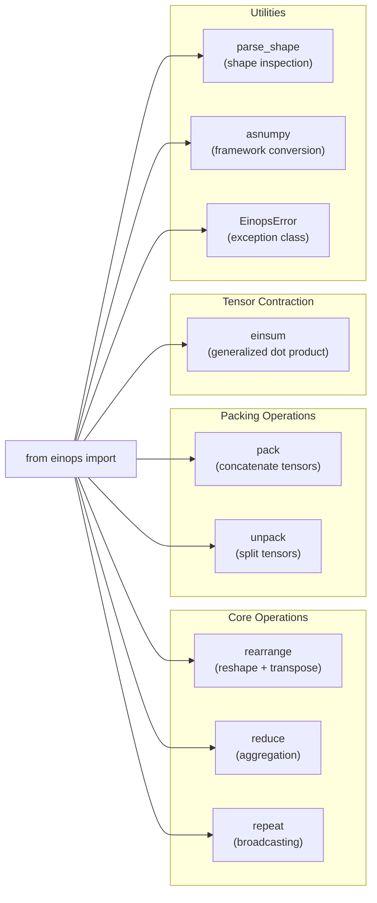
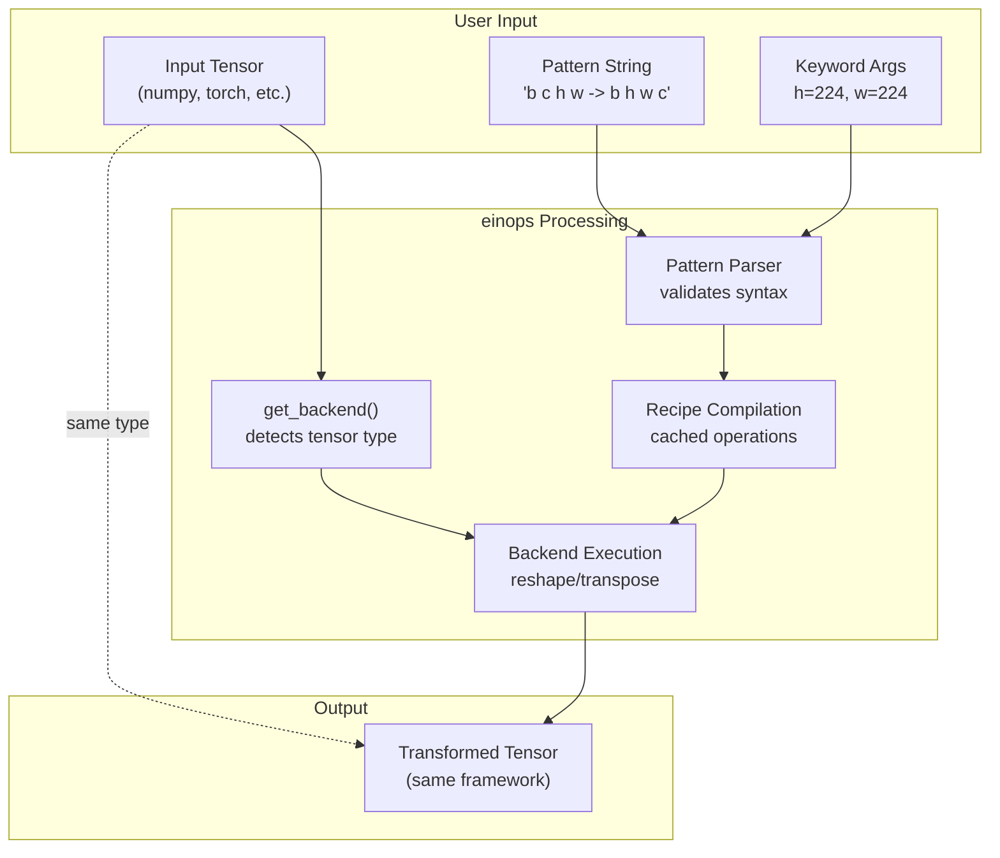
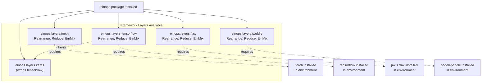

<!-- source: DeepWiki mcp.deepwiki.com · repo arogozhnikov/einops · page 1.1 Installation and Quick Start · fetched 2026-10-21 -->

# Installation and Quick Start

<details>
<summary>Relevant source files</summary>

The following files were used as context for generating this wiki page:

- [README.md](README.md)
- [pyproject.toml](pyproject.toml)

</details>


## Purpose and Scope

This page covers the installation process for einops, verification of successful installation, and your first tensor operations. It provides practical steps to get einops running in your environment and execute basic operations within minutes.

For detailed explanations of einops concepts and philosophy, see [Core Concepts and Design Philosophy](#1.2). For comprehensive examples and use cases, see [Quick Examples](#1.3). For detailed API documentation, see [Core API Reference](#2).

---

## System Requirements

**Python Version**: einops requires Python 3.10 or later.

**Runtime Dependencies**: einops has **zero runtime dependencies**. The package works standalone and detects available tensor frameworks dynamically at runtime.

**Supported Frameworks**: einops automatically detects and works with any installed framework including NumPy, PyTorch, TensorFlow, JAX, CuPy, MLX, Flax, Paddle, OneFlow, Tinygrad, and PyTensor. Additionally, any framework supporting the [Python Array API Standard](https://data-apis.org/array-api/) is automatically supported.

Sources: [pyproject.toml:9](), [pyproject.toml:25-27](), [README.md:301-334](), [README.md:379-381]()

---

## Installation Methods

### Standard Installation

The primary installation method uses pip:

```bash
pip install einops
```

### Alternative Installation with uv

The modern `uv` package installer is also supported:

```bash
uv pip install einops
```

Both methods install the same package with identical functionality. The `uv` tool typically offers faster installation times.

### Installation Process Flow



**Diagram: Installation Process** - Shows how pip/uv retrieves the package from PyPI, processes it through hatchling, and installs to your environment.

Sources: [README.md:83-90](), [pyproject.toml:1-3](), [pyproject.toml:9](), [pyproject.toml:25-27]()

---

## Verifying Installation

### Import Test

After installation, verify einops is available:

```python
import einops
print(einops.__version__)
```

This should display the installed version (e.g., "0.8.2") without errors.

### Core Functions Availability

Verify the core API is accessible:

```python
from einops import rearrange, reduce, repeat, pack, unpack, einsum
from einops import parse_shape, asnumpy, EinopsError
```

All imports should complete without `ImportError` or `AttributeError`.

### Framework Detection Test

Test that einops can detect your installed framework:

```python
import numpy as np
from einops import rearrange

# Create a simple numpy array
x = np.array([[1, 2], [3, 4]])

# Perform a basic rearrange operation
y = rearrange(x, 'h w -> w h')
print(y)  # Should print [[1, 3], [2, 4]]
```

If you have PyTorch installed:

```python
import torch
from einops import rearrange

x = torch.tensor([[1, 2], [3, 4]])
y = rearrange(x, 'h w -> w h')
print(y)  # Should work identically
```

The same pattern applies to any supported framework. einops automatically detects the tensor type and uses the appropriate backend.

Sources: [README.md:110-118](), [einops/__init__.py]() (implied from package structure)

---

## First Operations

### Entry Points and Core API



**Diagram: einops Public API** - Shows all importable functions and classes from the main `einops` module.

### Basic rearrange Example

The `rearrange` function reshapes and transposes tensors using pattern strings:

```python
from einops import rearrange
import numpy as np

# Create a batch of RGB images: batch=2, channels=3, height=4, width=4
images = np.random.rand(2, 3, 4, 4)

# Transpose to channels-last format
images_cl = rearrange(images, 'b c h w -> b h w c')
print(images_cl.shape)  # (2, 4, 4, 3)

# Flatten spatial dimensions
flattened = rearrange(images, 'b c h w -> b c (h w)')
print(flattened.shape)  # (2, 3, 16)

# Rearrange for Vision Transformer patches
patches = rearrange(images, 'b c (h p1) (w p2) -> b (h w) (c p1 p2)', p1=2, p2=2)
print(patches.shape)  # (2, 4, 12)
```

### Basic reduce Example

The `reduce` function performs aggregation operations:

```python
from einops import reduce

# Average pooling: reduce spatial dimensions by 2x2
pooled = reduce(images, 'b c (h h2) (w w2) -> b c h w', 'mean', h2=2, w2=2)
print(pooled.shape)  # (2, 3, 2, 2)

# Global average pooling
global_pool = reduce(images, 'b c h w -> b c', 'mean')
print(global_pool.shape)  # (2, 3)

# Max reduction
max_pool = reduce(images, 'b c (h h2) (w w2) -> b c h w', 'max', h2=2, w2=2)
print(max_pool.shape)  # (2, 3, 2, 2)
```

### Basic repeat Example

The `repeat` function copies tensor elements along new or existing axes:

```python
from einops import repeat

# Create a grayscale image
gray = np.random.rand(1, 28, 28)

# Convert to RGB by repeating channel dimension
rgb = repeat(gray, '1 h w -> c h w', c=3)
print(rgb.shape)  # (3, 28, 28)

# Tile an image
tiled = repeat(gray, '1 h w -> 1 (tile_h h) (tile_w w)', tile_h=2, tile_w=2)
print(tiled.shape)  # (1, 56, 56)
```

Sources: [README.md:110-118](), [README.md:196-262]()

---

## Operation Flow and Pattern Processing



**Diagram: Operation Execution Flow** - Shows how user input flows through pattern parsing and backend execution to produce output.

When you call `rearrange(tensor, pattern)`:
1. `get_backend()` dynamically detects the tensor's framework
2. The pattern string is parsed and validated
3. A `TransformRecipe` is compiled (and cached for reuse)
4. The appropriate backend executes the transformation
5. The result is returned in the same framework as the input

Sources: High-level architecture diagrams, [README.md:110-137]()

---

## Framework-Specific Considerations

### NumPy (Default Framework)

NumPy is the reference implementation and requires no additional setup:

```python
import numpy as np
from einops import rearrange

x = np.random.rand(10, 20, 30)
y = rearrange(x, 'a b c -> b a c')
```

### PyTorch

PyTorch tensors are automatically detected. For neural network layers, use `einops.layers.torch`:

```python
import torch
from einops import rearrange
from einops.layers.torch import Rearrange, Reduce

# Functional API
x = torch.randn(32, 3, 64, 64)
y = rearrange(x, 'b c h w -> b (c h w)')

# Layer API (for nn.Sequential)
model = torch.nn.Sequential(
    torch.nn.Conv2d(3, 16, 3),
    Rearrange('b c h w -> b (c h w)'),
    torch.nn.Linear(16 * 62 * 62, 10)
)
```

### TensorFlow / Keras

TensorFlow supports both eager and graph modes. For Keras layers, use `einops.layers.tensorflow` or `einops.layers.keras`:

```python
import tensorflow as tf
from einops import rearrange
from einops.layers.keras import Rearrange

# Eager mode
x = tf.random.normal([32, 64, 64, 3])
y = rearrange(x, 'b h w c -> b (h w) c')

# Keras model
model = tf.keras.Sequential([
    tf.keras.layers.Conv2D(16, 3),
    Rearrange('b h w c -> b (h w c)'),
    tf.keras.layers.Dense(10)
])
```

### JAX

JAX tensors (DeviceArray) work with functional operations:

```python
import jax.numpy as jnp
from einops import rearrange

x = jnp.ones((10, 20, 30))
y = rearrange(x, 'a b c -> b a c')
```

### Array API Standard Support

For frameworks implementing the Python Array API Standard (NumPy 2.0+, MLX, pydata/sparse, etc.), use the array API import:

```python
from einops.array_api import rearrange  # instead of from einops import rearrange

# Works with any array API compliant framework
import mlx.core as mx
x = mx.random.normal((10, 20, 30))
y = rearrange(x, 'a b c -> b a c')
```

Sources: [README.md:146-179](), [README.md:301-334]()

---

## Testing Your Setup

### Running Built-in Tests

Starting from einops 0.8.1, tests are distributed with the package:

```bash
pip install einops pytest

# Test specific frameworks
python -m einops.tests.run_tests numpy pytorch jax --pip-install

# Test only with NumPy (minimal requirement)
python -m einops.tests.run_tests numpy --pip-install
```

The `--pip-install` flag automatically installs test dependencies. Omit it if dependencies are already installed.

### Quick Validation Script

Create a file `test_einops.py`:

```python
"""Quick validation that einops works with your frameworks."""
import sys

def test_numpy():
    import numpy as np
    from einops import rearrange, reduce, repeat
    
    x = np.random.rand(2, 3, 4, 5)
    
    # Test rearrange
    assert rearrange(x, 'a b c d -> b a d c').shape == (3, 2, 5, 4)
    
    # Test reduce
    assert reduce(x, 'a b c d -> a b', 'mean').shape == (2, 3)
    
    # Test repeat
    assert repeat(x, 'a b c d -> a b c (d repeat)', repeat=2).shape == (2, 3, 4, 10)
    
    print("✓ NumPy tests passed")

def test_pytorch():
    try:
        import torch
        from einops import rearrange
        
        x = torch.randn(2, 3, 4, 5)
        assert rearrange(x, 'a b c d -> b a d c').shape == (3, 2, 5, 4)
        
        print("✓ PyTorch tests passed")
    except ImportError:
        print("⊘ PyTorch not installed (skipped)")

def test_tensorflow():
    try:
        import tensorflow as tf
        from einops import rearrange
        
        x = tf.random.normal([2, 3, 4, 5])
        assert rearrange(x, 'a b c d -> b a d c').shape == (3, 2, 5, 4)
        
        print("✓ TensorFlow tests passed")
    except ImportError:
        print("⊘ TensorFlow not installed (skipped)")

if __name__ == '__main__':
    test_numpy()
    test_pytorch()
    test_tensorflow()
    print("\nAll available frameworks validated!")
```

Run with:
```bash
python test_einops.py
```

Sources: [README.md:343-354](), [pyproject.toml:58-76]()

---

## Framework Layer Installation



**Diagram: Framework Layer Dependencies** - Shows the layer modules available after einops installation and their framework requirements.

All layer implementations are included in the einops package. They activate automatically when the corresponding framework is detected at import time.

Sources: [README.md:146-152](), [pyproject.toml:35]()

---

## Common Installation Issues

### Issue: ImportError after installation

**Problem**: `import einops` fails with `ModuleNotFoundError`

**Solution**: Ensure you're using the correct Python environment:
```bash
# Verify einops is installed in current environment
pip list | grep einops

# Or check which Python is being used
which python
python -c "import sys; print(sys.executable)"
```

### Issue: Version conflicts

**Problem**: einops requires Python 3.10+ but Python 3.9 is installed

**Solution**: Upgrade Python or use a virtual environment with Python 3.10+:
```bash
# Using venv
python3.10 -m venv einops_env
source einops_env/bin/activate  # On Windows: einops_env\Scripts\activate
pip install einops
```

### Issue: Framework not detected

**Problem**: einops fails with "Can't find backend for <tensor_type>"

**Solution**: Ensure the framework is properly installed:
```bash
# Example for PyTorch
pip install torch --index-url https://download.pytorch.org/whl/cpu

# Verify import works
python -c "import torch; print(torch.__version__)"
```

### Issue: Documentation build fails

**Problem**: Cannot build documentation locally

**Solution**: Use the provided hatch environment:
```bash
# Install hatch if needed
pip install hatch

# Serve documentation locally
hatch run docs:serve
```

Sources: [README.md:337-361](), [pyproject.toml:58-76]()

---

## Next Steps

After successfully installing einops, consider these next steps:

1. **Learn Core Concepts**: Read [Core Concepts and Design Philosophy](#1.2) to understand einops' pattern-based approach and semantic information benefits

2. **Explore Examples**: Review [Quick Examples](#1.3) for common tensor manipulation patterns across different use cases

3. **Study Tutorials**: Work through the tutorial notebooks:
   - [einops fundamentals](https://github.com/arogozhnikov/einops/blob/main/docs/1-einops-basics.ipynb)
   - [einops for deep learning](https://github.com/arogozhnikov/einops/blob/main/docs/2-einops-for-deep-learning.ipynb)
   - [packing and unpacking](https://github.com/arogozhnikov/einops/blob/main/docs/4-pack-and-unpack.ipynb)

4. **Read API Reference**: Consult [Core API Reference](#2) for detailed documentation of all operations

5. **Try Interactive Playground**: Use the [einops playground](https://arogozhnikov.github.io/jupyterlite/lab/index.html?download_github_folder=arogozhnikov/einops/docs) to experiment in your browser

6. **Review Framework Integration**: For neural network usage, see [Layer Integration](#3) covering PyTorch, TensorFlow, and other frameworks

7. **Join Community**: Visit the [GitHub discussions](https://github.com/arogozhnikov/einops/discussions) for questions and community support

Sources: [README.md:72-101](), [README.md:32-33]()

---

## Quick Reference Table

| Task | Operation | Example Pattern |
|------|-----------|----------------|
| Transpose | `rearrange` | `'b c h w -> b h w c'` |
| Flatten | `rearrange` | `'b c h w -> b (c h w)'` |
| Reshape | `rearrange` | `'b (c g) h w -> b c g h w'` |
| Pooling | `reduce` | `'b c (h 2) (w 2) -> b c h w'` with `'mean'` |
| Global pool | `reduce` | `'b c h w -> b c'` with `'mean'` |
| Broadcasting | `repeat` | `'h w -> h w c'` |
| Tiling | `repeat` | `'h w -> (h h2) (w w2)'` |
| Stack tensors | `pack` | `[x, y, z]` with pattern `'b * c'` |
| Split tensor | `unpack` | tensor with `ps` from pack |
| Dot product | `einsum` | `'b i c, b j c -> b i j'` |

Sources: [README.md:103-137]()

---

