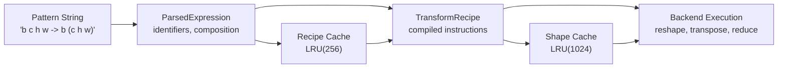
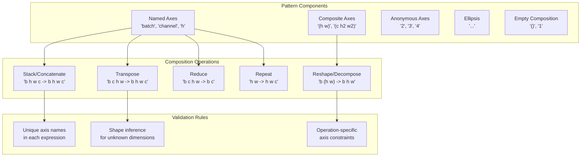
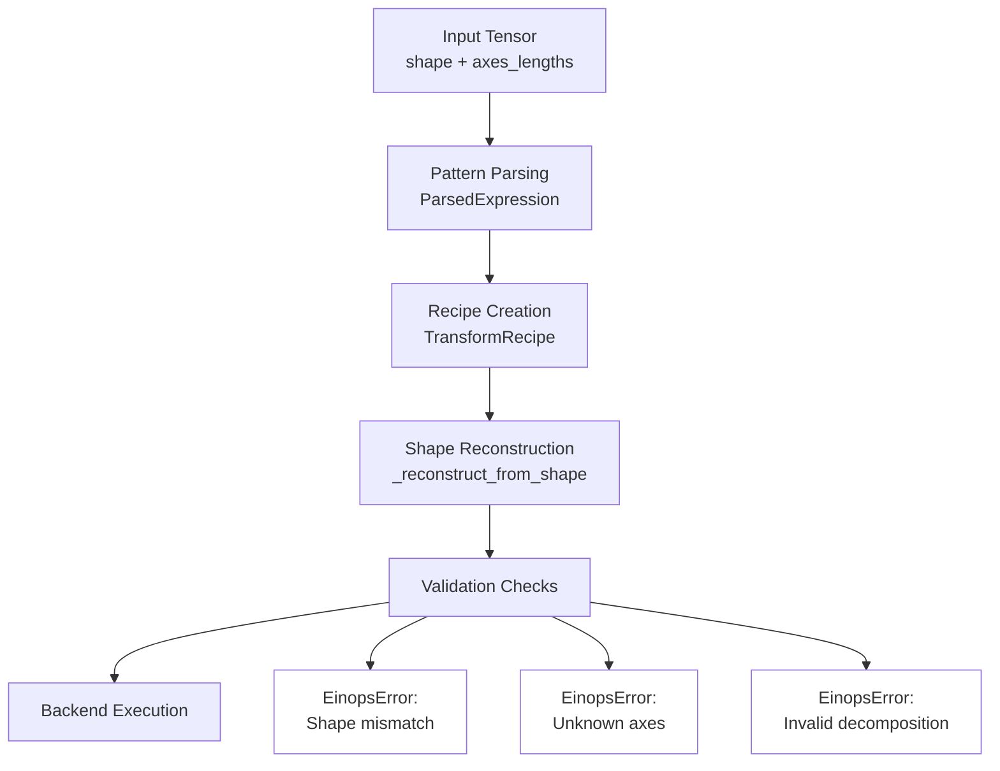
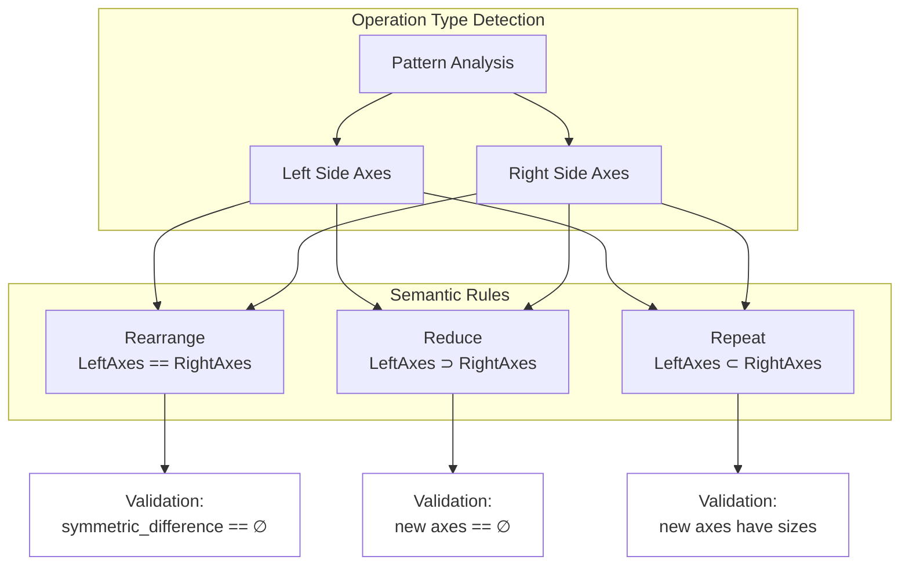
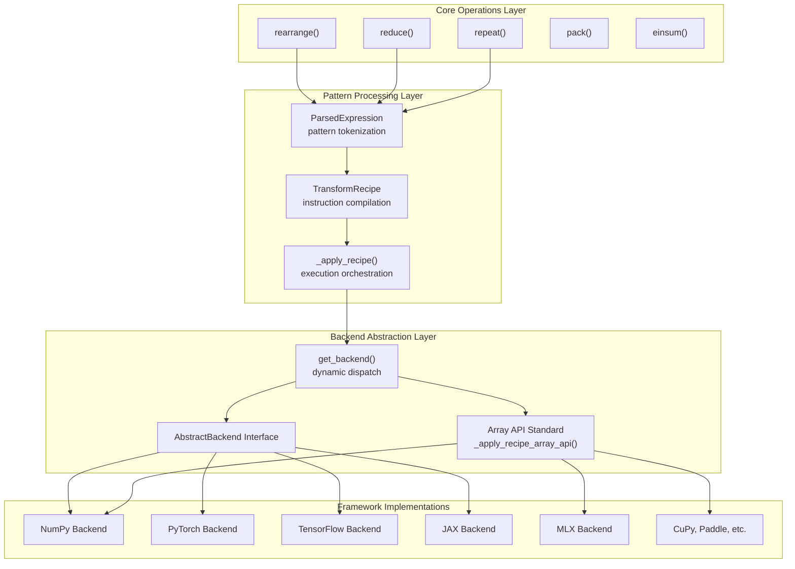
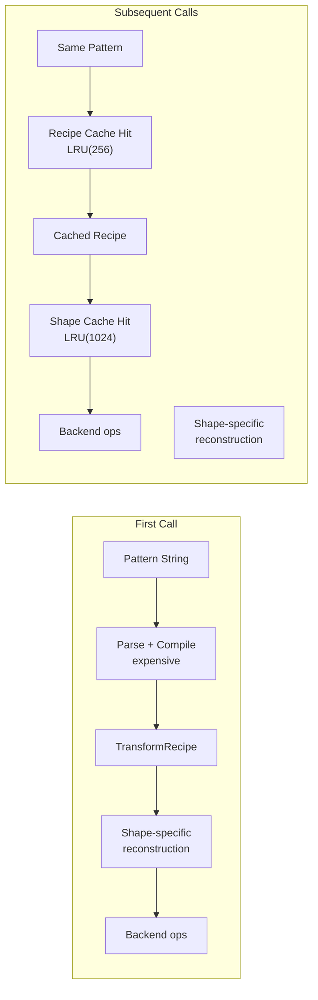

<!-- source: DeepWiki mcp.deepwiki.com · repo arogozhnikov/einops · page 1.2 Core Concepts and Design Philosophy · fetched 2026-10-21 -->

# Core Concepts and Design Philosophy

<details>
<summary>Relevant source files</summary>

The following files were used as context for generating this wiki page:

- [README.md](README.md)
- [einops/einops.py](einops/einops.py)
- [einops/parsing.py](einops/parsing.py)

</details>


## Purpose and Scope

This document explains the foundational principles and design decisions that shape einops as a tensor manipulation library. It covers the Einstein-inspired notation philosophy, the pattern language abstraction, semantic information benefits, deterministic transformation semantics, and the framework independence architecture that enables einops to work consistently across 10+ deep learning frameworks.

For practical pattern syntax details, see [Pattern Syntax Guide](#2.4). For implementation details of the backend abstraction system, see [Backend System](#4.1). For the pattern parsing implementation, see [Pattern Parsing System](#4.3).

---

## Einstein-Inspired Notation Philosophy

The name "einops" stands for **Einstein-Inspired Notation for Operations**. The library borrows the conceptual clarity of Einstein summation notation—where operations are specified declaratively through named indices—and extends it to general tensor manipulations beyond just summation.

**Traditional approach:**
```python
# Unclear what dimensions we're working with
y = x.view(x.shape[0], -1)
y = x.transpose(1, 2).reshape(batch, -1, channels)
```

**einops approach:**
```python
# Self-documenting: input has 'b c h w', output has 'b (c h w)'
y = rearrange(x, 'b c h w -> b (c h w)')
# Explicitly states we're transposing channels and time
y = rearrange(x, 'b c t -> b t c')
```

The core insight is that **named axes convey semantic meaning**. Rather than operating on positional indices (axis 0, axis 1, etc.), einops uses meaningful identifiers that describe what each dimension represents. This makes code simultaneously more readable and more reliable.

**Sources:** [README.md:186-213](), [einops/einops.py:563-616]()

---

## Pattern Language as First-Class Abstraction

### From Patterns to Executable Instructions

einops treats pattern strings as a first-class abstraction that gets parsed, validated, and compiled into efficient transformation recipes. This compilation happens through a multi-stage pipeline:



**Pattern Parsing Stage** ([einops/parsing.py:25-159]()): The `ParsedExpression` class tokenizes pattern strings into structured representations. It identifies:
- **Named axes**: Single or multi-character identifiers like `'batch'`, `'h'`, `'channel'`
- **Composite axes**: Grouped dimensions like `'(h w)'` or `'(c h2 w2)'`
- **Anonymous axes**: Numeric literals like `'2'` or `'3'` for known dimensions
- **Ellipsis**: `'...'` for variable-length dimension sequences
- **Empty compositions**: `'()'` for singleton dimensions

**Recipe Compilation Stage** ([einops/einops.py:290-442]()): The `_prepare_transformation_recipe` function converts parsed expressions into `TransformRecipe` objects. A recipe contains:
- `elementary_axes_lengths`: Sizes for each elementary axis
- `axes_permutation`: Order for transposition operations  
- `first_reduced_axis`: Boundary between kept and reduced axes
- `added_axes`: New dimensions for repeat operations
- `output_composite_axes`: Grouping structure for final reshape

**Two-Level Caching Strategy** ([einops/einops.py:227](), [einops/einops.py:289]()): 
- **Recipe Cache** (256 entries): Caches pattern parsing results. Key is `(pattern, operation, axes_names, ndim)`
- **Shape Cache** (1024 entries): Caches shape-specific computations. Key includes tensor shape and axis lengths

This separation allows a pattern like `'b c h w -> b c'` to be parsed once but applied efficiently to tensors with varying batch sizes.

**Sources:** [einops/einops.py:114-153](), [einops/einops.py:289-442](), [einops/parsing.py:25-159](), [README.md:107-118]()

### Pattern Components and Composition Rules



**Composite axes** enable decomposition and composition in a single operation. For example, `'b (h h2) (w w2) -> b h w (h2 w2 c)'` performs both spatial downsampling and channel expansion simultaneously. The parentheses indicate which axes should be grouped together.

**Anonymous axes** ([einops/parsing.py:10-23]()) are integers that specify known dimensions. They're useful for pooling operations: `'b c (h 2) (w 2) -> b c h w'` performs 2×2 max-pooling without requiring explicit size parameters.

**Ellipsis handling** ([einops/einops.py:331-363]()) allows patterns to work with variable-rank tensors. When a pattern contains `'...'`, the actual number of dimensions is determined at runtime and the ellipsis expands accordingly.

**Sources:** [einops/parsing.py:25-159](), [einops/einops.py:299-442](), [README.md:234-261]()

---

## Semantic Information and Self-Documenting Code

### Explicitness Over Implicit Behavior

A core design principle is that **operations should declare their assumptions explicitly** rather than relying on implicit conventions. This is achieved through three mechanisms:

**1. Named axes make intent explicit:**

```python
# Traditional: What are these dimensions?
y = x.view(x.shape[0], -1)

# einops: Clear that we're flattening spatial+channel dimensions
y = rearrange(x, 'b c h w -> b (c h w)')

# Traditional: Which axes are we summing over?
y = x.sum(axis=(2, 3))

# einops: Explicitly keeping batch and channel, reducing spatial
y = reduce(x, 'b c h w -> b c', 'sum')
```

**2. Dimension validation catches errors early:**

```python
# Specify expected dimensions as kwargs
y = rearrange(x, 'b c h w -> b (c h w)', c=256, h=19, w=19)
# Raises EinopsError if x doesn't have c=256, h=19, w=19
```

The `axes_lengths` parameters ([einops/einops.py:156-193]()) serve dual purposes: they provide size information for new axes in `repeat`, and they validate expected sizes for existing axes. This transforms silent bugs into loud errors at the operation boundary.

**3. Operation semantics are unambiguous:**

Consider depth-to-space operations. There are multiple valid orderings:

```python
# Channel-first ordering
rearrange(x, 'b c (h h2) (w w2) -> b (c h2 w2) h w', h2=2, w2=2)

# Spatial-first ordering  
rearrange(x, 'b c (h h2) (w w2) -> b (h2 w2 c) h w', h2=2, w2=2)
```

Both are valid, but they produce different results. Traditional frameworks often choose one implicitly. einops requires you to **specify exactly which ordering you want**, eliminating ambiguity.

**Sources:** [README.md:194-245](), [einops/einops.py:155-224]()

### Runtime Shape Validation Flow



The validation logic in `_reconstruct_from_shape_uncached` ([einops/einops.py:155-224]()) performs several checks:

- **Shape compatibility**: If a composite axis like `'(h h2)'` decomposes an input dimension, einops verifies that `input_length % (h * h2) == 0`
- **Explicit length matching**: If you specify `h=224`, einops verifies the actual dimension equals 224
- **Unknown axis inference**: When one axis length is unknown in a composite axis, einops infers it: `unknown = input_length // product(known_axes)`

These checks happen at runtime during the shape reconstruction phase, before any actual tensor operations execute.

**Sources:** [einops/einops.py:155-224](), [einops/einops.py:303-329]()

---

## Deterministic Transformation Semantics

### C-Order Composition Convention

When composing axes in einops, the **rightmost axis varies fastest** (C-order or row-major order). This is consistent across all operations:

```python
# When flattening (h w), iteration order is:
# (0,0), (0,1), (0,2), ..., (0,w-1), (1,0), (1,1), ...
rearrange(x, 'h w -> (h w)')

# When decomposing (h w) back to h and w:
rearrange(x, '(h w) -> h w', h=10, w=20)
# Reverses the flattening exactly
```

This convention applies to all composite axes, making operations **perfectly reversible** when mathematically possible. The composition order is enforced in `TransformRecipe.output_composite_axes` ([einops/einops.py:142-152]()).

**Sources:** [README.md:603-604](), [einops/einops.py:203-208]()

### Operation-Specific Semantics

**Rearrange** ([einops/einops.py:561-616]()): Pure reordering without element duplication or reduction. All axes in the input must appear in the output and vice versa. The pattern `'b c h w -> b h w c'` is a valid rearrange, but `'b c h w -> b h w'` is not (axes must match).

**Reduce** ([einops/einops.py:468-550]()): Axes present in input but absent in output are aggregated using the specified reduction operation. Built-in reductions are: `'min'`, `'max'`, `'sum'`, `'mean'`, `'prod'`, `'any'`, `'all'`. Custom reduction functions are supported via callables ([einops/einops.py:37-47]()).

**Repeat** ([einops/einops.py:627-674]()): Axes in output but not in input are broadcast/tiled. All new axes must have their sizes specified via `axes_lengths` parameters. The operation uses backend-specific broadcasting mechanisms for efficiency.



The validation logic in `_prepare_transformation_recipe` ([einops/einops.py:303-329]()) enforces these rules by comparing `left.identifiers` and `rght.identifiers` sets. Any violation raises an `EinopsError` with a descriptive message.

**Sources:** [einops/einops.py:303-329](), [einops/einops.py:468-674]()

---

## Framework Independence Through Abstraction

### Backend Abstraction Architecture

einops achieves framework independence through the `AbstractBackend` interface. Every framework-specific operation is accessed through this abstraction layer, ensuring that the core logic remains framework-agnostic.



**Dynamic Backend Detection** ([einops/_backends.py]()): The `get_backend()` function inspects tensor types at runtime to select the appropriate backend. This allows mixing operations across different tensor types within the same codebase (though mixing within a single operation is not supported).

**Dual-Path Architecture** (introduced in einops 0.7): Modern frameworks supporting the Python Array API Standard use a streamlined implementation path via `_apply_recipe_array_api` ([einops/einops.py:255-286]()), while legacy frameworks use the traditional `AbstractBackend` interface. This maintains backwards compatibility while adopting emerging standards.

**Sources:** [README.md:301-335](), [einops/einops.py:230-253](), [einops/einops.py:255-286]()

### Framework-Specific Terminology Independence

Different frameworks use inconsistent terminology for the same operations. einops provides a unified vocabulary:

| Operation | NumPy | PyTorch | TensorFlow | einops |
|-----------|-------|---------|------------|--------|
| Duplicate elements | `tile(x, (1, 2))` | `repeat(x, 1, 2)` | `tile(x, [1, 2])` | `repeat(x, 'h w -> h (tile w)', tile=2)` |
| Axis permutation | `transpose(x, (1, 0, 2))` | `permute(x, 1, 0, 2)` | `transpose(x, (1, 0, 2))` | `rearrange(x, 'a b c -> b a c')` |
| Flatten | `flatten(x)` → `(60,)` | `flatten(x)` → `(60,)` | `tf.layers.flatten(x)` → `(batch, 20)` | `rearrange(x, 'a b c -> (a b c)')` |

The same einops code produces identical results across all frameworks. The backend abstraction handles framework-specific quirks:

- **Shape handling**: Some frameworks use tuples, others lists, some include symbolic dimensions
- **Reduction APIs**: Different argument names (`axis=` vs `dim=` vs `axes=`)
- **Broadcasting mechanics**: Native expand vs explicit tile operations

This is implemented through backend-specific methods like `reshape()`, `transpose()`, `reduce()`, and `add_axes()` in each backend class.

**Sources:** [README.md:264-298](), [README.md:280-297]()

---

## Uniformity Across Dimensions

einops provides **dimension-agnostic operations**. The same pattern works for 1D, 2D, 3D, and higher-dimensional cases:

```python
# 1D pooling
reduce(x, 'b c (x dx) -> b c x', 'max', dx=2)

# 2D pooling
reduce(x, 'b c (x dx) (y dy) -> b c x y', 'max', dx=2, dy=3)

# 3D pooling
reduce(x, 'b c (x dx) (y dy) (z dz) -> b c x y z', 'max', dx=2, dy=3, dz=4)
```

This contrasts with traditional frameworks that require separate functions (`MaxPool1d`, `MaxPool2d`, `MaxPool3d` in PyTorch). The uniformity extends to custom operations:

```python
# Width-to-height transformation (not a standard operation)
rearrange(x, 'b c h (w w2) -> b c (h w2) w', w2=2)
```

The pattern language is expressive enough to define arbitrary rearrangements without requiring framework authors to anticipate every use case. The `TransformRecipe` compilation process ([einops/einops.py:290-442]()) converts patterns into primitive operations (reshape, transpose, reduce) that work consistently across all dimensionalities.

**Sources:** [README.md:247-262](), [einops/einops.py:468-550]()

---

## Performance Through Recipe Optimization

### Transformation Optimization Pipeline

The `_optimize_transformation` function ([einops/einops.py:50-102]()) applies algebraic simplifications to reduce the number of operations:

**Collapsing consecutive reduced axes:**
```python
# Before: reduce axes [2, 3, 4] separately
# After: merge into single axis, reduce once
reduced_axes = (2, 3, 4)  # if consecutive
# Collapses to single axis of size shape[2] * shape[3] * shape[4]
```

**Collapsing consecutive preserved axes:**
```python
# Before: reshape, transpose to move axes [3, 4, 5] → [0, 1, 2]
# After: merge axes [3, 4, 5] before transpose, reducing dimension count
```

These optimizations are critical for performance because:
1. Fewer reshape operations means fewer memory allocations
2. Transpose operations on lower-dimensional tensors are faster
3. Single reduction over merged axes is more efficient than multiple reductions

The optimization preserves operation semantics—it's purely an implementation detail that doesn't affect the mathematical result.

**Sources:** [einops/einops.py:50-102]()

### Caching Strategy Rationale



**Two-level caching rationale:**

1. **Recipe cache** ([einops/einops.py:289]()): Pattern parsing is expensive (string tokenization, validation, set operations). But recipes are pattern-dependent, not shape-dependent. A recipe for `'b c h w -> b (c h w)'` works for any batch size or spatial dimensions.

2. **Shape cache** ([einops/einops.py:227]()): Shape reconstruction computes actual axis lengths and operation sequences. This depends on the specific tensor shape. Multiple tensors can share a recipe but have different cached reconstructions.

The cache sizes (256 for recipes, 1024 for shapes) balance memory usage against hit rates. In typical deep learning code, the number of unique patterns is small (<100), while the number of shape combinations is larger due to variable batch sizes and dynamic networks.

**Sources:** [einops/einops.py:227](), [einops/einops.py:289](), [einops/einops.py:230-253]()

---

## Design Trade-offs and Limitations

### String-Based API Constraints

einops uses string patterns rather than a programmatic DSL. This has implications:

**Benefits:**
- Concise and readable
- Easy to log and debug
- Framework-independent representation
- Can be cached as hashable keys

**Limitations:**
- No static type checking for patterns
- Errors detected at runtime, not compile time
- IDE autocomplete doesn't work for axis names
- Pattern strings aren't first-class Python objects

The design prioritizes runtime flexibility and readability over static guarantees. The extensive validation in `ParsedExpression` ([einops/parsing.py:25-159]()) and `_prepare_transformation_recipe` ([einops/einops.py:290-442]()) aims to provide clear error messages to compensate for the lack of static checking.

### Composition vs. Primitive Operations

einops patterns can express complex transformations in a single line that would require multiple primitive operations. This raises a design question: should operations be composable or atomic?

**einops choice: Monolithic patterns**
```python
# Single operation combining reshape and reduce
reduce(x, 'b c (h h2) (w w2) -> b c h w', 'max', h2=2, w2=2)
```

**Alternative: Composable primitives**
```python
# Multiple steps
x = rearrange(x, 'b c (h h2) (w w2) -> b c h w h2 w2', h2=2, w2=2)
x = reduce(x, 'b c h w h2 w2 -> b c h w', 'max')
```

The monolithic approach was chosen because:
- Fewer intermediate allocations
- Optimization opportunities (see `_optimize_transformation`)
- More concise for common patterns
- Matches numpy's `einsum` precedent

The trade-off is reduced composability—you can't easily build new operations from combinations of einops functions. This is mitigated by supporting custom reduction functions ([einops/einops.py:37-47]()).

**Sources:** [einops/einops.py:50-102](), [einops/einops.py:468-550]()

---

