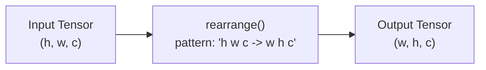
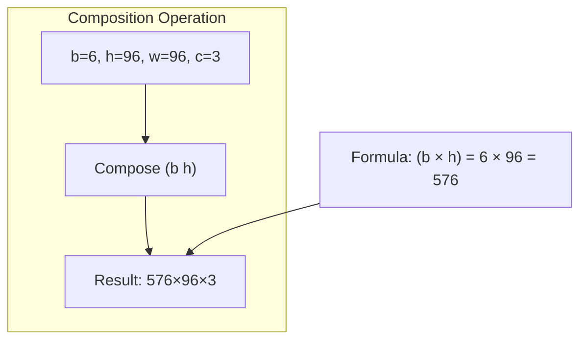
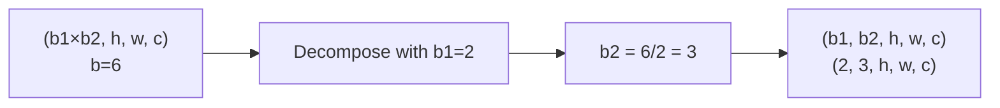
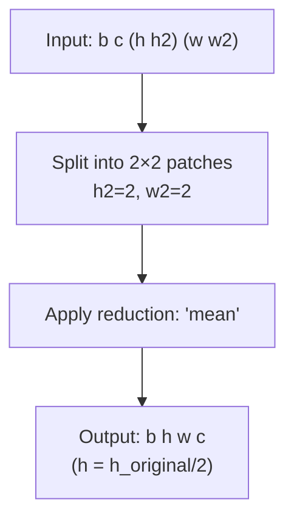
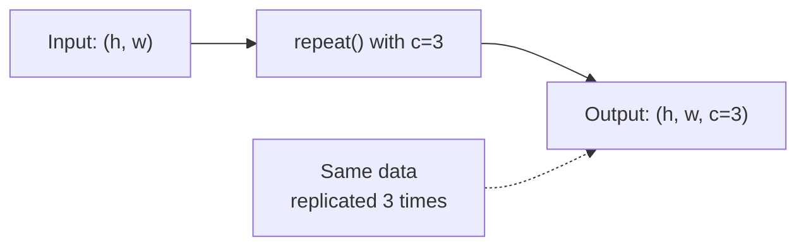
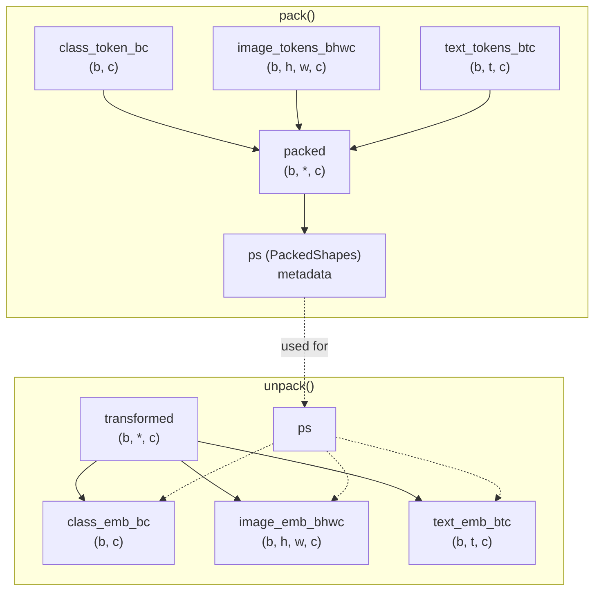
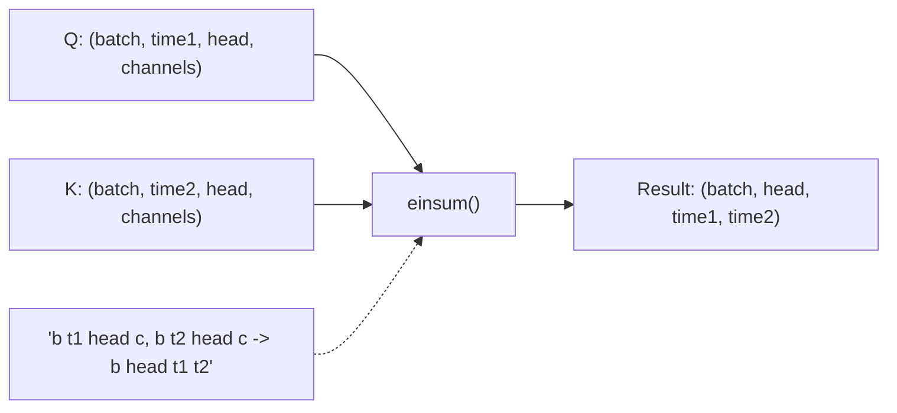
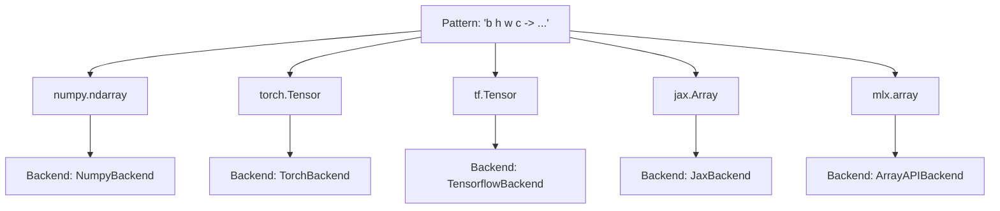
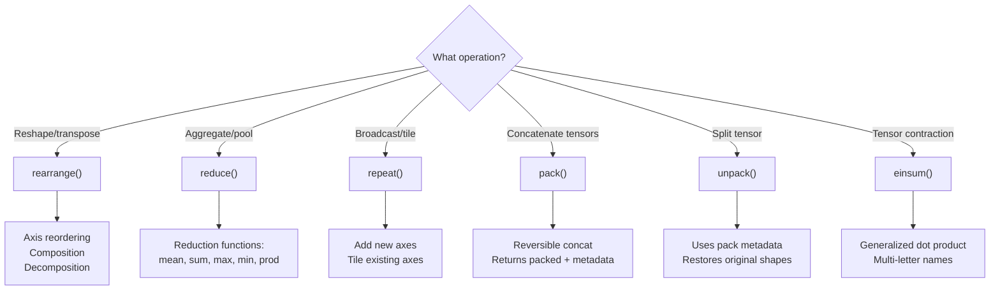

<!-- source: DeepWiki mcp.deepwiki.com · repo arogozhnikov/einops · page 1.3 Quick Examples · fetched 2026-10-21 -->

# Quick Examples

<details>
<summary>Relevant source files</summary>

The following files were used as context for generating this wiki page:

- [README.md](README.md)
- [docs/1-einops-basics.ipynb](docs/1-einops-basics.ipynb)
- [docs/4-pack-and-unpack.ipynb](docs/4-pack-and-unpack.ipynb)

</details>


## Purpose and Scope

This page provides practical code snippets demonstrating common tensor manipulation patterns using einops' core operations: `rearrange`, `reduce`, `repeat`, `pack`, `unpack`, and `einsum`. These examples show how einops enables readable, framework-independent tensor operations through declarative pattern notation.

For detailed API documentation of each operation, see [Core API Reference](#2). For the underlying design philosophy, see [Core Concepts and Design Philosophy](#1.2).

---

## Basic Rearrange Operations

The `rearrange` operation handles transposition, reshaping, and axis reordering through a simple pattern syntax.

### Simple Transposition

```python
from einops import rearrange

# Swap height and width axes
output = rearrange(image, 'h w c -> w h c')
```

**Sources:** [README.md:112-113](), [docs/1-einops-basics.ipynb:175-179]()



### Axis Composition

Combining multiple axes into a single axis using parentheses notation:

```python
# Flatten batch and height into single axis
output = rearrange(images, 'b h w c -> (b h) w c')

# Compose batch and width
output = rearrange(images, 'b h w c -> h (b w) c')
```

**Sources:** [docs/1-einops-basics.ipynb:227-231](), [docs/1-einops-basics.ipynb:249-251]()



### Axis Decomposition

Splitting a single axis into multiple components:

```python
# Decompose batch axis (6) into b1=2 and b2=3
output = rearrange(images, '(b1 b2) h w c -> b1 b2 h w c', b1=2)
# Result shape: (2, 3, 96, 96, 3)
```

**Sources:** [README.md:236-239](), [docs/1-einops-basics.ipynb:337-341]()



**Sources:** [docs/1-einops-basics.ipynb:337-341]()

---

## Reduce Operations

The `reduce` operation performs aggregation along specified axes using reduction functions.

```python
from einops import reduce

# Average pooling: reduce 2×2 patches to single values
output = reduce(image, 'b c (h h2) (w w2) -> b h w c', 'mean', h2=2, w2=2)

# Sum along specific axes
output = reduce(tensor, 'b c h w -> b c', 'sum')

# Max reduction
output = reduce(tensor, 'b c (x dx) -> b c x', 'max', dx=2)
```

**Sources:** [README.md:115](), [README.md:250]()

Available reduction operations: `min`, `max`, `sum`, `mean`, `prod`



**Sources:** [README.md:115](), [README.md:250-252]()

---

## Repeat Operations

The `repeat` operation broadcasts tensors along new or existing axes.

```python
from einops import repeat

# Copy along new color channel axis
output = repeat(grayscale, 'h w -> h w c', c=3)

# Tile along width
output = repeat(image, 'h w -> h (tile w)', tile=2)
```

**Sources:** [README.md:117](), [README.md:289-295]()



**Sources:** [README.md:117]()

---

## Pack and Unpack Operations

The `pack` and `unpack` operations enable reversible concatenation of heterogeneous tensors.

```python
from einops import pack, unpack

# Pack tensors with different dimensionality
class_token_bc = ...    # shape: (batch, channels)
image_tokens_bhwc = ... # shape: (batch, height, width, channels)
text_tokens_btc = ...   # shape: (batch, time, channels)

packed, ps = pack([class_token_bc, image_tokens_bhwc, text_tokens_btc], 'b * c')

# Unpack back to original shapes
class_emb_bc, image_emb_bhwc, text_emb_btc = unpack(transformed, ps, 'b * c')
```

**Sources:** [README.md:122-128]()



**Sources:** [README.md:122-128]()

---

## Einsum Operation

The `einsum` operation provides generalized tensor contraction with multi-letter axis names.

```python
from einops import einsum

# Attention mechanism: compute similarity between queries and keys
C = einsum(Q, K, 'b t1 head c, b t2 head c -> b head t1 t2')

# Multi-letter axis names for clarity
result = einsum(A, B, 'batch time1 head channels, batch time2 head channels -> batch head time1 time2')
```

**Sources:** [README.md:133-136]()

Key differences from standard einsum:
1. Axes can have multi-letter names for readability
2. Pattern comes as the last argument
3. Works consistently across frameworks



**Sources:** [README.md:133-136]()

---

## Framework Independence

All operations work identically across supported frameworks:

```python
import numpy as np
import torch
import tensorflow as tf
import jax.numpy as jnp

# Same operation works with any framework
np_result = rearrange(np_array, 'b h w c -> b c h w')
torch_result = rearrange(torch_tensor, 'b h w c -> b c h w')
tf_result = rearrange(tf_tensor, 'b h w c -> b c h w')
jax_result = rearrange(jax_array, 'b h w c -> b c h w')
```

**Sources:** [README.md:289-295](), [README.md:318-321]()



**Sources:** [README.md:303-334]()

---

## Pattern Syntax Quick Reference

| Syntax | Meaning | Example |
|--------|---------|---------|
| `a b c` | Named axes | `'batch height width'` |
| `(a b)` | Composition | `'(batch seq)'` - combines axes |
| `(a b)` on left | Decomposition | `'(h h2) w'` with `h2=2` - splits axis |
| `...` | Ellipsis | `'... c'` - matches remaining axes |
| `_` | Anonymous axis | `'_ h w c'` - ignore this axis |
| `*` | Wildcard (pack/unpack) | `'b * c'` - variable middle axes |

**Sources:** [README.md:110-118](), [README.md:236-261]()

---

## Operation Selection Guide



**Sources:** [README.md:107-137]()

---

