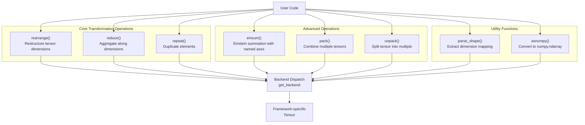
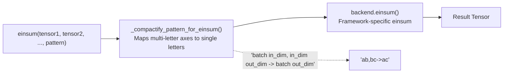
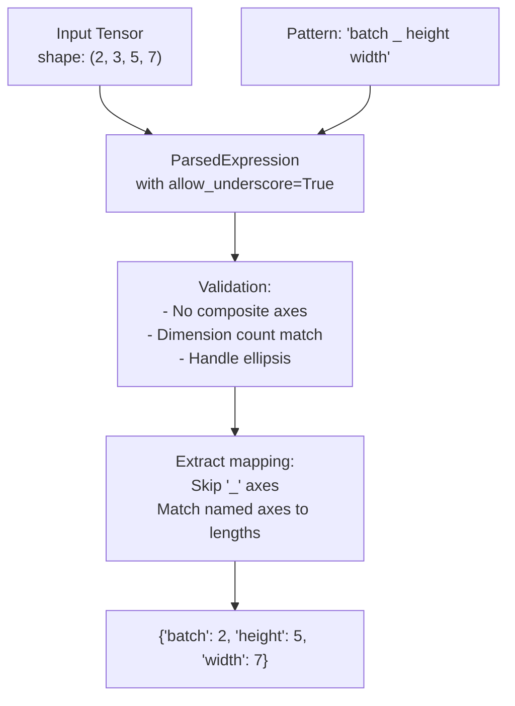
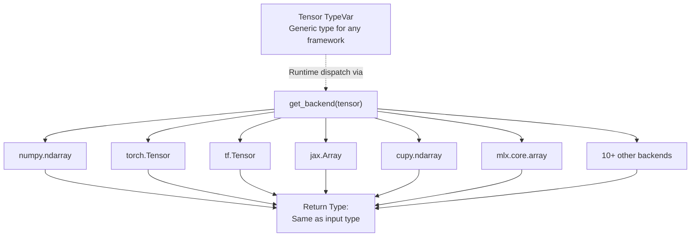
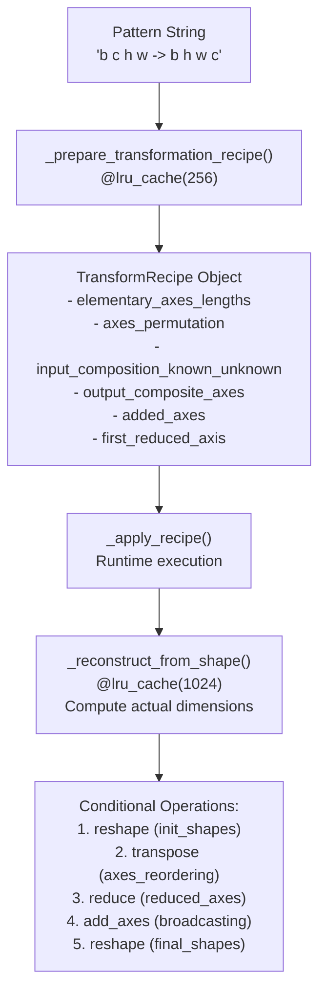

<!-- source: DeepWiki mcp.deepwiki.com · repo arogozhnikov/einops · page 2 Core API Reference · fetched 2026-10-21 -->

# Core API Reference

<details>
<summary>Relevant source files</summary>

The following files were used as context for generating this wiki page:

- [README.md](README.md)
- [einops/__init__.py](einops/__init__.py)
- [einops/einops.py](einops/einops.py)
- [einops/parsing.py](einops/parsing.py)
- [scripts/setup.py](scripts/setup.py)

</details>


This page provides comprehensive documentation of all user-facing functions in the einops library. These functions constitute the public API for tensor manipulation operations.

**Scope**: This page covers function signatures, parameters, return types, and usage guarantees for the core operations. For detailed pattern syntax rules, see [Pattern Syntax Guide](#2.4). For framework-specific layer implementations, see [Layer Integration](#3). For internal architecture details, see [Internal Architecture](#4).

## Function Taxonomy

The einops API consists of three categories of operations:



**Sources**: [einops/__init__.py:14](), [einops/einops.py:468-939]()

## API Function Reference

| Function | Signature | Purpose | Pattern Required |
|----------|-----------|---------|------------------|
| `rearrange` | `(tensor, pattern, **axes_lengths) -> Tensor` | Permute, reshape, squeeze, unsqueeze, stack | Yes |
| `reduce` | `(tensor, pattern, reduction, **axes_lengths) -> Tensor` | Aggregation operations (mean/max/sum/etc.) | Yes |
| `repeat` | `(tensor, pattern, **axes_lengths) -> Tensor` | Tile, broadcast, element duplication | Yes |
| `einsum` | `(*tensors, pattern) -> Tensor` | Multi-tensor contraction with named axes | Yes |
| `pack` | `(tensors, pattern) -> Tuple[Tensor, PackedShapes]` | Combine multiple tensors into one | Yes |
| `unpack` | `(tensor, packed_shapes, pattern) -> List[Tensor]` | Split tensor back to multiple tensors | Yes |
| `parse_shape` | `(tensor, pattern) -> Dict[str, int]` | Extract axis name to length mapping | Yes |
| `asnumpy` | `(tensor) -> np.ndarray` | Convert to numpy array | No |

**Sources**: [einops/__init__.py:14](), [einops/einops.py:16-18](), [einops/einops.py:468-776]()

## Core Transformation Operations

### Function: `rearrange`

**Signature**: 
```python
def rearrange(
    tensor: Union[Tensor, List[Tensor]], 
    pattern: str, 
    **axes_lengths: int
) -> Tensor
```

**Purpose**: Restructure tensor dimensions through permutation, reshaping, and composition operations.

**Parameters**:
- `tensor`: Single tensor or list of tensors (all must have same shape and type)
- `pattern`: String pattern in format `"left_expr -> right_expr"` 
- `**axes_lengths`: Optional axis length specifications for decomposition/composition

**Returns**: Tensor of same framework as input, often a view when possible

**Pattern Requirements**: Both sides must contain identical axis identifiers (symmetric difference = 0)

**Key Behaviors**:
- Accepts list input: stacks along new zeroth dimension
- Returns view when possible (backend-dependent)
- Uses C-order enumeration for axis composition
- Validates axis consistency at runtime

**Example Operations**:
```python
# Transpose
rearrange(x, 'b c h w -> b h w c')

# Flatten 
rearrange(x, 'b c h w -> b (c h w)')

# Split spatial dimensions
rearrange(x, 'b c (h h1) (w w1) -> b (h1 w1 c) h w', h1=2, w1=2)
```

**Sources**: [einops/einops.py:561-616](), [einops/einops.py:304-313]()

### Function: `reduce`

**Signature**:
```python
def reduce(
    tensor: Union[Tensor, List[Tensor]], 
    pattern: str, 
    reduction: Union[str, Callable], 
    **axes_lengths: int
) -> Tensor
```

**Purpose**: Aggregate tensor along specified dimensions with named reduction operations.

**Parameters**:
- `tensor`: Single tensor or list of tensors
- `pattern`: String pattern where axes on left but not right are reduced
- `reduction`: Either built-in string (`'min'`, `'max'`, `'sum'`, `'mean'`, `'prod'`, `'any'`, `'all'`) or custom callable `f(tensor, reduced_axes) -> tensor`
- `**axes_lengths`: Optional axis length specifications

**Returns**: Tensor with reduced dimensions removed or singleton dimensions if preserved with `1` or `()`

**Pattern Requirements**: Right-side axes must be subset of left-side axes

**Built-in Reductions**: Defined in `_reductions` tuple [einops/einops.py:21]()

**Example Operations**:
```python
# Global average pooling
reduce(x, 'b c h w -> b c', 'mean')

# Max pooling with kernel size 2x2
reduce(x, 'b c (h 2) (w 2) -> b c h w', 'max')

# Keep singleton dimensions
reduce(x, 'b c h w -> b c 1 1', 'mean')

# Custom reduction function
reduce(x, 'b c h w -> b c', lambda t, axes: t.std(axes))
```

**Sources**: [einops/einops.py:468-550](), [einops/einops.py:21](), [einops/einops.py:37-47]()

### Function: `repeat`

**Signature**:
```python
def repeat(
    tensor: Union[Tensor, List[Tensor]], 
    pattern: str, 
    **axes_lengths: int
) -> Tensor
```

**Purpose**: Duplicate tensor elements along existing or new dimensions.

**Parameters**:
- `tensor`: Single tensor or list of tensors
- `pattern`: String pattern where right-side has additional axes or compositions
- `**axes_lengths`: **Required** for all new axes that don't appear on left side

**Returns**: Tensor with repeated elements, often a view via broadcasting

**Pattern Requirements**: All left-side axes must appear on right side; new axes require length specification

**Example Operations**:
```python
# Add channel dimension by repeating
repeat(gray_image, 'h w -> h w c', c=3)

# Tile along spatial dimensions
repeat(x, 'h w -> (h 2) (w 3)')

# Upsample by factor of 2
repeat(x, 'b c h w -> b c (h 2) (w 2)')
```

**Sources**: [einops/einops.py:627-674](), [einops/einops.py:315-323]()

## Advanced Operations

### Function: `einsum`



**Signature**:
```python
def einsum(*tensors_and_pattern: Union[Tensor, str]) -> Tensor
```

**Purpose**: Generalized tensor contraction using Einstein summation notation with multi-letter axis names.

**Parameters**:
- `*tensors_and_pattern`: Variable number of tensors followed by pattern string as last argument
- Pattern format: `"tensor1_axes, tensor2_axes, ... -> output_axes"`

**Returns**: Result of Einstein summation

**Key Differences from numpy.einsum**:
- Multi-letter axis names supported (e.g., `'batch height width'`)
- Pattern **must** be last argument (tensors first)
- Pattern **must** contain `->` separator
- Axes appearing only on left are summed over

**Current Limitations** [einops/einops.py:782-792]():
- Singleton `()` axes not supported
- Rearrangements like `'(batch chan)'` not supported  
- Anonymous axes not supported

**Implementation Details**:
- Converts multi-letter names to single letters via `_compactify_pattern_for_einsum` [einops/einops.py:795-846]()
- Uses `@functools.lru_cache(256)` for pattern compilation [einops/einops.py:795]()
- Dispatches to framework-specific `backend.einsum()` [einops/einops.py:939]()

**Example Operations**:
```python
# Matrix multiplication with batch dimension
result = einsum(A, B, 'batch in_dim, in_dim out_dim -> batch out_dim')

# Dot product
result = einsum(v1, v2, 'dim, dim ->')

# Batched matrix multiplication with ellipsis
result = einsum(weights, data, 'out_dim in_dim, ... in_dim -> ... out_dim')
```

**Sources**: [einops/einops.py:865-939](), [einops/einops.py:795-846]()

### Functions: `pack` and `unpack`

**Purpose**: Combine multiple tensors into a single tensor (`pack`) and reverse the operation (`unpack`), enabling variable-length tensor handling and auto-batching.

**Detailed Documentation**: See [pack and unpack Operations](#2.3)

**Sources**: [einops/__init__.py:17](), [einops/packing.py]()

## Utility Functions

### Function: `parse_shape`



**Signature**:
```python
def parse_shape(x: Tensor, pattern: str) -> Dict[str, int]
```

**Purpose**: Extract dimension lengths as dictionary mapping axis names to their sizes.

**Parameters**:
- `x`: Tensor of any supported framework
- `pattern`: Space-separated axis names (use `_` to skip dimensions)

**Returns**: Dictionary mapping axis names to dimension lengths (may contain symbolic values for symbolic frameworks)

**Special Features**:
- Underscore `_` skips dimensions [einops/einops.py:731-732]()
- Supports ellipsis `...` for variable dimensions [einops/einops.py:713-720]()
- Validates anonymous axis lengths match [einops/einops.py:734-735]()

**Restrictions**:
- Cannot parse composite axes like `'(h w)'` [einops/einops.py:705-706]()
- Pattern must match tensor dimensionality [einops/einops.py:707-712]()

**Example Usage**:
```python
x = np.zeros([2, 3, 5, 7])
dims = parse_shape(x, 'batch _ h w')
# Returns: {'batch': 2, 'h': 5, 'w': 7}

# Use with other operations
y = np.zeros([700])
rearrange(y, '(b c h w) -> b c h w', **parse_shape(x, 'b _ h w'))
```

**Sources**: [einops/einops.py:677-736]()

### Function: `asnumpy`

**Signature**:
```python
def asnumpy(tensor: Tensor) -> np.ndarray
```

**Purpose**: Convert tensor from any imperative framework to `numpy.ndarray`.

**Parameters**:
- `tensor`: Tensor from imperative framework (numpy, cupy, torch, jax, etc.)

**Returns**: `numpy.ndarray` with data copied to CPU if necessary

**Restrictions**:
- Only works with imperative frameworks (not symbolic graphs like TensorFlow)
- Backend must implement `to_numpy()` method

**Implementation**: Delegates to `get_backend(tensor).to_numpy(tensor)` [einops/einops.py:776]()

**Sources**: [einops/einops.py:766-776]()

## Type System and Guarantees

### Tensor Type Parameter



**Type Variable**: `Tensor = TypeVar("Tensor")` [einops/einops.py:16]()

**Guarantee**: All transformation operations preserve tensor framework type. If input is `torch.Tensor`, output is `torch.Tensor`.

**Backend Detection**: Automatic via `get_backend(tensor)` which inspects tensor type [einops/einops.py:13]()

**Sources**: [einops/einops.py:16](), [einops/_backends.py]()

### Pattern String Format

All transformation operations use pattern strings in format: `"left_expr -> right_expr"`

**Component Rules**:
1. **Axis identifiers**: Space-separated multi-letter names (e.g., `'batch height width'`)
2. **Compositions**: Parenthesized groups `'(h w)'` for axis merging/splitting
3. **Ellipsis**: `...` for variable number of dimensions
4. **Anonymous axes**: Integer literals for known dimensions (e.g., `'(h 2)'`)
5. **Singleton axes**: Empty parentheses `()` for dimension of size 1

**Validation**: Performed by `ParsedExpression` class during recipe preparation [einops/parsing.py]()

**Sources**: [einops/einops.py:290-442]()

### Reduction Type System

**Type Definition**: `Reduction = Union[str, ReductionCallable]` [einops/einops.py:18]()

Where `ReductionCallable = Callable[[Tensor, Tuple[int, ...]], Tensor]` [einops/einops.py:17]()

**Built-in String Reductions**: `("min", "max", "sum", "mean", "prod", "any", "all")` [einops/einops.py:21]()

**Custom Reductions**: Any callable accepting `(tensor, reduced_axes_tuple)` and returning tensor

**Float Type Requirement**: `'mean'` reduction requires floating-point tensor [einops/einops.py:44-46]()

**Sources**: [einops/einops.py:17-21](), [einops/einops.py:37-47]()

## Error Handling

### EinopsError Exception

**Definition**: `class EinopsError(RuntimeError)` [einops/__init__.py:8-11]()

**Usage**: All einops validation and runtime errors raise `EinopsError` with descriptive messages

**Common Error Scenarios**:

| Error Condition | Pattern | Message Excerpt |
|----------------|---------|-----------------|
| Axis mismatch in rearrange | `'a b -> c d'` | `"Identifiers only on one side"` [einops/einops.py:312-313]() |
| Missing axis length in repeat | `'h w -> h w c'` (no `c=` kwarg) | `"Specify sizes for new axes"` [einops/einops.py:322-323]() |
| Unknown reduction | `reduce(x, '...', 'unknown')` | `"Unknown reduction"` [einops/einops.py:329]() |
| Shape mismatch | Decomposition fails | `"Shape mismatch, can't divide"` [einops/einops.py:188]() |
| Wrong dimensionality | Pattern expects 4D, got 3D | `"Wrong shape: expected N dims"` [einops/einops.py:334]() |
| Ellipsis misuse | Right has `...`, left doesn't | `"Ellipsis found in right side, but not left"` [einops/einops.py:305]() |

**Error Context Enhancement**: Operations catch `EinopsError` and add context about pattern, tensor shape, and parameters [einops/einops.py:543-550]()

**Sources**: [einops/__init__.py:8-11](), [einops/einops.py:304-329](), [einops/einops.py:543-550]()

## Recipe System and Performance

### TransformRecipe Class



**Recipe Generation**: Patterns are compiled once to `TransformRecipe` objects via `_prepare_transformation_recipe()` [einops/einops.py:289-442]()

**Caching Strategy**:
- Pattern compilation cached with `@lru_cache(256)` [einops/einops.py:289]()
- Shape reconstruction cached with `@lru_cache(1024)` [einops/einops.py:227]()

**Recipe Structure**: `TransformRecipe` stores pre-computed transformation metadata [einops/einops.py:114-152]()

**Execution Pipeline**: `_apply_recipe()` conditionally applies 5 primitive operations based on recipe [einops/einops.py:230-252]()

**Optimization**: `_optimize_transformation()` collapses consecutive axes when possible [einops/einops.py:50-102]()

**Sources**: [einops/einops.py:114-152](), [einops/einops.py:289-442](), [einops/einops.py:230-252](), [einops/einops.py:50-102]()

## List Input Handling

All transformation operations (`rearrange`, `reduce`, `repeat`) accept **list of tensors** as input:

**Behavior**: List elements are stacked along new zeroth dimension before transformation [einops/einops.py:529-533]()

**Requirements**:
- All tensors must be same type
- All tensors must have same shape
- List cannot be empty [einops/einops.py:531]()

**Implementation**: Backend-specific `stack_on_zeroth_dimension()` method [einops/einops.py:533]()

**Example**:
```python
images = [np.random.randn(30, 40, 3) for _ in range(32)]
# Stacks to (32, 30, 40, 3) then rearranges
rearrange(images, 'b h w c -> b c h w')
```

**Sources**: [einops/einops.py:529-533]()

## Return Value Guarantees

| Operation | View Return | Memory Copy |
|-----------|-------------|-------------|
| `rearrange` | When possible (backend-dependent) | When reshape/transpose requires |
| `reduce` | Never (aggregation requires computation) | Always |
| `repeat` | Via broadcasting when possible | When tiling required |
| `einsum` | Never | Always |
| `pack`/`unpack` | Implementation-dependent | Often requires copy |

**View Documentation**: [einops/einops.py:613]() states "If possible, a view to the original tensor is returned"

**Backend Variation**: View semantics vary by framework (e.g., PyTorch `.view()` vs NumPy `.reshape()`)

**Sources**: [einops/einops.py:613](), [einops/einops.py:671]()

---

