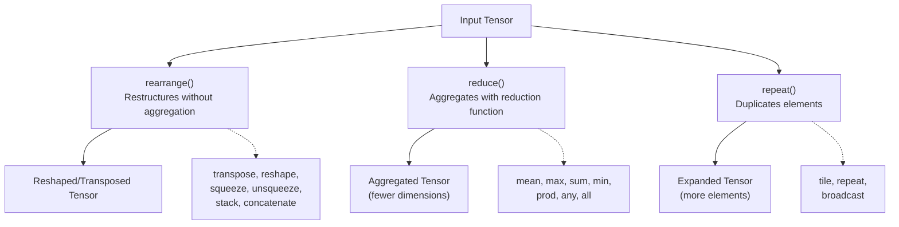
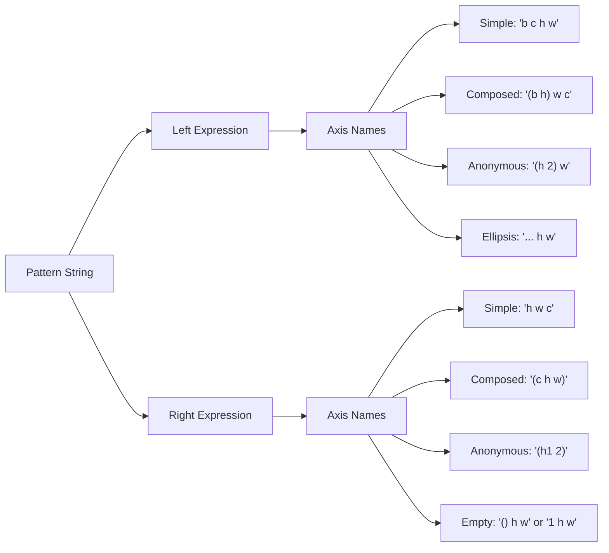
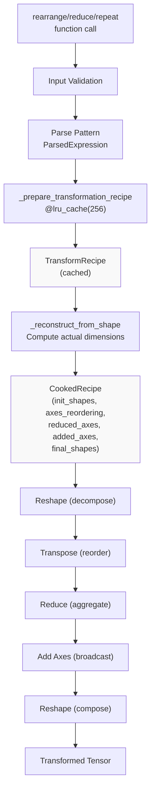
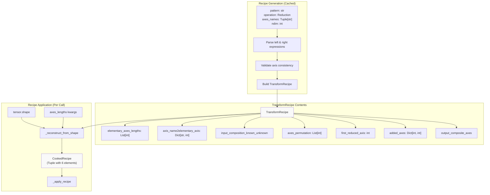
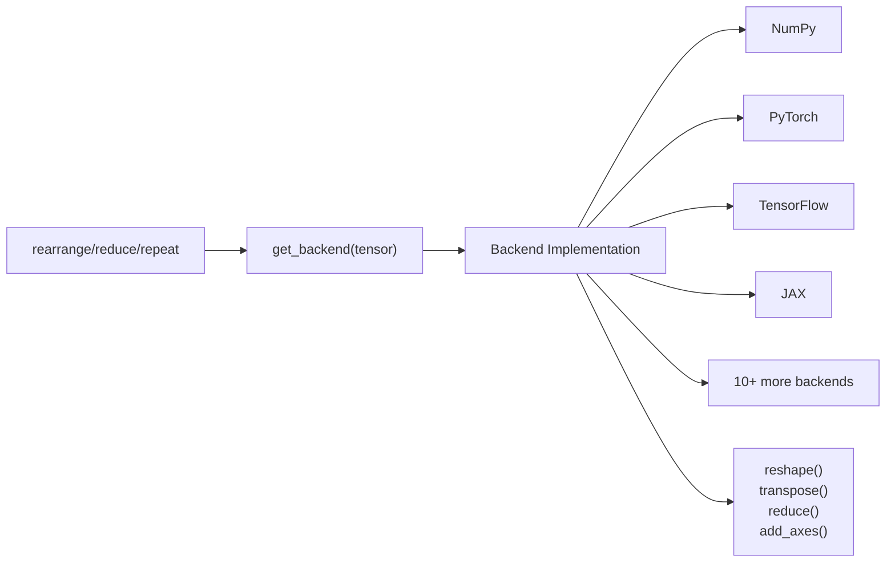

<!-- source: DeepWiki mcp.deepwiki.com · repo arogozhnikov/einops · page 2.1 rearrange, reduce, and repeat · fetched 2026-10-21 -->

# rearrange, reduce, and repeat

<details>
<summary>Relevant source files</summary>

The following files were used as context for generating this wiki page:

- [README.md](README.md)
- [einops/einops.py](einops/einops.py)
- [einops/parsing.py](einops/parsing.py)
- [einops/tests/test_examples.py](einops/tests/test_examples.py)
- [einops/tests/test_layers.py](einops/tests/test_layers.py)
- [einops/tests/test_ops.py](einops/tests/test_ops.py)
- [einops/tests/test_other.py](einops/tests/test_other.py)

</details>


## Purpose and Scope

This document describes the three fundamental tensor manipulation operations provided by einops: `rearrange`, `reduce`, and `repeat`. These operations form the core API for tensor transformations using einops' pattern-based domain-specific language (DSL).

For information about pattern syntax rules and validation, see [Pattern Syntax Guide](#2.4). For layer integrations of these operations, see [Layer Integration](#3). For the underlying pattern parsing system, see [Pattern Parsing System](#4.3).

## Overview of the Three Operations

The three core operations share a common interface but serve distinct purposes:



**Diagram: Three Core Operations and Their Native Equivalents**

Sources: [einops/einops.py:561-674](), [docs/1-einops-basics.ipynb:137-673]()

## Function Signatures

### rearrange

```python
def rearrange(tensor: Union[Tensor, List[Tensor]], 
              pattern: str, 
              **axes_lengths: Size) -> Tensor
```

Rearranges tensor elements according to a pattern. This is a reader-friendly smart element reordering operation that includes functionality of transpose, reshape, squeeze, unsqueeze, stack, and concatenate.

**Key validation rule**: For `rearrange`, the set of axes on both sides of `->` must be identical (symmetric difference = 0).

Sources: [einops/einops.py:561-616]()

### reduce

```python
def reduce(tensor: Union[Tensor, List[Tensor]], 
           pattern: str, 
           reduction: Reduction, 
           **axes_lengths: Size) -> Tensor
```

Combines rearrangement and reduction using a reduction function. The `reduction` parameter specifies how to aggregate values.

**Key validation rule**: For `reduce`, axes on the right must be a subset of axes on the left. Axes appearing only on the left are reduced.

**Available reductions**: `'min'`, `'max'`, `'sum'`, `'mean'`, `'prod'`, `'any'`, `'all'`, or a custom callable `f(tensor, reduced_axes) -> tensor`.

Sources: [einops/einops.py:468-550](), [einops/einops.py:21]()

### repeat

```python
def repeat(tensor: Union[Tensor, List[Tensor]], 
           pattern: str, 
           **axes_lengths: Size) -> Tensor
```

Reorders elements and repeats them in arbitrary combinations. Includes functionality of repeat, tile, and broadcast.

**Key validation rule**: For `repeat`, axes on the left must be a subset of axes on the right. New axes appearing only on the right must have their lengths specified in `axes_lengths`.

Sources: [einops/einops.py:627-674]()

## Common Parameters

### pattern: str

A string describing the transformation using einops DSL. The pattern consists of two parts separated by `->`:
- **Left side**: describes input tensor structure
- **Right side**: describes output tensor structure

Example patterns:
- `'b c h w -> b h w c'` - transpose (channels-first to channels-last)
- `'b c h w -> b (c h w)'` - flatten
- `'h w -> h w c'` with `c=3` - add new axis

### axes_lengths: **kwargs

Additional specifications for axis dimensions. Required when:
- Decomposing an axis: `'(h h1) -> h h1'` needs one of `h=` or `h1=`
- Adding new axes in `repeat`: `'h w -> h w c'` needs `c=`

### tensor: Union[Tensor, List[Tensor]]

Input can be:
- A single tensor from any supported framework
- A list of tensors (of same type/shape) which are automatically stacked

Sources: [einops/einops.py:516-523](), [einops/einops.py:606-610](), [einops/einops.py:664-668]()

## Pattern Components



**Diagram: Pattern Components**

Sources: [einops/einops.py:299-368]()

### Axis Composition and Decomposition

**Composition**: Merge multiple axes into one using parentheses.
```python
rearrange(x, 'b c h w -> b (c h w)')  # flatten
# Output shape: (b, c*h*w)
```

**Decomposition**: Split one axis into multiple using parentheses.
```python
rearrange(x, '(b1 b2) h w c -> b1 b2 h w c', b1=2)  # split batch
# Infers b2 = original_b / b1
```

The product of decomposed axis lengths must equal the original axis length. Only one unknown is allowed per decomposition.

Sources: [einops/einops.py:370-410](), [docs/1-einops-basics.ipynb:296-343]()

### Anonymous Axes

Axes can be specified with integer literals when their exact identity isn't important:

```python
# These are equivalent:
reduce(x, 'b c (h 2) (w 2) -> b c h w', 'max')
reduce(x, 'b c (h h2) (w w2) -> b c h w', 'max', h2=2, w2=2)
```

Anonymous axes are particularly useful for reductions where you don't need to reference the reduced axis.

Sources: [einops/einops.py:309-310](), [einops/einops.py:374-387]()

### Ellipsis

The ellipsis `...` matches an arbitrary number of axes, enabling dimension-agnostic operations:

```python
reduce(x, '... h w -> ...', 'mean')  # works for any number of leading dimensions
```

**Restrictions**:
- Ellipsis cannot appear on right side if not on left side
- Ellipsis cannot be inside parentheses on the left side

Sources: [einops/einops.py:304-306](), [einops/einops.py:331-368]()

## Execution Pipeline



**Diagram: Operation Execution Pipeline**

Each operation executes through the same five-stage pipeline, with stages conditionally applied based on the recipe:

1. **Initial Reshape**: Decomposes composite input axes (e.g., `(h h1)` → `h, h1`)
2. **Transpose**: Reorders axes to match output pattern
3. **Reduce**: Applies reduction function to specified axes (reduce only)
4. **Add Axes**: Broadcasts/tiles to create new axes (repeat only)
5. **Final Reshape**: Composes output axes (e.g., `h, w` → `(h w)`)

Sources: [einops/einops.py:230-252](), [einops/einops.py:290-442]()

## Recipe System



**Diagram: Recipe System Architecture**

The recipe system separates pattern processing into two phases:

1. **Recipe Generation** (cached): Pattern is parsed once and transformed into a `TransformRecipe` object containing abstract transformation logic
2. **Recipe Application** (per call): Recipe is "cooked" with actual tensor shape to produce concrete reshape/transpose operations

This design enables:
- **Performance**: Pattern parsing happens once, cached with `@lru_cache(256)`
- **Static graph compatibility**: Pre-computed recipes work with TensorFlow graph mode and PyTorch JIT
- **Multiple input dimensions**: Same pattern can handle different tensor ranks (for ellipsis patterns)

Sources: [einops/einops.py:114-152](), [einops/einops.py:155-225](), [einops/einops.py:289-295]()

## Implementation Details

### Backend Dispatch

All three operations are framework-agnostic and automatically detect the appropriate backend:



**Diagram: Backend Dispatch System**

Sources: [einops/einops.py:230-252](), [einops/_backends.py:1-100]()

### Reduction Operations

For `reduce`, the reduction type determines aggregation behavior:

```python
_reductions = ("min", "max", "sum", "mean", "prod", "any", "all")

def _reduce_axes(tensor, reduction_type: Reduction, reduced_axes: List[int], backend):
    if callable(reduction_type):
        return reduction_type(tensor, tuple(reduced_axes))
    else:
        assert reduction_type in _reductions
        if reduction_type == "mean":
            if not backend.is_float_type(tensor):
                raise NotImplementedError("reduce_mean is not available for non-floating tensors")
        return backend.reduce(tensor, reduction_type, tuple(reduced_axes))
```

Custom reduction functions are supported: `reduce(x, pattern, reduction=my_custom_fn)` where `my_custom_fn(tensor, axes) -> tensor`.

Sources: [einops/einops.py:37-47]()

### List Input Handling

When a list of tensors is provided:

```python
if isinstance(tensor, list):
    if len(tensor) == 0:
        raise TypeError("Rearrange/Reduce/Repeat can't be applied to an empty list")
    backend = get_backend(tensor[0])
    tensor = backend.stack_on_zeroth_dimension(tensor)
```

The list is automatically stacked along a new batch dimension, with the new axis appearing first in the pattern (e.g., `'b h w c'` where `b` enumerates the list).

Sources: [einops/einops.py:529-533]()

## Common Use Cases

### Deep Learning Operations

The operations cover most tensor manipulation needs in deep learning:

| Operation | Pattern Example | Use Case |
|-----------|----------------|----------|
| Flatten | `'b c h w -> b (c h w)'` | Conv to FC boundary |
| Channel transpose | `'b c h w -> b h w c'` | Framework conversion |
| Space-to-depth | `'b c (h h1) (w w1) -> b (h1 w1 c) h w'` | Resolution reduction |
| Depth-to-space | `'b (h1 w1 c) h w -> b c (h h1) (w w1)'` | Resolution increase |
| Global pooling | `'b c h w -> b c'` with reduction | Feature aggregation |
| Max pooling 2x2 | `'b c (h 2) (w 2) -> b c h w'` with reduction | Downsampling |

Sources: [docs/2-einops-for-deep-learning.ipynb:247-485]()

### Squeeze/Unsqueeze

```python
# Add dummy batch dimension (unsqueeze)
y = rearrange(image, 'h w c -> () c h w')  # or 'h w c -> 1 c h w'

# Remove dummy dimension (squeeze)
predictions = rearrange(batch_predictions, '() classes -> classes')
```

Empty composition `()` or literal `1` creates/removes dimensions of length 1.

Sources: [docs/2-einops-for-deep-learning.ipynb:517-535]()

### Broadcasting with keepdims

```python
# Per-channel mean normalization (keeps spatial dimensions)
y = x - reduce(x, 'b c h w -> b c 1 1', 'mean')

# Per-batch mean normalization
y = x - reduce(x, 'b c h w -> 1 c 1 1', 'mean')
```

This mirrors NumPy's `keepdims=True` but with explicit dimension specification.

Sources: [docs/2-einops-for-deep-learning.ipynb:541-628]()

### Stacking and Concatenation

```python
# Stack list along batch dimension
stacked = rearrange(list_of_tensors, 'b c h w -> b c h w')

# Concatenate along height
concat = rearrange(list_of_tensors, 'b c h w -> (b h) w c')

# Concatenate along channel
concat = rearrange(list_of_tensors, 'b c h w -> h w (b c)')
```

The new axis enumerating the list appears first in the left pattern.

Sources: [docs/2-einops-for-deep-learning.ipynb:630-812]()

## Error Handling

Each operation validates pattern consistency during recipe preparation:

```python
if operation == "rearrange":
    difference = set.symmetric_difference(left.identifiers, rght.identifiers)
    if len(difference) > 0:
        raise EinopsError(f"Identifiers only on one side of expression: {difference}")
        
elif operation == "repeat":
    difference = set.difference(left.identifiers, rght.identifiers)
    if len(difference) > 0:
        raise EinopsError(f"Unexpected identifiers on the left side of repeat: {difference}")
    axes_without_size = set.difference(
        {ax for ax in rght.identifiers if not isinstance(ax, AnonymousAxis)},
        {*left.identifiers, *axes_names},
    )
    if len(axes_without_size) > 0:
        raise EinopsError(f"Specify sizes for new axes in repeat: {axes_without_size}")
        
elif operation in _reductions or callable(operation):
    difference = set.difference(rght.identifiers, left.identifiers)
    if len(difference) > 0:
        raise EinopsError(f"Unexpected identifiers on the right side of reduce: {difference}")
```

Shape mismatches during execution also raise descriptive errors:

```python
if isinstance(length, int) and isinstance(known_product, int) and length != known_product:
    raise EinopsError(f"Shape mismatch, {length} != {known_product}")
```

Sources: [einops/einops.py:308-329](), [einops/einops.py:183-188]()

## Gradients and Backpropagation

All operations are fully differentiable and support automatic differentiation:

```python
# PyTorch example
x.requires_grad = True
y1 = reduce(x, 'b c h w -> b c', 'max')
y2 = rearrange(y1, 'b c -> c b')
y3 = reduce(y2, 'c b -> ', 'sum')
y3.backward()
# x.grad now contains gradients
```

The gradient flow works correctly through all reshape, transpose, reduce, and broadcast operations implemented by each backend.

Sources: [docs/2-einops-for-deep-learning.ipynb:170-195]()

## Relationship to Layers

The layer versions (`RearrangeMixin`, `ReduceMixin`) wrap these operations for framework integration:

```python
class RearrangeMixin:
    def __init__(self, pattern: str, **axes_lengths: Any) -> None:
        super().__init__()
        self.pattern = pattern
        self.axes_lengths = axes_lengths
        self._multirecipe = self.multirecipe()  # Pre-compute for all dims
        self._axes_lengths = tuple(self.axes_lengths.items())
    
    def _apply_recipe(self, x):
        backend = get_backend(x)
        return _apply_recipe(
            backend=backend,
            recipe=self._multirecipe[len(x.shape)],  # Select recipe for input rank
            tensor=x,
            reduction_type="rearrange",
            axes_lengths=self._axes_lengths,
        )
```

Layers pre-compute recipes for multiple input dimensionalities during initialization, enabling use in static graphs and JIT compilation contexts.

For detailed information about layers, see [Layer Integration](#3).

Sources: [einops/layers/__init__.py:9-49](), [einops/layers/__init__.py:58-99]()

---

