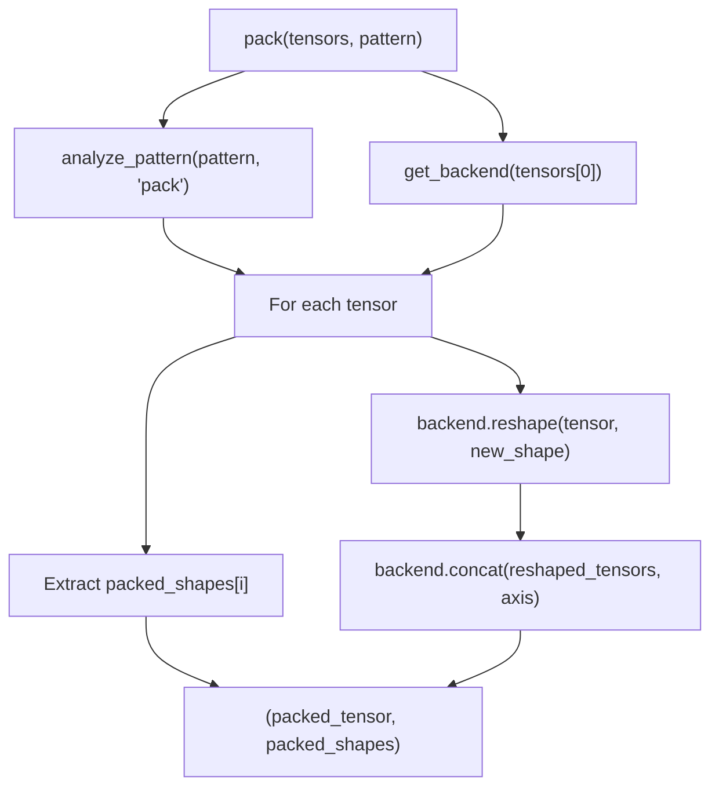
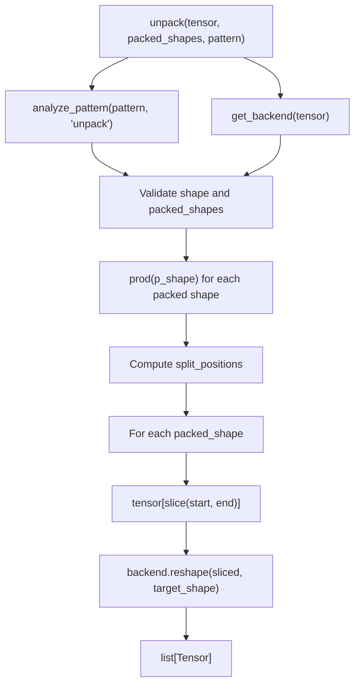
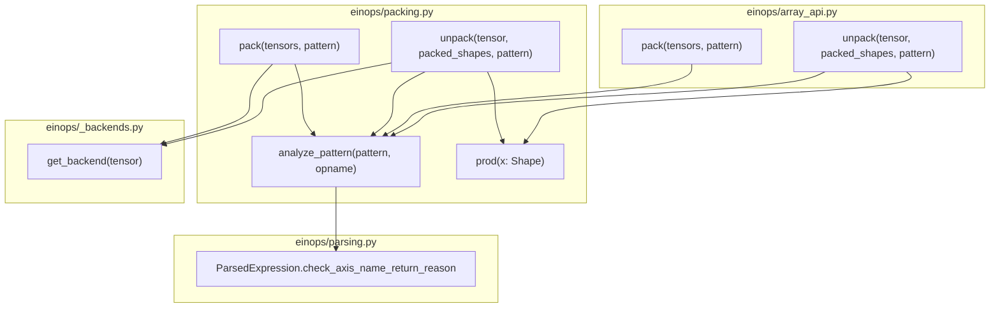

<!-- source: DeepWiki mcp.deepwiki.com · repo arogozhnikov/einops · page 2.3 pack and unpack Operations · fetched 2026-10-21 -->

# pack and unpack Operations

<details>
<summary>Relevant source files</summary>

The following files were used as context for generating this wiki page:

- [README.md](README.md)
- [docs/1-einops-basics.ipynb](docs/1-einops-basics.ipynb)
- [docs/4-pack-and-unpack.ipynb](docs/4-pack-and-unpack.ipynb)
- [einops/array_api.py](einops/array_api.py)
- [einops/packing.py](einops/packing.py)
- [einops/tests/test_parsing.py](einops/tests/test_parsing.py)

</details>


This document provides a comprehensive technical reference for the `pack` and `unpack` operations in einops. These operations enable flexible combination and decomposition of tensors with varying shapes, supporting advanced batching, multi-modal data handling, and reversible tensor transformations. The focus is on the API, pattern syntax, operational semantics, and implementation details.

For information about the core rearrange, reduce, and repeat operations, see [2.1]. For a guide to the pattern syntax used in all einops operations, see [2.4]. For details on the internal backend and recipe systems, see [4.1] and [4.2].

---

## Purpose and Scope

- **Purpose:**  
  To document the `pack` and `unpack` operations, including their API, pattern rules, use cases, and implementation details.
- **Scope:**  
  - How to use `pack` and `unpack` to combine and split tensors.
  - The meaning and handling of "Packed Shapes" (PS) metadata.
  - Supported pattern syntax and its constraints.
  - Typical use cases (auto-batching, multi-modal fusion, reversible splits).
  - Internal code structure and backend support.

---

## Overview of pack and unpack

The `pack` and `unpack` operations provide reversible tensor combination and decomposition:

- **`pack(tensors, pattern)`**: Combines a sequence of tensors into a single tensor by flattening and concatenating along a designated axis. Returns `(packed_tensor, packed_shapes)`.
- **`unpack(tensor, packed_shapes, pattern)`**: Splits a packed tensor back into its original components using the packed_shapes (PS) metadata.

These operations handle tensors of different ranks by reshaping them to compatible dimensions before concatenation. The PS metadata records the shape of the packed axes for each input tensor, enabling exact reconstruction.

**Key Characteristics:**

- Tensors may have different numbers of dimensions, provided the axes before and after `*` match.
- Reversibility is guaranteed: `unpack(pack(inputs, pattern)[0], PS, pattern)` reconstructs the original tensors.
- Implemented for all backends via [einops/_backends.py](): NumPy, PyTorch, TensorFlow, JAX, and Array API Standard compliant frameworks.
- Pattern syntax: space-separated axis names with exactly one `*` denoting the packed axis.

**Sources:**  
[einops/packing.py:34-88](), [einops/packing.py:98-190](), [einops/array_api.py:52-69](), [einops/array_api.py:72-125](), [docs/4-pack-and-unpack.ipynb:1-617]()

---

## API Reference

### Function Signatures

| Function | Purpose | Key Parameters | Returns |
|----------|---------|---------------|---------|
| `pack(tensors, pattern)` | Packs a sequence of tensors into one | `tensors`: `Sequence[Tensor]`<br>`pattern`: `str`, e.g. `"b * c"` | `tuple[Tensor, list[Shape]]` |
| `unpack(tensor, packed_shapes, pattern)` | Unpacks a tensor into a sequence | `tensor`: `Tensor`<br>`packed_shapes`: `list[Shape]`<br>`pattern`: `str` | `list[Tensor]` |

**Type Definitions:**
- `Tensor = TypeVar("Tensor")` - Generic tensor type compatible with any backend
- `Shape = Union[tuple[int, ...], list[int]]` - Shape representation as tuple or list of integers

**Sources:**  
[einops/packing.py:9-12](), [einops/packing.py:34-88](), [einops/packing.py:98-190](), [einops/array_api.py:49](), [einops/array_api.py:52-69](), [einops/array_api.py:72-125]()

---

## Pattern Syntax for pack/unpack

Pack/unpack patterns are whitespace-separated lists of axis names with exactly one `*` (asterisk) designating the packed axis. Unlike `rearrange` patterns, pack/unpack patterns do not use arrows or support axis reordering.

**Pattern Example:**  
- `"b * c"`:  
  - `b` and `c` are shared axes (first and last axes of all tensors).
  - `*` is the packed axis (may span zero or more axes in each tensor).

**Pattern Rules:**

- Exactly one `*` is required per pattern.
- All other axis names must be valid identifiers (checked via `ParsedExpression.check_axis_name_return_reason`).
- Duplicate axis names are prohibited.
- The number of axes before `*` and after `*` must match across all tensors.

**Pattern Validation:**  
The `analyze_pattern` function at [einops/packing.py:14-31]() parses the pattern and returns:
- `n_axes_before`: Number of axes before `*`
- `n_axes_after`: Number of axes after `*`
- `min_axes`: Minimum number of axes required = `n_axes_before + n_axes_after`

**Sources:**  
[einops/packing.py:14-31](), [einops/parsing.py:1-130]()

---

## Operational Semantics

### pack Operation

**Input:** `tensors: Sequence[Tensor]`, `pattern: str`

**Process:**
1. Call `analyze_pattern(pattern, "pack")` to determine `n_axes_before`, `n_axes_after`, `min_axes`.
2. Obtain backend via `get_backend(tensors[0])`.
3. For each tensor with shape `shape`:
   - Verify `len(shape) >= min_axes`, raise `EinopsError` otherwise.
   - Compute `axis_after_packed_axes = len(shape) - n_axes_after`.
   - Extract packed shape: `packed_shapes[i] = shape[n_axes_before:axis_after_packed_axes]`.
   - Reshape tensor to `(*shape[:n_axes_before], -1, *shape[axis_after_packed_axes:])` using `backend.reshape`.
4. Concatenate all reshaped tensors along axis `n_axes_before` using `backend.concat`.

**Output:** `(packed_tensor, packed_shapes)` where `packed_shapes` is a list of shapes (tuples or lists).

**Implementation:** [einops/packing.py:34-88](), [einops/array_api.py:52-69]()

### unpack Operation

**Input:** `tensor: Tensor`, `packed_shapes: list[Shape]`, `pattern: str`

**Process:**
1. Call `analyze_pattern(pattern, "unpack")` to determine `n_axes_before`, `n_axes_after`, `min_axes`.
2. Obtain backend and input shape.
3. Verify `len(input_shape) == n_axes_before + 1 + n_axes_after`, raise `EinopsError` otherwise.
4. Compute `lengths_of_composed_axes` by calling `prod(p_shape)` for each packed shape (or -1 if shape contains -1).
5. Verify at most one -1 exists in `lengths_of_composed_axes`.
6. Compute `split_positions` array indicating where to split the packed axis.
7. For each packed shape, slice the tensor along the packed axis and reshape to the original shape.

**Output:** `list[Tensor]` containing unpacked tensors.

**Implementation:** [einops/packing.py:98-190](), [einops/array_api.py:72-125]()

**Helper Function:**  
`prod(x: Shape) -> int` at [einops/packing.py:91-95]() computes the product of all integers in a shape.

**Sources:**  
[einops/packing.py:14-31](), [einops/packing.py:34-88](), [einops/packing.py:91-95](), [einops/packing.py:98-190](), [einops/array_api.py:52-69](), [einops/array_api.py:72-125]()

---

### Diagram: pack Operation Data Flow



**Sources:**  
[einops/packing.py:34-88](), [einops/array_api.py:52-69]()

### Diagram: unpack Operation Data Flow



**Sources:**  
[einops/packing.py:98-190](), [einops/array_api.py:72-125]()

---

## Example Use Cases

### 1. Stacking Data Layers of Different Ranks

RGB image shape `(h, w, 3)` and depth map shape `(h, w)` can be packed together:

```python
image_rgb, image_depth = np.random.random([h, w, 3]), np.random.random([h, w])
image_rgbd, ps = pack([image_rgb, image_depth], "h w *")
# image_rgbd.shape: (h, w, 4)
# ps: [(3,), ()]
```

The PS metadata `[(3,), ()]` indicates the first tensor contributed 3 channels and the second contributed 0 additional axes (scalar in the packed dimension). Unpacking reverses this:

```python
unpacked_rgb, unpacked_depth = unpack(image_rgbd, ps, "h w *")
# unpacked_rgb.shape: (h, w, 3)
# unpacked_depth.shape: (h, w)
```

**Source:** [docs/4-pack-and-unpack.ipynb:63-185]()

### 2. Auto-batching

A function accepting variable batch dimensions:

```python
def universal_predict(x):
    x_packed, ps = pack([x], "* h w c")
    predictions_packed = image_classifier(x_packed)
    [predictions] = unpack(predictions_packed, ps, "* cls")
    return predictions
```

This works for input shapes `(h, w, c)`, `(batch, h, w, c)`, or `(batch, frames, h, w, c)`.

**Source:** [docs/4-pack-and-unpack.ipynb:243-296]()

### 3. Vision Transformer with Class Token

Packing class tokens with patch tokens:

```python
input_packed, ps = pack([class_tokens, patch_tokens], "b * c")
output_packed = transformer(input_packed)
class_token_emb, patch_tokens_emb = unpack(output_packed, ps, "b * c_out")
```

Class tokens shape `(b, c)` and patch tokens shape `(b, h, w, c)` are packed along the spatial dimension.

**Source:** [docs/4-pack-and-unpack.ipynb:313-442]()

### 4. Multi-output Model Unpacking

Detection model output with multiple heads:

```python
confidence, bbox_x, bbox_y, bbox_w, bbox_h, mask_logits, class_logits = \
    unpack(model_output, [[], [], [], [], [], [mask_h, mask_w], [n_classes]], "b h w *")
```

Each output is automatically reshaped according to the specified packed shape.

**Source:** [docs/4-pack-and-unpack.ipynb:497-572]()

**Sources:**  
[docs/4-pack-and-unpack.ipynb:63-617]()

---

### Table: Comparison with Stack and Concatenate

| Operation      | Standard Stack/Concat | einops pack/unpack |
|----------------|----------------------|--------------------|
| Input ranks    | Must match           | Can differ         |
| Axis alignment | Manual               | Pattern-based      |
| Reversible     | No                   | Yes (with PS)      |
| Metadata       | None                 | Packed Shapes (PS) |
| Pattern        | Axis index           | Named axes + `*`   |

**Sources:**  
[docs/4-pack-and-unpack.ipynb]()

---

## Pattern Validation and Error Handling

- Patterns are validated for uniqueness of axis names and presence of exactly one `*`.
- If a tensor does not have enough axes to match the pattern, an error is raised.
- During unpack, if the packed axis cannot be split according to PS, an error is raised.

**Sources:**  
[einops/packing.py:13-31](), [einops/packing.py:77-88](), [einops/packing.py:142-190]()

---

### Diagram: Code Entity Dependencies



**Sources:**  
[einops/packing.py:1-191](), [einops/array_api.py:1-126](), [einops/_backends.py:1-50](), [einops/parsing.py:1-130]()

---

## Backend and Array API Support

Pack and unpack are implemented in two locations:

1. **Standard Backend Path** ([einops/packing.py:34-190]())
   - Uses `get_backend(tensor)` to obtain backend instance
   - Calls `backend.reshape()` and `backend.concat()` for tensor operations
   - Supports NumPy, PyTorch, TensorFlow, JAX, CuPy, Paddle, OneFlow, PyTensor, Tinygrad, MLX

2. **Array API Path** ([einops/array_api.py:52-125]())
   - Uses `tensor.__array_namespace__()` to obtain array API module
   - Calls `xp.reshape()` and `xp.concat()` directly
   - Supports Array API Standard compliant frameworks (NumPy 2.0+, MLX, sparse arrays, distributed arrays)

Both implementations share the `analyze_pattern` function and follow identical logic. The Array API path is preferred for frameworks implementing the Python Array API Standard.

**Sources:**  
[einops/packing.py:1-191](), [einops/array_api.py:1-126]()

---

## Limitations and Best Practices

**Pattern Constraints:**
- Exactly one `*` axis is required per pattern. Patterns with zero or multiple `*` will raise `EinopsError`.
- No axis reordering is supported. The order of axes before and after `*` is fixed.
- No axis composition (parentheses) is supported. Each axis name must be a single identifier.

**Reversibility:**
- The PS (packed_shapes) returned by `pack` must be used exactly as-is in `unpack` to guarantee reconstruction.
- Modifying PS or using a different pattern will result in incorrect shapes or runtime errors.

**Unknown Dimensions:**
- At most one `-1` is allowed across all packed shapes in a single `unpack` operation.
- If more than one `-1` is present, `EinopsError` is raised at [einops/packing.py:151-154]().

**Error Handling:**
- If reshape operations fail during `unpack`, a wrapped `EinopsError` is raised indicating the packed axis size and requested shapes at [einops/packing.py:186-190]().

**Sources:**  
[einops/packing.py:14-31](), [einops/packing.py:79-88](), [einops/packing.py:142-154](), [einops/packing.py:186-190](), [docs/4-pack-and-unpack.ipynb:217-227]()

---

## Further Reading

- For a comprehensive guide to pattern syntax, see [2.4].
- For core rearrange, reduce, and repeat operations, see [2.1].
- For advanced use cases and tutorials, see [7.4].

---

**Summary of Sources:**  
- [einops/packing.py:13-190]()
- [einops/array_api.py:52-126]()
- [docs/4-pack-and-unpack.ipynb]()

---

