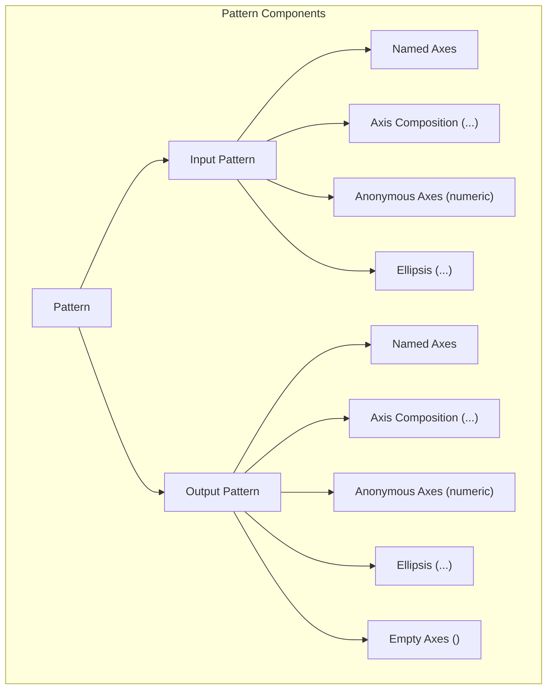
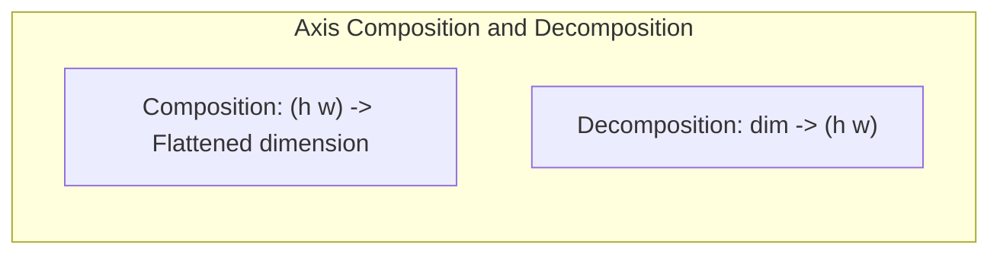
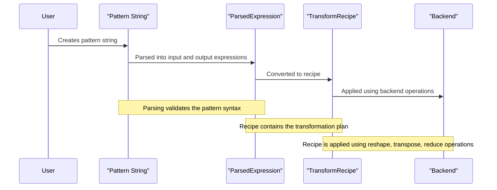
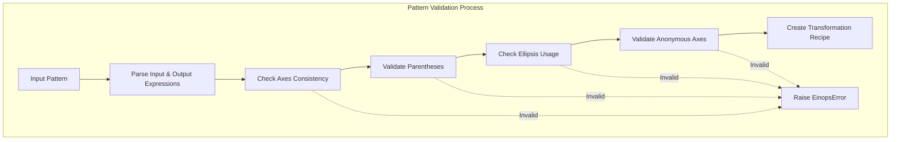
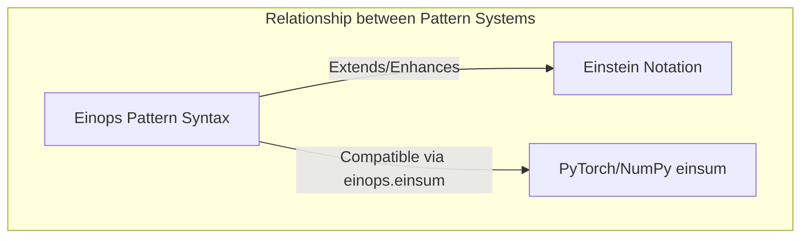

<!-- source: DeepWiki mcp.deepwiki.com · repo arogozhnikov/einops · page 2.4 Pattern Syntax Guide · fetched 2026-10-21 -->

# Pattern Syntax

<details>
<summary>Relevant source files</summary>

The following files were used as context for generating this wiki page:

- [README.md](README.md)
- [einops/einops.py](einops/einops.py)
- [einops/parsing.py](einops/parsing.py)

</details>


This page provides a detailed guide to the pattern syntax used in einops operations. The pattern language is a concise, readable way to express tensor transformations such as reshaping, transposing, and reducing dimensions. Understanding this syntax is fundamental to effectively using einops operations like `rearrange`, `reduce`, and `repeat`.

For information about the core operations that use these patterns, see [Core API](#2) and [rearrange, reduce, repeat](#2.1).

## Pattern Format

The basic format of an einops pattern consists of an input expression and an output expression, separated by an arrow:

```
input_pattern -> output_pattern
```

Both the input and output patterns describe tensor shapes as a space-separated list of dimensions (axes). The input pattern specifies the assumed shape of the input tensor, while the output pattern defines the desired shape for the result.

Sources: [einops/einops.py:299-300](), [einops/einops.py:453]()

## Pattern Components



Sources: [einops/parsing.py:24-152]()

### Named Axes

Named axes are identifiers that refer to specific dimensions in your tensor. They follow Python identifier rules with a few additional constraints:

- Must be valid Python identifiers (alphanumeric and underscore characters, cannot start with a number)
- Should not start or end with an underscore
- Should not be Python keywords (although this is allowed with a warning)

Common examples include dimensions like `batch`, `channel`, `height`, `width`, etc.

```
b c h w -> b h w c
```

In this example, `b`, `c`, `h`, and `w` are named axes representing batch, channel, height, and width dimensions.

Sources: [einops/parsing.py:127-152]()

### Composing and Decomposing Axes

Parentheses allow you to compose (combine) or decompose (split) axes:



- **Composition**: `b (h w) c -> b flat c` - Combines `h` and `w` into a single dimension
- **Decomposition**: `b flat c -> b (h w) c` - Splits `flat` into separate `h` and `w` dimensions

When decomposing dimensions, you must specify the size of at least all but one of the new dimensions, either through named arguments or anonymous axes.

Sources: [einops/parsing.py:84-111](), [einops/einops.py:572-584]()

### Anonymous Axes

Anonymous axes are specified directly as numeric values in the pattern. They indicate the size of a dimension rather than giving it a name.

```
b (h 2) (w 3) c -> b h w c
```

In this example, `2` and `3` are anonymous axes specifying that the height should be split into chunks of 2 and width into chunks of 3.

Anonymous axes with value 1 are handled specially - they are effectively ignored as they don't change the tensor shape.

Sources: [einops/parsing.py:9-21](), [einops/parsing.py:63-75]()

### Ellipsis

The ellipsis (`...`) represents an arbitrary number of dimensions in the pattern. It's particularly useful when working with tensors of varying dimensionality.

```
b c ... -> b ... c
```

This pattern would transpose the batch and channel dimensions while leaving all intermediate dimensions unchanged, regardless of how many there are.

When using ellipsis, you can only include one per pattern, and it must represent the same set of dimensions on both sides of the arrow.

Sources: [einops/parsing.py:6](), [einops/parsing.py:38-46](), [einops/einops.py:331-363]()

### Empty Axes

In output patterns, you can use empty parentheses `()` to introduce singleton dimensions (dimensions of size 1):

```
b c h w -> b c () ()
```

This is equivalent to `b c 1 1` and is commonly used for operations like per-channel normalization.

Sources: [einops/einops.py:504]()

## Pattern Processing



Sources: [einops/einops.py:289-442](), [einops/parsing.py:24-152]()

## Pattern Syntax Rules

The following rules apply to einops patterns:

1. **Axis Names Consistency**:
   - In `rearrange`, all axes must appear on both sides of the arrow
   - In `reduce`, axes that don't appear on the right side are reduced
   - In `repeat`, new axes may appear on the right side but must have specified sizes

2. **Parentheses Rules**:
   - Parentheses cannot be nested (only one level of composition is allowed)
   - Parentheses must be balanced

3. **Ellipsis Rules**:
   - Only one ellipsis allowed per pattern
   - Ellipsis on the right side must also be present on the left side
   - Ellipsis inside parentheses is only allowed on the right side

4. **Anonymous Axes Rules**:
   - Must be positive integers
   - Anonymous axes of length 1 are treated specially

Sources: [einops/einops.py:304-329](), [einops/parsing.py:84-111]()

## Pattern Validation and Error Handling

When a pattern is passed to einops operations, it undergoes several validation steps:



If an invalid pattern is detected, an `EinopsError` is raised with a descriptive message to help identify the issue.

Sources: [einops/einops.py:535-542](), [einops/parsing.py:38-111]()

## Operation-Specific Pattern Rules

Different operations have different requirements for patterns:

### Rearrange

```
input_pattern -> output_pattern
```

- All axes from input must appear in output (symmetric difference is empty)
- Non-unitary anonymous axes are not supported

Sources: [einops/einops.py:308-313]()

### Reduce

```
input_pattern -> output_pattern
```

- All axes in output must be present in input
- Axes missing from output are the ones being reduced

Sources: [einops/einops.py:324-327]()

### Repeat

```
input_pattern -> output_pattern
```

- All axes in input must be present in output
- New axes in output must have specified sizes (through arguments)

Sources: [einops/einops.py:314-323]()

## Pattern Examples

Here are examples of valid patterns for different operations:

### Rearrange Examples

1. **Transpose dimensions**:
   ```
   b c h w -> b h w c
   ```

2. **Reshape image batch to single batch**:
   ```
   b c h w -> (b c) h w
   ```

3. **Space to depth operation**:
   ```
   b c (h h1) (w w1) -> b (c h1 w1) h w
   ```

### Reduce Examples

1. **Global pooling**:
   ```
   b c h w -> b c
   ```

2. **Channel-wise mean**:
   ```
   b c h w -> b c 1 1
   ```

3. **Pooling with kernel size**:
   ```
   b c (h h1) (w w1) -> b c h w
   ```

### Repeat Examples

1. **Add channels to grayscale image**:
   ```
   h w -> h w c
   ```

2. **Upsampling**:
   ```
   h w -> (h h1) (w w1)
   ```

3. **Repeat batch dimension**:
   ```
   b c h w -> (repeat b) c h w
   ```

Sources: [einops/einops.py:464-502](), [einops/einops.py:552-598](), [einops/einops.py:608-647]()

## Relationship to Other Systems

### Pattern Syntax vs. Einstein Notation

Einops pattern syntax is inspired by Einstein notation but is more readable and focuses on tensor reshaping operations. `einsum` in einops provides a bridge between the pattern syntax and traditional Einstein summation notation:



Sources: [einops/einops.py:772-822](), [einops/einops.py:842-916]()

## Performance Considerations

The pattern string is parsed once and then cached for repeated use, improving performance when the same pattern is used multiple times:

```python
# Pattern parsed once and recipe cached
@functools.lru_cache(256)
def _prepare_transformation_recipe(pattern, operation, axes_names, ndim):
    # ...
```

For optimal performance:
- Reuse the same pattern strings when possible to benefit from caching
- For layer implementations, patterns are pre-processed during initialization

Sources: [einops/einops.py:289-290](), [einops/einops.py:227](), [einops/einops.py:445-457]()

---

