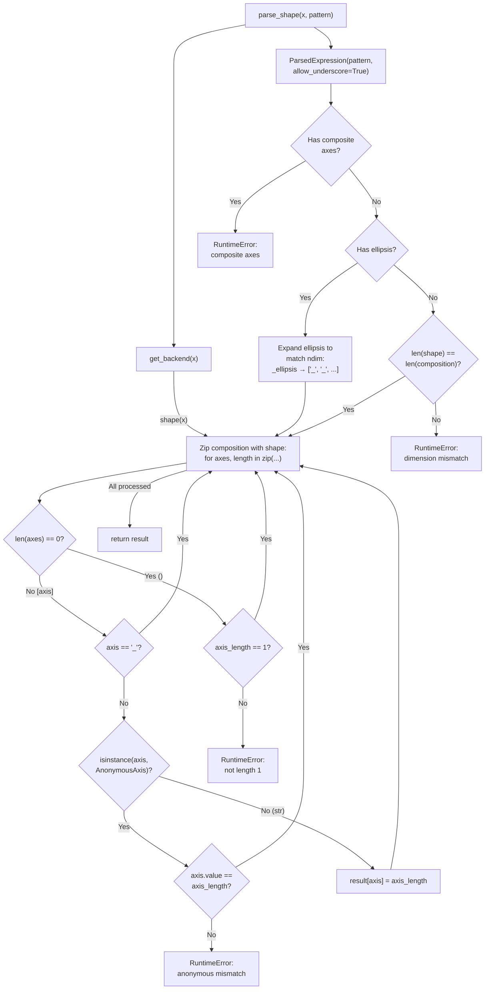
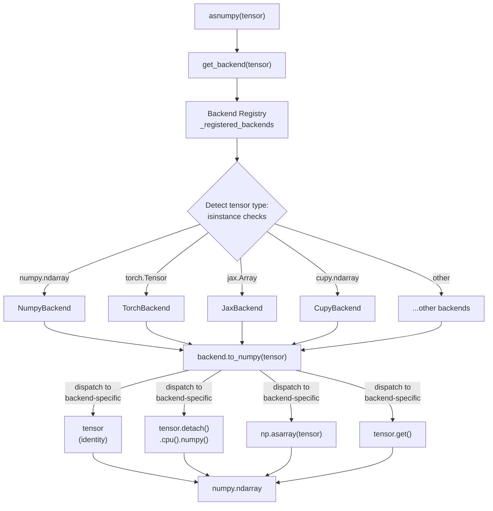

<!-- source: DeepWiki mcp.deepwiki.com · repo arogozhnikov/einops · page 2.5 Utility Functions · fetched 2026-10-21 -->

# Utility Functions

<details>
<summary>Relevant source files</summary>

The following files were used as context for generating this wiki page:

- [einops/__init__.py](einops/__init__.py)
- [einops/einops.py](einops/einops.py)
- [einops/parsing.py](einops/parsing.py)
- [scripts/setup.py](scripts/setup.py)

</details>


This page documents einops' helper functions that provide common tensor inspection and conversion operations: `parse_shape` for extracting dimension information from tensors, and `asnumpy` for framework-agnostic conversion to numpy arrays. These utilities complement the core transformation operations (see [rearrange, reduce, and repeat](#2.1)) by enabling introspection and interoperability.

For pattern syntax details used by `parse_shape`, see [Pattern Syntax Guide](#2.4). For information about the backend system that powers `asnumpy`, see [Backend System](#4.1).

## Overview of Utility Functions

einops exports two primary utility functions from its public API:

| Function | Purpose | Return Type |
|----------|---------|-------------|
| `parse_shape` | Extract axis lengths from tensor shapes into named dictionary | `dict` |
| `asnumpy` | Convert tensors from any imperative framework to `numpy.ndarray` | `numpy.ndarray` |

Both functions operate through einops' backend abstraction layer, supporting all frameworks that einops supports (NumPy, PyTorch, TensorFlow, JAX, etc.).

**Sources:** [einops/__init__.py:14](), [einops/einops.py:677-776]()

## parse_shape Function

### Function Signature and Purpose

```python
def parse_shape(x: Tensor, pattern: str) -> dict:
```

The `parse_shape` function extracts dimension information from a tensor's shape and returns it as a dictionary mapping axis names to their lengths. This enables introspection of tensor shapes using einops' semantic naming conventions, and the output can be directly passed to other einops operations via `**kwargs`.

**Sources:** [einops/einops.py:677-702]()

### Pattern Syntax

The pattern string follows similar rules to other einops operations, with special handling:

| Pattern Element | Behavior |
|----------------|----------|
| Named axes (e.g., `'batch height width'`) | Maps axis name to its length |
| Underscore (`'_'`) | Skips the dimension, not included in output |
| Ellipsis (`'...'`) | Matches variable number of dimensions, not named |
| Composite axes (e.g., `'(h w)'`) | **Not supported** - raises `RuntimeError` |
| Anonymous axes (e.g., `'3'`) | Validates that dimension equals the integer |

**Sources:** [einops/einops.py:703-706]()

### Usage Examples

```python
# Basic usage: extract dimensions by name
>>> x = np.zeros([2, 3, 5, 7])
>>> parse_shape(x, 'batch channel h w')
{'batch': 2, 'channel': 3, 'h': 5, 'w': 7}

# Skip dimensions with underscore
>>> parse_shape(x, 'batch _ h w')
{'batch': 2, 'h': 5, 'w': 7}

# Use output to specify axes_lengths for other operations
>>> y = np.zeros([700])
>>> shape_info = parse_shape(x, 'b _ h w')
>>> rearrange(y, '(b c h w) -> b c h w', **shape_info).shape
(2, 10, 5, 7)

# Ellipsis for unknown middle dimensions
>>> x = np.zeros([2, 3, 4, 5, 6])
>>> parse_shape(x, 'batch ... channel')
{'batch': 2, 'channel': 6}

# Anonymous axes for validation
>>> x = np.zeros([2, 3, 4])
>>> parse_shape(x, 'batch 3 width')  # Validates middle dim is 3
{'batch': 2, 'width': 4}
```

**Sources:** [einops/einops.py:677-736]()

### Internal Operation Flow



**Diagram: parse_shape Internal Processing Pipeline**

The function performs these steps:
1. Parse the pattern using `ParsedExpression` with `allow_underscore=True` enabled
2. Retrieve tensor shape from backend
3. Validate that composite axes are not used
4. Expand ellipsis if present to match tensor dimensionality
5. Iterate through each position, zipping composition with shape
6. For each axis: skip underscores, validate anonymous axes, add named axes to result
7. Return dictionary of axis names to lengths

**Sources:** [einops/einops.py:703-736]()

### Symbolic Framework Support

For symbolic execution frameworks (TensorFlow, Keras, PyTensor), `parse_shape` may return symbols rather than concrete integers:

```python
# TensorFlow example with unknown batch dimension
>>> import tensorflow as tf
>>> x = tf.keras.Input(shape=(None, 224, 224, 3))
>>> parse_shape(x, 'batch h w c')
{'batch': <KerasTensor representing dimension>, 'h': 224, 'w': 224, 'c': 3}
```

This enables `parse_shape` to work within symbolic graph construction, where dimensions may not be known until runtime.

**Sources:** [einops/einops.py:694]()

## asnumpy Function

### Function Signature and Purpose

```python
def asnumpy(tensor: Tensor) -> numpy.ndarray:
```

The `asnumpy` function provides framework-agnostic conversion of tensors to `numpy.ndarray`. It works with any imperative framework supported by einops (NumPy, PyTorch, JAX, CuPy, etc.) by dispatching to the appropriate backend's conversion method.

**Sources:** [einops/einops.py:766-776]()

### Supported Frameworks

`asnumpy` supports all imperative (non-symbolic) backends:

| Framework | Backend Method Called | Notes |
|-----------|----------------------|-------|
| NumPy | Identity (already numpy) | No conversion needed |
| PyTorch | `tensor.detach().cpu().numpy()` | Detaches from graph, moves to CPU |
| JAX | `np.asarray(tensor)` | Converts device array to numpy |
| CuPy | `tensor.get()` | Copies from GPU to CPU |
| Dask | `tensor.compute()` | Triggers computation |
| TensorFlow Eager | `tensor.numpy()` | Only for eager mode tensors |

Symbolic execution frameworks (TensorFlow graph mode, Keras, PyTensor) are **not supported** and will raise errors, as their tensors do not have concrete values.

**Sources:** [einops/_backends.py]() (implementation in backend classes)

### Usage Examples

```python
# Convert PyTorch tensor to NumPy
>>> import torch
>>> x = torch.randn(2, 3, 4)
>>> y = asnumpy(x)
>>> type(y)
<class 'numpy.ndarray'>

# Convert JAX array to NumPy
>>> import jax.numpy as jnp
>>> x = jnp.array([1, 2, 3])
>>> y = asnumpy(x)
>>> type(y)
<class 'numpy.ndarray'>

# NumPy arrays pass through unchanged
>>> import numpy as np
>>> x = np.array([1, 2, 3])
>>> y = asnumpy(x)
>>> x is y
True  # Same object, no copy made
```

**Sources:** [einops/einops.py:766-776]()

### Backend Dispatch Flow



**Diagram: asnumpy Backend Dispatch Architecture**

The conversion process:
1. Call `get_backend(tensor)` to identify the appropriate backend
2. Backend registry performs type detection via `isinstance` checks
3. Selected backend's `to_numpy` method is invoked
4. Backend-specific conversion logic executes (detach from graph, move to CPU, etc.)
5. Return `numpy.ndarray`

**Sources:** [einops/einops.py:776](), [einops/_backends.py:1-100]() (backend detection logic)

## Integration Patterns with Core Operations

### Common Usage Pattern: Dynamic Shape Introspection

The utility functions enable powerful patterns when combined with core operations:

```python
# Introspect source tensor and apply same structure to target
source = torch.randn(8, 3, 224, 224)
target = torch.randn(8 * 3 * 224 * 224)

# Extract shape information
shape_info = parse_shape(source, 'batch channel height width')
# {'batch': 8, 'channel': 3, 'height': 224, 'width': 224}

# Apply structure to flattened tensor
reshaped = rearrange(target, '(b c h w) -> b c h w', **shape_info)
# Shape: (8, 3, 224, 224)
```

**Sources:** [einops/einops.py:687-690]()

### Cross-Framework Workflow

```python
# Process in PyTorch, analyze in NumPy
import torch
import numpy as np

# Perform GPU computation
x = torch.randn(1000, 1000, device='cuda')
y = rearrange(x, 'h w -> w h')

# Convert to NumPy for analysis with CPU-only libraries
y_np = asnumpy(y)
mean = np.mean(y_np)  # NumPy analysis
```

### Integration with Layer System

Layers can use `parse_shape` for validation during initialization:

```python
# Hypothetical layer that validates input structure
class ValidatedLayer:
    def __init__(self, expected_pattern: str):
        self.expected_pattern = expected_pattern
    
    def forward(self, x):
        # Validate structure matches expectation
        shape_info = parse_shape(x, self.expected_pattern)
        # ... use shape_info for computation
```

**Sources:** [einops/layers/__init__.py:9-106]() (layer mixin architecture)

## Function Comparison Table

| Aspect | parse_shape | asnumpy |
|--------|-------------|---------|
| **Primary Purpose** | Shape introspection | Framework conversion |
| **Input** | Tensor + pattern string | Tensor |
| **Output** | dict[str, int] | numpy.ndarray |
| **Framework Support** | All (symbolic + imperative) | Imperative only |
| **Returns Symbols** | Yes (for symbolic frameworks) | No (concrete values only) |
| **Typical Use Case** | Dynamic shape passing | Interoperability |
| **Performance Impact** | Minimal (metadata only) | May involve GPU→CPU transfer |

**Sources:** [einops/einops.py:677-776]()

## Private Utilities

### _enumerate_directions (Not Public API)

The codebase contains `_enumerate_directions` [einops/einops.py:740-759](), which generates coordinate tensors for each axis (similar to `numpy.ogrid`). This function is **not exposed in the public API** and is not documented for end users.

```python
# Internal use only (not available to users)
x = np.zeros([2, 3, 4])
i, j, k = _enumerate_directions(x)
# result[i, j, k] = i + 2*j + 3*k
```

This function uses the backend's `arange` and `reshape` methods to construct enumeration tensors. It is intentionally private as noted by the comment at line 739.

**Sources:** [einops/einops.py:739-759]()

## Error Handling

### parse_shape Errors

| Error Condition | Exception | Example |
|----------------|-----------|---------|
| Composite axes in pattern | `RuntimeError` | `parse_shape(x, 'b (h w) c')` |
| Dimension count mismatch | `RuntimeError` | `parse_shape(np.zeros([2,3]), 'a b c d')` |
| Empty axis length ≠ 1 | `RuntimeError` | `parse_shape(np.zeros([2,3]), 'a () b')` when 2≠1 |
| Anonymous axis mismatch | `RuntimeError` | `parse_shape(np.zeros([2,3]), '5 b')` when 2≠5 |

### asnumpy Errors

`asnumpy` will fail if:
- The tensor type is not recognized by any registered backend
- The tensor is from a symbolic framework (TensorFlow graph mode, Keras layers, PyTensor)
- Backend-specific conversion fails (e.g., out of memory during GPU→CPU transfer)

**Sources:** [einops/einops.py:706-735]()

## Implementation Details

### Type Annotations

Both functions use `Tensor = TypeVar("Tensor")` to support generic tensor types across frameworks. The actual type checking and dispatch happens at runtime through the backend system.

```python
Tensor = TypeVar("Tensor")

def parse_shape(x: Tensor, pattern: str) -> dict: ...
def asnumpy(tensor: Tensor) -> np_ndarray: ...
```

Note that `np_ndarray` is defined as `Any` [einops/einops.py:763]() to avoid requiring numpy as a dependency.

**Sources:** [einops/einops.py:16](), [einops/einops.py:763]()

### Backend Method Requirements

For a backend to support these utilities, it must implement:

| Method | Required for parse_shape | Required for asnumpy |
|--------|--------------------------|---------------------|
| `shape(tensor)` | ✓ | |
| `to_numpy(tensor)` | | ✓ |

All einops backends implement both methods, ensuring consistent utility function behavior across frameworks.

**Sources:** [einops/_backends.py]() (AbstractBackend interface)

---

