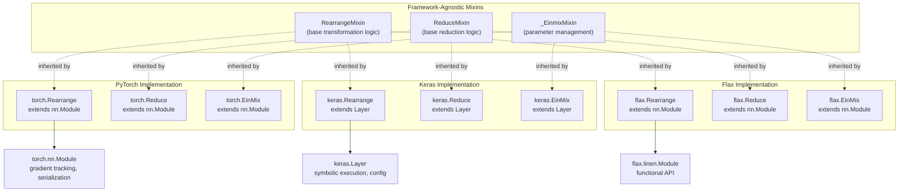
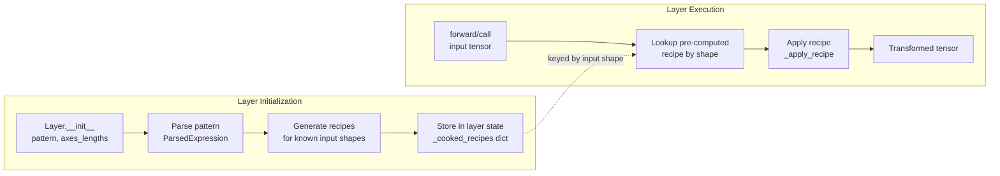
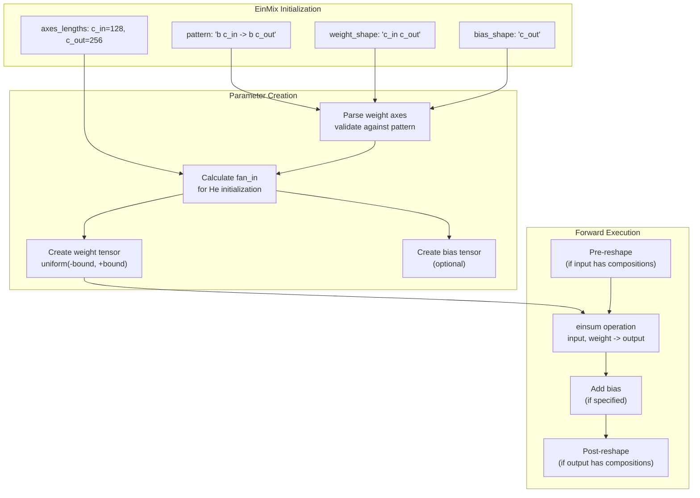

<!-- source: DeepWiki mcp.deepwiki.com · repo arogozhnikov/einops · page 3 Layer Integration · fetched 2026-10-21 -->

# Layer Integration

<details>
<summary>Relevant source files</summary>

The following files were used as context for generating this wiki page:

- [README.md](README.md)
- [einops/layers/__init__.py](einops/layers/__init__.py)
- [einops/layers/keras.py](einops/layers/keras.py)

</details>


This page provides an overview of how einops integrates into neural network architectures as native framework layers. Layers provide a stateless, declarative interface that can be composed within framework-specific model constructors (e.g., `torch.nn.Sequential`, `keras.Sequential`).

For framework-specific layer implementations, see [PyTorch Layers](#3.1), [TensorFlow/Keras Layers](#3.2), and [Other Framework Layers](#3.3). For advanced EinMix functionality, see [EinMix Layer Deep Dive](#3.4). For the underlying core operations that layers wrap, see [Core API Reference](#2).

---

## Purpose and Motivation

Einops layers enable integration with neural network frameworks without requiring custom `forward()` methods. The layers support:

1. **Static graph frameworks** (TensorFlow, Keras) where operations must be traceable at graph-building time
2. **JIT compilation** (torch.jit.script, torch.compile) where dynamic Python code cannot be executed
3. **Sequential model construction** where layers are composed declaratively without writing forward passes
4. **Gradient propagation** with automatic differentiation through all einops transformations

**Key difference from functional API**: While `rearrange(x, pattern)` executes immediately, `Rearrange(pattern)` creates a layer object with pre-computed transformation recipes that can be serialized, traced, and reused.

Sources: [README.md:139-175](), [einops/tests/test_layers.py:177-242]()

---

## Layer Architecture: Mixin Pattern

Einops uses a **mixin-based architecture** to separate framework-agnostic transformation logic from framework-specific parameter/layer management. This design enables code reuse across 5+ frameworks while maintaining native framework conventions.

### Class Hierarchy



**Design rationale**: Mixins contain pattern parsing, validation, and recipe generation. Framework-specific subclasses implement:
- Parameter creation (`torch.nn.Parameter`, `keras.Variable`)
- Forward/call methods conforming to framework conventions
- Serialization hooks (`state_dict`, `get_config`)
- Type annotations for static analysis

Sources: [einops/layers/_einmix.py:15-208](), [README.md:143-148]()

---

## Core Layer Types

Einops provides three layer types corresponding to core operations:

| Layer Class | Core Function | Purpose | Example Pattern |
|-------------|---------------|---------|-----------------|
| `Rearrange` | `rearrange()` | Reshape and transpose tensors | `'b c h w -> b (c h w)'` |
| `Reduce` | `reduce()` | Aggregate along axes | `'b c h w -> b c'` with `reduction='mean'` |
| `EinMix` | `einsum()` | Learnable linear transformation | `'b c_in -> b c_out'` with `weight_shape='c_in c_out'` |

### Usage Example: PyTorch Sequential Model

```python
from torch.nn import Sequential, Conv2d, Linear, ReLU
from einops.layers.torch import Rearrange, Reduce, EinMix

model = Sequential(
    Conv2d(3, 16, kernel_size=3),
    Reduce('b c (h h2) (w w2) -> b c h w', 'max', h2=2, w2=2),  # 2x2 max pooling
    Rearrange('b c h w -> b (c h w)'),  # flatten
    Linear(16 * 8 * 8, 120),
    ReLU(),
    EinMix('b c_in -> b c_out', weight_shape='c_in c_out', c_in=120, c_out=84),
    Linear(84, 10)
)
```

Sources: [README.md:154-168](), [einops/tests/test_layers.py:177-201]()

---

## Recipe Pre-computation System

Unlike functional operations that generate recipes on-the-fly, **layers pre-compute transformation recipes during initialization**. This is essential for compatibility with static graph frameworks and JIT compilers.

### Pre-computation Flow



**Recipe storage strategy**: Layers maintain a `_cooked_recipes` dictionary mapping input shapes to `TransformRecipe` objects. For frameworks with dynamic shapes (e.g., Keras with `None` dimensions), recipes are keyed by the known shape signature.

### Example: Rearrange Layer Initialization

During `Rearrange('b c h w -> b (c h w)').__init__()`:

1. Pattern is parsed into `ParsedExpression` objects for left and right sides
2. Axis identifiers are validated (left and right must have same set, except composed axes)
3. For imperative frameworks (PyTorch): recipe generation deferred to first forward pass
4. For symbolic frameworks (Keras): recipes pre-computed for shape signature `[None, None, None, None]`

**Why pre-computation matters**:
- `torch.jit.script` cannot execute dynamic Python code (pattern parsing, string manipulation)
- Keras symbolic execution requires fixed computational graphs
- Pre-computed recipes enable serialization/deserialization without re-parsing patterns

Sources: [einops/tests/test_layers.py:37-100](), [einops/layers/_einmix.py:67-108]()

---

## EinMix Layer: Learnable Transformations

`EinMix` is unique among einops layers because it **manages learnable parameters**. It combines einsum-style pattern specification with automatic weight initialization.

### EinMix Architecture



**Initialization**: Weight tensor initialized with uniform distribution in range `[-bound, +bound]` where `bound = sqrt(3 / fan_in)`. This is **He uniform initialization** adapted for arbitrary axis mixing patterns.

**Use cases**:
- **MLP-Mixer**: mixing tokens and channels independently
- **Vision Permutator**: learnable spatial mixing
- **Multi-head attention**: per-head linear projections in single layer

Sources: [einops/layers/_einmix.py:15-208](), [einops/tests/test_layers.py:359-447]()

---

## Framework Support Matrix

Einops provides layer implementations for multiple frameworks:

| Framework | Module Path | Base Class | Status |
|-----------|-------------|------------|--------|
| PyTorch | `einops.layers.torch` | `torch.nn.Module` | Full support (script, compile) |
| Keras/TensorFlow | `einops.layers.keras` | `keras.Layer` | TF 2.16+ required |
| Flax | `einops.layers.flax` | `flax.linen.Module` | Community maintained |
| PaddlePaddle | `einops.layers.paddle` | `paddle.nn.Layer` | Community maintained |
| Chainer | `einops.layers.chainer` | `chainer.Link` | Community maintained |

**Import pattern**:
```python
from einops.layers.torch import Rearrange, Reduce, EinMix
from einops.layers.keras import Rearrange, Reduce, EinMix
from einops.layers.flax import Rearrange, Reduce, EinMix
```

All implementations provide identical pattern syntax and semantics - only framework-specific plumbing differs.

Sources: [README.md:143-148](), [einops/tests/test_layers.py:308-357]()

---

## Testing and Validation

Layers are tested against functional API equivalents to ensure correctness:

**Test categories**:
1. **Imperative backends** (PyTorch, NumPy): test forward pass, gradient propagation, serialization
2. **Symbolic backends** (Keras, TensorFlow): test graph construction with unknown shapes (`None`)
3. **JIT compilation** (torch.jit.script, torch.jit.trace): test scripting and tracing compatibility
4. **Serialization** (pickle, keras save/load): test parameter preservation across save/load cycles

**Cross-framework validation**: Each layer operation is compared against the corresponding functional operation (`rearrange`, `reduce`) applied to the same input, ensuring behavioral consistency.

Sources: [einops/tests/test_layers.py:37-149](), [einops/tests/test_layers.py:177-306]()

---

## Implementation Guidelines

When using einops layers:

1. **Specify all axis lengths**: Layers require explicit `axes_lengths` parameters for all non-ellipsis axes
2. **Pre-compute when possible**: Layer initialization performs validation - catch errors early
3. **Use functional API for dynamic patterns**: If pattern depends on runtime values, use `rearrange(x, pattern)` instead
4. **Layer state is minimal**: Layers store only pattern strings and pre-computed recipes - no learned parameters except `EinMix`

**Performance**: Pre-computed recipes add negligible overhead. Recipe lookup is O(1) dictionary access. Recipe execution is identical to functional API.

For detailed framework-specific APIs, see [PyTorch Layers](#3.1), [TensorFlow/Keras Layers](#3.2), and [Other Framework Layers](#3.3).

---

