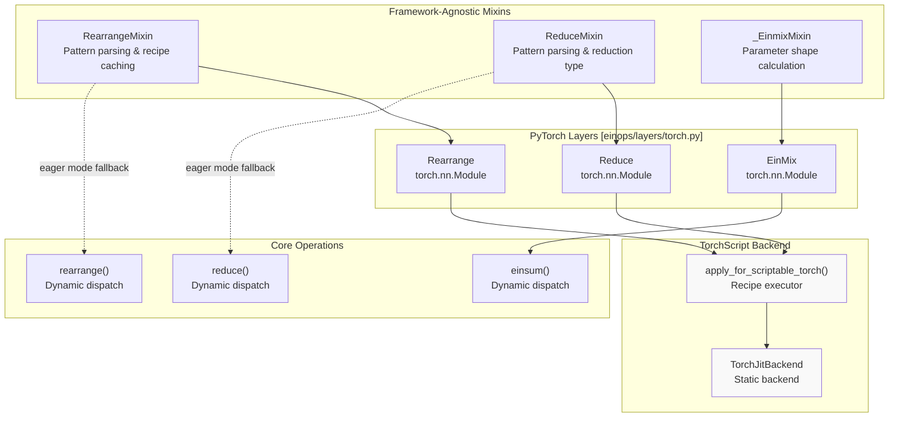
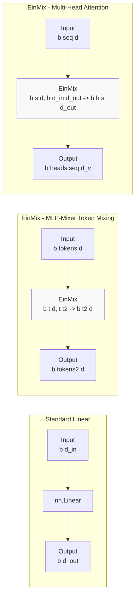
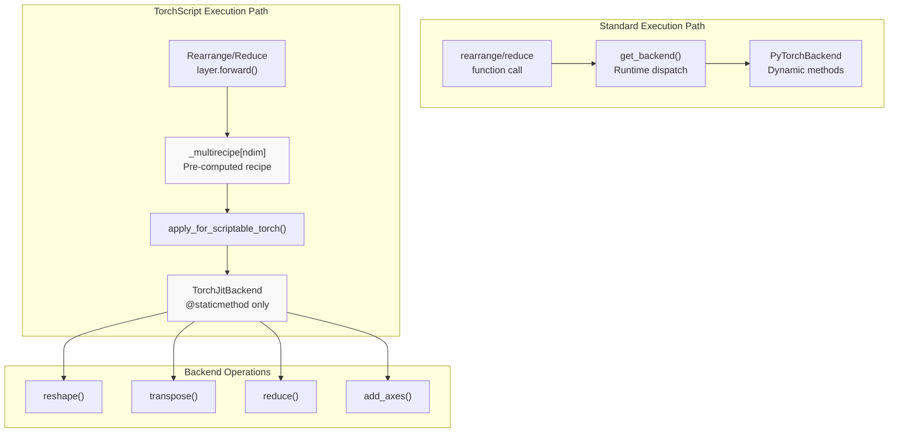
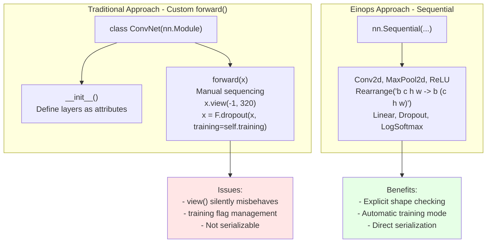

<!-- source: DeepWiki mcp.deepwiki.com · repo arogozhnikov/einops · page 3.1 PyTorch Layers · fetched 2026-10-21 -->

# PyTorch Layers

<details>
<summary>Relevant source files</summary>

The following files were used as context for generating this wiki page:

- [einops/layers/__init__.py](einops/layers/__init__.py)
- [einops/layers/keras.py](einops/layers/keras.py)
- [einops/layers/torch.py](einops/layers/torch.py)

</details>


## Purpose and Scope

This page documents the PyTorch-specific layer implementations provided by einops: `Rearrange`, `Reduce`, and `EinMix`. These layers inherit from `torch.nn.Module` and can be used directly in PyTorch neural networks, particularly within `nn.Sequential` models. The layers support both standard eager execution and advanced compilation modes (`torch.jit.script` and `torch.compile`).

For general layer concepts and the mixin architecture shared across frameworks, see [Layer Integration](#3). For TensorFlow/Keras layer equivalents, see [TensorFlow and Keras Layers](#3.2). For detailed information about the `EinMix` layer's design and applications, see [EinMix Layer Deep Dive](#3.4). For comprehensive details on PyTorch compilation support mechanisms, see [PyTorch Compilation Support](#5.1).

---

## Layer Class Hierarchy



**Sources:** [einops/layers/torch.py:1-69](), [einops/_torch_specific.py:21-100]()

---

## Rearrange Layer

The `Rearrange` layer performs tensor reshaping and transposition operations using einops' declarative pattern syntax. It is the layer equivalent of the `rearrange()` function.

### Class Definition

```python
class Rearrange(RearrangeMixin, torch.nn.Module)
```

**Location:** [einops/layers/torch.py:13-20]()

### Initialization

| Parameter | Type | Description |
|-----------|------|-------------|
| `pattern` | `str` | Rearrangement pattern (e.g., `'b c h w -> b (c h w)'`) |
| `**axes_lengths` | `int` | Lengths for anonymous axes or axes to be added |

**Example:**
```python
layer = Rearrange('b c (h h2) (w w2) -> b (h2 w2 c) h w', h2=2, w2=2)
```

### Forward Pass Implementation

The forward method retrieves a pre-computed recipe based on input dimensionality and applies it using `apply_for_scriptable_torch()`:

[einops/layers/torch.py:14-16]()

The layer maintains a `_multirecipe` dictionary (inherited from `RearrangeMixin`) that caches recipes for different input dimensions, enabling efficient execution without pattern re-parsing.

### Common Usage Patterns

| Operation | Pattern | Use Case |
|-----------|---------|----------|
| Flatten spatial | `'b c h w -> b (c h w)'` | Before linear layers |
| Space-to-depth | `'b c (h h2) (w w2) -> b (c h2 w2) h w'` | Super-resolution, downsampling |
| Channel shuffle | `'b (c1 c2) h w -> b (c2 c1) h w'` | ShuffleNet architecture |
| Add batch dim | `'h w c -> () h w c'` | Single image to batch |
| Permute axes | `'b h w c -> b c h w'` | Channel-last to channel-first |

**Sources:** [einops/layers/torch.py:13-20](), [docs/pytorch-examples.html:143-189](), [scripts/pytorch_examples_source/Pytorch.ipynb:73-138]()

---

## Reduce Layer

The `Reduce` layer performs reduction operations (aggregation) along specified axes. It is the layer equivalent of the `reduce()` function.

### Class Definition

```python
class Reduce(ReduceMixin, torch.nn.Module)
```

**Location:** [einops/layers/torch.py:23-30]()

### Initialization

| Parameter | Type | Description |
|-----------|------|-------------|
| `pattern` | `str` | Reduction pattern (e.g., `'b c h w -> b c'`) |
| `reduction` | `str` | Reduction operation: `'min'`, `'max'`, `'sum'`, `'mean'`, `'prod'` |
| `**axes_lengths` | `int` | Optional axis length constraints |

**Example:**
```python
# Global average pooling
layer = Reduce('b c h w -> b c', reduction='mean')
```

### Supported Reduction Operations

The `TorchJitBackend` implements the following reductions:

| Operation | PyTorch Method | Description |
|-----------|----------------|-------------|
| `'min'` | `torch.amin()` | Minimum value |
| `'max'` | `torch.amax()` | Maximum value |
| `'sum'` | `torch.sum()` | Sum of elements |
| `'mean'` | `torch.mean()` | Arithmetic mean |
| `'prod'` | `torch.prod()` | Product of elements |

**Implementation:** [einops/_torch_specific.py:28-42]()

### Usage in Sequential Models

The `Reduce` layer is particularly useful for replacing pooling operations:

```python
# Replace: nn.AvgPool2d(7) followed by view
nn.Sequential(
    # ... convolutional layers ...
    Reduce('b c h w -> b c', 'mean'),  # Global average pooling
    nn.Linear(512, num_classes)
)
```

**Sources:** [einops/layers/torch.py:23-30](), [einops/_torch_specific.py:28-42](), [scripts/pytorch_examples_source/Pytorch.ipynb:849-980]()

---

## EinMix Layer

The `EinMix` layer is a generalized linear transformation layer that uses `einsum` for parameter mixing. It extends beyond standard `nn.Linear` by supporting multi-dimensional transformations.

### Class Definition

```python
class EinMix(_EinmixMixin, torch.nn.Module)
```

**Location:** [einops/layers/torch.py:33-68]()

### Initialization

| Parameter | Type | Description |
|-----------|------|-------------|
| `pattern` | `str` | Einsum pattern for weight mixing |
| `weight_shape` | `tuple` | Shape of learnable weight tensor |
| `bias_shape` | `tuple` or `None` | Shape of bias (None for no bias) |
| `**axes_lengths` | `int` | Axis lengths for pattern |

### Parameter Management

The layer creates learnable parameters with He uniform initialization:

[einops/layers/torch.py:34-43]()

Weight initialization bounds are computed as:
- `weight_bound = sqrt(6.0 / fan_in)` where `fan_in` is the product of reduction axes
- `bias_bound = sqrt(1.0 / fan_in)`

### Forward Pass

The forward method applies optional pre-rearrangement, einsum transformation, bias addition, and optional post-rearrangement:

[einops/layers/torch.py:60-68]()

### Architecture Applications



**Sources:** [einops/layers/torch.py:33-68]()

For comprehensive details on `EinMix` usage patterns, architectural applications (MLP-Mixer, Vision Permutator), and design rationale, see [EinMix Layer Deep Dive](#3.4).

---

## TorchScript and torch.compile Support

### TorchJitBackend

The `TorchJitBackend` class provides a static backend implementation compatible with TorchScript's type system constraints:



**Key Design Constraints:**

1. **Static Methods Only**: TorchScript cannot trace dynamic method dispatch, so all backend methods are `@staticmethod`: [einops/_torch_specific.py:27-74]()

2. **Type Annotations**: All parameters and return types use explicit type hints compatible with TorchScript: [einops/_torch_specific.py:28-29](), [einops/_torch_specific.py:45-46]()

3. **No Dynamic Dispatch**: Backend lookup via `get_backend()` is bypassed; `TorchJitBackend` is hardcoded: [einops/_torch_specific.py:81]()

**Sources:** [einops/_torch_specific.py:21-100]()

### torch.compile Integration

Starting with PyTorch 2.0, einops layers and operations are compatible with `torch.compile`:

[einops/_torch_specific.py:103-127]()

This function registers einops operations with `torch._dynamo.allow_in_graph()`, enabling them to be included in compiled graphs rather than causing graph breaks.

**Usage:**
```python
import torch
from einops.layers.torch import Rearrange

model = torch.nn.Sequential(
    Rearrange('b c h w -> b (c h w)'),
    torch.nn.Linear(3072, 10)
)

compiled_model = torch.compile(model)  # Works without graph breaks
```

**Sources:** [einops/_torch_specific.py:103-131]()

---

## Integration with nn.Sequential

The primary design goal of einops layers is seamless integration with `torch.nn.Sequential`, enabling declarative model construction without custom `forward()` methods.

### Before and After Comparison



### Example: ConvNet Refactoring

**Original Implementation (with bugs):**
```python
class Net(nn.Module):
    def __init__(self):
        super(Net, self).__init__()
        self.conv1 = nn.Conv2d(1, 10, kernel_size=5)
        self.conv2 = nn.Conv2d(10, 20, kernel_size=5)
        self.conv2_drop = nn.Dropout2d()
        self.fc1 = nn.Linear(320, 50)
        self.fc2 = nn.Linear(50, 10)

    def forward(self, x):
        x = F.relu(F.max_pool2d(self.conv1(x), 2))
        x = F.relu(F.max_pool2d(self.conv2_drop(self.conv2(x)), 2))
        x = x.view(-1, 320)  # ⚠️ Silent failure if input size changes
        x = F.relu(self.fc1(x))
        x = F.dropout(x, training=self.training)  # ⚠️ Manual training flag
        x = self.fc2(x)
        return F.log_softmax(x, dim=1)
```

**Refactored with Einops:**
```python
conv_net = nn.Sequential(
    nn.Conv2d(1, 10, kernel_size=5),
    nn.MaxPool2d(kernel_size=2),
    nn.ReLU(),
    nn.Conv2d(10, 20, kernel_size=5),
    nn.MaxPool2d(kernel_size=2),
    nn.ReLU(),
    nn.Dropout2d(),
    Rearrange('b c h w -> b (c h w)'),  # ✓ Explicit shape validation
    nn.Linear(320, 50),
    nn.ReLU(),
    nn.Dropout(),  # ✓ Automatic training mode
    nn.Linear(50, 10),
    nn.LogSoftmax(dim=1)
)
```

**Advantages:**

| Aspect | Traditional | With Einops |
|--------|-------------|-------------|
| Shape errors | Silent failures with `view(-1, 320)` | Explicit validation, clear error messages |
| Training mode | Manual `training=self.training` flag | Automatic via `nn.Dropout()` |
| Serialization | Requires custom save/load logic | Direct `torch.save(model)` |
| Modification | Edit `forward()` method | Slice sequential: `model[:-1]` |
| Inspection | Print model, see layer names | Print model, see operation flow |

**Sources:** [docs/pytorch-examples.html:143-198](), [scripts/pytorch_examples_source/Pytorch.ipynb:73-138]()

---

## Usage Examples from Real-World Code

### Super-Resolution with Space-to-Depth

Replacing `nn.PixelShuffle` with `Rearrange` for clarity and framework portability:

```python
def SuperResolutionNet(upscale_factor):
    return nn.Sequential(
        nn.Conv2d(1, 64, kernel_size=5, padding=2),
        nn.ReLU(inplace=True),
        nn.Conv2d(64, 64, kernel_size=3, padding=1),
        nn.ReLU(inplace=True),
        nn.Conv2d(64, 32, kernel_size=3, padding=1),
        nn.ReLU(inplace=True),
        nn.Conv2d(32, upscale_factor ** 2, kernel_size=3, padding=1),
        Rearrange('b (h2 w2) h w -> b (h h2) (w w2)', h2=upscale_factor, w2=upscale_factor),
    )
```

**Benefits:**
- No PyTorch-specific `PixelShuffle` operation
- Explicit space-to-depth transformation
- Framework-agnostic pattern (works in TensorFlow/JAX)

**Sources:** [docs/pytorch-examples.html:200-236](), [scripts/pytorch_examples_source/Pytorch.ipynb:165-226]()

### Channel Shuffle in ShuffleNet

```python
class ShuffleUnit(nn.Module):
    def __init__(self, in_channels, out_channels, groups=3, grouped_conv=True):
        super().__init__()
        # ...
        self.right = nn.Sequential(
            conv1x1(in_channels, bottleneck_channels, groups=first_1x1_groups),
            nn.BatchNorm2d(bottleneck_channels),
            nn.ReLU(inplace=True),
            Rearrange('b (c1 c2) h w -> b (c2 c1) h w', c1=groups),  # Channel shuffle
            conv3x3(bottleneck_channels, bottleneck_channels, stride=depthwise_stride),
            # ...
        )
```

**Replaces:** 10+ lines of manual reshaping, transposing, and flattening

**Sources:** [docs/pytorch-examples.html:481-799](), [scripts/pytorch_examples_source/Pytorch.ipynb:481-799]()

### ResNet Global Average Pooling

Combining `AvgPool2d` and `view` into a single `Reduce` operation:

```python
def ResNet(block, layers, num_classes=1000):
    return nn.Sequential(
        # ... convolutional layers ...
        Reduce('b c h w -> b c', 'mean'),  # Global average pooling + flatten
        nn.Linear(512 * block.expansion, num_classes),
    )
```

**Replaces:**
```python
self.avgpool = nn.AvgPool2d(7, stride=1)
# ... in forward():
x = self.avgpool(x)
x = x.view(x.size(0), -1)
```

**Sources:** [docs/pytorch-examples.html:849-980](), [scripts/pytorch_examples_source/Pytorch.ipynb:849-980]()

---

## Best Practices

### When to Use Layers vs Functions

| Scenario | Use Layer | Use Function |
|----------|-----------|--------------|
| Inside `nn.Sequential` | ✓ | ✗ |
| Inside custom `forward()` | ✗ | ✓ |
| Need TorchScript support | ✓ | ✗* |
| Dynamic shape operations | ✗ | ✓ |
| Model serialization | ✓ | ✗ |

*Functions work with `torch.compile` but not `torch.jit.script`

### Shape Validation

Always provide axis lengths for validation when possible:

```python
# Good: Explicit validation
Rearrange('b c h w -> b (c h w)', c=3, h=224, w=224)

# Also good: Validate critical dimensions
Rearrange('b c h w -> b (c h w)', h=224, w=224)

# Risky: No validation
Rearrange('b c h w -> b (c h w)')
```

### Memory Efficiency

Use `inplace=True` for activation functions when possible:

```python
nn.Sequential(
    nn.Conv2d(64, 64, kernel_size=3, padding=1),
    nn.ReLU(inplace=True),  # Saves memory
    Rearrange('b c (h h2) (w w2) -> b (c h2 w2) h w', h2=2, w2=2),
    # ...
)
```

**Sources:** [docs/pytorch-examples.html:143-236](), [scripts/pytorch_examples_source/Pytorch.ipynb:73-226]()

---

## Common Patterns Reference

| Pattern | Code | Use Case |
|---------|------|----------|
| Flatten | `Rearrange('b c h w -> b (c h w)')` | Before fully connected layers |
| Unflatten | `Rearrange('b (c h w) -> b c h w', c=3, h=32)` | Reshape vector to image |
| Batch to channels | `Rearrange('b c h w -> (b c) h w')` | Group normalization |
| Channels to batch | `Rearrange('(b c) h w -> b c h w', b=batch_size)` | Inverse of above |
| Global pooling | `Reduce('b c h w -> b c', 'mean')` | Classification head |
| Spatial pooling | `Reduce('b c (h h2) (w w2) -> b c h w', 'max', h2=2, w2=2)` | Downsampling |
| Repeat channels | `Rearrange('b () h w -> b c h w', c=3)` | Grayscale to RGB |
| Stack | `Rearrange('b c h w -> b (c stack) h w', stack=2)` | Feature concatenation |

**Sources:** [docs/pytorch-examples.html:143-1300](), [docs_src/pages/projects.md:1-67]()

---

