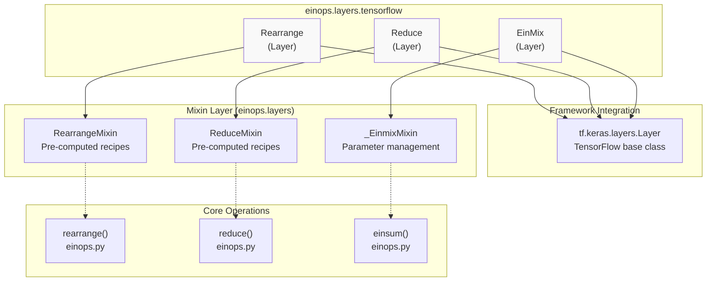
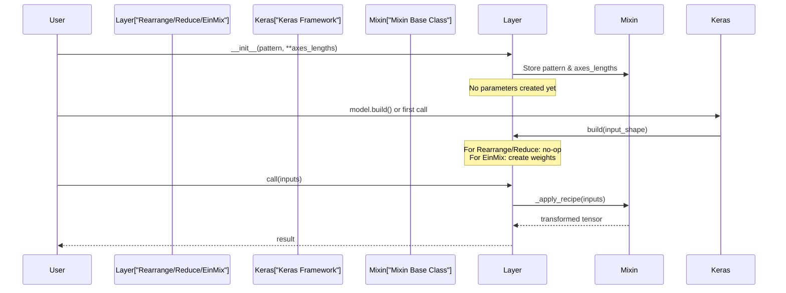
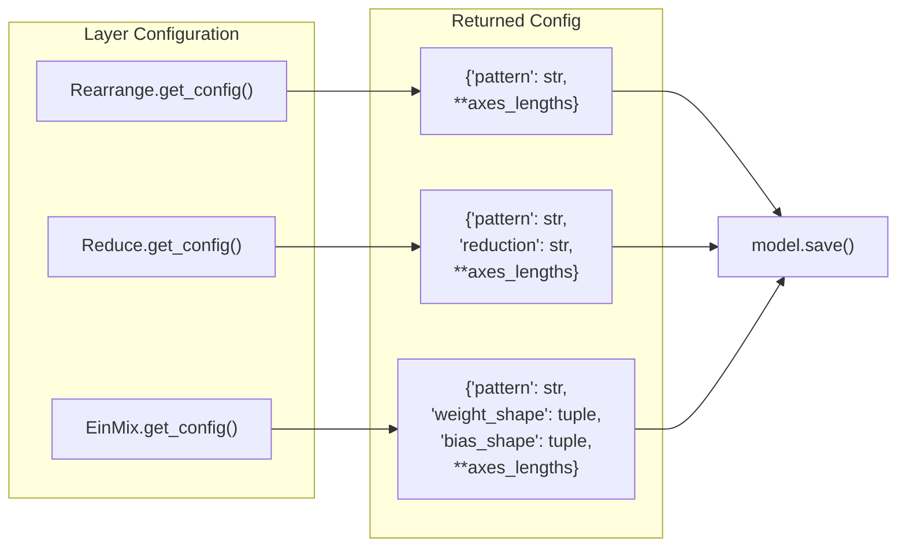
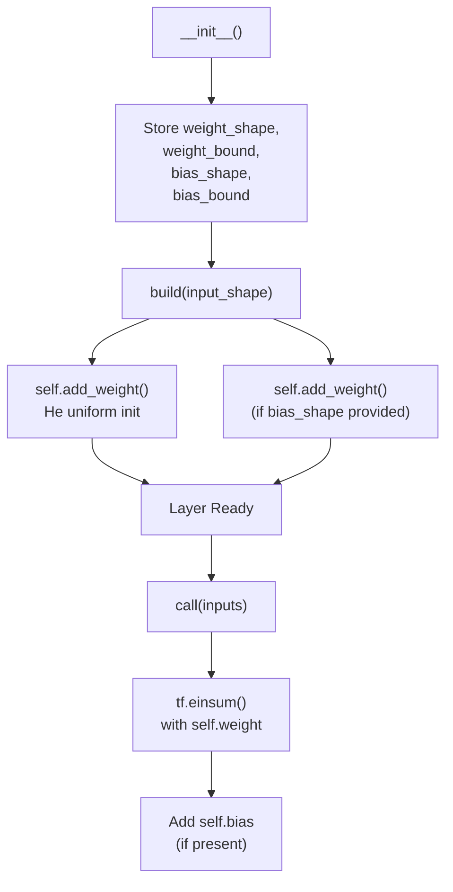

<!-- source: DeepWiki mcp.deepwiki.com · repo arogozhnikov/einops · page 3.2 TensorFlow and Keras Layers · fetched 2026-10-21 -->

# TensorFlow and Keras Layers

<details>
<summary>Relevant source files</summary>

The following files were used as context for generating this wiki page:

- [README.md](README.md)
- [einops/layers/keras.py](einops/layers/keras.py)
- [einops/layers/tensorflow.py](einops/layers/tensorflow.py)

</details>


## Purpose and Scope

This document covers the native TensorFlow/Keras layer implementations provided by einops, enabling seamless integration into Keras models and Sequential APIs. These layers wrap the core einops operations (`rearrange`, `reduce`, `einsum`) as standard Keras layers with proper parameter initialization, serialization support, and compatibility with TensorFlow's symbolic graph execution.

For information about the underlying operations, see [Core API Reference](#2). For PyTorch layer implementations, see [PyTorch Layers](#3.1). For the mixin architecture shared across frameworks, see [Layer Integration](#3).

## Architecture Overview

The TensorFlow/Keras layer implementation follows a mixin-based architecture where framework-specific layers inherit both from framework-agnostic mixins and TensorFlow's `Layer` base class.



**Sources:** [einops/layers/tensorflow.py:1-102]()

## Layer Lifecycle and Implementation

### Build and Call Pattern

TensorFlow/Keras layers follow a two-phase initialization pattern. The einops layer implementations conform to this standard:



**Sources:** [einops/layers/tensorflow.py:26-44]()

### Rearrange Layer

The `Rearrange` layer wraps the `rearrange` operation for use in Keras models. It performs tensor restructuring without learnable parameters.

| Method | Purpose |
|--------|---------|
| `__init__(pattern, **axes_lengths)` | Initialize with pattern string and optional axis lengths |
| `build(input_shape)` | No-op (no parameters to initialize) |
| `call(inputs)` | Apply pre-computed transformation recipe |
| `get_config()` | Return serializable configuration |

```python
# Import
from einops.layers.tensorflow import Rearrange

# Usage in Sequential model
layer = Rearrange('b c h w -> b h w c')
output = layer(input_tensor)
```

**Sources:** [einops/layers/tensorflow.py:25-34](), [docs/2-einops-for-deep-learning.ipynb:1131-1142]()

### Reduce Layer

The `Reduce` layer wraps the `reduce` operation, supporting various reduction operations (`mean`, `max`, `sum`, etc.).

| Method | Purpose |
|--------|---------|
| `__init__(pattern, reduction, **axes_lengths)` | Initialize with pattern, reduction type, and optional axis lengths |
| `build(input_shape)` | No-op (no parameters to initialize) |
| `call(inputs)` | Apply pre-computed reduction recipe |
| `get_config()` | Return serializable configuration including reduction type |

```python
# Import
from einops.layers.tensorflow import Reduce

# Global average pooling
layer = Reduce('b c h w -> b c', reduction='mean')
```

**Sources:** [einops/layers/tensorflow.py:36-44]()

### EinMix Layer

The `EinMix` layer is a learnable generalized linear layer that uses `einsum` for flexible parameter-input multiplication. Unlike `Rearrange` and `Reduce`, it creates and manages trainable weights.

| Method | Purpose |
|--------|---------|
| `__init__(pattern, weight_shape, bias_shape, **axes_lengths)` | Initialize layer specification |
| `build(input_shape)` | Create trainable weight and bias parameters |
| `call(inputs)` | Apply einsum operation with learned parameters |
| `get_config()` | Return serializable configuration |

The weight initialization uses He uniform initialization (uniform distribution in `[-bound, bound]` where `bound = sqrt(6 / fan_in)`).

**Sources:** [einops/layers/tensorflow.py:47-101](), [einops/layers/_einmix.py]()

## Keras Integration

### Sequential Model Usage

Einops layers integrate seamlessly with Keras Sequential API:

```python
from tensorflow.keras import Sequential
from tensorflow.keras.layers import Conv2D, Dense, ReLU
from einops.layers.tensorflow import Reduce, Rearrange

model = Sequential([
    Conv2D(32, kernel_size=3),
    # Combined pooling and flattening
    Reduce('b c (h 2) (w 2) -> b (c h w)', reduction='max'),
    Dense(128),
    ReLU(),
    # Reshape for output
    Rearrange('b d -> b 1 d'),
])
```

**Key benefits:**
- No need to write custom `forward()` methods
- Automatic shape inference
- Compatible with `model.summary()`
- Serializable with `model.save()` and `model.load()`

**Sources:** [docs/2-einops-for-deep-learning.ipynb:1131-1168]()

### Functional API Usage

Layers also work with the Functional API:

```python
from tensorflow.keras import Input, Model
from einops.layers.tensorflow import Rearrange

inputs = Input(shape=(224, 224, 3))
x = Rearrange('b h w c -> b c h w')(inputs)
# ... additional layers ...
model = Model(inputs=inputs, outputs=x)
```

**Sources:** [einops/layers/tensorflow.py:29-30]()

## Configuration and Serialization

All einops layers implement `get_config()` for proper model serialization:



**Sources:** [einops/layers/tensorflow.py:32-34,43-44,95-101]()

## Parameter Lifecycle (EinMix)

For the `EinMix` layer, parameter creation is deferred to the `build()` method following TensorFlow best practices:



**Sources:** [einops/layers/tensorflow.py:68-83]()

## Symbolic Graph Support

A key feature of the TensorFlow implementation is support for **symbolic graph execution**. Unlike imperative frameworks (PyTorch, NumPy), TensorFlow builds computational graphs where tensor shapes may be unknown at graph construction time.

### Pre-computed Recipes

The mixin classes pre-compute transformation recipes during initialization for common dimensionalities, enabling use in static graphs:

```python
# Recipe pre-computation in RearrangeMixin
# When pattern is set in __init__, recipes are generated
# for expected input dimensionalities
layer = Rearrange('b c h w -> b h w c')
# Internally computes recipes for 4D inputs
```

This allows the layer to work in TensorFlow's graph mode (`tf.function`) where tensor shapes are symbolic:

```python
@tf.function
def model_fn(x):
    layer = Rearrange('b h w c -> b c h w')
    return layer(x)  # Works with symbolic shapes
```

**Sources:** [einops/layers/tensorflow.py:1-12](), Architecture Diagram 3 in system overview

## Version Compatibility

The TensorFlow layer implementation has been updated to maintain compatibility with evolving TensorFlow APIs:

| einops Version | TensorFlow Version | Changes |
|----------------|-------------------|---------|
| 0.7.0 and prior | TF 2.13+ | Original layer implementation |
| 0.8.0 | TF 2.16+ | Re-implemented according to updated TF guidelines |

The core functionality remains identical across versions; changes primarily affect internal implementation details to comply with TensorFlow's evolving layer API standards.

**Important:** If using TensorFlow 2.16 or later, ensure einops 0.8.0 or later is installed.

**Sources:** [einops/layers/tensorflow.py:1-12]()

## Import Statement Reference

```python
# Import all layers
from einops.layers.tensorflow import Rearrange, Reduce, EinMix

# Alternative import as keras layers
# These are the same classes, just different import path
from einops.layers.keras import Rearrange, Reduce, EinMix
```

**Note:** Both import paths reference the same implementation. Use whichever is more consistent with your codebase conventions.

**Sources:** [einops/layers/tensorflow.py:1-23](), [docs/2-einops-for-deep-learning.ipynb:1131-1136]()

## Common Patterns

### Pattern 1: Flattening in Sequential Models

```python
# Replace: Flatten()
# With:
Rearrange('b c h w -> b (c h w)')
```

### Pattern 2: Global Pooling

```python
# Replace: GlobalAveragePooling2D()
# With:
Reduce('b c h w -> b c', reduction='mean')
```

### Pattern 3: Channel Reordering

```python
# NCHW to NHWC (or vice versa)
Rearrange('b c h w -> b h w c')
Rearrange('b h w c -> b c h w')
```

**Sources:** [docs/2-einops-for-deep-learning.ipynb:253-403]()

---

