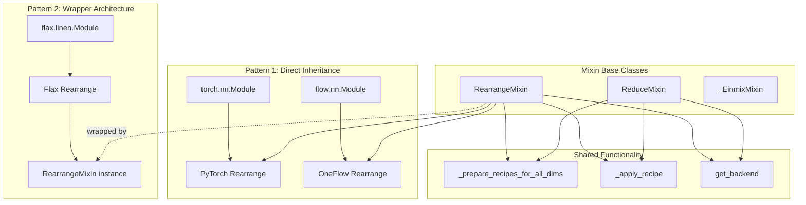
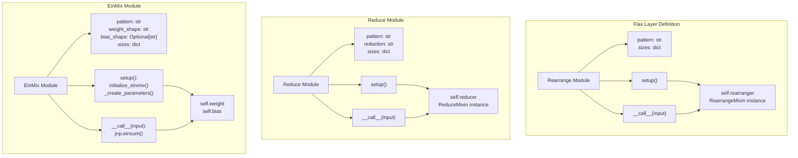
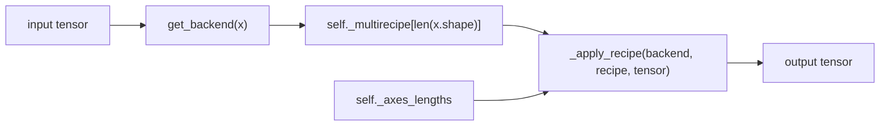

<!-- source: DeepWiki mcp.deepwiki.com · repo arogozhnikov/einops · page 3.3 Other Framework Layers · fetched 2026-10-21 -->

# Other Framework Layers

<details>
<summary>Relevant source files</summary>

The following files were used as context for generating this wiki page:

- [einops/layers/__init__.py](einops/layers/__init__.py)
- [einops/layers/flax.py](einops/layers/flax.py)
- [einops/layers/oneflow.py](einops/layers/oneflow.py)
- [einops/layers/tensorflow.py](einops/layers/tensorflow.py)

</details>


## Purpose and Scope

This page documents einops layer implementations for frameworks beyond PyTorch and TensorFlow/Keras. Specifically, this covers the Flax (JAX), OneFlow, and other framework integrations. For PyTorch layers, see [PyTorch Layers](#3.1). For TensorFlow and Keras layers, see [TensorFlow and Keras Layers](#3.2). For detailed documentation of the EinMix layer architecture, see [EinMix Layer Deep Dive](#3.4).

All framework implementations provide three core layer types: `Rearrange`, `Reduce`, and `EinMix`. These layers wrap einops operations into framework-specific neural network modules, enabling their use in sequential model definitions and benefiting from framework-specific features like automatic differentiation, model serialization, and compilation.

---

## Architectural Patterns

Framework layer implementations follow one of two architectural patterns, both utilizing the mixin classes defined in [einops/layers/\_\_init\_\_.py:9-106]():



**Pattern 1: Direct Inheritance** - PyTorch and OneFlow layers directly inherit from both the mixin and the framework's base module class. The mixin provides the `_apply_recipe` method, and the framework layer implements only the framework-specific forward method.

**Pattern 2: Wrapper Architecture** - Flax layers instantiate mixin objects as attributes during setup, rather than inheriting from them. This pattern accommodates Flax's dataclass-based module system and explicit `setup()` lifecycle.

Sources: [einops/layers/\_\_init\_\_.py:9-106](), [einops/layers/flax.py:14-34](), [einops/layers/oneflow.py:11-18]()

---

## Flax Layer Implementation

Flax provides einops layers as `flax.linen.Module` subclasses using JAX as the backend. The implementation uses Flax's dataclass-based module definition system.

### Flax Module Architecture



Sources: [einops/layers/flax.py:14-82]()

### Flax-Specific Features

**Dataclass Fields**: Flax modules use Python dataclasses with `@dataclass` decorator. Layer parameters are defined as class attributes with type annotations [einops/layers/flax.py:15-17](), [einops/layers/flax.py:26-28](), [einops/layers/flax.py:38-41]().

**Setup Lifecycle**: Unlike PyTorch's `__init__`, Flax uses `setup()` method for initialization [einops/layers/flax.py:19-20](), [einops/layers/flax.py:30-31](), [einops/layers/flax.py:43-49](). This separates parameter declaration from parameter creation, enabling Flax's functional transformations.

**Parameter Initialization**: Flax uses `self.param()` for creating trainable parameters with explicit initializers:

```python
self.weight = self.param("weight", jax.nn.initializers.uniform(weight_bound), weight_shape)
```

This integrates with JAX's functional random number generation [einops/layers/flax.py:52]().

**Wrapper Pattern**: Flax `Rearrange` and `Reduce` instantiate mixin objects rather than inheriting from them [einops/layers/flax.py:20](), [einops/layers/flax.py:31](). This is necessary because Flax modules must be dataclasses, which cannot use multiple inheritance with non-dataclass mixins.

**EinMix Implementation**: Flax's `EinMix` uniquely inherits from both `nn.Module` and `_EinmixMixin` [einops/layers/flax.py:37](). It calls `initialize_einmix()` in `setup()` [einops/layers/flax.py:44-49]() and uses `jnp.einsum` for tensor contraction [einops/layers/flax.py:77]().

### Usage Example

```python
import flax.linen as nn
from einops.layers.flax import Rearrange, Reduce, EinMix

class VisionModel(nn.Module):
    @nn.compact
    def __call__(self, x):
        # x shape: (batch, height, width, channels)
        x = Rearrange('b h w c -> b (h w) c')(x)
        x = EinMix('b n c -> b n d', weight_shape='c d', sizes={'d': 512})(x)
        x = Reduce('b n d -> b d', 'mean')(x)
        return x
```

Sources: [einops/layers/flax.py:1-82]()

---

## OneFlow Layer Implementation

OneFlow provides einops layers as `oneflow.nn.Module` subclasses. The implementation follows the direct inheritance pattern, similar to PyTorch.

### OneFlow Module Architecture

```mermaid
graph TB
    subgraph "Inheritance Structure"
        MIXIN["RearrangeMixin / ReduceMixin"]
        BASE["flow.nn.Module"]
        LAYER["OneFlow Rearrange/Reduce"]
        
        MIXIN --> LAYER
        BASE --> LAYER
    end
    
    subgraph "Rearrange Layer"
        RINIT["__init__(pattern, **axes_lengths)"]
        RFORWARD["forward(input)"]
        RAPPLY["self._apply_recipe(input)"]
        
        RINIT --> RFORWARD
        RFORWARD --> RAPPLY
    end
    
    subgraph "Reduce Layer"
        REDINIT["__init__(pattern, reduction, **axes_lengths)"]
        REDFORWARD["forward(input)"]
        REDAPPLY["self._apply_recipe(input)"]
        
        REDINIT --> REDFORWARD
        REDFORWARD --> REDAPPLY
    end
    
    subgraph "EinMix Layer"
        EINIT["__init__():<br/>_create_parameters()"]
        EFORWARD["forward(input):<br/>flow.einsum()"]
        EPARAM["self.weight: flow.nn.Parameter<br/>self.bias: flow.nn.Parameter"]
        EREARR["self.pre_rearrange<br/>self.post_rearrange"]
        
        EINIT --> EPARAM
        EINIT --> EREARR
        EFORWARD --> EPARAM
        EFORWARD --> EREARR
    end
```



Sources: [einops/layers/oneflow.py:11-54]()

### OneFlow-Specific Features

**Direct Inheritance**: OneFlow layers use multiple inheritance from both the mixin and `flow.nn.Module` [einops/layers/oneflow.py:11](), [einops/layers/oneflow.py:16](). The `forward()` method delegates directly to `_apply_recipe()` [einops/layers/oneflow.py:12-13](), [einops/layers/oneflow.py:17-18]().

**Parameter Creation**: OneFlow uses `flow.nn.Parameter` with uniform initialization via `.uniform_()` in-place method:

```python
self.weight = flow.nn.Parameter(
    flow.zeros(weight_shape).uniform_(-weight_bound, weight_bound), 
    requires_grad=True
)
```

This pattern is shown at [einops/layers/oneflow.py:23-24]().

**EinMix Implementation**: The `_create_parameters` method creates trainable parameters during initialization [einops/layers/oneflow.py:22-29](). The `forward` method applies optional pre/post rearrangements around the einsum operation using `flow.einsum` [einops/layers/oneflow.py:46-54]().

**No Serialization Methods**: Unlike PyTorch and TensorFlow implementations, OneFlow layers do not explicitly implement `__getstate__`/`__setstate__` or `get_config` methods. Serialization relies on OneFlow's default module serialization.

### Implementation Credits

The OneFlow implementation was contributed by Tianhe Ren and Depeng Liang [einops/layers/oneflow.py:8]().

Sources: [einops/layers/oneflow.py:1-54]()

---

## Paddle Layer Implementation

While not included in the provided files, Paddle (PaddlePaddle) layers follow a similar pattern to OneFlow, inheriting from `paddle.nn.Layer` and the mixin classes. Paddle layers use `paddle.nn.Parameter` for trainable weights and `paddle.einsum` for EinMix operations.

The implementation file would be located at `einops/layers/paddle.py` and provide `Rearrange`, `Reduce`, and `EinMix` classes compatible with PaddlePaddle's dynamic graph mode.

---

## Gluon and Chainer Implementations

Gluon (MXNet) and Chainer implementations were supported in earlier versions of einops but are less commonly maintained due to reduced community adoption of these frameworks. These implementations would follow similar patterns:

- **Gluon**: Inherits from `gluon.nn.Block`, implements `forward()` or `hybrid_forward()` for hybrid imperative/symbolic execution
- **Chainer**: Inherits from `chainer.Link`, implements `forward()` or `__call__()`

As of einops 0.8.0, focus has shifted to actively maintained frameworks (PyTorch, TensorFlow, JAX, OneFlow).

---

## Framework Comparison

| Feature | Flax (JAX) | OneFlow | PyTorch | TensorFlow |
|---------|------------|---------|---------|------------|
| **Base Class** | `flax.linen.Module` | `flow.nn.Module` | `torch.nn.Module` | `tf.keras.layers.Layer` |
| **Inheritance Pattern** | Wrapper (composition) | Direct inheritance | Direct inheritance | Direct inheritance |
| **Initialization** | `setup()` method | `__init__()` | `__init__()` | `build()` method |
| **Forward Method** | `__call__()` | `forward()` | `forward()` | `call()` |
| **Parameter Creation** | `self.param()` | `flow.nn.Parameter()` | `torch.nn.Parameter()` | `self.add_weight()` |
| **Einsum Function** | `jnp.einsum` | `flow.einsum` | `torch.einsum` | `tf.einsum` |
| **Serialization** | Flax state dict | OneFlow default | `__getstate__`/`__setstate__` | `get_config()` |
| **Module Definition** | Dataclass + setup | Class + init | Class + init | Class + build |

Sources: [einops/layers/flax.py:1-82](), [einops/layers/oneflow.py:1-54](), [einops/layers/\_\_init\_\_.py:9-106]()

---

## Common Mixin Functionality

All framework implementations share core functionality through the mixin classes:

### Recipe Compilation

Both `RearrangeMixin` and `ReduceMixin` use `_prepare_recipes_for_all_dims()` to compile patterns into `TransformRecipe` objects for all possible tensor dimensionalities [einops/layers/\_\_init\_\_.py:33-39](), [einops/layers/\_\_init\_\_.py:83-89](). This enables the same layer instance to handle tensors with varying numbers of dimensions.

### Recipe Application

The `_apply_recipe()` method performs the actual transformation:



This method dynamically selects the backend based on input tensor type, retrieves the recipe for the tensor's dimensionality, and applies it using the backend's operations [einops/layers/\_\_init\_\_.py:41-49](), [einops/layers/\_\_init\_\_.py:91-99]().

### Serialization Support

The base mixins implement `__getstate__` and `__setstate__` for Python pickle serialization [einops/layers/\_\_init\_\_.py:51-55](), [einops/layers/\_\_init\_\_.py:101-105](). This ensures layer state (pattern and axis lengths) is preserved during model checkpointing.

Sources: [einops/layers/\_\_init\_\_.py:9-106]()

---

## Integration with Framework Ecosystems

Each framework implementation ensures compatibility with framework-specific features:

### Automatic Differentiation

All implementations automatically participate in their framework's autograd system:
- **JAX**: Gradients flow through `jnp.einsum` and reshape operations
- **OneFlow**: `flow.nn.Parameter` with `requires_grad=True` enables backpropagation
- **PyTorch/TensorFlow**: See pages [3.1](#3.1) and [3.2](#3.2)

### Model Composition

Layers integrate naturally into framework-specific model composition patterns:

**Flax Compact Style**:
```python
class Model(nn.Module):
    @nn.compact
    def __call__(self, x):
        return Rearrange('b c h w -> b (c h w)')(x)
```

**OneFlow Sequential**:
```python
model = flow.nn.Sequential(
    Rearrange('b c h w -> b c (h w)'),
    flow.nn.Linear(3136, 512)
)
```

### Compilation Support

- **JAX**: Flax layers work with `jax.jit` compilation automatically
- **OneFlow**: Compatible with OneFlow's graph mode compilation
- **PyTorch**: See [PyTorch Compilation Support](#5.1) for `torch.compile` details

Sources: [einops/layers/flax.py:1-82](), [einops/layers/oneflow.py:1-54]()

---

