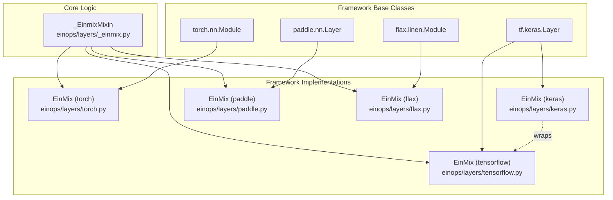
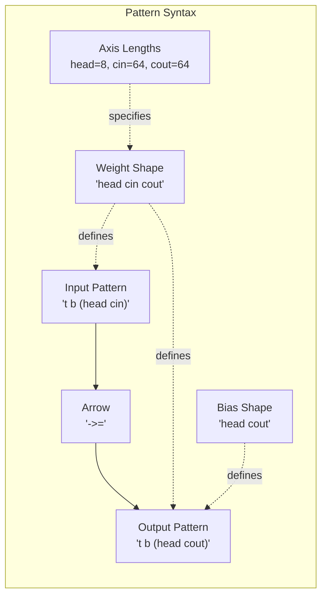
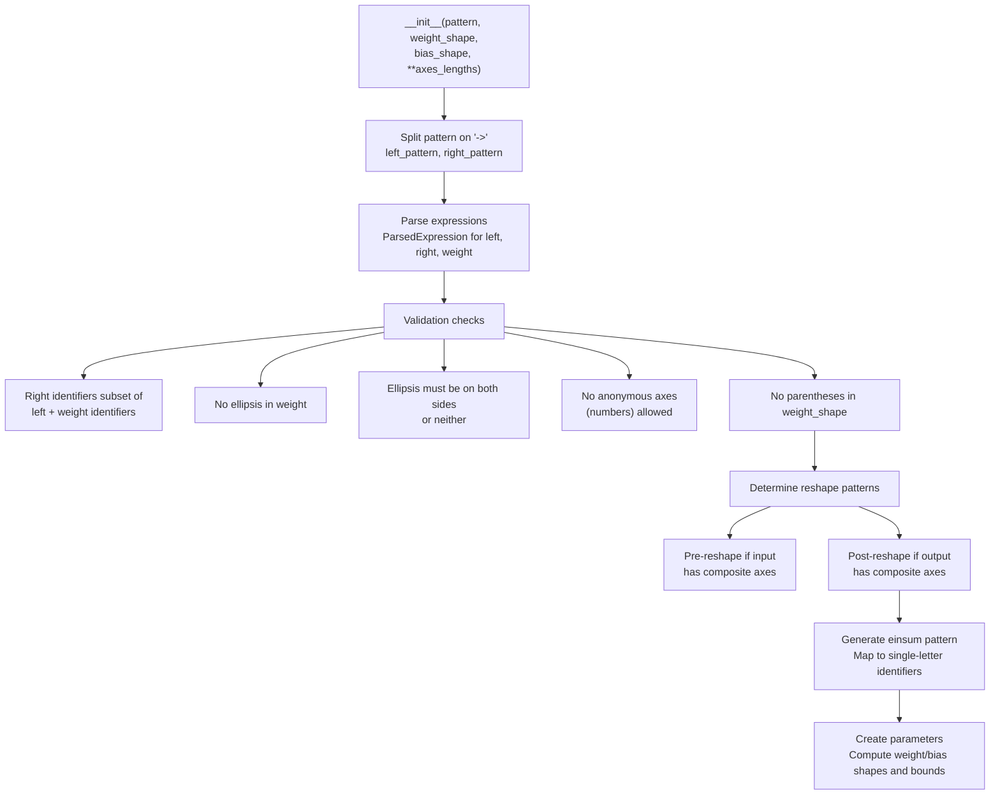
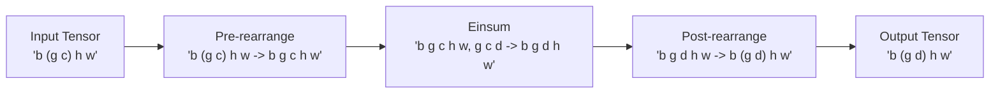

<!-- source: DeepWiki mcp.deepwiki.com · repo arogozhnikov/einops · page 3.4 EinMix Layer Deep Dive · fetched 2026-10-21 -->

# EinMix Layer Deep Dive

<details>
<summary>Relevant source files</summary>

The following files were used as context for generating this wiki page:

- [.pre-commit-config.yaml](.pre-commit-config.yaml)
- [docs/2-einops-for-deep-learning.ipynb](docs/2-einops-for-deep-learning.ipynb)
- [docs/3-einmix-layer.ipynb](docs/3-einmix-layer.ipynb)
- [docs/utils/__init__.py](docs/utils/__init__.py)
- [einops/layers/_einmix.py](einops/layers/_einmix.py)
- [einops/layers/keras.py](einops/layers/keras.py)
- [einops/layers/paddle.py](einops/layers/paddle.py)

</details>


**Purpose**: This page provides comprehensive technical documentation of the `EinMix` layer, a framework-agnostic neural network layer that combines Einstein summation notation with automated weight management to enable generalized linear transformations along arbitrary tensor axes. This includes architectural details, pattern specification, initialization strategies, and practical use cases in modern neural network architectures.

**Scope**: This page focuses on the `EinMix` layer implementation and usage patterns. For basic layer integration across frameworks, see [Layer Integration](#3). For specific framework implementations of `Rearrange` and `Reduce` layers, see [PyTorch Layers](#3.1), [TensorFlow and Keras Layers](#3.2), and [Other Framework Layers](#3.3).

---

## Overview

`EinMix` is a parametric neural network layer that generalizes the concept of a fully connected layer to arbitrary tensor transformations. Unlike `nn.Linear` which only operates on the last axis, `EinMix` can mix elements along any combination of axes while maintaining the semantic clarity of einops notation.

**Core Concept**: `EinMix` combines three operations:
1. Optional pre-reshaping of input (unpacking composite axes)
2. Einstein summation between input and learned weight tensor
3. Optional post-reshaping of output (packing axes)
4. Optional bias addition

**Comparison with einsum**:
```python
# Manual einsum approach
weight = <create and initialize>
bias = <create and initialize>
result = torch.einsum('tbc,cd->tbd', x, weight) + bias

# EinMix equivalent
layer = EinMix('t b c -> t b d', weight_shape='c d', bias_shape='d', c=128, d=256)
result = layer(x)
```

Sources: [einops/layers/_einmix.py:15-66](), [docs/3-einmix-layer.ipynb:42-72]()

---

## Architecture and Class Hierarchy

### Mixin-Based Design



**Diagram**: EinMix class hierarchy showing mixin-based architecture

The `_EinmixMixin` class ([einops/layers/_einmix.py:15-208]()) contains all framework-agnostic logic:
- Pattern parsing and validation
- Einsum pattern generation
- Weight/bias shape computation
- Initialization bounds calculation

Framework-specific implementations (e.g., [einops/layers/paddle.py:21-58]()) provide:
- Parameter creation and initialization
- Pre/post rearrange layer instantiation
- Forward pass implementation using framework's `einsum`

Sources: [einops/layers/_einmix.py:15-208](), [einops/layers/paddle.py:21-58](), [einops/layers/keras.py:1-9]()

---

## Pattern Specification System

### Pattern Components



**Diagram**: EinMix pattern specification components

### Pattern Parsing Flow



**Diagram**: Pattern parsing and initialization flow in `_EinmixMixin.initialize_einmix`

The initialization process ([einops/layers/_einmix.py:67-162]()) performs comprehensive validation and setup:

| Validation Check | Error Raised | Purpose |
|-----------------|--------------|---------|
| Right identifiers ⊆ (left ∪ weight) | `EinopsError` | Ensure all output axes come from input or weight |
| Ellipsis in weight | `EinopsError` | Weight shape must be fully specified |
| Ellipsis consistency | `EinopsError` | Must appear on both sides or neither |
| Anonymous axes | `EinopsError` | Numbers not allowed in patterns |
| Parentheses in weight | `EinopsError` | Weight must have flat structure |

Sources: [einops/layers/_einmix.py:67-162]()

---

## Weight and Bias Management

### Shape Computation

```python
# Example: Multi-head attention projection
# Pattern: 't b c -> t b (head d)'
# Weight shape: 'c head d'
# If c=512, head=8, d=64:
_weight_shape = [512, 8, 64]  # Computed from axes_lengths
```

The weight shape is computed at [einops/layers/_einmix.py:123]():
```python
_weight_shape = [axes_lengths[axis] for (axis,) in weight.composition]
```

### Initialization Strategy

`EinMix` uses **uniform He initialization** accounting for the effective fan-in:

```python
# Fan-in: number of input elements contributing to one output element
_fan_in = product([axes_lengths[axis] 
                   for (axis,) in weight.composition 
                   if axis not in right.identifiers])

weight_bound = (3 / _fan_in) ** 0.5
bias_bound = (1 / _fan_in) ** 0.5
```

**Key insight**: Only axes that are **reduced** (present in input/weight but not output) contribute to fan-in. Axes that appear in output represent independent output channels and don't increase fan-in.

| Transformation | Fan-in Calculation | Rationale |
|----------------|-------------------|-----------|
| `'b c -> b d'` with `weight_shape='c d'` | `c` | Each output element mixes `c` inputs |
| `'b h w c -> b h w d'` with `weight_shape='c d'` | `c` | Spatial dimensions unchanged, only channel mixing |
| `'b (h w) c -> b d'` with `weight_shape='h w c d'` | `h * w * c` | Each output mixes entire spatial grid |
| `'b h w c -> b h w c'` with `weight_shape='c'` | `c` | Element-wise scaling (normalizations) |

Sources: [einops/layers/_einmix.py:123-162]()

---

## Bias Shape and Broadcasting

Bias handling is sophisticated, supporting arbitrary axis subsets of the output:

```python
# Bias can depend on any subset of output axes
# Example: 't b (head d)' output can have bias shapes:
# - 'd': shared across time, batch, heads
# - 'head d': shared across time and batch
# - 't head d': shared across batch
```

**Constraint**: All bias dimensions must appear **after ellipsis** in the output pattern ([einops/layers/_einmix.py:144-151]()). This ensures bias can be broadcast correctly.

The bias shape computation creates a shape with:
- Size 1 for output axes not in `bias_shape` 
- Actual size for axes in `bias_shape`
- Ellipsis axes get size 1

```python
_bias_shape = []
for axes in right.composition:
    for axis in axes:
        if axis in bias.identifiers:
            _bias_shape.append(axes_lengths[axis])  # Actual size
        else:
            _bias_shape.append(1)  # Broadcasting dimension
```

Sources: [einops/layers/_einmix.py:126-158]()

---

## Einsum Pattern Generation

To ensure compatibility across all frameworks, axis names are mapped to single ASCII letters:

```python
# Example transformation
# Input pattern: 'time batch (head channel_in)'
# Weight pattern: 'head channel_in channel_out'  
# Output pattern: 'time batch (head channel_out)'

# After flattening parentheses:
# Input: 'time batch head channel_in'
# Weight: 'head channel_in channel_out'
# Output: 'time batch head channel_out'

# Mapped to letters (sorted identifiers):
# batch='a', channel_in='b', channel_out='c', head='d', time='e'
einsum_pattern = 'eadb,dbc->eadc'
```

The mapping process ([einops/layers/_einmix.py:164-185]()):
1. Collect all unique identifiers from left, right, and weight patterns
2. Sort identifiers alphabetically (ensures consistency)
3. Map to consecutive letters from `string.ascii_lowercase`
4. Preserve ellipsis as `'...'`
5. Flatten composite axes before mapping

Sources: [einops/layers/_einmix.py:164-185]()

---

## Rearrange Layer Integration

### Pre and Post Reshape Logic



**Diagram**: Flow through pre-rearrange, einsum, and post-rearrange stages

Pre-reshape is needed when input has composite axes (parentheses):
```python
# Pattern: 'b (g c) h w -> b (g d) h w'
# Pre-reshape unpacks: 'b (g c) h w -> b g c h w'
# Then einsum can process flat axes
```

Post-reshape is needed when output has composite axes:
```python
# After einsum produces flat output: 'b g d h w'
# Post-reshape packs: 'b g d h w -> b (g d) h w'
```

Framework implementations ([einops/layers/paddle.py:34-47]()) instantiate `Rearrange` layers as needed:
```python
if pre_reshape_pattern is not None:
    self.pre_rearrange = Rearrange(pre_reshape_pattern, **pre_reshape_lengths)
else:
    self.pre_rearrange = None
```

Sources: [einops/layers/_einmix.py:88-108](), [einops/layers/paddle.py:34-47]()

---

## Use Cases and Patterns

### 1. Token Mixing (MLPMixer)

**Problem**: Standard `nn.Linear` only mixes the last axis. MLPMixer needs to mix the token axis (middle dimension).

```python
# Input: (batch, num_patches, channels)
# Need to mix num_patches dimension while preserving batch and channels

# Traditional approach requires transposition:
x = x.transpose(1, 2)  # (batch, channels, num_patches)
x = nn.Linear(num_patches, num_patches)(x)
x = x.transpose(1, 2)  # Back to (batch, num_patches, channels)

# EinMix approach - single operation:
Mix('b patches c -> b patches_out c', 
    weight_shape='patches patches_out', 
    bias_shape='patches_out',
    patches=196, patches_out=196)
```

**Complete TokenMixer** implementation pattern:
```python
def TokenMixer(num_features, n_patches, expansion_factor, dropout):
    hidden = n_patches * expansion_factor
    return nn.Sequential(
        nn.LayerNorm(num_features),
        Mix('b hw c -> b hidden c', weight_shape='hw hidden', bias_shape='hidden',
            hw=n_patches, hidden=hidden),
        nn.GELU(),
        nn.Dropout(dropout),
        Mix('b hidden c -> b hw c', weight_shape='hidden hw', bias_shape='hw',
            hw=n_patches, hidden=hidden),
        nn.Dropout(dropout),
    )
```

Sources: [docs/3-einmix-layer.ipynb:89-159]()

---

### 2. Patch Embeddings (ViT/MLPMixer)

**Problem**: Convert image patches to embeddings - requires grouping spatial dimensions, mixing within patches, and flattening to sequence.

```python
# Traditional approach (convolutional):
Conv2d(in_channels, num_features, kernel_size=patch_size, stride=patch_size)
# Plus manual permute and reshape operations

# EinMix approach - expresses the full operation:
Mix('b c_in (h hp) (w wp) -> b (h w) c',
    weight_shape='c_in hp wp c',
    bias_shape='c',
    c=num_features, hp=patch_size, wp=patch_size, c_in=in_channels)
```

**What happens**:
1. Image split into `hp × wp` patches
2. Each patch (3D tensor: `c_in × hp × wp`) mixed to produce vector of length `c`
3. Patches from `h × w` grid flattened to sequence

Sources: [docs/3-einmix-layer.ipynb:184-248]()

---

### 3. Vision Permutator

**Problem**: Mix spatial dimensions separately and across channel groups (segments).

```python
# Original implementation: 10+ lines with multiple reshapes and permutes
# For mixing height: reshape -> permute -> reshape -> linear -> reshape -> permute -> reshape

# EinMix for height mixing:
Mix('b h w (n c) -> b h0 w (n c0)',
    weight_shape='h c h0 c0',
    bias_shape='h0 c0',
    h=H, h0=H, c=seg_len, c0=seg_len)

# EinMix for width mixing:
Mix('b h w (n c) -> b h w0 (n c0)',
    weight_shape='w c w0 c0', 
    bias_shape='w0 c0',
    w=W, w0=W, c=seg_len, c0=seg_len)

# EinMix for channel mixing:
Mix('b h w c -> b h w c0',
    weight_shape='c c0',
    bias_shape='c0',
    c=C, c0=C)
```

**Key insight**: By including segment length `c` in both input and output patterns `(n c)`, the layer creates **separate weights for each segment** while mixing within segments.

Sources: [docs/3-einmix-layer.ipynb:265-333]()

---

### 4. Multi-Head Attention Projections

**Problem**: Combine linear projection with axis reordering for attention mechanism.

```python
# Traditional approach:
# 1. Three separate linear layers for Q, K, V
# 2. Reshape to add head dimension
# 3. Transpose to (batch, head, time, hidden)

# EinMix approach - fused operation:
Mix('b t c -> qkv b h t hid',
    weight_shape='c qkv h hid',
    c=dim_input, qkv=3, h=n_heads, hid=head_dim)

# This simultaneously:
# - Projects input (c -> h*hid)  
# - Splits into Q, K, V (qkv axis)
# - Adds head dimension
# - Reorders to desired layout
```

**Output projection** similarly fuses operations:
```python
Mix('b h t hid -> b t c',
    weight_shape='h hid c',
    h=n_heads, hid=head_dim, c=dim_input)
```

Sources: [docs/3-einmix-layer.ipynb:348-366]()

---

### 5. Channel-wise Operations (Normalizations)

For operations like affine scaling in BatchNorm/LayerNorm:

```python
# Scale and shift per channel
Mix('b h w c -> b h w c',
    weight_shape='c',
    bias_shape='c',
    c=num_channels)
```

**Fan-in = `c`**: Each output element is multiplied by its corresponding weight element, so effective fan-in is 1, but the initialization accounts for `c` for stability.

Sources: [docs/3-einmix-layer.ipynb:373-382]()

---

## Framework-Specific Implementations

### Implementation Requirements

Each framework implementation must provide two methods:

| Method | Responsibility | Framework Specifics |
|--------|---------------|---------------------|
| `_create_parameters` | Create and initialize weight/bias tensors | Parameter registration, initializer API |
| `_create_rearrange_layers` | Instantiate pre/post Rearrange layers | Layer construction |
| `forward` | Apply transformation | einsum API, bias addition |

### PyTorch Implementation Pattern

```python
class EinMix(_EinmixMixin, torch.nn.Module):
    def _create_parameters(self, weight_shape, weight_bound, bias_shape, bias_bound):
        self.weight = torch.nn.Parameter(
            torch.zeros(weight_shape).uniform_(-weight_bound, weight_bound)
        )
        if bias_shape is not None:
            self.bias = torch.nn.Parameter(
                torch.zeros(bias_shape).uniform_(-bias_bound, bias_bound)
            )
        else:
            self.bias = None
    
    def _create_rearrange_layers(self, pre_pattern, pre_lengths, post_pattern, post_lengths):
        self.pre_rearrange = Rearrange(pre_pattern, **pre_lengths) if pre_pattern else None
        self.post_rearrange = Rearrange(post_pattern, **post_lengths) if post_pattern else None
    
    def forward(self, input):
        if self.pre_rearrange:
            input = self.pre_rearrange(input)
        result = torch.einsum(self.einsum_pattern, input, self.weight)
        if self.bias is not None:
            result = result + self.bias
        if self.post_rearrange:
            result = self.post_rearrange(result)
        return result
```

### Paddle Implementation

The Paddle implementation ([einops/layers/paddle.py:21-58]()) follows the same pattern but uses Paddle's API:

```python
self.weight = self.create_parameter(
    weight_shape, 
    default_initializer=paddle.nn.initializer.Uniform(-weight_bound, weight_bound)
)

result = paddle.einsum(self.einsum_pattern, input, self.weight)
```

### Keras/TensorFlow

Keras implementation ([einops/layers/keras.py:1-9]()) is a thin wrapper importing from TensorFlow layers, maintaining compatibility with Keras API.

Sources: [einops/layers/paddle.py:21-58](), [einops/layers/keras.py:1-9]()

---

## Advanced Patterns

### Local Mixing in Patches

Mix within non-overlapping patches:
```python
'b c (h hI) (w wI) -> b c (h hO) (w wO)'
weight_shape='c hI wI hO wO'
```
Each `hI × wI` patch mixed independently per channel.

### Subgrid Mixing

Mix positions at regular intervals (strided pattern):
```python
'b c (hI h) (wI w) -> b c (hO h) (wO w)'
weight_shape='c hI wI hO wO'
```
Creates dense connections within subgrids defined by step sizes `h` and `w`.

### Multi-Scale Channel Mixing

Mix different portions of channels differently:
```python
'b h w (g1 g2 c) -> b h w (g1 g2 d)'
weight_shape='g1 c g2 d'
```

Sources: [docs/3-einmix-layer.ipynb:400-439]()

---

## Error Messages and Debugging

### Common Validation Errors

| Error Message | Cause | Solution |
|--------------|-------|----------|
| `Unrecognized identifiers on the right side` | Output axis not in input or weight | Add axis to weight_shape or remove from output |
| `Ellipsis is not supported in weight` | `...` in weight_shape | Specify all weight dimensions explicitly |
| `Ellipsis should be on both sides` | Asymmetric ellipsis usage | Add or remove ellipsis symmetrically |
| `Anonymous axes (numbers) are not allowed` | Used literal numbers in pattern | Use named axes with axes_lengths parameter |
| `Parenthesis is not allowed in weight shape` | Composite axes in weight_shape | Flatten weight_shape axes |
| `Dimension {axis} of weight should be specified` | Missing axis in axes_lengths | Add axis=value to initialization |
| `all bias dimensions should go after ellipsis` | Bias axis before ellipsis in output | Reorder output pattern |

### repr Output

The `__repr__` method ([einops/layers/_einmix.py:200-207]()) provides clear representation:

```python
EinMix('b (h w) c -> b d', 'h w c d', 'd', h=14, w=14, c=128, d=256)
```

Shows pattern, weight_shape, bias_shape (if present), and all axis lengths.

Sources: [einops/layers/_einmix.py:10-13](), [einops/layers/_einmix.py:72-121](), [einops/layers/_einmix.py:200-207]()

---

## Summary

`EinMix` provides a unified interface for linear transformations that:

1. **Generalizes beyond last-axis mixing**: Operates on any axis combination
2. **Maintains semantic clarity**: Pattern notation documents the transformation
3. **Handles complexity**: Automatic weight management, initialization, and reshaping
4. **Framework agnostic**: Single implementation via mixin pattern
5. **Enables novel architectures**: MLPMixer, Vision Permutator, and beyond

**Key files**:
- Core logic: [einops/layers/_einmix.py:15-228]()
- Framework implementations: [einops/layers/paddle.py](), [einops/layers/keras.py]()
- Tutorial: [docs/3-einmix-layer.ipynb]()

Sources: [einops/layers/_einmix.py:15-228](), [docs/3-einmix-layer.ipynb:1-470]()

---

