<!-- source: DeepWiki mcp.deepwiki.com · repo arogozhnikov/einops · page 4 Internal Architecture · fetched 2026-10-21 -->

# Internal Architecture

<details>
<summary>Relevant source files</summary>

The following files were used as context for generating this wiki page:

- [einops/_backends.py](einops/_backends.py)
- [einops/einops.py](einops/einops.py)
- [einops/parsing.py](einops/parsing.py)

</details>


## Purpose and Scope

This document explains the internal design and implementation of einops, focusing on the core systems that enable pattern-based tensor operations across multiple deep learning frameworks. It covers:

- Backend abstraction layer for multi-framework support
- Pattern parsing and validation system
- Recipe compilation and caching mechanisms
- Optimization strategies for efficient execution

For information about the public API operations (`rearrange`, `reduce`, `repeat`), see [Core API Reference](#2). For framework-specific layer implementations, see [Layer Integration](#3). For Array API compliance details, see [Array API Support](#4.4).

---

## System Overview

The einops architecture consists of three main layers that transform user patterns into framework-specific operations:

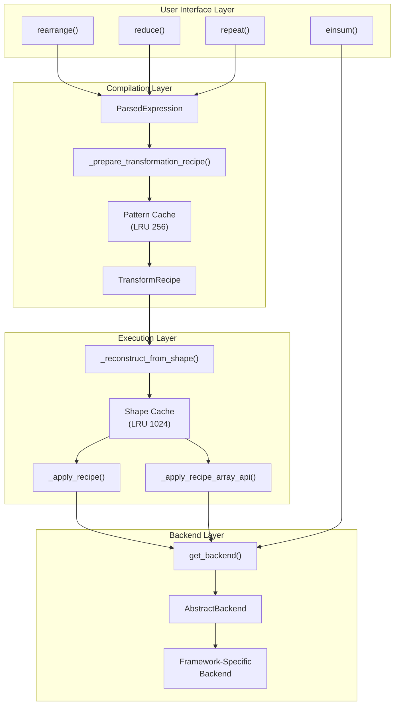

**Sources:** [einops/einops.py:1-940](), [einops/_backends.py:1-765](), [einops/parsing.py:1-159]()

The flow proceeds as follows:

1. **User calls an operation** with a pattern string and tensor
2. **Pattern is parsed** into `ParsedExpression` objects
3. **Recipe is compiled** from the parsed pattern (cached by pattern string)
4. **Shape reconstruction** occurs using the actual tensor shape (cached by shape)
5. **Backend is selected** based on tensor type
6. **Operations are executed** through the backend interface

---

## Backend Abstraction Layer

### Backend Discovery and Selection

The backend system uses lazy loading to avoid importing unused frameworks:

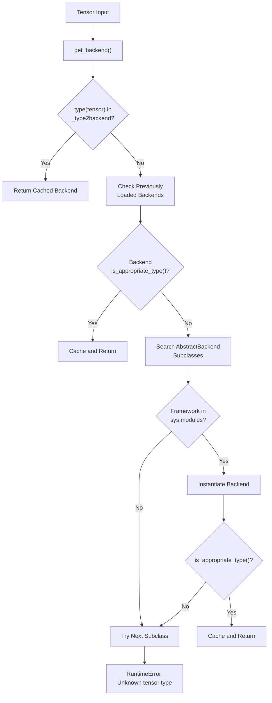

**Key Implementation Details:**

- `_type2backend` dict: Maps `type(tensor)` to backend for O(1) lookup
- `_loaded_backends` dict: Stores instantiated backends by framework name
- Backends are only instantiated when their framework is in `sys.modules`
- Thread-safe handling of concurrent backend loading (see #391 reference)

**Sources:** [einops/_backends.py:22-63]()

### AbstractBackend Interface

The `AbstractBackend` class defines the contract all backends must implement:

| Method Category | Methods | Purpose |
|-----------------|---------|---------|
| **Type Detection** | `is_appropriate_type()` | Identify if backend handles a tensor type |
| **Imperative Ops** | `from_numpy()`, `to_numpy()` | Convert to/from NumPy arrays |
| **Symbolic Ops** | `create_symbol()`, `eval_symbol()` | Support graph-based frameworks |
| **Shape Ops** | `shape()`, `reshape()`, `transpose()` | Core tensor reshaping |
| **Reduction Ops** | `reduce()`, `arange()` | Aggregation operations |
| **Composition Ops** | `stack_on_zeroth_dimension()`, `concat()`, `tile()` | Combine tensors |
| **Broadcasting** | `add_axis()`, `add_axes()` | Expand dimensions |
| **Type Checking** | `is_float_type()` | Validate operation compatibility |
| **Advanced Ops** | `einsum()`, `layers()` | Optional capabilities |

**Sources:** [einops/_backends.py:65-139]()

### Backend Implementations

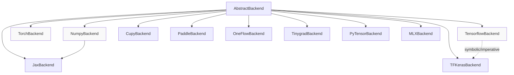

**Framework-Specific Adaptations:**

- **PyTorch (`TorchBackend`)**: Uses `permute()` instead of `transpose()`, `expand()` for efficient broadcasting
- **TensorFlow (`TensorflowBackend`)**: Handles both eager and graph modes, uses `HashableTuple` for symbolic shapes
- **TensorFlow Keras (`TFKerasBackend`)**: Provides symbolic execution with `create_symbol()`/`eval_symbol()`
- **JAX (`JaxBackend`)**: Inherits from `NumpyBackend`, overrides NumPy conversion methods
- **PyTensor (`PyTensorBackend`)**: Symbolic-only backend using `create_symbol()`

**Sources:** [einops/_backends.py:160-765]()

### Dual Execution Paths

Modern einops (0.7+) supports two execution paths:

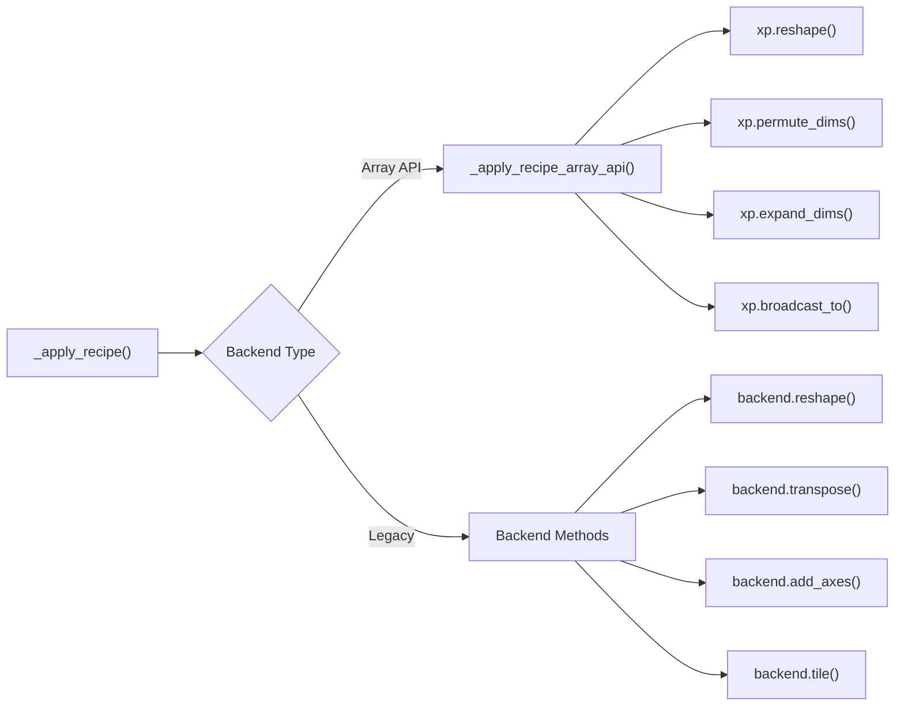

The Array API path (`_apply_recipe_array_api()`) directly uses standard functions, while the legacy path goes through the backend abstraction. This is handled in the main operations.

**Sources:** [einops/einops.py:230-287]()

---

## Pattern Parsing Pipeline

### ParsedExpression Class

The `ParsedExpression` class tokenizes and validates pattern strings:

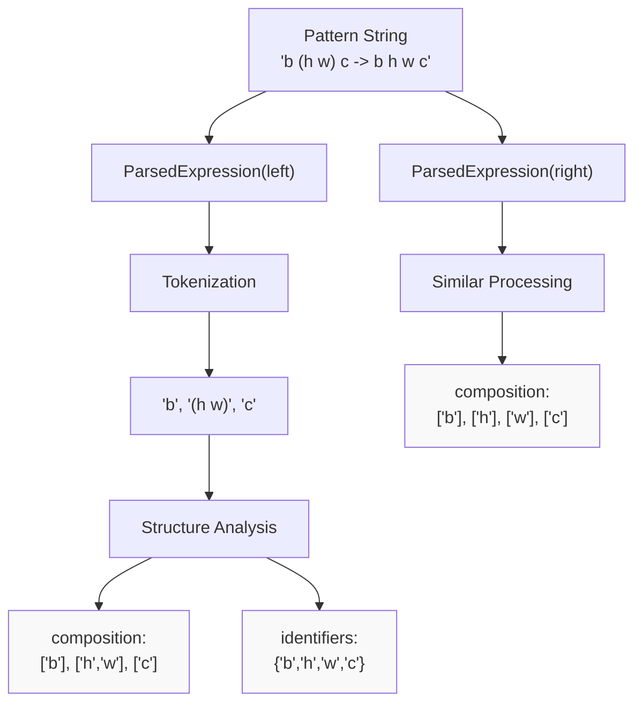

**Key Attributes:**

| Attribute | Type | Description |
|-----------|------|-------------|
| `composition` | `list[Union[list[str], str]]` | Structure of axes, preserving groupings |
| `identifiers` | `set[str]` | All axis names found in expression |
| `has_ellipsis` | `bool` | Whether pattern contains `...` |
| `has_ellipsis_parenthesized` | `Optional[bool]` | Whether ellipsis appears in parentheses |
| `has_non_unitary_anonymous_axes` | `bool` | Whether pattern has anonymous axes like `2` or `3` |

**Sources:** [einops/parsing.py:25-159]()

### Tokenization Process

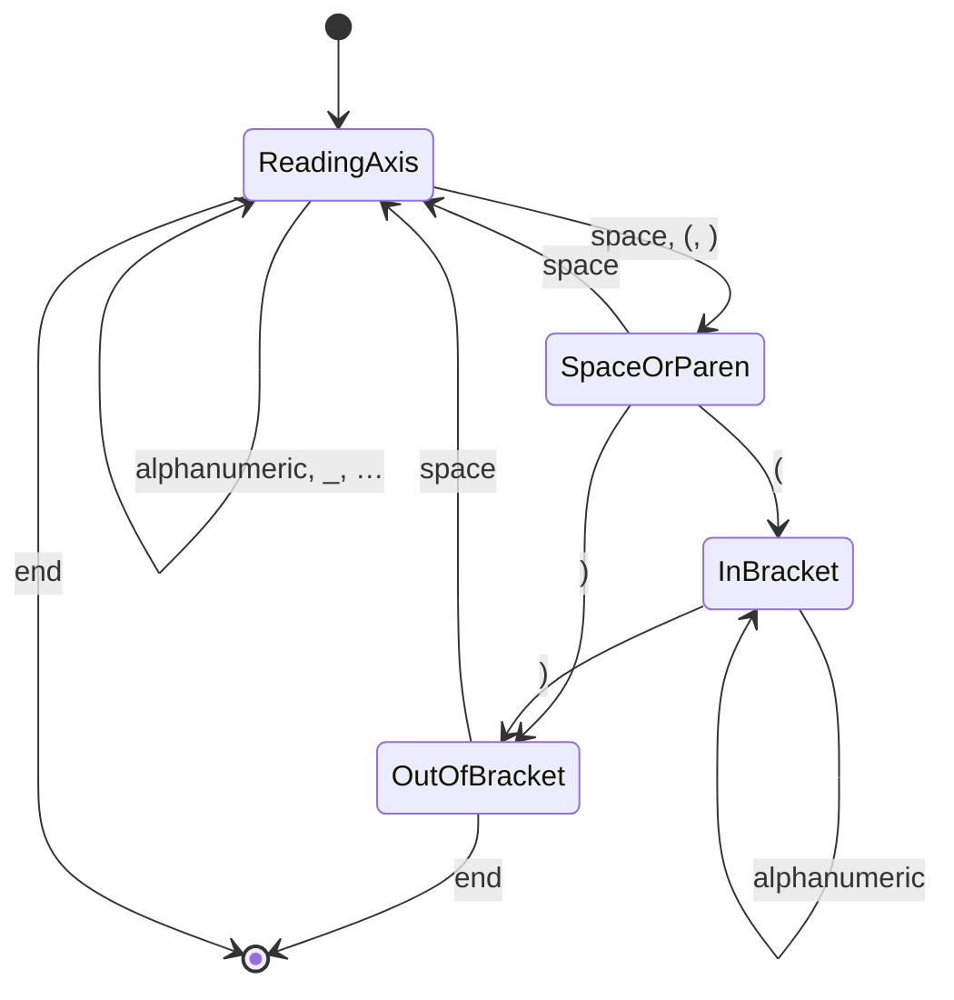

**Special Handling:**

- **Ellipsis (`...`)**: Converted to single unicode character `"…"` for internal processing
- **Anonymous axes (`1`, `2`, etc.)**: Wrapped in `AnonymousAxis` objects
- **Composite axes (`(h w)`)**: Stored as lists within `composition`
- **Underscore (`_`)**: Allowed only in `parse_shape()` to skip dimensions

**Sources:** [einops/parsing.py:31-112]()

### Validation Rules

The parser enforces these constraints:

1. **Identifier uniqueness**: No duplicate axis names (except `_` with `allow_underscore`)
2. **Balanced parentheses**: No nested or unmatched brackets
3. **Valid identifiers**: Must be Python identifiers, not starting/ending with underscore
4. **Single ellipsis**: Only one `...` allowed per expression
5. **Anonymous axis values**: Must be > 1 (value of 1 is handled specially)

**Sources:** [einops/parsing.py:51-111](), [einops/parsing.py:128-159]()

---

## Recipe Compilation System

### TransformRecipe Data Structure

The `TransformRecipe` class stores all information needed to execute a transformation:

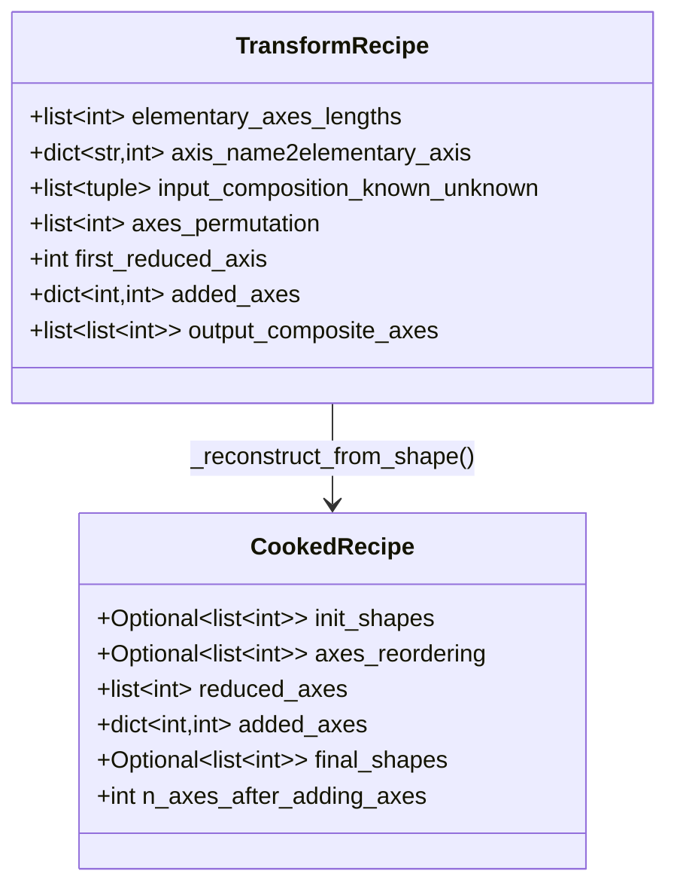

**Field Descriptions:**

- `elementary_axes_lengths`: Placeholder lengths for each elementary axis (may contain magic numbers like `-999999` for unknown)
- `axis_name2elementary_axis`: Maps provided axis names to their positions
- `input_composition_known_unknown`: For each input dimension, lists which elementary axes are known vs. unknown
- `axes_permutation`: Order of axes after transposition
- `first_reduced_axis`: Index where reduction begins (axes after this are reduced)
- `added_axes`: New axes to insert (position → elementary axis index)
- `output_composite_axes`: Grouping of elementary axes in the output

**Sources:** [einops/einops.py:114-153]()

### Recipe Compilation Flow

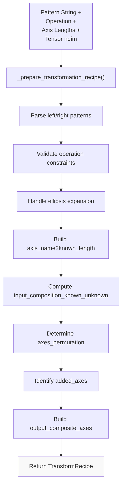

**Key Steps:**

1. **Pattern Splitting**: Split on `->` to get left/right expressions
2. **Constraint Validation**: Check operation-specific rules (e.g., `rearrange` requires same axes on both sides)
3. **Ellipsis Handling**: Expand `...` to concrete axes based on tensor rank
4. **Length Assignment**: Initialize all axes with `-999999` (unknown) or their specified length
5. **Composition Analysis**: Determine which axes in each input dimension are known/unknown
6. **Permutation Calculation**: Compute reordering to place axes in output order, then reduced axes
7. **Axis Addition**: Identify new axes in output (for `repeat` operation)

**Sources:** [einops/einops.py:289-442]()

### Magic Numbers for Shape Inference

The system uses special integer values to track axis lengths:

```python
_unknown_axis_length = -999999   # Length to be inferred from tensor shape
_expected_axis_length = -99999    # Length provided via kwargs, to be validated
```

These allow the recipe to be compiled before seeing the actual tensor, with concrete lengths filled in during execution.

**Sources:** [einops/einops.py:25-26]()

---

## Recipe Execution

### Shape Reconstruction

The `_reconstruct_from_shape()` function converts a `TransformRecipe` into a `CookedRecipe` with concrete dimensions:

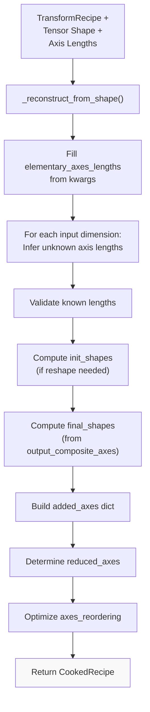

**Inference Logic:**

For each input dimension with shape `length`:
- If only one unknown axis: `unknown_length = length / product(known_lengths)`
- If all axes known: validate `length == product(known_lengths)`
- Raise `EinopsError` if validation fails or length not divisible

**Sources:** [einops/einops.py:155-225]()

### Execution Pipeline

The `_apply_recipe()` function executes the transformation:

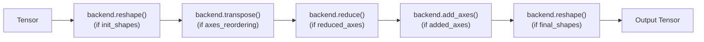

**Conditional Operations:**

- `init_shapes`: Required when input has composite axes (e.g., `(h w)` → separate dimensions)
- `axes_reordering`: Required unless axes are already in correct order
- `reduced_axes`: Required for `reduce()` and applicable reduction operations
- `added_axes`: Required for `repeat()` to introduce new dimensions
- `final_shapes`: Required when output has composite axes

**Sources:** [einops/einops.py:230-253](), [einops/einops.py:255-287]()

### Array API Fast Path

For backends supporting the Array API standard, einops uses `_apply_recipe_array_api()` which directly calls standard functions:

**Key Differences:**

- No backend object indirection
- Uses `xp.permute_dims()` instead of `transpose()`
- Uses `xp.expand_dims()` + `xp.broadcast_to()` for axis addition (more efficient than tile)
- Reduction operations called directly as `xp.{operation}()`

**Sources:** [einops/einops.py:255-287]()

---

## Caching Strategy

### Two-Level Cache Design

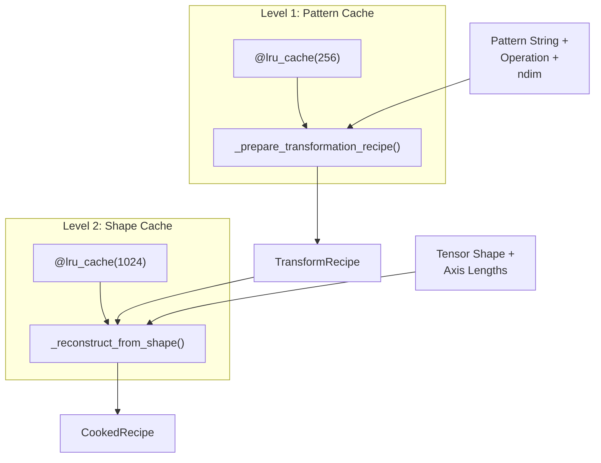

**Cache Design Rationale:**

1. **Pattern Cache (256 entries)**: 
   - Caches `TransformRecipe` by `(pattern, operation, axes_names, ndim)`
   - Smaller size since patterns are typically reused frequently
   - Independent of actual tensor shapes

2. **Shape Cache (1024 entries)**:
   - Caches `CookedRecipe` by `(recipe, shape, axes_lengths)`
   - Larger size to handle varying batch sizes and dimension combinations
   - Allows single pattern to work with different shapes efficiently

**Sources:** [einops/einops.py:227](), [einops/einops.py:289]()

### Cache Key Hashability

The shape cache uses a special mechanism to handle unhashable shapes (symbolic frameworks):

```python
try:
    # Attempt to use hashable tuple for caching
    result = _reconstruct_from_shape(recipe, backend.shape(tensor), axes_lengths)
except TypeError:
    # Fallback to uncached version for symbolic shapes
    result = _reconstruct_from_shape_uncached(recipe, backend.shape(tensor), axes_lengths)
```

This allows einops to work with both concrete shapes (NumPy, PyTorch) and symbolic shapes (TensorFlow graph mode, PyTensor).

**Sources:** [einops/einops.py:234-241]()

---

## Optimization Techniques

### Axis Collapsing

The `_optimize_transformation()` function collapses neighboring axes that are moved together:

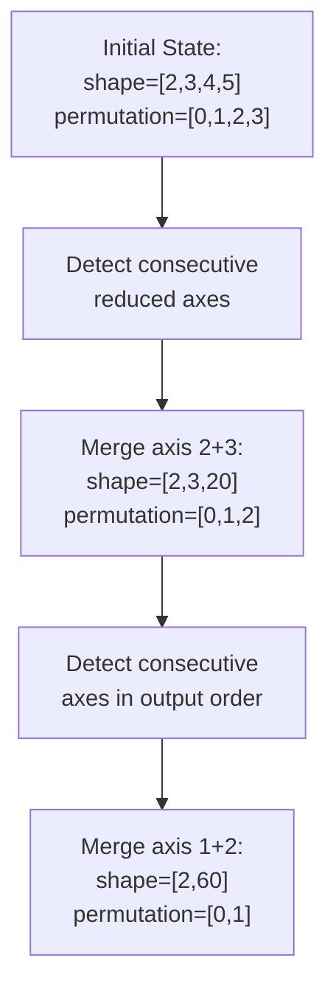

**Optimization Cases:**

1. **Consecutive Reduced Axes**: If axes `i` and `i+1` are both reduced, merge them before reduction
2. **Consecutive Output Axes**: If axes `i` and `i+1` appear consecutively in output, merge them

**Benefits:**

- Fewer reshape operations
- Reduced memory allocations
- Better backend optimization opportunities (backends can optimize larger contiguous operations)

**Sources:** [einops/einops.py:50-102]()

### Efficient Broadcasting

PyTorch and OneFlow backends use `expand()` instead of `tile()` for adding axes:

```python
# Instead of tile (copies data):
repeats = [1, 1, ..., axis_length, ...]
x = backend.tile(x, repeats)

# Use expand (creates view):
x = backend.add_axis(x, axis_position)
repeats[axis_position] = axis_length
x = x.expand(repeats)  # No data copy
```

The `expand()` operation creates a view with stride 0 for the repeated dimension, avoiding memory copies.

**Sources:** [einops/_backends.py:266-271](), [einops/_backends.py:520-525]()

### Einsum Pattern Compactification

The `_compactify_pattern_for_einsum()` function converts multi-character axis names to single characters:

```python
# Input pattern (einops style):
"batch height width, height width channel -> batch channel"

# Output pattern (standard einsum):
"abc,bcd->ad"
```

This is cached with `@lru_cache(256)` to avoid repeated string processing.

**Sources:** [einops/einops.py:795-846]()

---

## Error Handling

### EinopsError Exception

All validation errors raise `EinopsError` with context-rich messages:

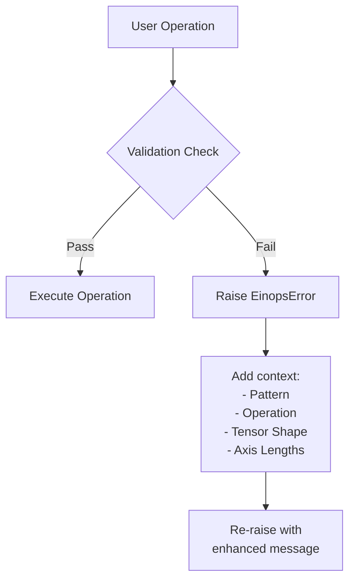

**Error Context Added:**

- The reduction/operation type
- The pattern string
- Input tensor shape (if not a list)
- Additional axis length specifications

**Sources:** [einops/einops.py:543-550]()

### Shape Validation

Multiple validation points ensure correctness:

1. **Pattern Parse Time**: Invalid identifiers, unbalanced parentheses
2. **Recipe Compile Time**: Missing axis names, incompatible operations
3. **Shape Reconstruction Time**: Dimension mismatches, indivisible lengths
4. **Execution Time**: Type errors (e.g., `mean` on non-float tensors)

**Sources:** [einops/einops.py:183-193](), [einops/einops.py:303-329](), [einops/einops.py:44-47]()

---

## Integration with Other Systems

### Layer System Integration

The `_prepare_recipes_for_all_dims()` function pre-compiles recipes for layers:

```python
def _prepare_recipes_for_all_dims(pattern, operation, axes_names):
    # For patterns with ellipsis, create recipes for ranks 0-7
    # For fixed patterns, create recipe for that specific rank
    left = ParsedExpression(left_str)
    if left.has_ellipsis:
        dims = [len(left.composition) - 1 + ellipsis_dims 
                for ellipsis_dims in range(8)]
    else:
        dims = [len(left.composition)]
    return {ndim: _prepare_transformation_recipe(...) for ndim in dims}
```

This allows layers to avoid runtime recipe compilation.

**Sources:** [einops/einops.py:445-457]()

### Symbolic Execution Support

Backends supporting symbolic execution (TensorFlow Keras, PyTensor) implement additional methods:

- `create_symbol(shape)`: Create symbolic tensor with given shape
- `eval_symbol(symbol, inputs)`: Evaluate symbolic expression with concrete values

These allow einops to work in graph-based computation models.

**Sources:** [einops/_backends.py:80-85](), [einops/_backends.py:434-439](), [einops/_backends.py:690-696]()

---

