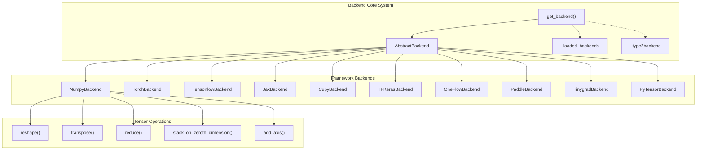
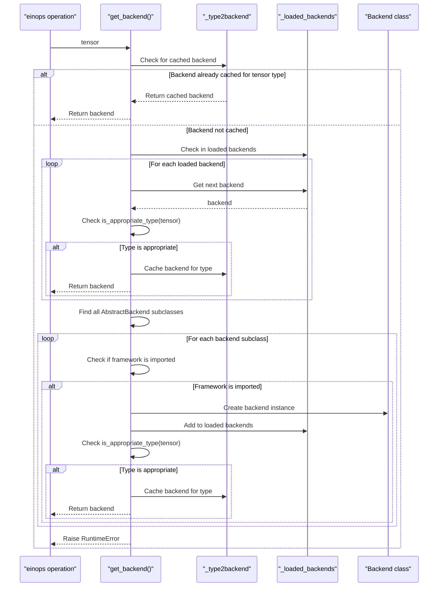
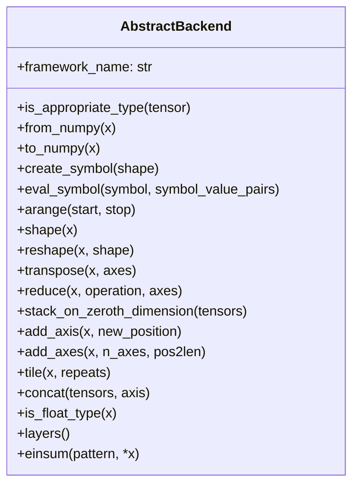
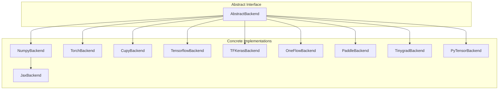
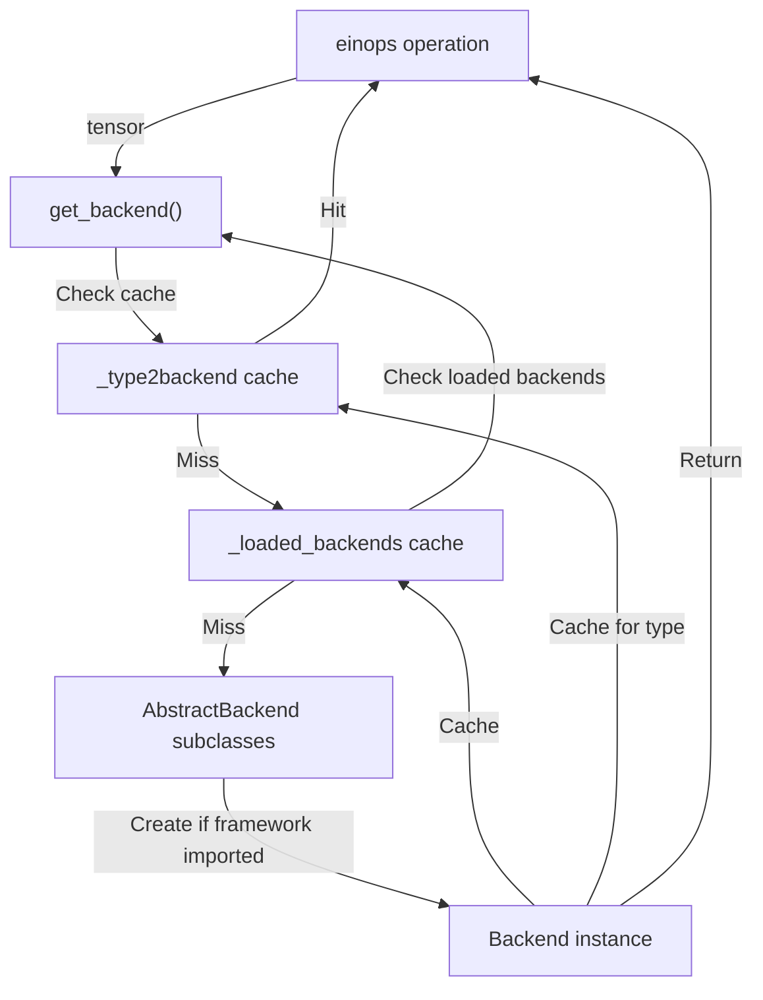
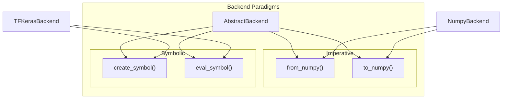
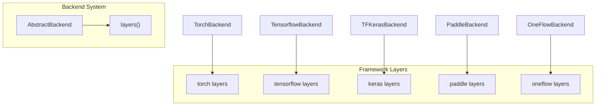

<!-- source: DeepWiki mcp.deepwiki.com · repo arogozhnikov/einops · page 4.1 Backend System · fetched 2026-10-21 -->

# Backend System

Relevant source files

The following files were used as context for generating this wiki page:

- [README.md](README.md)
- [einops/_backends.py](einops/_backends.py)

This page documents einops' backend system, which enables einops to work seamlessly with multiple tensor frameworks such as NumPy, PyTorch, TensorFlow, JAX, and others. For information about the broader internal architecture, see [Internal Architecture](#3), and for details about how transformation recipes are created and applied, see [Recipe System](#3.2).

## Purpose and Scope

The backend system serves as an abstraction layer between einops' operations and various tensor frameworks. It allows einops to:

1. Support multiple tensor frameworks with a unified interface
2. Lazy-load frameworks only when needed to minimize memory footprint
3. Provide consistent tensor operations across frameworks
4. Allow easy extension to support new tensor frameworks

Sources: [einops/_backends.py:1-11]()

## Architecture Overview

The backend system is designed with a clean separation of concerns and lazy loading of dependencies. It consists of an abstract interface that defines the operations required by einops, and concrete implementations for each supported framework.

Diagram: Backend System Architecture

Sources: [einops/_backends.py:17-19](), [einops/_backends.py:22-59](), [einops/_backends.py:62-136]()

## Backend Discovery and Selection

When a tensor operation is performed, einops needs to determine which backend to use for the given tensor. This is handled by the `get_backend()` function, which follows these steps:

Diagram: Backend Discovery Process

Sources: [einops/_backends.py:22-59]()

## The AbstractBackend Interface

All backend implementations inherit from the `AbstractBackend` class, which defines the interface each backend must implement. This interface includes methods for tensor manipulation operations like reshaping, transposition, and reduction.

Diagram: AbstractBackend Interface

Sources: [einops/_backends.py:62-136]()

The key methods of the `AbstractBackend` include:

| Method | Purpose |
|--------|---------|
| `is_appropriate_type(tensor)` | Checks if the backend can handle the given tensor type |
| `from_numpy(x)` | Converts a NumPy array to the framework's tensor type |
| `to_numpy(x)` | Converts the framework's tensor to a NumPy array |
| `reshape(x, shape)` | Reshapes the tensor to the specified shape |
| `transpose(x, axes)` | Transposes the tensor according to the given axes |
| `reduce(x, operation, axes)` | Performs reduction operations like sum, mean, etc. |
| `add_axis(x, new_position)` | Adds a new axis at the specified position |
| `einsum(pattern, *x)` | Performs Einstein summation |

Sources: [einops/_backends.py:62-136]()

## Framework-Specific Backend Implementations

Einops provides backend implementations for several tensor frameworks. Each backend implementation inherits from `AbstractBackend` and overrides the methods with framework-specific implementations.

Diagram: Backend Implementation Hierarchy

Sources: [einops/_backends.py:157-719]()

### Key Backend Implementations:

1. **NumpyBackend**: Provides operations for NumPy arrays
   - Sources: [einops/_backends.py:157-194]()

2. **TorchBackend**: Supports PyTorch tensors
   - Sources: [einops/_backends.py:214-288]()

3. **TensorflowBackend**: Handles TensorFlow tensors in eager mode
   - Sources: [einops/_backends.py:349-417]()

4. **JaxBackend**: Extends NumpyBackend for JAX arrays
   - Sources: [einops/_backends.py:196-212]()

5. **TFKerasBackend**: Supports Keras symbolic tensors
   - Sources: [einops/_backends.py:419-474]()

Each backend implementation provides methods that translate einops operations to the equivalent operations in the respective framework.

## Lazy-Loading Mechanism

To minimize memory footprint, einops does not import tensor frameworks unless they are actually needed. This is achieved through:

1. **No direct imports**: Framework-specific imports are contained within backend classes
2. **On-demand instantiation**: Backend instances are created only when needed
3. **Caching**: Once created, backends are cached to avoid repeated instantiation

Diagram: Lazy-Loading Backend System

Sources: [einops/_backends.py:1-11](), [einops/_backends.py:17-19](), [einops/_backends.py:22-59]()

## Helper Mechanisms for Framework Compatibility

### UnknownSize

For symbolic frameworks that don't provide symbols for shape dimensions, einops uses the `UnknownSize` class. This class mimics numeric operations but always returns itself, allowing it to be used in place of actual dimension values.

Sources: [einops/_backends.py:138-154]()

### HashableTuple

Some symbolic frameworks (like TensorFlow) use elements in shapes that aren't hashable. The `HashableTuple` class wraps these tuples to make them hashable, enabling them to be used in caching mechanisms.

Sources: [einops/_backends.py:330-347]()

## Symbolic vs. Imperative Backends

Backends in einops can be either symbolic or imperative, which affects which methods must be implemented:

1. **Imperative backends** (like NumPy, PyTorch): Implement `from_numpy` and `to_numpy`
2. **Symbolic backends** (like TensorFlow Keras in graph mode): Implement `create_symbol` and `eval_symbol`

Diagram: Symbolic vs. Imperative Backends

Sources: [einops/_backends.py:1-11](), [einops/_backends.py:71-82]()

## Creating Custom Backends

To add support for a new tensor framework, you can create a custom backend by extending the `AbstractBackend` class. At minimum, you need to implement:

1. `framework_name`: A string identifying the framework
2. `is_appropriate_type(tensor)`: Method to determine if the backend can handle a tensor
3. Basic tensor operations: `reshape`, `transpose`, etc.

For more details on creating custom backends, see [Custom Backends](#5.2).

Sources: [einops/_backends.py:62-136]()

## Integration with Layer Systems

Many backends also support integration with deep learning framework layers through the `layers()` method. This allows einops operations to be used directly in model definitions.

Diagram: Backend Layer Integration

Sources: [einops/_backends.py:128-129](), [einops/_backends.py:282-285](), [einops/_backends.py:410-413](), [einops/_backends.py:470-473](), [einops/_backends.py:537-540](), [einops/_backends.py:603-606]()

## Summary

The backend system is a key component of einops that enables it to operate seamlessly across multiple tensor frameworks. It uses a combination of:

1. An abstract interface that defines the required operations
2. Concrete implementations for each supported framework
3. A lazy-loading mechanism to minimize memory footprint
4. Helper classes to handle framework-specific peculiarities

This design makes einops a highly versatile library that can be used with various deep learning frameworks while maintaining a consistent interface.

---

