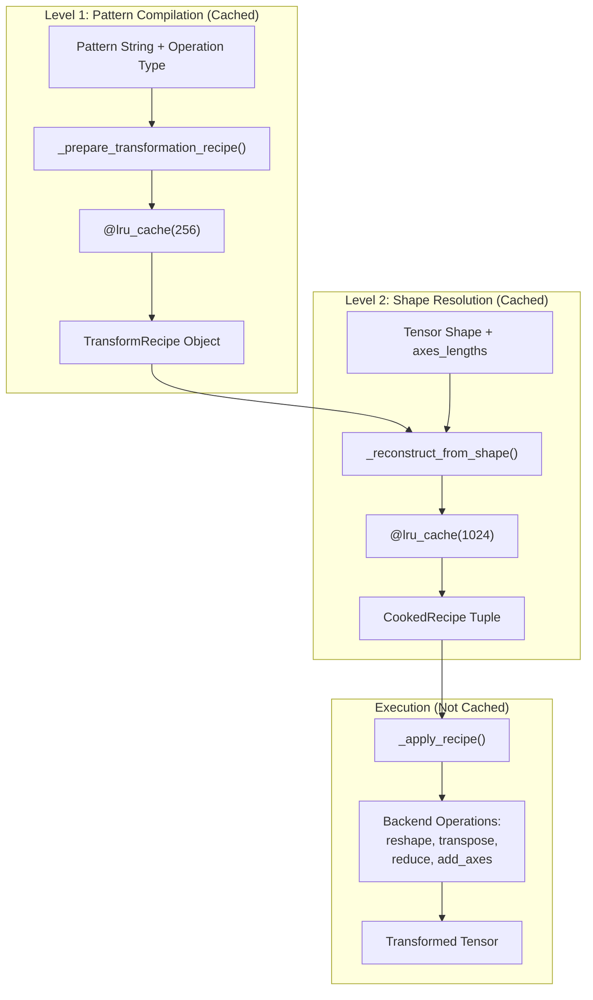
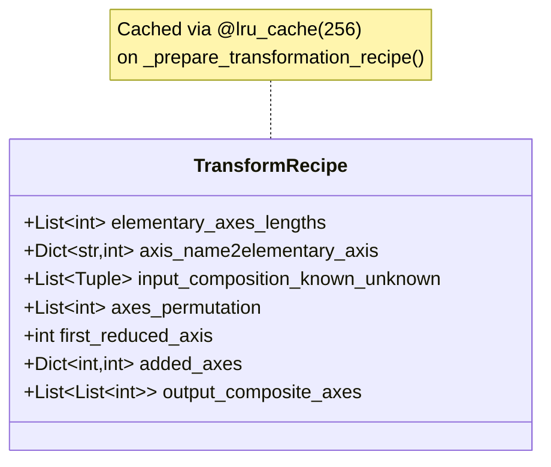
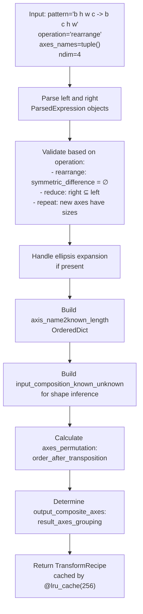
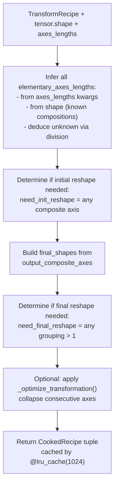
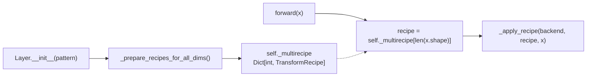
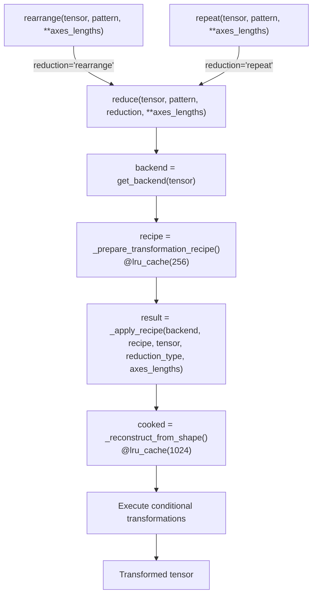
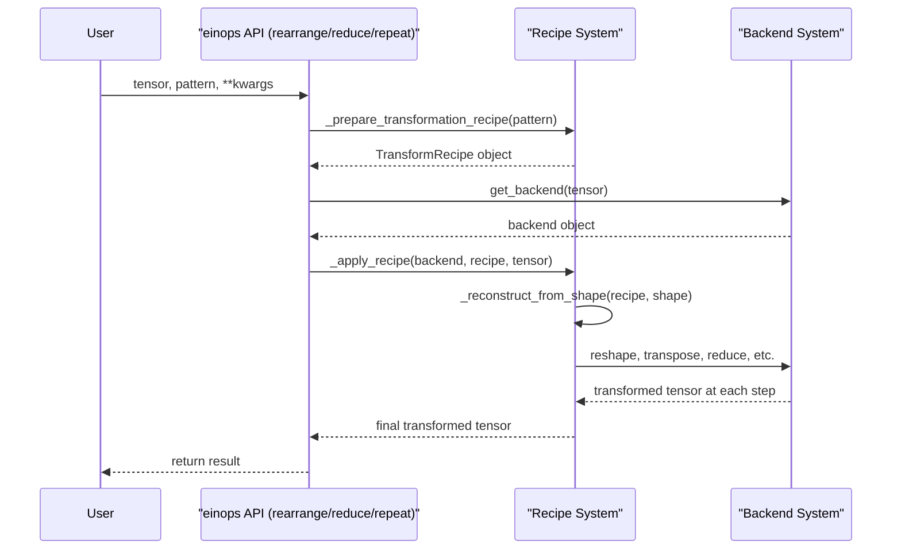

<!-- source: DeepWiki mcp.deepwiki.com · repo arogozhnikov/einops · page 4.2 Recipe System and Caching · fetched 2026-10-21 -->

# Recipe System and Caching

<details>
<summary>Relevant source files</summary>

The following files were used as context for generating this wiki page:

- [einops/einops.py](einops/einops.py)
- [einops/parsing.py](einops/parsing.py)
- [einops/tests/test_examples.py](einops/tests/test_examples.py)
- [einops/tests/test_layers.py](einops/tests/test_layers.py)
- [einops/tests/test_ops.py](einops/tests/test_ops.py)
- [einops/tests/test_other.py](einops/tests/test_other.py)

</details>


The Recipe System is a core component of einops that transforms string-based tensor operation patterns into concrete transformation sequences. A critical feature is its **two-level caching architecture**: first caching the pattern-to-recipe compilation, then caching the recipe-to-concrete-operations finalization. This design enables both flexible runtime usage and high-performance pre-computation for neural network layers.

For information about how patterns are initially parsed, see page 4.3. For details on how einops supports different tensor frameworks, see page 4.1.

## Overview of the Two-Level Caching Architecture

The Recipe System uses a two-stage compilation process with caching at each stage to maximize performance:

**Two-Level Caching Architecture**


**Level 1** caches the pattern compilation: pattern string → `TransformRecipe` object. This includes parsing, validation, and determining the abstract transformation structure.

**Level 2** caches the shape resolution: (`TransformRecipe`, tensor shape) → `CookedRecipe` tuple. This computes concrete dimension sizes and determines which transformation steps are actually needed.

Sources: [einops/einops.py:289-290](), [einops/einops.py:227](), [einops/einops.py:230-252]()

## TransformRecipe: The Intermediate Representation

The `TransformRecipe` class stores the abstract transformation plan, independent of any specific tensor shape. It represents the "compiled" form of a pattern string.

**TransformRecipe Structure**


### TransformRecipe Properties

| Property | Type | Purpose | Example Value |
|----------|------|---------|---------------|
| `elementary_axes_lengths` | `List[int]` | Length of each elementary axis (may contain sentinel values for unknown dimensions) | `[-999999, -999999, 3]` for pattern with 2 unknown and 1 known axis |
| `axis_name2elementary_axis` | `Dict[str, int]` | Maps axis names to their index in elementary_axes_lengths | `{'h': 0, 'w': 1, 'c': 2}` |
| `input_composition_known_unknown` | `List[Tuple[List[int], List[int]]]` | For each input dimension: (indices of known axes, indices of unknown axes) | `[([0], []), ([1], []), ([], [2])]` |
| `axes_permutation` | `List[int]` | Permutation to reorder axes after initial reshape | `[0, 2, 1]` to swap axes 1 and 2 |
| `first_reduced_axis` | `int` | Index where reduction starts (axes after this are reduced) | `2` means axes 2+ are reduced |
| `added_axes` | `Dict[int, int]` | Position → index mapping for newly added axes | `{2: 3}` adds axis from position 3 at position 2 |
| `output_composite_axes` | `List[List[int]]` | Groups of elementary axes forming each output dimension | `[[0], [1, 2]]` creates 2 output dims |

The sentinel values `_unknown_axis_length = -999999` and `_expected_axis_length = -99999` are used to mark axes whose lengths must be inferred from the tensor shape or provided via `axes_lengths` parameter.

Sources: [einops/einops.py:23-26](), [einops/einops.py:114-152]()

## Recipe Creation and Level 1 Caching

The function `_prepare_transformation_recipe` is decorated with `@functools.lru_cache(256)` to cache pattern compilation. It converts a pattern string into a `TransformRecipe` object through a multi-step process:

**Recipe Creation Pipeline**


### Cache Key Components

The LRU cache uses these parameters as the cache key:
- `pattern`: str (e.g., `"b h w c -> b c h w"`)
- `operation`: str or callable (e.g., `"rearrange"`, `"mean"`)
- `axes_names`: `Tuple[str, ...]` (names of axes with known lengths)
- `ndim`: int (dimensionality of input tensor)

With a cache size of 256, this accommodates diverse pattern variations in typical applications.

Sources: [einops/einops.py:289-442]()

## CookedRecipe: The Concrete Execution Plan

A "cooked recipe" is the final, concrete specification of operations to perform on a tensor with a specific shape. It's represented as a tuple type:

```python
CookedRecipe = Tuple[
    Optional[List[int]],  # init_shapes: initial reshape dimensions
    Optional[List[int]],  # axes_reordering: permutation for transpose
    List[int],            # reduced_axes: axes to reduce
    Dict[int, int],       # added_axes: position -> length for new axes
    Optional[List[int]],  # final_shapes: final reshape dimensions
    int                   # n_axes_after_adding_axes: total axes after additions
]
```

The `Optional` fields may be `None` if that transformation step is not needed, enabling optimization by skipping unnecessary operations.

Sources: [einops/einops.py:105]()

## Shape Reconstruction and Level 2 Caching

The `_reconstruct_from_shape_uncached` function converts a `TransformRecipe` into a `CookedRecipe` by resolving all dimension sizes using the actual tensor shape and `axes_lengths` parameters. This function is wrapped with `@functools.lru_cache(1024)`:

```python
_reconstruct_from_shape = functools.lru_cache(1024)(_reconstruct_from_shape_uncached)
```

**Shape Reconstruction Process**


### Cache Key for Shape Reconstruction

The cache uses:
- `self`: the `TransformRecipe` object
- `shape`: `List[int]` - the tensor's shape
- `axes_dims`: `FakeHashableAxesLengths` - tuple of (axis_name, dimension) pairs

For symbolic frameworks (TensorFlow, PyTensor) where shapes may not be hashable, the function falls back to the uncached version automatically (catching `TypeError`).

Sources: [einops/einops.py:155-227]()

## Recipe Application Pipeline

The `_apply_recipe` function orchestrates the complete transformation by obtaining the cooked recipe and executing each step conditionally:

**_apply_recipe Execution Flow**

```mermaid
flowchart TD
    input["backend, recipe, tensor,<br/>reduction_type, axes_lengths"]
    
    reconstruct["cooked = _reconstruct_from_shape()<br/>(cached)"]
    
    unpack["Unpack CookedRecipe:<br/>init_shapes, axes_reordering,<br/>reduced_axes, added_axes,<br/>final_shapes, n_axes_w_added"]
    
    reshape1{"init_shapes<br/>is not None?"}
    transpose{"axes_reordering<br/>is not None?"}
    reduce{"len(reduced_axes)<br/>> 0?"}
    add{"len(added_axes)<br/>> 0?"}
    reshape2{"final_shapes<br/>is not None?"}
    
    do_reshape1["tensor = backend.reshape(tensor, init_shapes)"]
    do_transpose["tensor = backend.transpose(tensor, axes_reordering)"]
    do_reduce["tensor = _reduce_axes(tensor, reduction_type, reduced_axes, backend)"]
    do_add["tensor = backend.add_axes(tensor, n_axes_w_added, added_axes)"]
    do_reshape2["tensor = backend.reshape(tensor, final_shapes)"]
    
    output["Return transformed tensor"]
    
    input --> reconstruct
    reconstruct --> unpack
    unpack --> reshape1
    
    reshape1 -->|Yes| do_reshape1
    reshape1 -->|No| transpose
    do_reshape1 --> transpose
    
    transpose -->|Yes| do_transpose
    transpose -->|No| reduce
    do_transpose --> reduce
    
    reduce -->|Yes| do_reduce
    reduce -->|No| add
    do_reduce --> add
    
    add -->|Yes| do_add
    add -->|No| reshape2
    do_add --> reshape2
    
    reshape2 -->|Yes| do_reshape2
    reshape2 -->|No| output
    do_reshape2 --> output
```


Each transformation step is conditional, executed only if needed based on the cooked recipe. This avoids unnecessary operations and improves performance.

Sources: [einops/einops.py:230-252]()

## Pre-computed Recipes for Neural Network Layers

Neural network layers require different handling because they must work with static graphs (TensorFlow/Keras) and JIT compilation (PyTorch's `torch.jit.script`, `torch.compile`). These contexts don't allow dynamic recipe generation during forward passes.

The solution is `_prepare_recipes_for_all_dims`, which pre-computes recipes for multiple input dimensionalities during layer initialization:

```python
def _prepare_recipes_for_all_dims(
    pattern: str, operation: Reduction, axes_names: Tuple[str, ...]
) -> Dict[int, TransformRecipe]:
    left_str, rght_str = pattern.split("->")
    left = ParsedExpression(left_str)
    dims = [len(left.composition)]
    if left.has_ellipsis:
        dims = [len(left.composition) - 1 + ellipsis_dims for ellipsis_dims in range(8)]
    return {ndim: _prepare_transformation_recipe(pattern, operation, axes_names, ndim=ndim) for ndim in dims}
```

**Pre-computation Strategy**:
- **Without ellipsis**: Pre-compute for exactly 1 dimensionality (the pattern's explicit ndim)
- **With ellipsis**: Pre-compute for 8 dimensionalities (covering 0-7 ellipsis dimensions)

This approach is used by `RearrangeMixin` and `ReduceMixin` in [einops/layers/__init__.py:9-105]():

**Layer Recipe Pre-computation**


During the forward pass, layers simply lookup the pre-computed recipe based on input dimensionality, avoiding any pattern parsing or recipe compilation.

Sources: [einops/einops.py:445-457](), [einops/layers/__init__.py:33-49](), [einops/layers/__init__.py:83-99]()

## Recipe Optimization

The `_optimize_transformation` function performs post-processing on cooked recipes to collapse redundant operations:

### Optimization Strategies

| Optimization | Description | Example |
|--------------|-------------|---------|
| **Collapse consecutive reduced axes** | Merges neighboring axes that will both be reduced | Axes [2, 3, 4] reduced → merge into single axis before reduction |
| **Collapse consecutive moved axes** | Merges axes that maintain relative order after transposition | Axes moved together [i, i+1] → merge before transpose |

**Example Transformation**:

Before optimization:
```
init_shapes = [batch, 10, 20, 30, channels]
reduced_axes = [2, 3]  # consecutive
axes_reordering = [0, 4, 1, 2, 3]
```

After optimization:
```
init_shapes = [batch, 10, 600, channels]  # 20*30 merged
reduced_axes = [2]  # single merged axis
axes_reordering = [0, 3, 1, 2]  # adjusted indices
```

This optimization reduces the number of operations and may enable better backend-specific optimizations.

Sources: [einops/einops.py:50-102]()

## Integration with Public API

The three main einops operations use the Recipe System through a unified interface:

**API Integration Flow**


### Implementation Details

- `rearrange()` [einops/einops.py:561-616]() calls `reduce()` with `reduction="rearrange"`
- `repeat()` [einops/einops.py:627-674]() calls `reduce()` with `reduction="repeat"`  
- `reduce()` [einops/einops.py:468-550]() is the core implementation that:
  1. Gets the appropriate backend via `get_backend(tensor)`
  2. Calls `_prepare_transformation_recipe()` (Level 1 cached)
  3. Calls `_apply_recipe()` which uses `_reconstruct_from_shape()` (Level 2 cached)

Sources: [einops/einops.py:468-550](), [einops/einops.py:561-616](), [einops/einops.py:627-674]()

## Performance Characteristics and Cache Sizing

The Recipe System's performance benefits from strategic cache sizing and optimizations:

### Cache Sizing Rationale

| Cache | Size | Rationale |
|-------|------|-----------|
| `_prepare_transformation_recipe` | 256 entries | Covers diverse pattern strings in typical applications. Each unique (pattern, operation, axes_names, ndim) combination is cached. |
| `_reconstruct_from_shape` | 1024 entries | Larger size accommodates varying tensor shapes. Each unique (recipe, shape, axes_lengths) combination is cached. |

### Performance Benefits

1. **Pattern Compilation Amortization**: Parsing and validating patterns happens once per unique pattern string, then is reused across all tensors.

2. **Shape Resolution Amortization**: Computing concrete dimensions happens once per unique shape, avoiding repeated division/inference operations.

3. **Conditional Execution**: Cooked recipes explicitly mark which transformations are needed (`None` for skipped steps), avoiding conditional checks in hot loops.

4. **Layer Pre-computation**: Neural network layers eliminate all dynamic recipe generation, making forward passes consist purely of cached lookups and tensor operations.

### Cache Eviction

Both caches use LRU (Least Recently Used) eviction:
- Pattern cache (256): Evicts least-used patterns when full
- Shape cache (1024): Evicts least-used shape resolutions when full

For applications with highly dynamic patterns or shapes exceeding cache capacity, some recomputation occurs, but this is rare in practice.

### Measurement Example

For a training loop processing 1000 batches with the same pattern:
- **Without caching**: 1000 pattern parses + 1000 shape resolutions
- **With caching**: 1 pattern parse + 1 shape resolution (assuming consistent batch shape)

This represents a ~2000x reduction in preprocessing overhead.

Sources: [einops/einops.py:289](), [einops/einops.py:227](), [einops/einops.py:230-252]()

## Array API Implementation

The `_apply_recipe_array_api` function [einops/einops.py:255-286]() provides an optimized path for frameworks supporting the Python Array API standard (numpy 2.0+, PyTorch with `torch.Tensor.__array_namespace__()`, etc.):

**Key Differences from Standard Implementation**:

1. **Direct API calls**: Uses `xp.reshape()`, `xp.permute_dims()` instead of `backend.reshape()`, `backend.transpose()`

2. **Broadcasting for new axes**: Instead of using `backend.add_axes()`, it uses:
   ```python
   for axis_position, _axis_length in added_axes.items():
       tensor = xp.expand_dims(tensor, axis=axis_position)
   # Then broadcast to final shape
   tensor = xp.broadcast_to(tensor, final_shape)
   ```

3. **Inline execution**: All operations are inlined rather than dispatched through backend methods, reducing function call overhead.

This implementation achieves better performance on Array API-compliant frameworks by avoiding the backend abstraction layer, while maintaining the same logical transformation sequence.

Sources: [einops/einops.py:255-286]()

## Putting It All Together

The Recipe System ties together pattern parsing, tensor operations, and framework-specific backends to provide a consistent and efficient API for tensor manipulations.



The Recipe System serves as the "brain" of einops, converting abstract pattern descriptions into concrete tensor operations while hiding the complexity from the user.

Sources: [einops/einops.py:230-252](), [einops/einops.py:460-650]()

---

