<!-- source: DeepWiki mcp.deepwiki.com · repo arogozhnikov/einops · page 4.3 Pattern Parsing System · fetched 2026-10-21 -->

# Pattern Parsing System

Relevant source files

The following files were used as context for generating this wiki page:

- [einops/einops.py](einops/einops.py)
- [einops/parsing.py](einops/parsing.py)

## Purpose and Scope

The Pattern Parsing System is responsible for transforming user-provided pattern strings (e.g., `'b h w c -> b c h w'`) into structured data representations that can be compiled into executable transformation recipes. This system handles tokenization, identifier extraction, structure analysis (composite axes, ellipsis), and validation of pattern syntax.

This document covers the `ParsedExpression` class and the parsing pipeline. For information about how parsed patterns are compiled into executable transformations, see [Recipe System and Caching](#4.2). For details on the pattern language syntax from a user perspective, see [Pattern Syntax Guide](#2.4).

---

## System Architecture

The pattern parsing system sits at the entry point of einops' processing pipeline, converting declarative pattern strings into structured information before recipe compilation.

**High-Level Pattern Processing Flow**

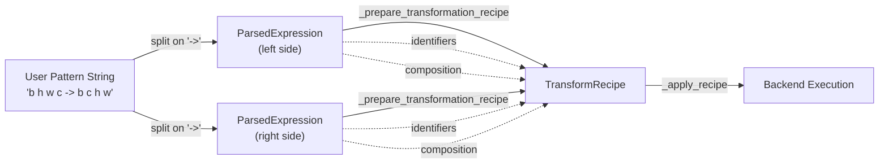

**Sources:** [einops/einops.py:289-442](), [einops/parsing.py:25-159]()

---

## ParsedExpression Class Structure

The `ParsedExpression` class is an immutable data structure that represents one side of a transformation pattern (either left or right of the `->` arrow). It is created during pattern parsing and consumed by the recipe generation system.

**ParsedExpression Data Model**

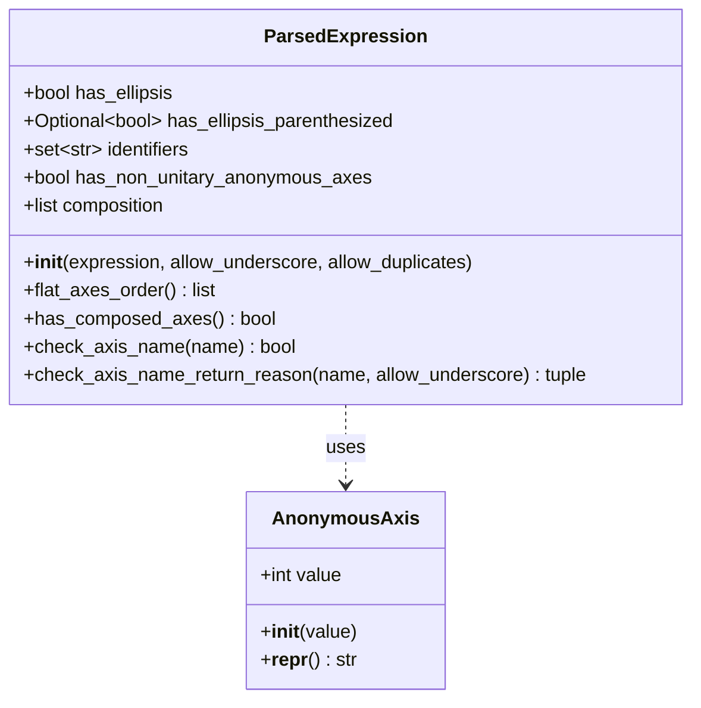

**Sources:** [einops/parsing.py:25-159](), [einops/parsing.py:10-23]()

### Key Fields

| Field | Type | Purpose |
|-------|------|---------|
| `has_ellipsis` | `bool` | Indicates if pattern contains `...` for variable dimensions |
| `has_ellipsis_parenthesized` | `Optional[bool]` | Tracks if ellipsis appears inside parentheses (left side only) |
| `identifiers` | `set[str]` | All unique axis names and special symbols (including `_ellipsis`) |
| `has_non_unitary_anonymous_axes` | `bool` | True if pattern contains numeric axes like `2`, `3`, etc. (excludes `1`) |
| `composition` | `list[Union[list[str], str]]` | Hierarchical structure: list of axes groups, where each group is a list of axis names |

The `composition` field encodes the structure of the pattern:
- Simple axes: `['b', 'h', 'w']` → `[['b'], ['h'], ['w']]`
- Composite axes: `'(h1 h2)'` → `[['h1', 'h2']]`
- Empty composition: `'()'` → `[[]]`
- Ellipsis: `'...'` → `[_ellipsis]` (where `_ellipsis = "…"` unicode symbol)

**Sources:** [einops/parsing.py:31-38]()

---

## Pattern Component Types

The pattern parsing system recognizes five distinct types of pattern components, each with different semantics and validation rules.

**Pattern Component Taxonomy**

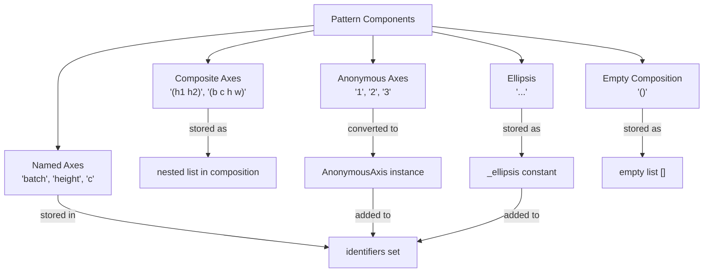

**Sources:** [einops/parsing.py:51-83]()

### Component Validation Rules

| Component Type | Validation | Example Valid | Example Invalid |
|----------------|------------|---------------|-----------------|
| Named Axes | Must be valid Python identifiers, cannot start/end with `_` (except special `_`), cannot be keywords | `'batch'`, `'h'`, `'channel_3'` | `'_private'`, `'3d'`, `'for'` |
| Anonymous Axes | Must be positive integers, `1` is special-cased (no axis created) | `'2'`, `'3'`, `'10'` | `'0'`, `'-1'`, `'1.5'` |
| Composite Axes | Can contain any combination of named/anonymous axes | `'(h w)'`, `'(batch 2)'` | `'((h w))'` (nested) |
| Ellipsis | Can appear at most once, `...` only (exactly 3 dots) | `'...'` | `'..'`, `'....'` |
| Empty Composition | Only valid inside parentheses as `()` | `'() b c'`, `'b () c'` | Empty without parens |

**Sources:** [einops/parsing.py:39-47](), [einops/parsing.py:64-71](), [einops/parsing.py:128-149]()

---

## Parsing Pipeline

The pattern parsing pipeline operates as a character-by-character state machine that builds up the `ParsedExpression` structure incrementally.

**Character-Level Parsing State Machine**

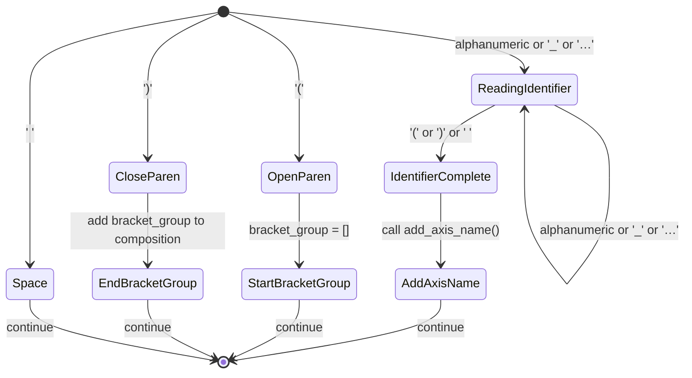

**Sources:** [einops/parsing.py:85-111]()

### Parsing Phases

**Phase 1: Character Scanning and Tokenization**

The parser iterates through each character in the expression string, accumulating characters into identifiers and responding to structural characters.

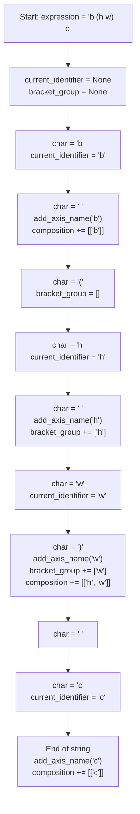

**Sources:** [einops/parsing.py:85-111]()

**Phase 2: Identifier Processing**

The `add_axis_name` function processes each complete identifier, determining its type and updating the appropriate data structures.

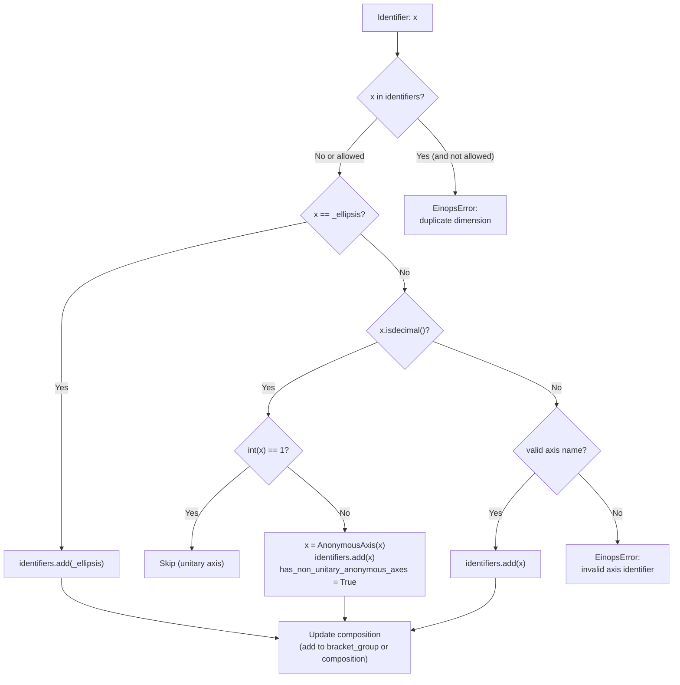

**Sources:** [einops/parsing.py:51-83]()

**Phase 3: Structure Building**

As identifiers are processed, they are added to the `composition` list, which maintains the hierarchical structure of the pattern.

| Pattern | Resulting composition |
|---------|----------------------|
| `'b h w c'` | `[['b'], ['h'], ['w'], ['c']]` |
| `'(b h) w c'` | `[['b', 'h'], ['w'], ['c']]` |
| `'b ... c'` | `[['b'], _ellipsis, ['c']]` |
| `'() b c'` | `[[], ['b'], ['c']]` |
| `'b (h 2) c'` | `[['b'], ['h', AnonymousAxis(2)], ['c']]` |

**Sources:** [einops/parsing.py:66-83](), [einops/parsing.py:94-99]()

---

## Validation System

Validation occurs at multiple stages: during parsing (syntax validation) and after parsing (semantic validation when comparing left and right patterns).

**Validation Points in Pattern Processing**

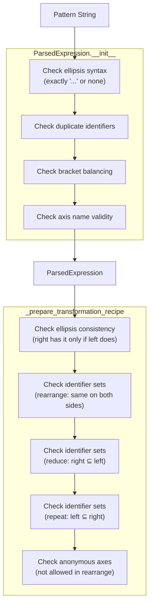

**Sources:** [einops/parsing.py:39-47](), [einops/parsing.py:52-54](), [einops/parsing.py:92-97](), [einops/parsing.py:108-111](), [einops/einops.py:304-329]()

### Syntax Validation Rules

The `ParsedExpression.__init__` method enforces syntax rules during parsing:

1. **Ellipsis Format** [einops/parsing.py:39-47]()
   - Must be exactly `...` (3 dots)
   - At most one ellipsis per expression
   - Cannot have standalone dots (`.` or `..`)

2. **Duplicate Detection** [einops/parsing.py:52-54]()
   - Same identifier cannot appear twice (unless `allow_duplicates=True` for einsum)
   - Exception: `_` is allowed to repeat when `allow_underscore=True`

3. **Bracket Balancing** [einops/parsing.py:92-97](), [einops/parsing.py:108-111]()
   - Every `(` must have matching `)`
   - Cannot nest brackets: `((h w))` is invalid
   - Must close all open brackets before end of expression

4. **Axis Name Validation** [einops/parsing.py:72-74](), [einops/parsing.py:128-149]()
   - Must be valid Python identifier
   - Cannot start or end with `_` (except special `_` with `allow_underscore`)
   - Should not be Python keywords (warning issued)
   - Should not be `'axis'` (future error, warning for now)

### Semantic Validation Rules

The `_prepare_transformation_recipe` function validates semantic consistency between left and right patterns:

| Operation | Left → Right Rule | Error if Violated |
|-----------|-------------------|-------------------|
| `rearrange` | `left.identifiers == right.identifiers` | Identifiers must appear on both sides |
| `reduce` | `right.identifiers ⊆ left.identifiers` | Right cannot introduce new identifiers |
| `repeat` | `left.identifiers ⊆ right.identifiers` | New identifiers on right must have explicit sizes |
| All | If left has `...`, right may optionally have it | Right cannot have `...` if left doesn't |
| `rearrange` only | No non-unitary anonymous axes | Anonymous axes (except `1`) not supported |

**Sources:** [einops/einops.py:304-329]()

---

## Special Pattern Constructs

### Ellipsis Handling

The ellipsis `...` represents a variable number of dimensions and requires special processing during recipe compilation.

**Ellipsis Expansion Process**

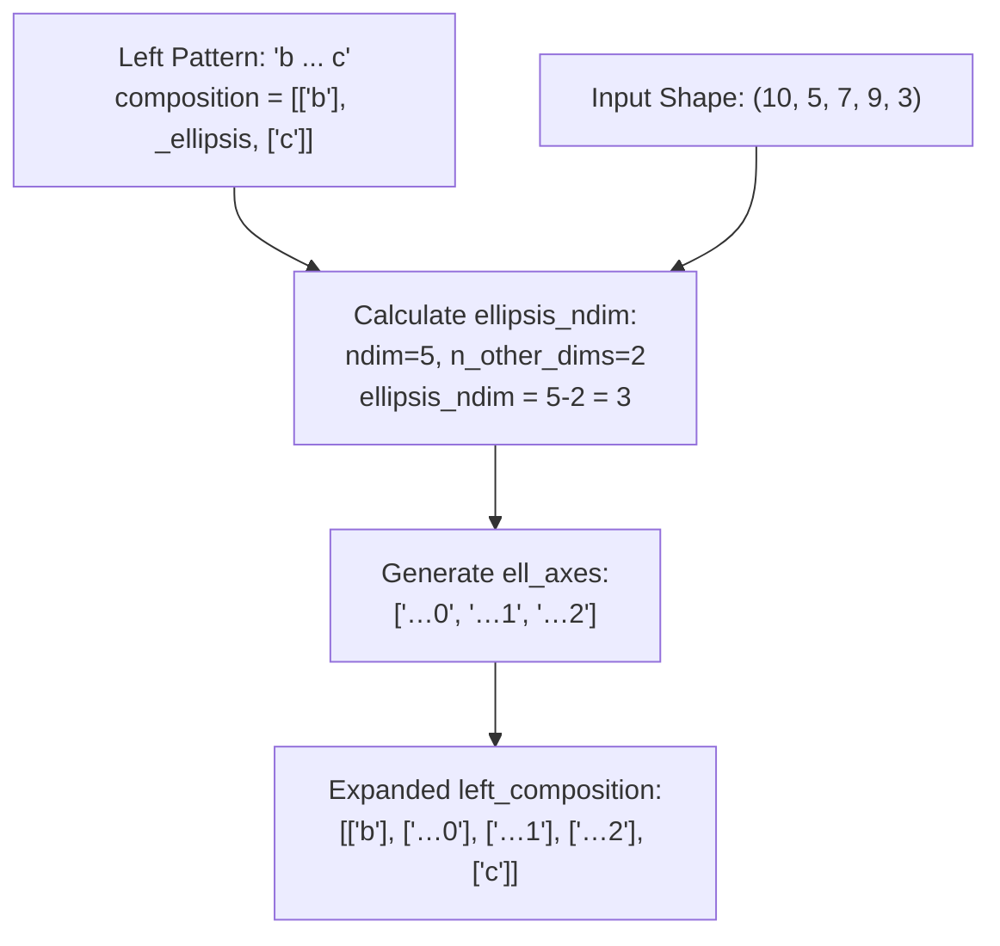

**Sources:** [einops/einops.py:331-368]()

The ellipsis expansion logic [einops/einops.py:331-368]():
1. Count non-ellipsis axes in left pattern: `n_other_dims = len(left.composition) - 1`
2. Verify tensor has enough dimensions: `ndim >= n_other_dims`
3. Calculate ellipsis dimensions: `ellipsis_ndim = ndim - n_other_dims`
4. Generate synthetic axis names: `[_ellipsis + str(i) for i in range(ellipsis_ndim)]`
5. Substitute ellipsis in both left and right compositions
6. Update identifier sets to include synthetic axes

### Anonymous Axes

Anonymous axes (numeric literals) represent axes with known fixed sizes and are converted to `AnonymousAxis` instances during parsing.

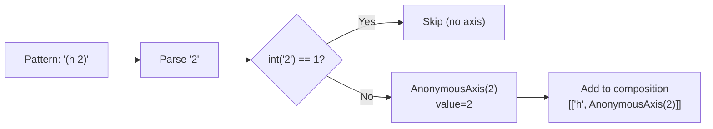

**Sources:** [einops/parsing.py:64-79]()

The `AnonymousAxis` class [einops/parsing.py:10-23]():
- Stores the integer value of the axis
- Each instance is unique (not equal to other instances with same value)
- Value must be positive (enforced in `__init__`)
- Special case: `1` is not converted to `AnonymousAxis`, but results in empty composition `[]`

---

## Integration with Recipe System

The `ParsedExpression` objects are consumed by `_prepare_transformation_recipe` to generate `TransformRecipe` objects.

**Pattern to Recipe Compilation Flow**

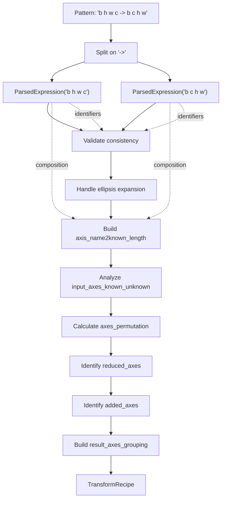

**Sources:** [einops/einops.py:289-442]()

### Key Mappings

The recipe compilation process extracts several mappings from `ParsedExpression` objects:

1. **axis_name2position** [einops/einops.py:390]()
   - Maps each axis name to its position in `elementary_axes_lengths`
   - Built from `OrderedDict(axis_name2known_length)`

2. **input_axes_known_unknown** [einops/einops.py:400-410]()
   - For each input axis (left composition element), identifies which elementary axes are known vs unknown
   - Used for shape inference at runtime

3. **axes_permutation** [einops/einops.py:421-425]()
   - Defines reordering of axes after initial reshape
   - Built by comparing order in left and right flat axes

4. **added_axes** [einops/einops.py:426-430]()
   - Maps output positions to elementary axis indices for new axes (repeat operation)
   - Built from `right.identifiers - left.identifiers`

5. **result_axes_grouping** [einops/einops.py:417-419]()
   - Groups elementary axes for final reshape
   - Built directly from `right.composition`

**Sources:** [einops/einops.py:370-442]()

---

## Caching Strategy

Pattern parsing results are cached to avoid repeated parsing of identical patterns. The caching happens at the recipe level, not at the `ParsedExpression` level.

**Caching Architecture**

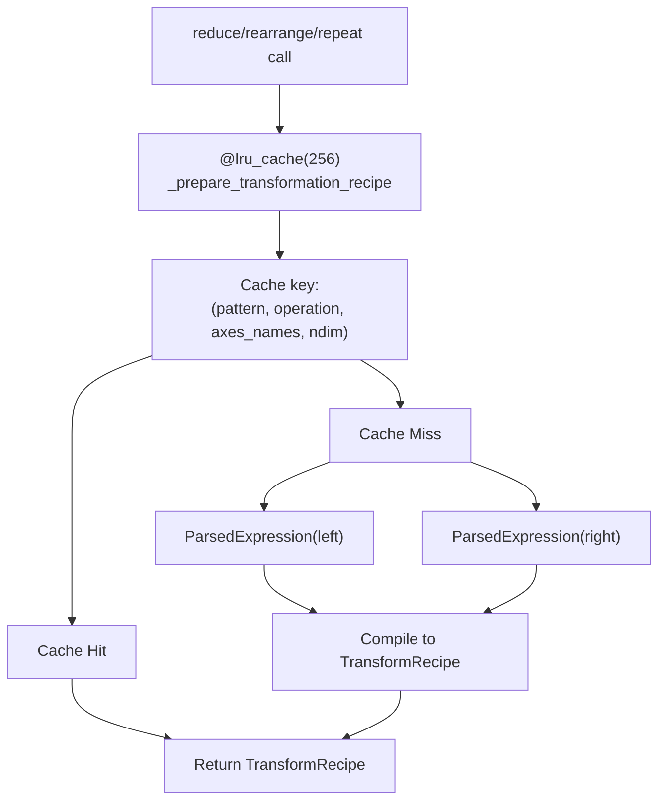

**Sources:** [einops/einops.py:289]()

The `_prepare_transformation_recipe` function is decorated with `@functools.lru_cache(256)` [einops/einops.py:289](), which caches based on:
- `pattern` (str): The full pattern string including `->`
- `operation` (str or callable): The operation type (`'rearrange'`, `'reduce'`, or reduction name)
- `axes_names` (tuple): Names of explicitly provided axes
- `ndim` (int): Number of dimensions in the input tensor

This means:
- Same pattern with different operations → different cache entries
- Same pattern with different tensor shapes → may reuse cached recipe if ellipsis handles shape difference
- Same pattern with different explicit axes → different cache entries

**Sources:** [einops/einops.py:289-295]()

---

## Error Messages and Debugging

The pattern parsing system generates detailed error messages to help users debug invalid patterns.

### Common Error Scenarios

| Error Type | Example Pattern | Error Message |
|------------|-----------------|---------------|
| Duplicate identifier | `'b h b c -> ...'` | `'Indexing expression contains duplicate dimension "b"'` |
| Invalid character | `'b@h -> b h'` | `"Unknown character '@'"` |
| Unbalanced brackets | `'(b h -> b h'` | `'Imbalanced parentheses in expression: "..."'` |
| Invalid ellipsis | `'b .. c -> ...'` | `'Expression may contain dots only inside ellipsis (...)'` |
| Multiple ellipsis | `'... b ... -> ...'` | `'Expression may contain dots only inside ellipsis (...); only one ellipsis for tensor'` |
| Invalid axis name | `'_b h w -> _b h w'` | `'Invalid axis identifier: _b\naxis name should should not start or end with underscore'` |
| Nested brackets | `'((h w)) -> h w'` | `'Axis composition is one-level (brackets inside brackets not allowed)'` |

**Sources:** [einops/parsing.py:39-111](), [einops/einops.py:304-329]()

### Einsum-Specific Validation

The `_compactify_pattern_for_einsum` function [einops/einops.py:795-846]() performs additional validation for einsum patterns:

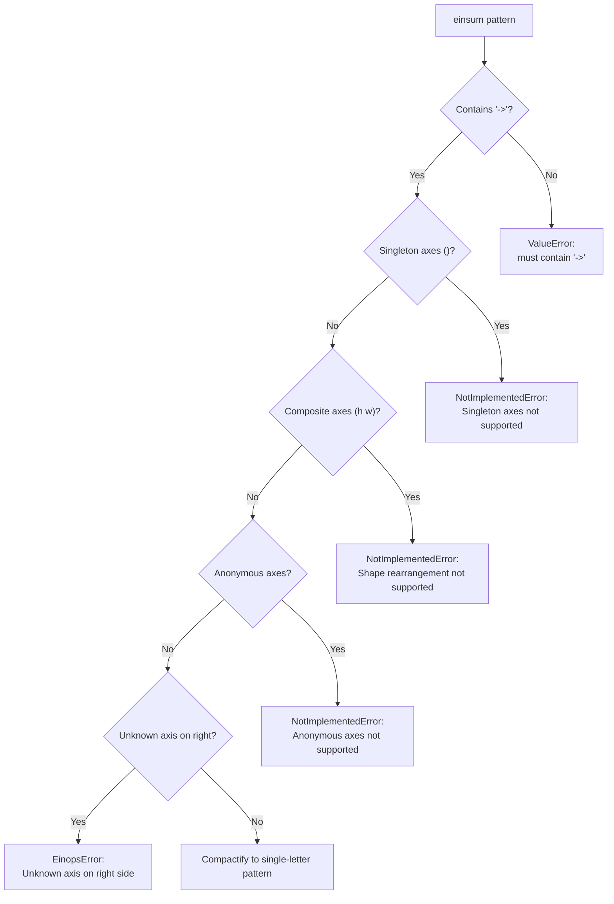

**Sources:** [einops/einops.py:779-793](), [einops/einops.py:795-846]()

---

## Summary

The Pattern Parsing System transforms user-friendly pattern strings into structured `ParsedExpression` objects through a character-level state machine. Key design principles include:

1. **Immutability**: `ParsedExpression` objects are immutable and contain all information about one side of a pattern
2. **Two-Stage Processing**: Parsing (string → ParsedExpression) is separate from compilation (ParsedExpression → TransformRecipe)
3. **Comprehensive Validation**: Syntax validation during parsing, semantic validation during recipe compilation
4. **Special Constructs**: Ellipsis and anonymous axes require special handling throughout the pipeline
5. **Caching**: Parsed recipes are cached to avoid repeated parsing overhead

The system supports five pattern component types (named axes, composite axes, anonymous axes, ellipsis, empty composition) and three operation modes (rearrange, reduce, repeat), each with distinct validation rules.

**Sources:** [einops/parsing.py:1-159](), [einops/einops.py:289-442]()

---

