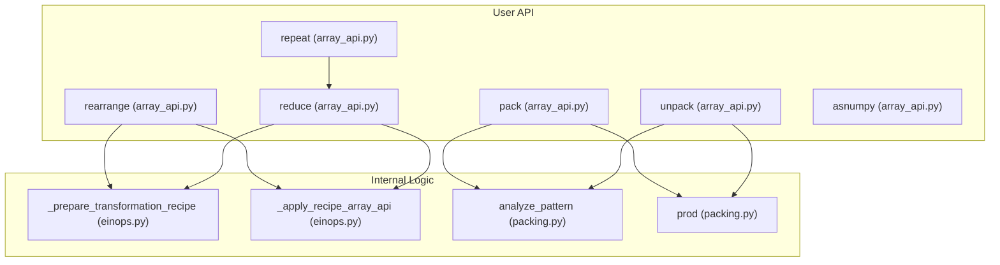
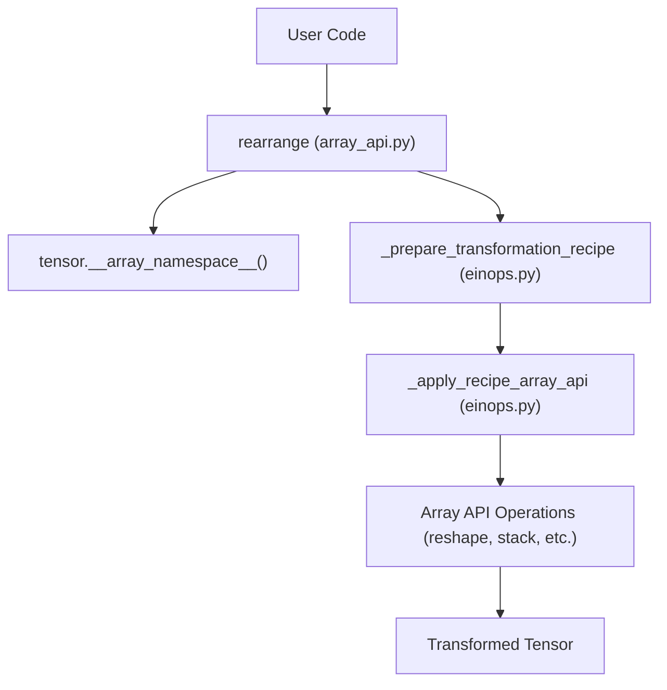
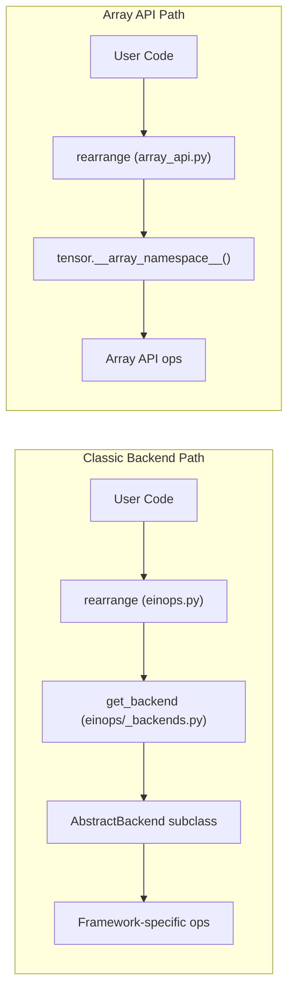

<!-- source: DeepWiki mcp.deepwiki.com · repo arogozhnikov/einops · page 4.4 Array API Support · fetched 2026-10-21 -->

# Array API Support

Relevant source files

The following files were used as context for generating this wiki page:

- [README.md](README.md)
- [einops/_backends.py](einops/_backends.py)
- [einops/array_api.py](einops/array_api.py)
- [einops/packing.py](einops/packing.py)
- [einops/tests/test_parsing.py](einops/tests/test_parsing.py)

This document describes the support for the Python Array API standard in the einops library. It covers the motivation, implementation, and usage of Array API-compliant operations in einops, including which code entities are responsible for this support and how they interact with the rest of the system. This page is focused on the internal and user-facing mechanisms that enable einops to work with any array library that implements the [Python Array API standard](https://data-apis.org/array-api/latest/), such as NumPy 2.0+, MLX, pydata/sparse, cubed, and ndonnx.

For information about the general backend abstraction system (including imperative and symbolic backends), see [Backend System](#4.1). For details on the core API functions and their semantics, see [Core API Reference](#2).

---

## Purpose and Scope

The Array API support in einops enables users to apply einops operations (`rearrange`, `reduce`, `repeat`, `pack`, `unpack`) to any array object that implements the `__array_namespace__()` protocol, as defined by the Array API standard. This allows einops to be future-proof and compatible with a growing ecosystem of array libraries, without requiring explicit backend implementations for each new library.

This document covers:

- The motivation for Array API support in einops.
- The main code entities that implement Array API support.
- How Array API support is integrated into the einops operation pipeline.
- Supported operations and their behavior.
- Limitations and future directions.

Sources:  
[einops/array_api.py:1-126](), [einops/_backends.py:1-719]()

---

## Motivation for Array API Support

The Python Array API standard defines a common interface for array operations, enabling interoperability between different array libraries. By supporting this standard, einops can:

- Work seamlessly with new and emerging array libraries (e.g., MLX, pydata/sparse) without code changes.
- Reduce maintenance overhead by relying on a single, well-defined interface.
- Future-proof the library as the array ecosystem evolves.

This approach complements einops' existing backend system, which provides explicit support for major frameworks (NumPy, PyTorch, TensorFlow, etc.), by adding a generic path for any Array API-compliant object.

Sources:  
[einops/array_api.py:1-6](), [einops/_backends.py:1-11]()

---

## Key Code Entities and Their Roles

The following table summarizes the main code entities responsible for Array API support in einops:

| Code Entity                        | File                        | Role                                                                                  |
|-------------------------------------|-----------------------------|---------------------------------------------------------------------------------------|
| `rearrange`, `reduce`, `repeat`    | `einops/array_api.py`       | User-facing Array API-compliant operations                                            |
| `pack`, `unpack`                   | `einops/array_api.py`       | Array API-compliant tensor packing/unpacking                                          |
| `asnumpy`                          | `einops/array_api.py`       | Converts Array API tensors to NumPy arrays using DLPack                               |
| `_apply_recipe_array_api`           | `einops/einops.py`          | Internal: applies transformation recipes using Array API namespace                    |
| `_prepare_transformation_recipe`    | `einops/einops.py`          | Internal: prepares transformation recipes for operations                              |
| `analyze_pattern`, `prod`           | `einops/packing.py`         | Shared logic for pattern analysis and shape product                                   |

Sources:  
[einops/array_api.py:1-126](), [einops/packing.py:1-190]()

---

### Diagram: Mapping Array API Operations to Code Entities

Sources:  
[einops/array_api.py:1-126](), [einops/packing.py:1-190]()

---

## How Array API Support is Integrated

### Detection and Dispatch

When a user calls an einops operation with an Array API-compliant tensor (i.e., an object with a `__array_namespace__()` method), the corresponding function in `einops/array_api.py` is used. These functions:

1. Obtain the array namespace via `tensor.__array_namespace__()`.
2. Use the namespace to perform all array operations (reshape, stack, concat, etc.).
3. Prepare and apply the transformation recipe using internal helpers.

This is distinct from the classic backend dispatch system in `einops/_backends.py`, which is used for explicit framework backends.

#### Diagram: Array API Operation Flow

Sources:  
[einops/array_api.py:7-41]()

---

### Supported Operations

The following operations are supported for Array API-compliant tensors:

| Operation   | Function Name   | Description                                                                 |
|-------------|----------------|-----------------------------------------------------------------------------|
| Rearranging | `rearrange`    | Restructures tensor dimensions according to a pattern                       |
| Reducing    | `reduce`       | Aggregates tensor along specified axes using a reduction operation           |
| Repeating   | `repeat`       | Duplicates tensor data along specified axes                                 |
| Packing     | `pack`         | Combines multiple tensors into one, tracking packed shapes                   |
| Unpacking   | `unpack`       | Splits a packed tensor into multiple tensors using packed shapes             |
| Conversion  | `asnumpy`      | Converts an Array API tensor to a NumPy array using DLPack                   |

All these functions are implemented in [einops/array_api.py:7-126](). They use only the methods provided by the Array API namespace, ensuring compatibility with any conforming library.

Sources:  
[einops/array_api.py:7-126]()

---

### Example: Array API Operation Dispatch Table

| Function         | Array API Namespace Method Used      | Notes                                 |
|------------------|-------------------------------------|---------------------------------------|
| `rearrange`      | `reshape`, `transpose`              | Uses recipe to determine operations   |
| `reduce`         | `sum`, `mean`, etc.                 | Reduction type passed as argument     |
| `repeat`         | `repeat` (via reduction="repeat")   | Implemented as a special reduction    |
| `pack`           | `reshape`, `concat`                 | Pattern analysis for axis handling    |
| `unpack`         | `reshape`, slicing                  | Uses packed shapes for splitting      |
| `asnumpy`        | `from_dlpack` (NumPy)               | Converts via DLPack                   |

Sources:  
[einops/array_api.py:7-126]()

---

## Comparison: Array API vs. Classic Backend System

The classic backend system in einops (see [Backend System](#4.1)) uses explicit backend classes (e.g., `NumpyBackend`, `TorchBackend`) to dispatch operations based on tensor type. In contrast, the Array API path:

- Does not require explicit backend registration.
- Relies on the `__array_namespace__()` protocol for all operations.
- Is automatically compatible with any library that implements the Array API.

This dual-path design allows einops to support both established frameworks and new array libraries with minimal code changes.

#### Diagram: Backend Dispatch vs. Array API Path

Sources:  
[einops/array_api.py:7-41](), [einops/_backends.py:22-719]()

---

## Limitations and Future Directions

- **Operation Coverage:** Only operations supported by the Array API standard are available. Some advanced or framework-specific features may not be accessible.
- **Performance:** Performance depends on the underlying array library's implementation of the Array API.
- **DLPack Conversion:** The `asnumpy` function uses DLPack for conversion, which requires both the source and target libraries to support DLPack ([einops/array_api.py:43-47]()).
- **Error Handling:** Error messages are wrapped to provide additional context, but may be less specific than those from explicit backends.

Future directions include:

- Expanding test coverage for new Array API libraries.
- Supporting additional Array API features as the standard evolves.
- Improving error reporting and diagnostics for Array API operations.

Sources:  
[einops/array_api.py:7-47]()

---

## Summary Table: Array API Support in einops

| Feature                | Supported | Notes                                                      |
|------------------------|-----------|------------------------------------------------------------|
| Rearrangement          | Yes       | Via `rearrange`                                            |
| Reduction              | Yes       | Via `reduce`                                               |
| Repetition             | Yes       | Via `repeat`                                               |
| Packing/Unpacking      | Yes       | Via `pack`/`unpack`                                        |
| Conversion to NumPy    | Yes       | Via `asnumpy` (DLPack required)                            |
| New Array Libraries    | Yes       | Any with `__array_namespace__()`                           |
| Custom Backends        | No        | Use classic backend system for custom logic                |

Sources:  
[einops/array_api.py:7-126]()

---

## References

- [einops/array_api.py:1-126]()
- [einops/_backends.py:1-719]()
- [einops/packing.py:1-190]()

For further details on backend abstraction, see [Backend System](#4.1). For the main API documentation, see [Core API Reference](#2).

---

