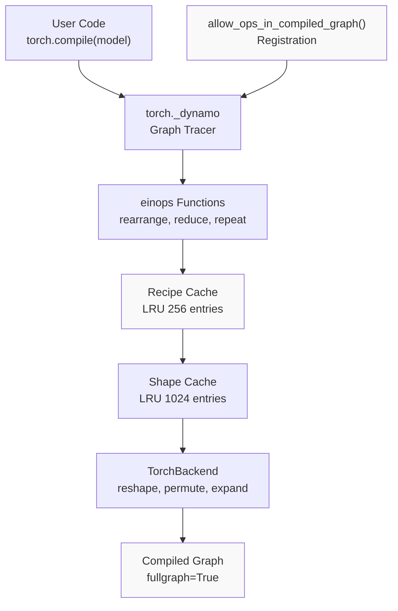
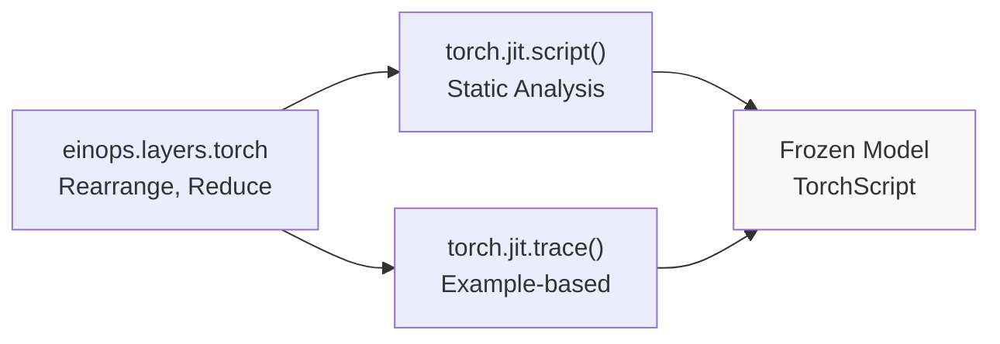
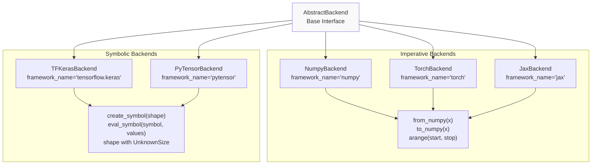
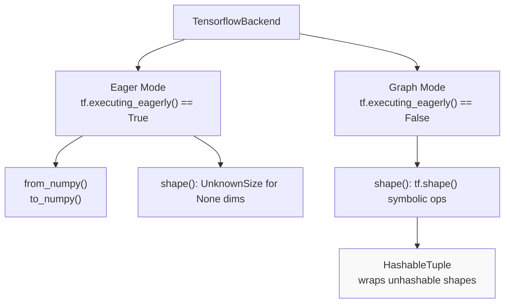
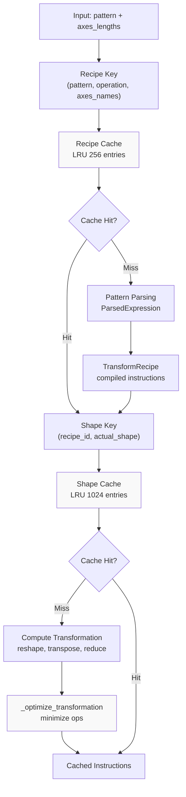
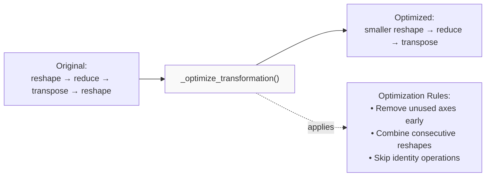
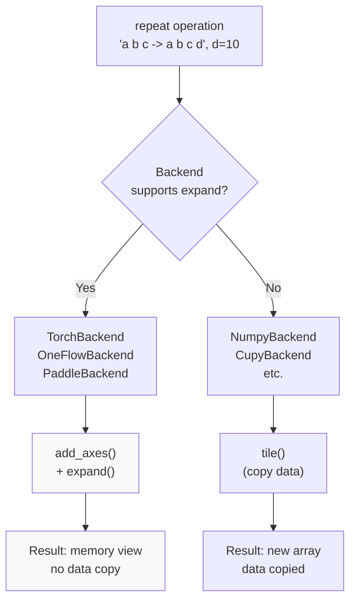
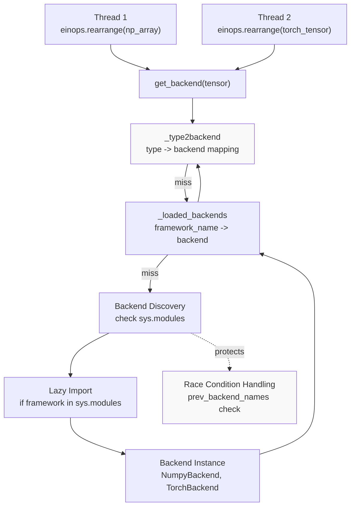
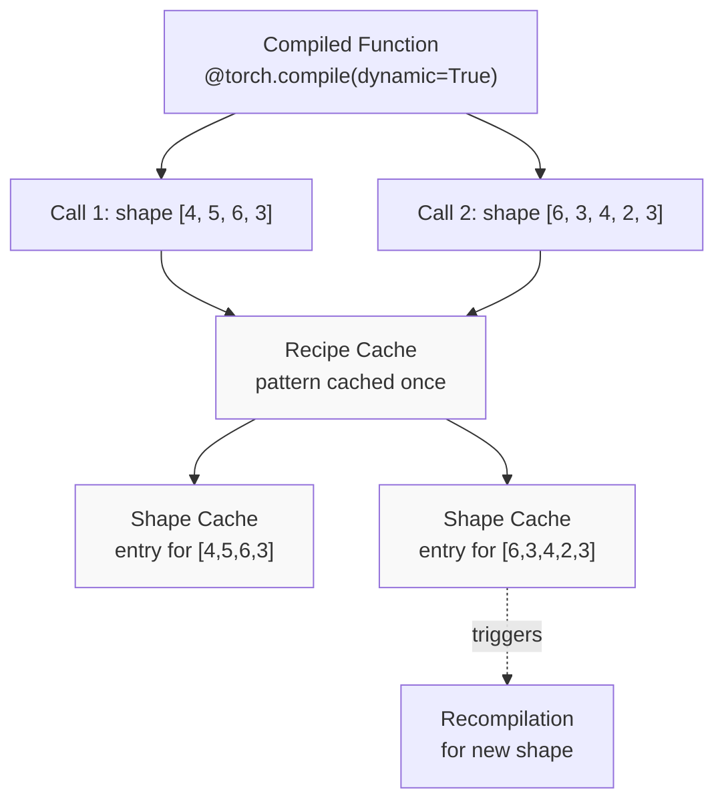

<!-- source: DeepWiki mcp.deepwiki.com · repo arogozhnikov/einops · page 5 Advanced Topics · fetched 2026-10-21 -->

# Advanced Topics

<details>
<summary>Relevant source files</summary>

The following files were used as context for generating this wiki page:

- [einops/_backends.py](einops/_backends.py)
- [einops/tests/test_examples.py](einops/tests/test_examples.py)
- [einops/tests/test_layers.py](einops/tests/test_layers.py)
- [einops/tests/test_ops.py](einops/tests/test_ops.py)
- [einops/tests/test_other.py](einops/tests/test_other.py)

</details>


**Purpose**: This page covers advanced usage patterns, performance optimization techniques, and framework-specific features in einops. Topics include PyTorch compilation support, the distinction between symbolic and imperative execution modes, internal optimization strategies, and considerations for multithreaded environments.

For detailed information on specific subsystems, see:
- PyTorch compilation details: [5.1](#5.1)
- Symbolic vs imperative execution: [5.2](#5.2)
- Performance optimization internals: [5.3](#5.3)
- Testing infrastructure: [6.1](#6.1)

---

## Compilation and Graph Mode Support

### PyTorch Compilation with torch.compile

Einops provides first-class support for `torch.compile`, PyTorch's JIT compilation system introduced in PyTorch 2.0. Operations can be compiled into optimized graphs using the `allow_ops_in_compiled_graph()` mechanism.

**Key Features**:
- **Fullgraph compilation**: Einops operations do not break the compilation graph
- **Dynamic shapes**: Pattern caching handles varying tensor dimensions efficiently
- **Variable argument operations**: `pack` and `unpack` work despite variable input/output counts

**Compilation Support Architecture**:



**How It Works**:

The `allow_ops_in_compiled_graph()` function registers einops operations with `torch._dynamo`, allowing them to be traced and compiled. The registration happens in the `_torch_specific` module, which is automatically imported when the `TorchBackend` is instantiated.

Sources: [einops/_backends.py:217-226](), [einops/tests/test_other.py:257-306]()

**Example: Compiling Model with Einops Operations**:

```python
import torch
from einops import rearrange, reduce, repeat, pack, unpack
from einops._torch_specific import allow_ops_in_compiled_graph

allow_ops_in_compiled_graph()

@torch.compile(fullgraph=True)
def process(x):
    x = rearrange(x, 'b (h w) c -> b h w c', h=16)
    x = reduce(x, 'b h w c -> b c', 'mean')
    return x
```

The test suite validates compilation with varying patterns and shapes to ensure the cache mechanism works correctly across multiple invocations with different tensor dimensions.

Sources: [einops/tests/test_other.py:257-306]()

### PyTorch Scripting and Tracing

Einops layers are compatible with both `torch.jit.trace` and `torch.jit.script`, enabling deployment in production environments that require serialized models.

**Scripting Compatibility**:



Both tracing (example-based) and scripting (static analysis) methods work because einops layers use standard PyTorch operations internally and maintain clear type signatures.

Sources: [einops/tests/test_layers.py:177-242]()

---

## Symbolic vs Imperative Execution

Einops supports two execution paradigms through the `AbstractBackend` interface: **imperative** (eager) and **symbolic** (graph-based). Understanding this distinction is critical for advanced usage.

### Backend Execution Modes

**Imperative Backends (Eager Execution)**:
- Execute operations immediately on concrete tensor values
- Methods: `from_numpy()`, `to_numpy()`, `arange()`
- Examples: NumPy, PyTorch (eager mode), JAX, CuPy, MLX, Tinygrad

**Symbolic Backends (Graph Construction)**:
- Build computation graphs with symbolic tensors
- Methods: `create_symbol()`, `eval_symbol()`
- Examples: TensorFlow (graph mode), TF.Keras, PyTensor



Sources: [einops/_backends.py:65-158](), [einops/_backends.py:351-477]()

### Symbolic Execution Example

**TensorFlow Keras Backend**:

The `TFKerasBackend` demonstrates symbolic execution. It creates symbolic tensors (placeholders) using `keras.Input()` and evaluates graphs using Keras models:

```python
# From TFKerasBackend implementation
def create_symbol(self, shape):
    return self.keras.Input(batch_shape=shape)

def eval_symbol(self, symbol, symbol_value_pairs):
    model = self.keras.models.Model(
        [var for (var, _) in symbol_value_pairs], 
        symbol
    )
    return model.predict_on_batch([val for (_, val) in symbol_value_pairs])
```

**Shape Handling**: Symbolic backends use `UnknownSize` objects for dimensions that cannot be determined statically (e.g., batch size). This allows pattern validation while deferring actual shape computation to runtime.

Sources: [einops/_backends.py:421-476](), [einops/_backends.py:141-158]()

### Hybrid Execution: TensorFlow

TensorFlow uniquely supports both modes through the `TensorflowBackend`, which detects execution mode at runtime:



When in graph mode, `TensorflowBackend` uses `tf.shape()` to create symbolic shape components, and wraps them in `HashableTuple` if they contain unhashable symbolic objects (needed for caching).

Sources: [einops/_backends.py:351-419](), [einops/_backends.py:333-348]()

---

## Performance Optimization Techniques

### Recipe and Shape Caching

Einops uses a **two-level caching system** to minimize overhead:

1. **Recipe Cache** (256 entries): Caches parsed patterns and transformation recipes
2. **Shape Cache** (1024 entries): Caches shape-specific transformation details



This architecture allows a pattern like `'b c h w -> b c'` to be parsed once (recipe cache) but applied efficiently to tensors with varying batch sizes (shape cache).

Sources: [einops/_backends.py:1-20](), [einops/tests/test_other.py:56-86]()

### Transformation Optimization

The `_optimize_transformation()` function minimizes the number of operations by:
- Eliminating unnecessary axes from initial reshape
- Combining reduction and transposition when possible
- Removing trivial operations

**Optimization Process**:



**Example Optimization**:
```python
# Before optimization
init_shape = [2, 3, 4, 5, 6]
reduced_axes = (1, 3)  # reduce axes 1, 3
axes_reordering = (2, 0, 1)  # reorder remaining axes
final_shape = [...]

# After _optimize_transformation
# Unnecessary axes removed from initial reshape
# Operations reordered for efficiency
```

Sources: [einops/einops.py]() (referenced), [einops/tests/test_other.py:56-86]()

### Efficient Broadcasting with expand

PyTorch, OneFlow, and Paddle backends use `expand()` instead of `tile()` for repetition when possible. The `expand()` operation creates a view rather than copying data, significantly improving memory efficiency and speed.

**Broadcasting Strategy**:



Implementation in `TorchBackend`:
```python
def add_axes(self, x, n_axes, pos2len):
    repeats = [-1] * n_axes
    for axis_position, axis_length in pos2len.items():
        x = self.add_axis(x, axis_position)
        repeats[axis_position] = axis_length
    return x.expand(repeats)  # View, not copy
```

Sources: [einops/_backends.py:266-271](), [einops/_backends.py:520-525]()

---

## Threading and Concurrency

### Backend Discovery in Multithreaded Environments

The backend discovery mechanism is thread-safe and handles concurrent initialization correctly. The `get_backend()` function uses module-level caches that are protected against race conditions.

**Thread Safety Architecture**:



**Race Condition Protection**: The backend discovery logic handles modification of `_loaded_backends` from other threads by maintaining a snapshot of previously loaded backends (`prev_backend_names`) and avoiding duplicate instantiation.

Sources: [einops/_backends.py:22-63](), [einops/tests/test_other.py:353-364]()

**Threading Test**: The test suite includes a specific test that spawns multiple threads executing einops operations concurrently with both NumPy and PyTorch tensors, validating thread safety in realistic scenarios.

Sources: [einops/tests/test_other.py:336-364]()

---

## UnknownSize Handling

For symbolic backends that don't provide shape symbols (like early TensorFlow versions), einops uses `UnknownSize` objects. These pseudo-symbols allow validation and caching to proceed without concrete shape information.

**UnknownSize Behavior**:

```python
class UnknownSize:
    def __floordiv__(self, other): return self
    def __eq__(self, other): return True  # Always equals
    def __mul__(self, other): return self
    def __hash__(self): return hash(None)
```

**Usage in Shape Validation**:
- Shape comparisons: `UnknownSize() == 10` returns `True`
- Arithmetic: `UnknownSize() * 5` returns `UnknownSize()`
- Hashing: All instances hash to the same value for caching

This design allows patterns to be validated even when some dimensions are unknown at graph construction time.

Sources: [einops/_backends.py:141-158](), [einops/_backends.py:374-387]()

---

## Dynamic Shapes in Compilation

When using `torch.compile` with `dynamic=True`, einops handles varying tensor shapes efficiently through its caching mechanism. The recipe cache stores pattern-level information, while the shape cache adapts to different concrete shapes.

**Dynamic Shape Handling**:



**Test Validation**: The test suite validates dynamic compilation by invoking the same compiled function with tensors of different shapes and even different numbers of dimensions, ensuring correctness across all variations.

Sources: [einops/tests/test_ops.py:595-622]()

---

## Summary of Advanced Capabilities

| Feature | Backend Support | Key Mechanism |
|---------|----------------|---------------|
| `torch.compile` | PyTorch 2.0+ | `allow_ops_in_compiled_graph()` registration |
| `torch.jit.script` | PyTorch | Standard typing in layer implementations |
| `torch.jit.trace` | PyTorch | Example-based freezing |
| Symbolic execution | TF.Keras, PyTensor | `create_symbol()` / `eval_symbol()` |
| Graph mode | TensorFlow | Mode detection via `tf.executing_eagerly()` |
| Dynamic shapes | PyTorch, TensorFlow | Shape cache with runtime resolution |
| Efficient broadcasting | PyTorch, OneFlow, Paddle | `expand()` instead of `tile()` |
| Threading safety | All backends | Module-level cache with race protection |
| Recipe caching | All backends | LRU cache (256 entries) |
| Shape caching | All backends | LRU cache (1024 entries) |
| Optimization | All backends | `_optimize_transformation()` |

Sources: [einops/_backends.py:1-765](), [einops/tests/test_other.py:1-364](), [einops/tests/test_ops.py:1-659]()

---

