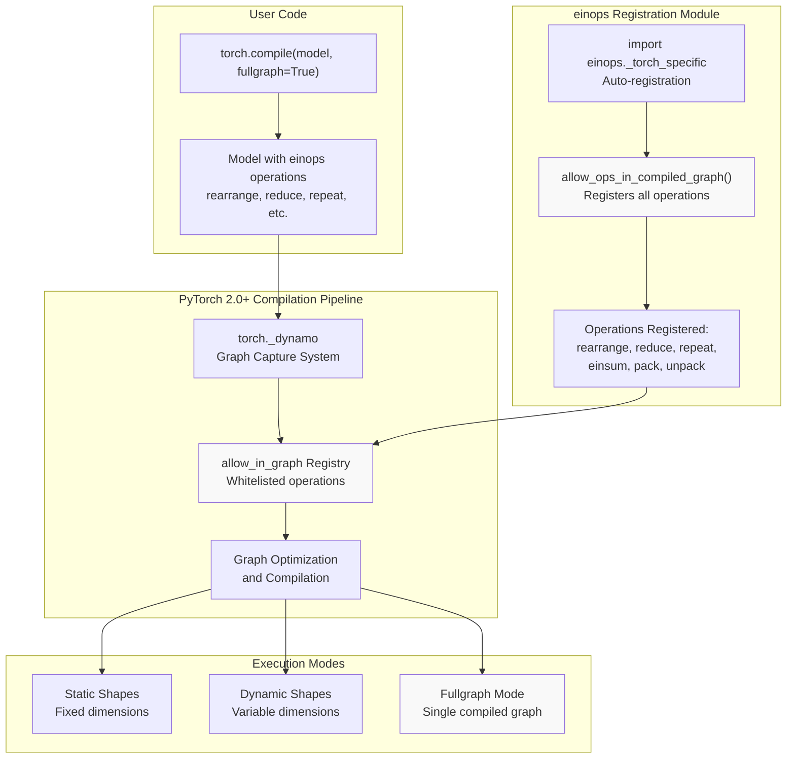
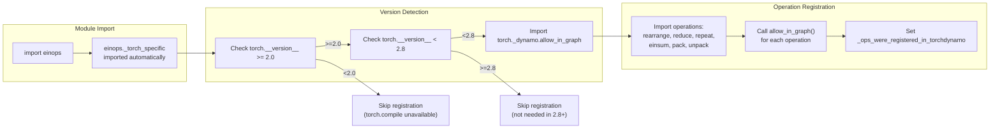
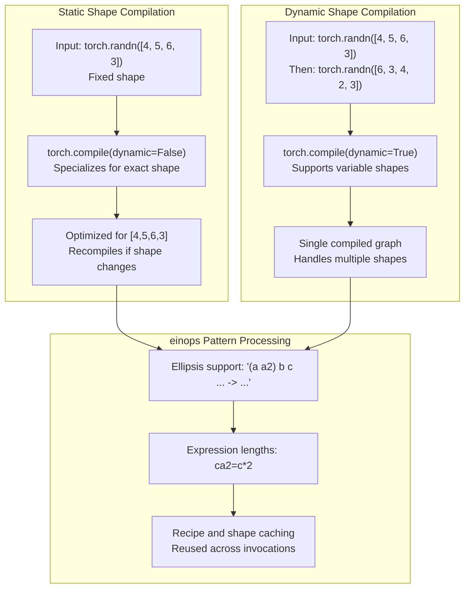
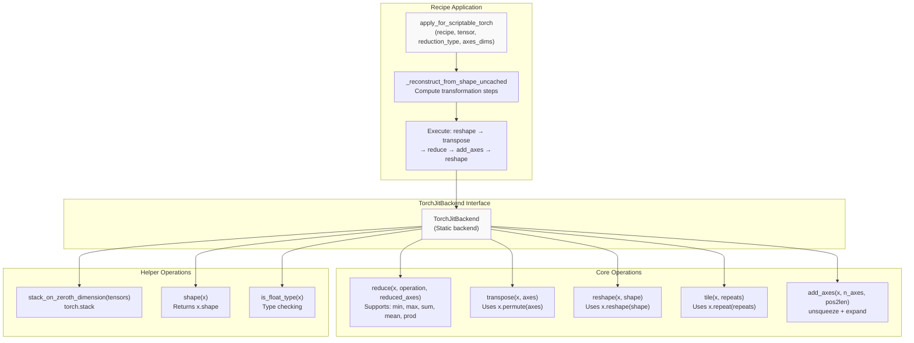

<!-- source: DeepWiki mcp.deepwiki.com · repo arogozhnikov/einops · page 5.1 PyTorch Compilation Support · fetched 2026-10-21 -->

# PyTorch Compilation Support

<details>
<summary>Relevant source files</summary>

The following files were used as context for generating this wiki page:

- [einops/_torch_specific.py](einops/_torch_specific.py)
- [einops/tests/test_examples.py](einops/tests/test_examples.py)
- [einops/tests/test_layers.py](einops/tests/test_layers.py)
- [einops/tests/test_ops.py](einops/tests/test_ops.py)
- [einops/tests/test_other.py](einops/tests/test_other.py)

</details>


## Purpose and Scope

This document describes einops' compatibility with PyTorch's compilation mechanisms, including the modern `torch.compile` system (PyTorch 2.0+) and the legacy TorchScript systems (`torch.jit.script` and `torch.jit.trace`). It covers the `allow_ops_in_compiled_graph` mechanism that enables einops operations to be included in compiled graphs, support for dynamic shapes, and the specialized `TorchJitBackend` for scripting compatibility.

For information about PyTorch-specific layers and their usage in neural network architectures, see [PyTorch Layers](#3.1). For general performance optimization strategies across all backends, see [Performance and Optimization](#5.3).

---

## Compilation Systems Overview

PyTorch provides multiple compilation mechanisms with different characteristics:

| System | PyTorch Version | Approach | einops Support Level |
|--------|----------------|----------|---------------------|
| `torch.compile` | 2.0+ | Dynamic graph compilation via TorchDynamo | Full support with `allow_ops_in_compiled_graph` |
| `torch.jit.trace` | 1.0+ | Execution tracing and freezing | Full support for layers |
| `torch.jit.script` | 1.0+ | Static type analysis and compilation | Partial support via `TorchJitBackend` |

The primary focus of einops' compilation support is `torch.compile`, which provides the most flexible and performant compilation experience. TorchScript support is maintained for backward compatibility.

**Sources:** [einops/_torch_specific.py:1-11]()

---

## torch.compile Support Architecture



**Sources:** [einops/_torch_specific.py:102-136](), [einops/tests/test_other.py:257-306]()

---

## allow_ops_in_compiled_graph Mechanism

The `allow_ops_in_compiled_graph` function is the core mechanism enabling einops operations to work seamlessly with `torch.compile`. It is automatically invoked on module import and registers all einops operations with TorchDynamo's whitelist.

### Registration Process



**Key Implementation Details:**

The function performs version-specific behavior:

- **PyTorch < 2.0**: No registration needed (torch.compile doesn't exist)
- **PyTorch 2.0 - 2.7**: Explicit registration required via `allow_in_graph`
- **PyTorch >= 2.8**: Registration not needed (einops works natively)

```python
# Simplified logic from _torch_specific.py
if torch.__version__[0] < "2":
    return  # torch.compile doesn't exist
    
if torch.__version__ >= "2.8":
    return  # einops don't need allow_in_graph
    
from torch._dynamo import allow_in_graph
from einops.einops import rearrange, reduce, repeat, einsum
from einops.packing import pack, unpack

allow_in_graph(rearrange)
allow_in_graph(reduce)
allow_in_graph(repeat)
allow_in_graph(einsum)
allow_in_graph(pack)
allow_in_graph(unpack)
```

The registration happens automatically at module import time through the module-level call at line 135: `allow_ops_in_compiled_graph()`.

**Sources:** [einops/_torch_specific.py:102-136]()

---

## Fullgraph Compilation

Fullgraph mode ensures that the entire computation is compiled into a single optimized graph without graph breaks. This is critical for maximum performance but requires all operations to be compilation-friendly.

### Fullgraph Compilation Test Example

The test suite verifies fullgraph compilation with complex patterns including variable numbers of inputs/outputs:

```python
@torch.compile(fullgraph=True)
class TorchModuleWithOperations(nn.Module):
    def forward(self, x_abc, suffix=""):
        a, b, c = x_abc.shape
        
        # Patterns with dynamic names
        x_abcd = repeat(x_abc, suf("a b c -> a b c 4"))
        x_abc = reduce(x_abcd, suf("a b c d -> a b c"), "min")
        
        # pack/unpack with variable outputs
        x_abdc, ps = pack([x_abc] * (2 + len(suffix)), suf("a b * c"))
        x_array = unpack(rearrange(x_abdc, ...), ps, "ab one1 c *")
        
        x1 = x_array[0] + len(x_array)
        x1 = rearrange(x1, suf("(a b) 1 c -> a b c"), b=b)
        
        addition = einsum(x_abc, x_abcd, suf("a b c, a b c d -> d"))[0]
        return x1 + addition
```

This demonstrates that einops operations can be compiled in fullgraph mode even with:

- **Dynamic pattern strings** (modified per invocation)
- **Variable-length outputs** (`unpack` returns a list)
- **Multiple operations chained together**
- **Different tensor shapes across invocations**

**Sources:** [einops/tests/test_other.py:257-306]()

---

## Dynamic Shape Support

einops operations support both static and dynamic shape compilation, allowing tensors with varying dimensions to be processed efficiently.

### Dynamic vs Static Compilation



### Dynamic Shape Test Case

The test verifies that compiled functions work correctly across different input dimensionalities:

```python
def func1(x):
    # Ellipsis allows variable number of dimensions
    a, b, c, *other = x.shape
    x = rearrange(x, "(a a2) b c ... -> b (c a2) (a ...)", a2=2)
    
    # Expression as axis length
    x = reduce(x, "b ca2 A -> b A", "sum", ca2=c * 2)
    return x

func1_compiled_static = torch.compile(func1, dynamic=False, fullgraph=True)
func1_compiled_dynamic = torch.compile(func1, dynamic=True, fullgraph=True)

# Works with 4D tensor
x = torch.randn(size=[4, 5, 6, 3])
assert torch.allclose(func1_compiled_dynamic(x), func1(x))

# Works with 5D tensor (different dimensionality)
x = torch.randn(size=[6, 3, 4, 2, 3])
assert torch.allclose(func1_compiled_dynamic(x), func1(x))
```

The key features enabling dynamic shape support:

1. **Ellipsis patterns** (`...`) handle variable numbers of dimensions
2. **Expression-based lengths** (`ca2=c*2`) compute dimensions at runtime
3. **Pattern caching** reuses parsed patterns across different shapes
4. **Shape reconstruction** adapts to actual tensor dimensions

**Sources:** [einops/tests/test_ops.py:595-622]()

---

## Legacy TorchScript Support

For PyTorch versions before 2.0 or when using TorchScript, einops provides the `TorchJitBackend` class and scriptable layers.

### TorchJitBackend Architecture



**Key Implementation Details:**

The `TorchJitBackend` is a completely static backend designed to work within TorchScript's restrictions:

1. **No dynamic dispatch**: All methods are static
2. **No backend registry**: Directly uses torch operations
3. **Type annotations**: All parameters and returns are typed for scripting
4. **Limited reduction types**: Explicit handling of min/max/sum/mean/prod

The `apply_for_scriptable_torch` function mirrors the standard `_apply_recipe` but is compatible with TorchScript:

```python
def apply_for_scriptable_torch(
    recipe: TransformRecipe, 
    tensor: torch.Tensor, 
    reduction_type: str, 
    axes_dims: list[tuple[str, int]]
) -> torch.Tensor:
    backend = TorchJitBackend
    (init_shapes, axes_reordering, reduced_axes, 
     added_axes, final_shapes, n_axes_w_added) = \
        _reconstruct_from_shape_uncached(recipe, backend.shape(tensor), axes_dims)
    
    # Apply transformations in sequence
    if init_shapes is not None:
        tensor = backend.reshape(tensor, init_shapes)
    if axes_reordering is not None:
        tensor = backend.transpose(tensor, axes_reordering)
    if len(reduced_axes) > 0:
        tensor = backend.reduce(tensor, operation=reduction_type, reduced_axes)
    if len(added_axes) > 0:
        tensor = backend.add_axes(tensor, n_axes=n_axes_w_added, pos2len=added_axes)
    if final_shapes is not None:
        tensor = backend.reshape(tensor, final_shapes)
    return tensor
```

**Sources:** [einops/_torch_specific.py:20-99]()

---

## torch.jit.trace and torch.jit.script

### Tracing Support

All einops layers support `torch.jit.trace`, which records actual operations during a forward pass and creates a frozen graph:

```python
model = nn.Sequential(
    Rearrange("b c h w -> b (c h w)"),
    Linear(16 * 5 * 5, 120),
    Reduce("b c -> b", "mean"),
)

# Trace with example input
traced_model = torch.jit.trace(model, example_inputs=input)

# Traced model produces identical results
torch.testing.assert_close(model(input), traced_model(input))
```

Tracing works because einops layers are standard `nn.Module` subclasses that execute PyTorch operations.

### Scripting Support

Individual einops layers can be scripted using `torch.jit.script`:

```python
# Script individual layers
scripted_rearrange = torch.jit.script(Rearrange("b c h w -> b (c h w)"))

# Use in models
model = nn.Sequential(
    Conv2d(6, 16, kernel_size=(5, 5)),
    scripted_rearrange,
    Linear(16 * 5 * 5, 120),
)

# Entire model can be scripted
scripted_model = torch.jit.script(model)
```

**Scripting Limitations:**

The comment in the source file explains the design constraint:

> "Unfortunately, torch's jit scripting mechanism isn't strong enough, and to have scripting supported at least for layers, a number of additional moves is needed."
>
> "Design of main operations (dynamic resolution by lookup) is unlikely to be implemented by torch.jit.script, but torch.compile seems to work with operations just fine."

This means:
- **Core operations** (`rearrange`, `reduce`, `repeat`) cannot be directly scripted due to dynamic backend lookup
- **Layers** can be scripted because they're static `nn.Module` classes
- **torch.compile is preferred** for modern PyTorch applications

**Sources:** [einops/_torch_specific.py:1-11](), [einops/tests/test_layers.py:177-242]()

---

## Testing and Verification

### Test Coverage Matrix

| Test | Purpose | Compilation Mode | Shape Variability |
|------|---------|------------------|-------------------|
| `test_torch_compile_for_functions` | Verifies all operations in fullgraph mode | `torch.compile(fullgraph=True)` | Static and dynamic patterns |
| `test_torch_compile_for_layers` | Verifies layer compilation | `torch.compile(fullgraph=True)` | Variable batch sizes |
| `test_torch_compile_with_dynamic_shape` | Tests dynamic shape support | `dynamic=True/False` | Different dimensionalities |
| `test_torch_layer` | Verifies tracing compatibility | `torch.jit.trace` | Fixed shapes |
| `test_torch_layers_scripting` | Verifies scripting compatibility | `torch.jit.script` | Fixed shapes |

### Fullgraph Mode Verification

The test ensures compilation without graph breaks:

```python
@torch.compile(fullgraph=True)
def forward(self, x_abc, suffix=""):
    # Complex operations that must all compile together
    x_abcd = repeat(x_abc, suf("a b c -> a b c 4"))
    x_abc = reduce(x_abcd, suf("a b c d -> a b c"), "min")
    x_abdc, ps = pack([x_abc] * (2 + len(suffix)), suf("a b * c"))
    x_array = unpack(rearrange(x_abdc, ...), ps, "ab one1 c *")
    return process(x_array)
```

The `fullgraph=True` flag will raise an error if any operation causes a graph break, ensuring all einops operations are properly registered and compilation-friendly.

### Cache Consistency

The test verifies that the internal caching system works correctly with compilation:

```python
for size in [10, 20, 40]:
    x = torch.rand([size, size + 1, size + 2])
    for suffix in ["", "suf1", "other_suffix"]:
        result1 = compiled(x, suffix)
        result2 = original(x.double(), suffix).float()
        torch.testing.assert_close(result1, result2, atol=1e-5, rtol=1e-5)
```

This tests that:
- Different tensor shapes work with the same compiled graph
- Different pattern strings (via suffix modification) work correctly
- Recipe and shape caches are properly accessed during compilation

**Sources:** [einops/tests/test_other.py:257-334](), [einops/tests/test_ops.py:595-622](), [einops/tests/test_layers.py:177-242]()

---

## Best Practices

### When to Use torch.compile

```python
# ✓ Recommended: Use torch.compile for production code
@torch.compile(fullgraph=True)
def process_batch(images):
    x = rearrange(images, "b c (h p1) (w p2) -> b (c p1 p2) h w", p1=2, p2=2)
    x = reduce(x, "b c h w -> b c", "mean")
    return x
```

### When to Use TorchScript

```python
# ✓ Use for PyTorch < 2.0 or when shipping models
model = nn.Sequential(
    Rearrange("b c h w -> b (c h w)"),
    Linear(16 * 5 * 5, 120),
)
traced = torch.jit.trace(model, example_inputs)
torch.jit.save(traced, "model.pt")
```

### Debugging Compilation Issues

```python
# Enable verbose mode to see graph breaks
torch._dynamo.config.verbose = True

@torch.compile(fullgraph=True)
def debug_function(x):
    # If this fails, verbose output shows where graph breaks
    return rearrange(x, "b c h w -> b (c h w)")
```

**Sources:** [einops/tests/test_ops.py:600-601]()

---

