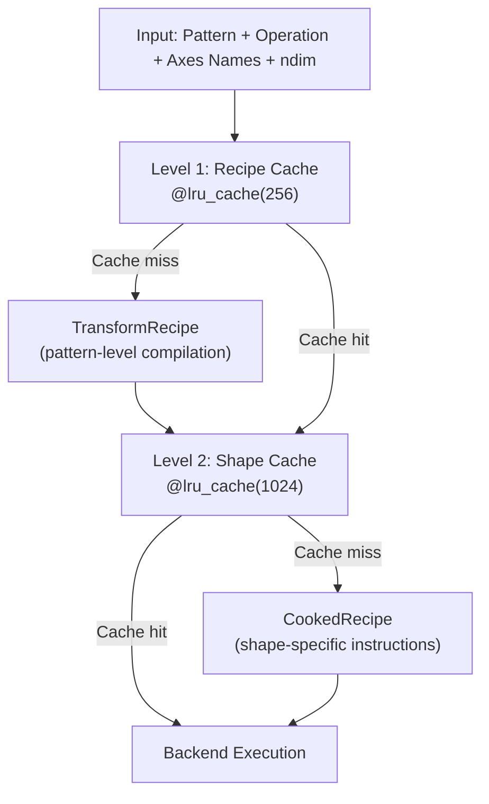
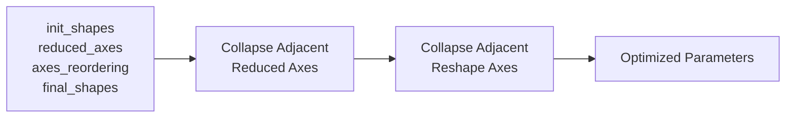
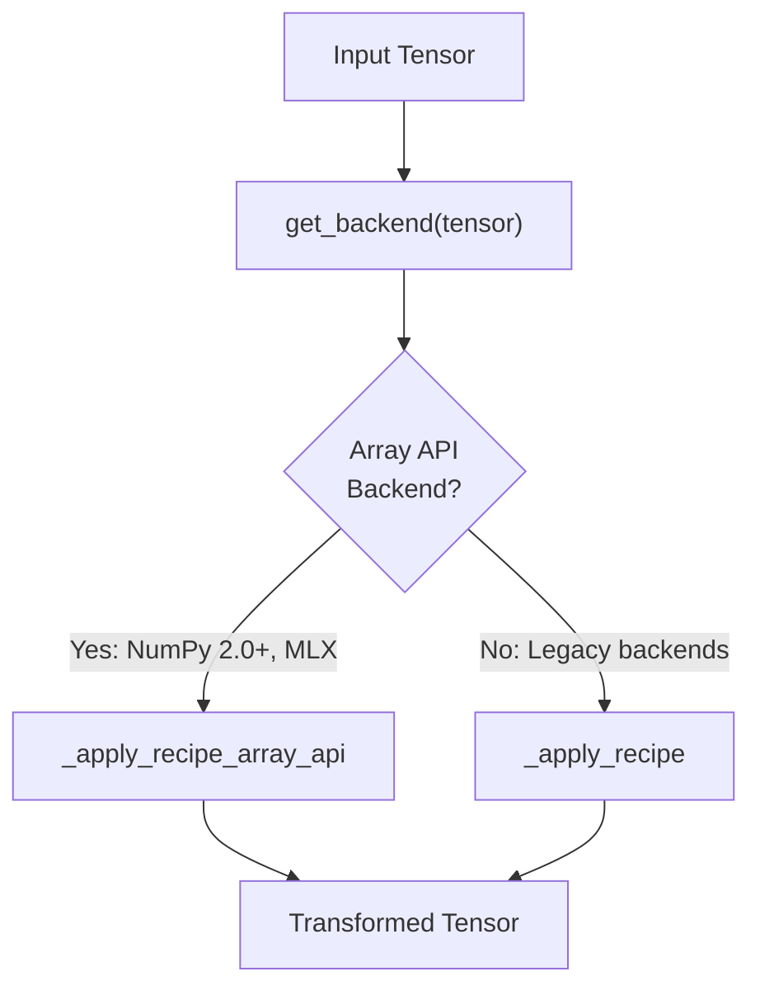
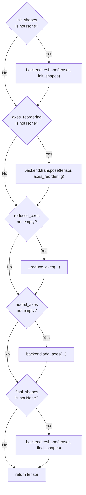

<!-- source: DeepWiki mcp.deepwiki.com · repo arogozhnikov/einops · page 5.3 Performance and Optimization · fetched 2026-10-21 -->

# Performance and Optimization

<details>
<summary>Relevant source files</summary>

The following files were used as context for generating this wiki page:

- [einops/_backends.py](einops/_backends.py)
- [einops/einops.py](einops/einops.py)
- [einops/parsing.py](einops/parsing.py)
- [einops/tests/test_examples.py](einops/tests/test_examples.py)
- [einops/tests/test_layers.py](einops/tests/test_layers.py)
- [einops/tests/test_ops.py](einops/tests/test_ops.py)
- [einops/tests/test_other.py](einops/tests/test_other.py)

</details>


This document describes the optimization techniques used in einops to achieve high performance across different deep learning frameworks. It covers caching strategies, operation reduction, efficient broadcasting, and backend-specific optimizations.

For information about PyTorch compilation support with `torch.compile`, see [PyTorch Compilation Support](#5.1). For symbolic vs imperative execution modes, see [Symbolic vs Imperative Execution](#5.2).

---

## Overview

einops employs multiple layers of optimization to minimize runtime overhead and memory usage:

1. **Two-level caching**: Pattern recipes and shape reconstructions are cached separately to maximize reuse
2. **Transformation optimization**: Neighboring operations are collapsed to reduce the number of backend calls
3. **Efficient broadcasting**: Modern backends use memory-efficient `expand` operations instead of `tile`
4. **Lazy evaluation**: Operations are only applied when necessary, avoiding redundant reshapes and transposes
5. **Backend-specific paths**: Different code paths for Array API-compliant vs legacy backends

These optimizations work together to make einops operations nearly as fast as hand-written framework-specific code, while maintaining the simplicity of the pattern-based API.

---

## Two-Level Caching System

einops uses a hierarchical caching strategy to avoid redundant computation:

**Caching Architecture**



Sources: [einops/einops.py:289-442]()

### Level 1: Recipe Cache

The recipe cache stores pattern compilations indexed by `(pattern, operation, axes_names, ndim)`:

| Function | Cache Size | Purpose |
|----------|-----------|---------|
| `_prepare_transformation_recipe` | 256 entries | Stores compiled pattern recipes |
| `_compactify_pattern_for_einsum` | 256 entries | Stores einsum pattern conversions |

**Cache Key Components**:
- `pattern`: The transformation pattern string (e.g., `"b c h w -> b h w c"`)
- `operation`: Either `"rearrange"`, `"repeat"`, or a reduction type
- `axes_names`: Tuple of explicitly provided axis names
- `ndim`: Number of dimensions in the input tensor

This level handles pattern parsing, axis validation, and logical transformation planning. A `TransformRecipe` object is created containing:
- Elementary axis lengths (with placeholder values)
- Axis name mappings
- Input composition structure
- Axes permutation order
- Positions of reduced and added axes
- Output composite axes groupings

Sources: [einops/einops.py:289-442]()

### Level 2: Shape Cache

The shape cache stores reconstructed transformations indexed by the recipe and actual tensor shape:

```python
_reconstruct_from_shape = functools.lru_cache(1024)(_reconstruct_from_shape_uncached)
```

**Cache Key**: `(TransformRecipe, shape, axes_lengths)`

**Cached Output** (`CookedRecipe`):
- `init_shapes`: Optional initial reshape dimensions
- `axes_reordering`: Optional transposition order
- `reduced_axes`: List of axes to reduce
- `added_axes`: Dictionary of axis positions and sizes
- `final_shapes`: Optional final reshape dimensions
- `n_axes_after_adding_axes`: Total axis count after additions

This level fills in concrete shape values from the input tensor, resolving unknown dimensions and validating consistency.

Sources: [einops/einops.py:227](), [einops/einops.py:155-224]()

### Cache Effectiveness

The two-level design maximizes reuse:

**Scenario 1**: Same pattern, varying batch sizes
```python
# First call with batch=32
rearrange(x32, "b c h w -> b (c h w)")  # Recipe cache miss, shape cache miss
# Second call with batch=64
rearrange(x64, "b c h w -> b (c h w)")  # Recipe cache HIT, shape cache miss
```

**Scenario 2**: Same pattern and shapes
```python
# Repeated calls in training loop
for batch in dataloader:
    y = rearrange(batch, "b c h w -> b h w c")  # Both caches HIT after first iteration
```

The recipe cache (256 entries) handles pattern diversity, while the shape cache (1024 entries) handles shape diversity for each pattern.

Sources: [einops/einops.py:227](), [einops/einops.py:289]()

---

## Transformation Optimization

The `_optimize_transformation` function reduces the number of backend operations by collapsing adjacent axes that participate in the same operation.

**Optimization Flow**



Sources: [einops/einops.py:50-102]()

### Adjacent Reduced Axes

When multiple consecutive axes are reduced, they can be combined into a single axis before reduction:

**Example**:
```python
# Input shape: [2, 3, 4, 5, 6]
# Pattern: "a b c d e -> a e"
# Initial: reduced_axes = (1, 2, 3)
```

**Before optimization**:
1. Reshape to [2, 3, 4, 5, 6]
2. Reduce axes 1, 2, 3 individually

**After optimization**:
1. Reshape to [2, 60, 6]  # 3*4*5 = 60
2. Reduce axis 1 only

This reduces three reduction operations to one, improving performance especially for operations like `sum` and `mean`.

Sources: [einops/einops.py:54-63]()

### Adjacent Reshaped Axes

Axes that remain adjacent after transposition can be pre-combined:

**Example**:
```python
# Input shape: [2, 3, 4, 5]
# Pattern: "a b c d -> a (b c) d"
```

**Before optimization**:
1. Reshape [2, 3, 4, 5] → [2, 3, 4, 5]
2. Transpose (no-op in this case)
3. Reshape [2, 3, 4, 5] → [2, 12, 5]

**After optimization**:
1. Reshape [2, 3, 4, 5] → [2, 12, 5]

The function eliminates unnecessary intermediate operations by detecting that axes 1 and 2 stay together.

Sources: [einops/einops.py:66-102]()

### Optimization Verification

The optimization preserves correctness by maintaining axis relationships:

```python
# Build mapping of initial axes to final axes
init_to_final = {}
for axis in range(len(init_shapes)):
    if axis in reduced_axes:
        init_to_final[axis] = None  # Axis will be reduced
    else:
        after_reduction = sum(x is not None for x in init_to_final.values())
        init_to_final[axis] = list(axes_reordering).index(after_reduction)
```

The test suite verifies that optimized transformations produce identical results to unoptimized versions.

Sources: [einops/einops.py:66-76](), [einops/tests/test_other.py:56-86]()

---

## Backend Execution Paths

einops provides different execution paths optimized for different backend capabilities:

**Backend Path Selection**



Sources: [einops/einops.py:230-252](), [einops/einops.py:255-286]()

### Standard Backend Path

Used for PyTorch, TensorFlow, JAX (with jax.numpy), and other legacy backends:

```python
def _apply_recipe(backend, recipe, tensor, reduction_type, axes_lengths):
    # Reconstruct concrete shapes from recipe and tensor
    init_shapes, axes_reordering, reduced_axes, added_axes, final_shapes, n_axes_w_added = \
        _reconstruct_from_shape(recipe, backend.shape(tensor), axes_lengths)
    
    # Apply operations in sequence
    if init_shapes is not None:
        tensor = backend.reshape(tensor, init_shapes)
    if axes_reordering is not None:
        tensor = backend.transpose(tensor, axes_reordering)
    if len(reduced_axes) > 0:
        tensor = _reduce_axes(tensor, reduction_type, reduced_axes, backend)
    if len(added_axes) > 0:
        tensor = backend.add_axes(tensor, n_axes_w_added, added_axes)
    if final_shapes is not None:
        tensor = backend.reshape(tensor, final_shapes)
    return tensor
```

Sources: [einops/einops.py:230-252]()

### Array API Path

Optimized for Array API Standard-compliant frameworks (NumPy 2.0+, MLX):

**Key Differences**:
1. **Direct namespace access**: Uses `xp.reshape`, `xp.permute_dims` instead of backend methods
2. **Inline implementation**: No backend abstraction overhead
3. **Standard operations**: Uses `xp.expand_dims` + `xp.broadcast_to` for adding axes

```python
def _apply_recipe_array_api(xp, recipe, tensor, reduction_type, axes_lengths):
    # ... same shape reconstruction ...
    
    if init_shapes is not None:
        tensor = xp.reshape(tensor, init_shapes)
    if axes_reordering is not None:
        tensor = xp.permute_dims(tensor, axes_reordering)
    if len(reduced_axes) > 0:
        if callable(reduction_type):
            tensor = reduction_type(tensor, tuple(reduced_axes))
        else:
            tensor = getattr(xp, reduction_type)(tensor, axis=tuple(reduced_axes))
    if len(added_axes) > 0:
        for axis_position, _axis_length in added_axes.items():
            tensor = xp.expand_dims(tensor, axis=axis_position)
        final_shape = list(tensor.shape)
        for axis_position, axis_length in added_axes.items():
            final_shape[axis_position] = axis_length
        tensor = xp.broadcast_to(tensor, final_shape)
    if final_shapes is not None:
        tensor = xp.reshape(tensor, final_shapes)
    return tensor
```

Sources: [einops/einops.py:255-286]()

---

## Efficient Broadcasting with Expand

Modern backends support memory-efficient broadcasting through `expand` operations instead of `tile`, which physically copies data.

**Broadcasting Strategies by Backend**

| Backend | Method | Memory Allocation |
|---------|--------|-------------------|
| PyTorch | `tensor.expand(repeats)` | View (no copy) |
| OneFlow | `tensor.expand(*repeats)` | View (no copy) |
| Paddle | `tensor.expand(repeats)` | View (no copy) |
| NumPy | `numpy.tile(tensor, repeats)` | Copy (allocated) |
| TensorFlow | `tf.tile(tensor, repeats)` | Copy (allocated) |

### PyTorch Optimization

PyTorch's `add_axes` implementation uses `expand` instead of `repeat`:

```python
def add_axes(self, x, n_axes, pos2len):
    repeats = [-1] * n_axes  # -1 means "keep size"
    for axis_position, axis_length in pos2len.items():
        x = self.add_axis(x, axis_position)
        repeats[axis_position] = axis_length
    return x.expand(repeats)  # Creates view, not copy
```

**Memory Savings**:
```python
# Input: [32, 256] 
# Operation: repeat(x, "b c -> b c h w", h=224, w=224)
# With tile: 32 * 256 * 224 * 224 * 4 bytes = ~6.5 GB allocated
# With expand: Same tensor viewed differently = ~256 KB allocated
```

The `expand` operation creates a view with modified strides, allowing the same memory to be reinterpreted as a larger tensor. This is especially beneficial for:
- Batch broadcasting in attention mechanisms
- Adding spatial dimensions for convolution
- Repeating learned parameters across batch

Sources: [einops/_backends.py:266-271](), [einops/einops.py:274-283]()

### Array API Broadcasting

Array API backends use `expand_dims` followed by `broadcast_to`:

```python
if len(added_axes) > 0:
    for axis_position, _axis_length in added_axes.items():
        tensor = xp.expand_dims(tensor, axis=axis_position)
    
    final_shape = list(tensor.shape)
    for axis_position, axis_length in added_axes.items():
        final_shape[axis_position] = axis_length
    
    tensor = xp.broadcast_to(tensor, final_shape)  # View-based broadcast
```

This two-step approach:
1. Adds singleton dimensions with `expand_dims`
2. Broadcasts to target shape with `broadcast_to` (creates view)

Sources: [einops/einops.py:274-283]()

---

## Lazy Operation Application

einops avoids unnecessary operations by checking if they would have any effect:

**Conditional Execution**



Sources: [einops/einops.py:242-251]()

### Identity Permutation Detection

When axes remain in their original order, the transpose is skipped:

```python
axes_reordering: Optional[list[int]] = self.axes_permutation
if self.axes_permutation == list(range(len(self.axes_permutation))):
    axes_reordering = None  # No transposition needed
```

**Example**:
```python
# Pattern: "b c h w -> b c h w" (identity)
# axes_permutation = [0, 1, 2, 3]
# Result: axes_reordering = None, transpose skipped
```

Sources: [einops/einops.py:219-221]()

### Reshape Elimination

Initial and final reshapes are only applied when necessary:

```python
# Initial reshape only needed for composite axes in input
init_shapes: Optional[list[int]] = axes_lengths[: len(self.axes_permutation)] if need_init_reshape else None

# Final reshape only needed for composite axes in output
_final_shapes = final_shapes if need_final_reshape else None
```

**Scenario**: Simple transpose without axis grouping
```python
rearrange(x, "b c h w -> b h w c")
# need_init_reshape = False (no composite axes on left)
# need_final_reshape = False (no composite axes on right)
# Only transpose is applied
```

Sources: [einops/einops.py:194-223]()

---

## Performance Characteristics

**Operation Complexity**

| Operation | Pattern Parsing | Shape Reconstruction | Backend Ops |
|-----------|----------------|---------------------|-------------|
| First call | O(pattern) | O(axes) | O(tensor) |
| Cache hit (same shape) | O(1) | O(1) | O(tensor) |
| Cache hit (new shape) | O(1) | O(axes) | O(tensor) |

**Memory Overhead**

| Component | Memory Usage |
|-----------|--------------|
| Recipe cache | ~256 × sizeof(TransformRecipe) ≈ 50 KB |
| Shape cache | ~1024 × sizeof(CookedRecipe) ≈ 200 KB |
| Per-operation | Minimal (views when possible) |

Sources: [einops/einops.py:227](), [einops/einops.py:289]()

### Benchmark Insights

From test infrastructure observations:

**Threading Safety**: einops operations are thread-safe due to functional design and LRU cache thread-safety:
```python
# Multiple threads can safely call einops operations
with ThreadPoolExecutor(max_workers=2) as ex:
    for i in range(20):
        ex.submit(lambda: einops.rearrange(tensor, "... i j -> ... j i"))
```

**Compilation Compatibility**: Operations work with PyTorch's `torch.compile` in fullgraph mode:
```python
@torch.compile(fullgraph=True)
def model(x):
    return rearrange(x, "b c h w -> b h w c")
# No graph breaks, single compiled graph
```

Sources: [einops/tests/test_other.py:336-363](), [einops/tests/test_other.py:257-306]()

---

## Best Practices for Performance

### 1. Reuse Patterns

Define patterns once and reuse them across batches:

```python
# Good: Pattern parsed once, cached
pattern = "b (h h2) (w w2) c -> b h w (c h2 w2)"
for batch in dataloader:
    output = rearrange(batch, pattern, h2=2, w2=2)

# Avoid: Pattern parsed every iteration
for batch in dataloader:
    output = rearrange(batch, "b (h h2) (w w2) c -> b h w (c h2 w2)", h2=2, w2=2)
```

Both work correctly due to caching, but the first is more explicit about reuse.

### 2. Use Layers for Fixed Patterns

In neural network modules, use einops layers:

```python
# Good: Recipe computed once during initialization
self.rearrange = Rearrange("b c h w -> b h w c")

# Less efficient: Recipe recomputed (though cached)
def forward(self, x):
    return rearrange(x, "b c h w -> b h w c")
```

Sources: [einops/layers/torch.py]()

### 3. Minimize Composite Axes

Composite axes on both sides require extra reshapes:

```python
# More efficient: Only one reshape
rearrange(x, "b (c h w) -> b c h w", c=3, h=224)

# Less efficient: Two reshapes
rearrange(x, "(b n) (c h w) -> (b c) n h w", n=2, c=3, h=224)
```

### 4. Prefer Rearrange to Reshape + Transpose

einops optimizes the combination:

```python
# Good: einops optimizes internally
y = rearrange(x, "b c h w -> b h w c")

# Less efficient: Two separate operations
y = x.reshape(b, c, h, w).permute(0, 2, 3, 1)
```

### 5. Use Reduce for Pooling

Reduction patterns combine reshape and reduction:

```python
# Good: Single optimized operation
y = reduce(x, "b c (h h2) (w w2) -> b c h w", "max", h2=2, w2=2)

# Less efficient: Multiple operations
x_reshaped = rearrange(x, "b c (h h2) (w w2) -> b c h w h2 w2", h2=2, w2=2)
y = x_reshaped.max(dim=4).values.max(dim=4).values
```

Sources: [einops/einops.py:468-550]()

---

## Summary

einops achieves high performance through:

1. **Two-level caching** separating pattern parsing (256 entries) from shape resolution (1024 entries)
2. **Transformation optimization** collapsing adjacent operations to reduce backend calls
3. **Efficient broadcasting** using view-based `expand` on modern backends
4. **Lazy evaluation** skipping unnecessary reshapes and transposes
5. **Backend-specific paths** with optimized implementations for Array API-compliant frameworks

The optimization strategy ensures that einops operations have minimal overhead compared to hand-written framework code, while providing a more readable and maintainable API.

Sources: [einops/einops.py:1-777](), [einops/_backends.py:1-765](), [einops/tests/test_other.py:1-364]()

---

