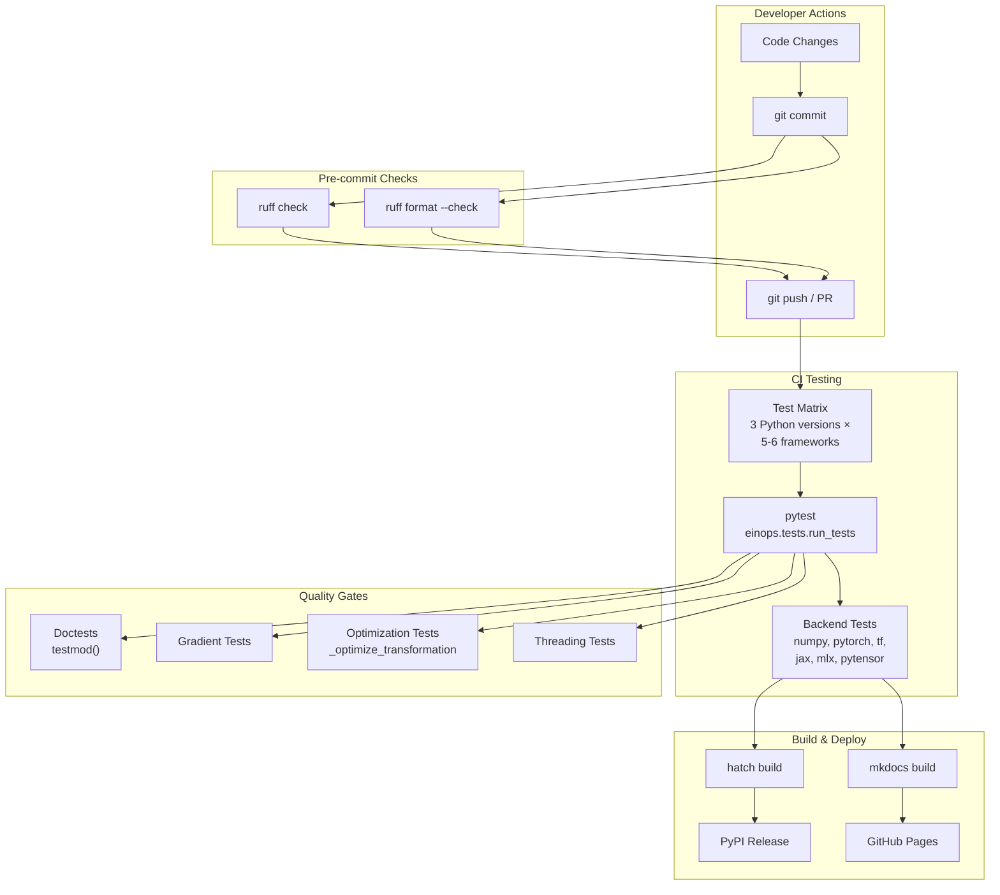
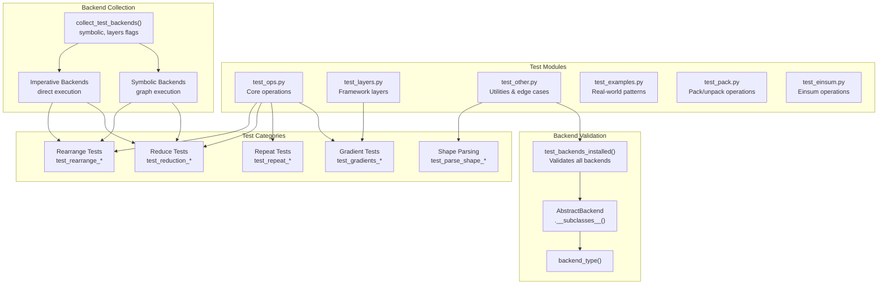
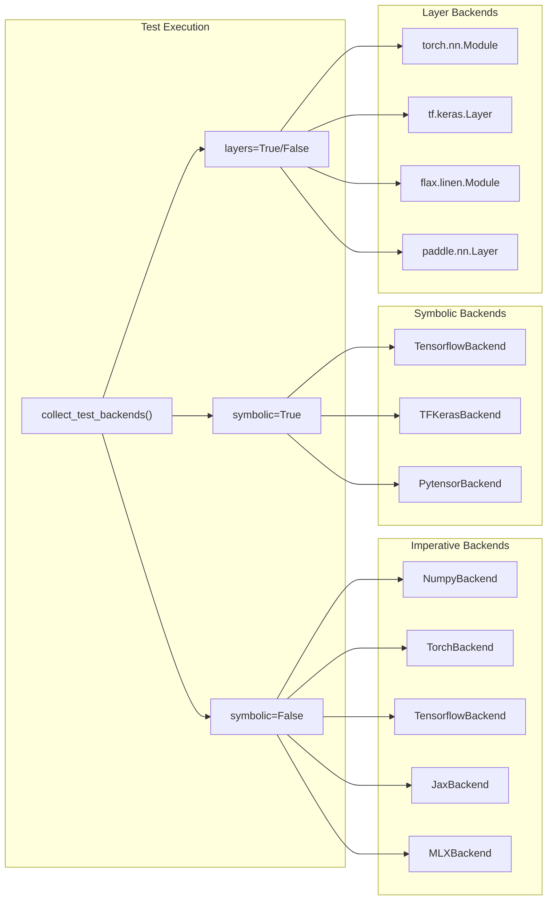
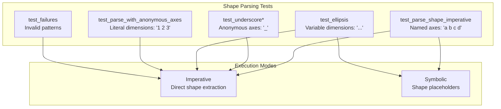
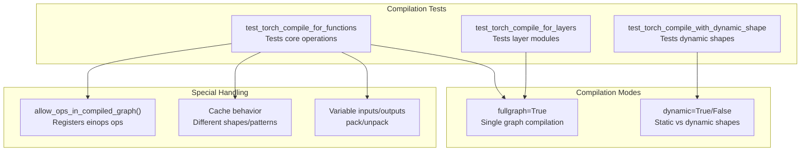
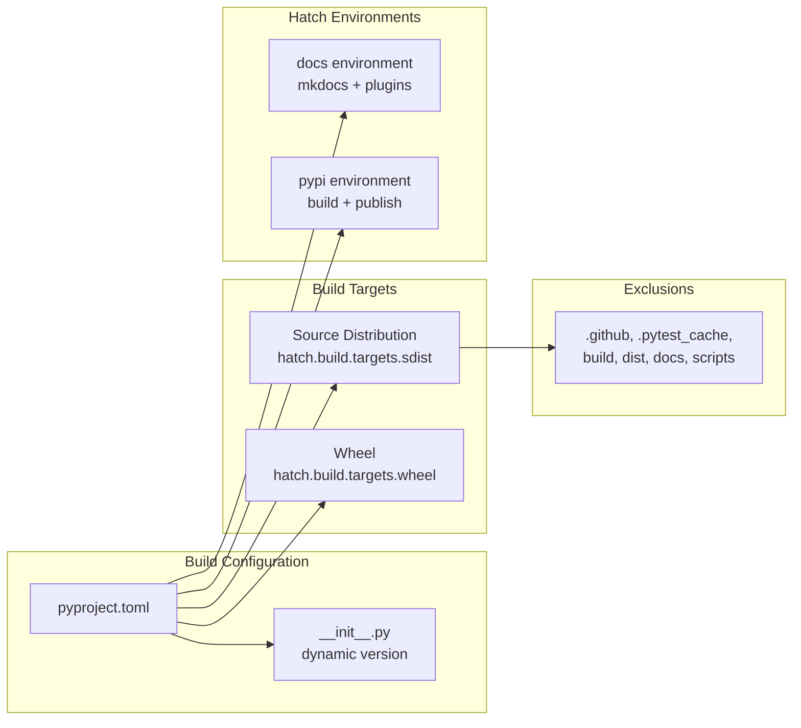
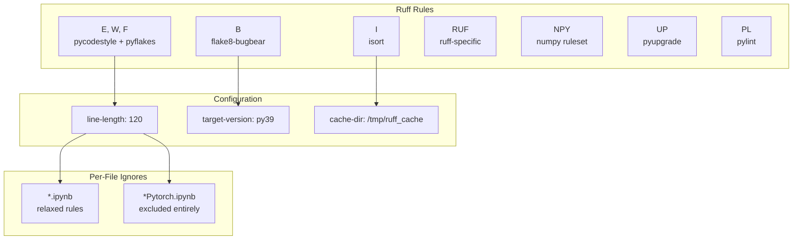

<!-- source: DeepWiki mcp.deepwiki.com · repo arogozhnikov/einops · page 6 Development and Testing · fetched 2026-10-21 -->

# Development and Testing

Relevant source files

The following files were used as context for generating this wiki page:

- [.github/workflows/run_tests.yml](.github/workflows/run_tests.yml)
- [einops/tests/test_examples.py](einops/tests/test_examples.py)
- [einops/tests/test_layers.py](einops/tests/test_layers.py)
- [einops/tests/test_ops.py](einops/tests/test_ops.py)
- [einops/tests/test_other.py](einops/tests/test_other.py)
- [pyproject.toml](pyproject.toml)

This document provides an overview of the development infrastructure, testing strategies, and CI/CD pipelines used in the einops repository. It covers the tools, workflows, and best practices for contributing to the project.

For detailed information about specific aspects of development:
- Testing implementation details: see [Testing Infrastructure](#6.1)
- CI/CD workflow details: see [CI/CD Pipelines](#6.2)
- Documentation building and deployment: see [Documentation System](#6.3)
- Local development setup: see [Development Environment](#6.4)

## Development Workflow Overview

The einops project follows a modern Python development workflow with zero runtime dependencies, comprehensive multi-framework testing, and automated quality checks.

**Sources:** [.github/workflows/run_tests.yml:1-37](), [pyproject.toml:86-141]()

## Testing Architecture

The einops test suite is organized around three key dimensions: operation types, backend compatibility, and execution modes (imperative vs symbolic).

### Test Suite Structure

**Sources:** [einops/tests/test_ops.py:1-659](), [einops/tests/test_layers.py:1-481](), [einops/tests/test_other.py:1-364]()

### Testing Strategies by Operation Type

| Operation | Imperative Test | Symbolic Test | Gradient Test | Backend Compatibility |
|-----------|-----------------|---------------|---------------|----------------------|
| `rearrange` | [test_ops.py:100-115]() | [test_ops.py:100-115]() | Indirect via layers | All backends |
| `reduce` | [test_ops.py:214-248]() | [test_ops.py:250-301]() | [test_ops.py:419-444]() | All backends |
| `repeat` | [test_ops.py:517-528]() | [test_ops.py:530-542]() | N/A | All backends |
| `pack/unpack` | Separate module | N/A | N/A | All backends |
| `einsum` | Separate module | Separate module | Implicit | All backends |
| Layers | [test_layers.py:37-67]() | [test_layers.py:69-100]() | [test_layers.py:37-67]() | Layer backends only |

**Sources:** [einops/tests/test_ops.py:214-659](), [einops/tests/test_layers.py:37-176]()

## Backend Testing Matrix

The test suite validates operations across multiple frameworks with both imperative and symbolic execution modes.

**Sources:** [einops/tests/test_ops.py:11-12](), [einops/tests/test_other.py:88-189]()

### Backend Validation

The test suite ensures all expected backends are available and properly initialized through [test_other.py:26-53](). This test:

1. Discovers all `AbstractBackend` subclasses recursively
2. Attempts to instantiate each backend
3. Verifies the framework can be imported and initialized
4. Fails if any requested backend is missing

**Sources:** [einops/tests/test_other.py:26-53]()

## Test Coverage Areas

### Core Operation Tests

| Test Function | Purpose | Key Assertions |
|---------------|---------|----------------|
| `test_ellipsis_ops_numpy` | Validates ellipsis patterns | Identity patterns, equivalence classes |
| `test_rearrange_consistency_numpy` | Ensures data preservation | Element equality, dtype preservation |
| `test_rearrange_permutations_numpy` | Random axis reordering | Indexing consistency across permutations |
| `test_reduction_stress_imperatives` | Stress tests with random shapes | Up to 11 dimensions, multiple reductions |
| `test_gradients_imperatives` | Gradient correctness | Cross-backend gradient consistency |

**Sources:** [einops/tests/test_ops.py:55-212](), [einops/tests/test_ops.py:419-444]()

### Shape Parsing Tests

The shape parsing system is tested with multiple edge cases:

**Sources:** [einops/tests/test_other.py:93-180](), [einops/tests/test_other.py:192-244]()

### Optimization Tests

The test suite validates that `_optimize_transformation` produces equivalent results while potentially reducing computational complexity:

- Tests shapes from 1D to 14D
- Validates optimization is idempotent (optimizing twice produces same result)
- Ensures numerical equivalence before/after optimization
- Uses random reduction axes and permutations

**Sources:** [einops/tests/test_other.py:56-86]()

### Layer-Specific Tests

Framework layers are tested for:

1. **Correctness**: Output matches functional API
2. **Serialization**: `pickle` round-trip preserves behavior
3. **Gradients**: Backpropagation works correctly
4. **Framework compatibility**: Tracing (PyTorch), scripting (PyTorch), graph mode (TensorFlow)

**Sources:** [einops/tests/test_layers.py:37-176]()

## PyTorch Compilation Support

The test suite validates `torch.compile` compatibility, which requires special handling:

**Sources:** [einops/tests/test_other.py:257-334](), [einops/tests/test_ops.py:595-622]()

## Threading Safety

The test suite includes a threading safety test to ensure einops can be used in concurrent environments:

- Uses `ThreadPoolExecutor` with 2 workers
- Executes 20 concurrent rearrange operations
- Tests with both NumPy and PyTorch backends
- Runs in subprocess to isolate threading issues

**Sources:** [einops/tests/test_other.py:336-364]()

## CI/CD Configuration

The GitHub Actions workflow [.github/workflows/run_tests.yml]() defines a matrix strategy:

### Test Matrix

| Python Version | Frameworks Tested |
|----------------|-------------------|
| 3.10 | numpy, pytorch, tensorflow, jax, mlx, pytensor |
| 3.11 | numpy, pytorch, tensorflow, jax, mlx |
| 3.13 | numpy, pytorch, tensorflow, jax, mlx, pytensor |

**Notes:**
- CuPy requires GPU, not tested in CI
- OneFlow testing dropped due to compatibility issues
- Paddle testing dropped due to NumPy divergence
- PyTorch configured for CPU-only to reduce resource usage

**Sources:** [.github/workflows/run_tests.yml:10-22]()

### Workflow Steps

1. **Checkout code**: `actions/checkout@v5`
2. **Setup Python**: `actions/setup-python@v5` with pip caching
3. **Ruff compliance**: `ruff check` and `ruff format --check`
4. **Run tests**: `python -m einops.tests.run_tests <frameworks> --pip-install`

**Sources:** [.github/workflows/run_tests.yml:24-36]()

## Build System

The project uses `hatchling` as the build backend with zero runtime dependencies:

**Sources:** [pyproject.toml:1-82]()

### Package Metadata

- **Name**: `einops`
- **Python requirement**: `>=3.10`
- **Dependencies**: None (runtime or installation-time)
- **Packages**: `einops`, `einops.layers`
- **License**: MIT

**Sources:** [pyproject.toml:5-35]()

## Code Quality Tools

### Ruff Configuration

The project uses `ruff` for both linting and formatting with extensive rule selection:

**Sources:** [pyproject.toml:86-141]()

### Selected Rule Categories

- **Error prevention**: E4, E7, E9, F, W, B
- **Import organization**: I, TID252 (absolute imports)
- **NumPy compatibility**: NPY, NPY201 (NumPy 2 deprecations)
- **Code modernization**: UP (pyupgrade), C4 (comprehensions)
- **Style consistency**: Q (quotes), ISC (string concat), FLY (f-strings)
- **Best practices**: PIE (flake8-pie), PTH (pathlib), RET (return statements)

**Sources:** [pyproject.toml:98-119]()

### Formatting Exceptions

- Docstring code blocks not reformatted
- Notebooks (`.ipynb`) excluded from formatting
- Notebooks have relaxed linting rules for imports and cell structure

**Sources:** [pyproject.toml:92-141]()

## Example-Based Testing

The test suite includes real-world example patterns to ensure practical usability:

### Pattern Categories

1. **Basic transformations**: transpose, reshape, view
2. **Vision operations**: depth-to-space, space-to-depth
3. **Pooling**: max-pooling, average-pooling
4. **Architecture patterns**: ShuffleNet, U-Net, strided convolution
5. **Framework-specific**: YOLO detection head (PyTorch)

Each example is tested across all backends with both contiguous and strided memory layouts.

**Sources:** [einops/tests/test_examples.py:9-151]()

## Doctest Integration

The test suite validates all docstrings in the codebase:

- Tests `einops.layers` module docstrings
- Tests `einops.einops` module docstrings
- Uses `testmod()` with `raise_on_error=True`
- Provides NumPy in extraglobs for docstring examples

**Sources:** [einops/tests/test_other.py:20-23]()

## Contributing Workflow

For developers contributing to einops:

1. **Install development dependencies**: Use `pip install -e .` for editable install
2. **Run linting**: `ruff check . && ruff format . --check`
3. **Run tests**: `python -m einops.tests.run_tests <frameworks> --pip-install`
4. **Build documentation**: `hatch run docs:serve` (requires docs environment)
5. **Submit PR**: Tests run automatically via GitHub Actions

For detailed setup instructions, see [Development Environment](#6.4).

**Sources:** [.github/workflows/run_tests.yml:1-37](), [pyproject.toml:58-76]()

---

