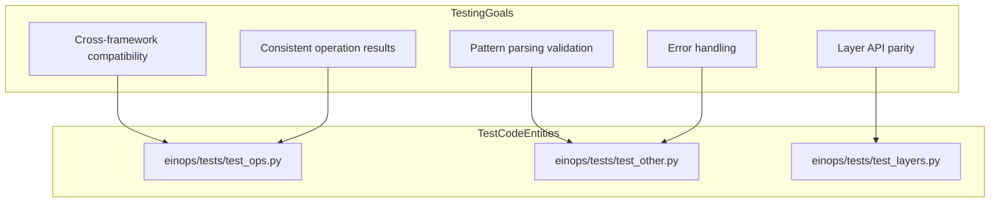
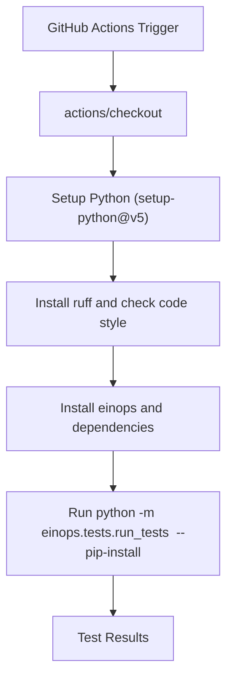
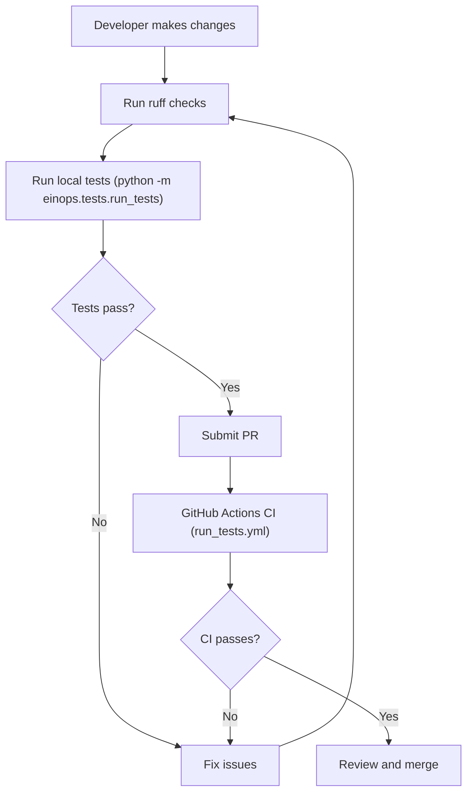

<!-- source: DeepWiki mcp.deepwiki.com · repo arogozhnikov/einops · page 6.1 Testing Infrastructure · fetched 2026-10-21 -->

# Testing Infrastructure

<details>
<summary>Relevant source files</summary>

The following files were used as context for generating this wiki page:

- [.github/workflows/run_tests.yml](.github/workflows/run_tests.yml)
- [einops/tests/run_tests.py](einops/tests/run_tests.py)
- [einops/tests/test_einsum.py](einops/tests/test_einsum.py)
- [einops/tests/test_examples.py](einops/tests/test_examples.py)
- [einops/tests/test_layers.py](einops/tests/test_layers.py)
- [einops/tests/test_ops.py](einops/tests/test_ops.py)
- [einops/tests/test_other.py](einops/tests/test_other.py)

</details>


This page documents the testing infrastructure of the einops library. It covers the organization of test code, how to run tests, the test matrix strategy, and the relationship between the testing system and the rest of the codebase. For information on the CI/CD system, see [6.2], and for development environment setup, see [6.4].

## Testing Goals and Strategy

Einops aims for strict cross-framework consistency and reliability across all supported Python versions and tensor frameworks. The testing infrastructure is designed to:

- Validate that all core operations (`rearrange`, `reduce`, `repeat`, `einsum`, `pack`, `unpack`) produce equivalent results across backends.
- Ensure that framework-specific layers (e.g., PyTorch, TensorFlow, JAX) behave identically to the core API.
- Detect and prevent regressions in API, error handling, and pattern parsing.
- Support both imperative and symbolic execution models.

### Diagram: Testing Goals and Code Entities


Sources: [einops/tests/test_ops.py:1-659](), [einops/tests/test_other.py:1-331](), [einops/tests/test_layers.py](), [.github/workflows/run_tests.yml:1-40]()

## Running Tests Locally

Tests are distributed with the einops package. You can run the full test suite in your environment to verify compatibility with your installed frameworks.

### Basic Usage

```bash
# Install einops in development mode
pip install -e .

# Run all tests for all supported frameworks (auto-installs them if needed)
python -m einops.tests.run_tests numpy pytorch tensorflow jax --pip-install

# Run tests for a specific framework only
python -m einops.tests.run_tests numpy
```

- The `--pip-install` flag will install the required framework dependencies before running tests.
- The test runner will automatically detect which frameworks are available and skip tests for missing frameworks.

### Test Entry Point

The main entry point for running tests is `einops/tests/run_tests.py` (invoked as a module).

Sources: [.github/workflows/run_tests.yml:39](), [pyproject.toml:35-36]()

## Code Quality Checks

Einops enforces code style and formatting using `ruff`. Code quality checks are run both locally and in CI.

```bash
pip install ruff==0.11.7
ruff check .            # Check code style
ruff format . --check   # Check formatting
```

- The configuration for `ruff` is specified in `pyproject.toml` under `[tool.ruff]` and related sections.
- These checks are run as a CI step before running the test suite.

Sources: [.github/workflows/run_tests.yml:34-36](), [pyproject.toml:86-141]()

## Test Matrix and Framework Coverage

The einops CI system uses a test matrix to ensure coverage across Python versions and frameworks. The same matrix can be used locally by specifying frameworks to `run_tests.py`.

### Supported Python Versions and Frameworks

| Python Version | Frameworks Tested                        | Notes                                                                 |
|----------------|------------------------------------------|-----------------------------------------------------------------------|
| 3.9            | numpy, pytorch, tensorflow, jax          | pytensor not tested (compatibility issues with numpy 2)               |
| 3.10           | pytensor                                 | pytensor only                                                         |
| 3.11           | numpy, pytorch, tensorflow, jax          |                                                                       |
| 3.12           | numpy, pytorch, tensorflow, jax          |                                                                       |
| 3.13           | pytensor                                 | pytensor only                                                         |

- Some frameworks are excluded from CI:
    - CuPy (requires GPU)
    - OneFlow (compatibility issues)
    - Paddle (divergence with numpy in Python 3.10)

Sources: [.github/workflows/run_tests.yml:10-24]()

## CI Workflow Overview

The CI workflow is defined in `.github/workflows/run_tests.yml`. It is triggered on every push and pull request, and runs the following steps for each matrix entry:

### Diagram: CI Workflow and Test Matrix



- The test matrix is defined in the `strategy.matrix` section of the workflow file.
- Each job installs the specified Python version and frameworks, runs code quality checks, and then executes the test suite.

Sources: [.github/workflows/run_tests.yml:1-40]()

## Test Code Organization

The einops test suite is organized into several files, each targeting a specific aspect of the library:

| Test File                       | Purpose                                                                 |
|----------------------------------|-------------------------------------------------------------------------|
| `einops/tests/test_ops.py`       | Core operation tests: `rearrange`, `reduce`, `repeat`, `einsum`, etc.   |
| `einops/tests/test_other.py`     | Backend integration, pattern parsing, error handling, and edge cases     |
| `einops/tests/test_layers.py`    | Layer tests for PyTorch, TensorFlow, and other framework integrations    |

### Diagram: Test File Coverage and Code Entities

```mermaid
graph TD
    subgraph "TestFiles"
        A["test_ops.py"]
        B["test_other.py"]
        C["test_layers.py"]
    end
    subgraph "CoreAPI"
        D["rearrange"]
        E["reduce"]
        F["repeat"]
        G["einsum"]
        H["pack/unpack"]
    end
    subgraph "Backends"
        I["_backends.py"]
    end
    subgraph "Layers"
        J["layers/torch.py"]
        K["layers/tensorflow.py"]
    end
    A --> D
    A --> E
    A --> F
    A --> G
    A --> H
    B --> I
    B --> D
    B --> "parse_shape"
    C --> J
    C --> K
```

Sources: [einops/tests/test_ops.py:1-659](), [einops/tests/test_other.py:1-331](), [einops/tests/test_layers.py]()

## Test Coverage Areas

The einops test suite covers the following areas:

1. **Core Operations**: Validates correctness of `rearrange`, `reduce`, `repeat`, `einsum`, `pack`, and `unpack` across all supported frameworks ([einops/tests/test_ops.py]()).
2. **Pattern Parsing and Validation**: Ensures the pattern DSL is parsed and validated correctly, including error cases ([einops/tests/test_other.py]()).
3. **Backend Implementations**: Verifies that all backends (NumPy, PyTorch, TensorFlow, JAX, etc.) produce consistent results ([einops/tests/test_ops.py](), [einops/tests/test_other.py]()).
4. **Layer Implementations**: Tests that framework-native layers (e.g., `torch.Rearrange`, `keras.Rearrange`) match the core API ([einops/tests/test_layers.py]()).
5. **Error Handling**: Checks that invalid patterns and inputs raise appropriate exceptions ([einops/tests/test_other.py]()).
6. **Symbolic vs Imperative Execution**: Ensures both execution models are tested, including dynamic shapes ([einops/tests/test_ops.py]()).
7. **Array API Compliance**: Tests compatibility with the Python Array API standard ([einops/tests/test_ops.py]()).

Sources: [einops/tests/test_ops.py:1-659](), [einops/tests/test_other.py:1-331](), [einops/tests/test_layers.py]()

## Development and Testing Workflow

The recommended workflow for contributors is:

1. Run code quality checks with `ruff`.
2. Run the test suite locally for at least NumPy, and for any frameworks relevant to your changes.
3. Submit a pull request. CI will run the full test matrix.
4. Address any failures reported by CI.

### Diagram: Contributor Testing Workflow



Sources: [.github/workflows/run_tests.yml:1-40](), [pyproject.toml:86-141]()

## Testing Best Practices

- Always run `ruff check .` and `ruff format . --check` before submitting changes.
- Run the test suite locally with at least NumPy, and with any frameworks affected by your changes.
- For backend-specific changes, test with the relevant framework.
- Rely on CI to test the full matrix of Python versions and frameworks.
- Ensure that results are consistent across all frameworks and execution models.

Sources: [.github/workflows/run_tests.yml:34-39](), [pyproject.toml:86-141]()

## Pytest Configuration

Einops includes specific pytest configuration to suppress irrelevant warnings from TensorFlow and protobuf libraries:

```ini
[tool.pytest.ini_options]
filterwarnings = [
    "ignore:Call to deprecated create function FieldDescriptor",
    "ignore:Call to deprecated create function Descriptor",
    "ignore:Call to deprecated create function EnumDescriptor",
    "ignore:Call to deprecated create function EnumValueDescriptor",
    "ignore:Call to deprecated create function FileDescriptor",
    "ignore:Call to deprecated create function OneofDescriptor",
]
```

Sources: [pyproject.toml:85-95]()

---

