<!-- source: DeepWiki mcp.deepwiki.com · repo arogozhnikov/einops · page 6.2 CI/CD Pipelines · fetched 2026-10-21 -->

# CI/CD Pipelines

<details>
<summary>Relevant source files</summary>

The following files were used as context for generating this wiki page:

- [.github/workflows/deploy_docs.yml](.github/workflows/deploy_docs.yml)
- [.github/workflows/deploy_to_pypi.yml](.github/workflows/deploy_to_pypi.yml)
- [.github/workflows/run_tests.yml](.github/workflows/run_tests.yml)
- [.github/workflows/test_notebooks.yml](.github/workflows/test_notebooks.yml)
- [docs/resources/python_badge.svg](docs/resources/python_badge.svg)
- [docs_src/css/codehilite.css](docs_src/css/codehilite.css)
- [mkdocs.yml](mkdocs.yml)

</details>


## Purpose and Scope

This document describes the continuous integration and deployment infrastructure for the einops repository. It covers the four GitHub Actions workflows that automate testing, quality enforcement, documentation deployment, and package publishing. For information about the testing infrastructure and test suite organization, see [Testing Infrastructure](#6.1). For documentation system architecture, see [Documentation System](#6.3).

---

## Overview

The einops CI/CD system consists of four GitHub Actions workflows that automate quality assurance and deployment:

| Workflow | Trigger | Purpose | Runtime |
|----------|---------|---------|---------|
| `run_tests.yml` | Push, Pull Request | Run test suite across Python versions and frameworks | ~5-10 min per matrix job |
| `test_notebooks.yml` | Push, Pull Request | Validate tutorial notebooks execute correctly | ~3-5 min per matrix job |
| `deploy_docs.yml` | Push to main/docs-deploy-testing | Deploy documentation to einops.rocks | ~2-3 min |
| `deploy_to_pypi.yml` | Release creation | Publish package to PyPI | ~1-2 min |

All workflows run on `ubuntu-latest` runners. The testing workflows use matrix strategies to parallelize execution across multiple Python versions and framework combinations.

**Sources:** [.github/workflows/run_tests.yml:1-37](), [.github/workflows/test_notebooks.yml:1-27](), [.github/workflows/deploy_docs.yml:1-34](), [.github/workflows/deploy_to_pypi.yml:1-28]()

---

## Workflow Architecture

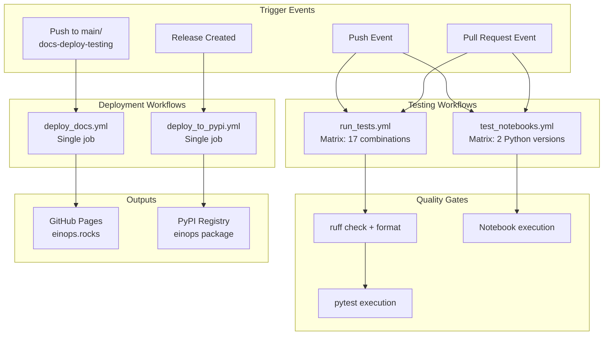

**Workflow Execution Model:** Testing workflows run in parallel for every push and pull request, providing immediate feedback on code quality and functionality. Deployment workflows are restricted to specific branch events (documentation) or release events (package publishing) to prevent accidental deployments.

**Sources:** [.github/workflows/run_tests.yml:3-3](), [.github/workflows/test_notebooks.yml:3-3](), [.github/workflows/deploy_docs.yml:2-7](), [.github/workflows/deploy_to_pypi.yml:3-5]()

---

## Testing Workflow (run_tests.yml)

### Matrix Strategy

The `run_tests.yml` workflow uses a matrix strategy to test across multiple Python versions and framework combinations:

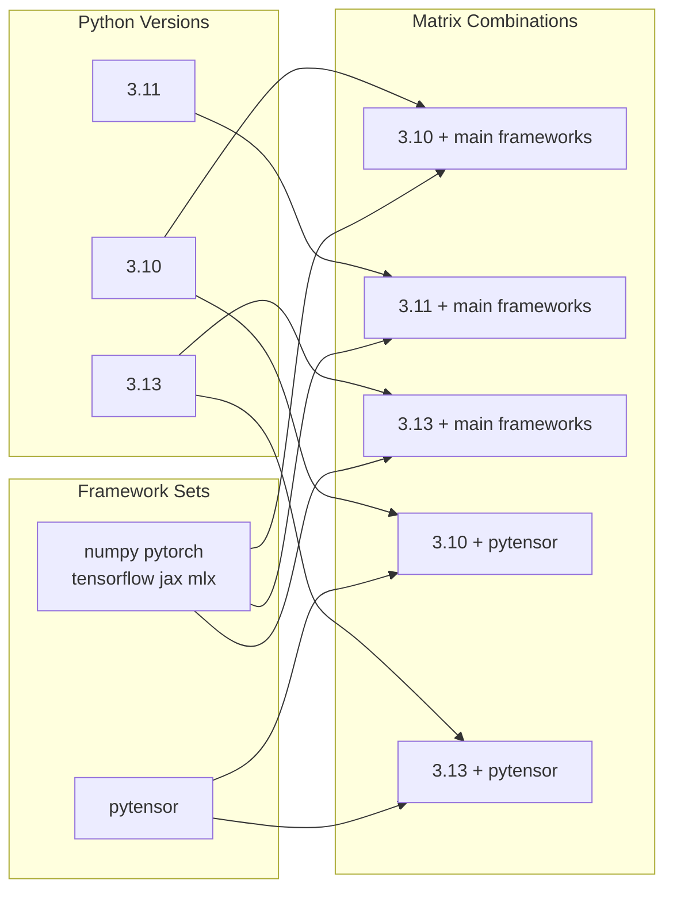

The matrix configuration creates **17 total jobs** (5 matrix combinations × multiple test modules). The base matrix tests Python 3.10, 3.11, and 3.13 with the primary framework set: `numpy pytorch tensorflow jax mlx`. The `include` section adds two additional jobs testing `pytensor` on Python 3.10 and 3.13.

**Framework Exclusions:** The configuration explicitly excludes several frameworks from CI testing:
- **cupy**: Requires GPU support not available on GitHub Actions runners
- **oneflow**: Dropped due to compatibility issues (see issue #10340)
- **paddle**: Dropped due to protobuf version conflicts and numpy divergence in Python 3.10

**Sources:** [.github/workflows/run_tests.yml:9-22]()

### Execution Steps

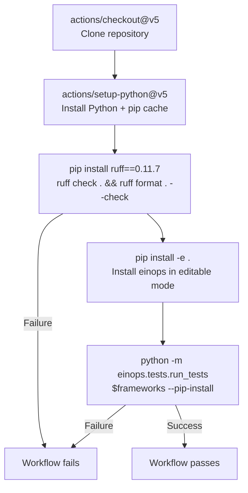

**Step Details:**

1. **Checkout**: Uses `actions/checkout@v5` to clone the repository at the commit being tested
2. **Python Setup**: Uses `actions/setup-python@v5` with pip caching enabled to speed up dependency installation
3. **Ruff Compliance**: Installs `ruff==0.11.7` and runs both linting (`ruff check .`) and formatting (`ruff format . --check`). This step must pass before tests run, enforcing code quality standards
4. **Test Execution**: Installs einops in editable mode, then runs `python -m einops.tests.run_tests` with the framework list and `--pip-install` flag to automatically install test dependencies

The `--pip-install` flag passed to `run_tests` triggers automatic installation of framework-specific dependencies for the specified frameworks.

**Sources:** [.github/workflows/run_tests.yml:24-36]()

---

## Notebook Testing Workflow (test_notebooks.yml)

### Matrix Configuration

The notebook testing workflow uses a simpler matrix than the main test workflow, testing only Python 3.10 and 3.13:

| Python Version | Purpose |
|----------------|---------|
| 3.10 | Minimum supported version |
| 3.13 | Latest stable version |

This reduced matrix balances coverage with CI runtime, as notebook execution is time-intensive.

**Sources:** [.github/workflows/test_notebooks.yml:9-11]()

### Execution Pipeline

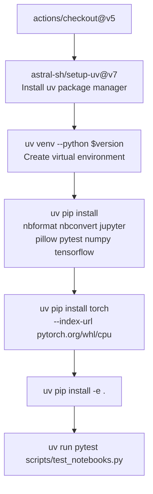

**Key Implementation Details:**

- **uv Package Manager**: Uses `uv` instead of `pip` for faster dependency resolution and installation. `uv` is a Rust-based Python package manager that provides significant speed improvements
- **CPU-Only PyTorch**: Installs PyTorch from the CPU-specific index (`https://download.pytorch.org/whl/cpu`) to avoid downloading large CUDA dependencies
- **Notebook Dependencies**: Installs `nbformat`, `nbconvert`, and `jupyter` for notebook execution, plus `pillow` for image processing in tutorials
- **Framework Coverage**: Tests with `numpy` and `tensorflow` as representative frameworks. PyTorch is installed separately with CPU-only configuration
- **Test Script**: Executes `scripts/test_notebooks.py` via pytest, which validates that all tutorial notebooks can execute without errors

**Sources:** [.github/workflows/test_notebooks.yml:13-26]()

---

## Documentation Deployment Workflow (deploy_docs.yml)

### Trigger Configuration

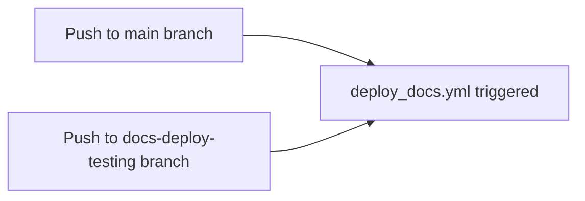

The documentation deployment workflow triggers on pushes to two branches:
- **main**: Production deployments to einops.rocks
- **docs-deploy-testing**: Testing branch for validating documentation changes before merging

This dual-branch strategy allows documentation preview before production deployment.

**Sources:** [.github/workflows/deploy_docs.yml:2-7]()

### Deployment Pipeline

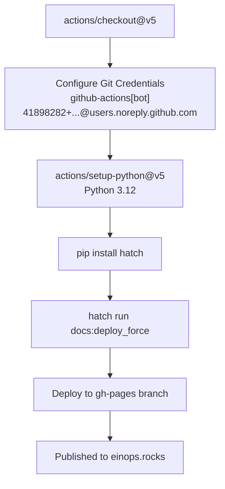

**Implementation Details:**

1. **Git Configuration**: Configures commits to use GitHub's official bot account credentials, ensuring deployment commits are properly attributed
2. **Python Setup**: Uses Python 3.12 (stable version) for documentation building
3. **Hatch Environment**: Uses `hatch run docs:deploy_force` instead of direct `mkdocs gh-deploy`, leveraging the hatch environment defined in `pyproject.toml`
4. **Force Deployment**: The `deploy_force` command uses `--force` flag to overwrite the `gh-pages` branch, ensuring clean deployment history

The workflow has `contents: write` permissions to push to the `gh-pages` branch.

**Sources:** [.github/workflows/deploy_docs.yml:8-34]()

### Documentation Build Process

The `hatch run docs:deploy_force` command triggers the following build process (configured in [mkdocs.yml]()):

1. **Content Processing**: Processes markdown files from `docs_src/` directory
2. **Notebook Rendering**: Converts Jupyter notebooks (`.ipynb`) to HTML using `mkdocs-jupyter` plugin
3. **API Documentation**: Generates API reference pages using `mkdocstrings` plugin
4. **Static Site Generation**: Builds complete static site with Material theme
5. **GitHub Pages Deployment**: Pushes built site to `gh-pages` branch

**Sources:** [mkdocs.yml:1-51]()

---

## PyPI Deployment Workflow (deploy_to_pypi.yml)

### Release-Triggered Deployment

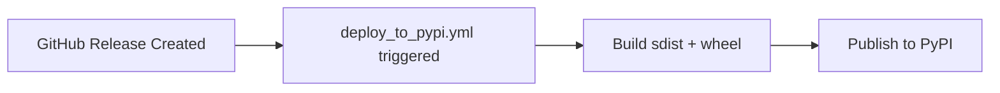

The PyPI deployment workflow is triggered exclusively by GitHub release creation events. This ensures packages are only published for explicitly tagged releases, preventing accidental deployments.

**Sources:** [.github/workflows/deploy_to_pypi.yml:3-5]()

### Build and Publish Pipeline

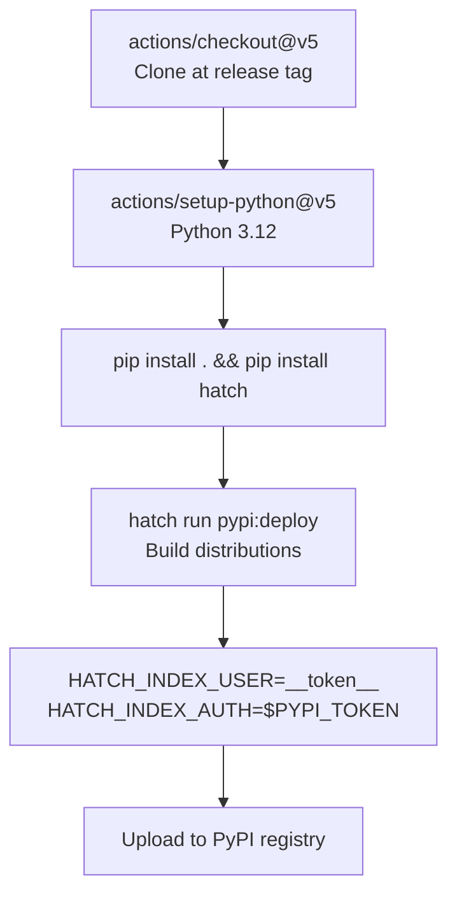

**Step Breakdown:**

1. **Checkout at Tag**: Clones repository at the specific release tag, ensuring the correct version is packaged
2. **Python 3.12**: Uses Python 3.12 for package building (version doesn't affect wheel compatibility)
3. **Dependency Installation**: Installs einops itself (to validate it's importable) and hatch build tool
4. **Hatch Build**: Runs `hatch run pypi:deploy` which uses the `pypi` environment defined in `pyproject.toml`
5. **Authentication**: Uses token-based authentication with PyPI. The token is stored in GitHub Secrets as `PYPI_TOKEN` and passed via environment variables:
   - `HATCH_INDEX_USER`: Set to `"__token__"` (PyPI's token authentication username)
   - `HATCH_INDEX_AUTH`: Set to the secret token value
6. **Upload**: Hatch builds both source distribution (sdist) and wheel, then uploads to PyPI

**Security**: The `PYPI_TOKEN` secret must be configured in the repository settings with appropriate PyPI API token permissions. Using a scoped token (project-specific) is recommended over account-wide tokens.

**Sources:** [.github/workflows/deploy_to_pypi.yml:8-28]()

---

## Workflow Dependencies and Build Tools

### Hatch Integration

The CI/CD workflows leverage `hatch` as the primary build and environment management tool. Hatch environments are defined in `pyproject.toml` and used for:

| Hatch Command | Purpose | Used In |
|---------------|---------|---------|
| `hatch run docs:deploy_force` | Build and deploy documentation with force flag | `deploy_docs.yml` |
| `hatch run pypi:deploy` | Build and publish package to PyPI | `deploy_to_pypi.yml` |

This centralization of build logic in `pyproject.toml` ensures consistency between local development and CI execution.

**Sources:** [.github/workflows/deploy_docs.yml:33-33](), [.github/workflows/deploy_to_pypi.yml:27-27]()

### Package Managers

The workflows use different package managers for different purposes:

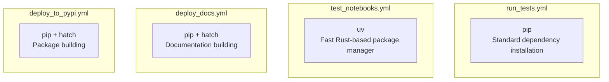

**Rationale**: `uv` is used for notebook testing because it provides significantly faster dependency resolution and installation, which is beneficial for the heavy dependency set required for notebook execution (PyTorch, TensorFlow, etc.). The other workflows use standard `pip` for simplicity and stability.

**Sources:** [.github/workflows/test_notebooks.yml:15-16]()

---

## Caching Strategies

### Pip Cache

The main testing workflow enables pip caching through the `setup-python` action:

```yaml
cache: pip
```

This caches downloaded packages based on `requirements.txt` or `pyproject.toml` hash, reducing dependency installation time on subsequent runs.

**Sources:** [.github/workflows/run_tests.yml:30-30]()

### Disabled MkDocs Cache

The documentation deployment workflow has caching commented out:

```yaml
# Switched off cache, deployment is fast anyway.
# - run: echo "cache_id=$(date --utc '+%V')" >> $GITHUB_ENV
# - uses: actions/cache@v4
```

This decision was made because documentation deployment is already fast (2-3 minutes) and the cache complexity doesn't provide significant benefit.

**Sources:** [.github/workflows/deploy_docs.yml:23-28]()

---

## Quality Enforcement

### Ruff Integration

The `run_tests.yml` workflow enforces code quality through `ruff` before running tests:

```bash
pip install ruff==0.11.7 && ruff check . && ruff format . --check
```

This command performs two checks:
1. **Linting** (`ruff check .`): Static analysis for code quality issues, style violations, and potential bugs
2. **Formatting** (`ruff format . --check`): Validates code formatting without modifying files (check-only mode)

Both checks must pass for the workflow to proceed to test execution. This ensures all code entering the repository meets style guidelines.

**Version Pinning**: Ruff is pinned to version `0.11.7` to ensure consistent linting behavior across all CI runs and prevent unexpected failures from ruff updates.

**Sources:** [.github/workflows/run_tests.yml:32-33]()

---

## Permissions and Security

### Workflow Permissions

| Workflow | Permissions | Reason |
|----------|-------------|--------|
| `run_tests.yml` | Default (read-only) | Only needs to read code and run tests |
| `test_notebooks.yml` | Default (read-only) | Only needs to read code and execute notebooks |
| `deploy_docs.yml` | `contents: write` | Must push to `gh-pages` branch |
| `deploy_to_pypi.yml` | Default + secrets | Needs `PYPI_TOKEN` secret for publishing |

**Security Best Practices:**
- Documentation deployment uses GitHub's official bot credentials, not personal tokens
- PyPI deployment uses scoped API tokens stored in GitHub Secrets
- Testing workflows have minimal permissions, following principle of least privilege

**Sources:** [.github/workflows/deploy_docs.yml:8-9](), [.github/workflows/deploy_to_pypi.yml:24-25]()

---

## Framework Coverage Matrix

The testing workflows provide comprehensive framework coverage:

| Framework | Tested Versions | Test Workflow | Notes |
|-----------|----------------|---------------|-------|
| NumPy | Latest stable | Both workflows | Core dependency |
| PyTorch | Latest stable | Both workflows | CPU-only in notebooks |
| TensorFlow | Latest stable | Both workflows | Includes Keras |
| JAX | Latest stable | `run_tests.yml` | Not in notebooks |
| MLX | Latest stable | `run_tests.yml` | Apple Silicon framework |
| PyTensor | Latest stable | `run_tests.yml` | Python 3.10, 3.13 only |
| CuPy | Not tested | - | Requires GPU |
| OneFlow | Not tested | - | Compatibility issues |
| Paddle | Not tested | - | Protobuf conflicts |

This matrix ensures einops functions correctly across all actively supported frameworks while excluding frameworks with infrastructure or compatibility constraints.

**Sources:** [.github/workflows/run_tests.yml:16-21](), [.github/workflows/test_notebooks.yml:22-23]()

---

## Execution Time and Resource Usage

### Typical Workflow Durations

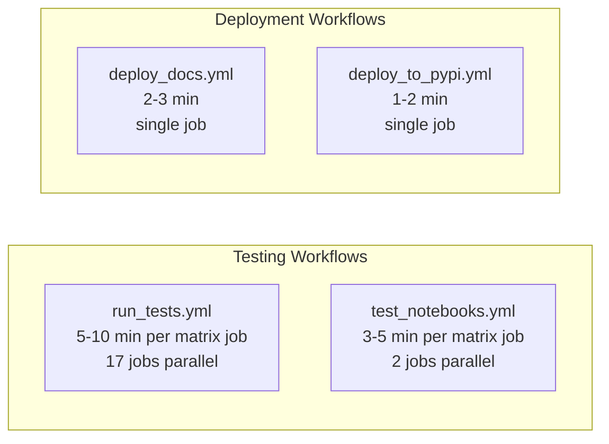

**Total CI Time per Push/PR:**
- Testing workflows run in parallel, so total wall-clock time is ~5-10 minutes (limited by slowest matrix job)
- All matrix jobs must pass for the workflow to succeed

**Resource Optimization:**
- PyTorch installed from CPU-only index to avoid large CUDA downloads
- Pip caching reduces dependency installation time
- Matrix strategy parallelizes testing across multiple runners

**Sources:** [.github/workflows/run_tests.yml:8-8](), [.github/workflows/test_notebooks.yml:8-8]()

---

## Failure Handling

### Test Failure Scenarios

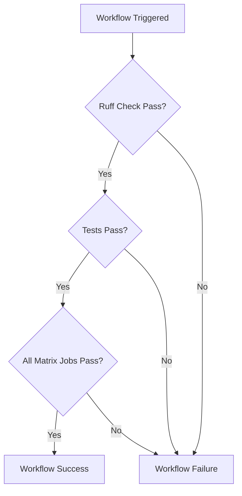

**Failure Impact:**
- **Ruff failures**: Indicate code style or quality issues; must be fixed before tests run
- **Test failures**: Indicate functional bugs or compatibility issues; require code fixes
- **Matrix failures**: Any single matrix job failure fails the entire workflow
- **Deployment failures**: Do not run on pull requests, only affect main branch or releases

**Pull Request Protection:** Repositories typically configure branch protection rules requiring `run_tests.yml` to pass before pull requests can be merged.

**Sources:** [.github/workflows/run_tests.yml:32-36]()

---

