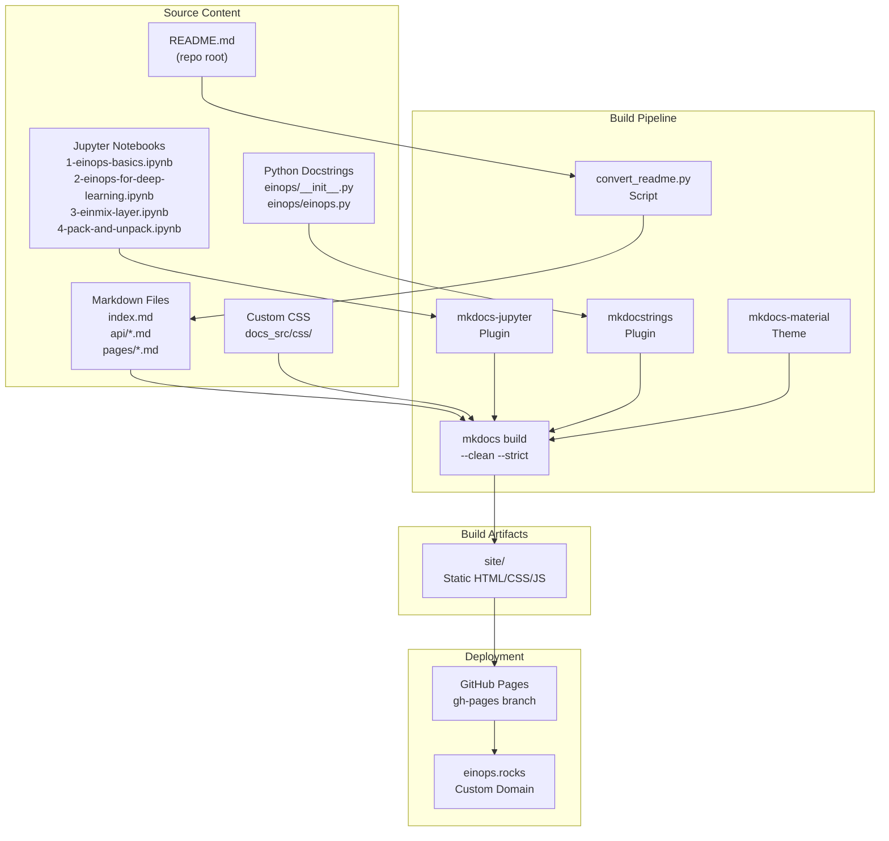
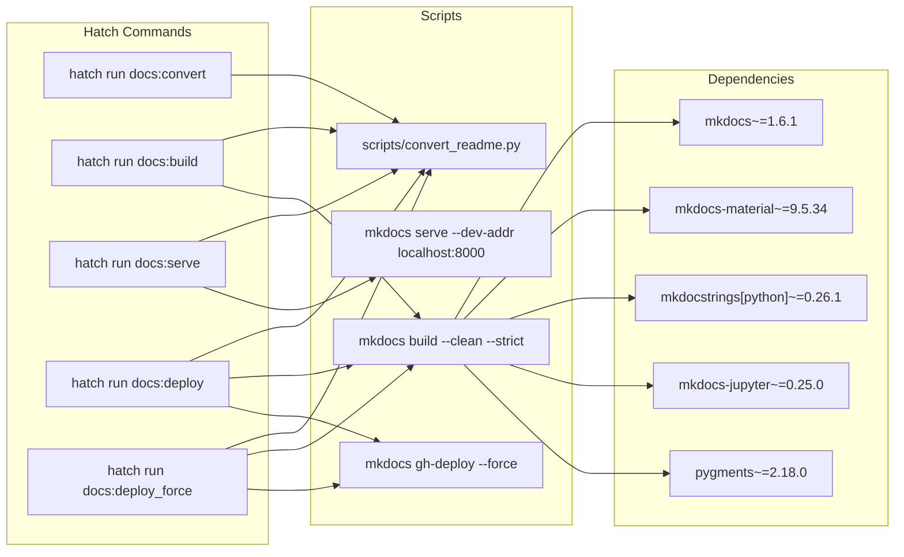
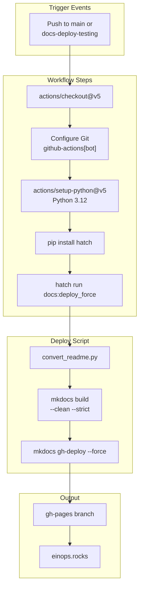
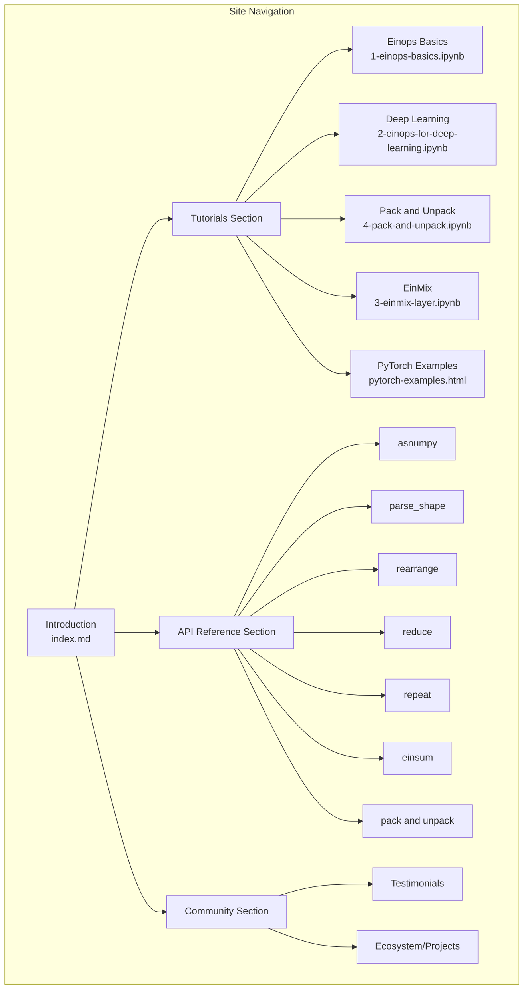

<!-- source: DeepWiki mcp.deepwiki.com · repo arogozhnikov/einops · page 6.3 Documentation System · fetched 2026-10-21 -->

# Documentation System

<details>
<summary>Relevant source files</summary>

The following files were used as context for generating this wiki page:

- [.github/workflows/deploy_docs.yml](.github/workflows/deploy_docs.yml)
- [docs/README.md](docs/README.md)
- [docs_src/css/codehilite.css](docs_src/css/codehilite.css)
- [mkdocs.yml](mkdocs.yml)
- [pyproject.toml](pyproject.toml)

</details>


## Purpose and Scope

This document covers the mkdocs-based documentation system used to generate the static site hosted at einops.rocks. It includes the source organization in `docs_src/`, the build process using hatch and mkdocs, notebook rendering with mkdocs-jupyter, API reference generation with mkdocstrings, and the automated deployment pipeline via GitHub Actions.

For information about the testing infrastructure, see [Testing Infrastructure](#6.1). For CI/CD workflows beyond documentation deployment, see [CI/CD Pipelines](#6.2).

---

## Documentation Architecture

The einops documentation system uses mkdocs with the Material theme to generate a static website from markdown files, Jupyter notebooks, and Python docstrings. The system is designed to provide multiple content types: tutorial notebooks, API references, and community resources.



**Sources:** [mkdocs.yml:1-51](), [pyproject.toml:58-76](), [.github/workflows/deploy_docs.yml:1-34]()

---

## Source Organization

The documentation source files are organized in the `docs_src/` directory, with a structure that mirrors the final site navigation defined in `mkdocs.yml`.

| Path | Content Type | Purpose |
|------|--------------|---------|
| `docs_src/index.md` | Markdown | Homepage introduction |
| `docs_src/1-einops-basics.ipynb` | Jupyter Notebook | Basic operations tutorial |
| `docs_src/2-einops-for-deep-learning.ipynb` | Jupyter Notebook | Deep learning applications |
| `docs_src/3-einmix-layer.ipynb` | Jupyter Notebook | EinMix layer guide |
| `docs_src/4-pack-and-unpack.ipynb` | Jupyter Notebook | Pack/unpack operations |
| `docs_src/pytorch-examples.html` | Static HTML | PyTorch code comparisons |
| `docs_src/api/*.md` | Markdown | API reference pages |
| `docs_src/pages/*.md` | Markdown | Community/testimonials |
| `docs_src/css/*.css` | Stylesheets | Custom styling |
| `docs_src/images/` | Assets | Favicon, images |

The navigation structure is explicitly defined in [mkdocs.yml:12-29]():

```yaml
nav:
  - Introduction: index.md
  - Tutorials: [notebooks]
  - API Reference: [api pages]
  - Testimonials: pages/testimonials.md
  - Community/Ecosystem: pages/projects.md
```

**Sources:** [mkdocs.yml:5-29]()

---

## Build Process

The documentation build process is managed through hatch environments defined in `pyproject.toml`. The build system provides multiple commands for different workflows.



### Hatch Environment Configuration

The docs environment is defined in [pyproject.toml:58-76]():

```toml
[tool.hatch.envs.docs]
dependencies = [
    "mkdocs~=1.6.1",
    "mkdocs-material~=9.5.34",
    "mkdocstrings[python]~=0.26.1",
    "mkdocs-jupyter~=0.25.0",
    "pygments~=2.18.0",
]
```

### Build Commands

| Command | Purpose | Operations |
|---------|---------|------------|
| `convert` | Process README | Runs `scripts/convert_readme.py` |
| `build` | Generate static site | `convert` → `mkdocs build --clean --strict` |
| `serve` | Local development server | `convert` → `mkdocs serve --dev-addr localhost:8000` |
| `deploy` | Deploy to GitHub Pages | `convert` → `build` → `mkdocs gh-deploy` |
| `deploy_force` | Force deploy (CI) | Same as deploy with `--force` flag |

The `--clean` flag removes the previous build directory, and `--strict` treats warnings as errors to ensure documentation quality.

**Sources:** [pyproject.toml:58-76]()

---

## README Conversion

The `scripts/convert_readme.py` script processes the repository's `README.md` and transforms it into documentation-ready markdown. This script is invoked before every build operation to ensure the homepage stays synchronized with the repository README.

The conversion is always executed first in the build chain:

- `build = "convert && mkdocs build --clean --strict {args}"`
- `serve = "convert && mkdocs serve --dev-addr localhost:8000 {args}"`
- `deploy = "convert && mkdocs build --clean --strict && mkdocs gh-deploy"`

This ensures that changes to `README.md` are automatically reflected in the documentation without manual synchronization.

**Sources:** [pyproject.toml:70-75]()

---

## Notebook Rendering

Tutorial notebooks are rendered as interactive documentation pages using the `mkdocs-jupyter` plugin. The plugin converts Jupyter notebooks to HTML while preserving code execution results, outputs, and visualizations.

### Plugin Configuration

The mkdocs-jupyter plugin is configured in [mkdocs.yml:38-46]():

```yaml
plugins:
  - search
  - mkdocstrings:
      handlers:
        python:
          options:
            docstring_options:
              warn_unknown_params: false
  - mkdocs-jupyter
```

### Tutorial Notebooks

The following notebooks are included in the navigation:

| Notebook | Path | Content |
|----------|------|---------|
| Einops Basics | `1-einops-basics.ipynb` | Fundamental operations and patterns |
| Deep Learning | `2-einops-for-deep-learning.ipynb` | CNN, attention, normalization |
| EinMix | `3-einmix-layer.ipynb` | EinMix layer for MLPs |
| Pack/Unpack | `4-pack-and-unpack.ipynb` | Heterogeneous tensor operations |
| PyTorch Examples | `pytorch-examples.html` | Before/after code comparisons |

The PyTorch examples page is a static HTML file rather than a notebook, likely generated separately from the original PyTorch comparison notebook.

**Sources:** [mkdocs.yml:14-19](), [pyproject.toml:63](), [docs/README.md:1-12]()

---

## API Documentation

API reference pages are generated using mkdocstrings, which extracts documentation from Python docstrings and renders them as formatted HTML.

### Docstring Extraction

The mkdocstrings plugin is configured with Python handler options:

```yaml
- mkdocstrings:
    handlers:
      python:
        options:
          docstring_options:
            warn_unknown_params: false
```

The `warn_unknown_params: false` setting suppresses warnings about undocumented parameters, useful for dynamically-typed Python code where parameter documentation may be provided in the main docstring text.

### API Reference Pages

Each core operation has a dedicated API page in `docs_src/api/`:

| API Page | Function | Purpose |
|----------|----------|---------|
| `asnumpy.md` | `asnumpy()` | Convert tensors to NumPy |
| `parse_shape.md` | `parse_shape()` | Parse tensor dimensions |
| `rearrange.md` | `rearrange()` | Reshape and transpose |
| `reduce.md` | `reduce()` | Aggregation operations |
| `repeat.md` | `repeat()` | Broadcasting operations |
| `einsum.md` | `einsum()` | Tensor contractions |
| `pack_unpack.md` | `pack()`, `unpack()` | Packing operations |

These markdown files use mkdocstrings syntax to automatically extract and format docstrings from the source code.

**Sources:** [mkdocs.yml:20-27](), [mkdocs.yml:40-45]()

---

## Theme and Styling

The documentation uses the Material for MkDocs theme with custom styling for code highlighting.

### Material Theme Configuration

The theme configuration is defined in [mkdocs.yml:6-11]():

```yaml
theme:
  name: material
  favicon: images/favicon.png
  icon:
    logo: fontawesome/solid/infinity
    repo: octicons/mark-github-16
```

The infinity symbol (∞) serves as the logo, reflecting the mathematical foundations of einops notation.

### Code Highlighting

Custom code syntax highlighting is provided through [docs_src/css/codehilite.css:1-72](), which defines color schemes for different token types:

| Token Type | CSS Class | Color |
|------------|-----------|-------|
| Keywords | `.k` | `#000000` (black, bold) |
| Comments | `.c` | `#999988` (gray, italic) |
| Strings | `.s` | `#d01040` (red) |
| Numbers | `.m` | `#009999` (teal) |
| Functions | `.nf` | `#990000` (dark red, bold) |
| Classes | `.nc` | `#445588` (blue, bold) |

The code blocks have a light gray background (`#F7F7F7`) with subtle borders for clear separation from surrounding text.

### Markdown Extensions

Additional markdown features are enabled through extensions:

- `admonition` - callout boxes for notes/warnings
- `codehilite` - syntax highlighting using Pygments
- `pymdownx.arithmatex` - LaTeX math support via MathJax
- `markdown.extensions.md_in_html` - raw HTML in markdown

**Sources:** [mkdocs.yml:6-11](), [mkdocs.yml:33-37](), [mkdocs.yml:47-50](), [docs_src/css/codehilite.css:1-72]()

---

## Deployment Pipeline

Documentation is automatically deployed to GitHub Pages whenever changes are pushed to the `main` or `docs-deploy-testing` branches.



### Workflow Configuration

The deployment workflow is defined in [.github/workflows/deploy_docs.yml:1-34]():

**Trigger Configuration:**
- Runs on `push` events to `main` or `docs-deploy-testing` branches
- Requires `contents: write` permission for gh-pages deployment

**Execution Steps:**

1. **Checkout:** Uses `actions/checkout@v5` to retrieve repository code
2. **Git Configuration:** Sets up git credentials as `github-actions[bot]` for automated commits
3. **Python Setup:** Installs Python 3.12 via `actions/setup-python@v5`
4. **Build & Deploy:** Runs `pip install hatch && hatch run docs:deploy_force`

### Force Deployment

The workflow uses `deploy_force` instead of `deploy` because GitHub Actions requires the `--force` flag for `mkdocs gh-deploy`. From the comment in [pyproject.toml:74]():

```python
# when mkdocs deployed from github actions, it requires --force. Reason unclear.
```

This likely relates to how GitHub Actions handles the gh-pages branch history or authentication context.

### GitHub Pages Configuration

The site is configured with:
- **Repository:** `arogozhnikov/einops`
- **Branch:** `gh-pages` (created by `mkdocs gh-deploy`)
- **Custom Domain:** `einops.rocks` (configured via [mkdocs.yml:4]())

**Sources:** [.github/workflows/deploy_docs.yml:1-34](), [pyproject.toml:74-75](), [mkdocs.yml:1-4]()

---

## Site Structure

The final navigation structure organizes content into logical sections:



The structure prioritizes tutorial content for new users, followed by comprehensive API documentation, and concludes with community resources and testimonials.

**Sources:** [mkdocs.yml:12-29]()

---

## Build Artifacts Exclusion

The hatch sdist configuration explicitly excludes documentation-related directories from the source distribution:

```toml
[tool.hatch.build.targets.sdist]
exclude = [
    "/docs",
    "/docs_src",
    ...
]
```

This ensures that:
- Pre-built documentation (`/docs`) is not included in source distributions
- Documentation source files (`/docs_src`) are not included in PyPI packages
- Build artifacts remain separate from the distributed package

Only the runtime library code in `einops/` is included in the distribution, keeping package size minimal and focused on the core functionality.

**Sources:** [pyproject.toml:40-52]()

---

## Development Workflow

### Local Development

To work on documentation locally:

1. **Install dependencies:**
   ```bash
   pip install hatch
   ```

2. **Start development server:**
   ```bash
   hatch run docs:serve
   ```
   This runs the conversion script, builds the documentation, and starts a local server at `localhost:8000` with live reloading.

3. **Build for inspection:**
   ```bash
   hatch run docs:build
   ```
   Generates static files in `site/` directory for review.

### Manual Deployment

To manually deploy documentation:

```bash
hatch run docs:deploy
```

This is useful for testing the deployment process locally before pushing to the main branch.

**Sources:** [pyproject.toml:70-73]()

---

## External Dependencies

The documentation system depends on the following external packages:

| Package | Version | Purpose |
|---------|---------|---------|
| mkdocs | ~1.6.1 | Static site generator |
| mkdocs-material | ~9.5.34 | Material Design theme |
| mkdocstrings[python] | ~0.26.1 | API documentation from docstrings |
| mkdocs-jupyter | ~0.25.0 | Jupyter notebook rendering |
| pygments | ~2.18.0 | Syntax highlighting in code blocks |

All dependencies use approximate version pinning (`~=`) to allow patch updates while maintaining compatibility.

### MathJax Integration

Mathematical notation is rendered using MathJax, loaded via CDN:

```yaml
extra_javascript:
  - https://cdnjs.cloudflare.com/ajax/libs/mathjax/2.7.0/MathJax.js?config=TeX-MML-AM_CHTML
```

This enables LaTeX math rendering in markdown using the `pymdownx.arithmatex` extension.

**Sources:** [pyproject.toml:59-66](), [mkdocs.yml:47-48](), [mkdocs.yml:36]()

---

