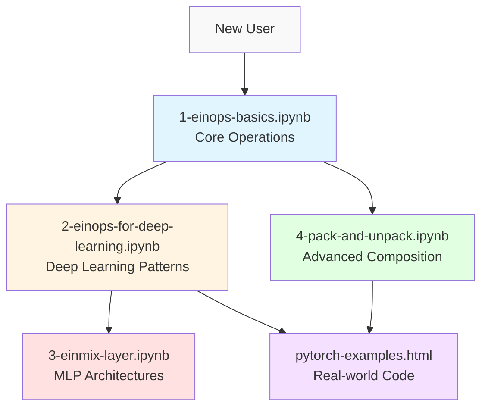
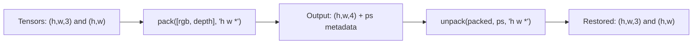
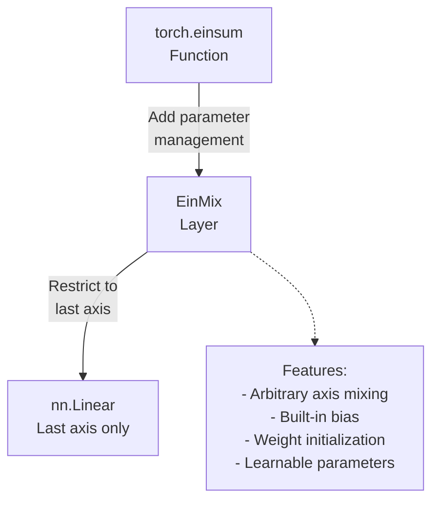
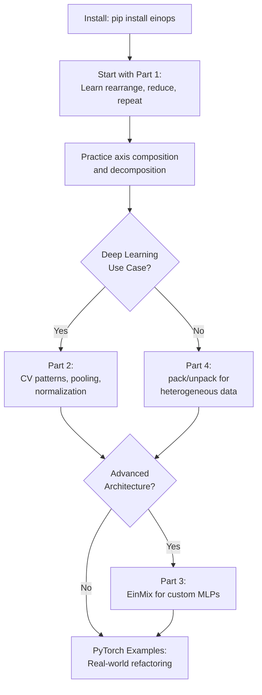

<!-- source: DeepWiki mcp.deepwiki.com · repo arogozhnikov/einops · page 7 Tutorials and Examples · fetched 2026-10-21 -->

# Tutorials and Examples

<details>
<summary>Relevant source files</summary>

The following files were used as context for generating this wiki page:

- [.pre-commit-config.yaml](.pre-commit-config.yaml)
- [README.md](README.md)
- [docs/1-einops-basics.ipynb](docs/1-einops-basics.ipynb)
- [docs/2-einops-for-deep-learning.ipynb](docs/2-einops-for-deep-learning.ipynb)
- [docs/3-einmix-layer.ipynb](docs/3-einmix-layer.ipynb)
- [docs/4-pack-and-unpack.ipynb](docs/4-pack-and-unpack.ipynb)
- [docs/utils/__init__.py](docs/utils/__init__.py)

</details>


## Purpose and Scope

This section provides comprehensive learning materials for einops through interactive Jupyter notebooks and practical code examples. The tutorials progress from fundamental tensor operations to advanced deep learning applications, demonstrating einops capabilities across multiple frameworks. For API reference documentation, see [Core API Reference](#2). For layer integration details, see [Layer Integration](#3). For advanced performance topics, see [Advanced Topics](#5).

## Tutorial Learning Path



**Sources:** [README.md:92-101](), [docs/1-einops-basics.ipynb:1-30](), [docs/2-einops-for-deep-learning.ipynb:1-16]()

## Tutorial Structure Overview

| Tutorial | File | Difficulty | Framework | Key Concepts |
|----------|------|-----------|-----------|--------------|
| Part 1: Basics | `1-einops-basics.ipynb` | Beginner | NumPy | `rearrange`, `reduce`, `repeat`, axis composition |
| Part 2: Deep Learning | `2-einops-for-deep-learning.ipynb` | Intermediate | PyTorch/TensorFlow | Pooling, normalization, stacking, gradients |
| Part 3: EinMix | `3-einmix-layer.ipynb` | Advanced | PyTorch | MLPMixer, ViT, custom architectures |
| Part 4: Pack/Unpack | `4-pack-and-unpack.ipynb` | Intermediate | NumPy | Heterogeneous tensors, auto-batching |
| PyTorch Examples | `pytorch-examples.html` | All Levels | PyTorch | Before/after comparisons |

**Sources:** [README.md:92-99](), [docs/1-einops-basics.ipynb:1-30](), [docs/2-einops-for-deep-learning.ipynb:1-16](), [docs/3-einmix-layer.ipynb:1-13](), [docs/4-pack-and-unpack.ipynb:1-18]()

## Part 1: Einops Basics Tutorial

**Location:** [docs/1-einops-basics.ipynb:1-1560]()

### Content Overview

The fundamentals tutorial introduces core einops operations through visual examples using NumPy arrays displayed as images. The notebook demonstrates:

- **Axis Reordering:** Transposing with semantic names (`'b c h w -> b h w c'`)
- **Axis Composition:** Combining axes (`'b h w c -> (b h) w c'` for vertical stacking)
- **Axis Decomposition:** Splitting axes (`'b c (h h2) (w w2) -> b (c h2 w2) h w'` for space-to-depth)
- **Reduction Operations:** Aggregating along axes (`reduce(x, 'b c h w -> b c', 'mean')`)
- **Repetition Operations:** Broadcasting with explicit patterns (`repeat(x, 'h w -> h w c', c=3)`)

### Interactive Features

The tutorial uses custom IPython display formatters defined in [docs/utils/__init__.py:7-23]() to render NumPy arrays as inline images, making tensor transformations visually intuitive. The `guess()` function at [docs/utils/__init__.py:37-41]() provides hover-to-reveal answers for shape prediction exercises.

### Key Code Examples

```python
# Composition: Stack images vertically
rearrange(ims, 'b h w c -> (b h) w c')

# Decomposition: Extract color channels
rearrange(ims, 'b h w c -> b h w c')

# Reduction: Average pooling
reduce(x, 'b c (h h2) (w w2) -> b c h w', 'mean', h2=2, w2=2)
```

**Sources:** [docs/1-einops-basics.ipynb:156-157](), [docs/1-einops-basics.ipynb:226-231](), [docs/1-einops-basics.ipynb:447-448]()

## Part 2: Deep Learning Applications Tutorial

**Location:** [docs/2-einops-for-deep-learning.ipynb:1-1048]()

### Framework Selection

The tutorial supports both PyTorch and TensorFlow through a configurable backend selection at [docs/2-einops-for-deep-learning.ipynb:64-65](). This demonstrates einops' framework-agnostic design—the same operation code works identically across frameworks.

### Deep Learning Patterns Covered

#### 1. Gradient Compatibility
Demonstrates backpropagation through einops operations at [docs/2-einops-for-deep-learning.ipynb:172-195](), showing that `rearrange` and `reduce` are differentiable:

```python
y1 = reduce(y0, 'b c h w -> b c', 'max')
y2 = rearrange(y1, 'b c -> c b')
# Gradients flow back through both operations
```

#### 2. Common CV Operations
- **Flattening:** `'b c h w -> b (c h w)'` for FC layers [docs/2-einops-for-deep-learning.ipynb:278-280]()
- **Space-to-depth:** `'b c (h h1) (w w1) -> b (h1 w1 c) h w'` [docs/2-einops-for-deep-learning.ipynb:318-319]()
- **Global pooling:** `reduce(x, 'b c h w -> b c', 'mean')` [docs/2-einops-for-deep-learning.ipynb:401-402]()
- **Max pooling:** `reduce(x, 'b c (h h1) (w w1) -> b c h w', 'max', h1=2, w1=2)` [docs/2-einops-for-deep-learning.ipynb:447-448]()

#### 3. Normalization Patterns
Per-channel mean normalization with keepdims behavior:
```python
# Per-image normalization
y = x - reduce(x, 'b c h w -> b c 1 1', 'mean')

# Batch normalization
y = x - reduce(x, 'b c h w -> 1 c 1 1', 'mean')
```

**Sources:** [docs/2-einops-for-deep-learning.ipynb:580-581](), [docs/2-einops-for-deep-learning.ipynb:626-627]()

#### 4. Stacking and Concatenation
Demonstrates list-to-tensor operations with controlled axis ordering:
```python
# Stack along first axis
rearrange(list_of_tensors, 'b c h w -> b h w c')

# Concatenate along last axis
rearrange(list_of_tensors, 'b c h w -> h w (b c)')
```

**Sources:** [docs/2-einops-for-deep-learning.ipynb:691-692](), [docs/2-einops-for-deep-learning.ipynb:810-811]()

#### 5. Layer Integration
Shows usage of `einops.layers.torch.Rearrange` and `einops.layers.torch.Reduce` within `nn.Sequential` for building models without custom forward methods.

**Sources:** [docs/2-einops-for-deep-learning.ipynb:897-931]()

## Part 3: Pack and Unpack Tutorial

**Location:** [docs/4-pack-and-unpack.ipynb:1-618]()

### Core Concepts

The `pack` and `unpack` operations handle heterogeneous tensor dimensions through a reversible packing mechanism. Unlike `concatenate` or `stack`, these operations:
- Accept tensors of different dimensionality
- Store metadata (`ps`) for perfect reconstruction
- Support compact pattern syntax without arrows

### Pattern Syntax



**Pattern interpretation for `'h w *'`:**
- `h`, `w`: Shared axes across all inputs (must match)
- `*`: Variable wildcard axis where packing occurs
- Output is always 3-dimensional regardless of input dimensionality

**Sources:** [docs/4-pack-and-unpack.ipynb:74-82](), [docs/4-pack-and-unpack.ipynb:88-94]()

### Practical Applications

#### 1. Multi-Modal Stacking
Combining RGB and depth images with different dimensionality:
```python
image_rgb = np.random.random([h, w, 3])  # 3D
image_depth = np.random.random([h, w])    # 2D
image_rgbd, ps = pack([image_rgb, image_depth], 'h w *')  # Result: (h, w, 4)
```

**Sources:** [docs/4-pack-and-unpack.ipynb:77-81]()

#### 2. Auto-Batching
Universal prediction function handling single samples or batches at [docs/4-pack-and-unpack.ipynb:260-264]():
```python
def universal_predict(x):
    x_packed, ps = pack([x], '* h w c')
    predictions_packed = image_classifier(x_packed)
    [predictions] = unpack(predictions_packed, ps, '* cls')
    return predictions
```

Works with shapes: `(h,w,c)`, `(b,h,w,c)`, or `(b,t,h,w,c)`.

#### 3. Vision Transformer Class Token
Mixing class tokens with patch tokens at [docs/4-pack-and-unpack.ipynb:402-405]():
```python
input_packed, ps = pack([class_tokens, patch_tokens], 'b * c')
output_packed = transformer_mock(input_packed)
class_token_emb, patch_tokens_emb = unpack(output_packed, ps, 'b * c_out')
```

**Sources:** [docs/4-pack-and-unpack.ipynb:402-408]()

#### 4. Multi-Output Detection
Unpacking detection model outputs at [docs/4-pack-and-unpack.ipynb:543-545]():
```python
confidence, bbox_x_shift, bbox_y_shift, bbox_w, bbox_h, mask_logits, class_logits \
    = unpack(model_output, [[]] * 5 + [[mask_h, mask_w], [n_classes]], 'b h w *')
```

This replaces manual slicing and reshaping with automatic shape validation.

**Sources:** [docs/4-pack-and-unpack.ipynb:543-545]()

## Part 4: EinMix Layer Tutorial

**Location:** [docs/3-einmix-layer.ipynb:1-470]()

### EinMix Overview

`EinMix` is a generalized linear layer that supports mixing arbitrary axes, not just the last dimension. It's designed for modern MLP architectures like MLPMixer, Vision Permutator, and custom attention mechanisms.



**Key differences from `einsum`:**
- Manages learnable weights and biases
- Weights are not in the pattern string
- Includes automatic initialization

**Sources:** [docs/3-einmix-layer.ipynb:42-73]()

### Architecture Implementations

#### 1. MLPMixer TokenMixer

Original implementation at [docs/3-einmix-layer.ipynb:109-125]() requires manual transpositions. EinMix version at [docs/3-einmix-layer.ipynb:149-158]():

```python
def TokenMixer(num_features: int, n_patches: int, expansion_factor: int, dropout: float):
    n_hidden = n_patches * expansion_factor
    return nn.Sequential(
        nn.LayerNorm(num_features),
        Mix('b hw c -> b hid c', weight_shape='hw hid', bias_shape='hid', 
            hw=n_patches, hidden=n_hidden),
        nn.GELU(),
        nn.Dropout(dropout),
        Mix('b hid c -> b hw c', weight_shape='hid hw', bias_shape='hw',  
            hw=n_patches, hidden=n_hidden),
        nn.Dropout(dropout),
    )
```

Eliminates the need for explicit `transpose` operations by specifying desired axis directly.

**Sources:** [docs/3-einmix-layer.ipynb:149-158]()

#### 2. Vision Transformer Patch Embeddings

Combines patch splitting and linear projection in a single operation at [docs/3-einmix-layer.ipynb:245-247]():

```python
def patcher(patch_size=16, in_channels=3, num_features=128):
    return Mix('b c_in (h hp) (w wp) -> b (h w) c', 
               weight_shape='c_in hp wp c', bias_shape='c',
               c=num_features, hp=patch_size, wp=patch_size, c_in=in_channels)
```

This replaces the Conv2d-based approach at [docs/3-einmix-layer.ipynb:206-216]() with a more explicit pattern.

**Sources:** [docs/3-einmix-layer.ipynb:245-247](), [docs/3-einmix-layer.ipynb:195-216]()

#### 3. Vision Permutator

Simplifies the complex reshape chains at [docs/3-einmix-layer.ipynb:271-295]() to three readable `Mix` layers at [docs/3-einmix-layer.ipynb:318-332]():

```python
class WeightedPermuteMLP_new(nn.Module):
    def __init__(self, H, W, C, seg_len):
        super().__init__()
        self.mlp_c = Mix('b h w c -> b h w c0', weight_shape='c c0', bias_shape='c0',
                         c=C, c0=C)
        self.mlp_h = Mix('b h w (n c) -> b h0 w (n c0)', weight_shape='h c h0 c0', 
                         bias_shape='h0 c0', h=H, h0=H, c=seg_len, c0=seg_len)
        self.mlp_w = Mix('b h w (n c) -> b h w0 (n c0)', weight_shape='w c w0 c0', 
                         bias_shape='w0 c0', w=W, w0=W, c=seg_len, c0=seg_len)
```

Each layer mixes a different dimension (channels, height, width) with segment-based grouping.

**Sources:** [docs/3-einmix-layer.ipynb:318-332]()

#### 4. Multi-Head Attention

Fuses Q/K/V projections with transpositions at [docs/3-einmix-layer.ipynb:355-366]():

```python
class MultiheadAttention(nn.Module):
    def __init__(self, dim_input, n_heads, head_dim):
        super().__init__()
        self.input_to_qkv = Mix('b t c -> qkv b h t hid', 'c qkv h hid',
                                c=dim_input, qkv=3, h=n_heads, hid=head_dim)
        self.out_proj = Mix('b h t hid -> b t c', 'h hid c',
                            h=n_heads, hid=head_dim, c=dim_input)
    
    def forward(self, x):
        q, k, v = self.input_to_qkv(x)  # Single operation
        return self.out_proj(F.scaled_dot_product_attention(q, k, v))
```

Produces correctly-ordered tensors for `F.scaled_dot_product_attention` without manual transpositions.

**Sources:** [docs/3-einmix-layer.ipynb:355-366]()

### Advanced Mixing Patterns

The tutorial discusses unexplored mixing possibilities at [docs/3-einmix-layer.ipynb:388-438]():

- **Local patch mixing:** `'b c (h hI) (w wI) -> b c (h hO) (w wO)'` with `weight_shape='c hI wI hO wO'`
- **Subgrid mixing:** `'b c (hI h) (wI w) -> b c (hO h) (wO w)'` for global information flow without attention
- **Grouped channel mixing:** Separate linear layers per channel group in a single operation

**Sources:** [docs/3-einmix-layer.ipynb:404-427]()

## Tutorial Execution Environment

### Running Notebooks

All tutorials are Jupyter notebooks that can be executed:
1. **Locally:** Clone repository and run `jupyter notebook docs/`
2. **In Browser:** Via [einops playground](https://arogozhnikov.github.io/jupyterlite/lab/index.html?download_github_folder=arogozhnikov/einops/docs) (JupyterLite) mentioned at [README.md:32]()
3. **Via Documentation:** Rendered at [einops.rocks](https://einops.rocks)

### Framework Installation

Each notebook includes installation cells. Example from [docs/1-einops-basics.ipynb:52-54]():
```python
%pip install einops numpy pillow -q
```

Deep learning tutorial supports framework switching at [docs/2-einops-for-deep-learning.ipynb:64-94]() with automatic backend configuration.

**Sources:** [README.md:32](), [docs/1-einops-basics.ipynb:52-54](), [docs/2-einops-for-deep-learning.ipynb:64-94]()

## Tutorial Utility Functions

### Display Formatters

The [docs/utils/__init__.py:7-23]() module provides `display_np_arrays_as_images()` which registers custom IPython formatters:
- Converts NumPy arrays to PNG images for 2D/3D tensors
- Enables visual feedback for tensor operations
- Automatically clips values to [0, 1] range and scales to uint8

### Interactive Exercises

The `guess()` function at [docs/utils/__init__.py:37-41]() creates hover-to-reveal answers using CSS:
```python
def guess(x):
    display_html(
        _style_inline + f"<h4>Answer is: <span class='einops-answer'>{tuple(x)}</span> (hover to see)</h4>",
        raw=True,
    )
```

This encourages users to predict shapes before checking answers.

**Sources:** [docs/utils/__init__.py:7-41]()

## Community Examples Reference

The README at [README.md:99]() links to PyTorch examples showing before/after comparisons of real-world code. This demonstrates practical improvements in readability and correctness when using einops for models like ResNet, RNN, ShuffleNet, and FastText.

These examples are part of the einops documentation but covered in detail in child page [PyTorch Examples Collection](#7.3).

**Sources:** [README.md:99]()

## Tutorial Progression Summary



**Recommended order:**
1. Complete Part 1 for foundational understanding
2. Choose Part 2 (deep learning) or Part 4 (composition) based on use case
3. Explore Part 3 (EinMix) for advanced architectures
4. Review PyTorch examples for practical patterns

**Sources:** [README.md:92-99](), [docs/1-einops-basics.ipynb:1-30](), [docs/2-einops-for-deep-learning.ipynb:1-16](), [docs/3-einmix-layer.ipynb:1-13](), [docs/4-pack-and-unpack.ipynb:1-18]()

---

