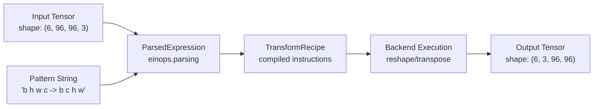
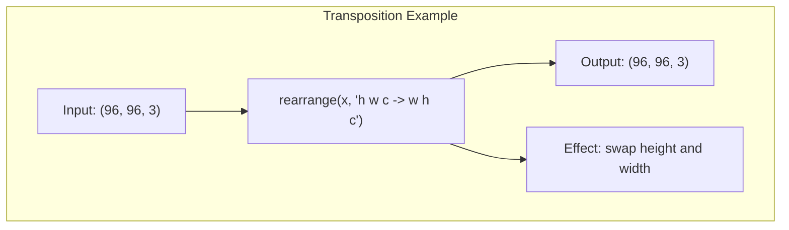
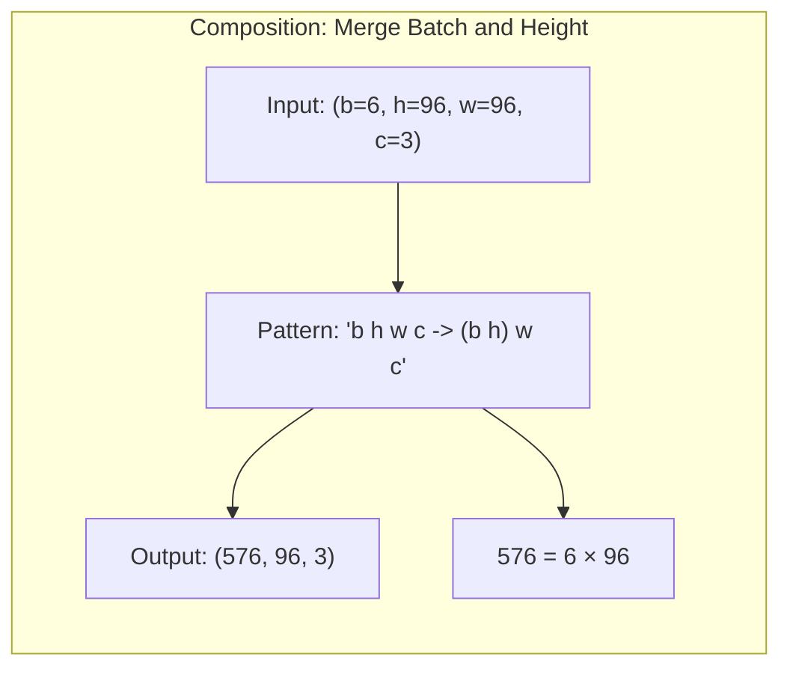
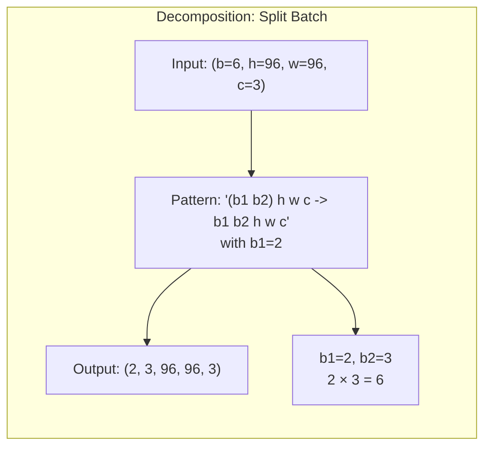
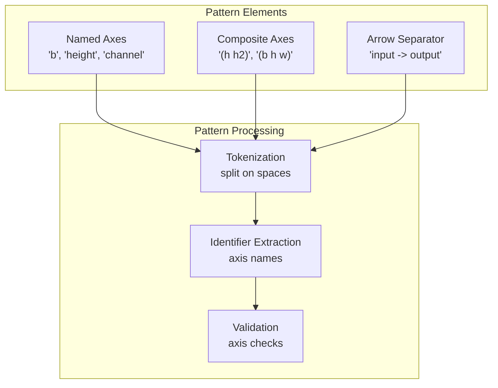
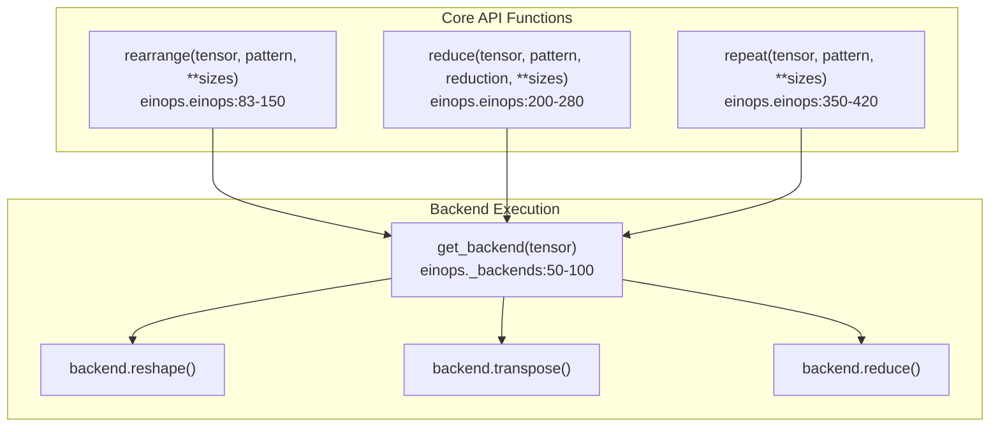

<!-- source: DeepWiki mcp.deepwiki.com · repo arogozhnikov/einops · page 7.1 Basic Tensor Operations Tutorial · fetched 2026-10-21 -->

# Basic Tensor Operations Tutorial

<details>
<summary>Relevant source files</summary>

The following files were used as context for generating this wiki page:

- [README.md](README.md)
- [docs/1-einops-basics.ipynb](docs/1-einops-basics.ipynb)
- [docs/4-pack-and-unpack.ipynb](docs/4-pack-and-unpack.ipynb)

</details>


## Purpose and Scope

This tutorial introduces the fundamental tensor manipulation operations in einops: `rearrange`, `reduce`, and `repeat`. Through practical examples with image tensors, you will learn how to use einops pattern notation to perform reshaping, transposition, composition, and decomposition of tensor axes without writing complex indexing code.

For advanced topics like pack/unpack operations and EinMix layers, see [Pack/Unpack and EinMix Tutorials](#7.4). For deep learning-specific applications, see [Deep Learning Applications Tutorial](#7.2).

**Sources:** [docs/1-einops-basics.ipynb:5-29](), [README.md:107-118]()

## Understanding Pattern Notation

Einops uses a declarative pattern notation where you specify the transformation by describing the input and output shapes. Patterns consist of axis names separated by spaces, with the input and output separated by `->`.



**Key Concepts:**
- **Named axes**: Use letters or words like `b`, `h`, `width`, `channel` to identify dimensions
- **Composition**: Group axes with parentheses like `(b h)` to merge them
- **Decomposition**: Split axes like `(h h2)` with explicit sizes `h2=2`
- **Order matters**: The sequence of axes determines the memory layout

**Sources:** [einops/einops.py:1-100](), [einops/parsing.py:1-50](), [README.md:196-231]()

## The Rearrange Operation

### Simple Transposition

The most basic operation is swapping axes. This is equivalent to `numpy.transpose()` or `torch.permute()` but with readable axis names.



**Example from tutorial:**
```python
# Swap height and width axes
rearrange(ims[0], "h w c -> w h c")

# Same operation with verbose names  
rearrange(ims[0], "height width color -> width height color")
```

The pattern `"h w c -> w h c"` means:
- Input has 3 dimensions: height, width, channels
- Output reorders them: width, height, channels
- No data is lost, only memory layout changes

**Sources:** [docs/1-einops-basics.ipynb:163-202](), [einops/einops.py:83-150]()

### Axis Composition

Composition merges multiple axes into one, effectively reshaping the tensor. The new axis length is the product of the merged dimensions.



**Example from tutorial:**
```python
# Merge batch dimension with height
rearrange(ims, "b h w c -> (b h) w c")
# Result shape: (576, 96, 3) where 576 = 6 * 96

# Merge batch dimension with width  
rearrange(ims, "b h w c -> h (b w) c")
# Result shape: (96, 576, 3) where 576 = 6 * 96

# Flatten all dimensions
rearrange(ims, "b h w c -> (b h w c)")  
# Result shape: (165888,) where 165888 = 6 * 96 * 96 * 3
```

**Key insight:** Parentheses `()` in the output pattern indicate composition. The dimensions are multiplied together.

**Sources:** [docs/1-einops-basics.ipynb:213-304](), [README.md:110-118]()

### Axis Decomposition

Decomposition splits one axis into multiple axes. You must explicitly specify at least one of the split sizes.



**Example from tutorial:**
```python
# Split batch dimension into b1=2 and b2=3
rearrange(ims, "(b1 b2) h w c -> b1 b2 h w c", b1=2)
# Result shape: (2, 3, 96, 96, 3)

# Decompose width into w and w2
rearrange(ims, "b h (w w2) c -> b h w w2 c", w2=2)
# Result shape: (6, 96, 48, 2, 3) where 48 * 2 = 96
```

**Key insight:** Parentheses `()` in the input pattern indicate decomposition. Use keyword arguments to specify split sizes.

**Sources:** [docs/1-einops-basics.ipynb:318-361](), [einops/parsing.py:150-250]()

### Combined Operations

You can combine composition and decomposition in a single operation for complex transformations.

```python
# Split batch into 2×3 grid, then merge with spatial dimensions
rearrange(ims, "(b1 b2) h w c -> (b1 h) (b2 w) c", b1=2)
# Input: (6, 96, 96, 3)
# After decomposition: (2, 3, 96, 96, 3)  
# After composition: (192, 288, 3)

# Width-to-height transformation
rearrange(ims, "b h (w w2) c -> (h w2) (b w) c", w2=2)
# Splits width by 2, moves w2 to height, merges batch with remaining width
```

**Sources:** [docs/1-einops-basics.ipynb:363-409]()

### Order of Axes Matters

The order you specify axes determines the resulting memory layout, even if the shape is the same.

```python
# Example 1: merge batch with height, then with width
rearrange(ims, "(b1 b2) h w c -> (b1 h) (b2 w) c", b1=2)
# Images arranged in 2 rows, 3 columns

# Example 2: merge batch with width, then with height  
rearrange(ims, "(b1 b2) h w c -> (b2 h) (b1 w) c", b1=2)
# Images arranged differently - 3 rows, 2 columns
```

The pattern determines which axes are adjacent in memory, affecting iteration order and potentially cache performance.

**Sources:** [docs/1-einops-basics.ipynb:415-409]()

## Pattern Syntax Components



**Syntax Reference:**
| Element | Example | Purpose |
|---------|---------|---------|
| Named axis | `b`, `height` | Identifies a dimension |
| Composition | `(b h w)` | Merges multiple axes |
| Decomposition | `(h h2)` | Splits an axis |
| Arrow | `->` | Separates input from output |
| Size specification | `h2=2` | Provides split dimensions |

**Sources:** [einops/parsing.py:50-150](), [README.md:223-245]()

## Reduce Operation

The `reduce` operation combines rearrangement with aggregation (reduction) along specified axes.

```python
# Average pooling: reduce spatial dimensions by factor of 2
output = reduce(input_tensor, 'b c (h h2) (w w2) -> b c h w', 'mean', h2=2, w2=2)

# Global average pooling: remove spatial dimensions entirely
output = reduce(input_tensor, 'b c h w -> b c', 'mean')

# Other reduction types: 'max', 'min', 'sum', 'prod'
output = reduce(input_tensor, 'b c h w -> b c', 'max')
```

**Available reductions:** `mean`, `min`, `max`, `sum`, `prod`

**Sources:** [README.md:115](), [docs/2-einops-for-deep-learning.ipynb:50-150]()

## Repeat Operation

The `repeat` operation copies data along new or existing axes.

```python
# Create new axis and repeat along it
output = repeat(input_tensor, 'h w -> h w c', c=3)
# Input: (96, 96) → Output: (96, 96, 3)

# Tile along existing axis  
output = repeat(input_tensor, 'h w -> h (tile w)', tile=2)
# Input: (96, 96) → Output: (96, 192)

# Repeat along batch dimension
output = repeat(input_tensor, 'h w c -> batch h w c', batch=32)
# Input: (96, 96, 3) → Output: (32, 96, 96, 3)
```

**Sources:** [README.md:117](), [README.md:283-296]()

## API Function Reference

The three core operations are imported from `einops`:

```python
from einops import rearrange, reduce, repeat

# All three functions follow similar signatures:
# operation(tensor, pattern, **axes_lengths)
# operation(tensor, pattern, reduction_type, **axes_lengths)  # reduce only
```



**Sources:** [einops/__init__.py:1-50](), [einops/einops.py:1-500](), [einops/_backends.py:1-100]()

## Next Steps

This tutorial covered the fundamentals of einops tensor operations. For more advanced usage:

- **Deep learning patterns**: Batch normalization, attention mechanisms, convolutions → See [Deep Learning Applications Tutorial](#7.2)
- **PyTorch-specific examples**: Model integration, training loops → See [PyTorch Examples Collection](#7.3)  
- **Packing heterogeneous tensors**: Variable-length sequences, multi-modal data → See [Pack/Unpack and EinMix Tutorials](#7.4)

**Sources:** [docs/1-einops-basics.ipynb:1-500](), [README.md:92-108]()

---

