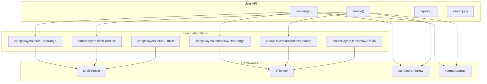
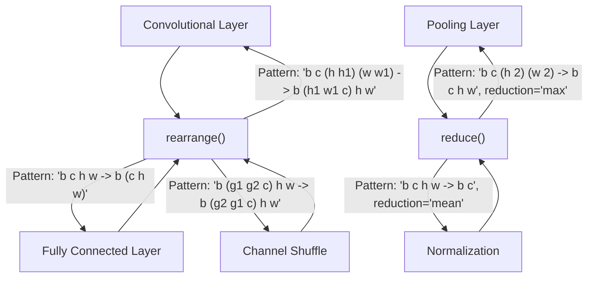

<!-- source: DeepWiki mcp.deepwiki.com · repo arogozhnikov/einops · page 7.2 Deep Learning Applications Tutorial · fetched 2026-10-21 -->

# Deep Learning Applications Tutorial

<details>
<summary>Relevant source files</summary>

The following files were used as context for generating this wiki page:

- [.pre-commit-config.yaml](.pre-commit-config.yaml)
- [README.md](README.md)
- [docs/2-einops-for-deep-learning.ipynb](docs/2-einops-for-deep-learning.ipynb)
- [docs/3-einmix-layer.ipynb](docs/3-einmix-layer.ipynb)
- [docs/utils/__init__.py](docs/utils/__init__.py)

</details>


This page provides a technical walkthrough of how einops is applied in deep learning, focusing on practical tensor manipulations, common neural network operations, and integration with major frameworks. The content is based on the official tutorial notebook [docs/2-einops-for-deep-learning.ipynb](), and is intended for users who want to understand how to use einops in real-world deep learning code.

For foundational concepts and pattern syntax, see pages [1.2] and [2.4].

---

## System Overview: einops in Deep Learning

Einops enables concise, framework-agnostic tensor operations for deep learning. Its pattern-based API (`rearrange`, `reduce`, `repeat`) and native layer integrations allow for readable and maintainable code across PyTorch, TensorFlow, and other frameworks.

### Diagram: "Deep Learning Operations and Code Entities"


Sources: [docs/2-einops-for-deep-learning.ipynb:1-16](), [docs/2-einops-for-deep-learning.ipynb:1125-1169]()

## Framework Selection and Setup

Einops supports multiple deep learning frameworks. The tutorial demonstrates switching between PyTorch and TensorFlow, and shows that einops operations are compatible with both.

- To select a framework, set a variable (e.g., `flavour = "pytorch"` or `"tensorflow"`).
- Tensors are created using the selected framework's API.
- All einops operations (`rearrange`, `reduce`, etc.) work natively with the selected tensor type.

**Key code entities:**
- `rearrange`, `reduce` from `einops`
- `torch.Tensor`, `tf.Tensor`

Sources: [docs/2-einops-for-deep-learning.ipynb:19-96]()

---

## Basic Tensor Operations in Deep Learning

### Format Conversions (BCHW ↔ BHWC)

Image data may be stored in different formats depending on the framework. Einops allows explicit and readable conversion between formats.

| Operation | Pattern | Example |
|-----------|---------|---------|
| BCHW → BHWC | `'b c h w -> b h w c'` | `rearrange(x, 'b c h w -> b h w c')` |
| BHWC → BCHW | `'b h w c -> b c h w'` | `rearrange(x, 'b h w c -> b c h w')` |

Sources: [docs/2-einops-for-deep-learning.ipynb:127-154]()

### Backpropagation Compatibility

Einops operations are differentiable and can be used in computation graphs. Gradients flow through all einops operations as expected.

- Example: chaining `reduce` and `rearrange` operations, then calling `.backward()` (PyTorch) or using `tf.GradientTape` (TensorFlow).

Sources: [docs/2-einops-for-deep-learning.ipynb:155-196]()

## Common Deep Learning Operations with einops

Einops can express a wide range of tensor operations used in neural network models. The following table summarizes key operations and their einops patterns:

| Operation                | Pattern Example                                      | Description                                 |
|--------------------------|------------------------------------------------------|---------------------------------------------|
| Flattening               | `'b c h w -> b (c h w)'`                             | Prepare for fully connected layers          |
| Space-to-Depth           | `'b c (h h1) (w w1) -> b (h1 w1 c) h w'`             | Rearrangement for sub-pixel convolutions    |
| Depth-to-Space           | `'b (h1 w1 c) h w -> b c (h h1) (w w1)'`             | Inverse of space-to-depth                   |
| Global Average Pooling   | `'b c h w -> b c'` with reduction `"mean"`           | Reduce spatial dimensions                   |
| Max Pooling (2x2)        | `'b c (h 2) (w 2) -> b c h w'` with reduction `"max"`| Pooling over spatial windows                |
| Channel Shuffle          | `'b (g1 g2 c) h w -> b (g2 g1 c) h w'`               | ShuffleNet-style channel mixing             |
| Per-channel Normalization| `'b c h w -> b c 1 1'` with reduction `"mean"`       | Compute per-channel means                   |

### Diagram: "Mapping Deep Learning Operations to einops Patterns"


Sources: [docs/2-einops-for-deep-learning.ipynb:254-896]()

---

### Additional Operations

- **Squeeze/Unsqueeze**: Use empty composition `()` or `1` in patterns to add or remove singleton axes.
- **Stacking/Concatenation**: Use `rearrange` to stack or concatenate lists of tensors along arbitrary axes.
- **Split/Unpack**: Use pattern decomposition to split a dimension into multiple axes.

Sources: [docs/2-einops-for-deep-learning.ipynb:516-812]()

## Layer Integration and Framework Support

Einops provides native layer classes for major deep learning frameworks. These layers precompute transformation recipes for static graph and JIT compatibility.

### Diagram: "Layer Classes and Code Entities"

```mermaid
flowchart TB
    subgraph "einops.layers.torch"
        TorchRearrange["Rearrange (nn.Module)"]
        TorchReduce["Reduce (nn.Module)"]
        TorchEinMix["EinMix (nn.Module)"]
    end
    subgraph "einops.layers.tensorflow"
        KerasRearrange["Rearrange (Layer)"]
        KerasReduce["Reduce (Layer)"]
        KerasEinMix["EinMix (Layer)"]
    end
    subgraph "einops.layers.flax"
        FlaxRearrange["Rearrange (Module)"]
        FlaxReduce["Reduce (Module)"]
        FlaxEinMix["EinMix (Module)"]
    end

    TorchRearrange -->|"uses"| Rearrange
    TorchReduce -->|"uses"| Reduce
    TorchEinMix -->|"uses"| "einsum"
    KerasRearrange -->|"uses"| Rearrange
    KerasReduce -->|"uses"| Reduce
    KerasEinMix -->|"uses"| "einsum"
    FlaxRearrange -->|"uses"| Rearrange
    FlaxReduce -->|"uses"| Reduce
    FlaxEinMix -->|"uses"| "einsum"
```
Sources: [docs/2-einops-for-deep-learning.ipynb:1125-1169]()

### Usage

- Layers can be used in `nn.Sequential` (PyTorch) or `tf.keras.Sequential` (TensorFlow) models.
- Layer classes are compatible with static graph tracing and JIT compilation.
- All layers are based on the same pattern syntax as the functional API.

Sources: [docs/2-einops-for-deep-learning.ipynb:1125-1169]()

## Practical Examples: Deep Learning Model Building Blocks

Einops can be used to refactor and clarify common deep learning model components. The following examples are based on the official tutorial and reference implementations.

### Example Table: Common Model Operations

| Model Component         | einops Pattern Example                        | Code Entity Reference |
|------------------------|-----------------------------------------------|----------------------|
| Flatten for FC         | `'b c h w -> b (c h w)'`                      | `einops.rearrange`   |
| Space-to-Depth         | `'b c (h h1) (w w1) -> b (h1 w1 c) h w'`      | `einops.rearrange`   |
| Depth-to-Space         | `'b (h1 w1 c) h w -> b c (h h1) (w w1)'`      | `einops.rearrange`   |
| Global Avg Pool        | `'b c h w -> b c'`, reduction=`"mean"`        | `einops.reduce`      |
| Max Pool (2x2)         | `'b c (h 2) (w 2) -> b c h w'`, reduction=`"max"` | `einops.reduce`  |
| Channel Shuffle        | `'b (g1 g2 c) h w -> b (g2 g1 c) h w'`        | `einops.rearrange`   |

Sources: [docs/2-einops-for-deep-learning.ipynb:254-896]()

---

### Example: Model Layer Integration

- Use `einops.layers.torch.Rearrange` and `einops.layers.torch.Reduce` in `nn.Sequential` models for PyTorch.
- Use `einops.layers.tensorflow.Rearrange` and `einops.layers.tensorflow.Reduce` in Keras models.

Sources: [docs/2-einops-for-deep-learning.ipynb:1125-1169]()

## Performance Considerations

One concern with einops might be performance overhead. Tests show that there's minimal to no performance difference between original implementations and einops versions for common operations:

| Implementation | Performance |
|----------------|-------------|
| Original ResMLP | ~28 ms per batch |
| EinMix ResMLP | ~26 ms per batch |
| Original Vision Permutator | ~90 ms per batch |
| EinMix Vision Permutator | ~91 ms per batch |

Sources: [docs/3-einmix-layer.ipynb:275-307](), [docs/3-einmix-layer.ipynb:581-610]()

## Summary

Einops brings several advantages to deep learning workflows:

1. **Readability**: Operations are expressed in a consistent, self-documenting pattern syntax
2. **Framework Agnosticism**: Same code works across PyTorch, TensorFlow, JAX, and other frameworks
3. **Expressiveness**: Complex operations like space-to-depth become intuitive one-liners
4. **Advanced Architectures**: EinMix layer enables concise implementations of modern MLP architectures

By adopting einops for tensor manipulations in deep learning code, developers can create more maintainable and understandable implementations without sacrificing performance.

---

