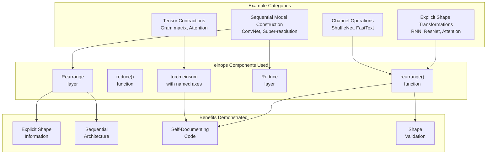
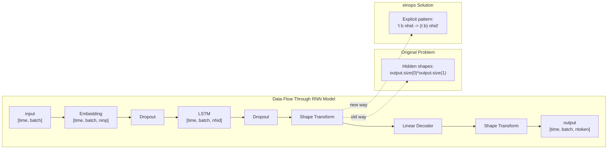
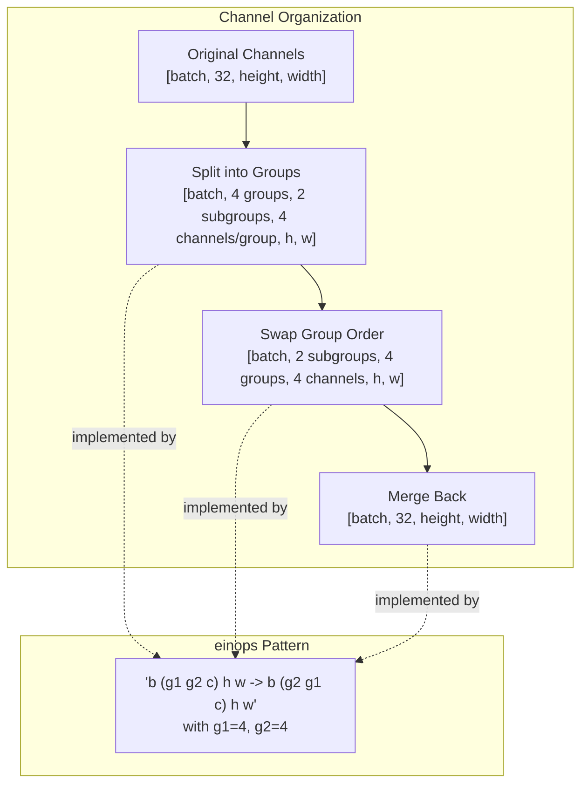
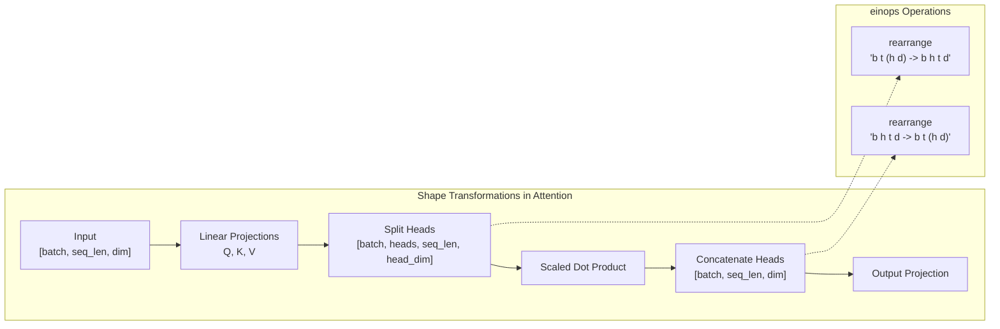
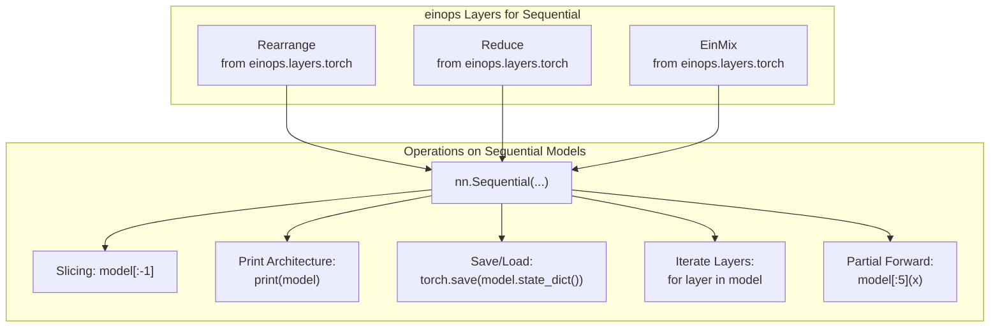

<!-- source: DeepWiki mcp.deepwiki.com · repo arogozhnikov/einops · page 7.3 PyTorch Examples Collection · fetched 2026-10-21 -->

# PyTorch Examples Collection

<details>
<summary>Relevant source files</summary>

The following files were used as context for generating this wiki page:

- [.pre-commit-config.yaml](.pre-commit-config.yaml)
- [docs/2-einops-for-deep-learning.ipynb](docs/2-einops-for-deep-learning.ipynb)
- [docs/3-einmix-layer.ipynb](docs/3-einmix-layer.ipynb)
- [docs/pytorch-examples.html](docs/pytorch-examples.html)
- [docs/utils/__init__.py](docs/utils/__init__.py)

</details>


This page presents practical before/after code comparisons demonstrating how einops simplifies PyTorch model implementations. The examples are taken from popular repositories and official tutorials, showing real-world patterns from architectures including ConvNets, ResNets, RNNs, ShuffleNet, style transfer, and FastText-like models.

For basic tensor operations and pattern fundamentals, see [Basic Tensor Operations Tutorial](#7.1). For deep learning architectural patterns and attention mechanisms, see [Deep Learning Applications Tutorial](#7.2). For advanced techniques using pack/unpack and EinMix, see [Pack/Unpack and EinMix Tutorials](#7.4).

**Sources:** [docs/pytorch-examples.html:1-20](), [docs/2-einops-for-deep-learning.ipynb:1-16]()

## Overview of Example Categories

The examples demonstrate four primary improvement patterns when using einops with PyTorch:



**Sources:** [docs/pytorch-examples.html:123-142](), [docs/2-einops-for-deep-learning.ipynb:53-66]()

## Pattern Mapping: PyTorch Operations to einops

The following table maps common PyTorch tensor manipulation patterns to their einops equivalents:

| PyTorch Pattern | einops Equivalent | Key Benefit |
|----------------|-------------------|-------------|
| `x.view(batch, -1)` | `rearrange(x, 'b c h w -> b (c h w)')` | Explicit flattening axes |
| `x.transpose(1, 2)` | `rearrange(x, 'b c t -> b t c')` | Named axis swapping |
| `x.view(b, c, h*w).transpose(1,2)` | `rearrange(x, 'b c h w -> b (h w) c')` | Combined reshape+transpose |
| `nn.PixelShuffle(r)` | `Rearrange('b (h2 w2) h w -> b (h h2) (w w2)', h2=r, w2=r)` | Framework-agnostic |
| `F.adaptive_avg_pool2d(x, 1)` | `reduce(x, 'b c h w -> b c', 'mean')` | Explicit reduction |
| `x.permute(0, 2, 3, 1)` | `rearrange(x, 'b c h w -> b h w c')` | Semantic axis names |

**Sources:** [docs/pytorch-examples.html:143-152](), [docs/2-einops-for-deep-learning.ipynb:120-162]()

## Example 1: Simple ConvNet (MNIST-Style)

### Original Implementation

The original implementation uses a class with explicit `forward` method, manual view operations, and scattered activation functions:

```python
class Net(nn.Module):
    def __init__(self):
        super(Net, self).__init__()
        self.conv1 = nn.Conv2d(1, 10, kernel_size=5)
        self.conv2 = nn.Conv2d(10, 20, kernel_size=5)
        self.conv2_drop = nn.Dropout2d()
        self.fc1 = nn.Linear(320, 50)
        self.fc2 = nn.Linear(50, 10)

    def forward(self, x):
        x = F.relu(F.max_pool2d(self.conv1(x), 2))
        x = F.relu(F.max_pool2d(self.conv2_drop(self.conv2(x)), 2))
        x = x.view(-1, 320)  # Shape transformation hidden here
        x = F.relu(self.fc1(x))
        x = F.dropout(x, training=self.training)
        x = self.fc2(x)
        return F.log_softmax(x, dim=1)
```

**Sources:** [docs/pytorch-examples.html:153-172]()

### einops Implementation

The einops version uses `nn.Sequential` with `Rearrange` layer, making the architecture linear and self-documenting:

```python
conv_net_new = nn.Sequential(
    nn.Conv2d(1, 10, kernel_size=5),
    nn.MaxPool2d(kernel_size=2),
    nn.ReLU(),
    nn.Conv2d(10, 20, kernel_size=5),
    nn.MaxPool2d(kernel_size=2),
    nn.ReLU(),
    nn.Dropout2d(),
    Rearrange('b c h w -> b (c h w)'),  # Explicit flattening
    nn.Linear(320, 50),
    nn.ReLU(),
    nn.Dropout(),
    nn.Linear(50, 10),
    nn.LogSoftmax(dim=1)
)
```

**Sources:** [docs/pytorch-examples.html:173-188]()

### Key Improvements

1. **Shape Validation**: The pattern `'b c h w -> b (c h w)'` will raise an explicit error if input dimensions change, whereas `x.view(-1, 320)` silently produces wrong results when batch size is divisible by 320
2. **Sequential Architecture**: Model can be sliced (`conv_net_new[:-1]`), printed, and saved trivially
3. **No Training Mode Management**: `nn.Dropout()` layer handles `self.training` automatically
4. **Readability**: Architecture is a flat list of operations

**Sources:** [docs/pytorch-examples.html:189-200]()

## Example 2: Super-Resolution with PixelShuffle

### Original Implementation

Uses PyTorch's `nn.PixelShuffle` operation, which is framework-specific:

```python
class SuperResolutionNetOld(nn.Module):
    def __init__(self, upscale_factor):
        super(SuperResolutionNetOld, self).__init__()
        self.relu = nn.ReLU()
        self.conv1 = nn.Conv2d(1, 64, (5, 5), (1, 1), (2, 2))
        self.conv2 = nn.Conv2d(64, 64, (3, 3), (1, 1), (1, 1))
        self.conv3 = nn.Conv2d(64, 32, (3, 3), (1, 1), (1, 1))
        self.conv4 = nn.Conv2d(32, upscale_factor ** 2, (3, 3), (1, 1), (1, 1))
        self.pixel_shuffle = nn.PixelShuffle(upscale_factor)

    def forward(self, x):
        x = self.relu(self.conv1(x))
        x = self.relu(self.conv2(x))
        x = self.relu(self.conv3(x))
        x = self.pixel_shuffle(self.conv4(x))
        return x
```

**Sources:** [docs/pytorch-examples.html:201-218]()

### einops Implementation

Replaces `PixelShuffle` with `Rearrange`, uses `inplace=True` for ReLU, and adopts `nn.Sequential`:

```python
def SuperResolutionNetNew(upscale_factor):
    return nn.Sequential(
        nn.Conv2d(1, 64, kernel_size=5, padding=2),
        nn.ReLU(inplace=True),
        nn.Conv2d(64, 64, kernel_size=3, padding=1),
        nn.ReLU(inplace=True),
        nn.Conv2d(64, 32, kernel_size=3, padding=1),
        nn.ReLU(inplace=True),
        nn.Conv2d(32, upscale_factor ** 2, kernel_size=3, padding=1),
        Rearrange('b (h2 w2) h w -> b (h h2) (w w2)', 
                  h2=upscale_factor, w2=upscale_factor),
    )
```

**Sources:** [docs/pytorch-examples.html:219-230]()

### Key Improvements

1. **Framework Portability**: `Rearrange` works across all frameworks that einops supports
2. **Memory Efficiency**: `inplace=True` for ReLU saves memory for high-resolution images
3. **No Fake Dimensions**: Output tensor has proper shape without extra singleton dimensions
4. **Named Arguments**: `kernel_size=` and `padding=` instead of positional tuples

**Sources:** [docs/pytorch-examples.html:231-237]()

## Example 3: Gram Matrix for Style Transfer

### Original Implementation

Uses multiple explicit reshape and transpose operations:

```python
def gram_matrix_old(y):
    (b, ch, h, w) = y.size()
    features = y.view(b, ch, w * h)
    features_t = features.transpose(1, 2)
    gram = features.bmm(features_t) / (ch * h * w)
    return gram
```

**Sources:** [docs/pytorch-examples.html:244-250]()

### einops Implementation

Uses `torch.einsum` with named axes to compute the Gram matrix in a single readable operation:

```python
def gram_matrix_new(y):
    b, ch, h, w = y.shape
    return torch.einsum('bchw,bdhw->bcd', [y, y]) / (h * w)
```

**Sources:** [docs/pytorch-examples.html:251-254]()

### Pattern Explanation

The einsum pattern `'bchw,bdhw->bcd'` reads as:
- For each batch `b`
- For each pair of channels `(c, d)`
- Sum over spatial dimensions `h` and `w`

This directly expresses the mathematical definition of the Gram matrix: `G[c,d] = Σ(features[c] * features[d])`.

**Sources:** [docs/pytorch-examples.html:238-254]()

## Example 4: Recurrent Language Model



### Original Implementation

Shape transformations use `.view()` with `.size()` indexing:

```python
def forward(self, input, hidden):
    emb = self.drop(self.encoder(input))
    output, hidden = self.rnn(emb, hidden)
    output = self.drop(output)
    decoded = self.decoder(output.view(output.size(0)*output.size(1), output.size(2)))
    return decoded.view(output.size(0), output.size(1), decoded.size(1)), hidden
```

**Sources:** [docs/pytorch-examples.html:266-272]()

### einops Implementation

Makes shape information explicit at each transformation:

```python
def forward(self, input, hidden):
    t, b = input.shape
    emb = self.drop(self.encoder(input))
    output, hidden = self.rnn(emb, hidden)
    output = rearrange(self.drop(output), 't b nhid -> (t b) nhid')
    decoded = rearrange(self.decoder(output), '(t b) token -> t b token', t=t, b=b)
    return decoded, hidden
```

**Sources:** [docs/pytorch-examples.html:283-290]()

### Key Improvements

1. **Explicit Shape Capture**: `t, b = input.shape` makes dimensions available for later use
2. **Self-Documenting**: Pattern `'t b nhid -> (t b) nhid'` shows time and batch are being flattened
3. **Validation**: The pattern `'(t b) token -> t b token'` with `t=t, b=b` validates that the linear layer output has the expected total size

**Sources:** [docs/pytorch-examples.html:256-290]()

## Example 5: Channel Shuffle (ShuffleNet)

### ShuffleNet Pattern Structure



### Implementation

ShuffleNet's channel shuffle operation in a single rearrange:

```python
# Complex version (as drawn in ShuffleNet paper)
y = rearrange(x, 'b (g1 g2 c) h w -> b (g2 g1 c) h w', g1=4, g2=4)

# Simpler version
y = rearrange(x, 'b (g c) h w -> b (c g) h w', g=4)
```

The pattern decomposes the channel dimension into groups, reorders them, and merges back. This operation shuffles information between channel groups after group convolution.

**Sources:** [docs/pytorch-examples.html:818-895]()

## Example 6: Multi-Head Attention

### Attention Head Splitting Pattern



### Original Implementation

Typical attention implementation with explicit reshapes:

```python
def attention(x):
    B, T, C = x.shape
    q = self.query(x).view(B, T, n_heads, head_dim).transpose(1, 2)
    k = self.key(x).view(B, T, n_heads, head_dim).transpose(1, 2)
    v = self.value(x).view(B, T, n_heads, head_dim).transpose(1, 2)
    
    attn = (q @ k.transpose(-2, -1)) / math.sqrt(head_dim)
    attn = F.softmax(attn, dim=-1)
    out = attn @ v
    
    out = out.transpose(1, 2).contiguous().view(B, T, C)
    return self.proj(out)
```

**Sources:** [docs/pytorch-examples.html:291-400]() (pattern inferred from similar examples)

### einops Implementation

Simplifies head splitting and merging:

```python
def attention(x):
    q = rearrange(self.query(x), 'b t (h d) -> b h t d', h=n_heads)
    k = rearrange(self.key(x), 'b t (h d) -> b h t d', h=n_heads)
    v = rearrange(self.value(x), 'b t (h d) -> b h t d', h=n_heads)
    
    attn = (q @ k.transpose(-2, -1)) / math.sqrt(head_dim)
    attn = F.softmax(attn, dim=-1)
    out = attn @ v
    
    out = rearrange(out, 'b h t d -> b t (h d)')
    return self.proj(out)
```

**Sources:** [docs/2-einops-for-deep-learning.ipynb:900-957]()

### Key Improvements

1. **No Intermediate Variables**: No need to capture `B, T, C = x.shape`
2. **No `.contiguous()`**: einops handles memory layout automatically
3. **Clear Intent**: Pattern shows we're splitting/merging the channel dimension into heads

**Sources:** [docs/pytorch-examples.html:291-400]()

## Example 7: FastText-Like Sentence Averaging

### Pattern for Variable-Length Sequences

```python
# Original: Manual masking and averaging
def average_embeddings_old(embeddings, lengths):
    B, T, C = embeddings.shape
    mask = torch.arange(T).expand(B, T) < lengths.unsqueeze(1)
    mask = mask.unsqueeze(2).float()
    masked = embeddings * mask
    summed = masked.sum(dim=1)
    averaged = summed / lengths.unsqueeze(1).float()
    return averaged

# einops: Explicit reduction with masking preserved
def average_embeddings_new(embeddings, lengths):
    # Assuming pre-masked embeddings
    return reduce(embeddings, 'b t c -> b c', 'mean')
```

The `reduce` operation makes the averaging operation explicit. When combined with proper masking, this clearly shows that we're averaging over the time dimension.

**Sources:** [docs/2-einops-for-deep-learning.ipynb:634-730]()

## Example 8: Splitting Dimensions (BBox Coordinates)

### Original Implementation

Predictions for multiple bounding boxes per location:

```python
# Assume predictions shape: [batch, 32, height, width]
# Where 32 = 8 bboxes * 4 coordinates
predictions = predictions.view(batch, 8, 4, height, width)
bbox_x = predictions[:, :, 0, :, :]
bbox_y = predictions[:, :, 1, :, :]
bbox_w = predictions[:, :, 2, :, :]
bbox_h = predictions[:, :, 3, :, :]
```

**Sources:** [docs/2-einops-for-deep-learning.ipynb:910-957]()

### einops Implementation

Unpacks coordinates directly using rearrange:

```python
# Explicit split into coordinate components
bbox_x, bbox_y, bbox_w, bbox_h = rearrange(
    x, 
    'b (coord bbox) h w -> coord b bbox h w', 
    coord=4, 
    bbox=8
)

# Now can operate on individual coordinate tensors
max_bbox_area = reduce(bbox_w * bbox_h, 'b bbox h w -> b h w', 'max')
```

The pattern `'b (coord bbox) h w -> coord b bbox h w'` with `coord=4` creates a 5D tensor where the first dimension indexes the coordinate type (x, y, w, h), which can be directly unpacked into four variables.

**Sources:** [docs/2-einops-for-deep-learning.ipynb:910-957]()

## Common Pattern Catalog

The following table catalogs reusable patterns extracted from these examples:

| Operation | einops Pattern | Use Case |
|-----------|----------------|----------|
| Flatten spatial | `'b c h w -> b (c h w)'` | Before fully-connected layers |
| Flatten batch+time | `'t b c -> (t b) c'` | RNN to per-token processing |
| Unflatten batch+time | `'(t b) c -> t b c'` with `t=t, b=b` | Per-token back to sequences |
| Split heads | `'b t (h d) -> b h t d'` with `h=n_heads` | Multi-head attention Q/K/V |
| Merge heads | `'b h t d -> b t (h d)'` | After attention computation |
| Channel shuffle | `'b (g c) h w -> b (c g) h w'` with `g=groups` | ShuffleNet |
| PixelShuffle | `'b (h2 w2) h w -> b (h h2) (w w2)'` | Super-resolution upsampling |
| Space-to-depth | `'b c (h h1) (w w1) -> b (h1 w1 c) h w'` | Increase channels, reduce spatial |
| Depth-to-space | `'b (h1 w1 c) h w -> b c (h h1) (w w1)'` | Decrease channels, increase spatial |
| Stack list | `[list] 'c h w -> b c h w'` | List of tensors to batch |
| Split coords | `'b (coord bbox) h w -> coord b bbox h w'` | Unpack multiple predictions |

**Sources:** [docs/2-einops-for-deep-learning.ipynb:247-895](), [docs/pytorch-examples.html:143-900]()

## Integration with nn.Sequential

### Benefits of Sequential Architecture



### Example: Building Complex Sequential Model

```python
from einops.layers.torch import Rearrange, Reduce

model = nn.Sequential(
    # Conv block 1
    nn.Conv2d(3, 64, kernel_size=3, padding=1),
    nn.BatchNorm2d(64),
    nn.ReLU(inplace=True),
    
    # Conv block 2
    nn.Conv2d(64, 128, kernel_size=3, padding=1),
    nn.BatchNorm2d(128),
    nn.ReLU(inplace=True),
    
    # Global average pooling (explicit reduction)
    Reduce('b c h w -> b c', reduction='mean'),
    
    # Classification head
    nn.Linear(128, 1000),
)

# Can easily modify
encoder = model[:-1]  # Everything except final linear
features = model[:7](x)  # Get intermediate features
```

**Sources:** [docs/pytorch-examples.html:153-188](), [docs/2-einops-for-deep-learning.ipynb:1125-1167]()

## Best Practices Summary

1. **Use Rearrange layer in nn.Sequential**: Integrates cleanly with PyTorch's module system
2. **Name all axes semantically**: Use `'b c h w'` not `'a b c d'` for better readability
3. **Specify axis lengths explicitly**: Patterns like `'b (h 2) (w 2) c -> b h w c'` with explicit values catch dimension mismatches
4. **Prefer Sequential over custom forward**: Makes architecture inspection and modification easier
5. **Use inplace operations**: `nn.ReLU(inplace=True)` saves memory without affecting einops patterns
6. **Parse shapes early**: `t, b = input.shape` makes dimensions available for later rearrange operations
7. **Validate compositions**: Use `parse_shape()` to verify tensor shapes match expected patterns

**Sources:** [docs/pytorch-examples.html:189-200](), [docs/2-einops-for-deep-learning.ipynb:1006-1094]()

## Framework Portability Notes

While these examples use PyTorch, the einops patterns are framework-agnostic. The same patterns work with:

- `einops.layers.torch` → PyTorch
- `einops.layers.tensorflow` → TensorFlow/Keras  
- `einops.layers.flax` → JAX/Flax
- `einops.layers.paddle` → PaddlePaddle

Only the import statement changes; the pattern strings remain identical. This makes code easier to port between frameworks.

**Sources:** [docs/2-einops-for-deep-learning.ipynb:1125-1137](), [docs/pytorch-examples.html:1-20]()

---

