<!-- source: DeepWiki mcp.deepwiki.com · repo arogozhnikov/einops · page 7.4 Pack/Unpack and EinMix Tutorials · fetched 2026-10-21 -->

# Pack/Unpack and EinMix Tutorials

<details>
<summary>Relevant source files</summary>

The following files were used as context for generating this wiki page:

- [.pre-commit-config.yaml](.pre-commit-config.yaml)
- [docs/1-einops-basics.ipynb](docs/1-einops-basics.ipynb)
- [docs/2-einops-for-deep-learning.ipynb](docs/2-einops-for-deep-learning.ipynb)
- [docs/3-einmix-layer.ipynb](docs/3-einmix-layer.ipynb)
- [docs/4-pack-and-unpack.ipynb](docs/4-pack-and-unpack.ipynb)
- [docs/utils/__init__.py](docs/utils/__init__.py)
- [einops/array_api.py](einops/array_api.py)
- [einops/packing.py](einops/packing.py)
- [einops/tests/test_parsing.py](einops/tests/test_parsing.py)

</details>


## Purpose and Scope

This page documents two advanced einops tutorials that cover specialized operations beyond the basic `rearrange`, `reduce`, and `repeat` functions. The `pack` and `unpack` operations provide advanced tensor composition capabilities for handling tensors of varying dimensionality, while `EinMix` extends einops into learnable neural network layers for complex MLP architectures.

For basic tensor operations, see [Basic Tensor Operations Tutorial](#7.1). For framework-specific layer implementations, see [PyTorch Layers](#3.1), [TensorFlow and Keras Layers](#3.2), and [EinMix Layer Deep Dive](#3.4).

**Sources**: [docs/4-pack-and-unpack.ipynb:1-18](), [docs/3-einmix-layer.ipynb:1-13]()

---

## Pack and Unpack Operations

### Overview

The `pack` and `unpack` functions, introduced in einops 0.6, provide generalized tensor composition operations that extend beyond standard concatenation and stacking. Unlike traditional concatenation which requires tensors to have the same number of dimensions, `pack` can combine tensors of different dimensionalities along a specified axis, while `unpack` reverses this operation.

**Key characteristics**:
- `pack` combines multiple tensors into one, concatenating along a designated `*` axis
- `unpack` splits a tensor back into multiple tensors
- **PS (Packed Shapes)** metadata stores information about how tensors were packed
- Pattern syntax uses a single expression (no arrow) with one `*` axis

**Sources**: [einops/packing.py:33-68](), [docs/4-pack-and-unpack.ipynb:6-17]()

### Pattern Syntax

Pack/unpack patterns differ from other einops operations in their simplified syntax:

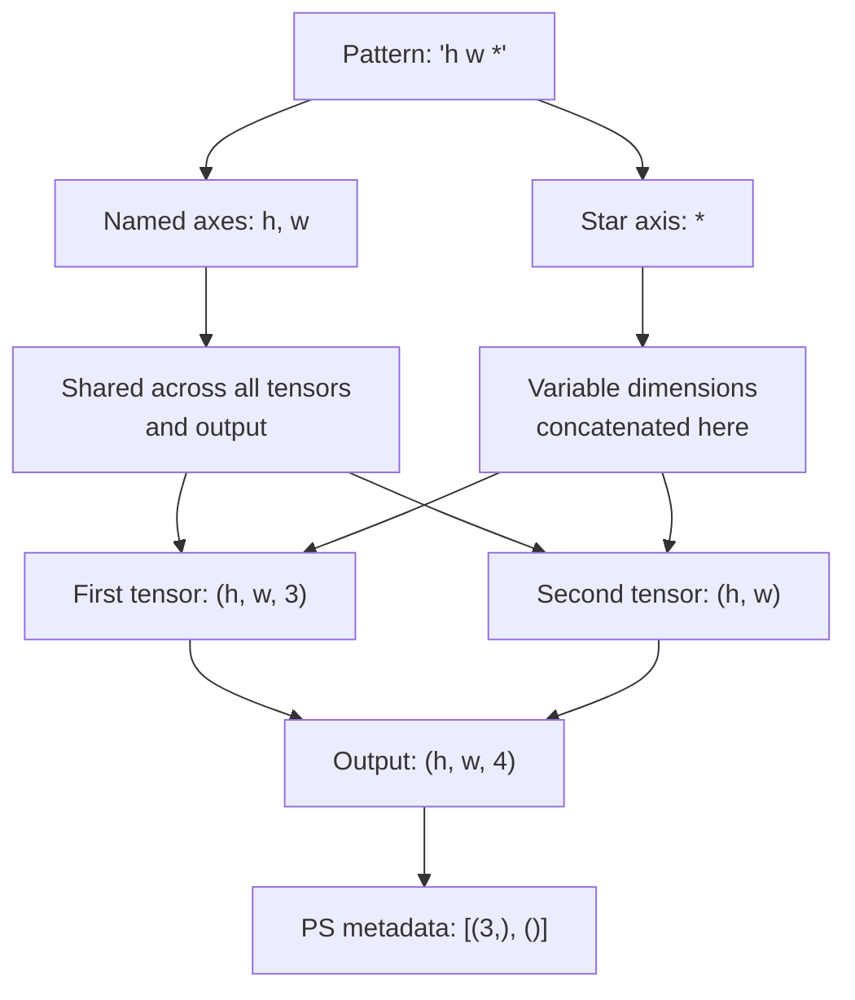

**Pattern structure**:
- Space-separated axis names (e.g., `"h w *"`, `"batch seq *"`, `"* h w c"`)
- Exactly one `*` axis that designates where packing/unpacking occurs
- All other axes must be valid identifiers
- No arrow (`->`) notation
- Same pattern can be used for both `pack` and `unpack`

**Sources**: [einops/packing.py:14-30](), [docs/4-pack-and-unpack.ipynb:70-77]()

### Pattern Analysis Implementation

The `analyze_pattern` function validates and parses pack/unpack patterns:

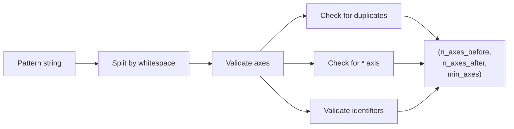

The function returns three values:
- `n_axes_before`: number of axes before the `*` axis
- `n_axes_after`: number of axes after the `*` axis  
- `min_axes`: minimum number of dimensions required (`n_axes_before + n_axes_after`)

**Sources**: [einops/packing.py:13-30]()

### Pack Operation Deep Dive

The `pack` function combines multiple tensors with different shapes into a single tensor:

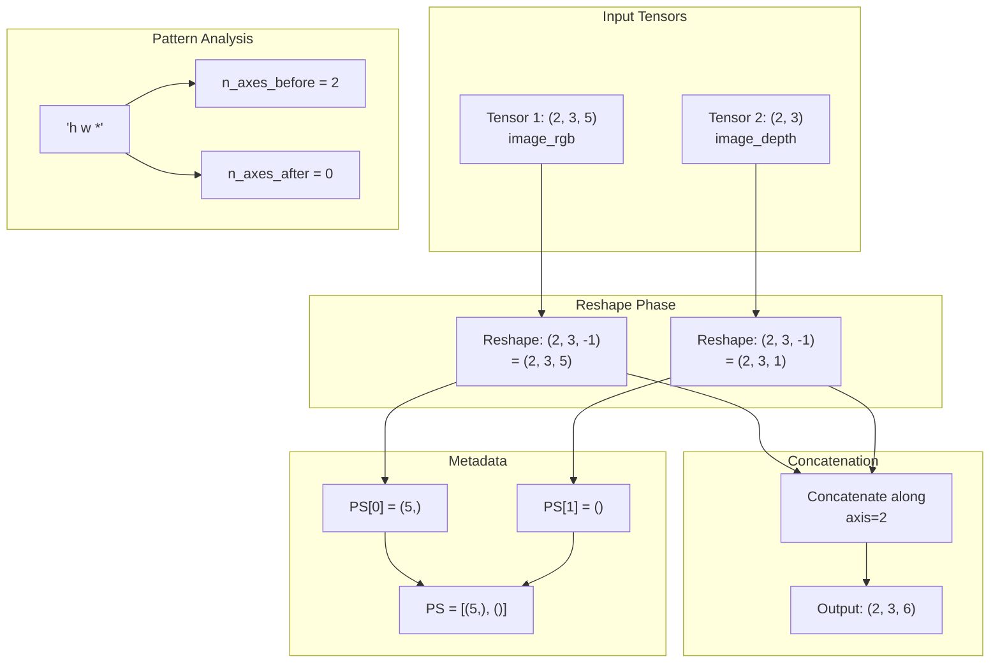

**Implementation steps** ([einops/packing.py:69-87]()):
1. **Pattern analysis**: Extract `n_axes_before`, `n_axes_after`, `min_axes`
2. **Backend detection**: Get backend from first tensor
3. **Reshape loop**: For each input tensor:
   - Extract shape
   - Validate minimum dimensions
   - Calculate which axes are "packed" (between before/after axes)
   - Store packed shape in PS metadata
   - Reshape to flatten packed axes: `(*shape[:n_axes_before], -1, *shape[axis_after_packed_axes:])`
4. **Concatenation**: Concatenate all reshaped tensors along the packed axis position

**Sources**: [einops/packing.py:33-87](), [docs/4-pack-and-unpack.ipynb:46-105]()

### Unpack Operation Deep Dive

The `unpack` function splits a packed tensor back into multiple tensors using PS metadata:

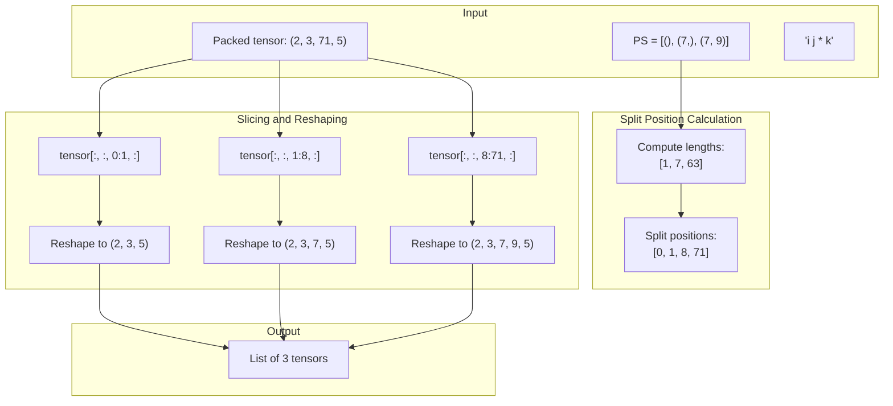

**Implementation steps** ([einops/packing.py:97-189]()):
1. **Pattern analysis**: Validate pattern and extract axis positions
2. **Shape validation**: Ensure tensor has correct dimensionality for pattern
3. **Length calculation**: Compute product of each PS entry (handle `-1` for unknown)
4. **Split position computation**: Calculate cumulative positions for slicing
5. **Unknown dimension inference**: If one PS entry contains `-1`, infer its size
6. **Slice and reshape**: For each output tensor:
   - Slice along the unpacked axis using computed positions
   - Reshape to include the packed dimensions from PS

**Unknown dimension handling**: At most one PS entry can contain `-1`, which is inferred from the remaining space in the packed axis.

**Sources**: [einops/packing.py:97-189](), [docs/4-pack-and-unpack.ipynb:114-167]()

### PS (Packed Shapes) Metadata

PS is a list of tuples/lists storing the shape of the packed dimensions for each tensor:

| Input Tensor Shape | Pattern | Packed Dimensions | PS Entry |
|-------------------|---------|-------------------|----------|
| `(h, w, 3)` | `"h w *"` | `(3,)` | `(3,)` |
| `(h, w)` | `"h w *"` | `()` | `()` |
| `(b, h, w, c)` | `"* h w c"` | `(b,)` | `(b,)` |
| `(b, t, h, w, c)` | `"* h w c"` | `(b, t)` | `(b, t)` |

**Key properties**:
- Empty tuple `()` means no packed dimensions (tensor was 2D for pattern `"h w *"`)
- Can contain `-1` for unknown dimension (must be inferred during unpack)
- Order corresponds to input tensor order in `pack` call
- Required for `unpack` to correctly split the packed tensor

**Sources**: [einops/packing.py:75-85](), [docs/4-pack-and-unpack.ipynb:128-140]()

### Use Case: Auto-Batching

A common pattern is to write functions that work with both single samples and batches:

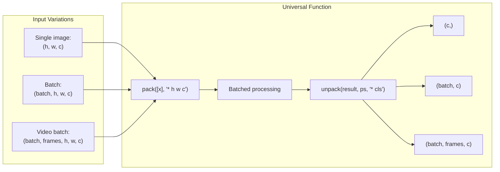

**Implementation pattern**:
```python
def universal_predict(x):
    x_packed, ps = pack([x], "* h w c")
    predictions_packed = model(x_packed)  # Always batched
    [predictions] = unpack(predictions_packed, ps, "* cls")
    return predictions
```

**Benefits**:
- Single codebase handles any leading dimensions
- No explicit shape checking or reshaping
- Automatically preserves input dimensionality structure

**Sources**: [docs/4-pack-and-unpack.ipynb:216-278]()

### Use Case: Vision Transformer Class Tokens

Pack/unpack simplify adding class tokens to patch sequences:

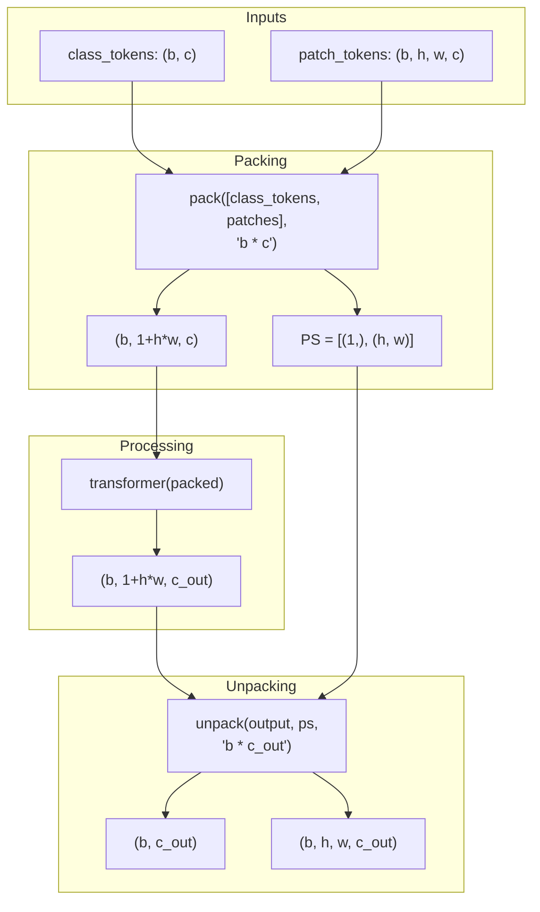

**Advantages over manual implementation**:
- No manual dimension calculations or reshape chains
- Automatic handling of dummy dimensions
- Clear separation of concerns: pack, process, unpack

**Sources**: [docs/4-pack-and-unpack.ipynb:295-425]()

### Use Case: Multi-Modal Transformer Inputs

Pack enables clean composition of heterogeneous inputs:

```python
# Mixing different modalities
all_inputs = [text_tokens_btc, image_bhwc, task_token_bc, static_tokens_bnc]
inputs_packed, ps = pack(all_inputs, 'b * c')
outputs_packed = transformer(inputs_packed)
text_out, image_out, task_out, static_out = unpack(outputs_packed, ps, 'b * c_out')
```

**Common scenarios**:
- **GAN training**: Pack real and fake images together
- **Multi-task learning**: Pack different prediction heads' outputs
- **Detection models**: Unpack complex output structures (confidence, bbox, mask, class logits)

**Sources**: [docs/4-pack-and-unpack.ipynb:438-465](), [docs/4-pack-and-unpack.ipynb:479-535]()

### Use Case: Structured Output Unpacking

Unpack simplifies extracting structured outputs from packed predictions:

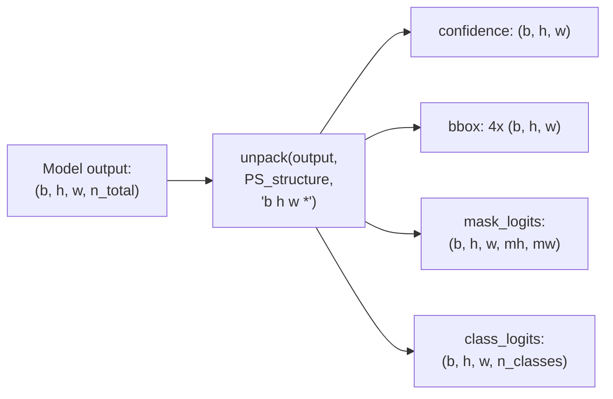

**Example PS specification**:
```python
ps = [[], [], [], [], [], [mask_h, mask_w], [n_classes]]
# 5 scalar outputs + 1 mask + 1 classification
```

**Benefits**:
- No manual offset calculation
- Automatic reshape for multi-dimensional outputs
- Built-in shape validation

**Sources**: [docs/4-pack-and-unpack.ipynb:479-554]()

---

## EinMix Layer Tutorial

### Overview

`EinMix` is a learnable layer that extends einops' pattern-based approach to parameterized linear transformations. It generalizes beyond `nn.Linear` by allowing mixing along arbitrary axes or axis combinations, enabling architectures like MLP-Mixer, Vision Permutator, and custom multi-head attention.

**Relationship to einsum**:
- `einsum`: functional interface for arbitrary tensor contractions
- `EinMix`: layer wrapper with automatic parameter initialization and management
- Pattern syntax similar to `rearrange`, but includes weight and bias specifications

**Sources**: [docs/3-einmix-layer.ipynb:8-73]()

### EinMix vs Einsum Comparison

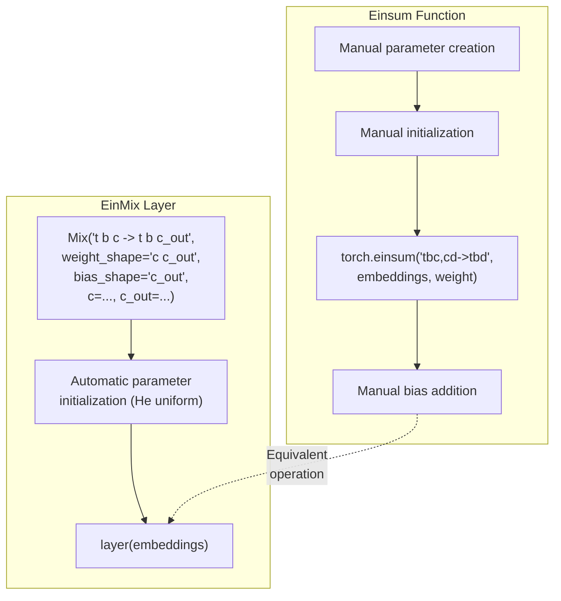

**Key differences**:
1. **Parameter management**: EinMix creates and initializes parameters automatically
2. **Bias handling**: Built-in bias term (optional)
3. **Pattern notation**: Left side = input, right side = output, no explicit weight axis
4. **Shape specification**: `weight_shape` and `bias_shape` define parameter dimensions

**Sources**: [docs/3-einmix-layer.ipynb:42-73]()

### Pattern Syntax for EinMix

EinMix patterns specify how input axes are transformed to output axes:

| Pattern | Weight Shape | Bias Shape | Operation |
|---------|--------------|------------|-----------|
| `'t b c -> t b c_out'` | `'c c_out'` | `'c_out'` | Standard linear layer |
| `'b hw c -> b hid c'` | `'hw hid'` | `'hid'` | Mix along spatial axis |
| `'b c (h hp) (w wp) -> b (h w) c'` | `'c_in hp wp c'` | `'c'` | Patch embedding |
| `'b t c -> qkv b h t hid'` | `'c qkv h hid'` | None | Multi-head Q/K/V projection |

**Pattern components**:
- **Input side** (left of `->`): Describes input tensor structure
- **Output side** (right of `->`): Describes output tensor structure
- **Weight shape**: Which axes from input are contracted (not in output)
- **Bias shape**: Which axes in output receive bias (typically new or transformed axes)

**Sources**: [docs/3-einmix-layer.ipynb:59-73]()

### MLP-Mixer TokenMixer Architecture

MLP-Mixer's TokenMixer mixes information across spatial locations while keeping channels independent:

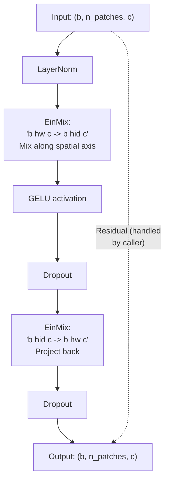

**Implementation comparison**:

**Original implementation** (requires transpose gymnastics):
- Uses `nn.Linear` which only works on last axis
- Manual transpose before and after: `x.transpose(1, 2)`
- Separate MLP class with multiple linear layers

**EinMix implementation**:
```python
nn.Sequential(
    nn.LayerNorm(num_features),
    Mix("b hw c -> b hid c", weight_shape="hw hid", bias_shape="hid", 
        hw=n_patches, hidden=n_hidden),
    nn.GELU(),
    nn.Dropout(dropout),
    Mix("b hid c -> b hw c", weight_shape="hid hw", bias_shape="hw",  
        hw=n_patches, hidden=n_hidden),
    nn.Dropout(dropout),
)
```

**Advantages**:
- Direct axis specification (no transposes needed)
- Sequential structure (easier to read and modify)
- Clear intent: "mix spatial tokens while preserving channels"

**Sources**: [docs/3-einmix-layer.ipynb:80-159]()

### Vision Transformer Patch Embedding

EinMix can perform patch extraction and linear projection in a single operation:

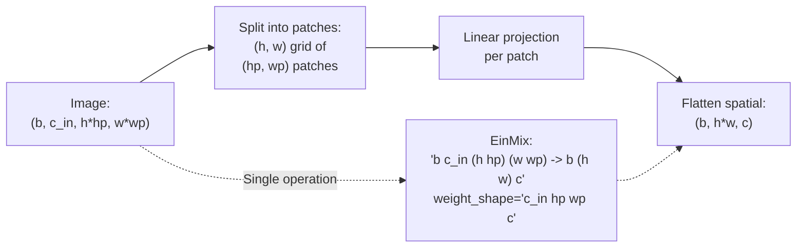

**Traditional implementation** (convolution trick):
```python
# Uses strided convolution
self.patcher = nn.Conv2d(in_channels, num_features, 
                         kernel_size=patch_size, stride=patch_size)
# Then manual permute and reshape
patches = self.patcher(x)
patches = patches.permute(0, 2, 3, 1).view(batch_size, -1, num_features)
```

**EinMix implementation**:
```python
Mix("b c_in (h hp) (w wp) -> b (h w) c", 
    weight_shape="c_in hp wp c", bias_shape="c",
    c=num_features, hp=patch_size, wp=patch_size, c_in=in_channels)
```

**Benefits**:
- Single operation (no separate reshape/permute)
- No hardcoded image size requirement
- Clear semantic meaning in pattern

**Sources**: [docs/3-einmix-layer.ipynb:175-247]()

### Vision Permutator Architecture

Vision Permutator performs weighted permutations separately on height, width, and channel dimensions:

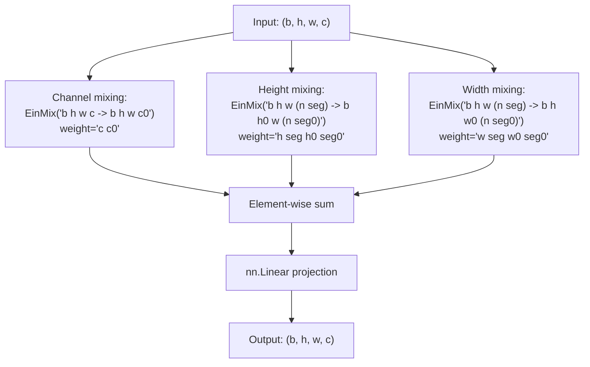

**Original implementation issues**:
- Long reshape/permute/reshape chains
- Hard to understand intent
- Fragile when adding batch dimension

**EinMix solution**:
```python
self.mlp_c = Mix("b h w c -> b h w c0", weight_shape="c c0", bias_shape="c0")
self.mlp_h = Mix("b h w (n c) -> b h0 w (n c0)", 
                  weight_shape="h c h0 c0", bias_shape="h0 c0")
self.mlp_w = Mix("b h w (n c) -> b h w0 (n c0)", 
                  weight_shape="w c w0 c0", bias_shape="w0 c0")

def forward(self, x):
    x = self.mlp_c(x) + self.mlp_h(x) + self.mlp_w(x)
    return self.proj(x)
```

**Key insight**: EinMix can split channels into segments `(n c)` and mix within segments separately, enabling per-segment transformations.

**Sources**: [docs/3-einmix-layer.ipynb:255-333]()

### Multi-Head Attention with EinMix

EinMix can perform Q/K/V projections and dimension reordering in single operations:

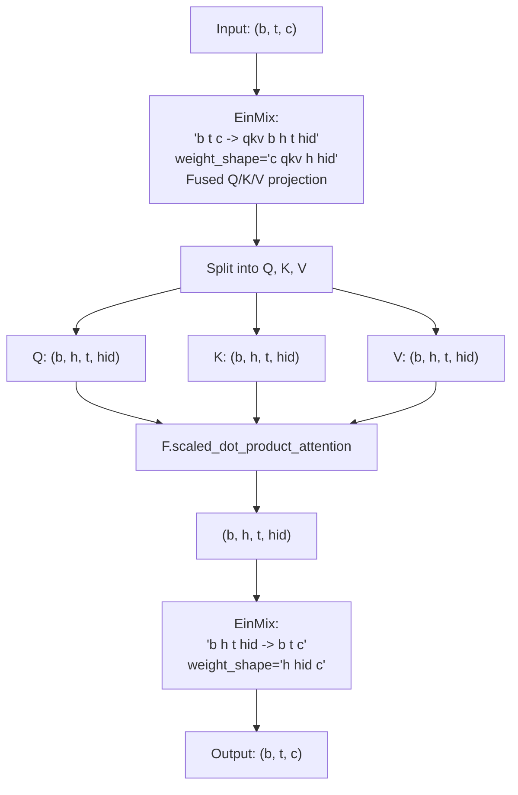

**Implementation**:
```python
class MultiheadAttention(nn.Module):
    def __init__(self, dim_input, n_heads, head_dim):
        self.input_to_qkv = Mix("b t c -> qkv b h t hid", "c qkv h hid",
                                c=dim_input, qkv=3, h=n_heads, hid=head_dim)
        self.out_proj = Mix("b h t hid -> b t c", "h hid c",
                            h=n_heads, hid=head_dim, c=dim_input)

    def forward(self, x):
        q, k, v = self.input_to_qkv(x)  # Fused projection
        return self.out_proj(F.scaled_dot_product_attention(q, k, v))
```

**Advantages**:
- Single operation for all three projections
- Automatic transposition to attention-friendly format
- Clean integration with Flash Attention API

**Sources**: [docs/3-einmix-layer.ipynb:340-367]()

### Advanced EinMix Patterns

EinMix enables architectural patterns beyond standard research:

| Pattern | Description | Use Case |
|---------|-------------|----------|
| `'b c (h hI) (w wI) -> b c (h hO) (w wO)'` | Local mixing within patches | Patch-wise MLPs |
| `'b c (hI h) (wI w) -> b c (hO h) (wO w)'` | Subgrid mixing | Global information aggregation |
| `'b (g c) ... -> b (g c_out) ...'` | Grouped channel mixing | Efficient channel operations |
| `'b h w c -> b (h h2) (w w2) c'` | Spatial upsampling | Super-resolution |

**Design space exploration**:
- Mix partial axes in grid patterns
- Combine spatial and channel grouping
- Multi-dimensional mixing (2D/3D/4D)
- Framework-agnostic (works with PyTorch, TensorFlow, JAX, etc.)

**Sources**: [docs/3-einmix-layer.ipynb:389-438]()

### Parameter Initialization

EinMix uses He uniform initialization by default, which is appropriate for ReLU-family activations:

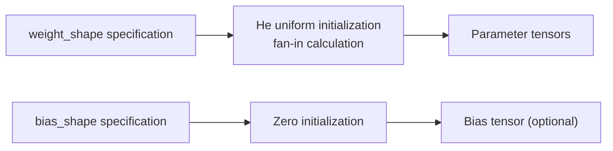

**Initialization strategy**:
- **Weight**: He uniform based on fan-in (input dimensions)
- **Bias**: Zero initialization (when specified)
- **Rationale**: Maintains activation variance through layers

For detailed parameter management, see [EinMix Layer Deep Dive](#3.4).

**Sources**: Inferred from layer behavior and standard practice

---

## Integration with Einops Ecosystem

### Relationship to Core Operations

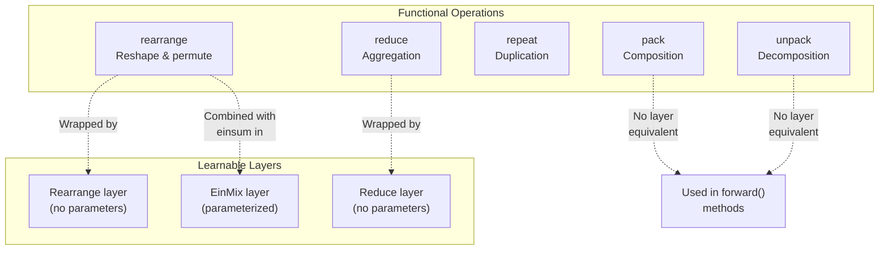

**Distinctions**:
- **pack/unpack**: No layer versions (used as functional operations in `forward()`)
- **EinMix**: Combines `rearrange` logic with learnable transformations
- **Layer variants**: Pre-compute recipes during initialization for compatibility with static graphs

**Sources**: Architecture understanding from high-level diagrams and [einops/packing.py:1-190]()

### Framework Support

Both tutorials demonstrate framework-agnostic patterns:

**Pack/Unpack**:
- Implementations in [einops/packing.py]() (backend-dispatched)
- Array API version in [einops/array_api.py:52-125]()
- Works with NumPy, PyTorch, TensorFlow, JAX, etc.

**EinMix**:
- Tutorial uses PyTorch ([docs/3-einmix-layer.ipynb:30-34]())
- Available for TensorFlow/Keras, Flax, PaddlePaddle
- See [PyTorch Layers](#3.1) and [TensorFlow and Keras Layers](#3.2)

**Sources**: [einops/packing.py:1-190](), [einops/array_api.py:1-126](), [docs/3-einmix-layer.ipynb:30-34]()

---

## Tutorial Notebooks

### File Locations

- **Pack/Unpack Tutorial**: [docs/4-pack-and-unpack.ipynb:1-605]()
- **EinMix Tutorial**: [docs/3-einmix-layer.ipynb:1-470]()

### Running the Tutorials

Both notebooks use standard Jupyter notebook format and can be run locally or in cloud environments (Google Colab, GitHub Codespaces).

**Requirements**:
- einops (pip install einops)
- Framework of choice (numpy for pack/unpack demo, torch for EinMix demo)
- Jupyter environment

**Development environment setup**: See [Development Environment](#6.4)

**Sources**: [docs/4-pack-and-unpack.ipynb:1-605](), [docs/3-einmix-layer.ipynb:1-470]()

---

