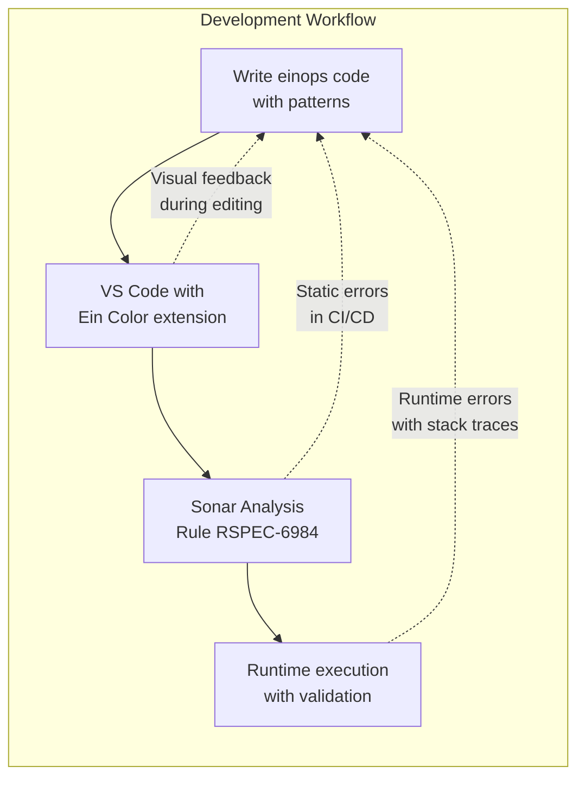
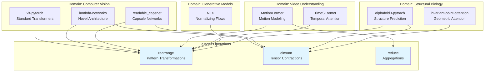
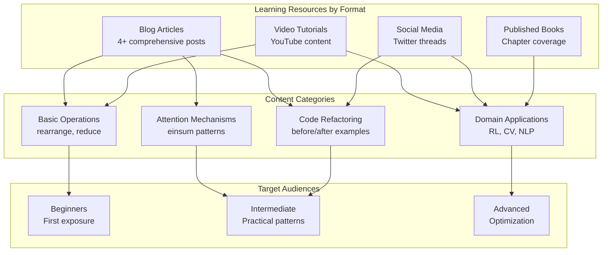
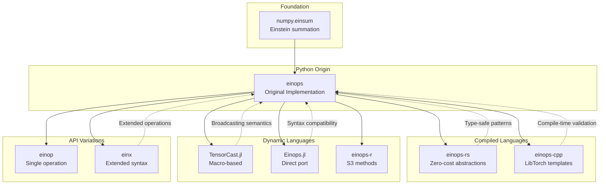
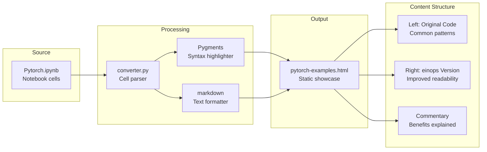

<!-- source: DeepWiki mcp.deepwiki.com · repo arogozhnikov/einops · page 7.5 Community Projects and Ecosystem · fetched 2026-10-21 -->

# Community Projects and Ecosystem

<details>
<summary>Relevant source files</summary>

The following files were used as context for generating this wiki page:

- [docs/README.md](docs/README.md)
- [docs_src/pages/projects.md](docs_src/pages/projects.md)
- [docs_src/pages/testimonials.md](docs_src/pages/testimonials.md)
- [scripts/pytorch_examples_source/Pytorch.ipynb](scripts/pytorch_examples_source/Pytorch.ipynb)
- [scripts/pytorch_examples_source/converter.py](scripts/pytorch_examples_source/converter.py)

</details>


This page catalogs the external tools, projects, tutorials, and implementations that comprise the einops ecosystem. It documents how einops has been adopted across different domains, programming languages, and frameworks, as well as the community-contributed resources that help users learn and apply einops patterns.

For einops core operations and syntax, see [Core API Reference](#2). For practical usage patterns in deep learning, see [Deep Learning Applications Tutorial](#7.2) and [PyTorch Examples Collection](#7.3).

---

## Overview of the Ecosystem

The einops ecosystem consists of four main components: development tools that assist einops users, real-world projects demonstrating einops patterns, community-created educational resources, and ports to other programming languages.

```mermaid
graph TB
    subgraph "Core Library"
        EINOPS[einops<br/>Python Package]
    end
    
    subgraph "Development Tools"
        VSCODE[Ein Color<br/>VS Code Extension]
        SONAR[Sonar Codechecker<br/>Static Analysis Rule]
    end
    
    subgraph "Major Adopters"
        LUCIDRAINS[lucidrains/vit-pytorch<br/>Vision Transformers]
        ALPHAFOLD[alphafold3-pytorch<br/>Protein Folding]
        CAPSNET[readable_capsnet<br/>Capsule Networks]
        NUX[NuX<br/>Normalizing Flows]
        MOTION[MotionFormer<br/>Video Recognition]
    end
    
    subgraph "Educational Resources"
        AISUMMER[AI Summer Tutorial<br/>einsum + attention]
        YOUTUBE[Kapil Sachdeva Video<br/>Introduction]
        BLOG[Technical Blog Posts<br/>Multiple authors]
        BOOK[Book Chapter<br/>Deep RL in Action]
    end
    
    subgraph "Language Ports"
        RUST[einops-rs<br/>Rust]
        CPP[einops-cpp<br/>C++ Torch]
        JULIA1[TensorCast.jl<br/>Julia]
        JULIA2[Einops.jl<br/>Julia]
        R[einops<br/>R Language]
    end
    
    subgraph "Extended Ecosystem"
        EINOP[einop<br/>Minimal API]
        EINX[einx<br/>Extended Operations]
    end
    
    EINOPS --> VSCODE
    EINOPS --> SONAR
    
    EINOPS --> LUCIDRAINS
    EINOPS --> ALPHAFOLD
    EINOPS --> CAPSNET
    EINOPS --> NUX
    EINOPS --> MOTION
    
    EINOPS --> AISUMMER
    EINOPS --> YOUTUBE
    EINOPS --> BLOG
    EINOPS --> BOOK
    
    EINOPS --> RUST
    EINOPS --> CPP
    EINOPS --> JULIA1
    EINOPS --> JULIA2
    EINOPS --> R
    
    EINOPS --> EINOP
    EINOPS --> EINX
    
    style EINOPS fill:#e1f5ff,stroke:#333,stroke-width:3px
    style LUCIDRAINS fill:#fff4e1
    style ALPHAFOLD fill:#fff4e1
```



**Sources:** [docs_src/pages/projects.md:1-66]()

---

## Development Tools for einops Users

Two primary tools enhance the development experience when working with einops patterns: syntax highlighting for visual pattern recognition and static analysis for error detection.

### Ein Color VS Code Extension

The Ein Color extension provides syntax highlighting specifically designed for einops patterns. It colors different axis names in einops operations, making it easier to visually track axis transformations across complex rearrangements.

**Marketplace:** `MarcinJachmann.vscode-eincolor`

This extension improves code readability by applying distinct colors to:
- Named axes (e.g., `'b'`, `'c'`, `'h'`, `'w'`)
- Composite axes (e.g., `'(h w)'`)
- Special symbols (`'*'`, `'...'`)

### Sonar Static Analysis Rule

SonarSource provides a dedicated rule (RSPEC-6984) for statically checking einops patterns. This rule validates:
- Pattern syntax correctness
- Axis consistency between input and output patterns
- Proper usage of composite axes and special symbols

The static analysis integration allows teams to catch einops pattern errors during code review and CI/CD pipelines, before runtime execution.



**Sources:** [docs_src/pages/projects.md:1-5]()

---

## Selected Projects Using einops

The following projects demonstrate practical einops usage patterns across different domains. Each project shows how einops simplifies complex tensor operations in production code.

### Vision Transformers by lucidrains

The `lucidrains/vit-pytorch` repository contains implementations of numerous vision transformer architectures, making extensive use of einops for attention mechanisms and tensor reshaping.

**Repository:** `https://github.com/lucidrains/vit-pytorch`

Key einops patterns demonstrated:
- Multi-head attention with `rearrange` for head splitting
- Patch embedding with `rearrange('b c (h p1) (w p2) -> b (h w) (p1 p2 c)')`
- Position encoding and token concatenation

This collection serves as a canonical reference for implementing transformer architectures with einops, showing consistent patterns across dozens of variants.

### Lambda Networks

The lambda networks implementation demonstrates how einops can make non-conventional architectures more readable than the original paper descriptions.

**Repository:** `https://github.com/lucidrains/lambda-networks`  
**Video walkthrough:** Available demonstrating einops usage patterns

The implementation shows:
- Content-based attention mechanisms using `einsum`
- Position encoding with explicit axis naming
- Efficient memory usage through careful tensor layout

### Capsule Networks (CapsNets)

The `readable_capsnet` implementation achieves significant improvements over standard implementations through einops patterns.

**Repository:** `https://github.com/arogozhnikov/readable_capsnet`

Performance characteristics:
- **3-10x less code** than traditional implementations
- Blazingly fast execution
- Memory efficient routing algorithms

The implementation demonstrates:
- Dynamic routing with `einsum` for agreement computation
- Squash activation functions with explicit tensor dimensions
- Batch processing with clear axis semantics

### Normalizing Flows: NuX

NuX implements normalizing flows in JAX, using einops to handle the complex rearrangement patterns common in flow-based models.

**Repository:** `https://github.com/Information-Fusion-Lab-Umass/NuX`

Flow transformations mapped to einops:
- Coupling layers with channel splitting
- ActNorm layers with axis-aware normalization
- Invertible 1x1 convolutions with `rearrange`

### Video Recognition Models

Video transformers require handling 5D tensors (batch, time, channels, height, width). Einops provides clear semantics for temporal operations.

**MotionFormer:** `https://github.com/facebookresearch/Motionformer`  
**TimeSFormer:** `https://github.com/lucidrains/TimeSformer-pytorch`

Common patterns:
- Temporal patch embedding: `'b t c h w -> b t (h w) c'`
- Spatiotemporal attention mixing
- Frame aggregation with `reduce` operations

### Protein Folding: AlphaFold Implementations

Protein structure prediction implementations use einops for geometric transformations and attention mechanisms over 3D coordinates.

**alphafold3-pytorch:** `https://github.com/lucidrains/alphafold3-pytorch`  
**Invariant Point Attention:** `https://github.com/lucidrains/invariant-point-attention`

Einops patterns for protein folding:
- Pairwise residue interactions: `einsum('b i c, b j c -> b i j')`
- Rotation and translation handling with explicit geometric axes
- Multi-scale feature aggregation



**Sources:** [docs_src/pages/projects.md:6-32]()

---

## Community Educational Resources

The einops community has created extensive educational content across multiple formats and platforms. These resources help users learn einops patterns and best practices.

### Tutorial Articles and Blog Posts

Multiple technical writers have created comprehensive einops tutorials:

**AI Summer: Einsum and Attention Mechanisms**  
URL: `https://theaisummer.com/einsum-attention/`

This tutorial covers:
- Relationship between `einsum` and attention
- Pattern syntax for common attention variants
- Performance considerations

**Kapil Sachdeva Video Introduction**  
URL: `https://www.youtube.com/watch?v=xGy75Pjsqzo`

Video walkthrough demonstrating:
- Basic einops operations
- Live coding examples
- Common pitfalls and solutions

**Implementing Visual Transformers in PyTorch**  
Published on Towards Data Science

Article structure:
- Step-by-step transformer implementation
- Einops patterns for patch embedding
- Comparison with traditional PyTorch code

**Refactoring Machine Learning Code with einops**  
URL: `https://www.paepper.com/blog/posts/refactoring-machine-learning-code-einops/`

Part of a series on code quality, focusing on:
- Before/after code comparisons
- Readability improvements
- Maintenance benefits

### Social Media Discussions

**ML TLDR Twitter Thread**  
URL: `https://twitter.com/mlsummaries/status/1400505282543955970`

Community discussion covering:
- Quick reference patterns
- Use cases across frameworks
- Integration tips

### Published Literature

**"Deep Reinforcement Learning in Action"**  
Authors: Brandon Brown & Alexander Zai  
Chapter: 10

The book includes:
- Introduction to einops for RL practitioners
- Pattern usage in policy networks
- Value function tensor manipulations



**Sources:** [docs_src/pages/projects.md:34-53](), [docs_src/pages/testimonials.md:17-138]()

---

## Related Projects and Language Ports

The einops pattern language has inspired implementations in multiple programming languages and alternative APIs for specialized use cases.

### Language Implementations

The einops pattern syntax has been ported to several languages beyond Python, enabling cross-language adoption of the same readable patterns.

| Language | Project | Repository | Notes |
|----------|---------|------------|-------|
| **Rust** | einops-rs | `https://docs.rs/einops/0.1.0/einops` | Native Rust tensors |
| **C++** | einops-cpp | `https://github.com/dorpxam/einops-cpp` | For LibTorch/PyTorch C++ |
| **Julia** | TensorCast.jl | `https://juliahub.com/ui/Packages/TensorCast` | Julia-idiomatic API |
| **Julia** | Einops.jl | `https://murrellgroup.github.io/Einops.jl/stable/` | One-to-one port |
| **R** | einops | `https://qile0317.github.io/einops/` | R arrays |

#### Rust Implementation

The Rust port (`einops-rs`) provides:
- Zero-cost abstractions over tensor operations
- Compile-time pattern validation where possible
- Integration with `ndarray` crate

#### C++ LibTorch Implementation

The `einops-cpp` project enables:
- Header-only library for LibTorch
- Template-based pattern parsing
- C++17 constexpr validation

#### Julia Implementations

Julia has two distinct approaches:

**TensorCast.jl:** Designed for Julia's broadcasting semantics, using macro-based syntax that feels native to Julia users.

**Einops.jl:** One-to-one port maintaining identical pattern syntax, making cross-language code sharing easier.

#### R Implementation

The R port provides:
- S3 methods for common R array types
- Integration with tidyverse conventions
- RStudio IDE support

### Alternative Python APIs

Two Python projects explore variations on the einops API design:

**einop - Minimal API**  
Repository: `https://github.com/cgarciae/einop`

Philosophy:
- Single operation combining all functionality
- Extreme API compactness
- Pattern strings encode operation type

**einx - Extended Operations**  
Repository: `https://github.com/fferflo/einx`

Philosophy:
- Create einops-style operations for any transformation
- Extended pattern syntax
- Additional primitives beyond rearrange/reduce/repeat



**Sources:** [docs_src/pages/projects.md:56-66]()

---

## Integration Patterns and Best Practices

Based on community usage across major projects, several integration patterns have emerged for effectively incorporating einops into different types of codebases.

### Pattern: Sequential Model Definition

Demonstrated extensively in PyTorch examples, using einops layers in `nn.Sequential`:

```python
model = nn.Sequential(
    nn.Conv2d(3, 64, kernel_size=3),
    Rearrange('b c h w -> b (c h w)'),
    nn.Linear(64 * h * w, num_classes)
)
```

Benefits:
- Explicit shape documentation
- No manual `.view()` or `.reshape()` calls
- Easier to modify and maintain

**Sources:** [scripts/pytorch_examples_source/Pytorch.ipynb:108-122]()

### Pattern: Attention Mechanism Template

Standard pattern for multi-head attention found across transformer implementations:

```python
q = rearrange(self.w_q(x), 'b l (head k) -> head b l k', head=n_heads)
k = rearrange(self.w_k(x), 'b t (head k) -> head b t k', head=n_heads)
v = rearrange(self.w_v(x), 'b t (head v) -> head b t v', head=n_heads)
attn = torch.einsum('hblk,hbtk->hblt', [q, k]) / sqrt(d_k)
output = torch.einsum('hblt,hbtv->hblv', [attn, v])
output = rearrange(output, 'head b l v -> b l (head v)')
```

Key aspects:
- Explicit `head` dimension handling
- Clear separation of query/key/value transformations
- Readable einsum patterns for attention computation

**Sources:** [scripts/pytorch_examples_source/Pytorch.ipynb:1673-1706]()

### Pattern: Video Tensor Handling

For 5D video tensors (batch, time, channels, height, width):

```python
# Temporal patch embedding
patches = rearrange(video, 'b t c (h p1) (w p2) -> b t (h w) (p1 p2 c)', 
                    p1=patch_size, p2=patch_size)

# Spatial-temporal mixing
output = rearrange(video, 'b t c h w -> (b t) c h w')
output = spatial_transform(output)
output = rearrange(output, '(b t) c h w -> b t c h w', b=batch_size)
```

Advantages:
- Explicit temporal dimension handling
- Clear batch-time relationship
- Easier debugging with named dimensions

### Pattern: Channel Shuffle Operations

Common in efficient architectures like ShuffleNet:

```python
def channel_shuffle(x, groups):
    return rearrange(x, 'b (c1 c2) h w -> b (c2 c1) h w', c1=groups)
```

Benefits:
- Single line vs. multi-step reshape/transpose/reshape
- Self-documenting group structure
- No `.contiguous()` workarounds needed

**Sources:** [scripts/pytorch_examples_source/Pytorch.ipynb:517-520]()

### Pattern: Gram Matrix for Style Transfer

Efficient computation using einsum:

```python
def gram_matrix(y):
    b, ch, h, w = y.shape
    return torch.einsum('bchw,bdhw->bcd', [y, y]) / (h * w)
```

Replaces:
- Manual reshape operations
- `.bmm()` batched matrix multiplication
- Multiple transpose operations

**Sources:** [scripts/pytorch_examples_source/Pytorch.ipynb:355-359]()

```mermaid
graph TB
    subgraph "Integration Pattern Categories"
        SEQ[Sequential Models<br/>nn.Sequential + layers]
        ATTN[Attention Mechanisms<br/>einsum + rearrange]
        VIDEO[Video Processing<br/>5D tensor handling]
        SHUFFLE[Efficient Architectures<br/>channel operations]
        STYLE[Style Transfer<br/>gram matrices]
    end
    
    subgraph "Code Quality Benefits"
        READ[Readability<br/>self-documenting]
        MAINT[Maintainability<br/>easier refactoring]
        DEBUG[Debuggability<br/>explicit shapes]
        PERF[Performance<br/>optimized paths]
    end
    
    SEQ --> READ
    SEQ --> MAINT
    
    ATTN --> READ
    ATTN --> DEBUG
    
    VIDEO --> DEBUG
    VIDEO --> READ
    
    SHUFFLE --> READ
    SHUFFLE --> PERF
    
    STYLE --> PERF
    STYLE --> READ
    
    subgraph "Common Anti-patterns Avoided"
        VIEW[view() shape errors]
        CONTIGUOUS[contiguous() workarounds]
        TRANSPOSE[multiple transposes]
        RESHAPE[reshape ambiguity]
    end
    
    SEQ -.->|eliminates| VIEW
    SHUFFLE -.->|eliminates| CONTIGUOUS
    STYLE -.->|eliminates| TRANSPOSE
    ATTN -.->|eliminates| RESHAPE
```

**Sources:** [scripts/pytorch_examples_source/Pytorch.ipynb:1-1800]()

---

## Adoption Metrics and Community Impact

The einops library has achieved widespread adoption across major AI research institutions and production systems, despite never appearing in major machine learning news outlets. Growth occurred organically through code sharing and word-of-mouth recommendations.

### Industry Adoption

Based on testimonials and public code repositories, einops is used at:

- **DeepMind** (Norman Casagrande testimonial)
- **Facebook AI Research** (Tim Rocktäschel, MotionFormer authors)
- **Google Research** (Jake VanderPlas recommendation)
- **Apple** (Daniel Havir, Robin M. Schmidt)
- **Former YouTube** (Aurélien Geron, ex-PM of video classification)

### Academic Adoption

Institutions with documented einops usage:

- **MILA** (Nasim Rahaman)
- **University of Washington** (Tim Dettmers, Samson Koelle)
- **University of Amsterdam** (Tom Lieberum)
- **Various university research groups** (normalizing flows, protein folding)

### Productivity Impact

From community discussion on Twitter:

> "AI research suffers globally from a 5% loss of productivity because einops are not included in @PyTorch by default."
> 
> — François Fleuret (discussion thread participant)

The 5% estimate represents:
- Debugging time saved from shape mismatches
- Code review time reduced through readable patterns
- Refactoring time minimized with explicit transformations

### Community Sentiment Patterns

Analysis of testimonials reveals common themes:

**Readability:** Users consistently report code becomes easier to read and understand  
**Discovery:** Many users wish they had discovered einops earlier in their careers  
**Adoption curve:** Initial skepticism followed by enthusiastic adoption  
**Teaching:** Einops becomes a preferred teaching tool for tensor operations

**Sources:** [docs_src/pages/testimonials.md:17-138]()

---

## Example Showcase: PyTorch Code Improvements

The repository maintains a comprehensive showcase of before/after code comparisons demonstrating einops improvements to popular PyTorch implementations. This showcase is compiled into an HTML page for easy reference.

### Showcase Generation Pipeline

The showcase is generated from a Jupyter notebook using a custom converter:

[scripts/pytorch_examples_source/converter.py:1-104]()

Pipeline steps:
1. Parse `Pytorch.ipynb` notebook cells
2. Identify cells marked with `#left` (original) or `#right` (improved)
3. Apply syntax highlighting with Pygments
4. Generate side-by-side HTML comparison
5. Add styling for readability
6. Output to `docs/pytorch-examples.html`

### Showcased Improvements

The notebook demonstrates einops patterns for:

- Simple ConvNet architecture with `nn.Sequential`
- Super-resolution networks with pixel shuffle
- ResNet blocks with explicit shape checking
- ShuffleNet channel shuffle operations
- RNN language models with bidirectional handling
- FastText architecture as pure sequential model
- CNN text classification with proper Conv1d
- Highway convolutions with explicit splitting
- Attention mechanisms (simple and multi-head)
- Transformer scaled dot-product attention

Each example shows:
- Original implementation (left)
- Improved einops version (right)
- Commentary on benefits and pitfalls avoided



**Sources:** [scripts/pytorch_examples_source/Pytorch.ipynb:1-100](), [scripts/pytorch_examples_source/converter.py:1-104]()

---

## Contributing to the Ecosystem

The einops ecosystem welcomes contributions in several forms:

**Adding Projects:** Open pull requests to `docs_src/pages/projects.md` with:
- Project description and repository link
- Key einops patterns demonstrated
- Domain and use case

**Creating Tutorials:** Community members are encouraged to create:
- Blog posts on specific use cases
- Video walkthroughs of implementations
- Example notebooks for new domains

**Reporting IDE Integration:** Share tools and plugins that enhance einops development experience.

**Language Ports:** Maintainers of ports to other languages can request listing by demonstrating:
- Pattern syntax compatibility
- Test coverage
- Documentation quality

**Sources:** [docs_src/pages/projects.md:1-66]()