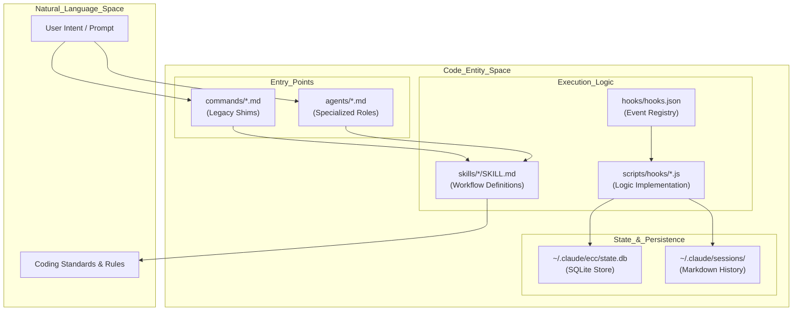
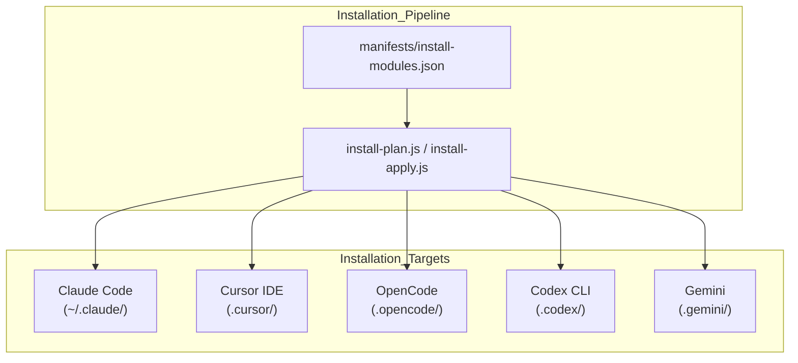

<!-- source: DeepWiki mcp.deepwiki.com · repo affaan-m/everything-claude-code · page 1 Overview · fetched 2026-10-26 -->

# Overview

Relevant source files

The following files were used as context for generating this wiki page:

- [.agents/plugins/marketplace.json](.agents/plugins/marketplace.json)
- [.claude-plugin/PLUGIN_SCHEMA_NOTES.md](.claude-plugin/PLUGIN_SCHEMA_NOTES.md)
- [.claude-plugin/README.md](.claude-plugin/README.md)
- [.claude-plugin/marketplace.json](.claude-plugin/marketplace.json)
- [.claude-plugin/plugin.json](.claude-plugin/plugin.json)
- [.codex-plugin/README.md](.codex-plugin/README.md)
- [.codex-plugin/plugin.json](.codex-plugin/plugin.json)
- [.mcp.json](.mcp.json)
- [AGENTS.md](AGENTS.md)
- [README.md](README.md)
- [README.zh-CN.md](README.zh-CN.md)
- [WORKING-CONTEXT.md](WORKING-CONTEXT.md)
- [agent.yaml](agent.yaml)
- [commands/auto-update.md](commands/auto-update.md)
- [commands/jira.md](commands/jira.md)
- [docs/zh-CN/AGENTS.md](docs/zh-CN/AGENTS.md)
- [docs/zh-CN/README.md](docs/zh-CN/README.md)
- [manifests/install-modules.json](manifests/install-modules.json)
- [schemas/package-manager.schema.json](schemas/package-manager.schema.json)
- [schemas/plugin.schema.json](schemas/plugin.schema.json)
- [scripts/auto-update.js](scripts/auto-update.js)
- [skills/jira-integration/SKILL.md](skills/jira-integration/SKILL.md)
- [tests/ci/agent-yaml-surface.test.js](tests/ci/agent-yaml-surface.test.js)
- [tests/plugin-manifest.test.js](tests/plugin-manifest.test.js)
- [tests/scripts/auto-update.test.js](tests/scripts/auto-update.test.js)

Everything Claude Code (ECC) is a comprehensive performance optimization and enhancement system for Claude Code and compatible AI agent harnesses. It provides a production-ready suite of agents, skills, commands, rules, hooks, and MCP configurations designed to optimize token usage, enforce code quality, persist memory across sessions, and enable autonomous workflows [[README.md:3-37]]().

The system originated from an Anthropic hackathon-winning entry and has been battle-tested over 10+ months of intensive daily use building real-world products [[README.md:20-37]](). ECC is explicitly framed as an agent harness performance system rather than a simple configuration pack [[README.md:35-37]]().

---

## Origins and Maturity

ECC was developed to bridge the gap between raw AI agent capabilities and production engineering requirements. As of v2.0.0-rc.1, the system has evolved into a mature framework supporting 12+ language ecosystems [[README.md:85-103]]().

### System Statistics
- **48 Specialized Agents**: Domain-specific delegation for planning, architecture, and language-specific reviews [[AGENTS.md:3-3]](), [[WORKING-CONTEXT.md:13-13]]().
- **182 Skills**: Workflow definitions spanning frameworks, databases, and business operations [[AGENTS.md:3-3]](), [[WORKING-CONTEXT.md:13-13]]().
- **68 Legacy Commands**: Slash-entry compatibility shims for rapid execution [[AGENTS.md:3-3]](), [[WORKING-CONTEXT.md:13-13]]().
- **8 Hook Event Types**: Lifecycle triggers including `PreToolUse`, `PostToolUse`, `SessionStart`, `SessionEnd`, `Stop`, and `PreCompact` [[README.md:72-79]]().
- **12 Language Ecosystems**: Rules and reviewers for TypeScript, Python, Go, Java, PHP, Perl, Kotlin, C++, Rust, and Swift [[README.md:97-102]]().
- **Cross-Platform Support**: Native integration for Claude Code, Cursor, OpenCode, Codex, Gemini, and Antigravity [[README.md:39-41]]().

**Sources:** [[README.md:1-103]](), [[AGENTS.md:1-45]](), [[WORKING-CONTEXT.md:1-21]]()

---

## System Architecture Overview

ECC operates as a modular middleware layer between the AI agent harness and the underlying filesystem/tools. It uses a manifest-driven installation pipeline to target different environments [[README.md:96-97]]().

### Component Interaction Diagram

This diagram maps the relationship between high-level system concepts and the specific code entities that implement them.

**Sources:** [[AGENTS.md:15-45]](), [[.claude-plugin/plugin.json:1-28]](), [[manifests/install-modules.json:1-108]]()

---

## Core Component Types

### Specialized Agents
Agents are defined in `agents/*.md` with YAML frontmatter specifying model configurations (Haiku/Sonnet/Opus) and tool permissions [[AGENTS.md:15-45]](). They are discovered automatically by convention and do not need explicit declaration in the plugin manifest [[.claude-plugin/PLUGIN_SCHEMA_NOTES.md:58-74]]().

| Agent | Purpose | When to Use |
|-------|---------|-------------|
| `planner` | Implementation planning | Complex features, refactoring [[AGENTS.md:19-19]]() |
| `architect` | System design and scalability | Architectural decisions [[AGENTS.md:20-20]]() |
| `tdd-guide` | Test-driven development | New features, bug fixes [[AGENTS.md:21-21]]() |
| `security-reviewer` | Vulnerability detection | Before commits, sensitive code [[AGENTS.md:23-23]]() |
| `harness-optimizer` | Harness config tuning | Reliability, cost, throughput [[AGENTS.md:40-40]]() |
| `loop-operator` | Autonomous loop execution | Run loops safely, monitor stalls [[AGENTS.md:39-39]]() |

**Sources:** [[AGENTS.md:15-60]](), [[.claude-plugin/PLUGIN_SCHEMA_NOTES.md:58-74]]()

### Workflow Skills
Skills in `skills/` are the canonical workflow surface [[AGENTS.md:119-122]](). They use a structured Markdown format to provide "evidence-based" guidance to the agent.

- **Framework Skills**: `nestjs-patterns`, `django-patterns`, `laravel-patterns`, `springboot-patterns` [[manifests/install-modules.json:114-152]]().
- **Quality Skills**: `plankton-code-quality`, `verification-loop`, `strategic-compact` [[manifests/install-modules.json:201-218]]().
- **Learning Skills**: `continuous-learning-v2` (Instinct-based learning) [[manifests/install-modules.json:208-208]]().

**Sources:** [[manifests/install-modules.json:110-234]](), [[AGENTS.md:119-124]]()

### Hook System
Hooks provide automated quality gates and memory management. They are registered in `hooks/hooks.json` and are auto-loaded by convention in Claude Code v2.1+ [[.claude-plugin/PLUGIN_SCHEMA_NOTES.md:98-132]]().

- **Quality Gates**: `PostToolUse` hooks for linting, type-checking, and formatting [[README.md:75-77]]().
- **Memory Management**: `SessionStart` and `Stop` hooks for extracting summaries and maintaining context continuity [[README.md:75-75]]().

**Sources:** [[README.md:72-79]](), [[manifests/install-modules.json:63-81]](), [[.claude-plugin/PLUGIN_SCHEMA_NOTES.md:98-132]]()

---

## Cross-Platform Infrastructure

ECC is designed to be platform-agnostic, providing specific adapters and manifests for different IDEs and CLIs [[README.md:39-41]]().

### Platform Target Resolution

The system uses `install-modules.json` to map components to specific harness targets such as `claude`, `cursor`, `opencode`, and `codex` [[manifests/install-modules.json:11-16]]().

**Sources:** [[manifests/install-modules.json:1-108]](), [[README.md:94-103]]()

### Package Manager Cascade
The system handles environment-specific tooling via a priority-based detection cascade [[README.zh-CN.md:185-194]]().

1. **Environment**: `CLAUDE_PACKAGE_MANAGER` [[README.zh-CN.md:189-189]]()
2. **Project**: `.claude/package-manager.json` [[README.zh-CN.md:190-190]]()
3. **Manifest**: `package.json` `packageManager` field [[README.zh-CN.md:191-191]]()
4. **Lockfiles**: Detection from `yarn.lock`, `pnpm-lock.yaml`, etc. [[README.zh-CN.md:192-192]]()

**Sources:** [[README.zh-CN.md:185-205]](), [[manifests/install-modules.json:83-94]]()

---

## ECC 2.0 (Alpha)
The project includes a next-generation Rust-based control plane in the `ecc2/` directory [[README.md:96-96]](). This prototype provides a terminal UI (TUI) for orchestrating agent sessions and exposes commands such as `dashboard`, `start`, `sessions`, `status`, and `resume` [[README.md:96-96]]().

**Sources:** [[README.md:89-98]](), [[WORKING-CONTEXT.md:16-16]]()

---

## Quality Assurance
ECC maintains a high bar for its own codebase:
- **Test Suite**: Comprehensive validation including manifest checks (`tests/plugin-manifest.test.js`) and version consistency across 12+ locations [[tests/plugin-manifest.test.js:1-180]]().
- **State Persistence**: Uses a SQLite state store to track installations and component health [[README.md:104-104]]().

**Sources:** [[README.md:94-106]](), [[WORKING-CONTEXT.md:12-13]](), [[tests/plugin-manifest.test.js:1-180]]()

---

