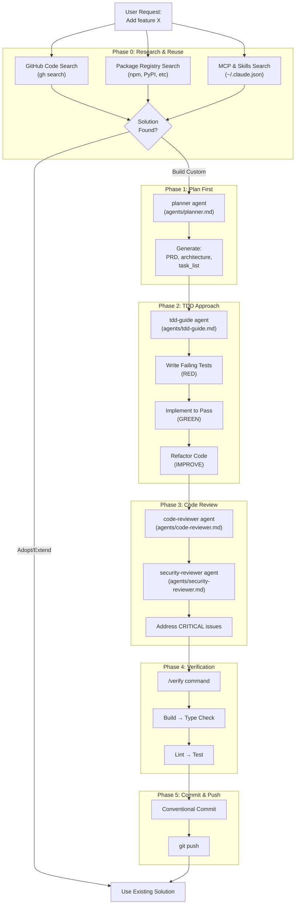
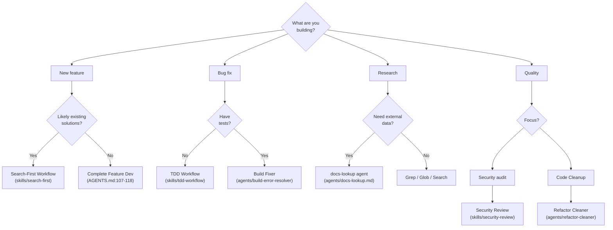
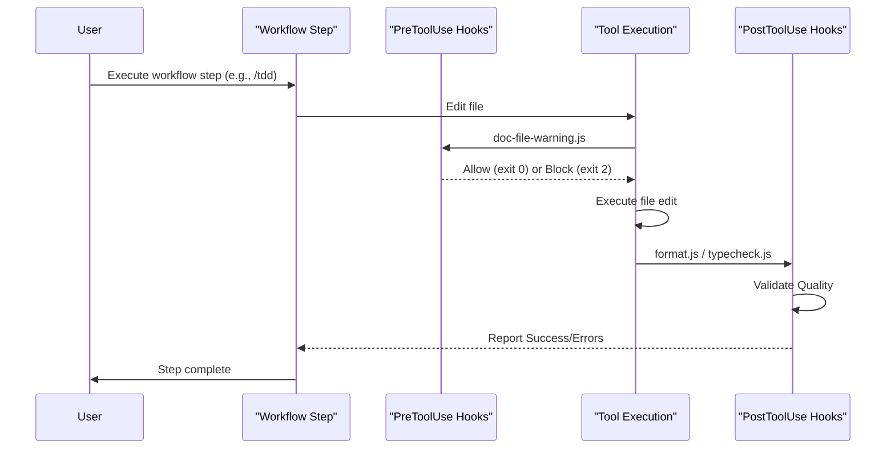

<!-- source: DeepWiki mcp.deepwiki.com · repo affaan-m/everything-claude-code · page 10 Development Workflows · fetched 2026-10-26 -->

# Development Workflows

Relevant source files

The following files were used as context for generating this wiki page:

- [AGENTS.md](AGENTS.md)
- [CONTRIBUTING.md](CONTRIBUTING.md)
- [README.md](README.md)
- [README.zh-CN.md](README.zh-CN.md)
- [WORKING-CONTEXT.md](WORKING-CONTEXT.md)
- [agent.yaml](agent.yaml)
- [agents/docs-lookup.md](agents/docs-lookup.md)
- [commands/auto-update.md](commands/auto-update.md)
- [commands/jira.md](commands/jira.md)
- [docs/SKILL-DEVELOPMENT-GUIDE.md](docs/SKILL-DEVELOPMENT-GUIDE.md)
- [docs/examples/project-guidelines-template.md](docs/examples/project-guidelines-template.md)
- [docs/skill-adaptation-policy.md](docs/skill-adaptation-policy.md)
- [docs/zh-CN/AGENTS.md](docs/zh-CN/AGENTS.md)
- [docs/zh-CN/README.md](docs/zh-CN/README.md)
- [manifests/install-modules.json](manifests/install-modules.json)
- [rules/common/code-review.md](rules/common/code-review.md)
- [rules/common/development-workflow.md](rules/common/development-workflow.md)
- [scripts/auto-update.js](scripts/auto-update.js)
- [skills/jira-integration/SKILL.md](skills/jira-integration/SKILL.md)
- [skills/search-first/SKILL.md](skills/search-first/SKILL.md)
- [tests/ci/agent-yaml-surface.test.js](tests/ci/agent-yaml-surface.test.js)
- [tests/scripts/auto-update.test.js](tests/scripts/auto-update.test.js)

## Purpose and Scope

This page documents end-to-end development workflows using ECC components. A **workflow** is a structured sequence of steps combining agents, skills, commands, and hooks to accomplish a complete development task—from initial research through implementation to verification and commit.

ECC provides a production-ready system of 47 specialized agents, 181 skills, and 79 commands evolved over 10+ months of intensive daily use [WORKING-CONTEXT.md:13](). This page provides an overview of workflow types and orchestration patterns. For detailed implementation of specific workflows, see:

- [Complete Feature Development](#10.1) — Full implementation: Research & Reuse → Plan First → TDD → Code Review → Commit & Push.
- [Search-First Workflow](#10.2) — Research-first skill: need analysis, parallel search, and evaluation.
- [Test-Driven Development Workflow](#10.3) — TDD workflow using `tdd-guide` agent: RED → GREEN → IMPROVE.
- [Code Review & Security Workflow](#10.4) — `code-reviewer` and `security-reviewer` agent usage and security scanning.
- [Checkpoint & Verification Workflow](#10.5) — `/checkpoint` and `/verify` command pipelines for state management.
- [Eval-Driven Development Workflow](#10.6) — `/eval` command for capability and regression testing.
- [Autonomous Loop Patterns](#10.7) — Unattended execution patterns: Sequential Pipelines and NanoClaw REPL.

Sources: [AGENTS.md:3-5](), [WORKING-CONTEXT.md:12-14](), [README.md:35-37]()

---

## Workflow Categories

ECC workflows are categorized by their operational domain and level of automation [manifests/install-modules.json:198-234]():

| Category | Purpose | Key Components | Automation Level |
|----------|---------|----------------|------------------|
| **Feature Development** | Implement new features from planning to commit | `planner`, `tdd-guide`, `code-reviewer` | Interactive |
| **Search-First** | Find existing solutions before coding | `docs-lookup` agent, `search-first` skill | Interactive |
| **TDD** | Write tests first, implement to pass | `tdd-guide` agent, `tdd-workflow` skill | Interactive |
| **Code Review & Security** | Quality gates and vulnerability scanning | `code-reviewer`, `security-reviewer` | On-demand |
| **Verification Loops** | Continuous or checkpoint-based validation | `verification-loop` skill, `/checkpoint`, `/verify` | Mixed |
| **Autonomous Loops** | Unattended execution via `loop-operator` | `loop-operator`, NanoClaw v2 | Fully automated |

Sources: [AGENTS.md:17-45](), [manifests/install-modules.json:198-234](), [README.md:87-91]()

---

## The Standard Feature Development Pipeline

### Complete Workflow Architecture

The canonical feature development workflow integrates research, planning, TDD, review, and verification phases [AGENTS.md:107-118](). It mandates research and reuse before any new implementation [rules/common/development-workflow.md:9-15]().

Sources: [AGENTS.md:107-118](), [rules/common/development-workflow.md:9-15](), [AGENTS.md:17-45]()

### Phase-Specific Tools

Each phase utilizes specific agents and skills from the ECC catalog [AGENTS.md:17-45]():

| Phase | Commands | Agents | Skills |
|-------|----------|--------|--------|
| **Research** | `/docs-lookup` | `docs-lookup` | `documentation-lookup` |
| **Planning** | `/plan` | `planner`, `architect` | — |
| **TDD** | `/tdd` | `tdd-guide` | `tdd-workflow` |
| **Review** | `/code-review` | `code-reviewer` | `security-review` |
| **Verification** | `/verify`, `/checkpoint` | `build-error-resolver` | `verification-loop` |
| **Autonomous** | `/loop-start` | `loop-operator` | `continuous-learning-v2` |

Sources: [AGENTS.md:17-45](), [README.md:101-102](), [manifests/install-modules.json:198-234]()

---

## Workflow Selection Guide

### Decision Matrix

The following logic helps determine the appropriate workflow for a given task:

Sources: [AGENTS.md:17-45](), [AGENTS.md:107-118](), [docs/SKILL-DEVELOPMENT-GUIDE.md:123-131]()

---

## Workflow Orchestration Patterns

### Interactive vs Autonomous Execution

ECC workflows operate in two primary modes:

1.  **Interactive Mode**: The user invokes commands (e.g., `/plan`) or skills manually, reviewing output and providing feedback at each step [AGENTS.md:107-118]().
2.  **Autonomous Mode**: Managed by the `loop-operator` agent and `/loop-start` command, this mode executes multi-step pipelines unattended, monitoring for stalls or errors [AGENTS.md:39-40]().

Sources: [AGENTS.md:39-40](), [AGENTS.md:49-54]()

### Hook-Driven Automation

Workflows integrate with the ECC hooks system to enforce quality gates automatically during tool use [manifests/install-modules.json:63-81]():

Sources: [README.md:99-101](), [manifests/install-modules.json:63-81]()

---

## Agent Delegation in Workflows

### Workflow-to-Agent Mapping

Workflows delegate specialized tasks to focused agents defined in the `agents/` directory [AGENTS.md:17-45]():

| Phase | Agent | Purpose | Target Model |
|-------|-------|---------|--------------|
| Planning | `planner` | Implementation planning | Sonnet [AGENTS.md:49]() |
| Architecture | `architect` | System design and scalability | Sonnet [AGENTS.md:52]() |
| TDD | `tdd-guide` | Test-driven development | Sonnet [AGENTS.md:51]() |
| Review | `code-reviewer` | Quality and maintainability | Sonnet [AGENTS.md:50]() |
| Security | `security-reviewer` | Vulnerability detection | Sonnet [AGENTS.md:53]() |
| Build Fix | `build-error-resolver` | Fix build/type errors | Haiku [AGENTS.md:24]() |

Sources: [AGENTS.md:17-45](), [AGENTS.md:49-55]()

### Context and Performance

ECC optimizes context usage by following strict thresholds. Large refactoring or multi-file features should avoid the last 20% of the context window to prevent performance degradation [AGENTS.md:141]().

---

## Quality Gates and Verification

Workflows incorporate quality gates at logical intervals to ensure project health:

1.  **Mandatory TDD**: 80%+ test coverage is required for all new implementations [AGENTS.md:10-93](), [rules/common/development-workflow.md:28]().
2.  **Security-First**: No hardcoded secrets and full input validation before any commit [AGENTS.md:11-61]().
3.  **Continuous Learning**: Patterns extracted from successful sessions are codified into reusable skills via the `continuous-learning-v2` workflow [manifests/install-modules.json:208]().
4.  **Verification Loops**: Systematic execution of build, type-check, lint, and test suites via the `/verify` command [manifests/install-modules.json:218]().

Sources: [AGENTS.md:10-11](), [AGENTS.md:61-93](), [manifests/install-modules.json:198-234](), [rules/common/development-workflow.md:23-28]()

---

