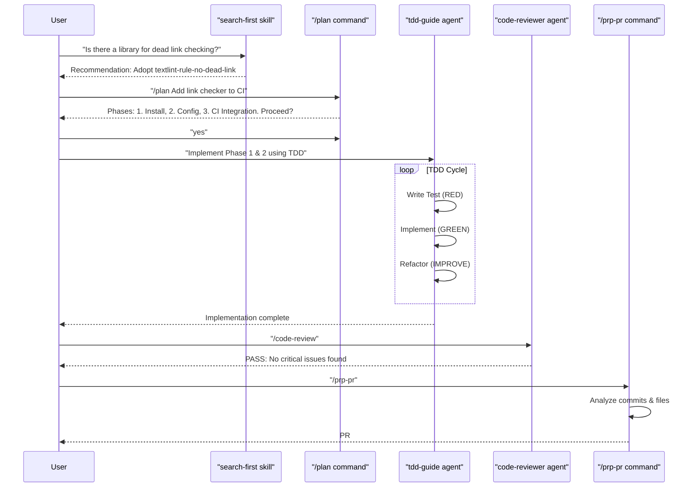

<!-- source: DeepWiki mcp.deepwiki.com · repo affaan-m/everything-claude-code · page 10.1 Complete Feature Development · fetched 2026-10-26 -->

# Complete Feature Development

<details>
<summary>Relevant source files</summary>

The following files were used as context for generating this wiki page:

- [CONTRIBUTING.md](CONTRIBUTING.md)
- [agents/docs-lookup.md](agents/docs-lookup.md)
- [commands/plan.md](commands/plan.md)
- [commands/prp-commit.md](commands/prp-commit.md)
- [commands/prp-plan.md](commands/prp-plan.md)
- [commands/prp-pr.md](commands/prp-pr.md)
- [commands/prp-prd.md](commands/prp-prd.md)
- [commands/python-review.md](commands/python-review.md)
- [docs/SKILL-DEVELOPMENT-GUIDE.md](docs/SKILL-DEVELOPMENT-GUIDE.md)
- [docs/SKILL-PLACEMENT-POLICY.md](docs/SKILL-PLACEMENT-POLICY.md)
- [docs/examples/project-guidelines-template.md](docs/examples/project-guidelines-template.md)
- [docs/skill-adaptation-policy.md](docs/skill-adaptation-policy.md)
- [rules/common/code-review.md](rules/common/code-review.md)
- [rules/common/development-workflow.md](rules/common/development-workflow.md)
- [schemas/provenance.schema.json](schemas/provenance.schema.json)
- [scripts/ci/validate-agents.js](scripts/ci/validate-agents.js)
- [scripts/ci/validate-commands.js](scripts/ci/validate-commands.js)
- [scripts/ci/validate-install-manifests.js](scripts/ci/validate-install-manifests.js)
- [scripts/ci/validate-skills.js](scripts/ci/validate-skills.js)
- [skills/hexagonal-architecture/SKILL.md](skills/hexagonal-architecture/SKILL.md)
- [skills/search-first/SKILL.md](skills/search-first/SKILL.md)
- [tests/commands/plan-command.test.js](tests/commands/plan-command.test.js)

</details>


## Purpose and Scope

This page documents the end-to-end workflow for developing production-ready features using Everything Claude Code (ECC). It defines a structured pipeline that moves from initial discovery to verified implementation: **Research & Reuse → Plan First → TDD → Code Review → Commit & Push**. This process is designed to minimize technical debt, prevent "reinventing the wheel," and enforce quality gates at every stage of the lifecycle [rules/common/development-workflow.md:1-6]().

---

## Workflow Overview

The feature implementation workflow is a battle-tested pipeline that extends standard git operations with rigorous pre-coding phases [rules/common/development-workflow.md:7-38]().

Title: Feature Development Pipeline
```mermaid
graph TD
    subgraph "Phase 0: Discovery"
        ["search-first (skills/search-first/SKILL.md)"]
    end

    subgraph "Phase 1: Strategy"
        ["/plan (commands/plan.md)"]
        ["planner (agents/planner.md)"]
    end

    subgraph "Phase 2: Execution"
        ["tdd-workflow (CONTRIBUTING.md:179-179)"]
        ["tdd-guide (agents/tdd-guide.md)"]
    end

    subgraph "Phase 3: Validation"
        ["/code-review (rules/common/code-review.md)"]
        ["code-reviewer (agents/code-reviewer.md)"]
    end

    subgraph "Phase 4: Persistence"
        ["/prp-commit (commands/prp-commit.md)"]
        ["/prp-pr (commands/prp-pr.md)"]
    end

    ["search-first (skills/search-first/SKILL.md)"] --> ["/plan (commands/plan.md)"]
    ["/plan (commands/plan.md)"] --> ["planner (agents/planner.md)"]
    ["planner (agents/planner.md)"] --> ["tdd-workflow (CONTRIBUTING.md:179-179)"]
    ["tdd-workflow (CONTRIBUTING.md:179-179)"] --> ["tdd-guide (agents/tdd-guide.md)"]
    ["tdd-guide (agents/tdd-guide.md)"] --> ["/code-review (rules/common/code-review.md)"]
    ["/code-review (rules/common/code-review.md)"] --> ["code-reviewer (agents/code-reviewer.md)"]
    ["code-reviewer (agents/code-reviewer.md)"] --> ["/prp-commit (commands/prp-commit.md)"]
    ["/prp-commit (commands/prp-commit.md)"] --> ["/prp-pr (commands/prp-pr.md)"]
```

**Sources:** [rules/common/development-workflow.md:7-38](), [commands/plan.md:105-112](), [CONTRIBUTING.md:179-179]()

---

## Phase 0: Research & Reuse

Before writing any new code, ECC mandates a "search-first" approach to identify existing solutions, libraries, or internal patterns that can be adopted or ported [rules/common/development-workflow.md:9-15]().

### The Search-First Logic
This phase is systematized by the `search-first` skill, which follows a specific decision matrix to avoid dependency bloat while maximizing reuse [skills/search-first/SKILL.md:19-47]().

| Signal | Action |
|--------|--------|
| Exact match, well-maintained, MIT/Apache | **Adopt** — install and use directly [skills/search-first/SKILL.md:53-53]() |
| Partial match, good foundation | **Extend** — install + write thin wrapper [skills/search-first/SKILL.md:54-54]() |
| Multiple weak matches | **Compose** — combine 2-3 small packages [skills/search-first/SKILL.md:55-55]() |
| Nothing suitable found | **Build** — write custom, but informed by research [skills/search-first/SKILL.md:56-56]() |

**Sources:** [rules/common/development-workflow.md:9-15](), [skills/search-first/SKILL.md:49-56]()

---

## Phase 1: Plan First

The `/plan` command (or the `planner` agent) is used to create a comprehensive implementation strategy before any code is written [commands/plan.md:1-10]().

### Planning Requirements
The plan must include:
1.  **Requirements Restatement:** Clarify what needs to be built [commands/plan.md:13-13]().
2.  **Risk Identification:** Surface potential issues and blockers [commands/plan.md:14-14]().
3.  **Step Plan:** Break down implementation into actionable phases [commands/plan.md:15-15]().
4.  **Confirmation Gate:** The assistant MUST receive user approval before proceeding [commands/plan.md:16-16]().

**Sources:** [commands/plan.md:11-17](), [rules/common/development-workflow.md:17-21]()

---

## Phase 2: TDD Approach

ECC enforces a strict Test-Driven Development (TDD) cycle using the `tdd-guide` agent [rules/common/development-workflow.md:23-24]().

### The RED-GREEN-IMPROVE Cycle
1.  **RED:** Write tests first [rules/common/development-workflow.md:25-25]().
2.  **GREEN:** Implement to pass tests [rules/common/development-workflow.md:26-26]().
3.  **IMPROVE:** Refactor code while maintaining verification [rules/common/development-workflow.md:27-27]().

### Coverage Requirements
New features should aim for **80%+ test coverage** to ensure long-term stability [rules/common/development-workflow.md:28-28]().

**Sources:** [rules/common/development-workflow.md:23-29](), [CONTRIBUTING.md:179-179]()

---

## Phase 3: Code Review

Immediately following implementation, the `code-reviewer` agent performs a quality audit [rules/common/development-workflow.md:30-31]().

### Review Specialization
Depending on the technology stack, specialized reviewers or commands may be invoked:
*   **python-reviewer**: For comprehensive Python-specific review including PEP 8 and type hints [commands/python-review.md:1-7]().
*   **security-reviewer**: Mandatory for sensitive code (auth, database queries, input handling) [rules/common/code-review.md:39-50]().
*   **Language-specific reviewers**: `go-reviewer`, `rust-reviewer`, `typescript-reviewer` [rules/common/code-review.md:62-72]().

### Severity Levels
Issues are categorized to determine merge readiness:
*   **CRITICAL**: Security vulnerability or data loss risk (**BLOCK**) [rules/common/code-review.md:55-55]().
*   **HIGH**: Bug or significant quality issue (**WARN**) [rules/common/code-review.md:56-56]().

**Sources:** [rules/common/code-review.md:51-72](), [commands/python-review.md:27-54]()

---

## Phase 4: Commit & Push

The final stage persists verified changes using the PRP (Pull Request Process) series of commands [commands/prp-pr.md:8-8]().

### Workflow Steps
1.  **Commit**: Use `/prp-commit` to create detailed, conventional commit messages [rules/common/development-workflow.md:35-38]().
2.  **PR Creation**: Use `/prp-pr` to analyze changes, discover templates, and push to GitHub [commands/prp-pr.md:1-6]().
3.  **Verification**: Confirm CI checks and linked artifacts before merging [commands/prp-pr.md:146-154]().

**Sources:** [rules/common/development-workflow.md:35-38](), [commands/prp-pr.md:1-174]()

---

## Data Flow: From Intent to Entity

This diagram bridges natural language intent to specific code entities within the ECC ecosystem.

Title: Intent to Code Entity Mapping
```mermaid
graph LR
    subgraph "Natural Language Space"
        ["'I need to research X'"]
        ["'Create a plan for Y'"]
        ["'Implement Z with tests'"]
        ["'Review my Python code'"]
    end

    subgraph "Code Entity Space"
        ["search-first (skills/search-first/SKILL.md)"]
        ["/plan (commands/plan.md)"]
        ["tdd-guide (agents/tdd-guide.md)"]
        ["python-review (commands/python-review.md)"]
        ["code-reviewer (agents/code-reviewer.md)"]
    end

    ["'I need to research X'"] --> ["search-first (skills/search-first/SKILL.md)"]
    ["'Create a plan for Y'"] --> ["/plan (commands/plan.md)"]
    ["'Implement Z with tests'"] --> ["tdd-guide (agents/tdd-guide.md)"]
    ["'Review my Python code'"] --> ["python-review (commands/python-review.md)"]

    ["python-review (commands/python-review.md)"] -.->|Invokes| ["python-reviewer (agents/python-reviewer.md)"]
    ["/plan (commands/plan.md)"] -.->|Optionally delegates to| ["planner (agents/planner.md)"]
```

**Sources:** [skills/search-first/SKILL.md:1-5](), [commands/plan.md:114-122](), [commands/python-review.md:203-207]()

---

## System Interaction: Feature Implementation

This diagram illustrates the sequential interaction between the user and ECC components during a feature lifecycle.

Title: Feature Lifecycle Interaction


**Sources:** [skills/search-first/SKILL.md:129-137](), [commands/plan.md:38-95](), [rules/common/development-workflow.md:7-38](), [commands/prp-pr.md:155-174]()

---

