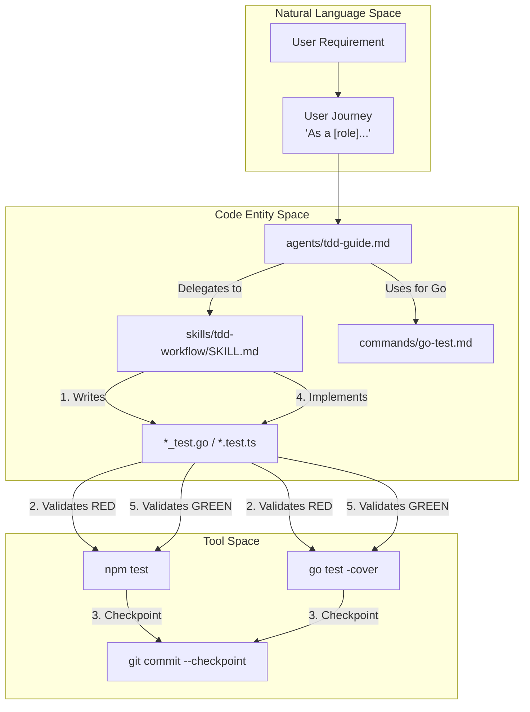
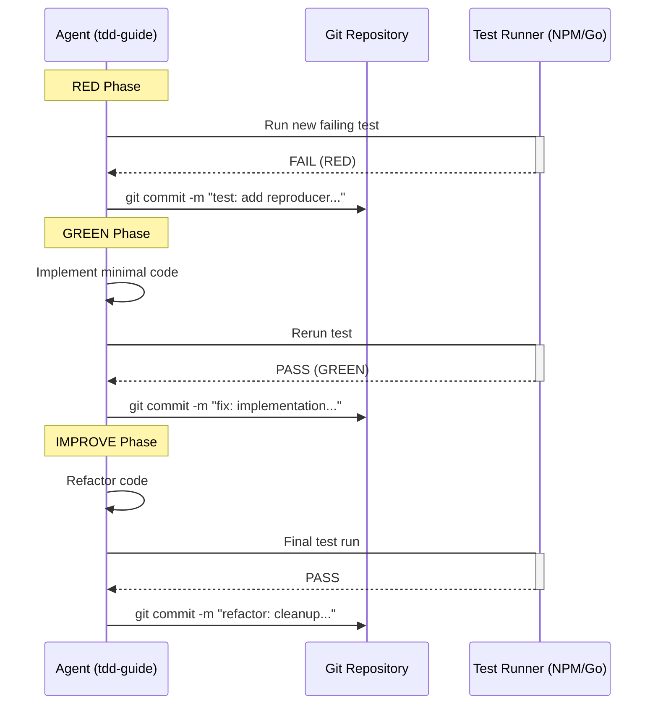

<!-- source: DeepWiki mcp.deepwiki.com · repo affaan-m/everything-claude-code · page 10.3 Test-Driven Development Workflow · fetched 2026-10-26 -->

# Test-Driven Development Workflow

Relevant source files

The following files were used as context for generating this wiki page:

- [agents/go-build-resolver.md](agents/go-build-resolver.md)
- [agents/go-reviewer.md](agents/go-reviewer.md)
- [agents/refactor-cleaner.md](agents/refactor-cleaner.md)
- [agents/tdd-guide.md](agents/tdd-guide.md)
- [commands/go-build.md](commands/go-build.md)
- [commands/go-review.md](commands/go-review.md)
- [commands/go-test.md](commands/go-test.md)
- [skills/golang-patterns/SKILL.md](skills/golang-patterns/SKILL.md)
- [skills/golang-testing/SKILL.md](skills/golang-testing/SKILL.md)
- [skills/security-review/SKILL.md](skills/security-review/SKILL.md)
- [skills/tdd-workflow/SKILL.md](skills/tdd-workflow/SKILL.md)

This page documents the Test-Driven Development (TDD) workflow implementation in Everything Claude Code (ECC), specifically focusing on the `tdd-workflow` skill, the `tdd-guide` agent, and language-specific implementations like the Go TDD command. The workflow enforces a strict RED-GREEN-IMPROVE cycle with mandatory coverage and checkpoint requirements.

---

## Overview

The TDD workflow in ECC is a high-discipline process that mandates writing tests before any production code is modified. It is primarily driven by the `tdd-workflow` skill [[skills/tdd-workflow/SKILL.md:1-5]]() and the `tdd-guide` agent [[agents/tdd-guide.md:1-6]](). The workflow is designed to ensure 80%+ test coverage across unit, integration, and E2E layers [[skills/tdd-workflow/SKILL.md:24-29]](). Specialists like the `tdd-guide` agent are trained to catch edge cases—such as null/undefined inputs, race conditions, and boundary values—before implementation begins [[agents/tdd-guide.md:50-60]]().

**Sources**: [[skills/tdd-workflow/SKILL.md:1-5]](), [[agents/tdd-guide.md:1-60]]()

---

## The TDD Cycle: RED-GREEN-IMPROVE

The core methodology follows a three-phase iterative loop. Each phase has specific entry and exit criteria, including mandatory validation steps and git checkpoints [[skills/tdd-workflow/SKILL.md:63-165]]().

### 1. RED (Write Failing Test)
*   **Goal**: Define the requirement through a test that fails for the *intended* reason [[skills/tdd-workflow/SKILL.md:103-115]]().
*   **Validation**: A test is only considered RED if it is compiled and executed, resulting in a failure caused by missing logic or a bug, not unrelated syntax errors or broken setup [[skills/tdd-workflow/SKILL.md:113-118]]().
*   **Checkpoint**: Create a git commit (e.g., `test: add reproducer for <feature or bug>`) immediately after the RED state is validated on the active branch [[skills/tdd-workflow/SKILL.md:120-124]]().

### 2. GREEN (Pass Test)
*   **Goal**: Implement the minimal amount of code necessary to make the failing test pass [[skills/tdd-workflow/SKILL.md:126-128]]().
*   **Validation**: Rerun the same relevant test target to confirm the previously failing test is now GREEN [[skills/tdd-workflow/SKILL.md:144-145]]().
*   **Checkpoint**: Create a git commit (e.g., `fix: <feature or bug>`) after GREEN is confirmed [[skills/tdd-workflow/SKILL.md:148-152]]().

### 3. IMPROVE (Refactor)
*   **Goal**: Enhance code quality (readability, performance, naming) without changing behavior [[skills/tdd-workflow/SKILL.md:154-159]]().
*   **Validation**: Ensure all tests remain GREEN after refactoring [[skills/tdd-workflow/SKILL.md:161]](). Specialized agents like `refactor-cleaner` may be used here to remove dead code identified by tools like `knip` or `ts-prune` [[agents/refactor-cleaner.md:1-26]]().
*   **Checkpoint**: Create a final commit (e.g., `refactor: clean up after <feature or bug> implementation`) [[skills/tdd-workflow/SKILL.md:162-164]]().

**Sources**: [[skills/tdd-workflow/SKILL.md:97-165]](), [[agents/tdd-guide.md:18-35]](), [[agents/refactor-cleaner.md:1-26]]()

---

## Data Flow and Code Entity Mapping

The following diagrams bridge the natural language TDD requirements to the specific code entities and tools used in the ECC implementation.

### TDD Execution Flow

**Sources**: [[skills/tdd-workflow/SKILL.md:63-145]](), [[agents/tdd-guide.md:1-40]](), [[commands/go-test.md:1-17]]()

---

## Language-Specific Implementations

ECC provides specialized TDD paths for different ecosystems, notably Go and TypeScript/JavaScript.

### Go TDD Workflow (`/go-test`)
The `/go-test` command enforces idiomatic Go testing patterns, such as table-driven tests and subtests [[commands/go-test.md:174-193]]().
1.  **Define Signatures**: Scaffold function signatures that `panic("not implemented")` [[commands/go-test.md:46-55]]().
2.  **Table-Driven Tests**: Write comprehensive test cases in a `TestXxx` function using a struct slice [[commands/go-test.md:67-101]]().
3.  **Coverage**: Use `go test -cover` to target 80% (general) to 100% (critical logic) coverage [[commands/go-test.md:218-242]]().

### TypeScript/Node.js TDD
Follows standard patterns using Jest, Vitest, or Playwright [[skills/tdd-workflow/SKILL.md:174-204]]().
*   **Unit**: Individual functions/utilities [[skills/tdd-workflow/SKILL.md:32-37]]().
*   **Integration**: API endpoints and service interactions [[skills/tdd-workflow/SKILL.md:38-43]]().
*   **E2E**: Critical user flows using Playwright browser automation [[skills/tdd-workflow/SKILL.md:44-49]]().

**Sources**: [[commands/go-test.md:1-242]](), [[skills/tdd-workflow/SKILL.md:30-49]](), [[skills/golang-testing/SKILL.md:1-100]]()

---

## Git Checkpoint System

The `tdd-workflow` skill emphasizes "checkpoint evidence" to ensure the AI agent does not skip steps. It requires that checkpoints be reachable from the current `HEAD` on the active branch [[skills/tdd-workflow/SKILL.md:51-56]]().

**Sources**: [[skills/tdd-workflow/SKILL.md:50-62]](), [[skills/tdd-workflow/SKILL.md:120-165]]()

---

## Integration with Feature Development

TDD is typically part of a broader orchestration flow involving multiple specialized agents and commands.

1.  **Implementation**: Use the `tdd-workflow` skill or `/go-test` command to build the feature [[skills/tdd-workflow/SKILL.md:1-5]](), [[commands/go-test.md:1-17]]().
2.  **Build Resolution**: If TDD implementation causes compilation errors (especially in Go), invoke the `go-build-resolver` agent via `/go-build` for surgical fixes [[agents/go-build-resolver.md:8-18]](), [[commands/go-build.md:1-15]]().
3.  **Security Review**: Use the `security-review` skill when handling sensitive data or auth to verify against the security checklist [[skills/security-review/SKILL.md:1-21]]().
4.  **Final Review**: Use specialized reviewers like `go-reviewer` (via `/go-review`) to ensure idiomatic patterns and concurrency safety before merging [[agents/go-reviewer.md:1-45]](), [[commands/go-review.md:1-16]]().

**Sources**: [[commands/go-build.md:1-15]](), [[skills/security-review/SKILL.md:1-21]](), [[agents/go-reviewer.md:1-45]](), [[commands/go-review.md:1-16]]()

---

