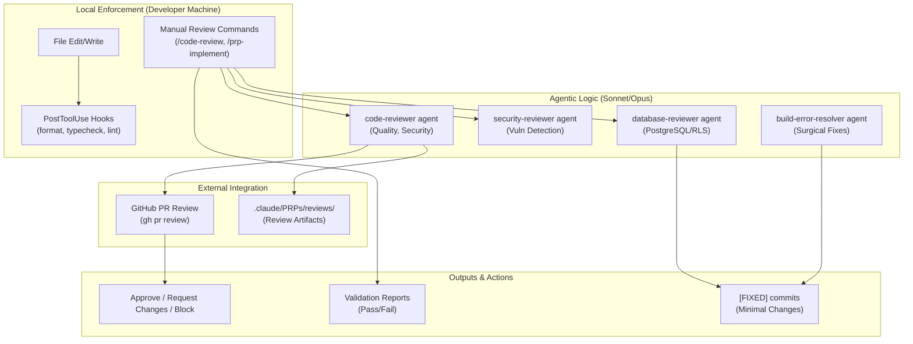
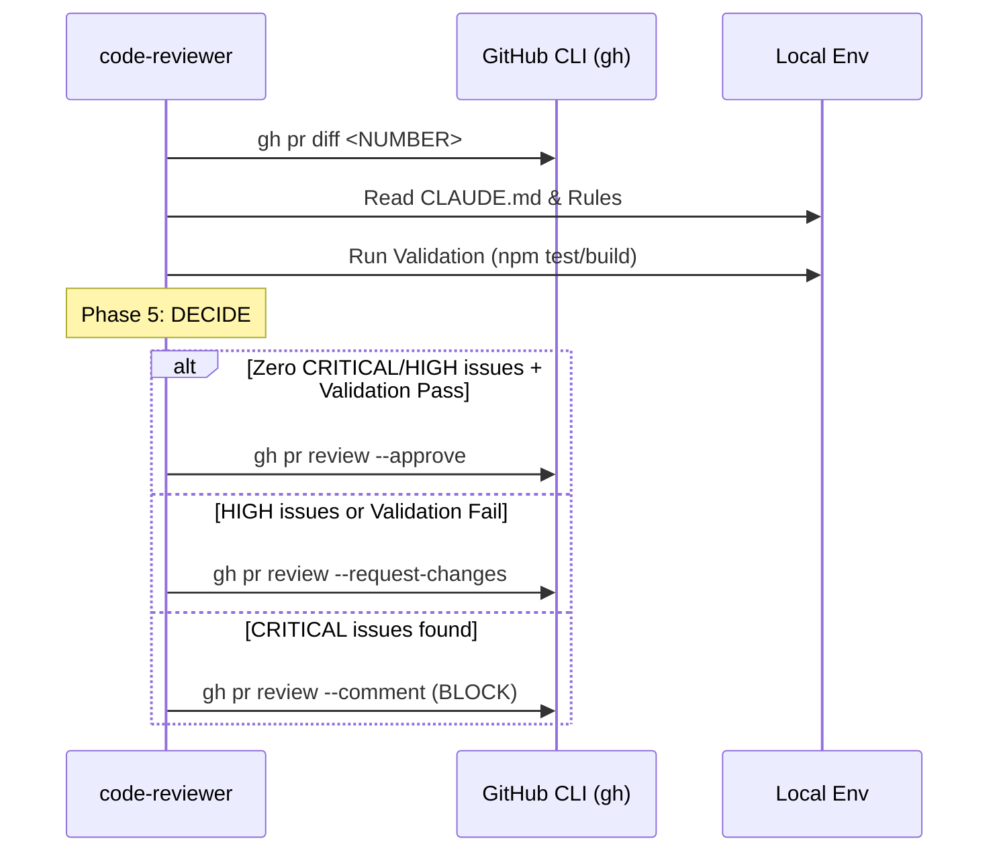

<!-- source: DeepWiki mcp.deepwiki.com · repo affaan-m/everything-claude-code · page 10.4 Code Review & Security Workflow · fetched 2026-10-26 -->

# Code Review & Security Workflow

Relevant source files

The following files were used as context for generating this wiki page:

- [agents/architect.md](agents/architect.md)
- [agents/build-error-resolver.md](agents/build-error-resolver.md)
- [agents/code-reviewer.md](agents/code-reviewer.md)
- [agents/database-reviewer.md](agents/database-reviewer.md)
- [agents/doc-updater.md](agents/doc-updater.md)
- [agents/e2e-runner.md](agents/e2e-runner.md)
- [agents/gan-generator.md](agents/gan-generator.md)
- [agents/planner.md](agents/planner.md)
- [agents/python-reviewer.md](agents/python-reviewer.md)
- [agents/security-reviewer.md](agents/security-reviewer.md)
- [commands/code-review.md](commands/code-review.md)
- [commands/prp-implement.md](commands/prp-implement.md)
- [docs/zh-CN/skills/browser-qa/SKILL.md](docs/zh-CN/skills/browser-qa/SKILL.md)
- [examples/django-api-CLAUDE.md](examples/django-api-CLAUDE.md)
- [examples/saas-nextjs-CLAUDE.md](examples/saas-nextjs-CLAUDE.md)
- [scripts/gan-harness.sh](scripts/gan-harness.sh)
- [scripts/setup-package-manager.js](scripts/setup-package-manager.js)
- [skills/cpp-testing/SKILL.md](skills/cpp-testing/SKILL.md)
- [skills/e2e-testing/SKILL.md](skills/e2e-testing/SKILL.md)
- [skills/gan-style-harness/SKILL.md](skills/gan-style-harness/SKILL.md)
- [skills/postgres-patterns/SKILL.md](skills/postgres-patterns/SKILL.md)

This page documents code-reviewer and security-reviewer agent usage, issue prioritization, and security scanning workflows within Everything Claude Code (ECC). It covers manual review invocation, automated quality enforcement, and integration with development pipelines.

For continuous verification and testing workflows, see [Checkpoint & Verification Workflow](10.5). For write-time quality enforcement hooks, see [Hook Testing Infrastructure](6.5) and [PostToolUse Hooks](6.3).

---

## Overview

ECC provides a multi-layered code review and security system with four enforcement levels:

1.  **Write-time enforcement** — PostToolUse hooks (format, typecheck, lint) warn on quality issues immediately after file edits.
2.  **Manual review agents** — Dedicated subagents (`code-reviewer`, `security-reviewer`, `database-reviewer`) perform deep analysis on demand.
3.  **CI/CD Pipeline Integration** — Automated validation of agents, hooks, and security audits via GitHub Actions.
4.  **Specialized Validation Loops** — Surgical fix loops for build errors and TDD enforcement.

The system distinguishes between **blocking quality gates** (hooks or commands that prevent problematic operations) and **advisory feedback** (warnings that guide but don't block).

Sources: [agents/code-reviewer.md:1-6](), [commands/code-review.md:1-10](), [agents/security-reviewer.md:1-6]()

---

## Core Components

### Review Agents

ECC includes specialized review agents with distinct scopes and model configurations:

| Agent | Model | Tools | Purpose |
| :--- | :--- | :--- | :--- |
| `code-reviewer` | sonnet | Read, Grep, Glob, Bash | General quality, security, and maintainability review. [agents/code-reviewer.md:1-6]() |
| `security-reviewer` | sonnet | Read, Write, Edit, Bash, Grep, Glob | Deep security audits, vulnerability detection, and remediation. [agents/security-reviewer.md:1-6]() |
| `database-reviewer`| sonnet | Read, Write, Edit, Bash, Grep, Glob | PostgreSQL optimization, RLS security, and schema design. [agents/database-reviewer.md:1-6]() |
| `build-error-resolver`| sonnet | Read, Write, Edit, Bash, Grep, Glob | Surgical resolution of TypeScript and build failures. [agents/build-error-resolver.md:1-6]() |
| `doc-updater` | haiku | Read, Write, Edit, Bash, Grep, Glob | Maintains codemaps and ensures documentation matches code reality. [agents/doc-updater.md:1-6]() |

Sources: [agents/code-reviewer.md:1-6](), [agents/security-reviewer.md:1-6](), [agents/database-reviewer.md:1-6](), [agents/build-error-resolver.md:1-6](), [agents/doc-updater.md:1-6]()

### Review & Quality Commands

| Command | Primary Agent | When to Use |
| :--- | :--- | :--- |
| `/code-review` | `code-reviewer` | Review local uncommitted changes or GitHub PRs. [commands/code-review.md:1-10]() |
| `/prp-implement` | N/A | Execute plans with rigorous validation loops (type-check, lint, test, build). [commands/prp-implement.md:1-15]() |
| `/setup-pm` | N/A | Configure and verify package manager consistency. [scripts/setup-package-manager.js:1-13]() |

Sources: [commands/code-review.md:1-10](), [commands/prp-implement.md:1-15](), [scripts/setup-package-manager.js:1-13]()

---

## Code Review Architecture

**Diagram: ECC Quality and Security Pipeline**

The system operates at distinct intervention points:
1.  **Immediate feedback** via hooks (formatting, type errors) — runs transparently during edits.
2.  **Specialized Manual Review** via `/code-review`. This command can operate in **Local Review Mode** (uncommitted changes) or **PR Review Mode** (fetching diffs via `gh pr diff`). [commands/code-review.md:24-117]()
3.  **Validation Loops** for build errors using `build-error-resolver`, which targets minimal lines changed (< 5%) to reach a green state. [agents/build-error-resolver.md:97-103]()
4.  **Implementation Gating** via `/prp-implement`, which enforces a 5-level validation pipeline (Static Analysis, Unit Tests, Build, Integration, Edge Cases). [commands/prp-implement.md:132-205]()

Sources: [commands/code-review.md:24-117](), [agents/build-error-resolver.md:97-103](), [commands/prp-implement.md:132-205]()

---

## Review Workflow Patterns

### Pattern 1: Security-First Review

The `code-reviewer` and `security-reviewer` agents apply a strict hierarchy of concerns [agents/code-reviewer.md:31-61]:

1.  **CRITICAL - Security**: Flags hardcoded credentials, SQL injection, XSS vulnerabilities, path traversal, and authentication bypasses. [agents/code-reviewer.md:32-44]()
2.  **CRITICAL - Database Security**: The `database-reviewer` specifically enforces Row Level Security (RLS) on multi-tenant tables and validates RLS policy column indexing. [agents/database-reviewer.md:43-48]()
3.  **HIGH - Quality**: Detects large functions (>50 lines), deep nesting (>4 levels), missing error handling, and mutation patterns. [agents/code-reviewer.md:62-72]()
4.  **Confidence Filtering**: Agents are instructed to only report issues they are >80% confident about to minimize noise. [agents/code-reviewer.md:20-29]()

Sources: [agents/code-reviewer.md:31-72](), [agents/database-reviewer.md:43-48]()

### Pattern 2: PR Review & Decision Logic

The `/code-review` command implements a multi-phase PR review logic [commands/code-review.md:76-244]:

**Diagram: PR Review Decision Logic**

*   **Validation**: Detects project type (Node, Rust, Go, Python) and runs corresponding build/test commands. [commands/code-review.md:138-172]()
*   **Artifacts**: Generates a markdown report at `.claude/PRPs/reviews/pr-<NUMBER>-review.md`. [commands/code-review.md:189-230]()

Sources: [commands/code-review.md:76-244](), [commands/code-review.md:138-172]()

---

## Database Security & Optimization

The `database-reviewer` agent focuses on PostgreSQL and Supabase best practices [agents/database-reviewer.md:10-20]:

*   **Query Performance**: Enforces `EXPLAIN ANALYZE` on complex queries and checks for Seq Scans on large tables. [agents/database-reviewer.md:32-37]()
*   **Schema Constraints**: Mandates `bigint` for IDs, `timestamptz` for timestamps, and foreign key indexing. [agents/database-reviewer.md:38-42, 51]()
*   **Concurrency**: Recommends `FOR UPDATE SKIP LOCKED` for queues and consistent lock ordering to prevent deadlocks. [agents/database-reviewer.md:54, 58]()

Sources: [agents/database-reviewer.md:10-58]()

---

## Build Error Resolution Loop

The `build-error-resolver` agent provides a surgical loop for fixing compilation issues [agents/build-error-resolver.md:30-43]:

1.  **Diagnose**: Runs `npx tsc --noEmit --pretty` to categorize type inference, imports, and config errors. [agents/build-error-resolver.md:32-36]()
2.  **Surgical Fix**: Applies minimal changes (e.g., adding type annotations, null checks `?.`, or fixing imports). [agents/build-error-resolver.md:37-43, 44-56]()
3.  **Verify**: Re-runs the build and verifies `npx tsc --noEmit` exits with code 0. [agents/build-error-resolver.md:97-103]()
4.  **Constraint**: Explicitly forbidden from refactoring, changing architecture, or adding features. [agents/build-error-resolver.md:67-74]()

Sources: [agents/build-error-resolver.md:30-103]()

---

## References

| Component | File Path |
| :--- | :--- |
| Code Reviewer Agent | [agents/code-reviewer.md]() |
| Security Reviewer Agent | [agents/security-reviewer.md]() |
| Database Reviewer Agent | [agents/database-reviewer.md]() |
| Build Error Resolver | [agents/build-error-resolver.md]() |
| Code Review Command | [commands/code-review.md]() |
| PRP Implementation | [commands/prp-implement.md]() |
| Package Manager Setup | [scripts/setup-package-manager.js]() |

Sources: [agents/code-reviewer.md:1-6](), [agents/security-reviewer.md:1-6](), [agents/database-reviewer.md:1-6](), [agents/build-error-resolver.md:1-6](), [commands/code-review.md:1-4](), [commands/prp-implement.md:1-4](), [scripts/setup-package-manager.js:1-13]()

---

