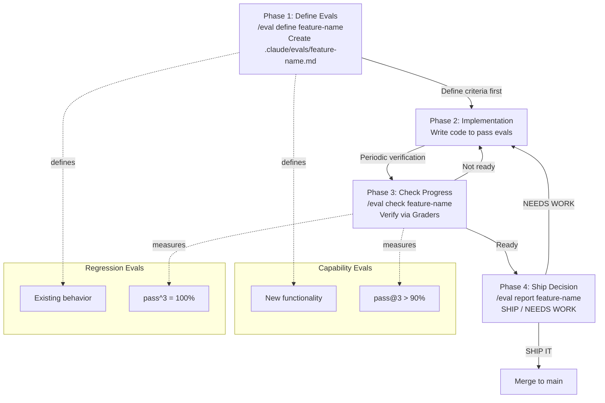

<!-- source: DeepWiki mcp.deepwiki.com · repo affaan-m/everything-claude-code · page 10.6 Eval-Driven Development Workflow · fetched 2026-10-26 -->

# Eval-Driven Development Workflow

<details>
<summary>Relevant source files</summary>

The following files were used as context for generating this wiki page:

- [AGENTS.md](AGENTS.md)
- [README.md](README.md)
- [README.zh-CN.md](README.zh-CN.md)
- [WORKING-CONTEXT.md](WORKING-CONTEXT.md)
- [agent.yaml](agent.yaml)
- [commands/auto-update.md](commands/auto-update.md)
- [commands/jira.md](commands/jira.md)
- [docs/zh-CN/AGENTS.md](docs/zh-CN/AGENTS.md)
- [docs/zh-CN/README.md](docs/zh-CN/README.md)
- [examples/user-CLAUDE.md](examples/user-CLAUDE.md)
- [manifests/install-modules.json](manifests/install-modules.json)
- [scripts/auto-update.js](scripts/auto-update.js)
- [skills/backend-patterns/SKILL.md](skills/backend-patterns/SKILL.md)
- [skills/clickhouse-io/SKILL.md](skills/clickhouse-io/SKILL.md)
- [skills/coding-standards/SKILL.md](skills/coding-standards/SKILL.md)
- [skills/continuous-learning/SKILL.md](skills/continuous-learning/SKILL.md)
- [skills/django-verification/SKILL.md](skills/django-verification/SKILL.md)
- [skills/eval-harness/SKILL.md](skills/eval-harness/SKILL.md)
- [skills/frontend-patterns/SKILL.md](skills/frontend-patterns/SKILL.md)
- [skills/iterative-retrieval/SKILL.md](skills/iterative-retrieval/SKILL.md)
- [skills/jira-integration/SKILL.md](skills/jira-integration/SKILL.md)
- [tests/ci/agent-yaml-surface.test.js](tests/ci/agent-yaml-surface.test.js)
- [tests/scripts/auto-update.test.js](tests/scripts/auto-update.test.js)

</details>


## Purpose and Scope

This document describes the eval-driven development (EDD) workflow, a formal evaluation framework for AI agent sessions within Everything Claude Code (ECC). EDD establishes objective pass/fail criteria before implementation begins and tracks progress against these criteria throughout development. The workflow centers on the `eval-harness` skill and the `/eval` command, which manages capability evals (new functionality), regression evals (existing functionality preservation), and reliability metrics like `pass@k` [manifests/install-modules.json:201-211]().

For general TDD practices, see [Test-Driven Development Workflow](10.3). For code quality verification, see [Code Review & Security Workflow](10.4). For progress tracking, see [Checkpoint & Verification Workflow](10.5).

## Workflow Overview

The eval-driven development workflow follows a four-phase cycle that treats evals as the "unit tests of AI development."

Title: Eval-Driven Development Lifecycle

Sources: [README.md:81-82](), [manifests/install-modules.json:201-211](), [AGENTS.md:100-103]()

## Eval Types

### Capability Evals
Capability evals test if the agent can perform a task it previously could not. They measure reliability across multiple attempts using `pass@k` metrics.

| Metric | Requirement | Meaning |
|--------|-------------|---------|
| `pass@1` | Informational | Success on the first attempt. |
| `pass@3` | **>= 90%** | Practical reliability under controlled retries. |

### Regression Evals
Regression evals ensure changes do not break existing functionality. These require a higher bar for stability.

| Metric | Requirement | Meaning |
|--------|-------------|---------|
| `pass^3` | **100%** | Stability test: all 3 consecutive trials must succeed. |

Sources: [README.md:81-82](), [AGENTS.md:91-94](), [AGENTS.md:100-103]()

## Grader Implementation

The ECC system supports four distinct grader types to evaluate task completion within the `eval-harness` skill [manifests/install-modules.json:211-211]().

### 1. Code-Based Grader
Deterministic checks using shell commands or test runners. This is the preferred grader type.
*   **Examples**: `grep` for patterns, `npm test` for logic, or build validation [AGENTS.md:143-144]().

### 2. Rule Grader
Enforces constraints via ECC rules (e.g., naming conventions, immutability) found in `rules/common/coding-style.md` [skills/coding-standards/SKILL.md:15-15]().

### 3. Model-Based Grader
Uses an LLM (typically Claude 3.5 Sonnet or Opus) as a judge to evaluate open-ended outputs against a rubric [agent.yaml:7-10]().
*   **Criteria**: Problem resolution, structure, and adherence to `coding-standards` [skills/coding-standards/SKILL.md:1-5]().

### 4. Human Grader
Manual adjudication for ambiguous outputs. Human review is recommended for security-critical paths as defined in the Security Guidelines [AGENTS.md:59-73]().

Sources: [manifests/install-modules.json:211-211](), [AGENTS.md:75-81](), [skills/coding-standards/SKILL.md:1-15]()

## Command Interface

The `/eval` command delegates to the `eval-harness` skill and associated agents [agent.yaml:145-213]().

| Command | Intent | Action |
|---------|--------|--------|
| `/eval define <name>` | **Define** | Creates definition at `.claude/evals/<name>.md`. |
| `/eval check <name>` | **Check** | Runs current evals and records status. |
| `/eval report <name>` | **Report** | Generates full report with `pass@k` metrics. |
| `/eval list` | **List** | Lists all defined evals in the project. |

Sources: [agent.yaml:145-213](), [manifests/install-modules.json:201-211]()

## Data Flow and Storage

Evals are stored as first-class artifacts within the project directory to ensure persistence across sessions.

Title: Eval System Code Entities and Data Flow
```mermaid
graph LR
    USER["User Command"]
    AGENT["Agent (e.g. planner/tdd-guide)"]
    SKILL["skills/eval-harness/SKILL.md"]
    
    subgraph "Project Artifacts"
        DEF[".claude/evals/feature.md"]
        LOG[".claude/evals/feature.log"]
        BASE[".claude/evals/baseline.json"]
    end
    
    USER -->|"/eval check"| AGENT
    AGENT -->| "Invoke Skill" | SKILL
    SKILL -->| "Read Definition" | DEF
    SKILL -->| "Run Graders" | LOG
    SKILL -->| "Compare Baselines" | BASE
    SKILL -->| "Generate Report" | USER
```
Sources: [AGENTS.md:15-45](), [manifests/install-modules.json:201-211](), [agent.yaml:145-213]()

### File Structure
*   **`.claude/evals/<feature>.md`**: Contains the eval definition and criteria.
*   **`.claude/evals/<feature>.log`**: Stores the run history and evidence.
*   **`.claude/evals/baseline.json`**: Stores regression baselines for comparison.

Sources: [WORKING-CONTEXT.md:34-39](), [manifests/install-modules.json:201-211]()

## Metrics Calculation and Decisions

### Pass@k Guidance
*   **pass@1**: Direct reliability indicator.
*   **pass@3**: Practical reliability (used for Capability Evals).
*   **pass^3**: Strict stability (used for Regression Evals).

### Decision Matrix
The final report concludes with a status based on the following logic:
1.  **SHIP**: Capability `pass@3 >= 90%` AND Regression `pass^3 = 100%`.
2.  **NEEDS WORK**: Thresholds not met; requires further implementation or refactoring.
3.  **BLOCKED**: Graders are failing due to environmental issues (e.g., build errors) [AGENTS.md:143-144]().

Sources: [README.md:81-82](), [AGENTS.md:91-105]()

## Best Practices

1.  **Define BEFORE coding**: Forces clear thinking about success criteria [AGENTS.md:13-13]().
2.  **Deterministic Graders**: Use code-based graders (unit tests) over model-based graders whenever possible [AGENTS.md:91-94]().
3.  **Human Review for Security**: Never fully automate security-critical evaluations [AGENTS.md:59-60]().
4.  **Immutability**: Ensure graders do not mutate the state they are checking [AGENTS.md:77-77]().

Sources: [AGENTS.md:7-14](), [AGENTS.md:59-73](), [AGENTS.md:77-77]()

---

