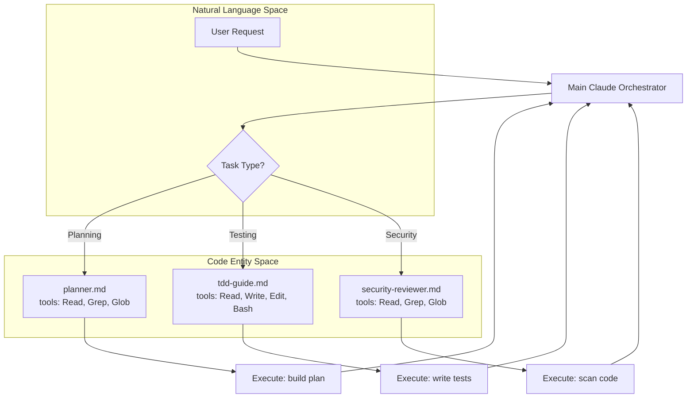
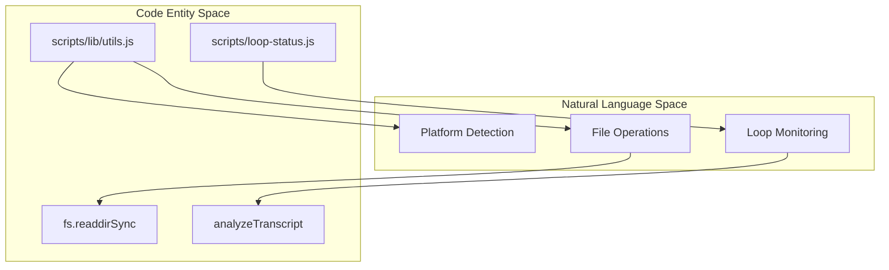
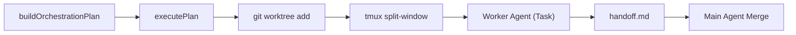

<!-- source: DeepWiki mcp.deepwiki.com · repo affaan-m/everything-claude-code · page 11 Advanced Topics · fetched 2026-10-26 -->

# Advanced Topics

Relevant source files

The following files were used as context for generating this wiki page:

- [.yarnrc.yml](.yarnrc.yml)
- [AGENTS.md](AGENTS.md)
- [README.md](README.md)
- [README.zh-CN.md](README.zh-CN.md)
- [WORKING-CONTEXT.md](WORKING-CONTEXT.md)
- [agent.yaml](agent.yaml)
- [commands/auto-update.md](commands/auto-update.md)
- [commands/jira.md](commands/jira.md)
- [commands/loop-status.md](commands/loop-status.md)
- [docs/zh-CN/AGENTS.md](docs/zh-CN/AGENTS.md)
- [docs/zh-CN/README.md](docs/zh-CN/README.md)
- [manifests/install-modules.json](manifests/install-modules.json)
- [package-lock.json](package-lock.json)
- [package.json](package.json)
- [scripts/auto-update.js](scripts/auto-update.js)
- [scripts/build-opencode.js](scripts/build-opencode.js)
- [scripts/consult.js](scripts/consult.js)
- [scripts/ecc.js](scripts/ecc.js)
- [scripts/loop-status.js](scripts/loop-status.js)
- [skills/jira-integration/SKILL.md](skills/jira-integration/SKILL.md)
- [tests/ci/agent-yaml-surface.test.js](tests/ci/agent-yaml-surface.test.js)
- [tests/scripts/auto-update.test.js](tests/scripts/auto-update.test.js)
- [tests/scripts/consult.test.js](tests/scripts/consult.test.js)
- [tests/scripts/ecc.test.js](tests/scripts/ecc.test.js)
- [tests/scripts/loop-status.test.js](tests/scripts/loop-status.test.js)
- [tests/scripts/npm-publish-surface.test.js](tests/scripts/npm-publish-surface.test.js)
- [yarn.lock](yarn.lock)

This page provides deep dives into the internal architectures, optimization strategies, and testing infrastructure that power Everything Claude Code (ECC). Topics covered include agent delegation patterns, token optimization techniques, memory preservation across sessions, cross-platform utility libraries, package manager detection, and the Plankton code quality system.

For basic concepts about agents, skills, and hooks, see [Core Concepts](#3). For practical workflows using these systems, see [Development Workflows](#10). For cross-platform details, see [Cross-Platform Support](#12).

---

## Agent Delegation & Orchestration

The system implements agent orchestration where the main Claude instance delegates specialized tasks to bounded subagents. This reduces context pressure and enables parallel execution. The system features 47 specialized agents [WORKING-CONTEXT.md:13](), including the `loop-operator` for autonomous execution [AGENTS.md:39]() and the `harness-optimizer` for config tuning [AGENTS.md:40]().

### Bounded Contexts and Tool Sandboxing

Each agent operates within a bounded context defined by:
- **Tool Permissions**: Restricted subset of available tools (Read, Write, Edit, Bash, Grep, Glob) [AGENTS.md:19-23]()
- **Skill Access**: Pre-loaded skills relevant to the agent's domain [package.json:90-230]()
- **Model Selection**: Appropriate model tier (Haiku for simple tasks, Sonnet for moderate, Opus for complex) [README.md:78]().

**Architecture: Agent Delegation Flow**

Sources: [AGENTS.md:15-55](), [docs/zh-CN/AGENTS.md:15-60](), [WORKING-CONTEXT.md:13]()

For details, see [Agent Delegation & Orchestration](#11.1).

---

## Token Optimization Strategies

Token optimization operates at multiple levels: model selection (Haiku/Sonnet/Opus), MCP discipline, tool choice (mgrep vs grep), and codebase structure.

### The 200k → 70k Degradation Problem

The 200k context window can degrade significantly if too many MCP servers are enabled. Each MCP server adds tool definitions that consume context. ECC manages 14 MCP server configurations [docs/zh-CN/AGENTS.md:155]() and recommends a "discipline" approach: having many configured but only a subset enabled at any time to preserve the effective window [README.md:83]().

### Strategic Compaction

The `strategic-compact` skill [package.json:220]() tracks tool call count and suggests compaction at logical intervals. The system also includes a `token-budget-advisor` skill [package.json:228]() to help manage context utilization.

Sources: [README.md:78-83](), [AGENTS.md:139-144](), [package.json:220-228]()

For details, see [Token Optimization Strategies](#11.2).

---

## Memory & Context Preservation

Session preservation across Claude Code invocations is handled by session files, state stores, and hooks. The system uses a SQLite state store (`~/.claude/ecc/state.db`) to track session and install state [README.md:104]().

### Session File Format and Lifecycle

The system utilizes specific directories for session data, including project-scoped transcripts in `~/.claude/projects/` [scripts/loop-status.js:211](). The `loop-status` utility analyzes these transcripts to detect stale calls or pending results [scripts/loop-status.js:18-19]().

For details, see [Memory & Context Preservation](#11.3).

---

## Utility Library Architecture

The utility library (`scripts/lib/`) provides cross-platform primitives for file operations, command execution, and hook I/O. These scripts are battle-tested across Windows, macOS, and Linux [README.md:183-184]().

### Cross-Platform Primitives

Sources: [README.md:183-184](), [scripts/loop-status.js:1-13](), [package.json:77]()

For details, see [Utility Library Architecture](#11.4).

---

## Package Manager System

The system implements a priority cascade to detect the preferred package manager (npm, pnpm, yarn, bun) [README.zh-CN.md:185-194]().

### Detection Priority

1. **Environment variable**: `CLAUDE_PACKAGE_MANAGER` [README.zh-CN.md:189]()
2. **Project configuration**: `.claude/package-manager.json` [README.zh-CN.md:190]()
3. **package.json**: `packageManager` field [README.zh-CN.md:191]()
4. **Lock files**: `package-lock.json`, `yarn.lock`, `pnpm-lock.yaml`, `bun.lockb` [README.zh-CN.md:192]()
5. **Global configuration**: `~/.claude/package-manager.json` [README.zh-CN.md:193]()

Sources: [README.zh-CN.md:185-194](), [package.json:86]()

For details, see [Package Manager System](#11.5).

---

## Testing Infrastructure

The testing infrastructure includes unit tests, integration tests, and CI validation scripts. The project maintains a high standard of quality with over 1,000 internal tests [docs/zh-CN/README.md:113]().

### Test Suite Orchestration

The test suite includes dedicated scripts for validating various components and preventing regressions.

| Test Script | Target | Purpose |
|-----------|--------|---------|
| `tests/scripts/loop-status.test.js` | `scripts/loop-status.js` | Validates transcript analysis and overdue wakeup detection [tests/scripts/loop-status.test.js:1-18]() |
| `tests/scripts/build-opencode.test.js` | `scripts/build-opencode.js` | Packaging regression guard for OpenCode artifacts [WORKING-CONTEXT.md:95]() |
| `tests/ci/agent-yaml-surface.test.js` | `agent.yaml` | Ensures parity between export and source directories [WORKING-CONTEXT.md:39]() |

Sources: [WORKING-CONTEXT.md:94-97](), [tests/scripts/loop-status.test.js:1-18](), [package.json:64-89]()

For details, see [Testing Infrastructure](#11.7).

---

## Plankton Code Quality System

Plankton is a three-phase architecture for automated code quality [package.json:193]():
1. **Silent Auto-fix**: Runs formatters silently to resolve stylistic issues.
2. **Subprocess Remediation**: Routes complex errors (e.g., build or type errors) to specialized Claude subprocesses like `build-error-resolver` [AGENTS.md:24]().
3. **Main Agent Reporting**: Reports remaining unfixable issues to the primary session.

For details, see [Plankton Code Quality System](#11.8).

---

## Tmux Worktree Orchestration

The system manages complex multi-agent workflows across git worktrees and tmux sessions. It allows the main agent to build an "Orchestration Plan" that spawns a "Worktree Swarm" for parallel development [README.md:82]().

### Worktree Swarm Lifecycle

Sources: [README.md:82](), [package.json:82](), [WORKING-CONTEXT.md:36-37]()

For details, see [Tmux Worktree Orchestration](#11.9).

---

