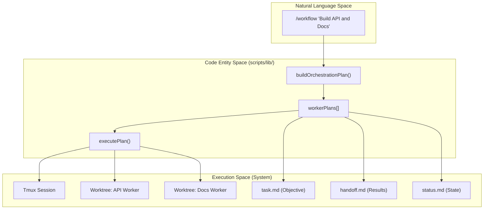
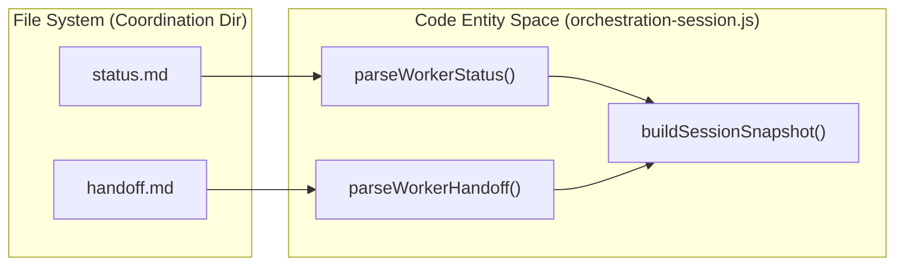

<!-- source: DeepWiki mcp.deepwiki.com · repo affaan-m/everything-claude-code · page 11.1 Agent Delegation & Orchestration · fetched 2026-10-26 -->

# Agent Delegation & Orchestration

Relevant source files

The following files were used as context for generating this wiki page:

- [.agents/skills/crosspost/SKILL.md](.agents/skills/crosspost/SKILL.md)
- [.agents/skills/exa-search/SKILL.md](.agents/skills/exa-search/SKILL.md)
- [.agents/skills/x-api/SKILL.md](.agents/skills/x-api/SKILL.md)
- [commands/multi-backend.md](commands/multi-backend.md)
- [commands/multi-execute.md](commands/multi-execute.md)
- [commands/multi-frontend.md](commands/multi-frontend.md)
- [commands/multi-plan.md](commands/multi-plan.md)
- [commands/multi-workflow.md](commands/multi-workflow.md)
- [commands/pm2.md](commands/pm2.md)
- [docs/ja-JP/commands/multi-backend.md](docs/ja-JP/commands/multi-backend.md)
- [docs/ja-JP/commands/multi-execute.md](docs/ja-JP/commands/multi-execute.md)
- [docs/ja-JP/commands/multi-frontend.md](docs/ja-JP/commands/multi-frontend.md)
- [docs/ja-JP/commands/multi-plan.md](docs/ja-JP/commands/multi-plan.md)
- [docs/ja-JP/commands/multi-workflow.md](docs/ja-JP/commands/multi-workflow.md)
- [scripts/lib/orchestration-session.js](scripts/lib/orchestration-session.js)
- [scripts/lib/tmux-worktree-orchestrator.js](scripts/lib/tmux-worktree-orchestrator.js)
- [scripts/orchestrate-codex-worker.sh](scripts/orchestrate-codex-worker.sh)
- [scripts/orchestrate-worktrees.js](scripts/orchestrate-worktrees.js)
- [scripts/orchestration-status.js](scripts/orchestration-status.js)
- [skills/crosspost/SKILL.md](skills/crosspost/SKILL.md)
- [skills/dmux-workflows/SKILL.md](skills/dmux-workflows/SKILL.md)
- [skills/exa-search/SKILL.md](skills/exa-search/SKILL.md)
- [skills/fal-ai-media/SKILL.md](skills/fal-ai-media/SKILL.md)
- [skills/nutrient-document-processing/SKILL.md](skills/nutrient-document-processing/SKILL.md)
- [skills/x-api/SKILL.md](skills/x-api/SKILL.md)
- [tests/lib/orchestration-session.test.js](tests/lib/orchestration-session.test.js)
- [tests/lib/tmux-worktree-orchestrator.test.js](tests/lib/tmux-worktree-orchestrator.test.js)

## Purpose and Scope

This document explains agent delegation patterns, handoff documents, tool permission boundaries, and orchestrator agents in Everything Claude Code (ECC). It covers how specialized subagents enable bounded task execution, sequential workflows with handoff documents, parallel execution patterns, and advanced multi-model orchestration via tmux and worktrees.

## Agent-First Philosophy

The Everything Claude Code system implements an **agent-first** design philosophy where the main Claude orchestrator delegates specialized work to subagents rather than attempting all tasks directly. This approach provides context preservation, specialization, and risk mitigation through restricted tool access.

The system supports complex multi-model workflows, such as using Claude for orchestration, Codex for backend logic, and Gemini for frontend design, as defined in the collaborative development commands [commands/multi-workflow.md:1-33]().

**Sources:** [commands/multi-workflow.md:1-33]()

## Agent Directory Structure

Agents are defined as specialized Markdown profiles. In the ECC architecture, these are categorized by their domain expertise and tool access levels.

| Agent | File Path | Primary Expertise |
| :--- | :--- | :--- |
| **Planner** | `agents/planner.md` | Strategic Decomposition & Task Planning |
| **Architect** | `agents/architect.md` | System Design & Technical Specification |
| **TDD Guide** | `agents/tdd-guide.md` | Test-Driven Development & Red-Green-Refactor |
| **Code Reviewer** | `agents/code-reviewer.md` | Quality Audit & Best Practice Enforcement |
| **Security Reviewer** | `agents/security-reviewer.md` | Vulnerability Scanning & Security Hardening |
| **Database Reviewer** | `agents/database-reviewer.md` | SQL Optimization & Schema Design |

**Sources:** [commands/multi-workflow.md:75-82](), [commands/multi-execute.md:87-93]()

## Orchestrator Agents vs Specialist Agents

### Orchestrator Agents
Orchestrator agents coordinate complex workflows and delegate to specialist agents. They manage the high-level state machine of a task, moving through phases like Research, Ideation, and Planning [commands/multi-workflow.md:100-106](). Claude typically acts as the primary orchestrator, synthesizing inputs from external models like Codex and Gemini [commands/multi-workflow.md:24-33]().

### Specialist Agents
Specialist agents perform focused tasks within limited scope. For example, Codex is treated as the backend authority for logic and algorithms, while Gemini is the frontend expert for UI/UX [commands/multi-workflow.md:28-32]().

### Tool Permission Boundaries
ECC enforces "Code Sovereignty," where external models (Codex/Gemini) have **zero filesystem write access**; all modifications are synthesized and applied by Claude [commands/multi-plan.md:15-19]().

| Agent Type | Tools | Primary Role |
| :--- | :--- | :--- |
| **Orchestrator** | All (Claude) | Routing, Planning, Execution |
| **Backend Specialist** | Read, Grep, Glob | Logic, Algorithms (Codex) |
| **Frontend Specialist** | Read, Grep, Glob | UI/UX, Styles (Gemini) |

**Sources:** [commands/multi-plan.md:15-19](), [commands/multi-workflow.md:24-33](), [commands/multi-execute.md:12-16]()

## Tmux Worktree Orchestration

For complex tasks requiring isolated environments or parallel execution, ECC uses a `tmux` and `git worktree` orchestration system implemented in `scripts/lib/tmux-worktree-orchestrator.js` [scripts/lib/tmux-worktree-orchestrator.js:1-6]().

### Orchestration Architecture

### Key Functions and Data Flow

1.  **`buildOrchestrationPlan(config)`**: Generates a plan including worker slugs, branch names, and `tmux` split commands [scripts/lib/tmux-worktree-orchestrator.js:175-212]().
2.  **`buildWorkerArtifacts(workerPlan)`**: Populates the content for `task.md`, `status.md`, and `handoff.md` within the worker's coordination directory [scripts/lib/tmux-worktree-orchestrator.js:108-173]().
3.  **`overlaySeedPaths`**: Copies specific files from the main repo into worker worktrees to provide immediate context without full git checkouts [scripts/lib/tmux-worktree-orchestrator.js:86-106](). This is useful for providing local scripts or plans to isolated workers [tests/lib/tmux-worktree-orchestrator.test.js:119-139]().

**Sources:** [scripts/lib/tmux-worktree-orchestrator.js:86-212](), [tests/lib/tmux-worktree-orchestrator.test.js:55-105]()

## Multi-Model Collaborative Workflows

ECC supports collaborative execution where different models act as domain authorities.

### The 6-Phase Workflow
Implemented in `/workflow` [commands/multi-workflow.md:100-106]():
1.  **Research**: Prompt enhancement and context retrieval [commands/multi-workflow.md:122-131]().
2.  **Ideation**: Parallel analysis by Codex (Backend) and Gemini (Frontend) [commands/multi-workflow.md:132-144]().
3.  **Plan**: Synthesis of model-specific architectures into a single `.claude/plan/` file [commands/multi-workflow.md:146-158]().
4.  **Execute**: Implementation by Claude based on the multi-model prototype [commands/multi-execute.md:172-198]().
5.  **Optimize**: Parallel review for security and performance [commands/multi-workflow.md:168-174]().
6.  **Review**: Final audit and delivery.

### Intelligent Routing
*   **Frontend**: Gemini is the visual and UI/UX authority [commands/multi-execute.md:178-188]().
*   **Backend**: Codex is the logic and algorithms authority [commands/multi-execute.md:189-196]().
*   **Fullstack**: Parallel prototypes are generated and then merged by Claude [commands/multi-execute.md:197-203]().

**Sources:** [commands/multi-workflow.md:100-174](), [commands/multi-execute.md:172-203]()

## Monitoring and Session Management

The `scripts/lib/orchestration-session.js` library manages the state of distributed agent sessions.

### Session Snapshots
The `buildSessionSnapshot` function aggregates data from `tmux list-panes` and the coordination files (`status.md`, `handoff.md`) to provide a unified view of the swarm [scripts/lib/orchestration-session.js:226-245]().

### Status Parsing
ECC uses structured Markdown parsing to track worker progress:
*   **`parseWorkerStatus`**: Extracts `state` (e.g., `not started`, `running`, `completed`), `branch`, and `worktree` paths [scripts/lib/orchestration-session.js:58-90]().
*   **`parseWorkerHandoff`**: Extracts `summary`, `validation` steps, and `remainingRisks` from the worker's final report [scripts/lib/orchestration-session.js:99-105]().

**Sources:** [scripts/lib/orchestration-session.js:58-245](), [tests/lib/tmux-worktree-orchestrator.test.js:81-88]()

## Best Practices for Delegation

1.  **Parallel Execution**: Use `run_in_background: true` for Codex/Gemini calls to avoid blocking the main orchestrator thread [commands/multi-plan.md:15-17]().
2.  **Stop-Loss Mechanism**: Do not proceed to the next phase until the current phase output is validated or the user approves [commands/multi-plan.md:18-19]().
3.  **Refactoring Prototypes**: Treat model-generated diffs as "dirty prototypes" that Claude must refactor into production-grade code [commands/multi-execute.md:16-18]().
4.  **Handoff Documentation**: Workers must update `handoff.md` with a summary and validation evidence to ensure context continuity [scripts/lib/tmux-worktree-orchestrator.js:144-160]().
5.  **Session Reuse**: Always save and reuse `SESSION_ID` for subsequent calls to maintain context across workflow phases [commands/multi-plan.md:53-54]().

**Sources:** [commands/multi-plan.md:15-54](), [commands/multi-execute.md:16-18](), [scripts/lib/tmux-worktree-orchestrator.js:144-160]()

---

