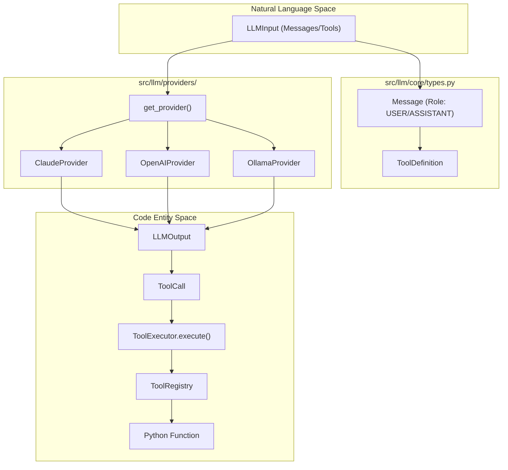
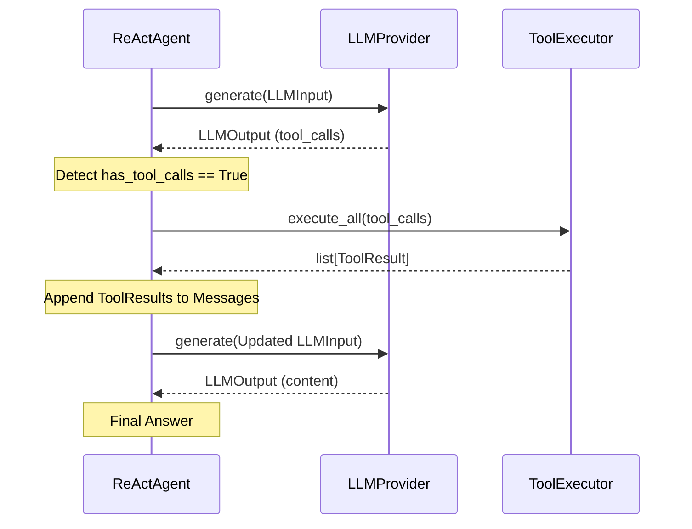

<!-- source: DeepWiki mcp.deepwiki.com · repo affaan-m/everything-claude-code · page 11.10 Python LLM Abstraction Layer · fetched 2026-10-26 -->

# Python LLM Abstraction Layer

Relevant source files

The following files were used as context for generating this wiki page:

- [pyproject.toml](pyproject.toml)
- [src/llm/__init__.py](src/llm/__init__.py)
- [src/llm/__main__.py](src/llm/__main__.py)
- [src/llm/cli/__init__.py](src/llm/cli/__init__.py)
- [src/llm/cli/selector.py](src/llm/cli/selector.py)
- [src/llm/core/__init__.py](src/llm/core/__init__.py)
- [src/llm/core/interface.py](src/llm/core/interface.py)
- [src/llm/core/types.py](src/llm/core/types.py)
- [src/llm/prompt/__init__.py](src/llm/prompt/__init__.py)
- [src/llm/providers/__init__.py](src/llm/providers/__init__.py)
- [src/llm/tools/__init__.py](src/llm/tools/__init__.py)
- [src/llm/tools/executor.py](src/llm/tools/executor.py)

The Python LLM Abstraction Layer is a provider-agnostic interface located in `src/llm/` that allows the Everything Claude Code (ECC) ecosystem to interact with various Large Language Models (LLMs) through a unified API [src/llm/__init__.py:1-11](). It supports Claude (Anthropic), OpenAI, and Ollama backends, providing standardized types for messages, tool calls, and model outputs [src/llm/providers/__init__.py:1-14]().

## Core Architecture

The module is built around a central `LLMProvider` interface that defines how different backends must implement generation and model listing logic [src/llm/core/interface.py:11-21]().

### LLMProvider Interface
All backend implementations (Claude, OpenAI, Ollama) inherit from the `LLMProvider` abstract base class [src/llm/core/interface.py:11-12]().

| Method | Description |
| :--- | :--- |
| `generate(input: LLMInput)` | Primary execution method that returns an `LLMOutput` [src/llm/core/interface.py:15](). |
| `list_models()` | Returns a list of `ModelInfo` objects supported by the provider [src/llm/core/interface.py:18](). |
| `validate_config()` | Ensures API keys or local endpoints are correctly configured [src/llm/core/interface.py:21](). |
| `supports_tools()` | Boolean flag indicating if the model supports function calling [src/llm/core/interface.py:23-24](). |

### Data Flow: Request to Response
The following diagram illustrates how a request flows from the "Natural Language Space" (Messages) through the abstraction layer into the "Code Entity Space" (Providers and Tool Executors).

**LLM Request and Execution Flow**

Sources: [src/llm/core/types.py:75-107](), [src/llm/providers/resolver.py:6](), [src/llm/tools/executor.py:37-41]()

## Tool Execution System

The abstraction layer provides a robust system for handling tool/function calling, enabling agents to interact with the local environment.

### ToolRegistry and Executor
*   **`ToolRegistry`**: A central store where Python functions are mapped to `ToolDefinition` objects [src/llm/tools/executor.py:15-18](). It tracks the function schema (parameters, descriptions) required by LLMs for tool discovery [src/llm/tools/executor.py:20-22]().
*   **`ToolExecutor`**: Responsible for taking a `ToolCall` (emitted by the LLM), looking up the corresponding function in the registry, and executing it with the provided arguments [src/llm/tools/executor.py:37-42](). It handles error wrapping via `ToolResult` to ensure the LLM receives a graceful error message if a tool fails [src/llm/tools/executor.py:50-59]().

### ReActAgent Implementation
The `ReActAgent` class implements a "Reason-Act" loop [src/llm/tools/executor.py:65-71](). It continues to call the provider and execute tools until the LLM returns a final response or the `max_iterations` limit (default 10) is reached [src/llm/tools/executor.py:70-80]().

**ReAct Loop Logic**

Sources: [src/llm/tools/executor.py:80-112]()

## Interactive CLI Selector

The module includes a CLI utility for managing LLM configurations. Users can invoke this via `llm-select` or by running the module directly [pyproject.toml:41](), [src/llm/__main__.py:4-7]().

### Selection Logic
The `interactive_select` function guides the user through choosing a provider and a specific model [src/llm/cli/selector.py:91-138]().
1.  **Provider Selection**: Lists Claude, OpenAI, and Ollama [src/llm/cli/selector.py:125]().
2.  **Model Selection**: Filters models based on the chosen provider (e.g., `gpt-4o` for OpenAI or `claude-sonnet-4-7` for Claude) [src/llm/cli/selector.py:129-130]().
3.  **Persistence**: Saves the selection to a `.llm.env` file and optionally loads it into the current `os.environ` [src/llm/cli/selector.py:76-89]().

Sources: [src/llm/cli/selector.py:19-150]()

## Type Definitions

The module relies on frozen dataclasses to ensure immutability and type safety across the abstraction layer [src/llm/core/types.py:5]().

| Class | Key Fields | Purpose |
| :--- | :--- | :--- |
| `Message` | `role`, `content`, `tool_calls` | Represents a single turn in a conversation [src/llm/core/types.py:24-30](). |
| `ToolDefinition` | `name`, `parameters`, `strict` | JSON schema for a tool provided to the LLM [src/llm/core/types.py:46-50](). |
| `LLMInput` | `messages`, `model`, `tools`, `temperature` | The full payload sent to a provider [src/llm/core/types.py:76-83](). |
| `LLMOutput` | `content`, `tool_calls`, `usage` | The standardized response from any provider [src/llm/core/types.py:101-107](). |
| `ModelInfo` | `name`, `supports_tools`, `context_window` | Metadata about a specific model's capabilities [src/llm/core/types.py:130-137](). |

Sources: [src/llm/core/types.py:1-147]()

## Dependencies and Installation

The abstraction layer is packaged as a standalone Python project with the following requirements:
*   **Python**: >= 3.11 [pyproject.toml:6]()
*   **Core Libraries**: `anthropic` (>= 0.25.0) and `openai` (>= 1.30.0) [pyproject.toml:22-23]()
*   **Build System**: `hatchling` [pyproject.toml:44-45]()

Sources: [pyproject.toml:1-49]()

---

