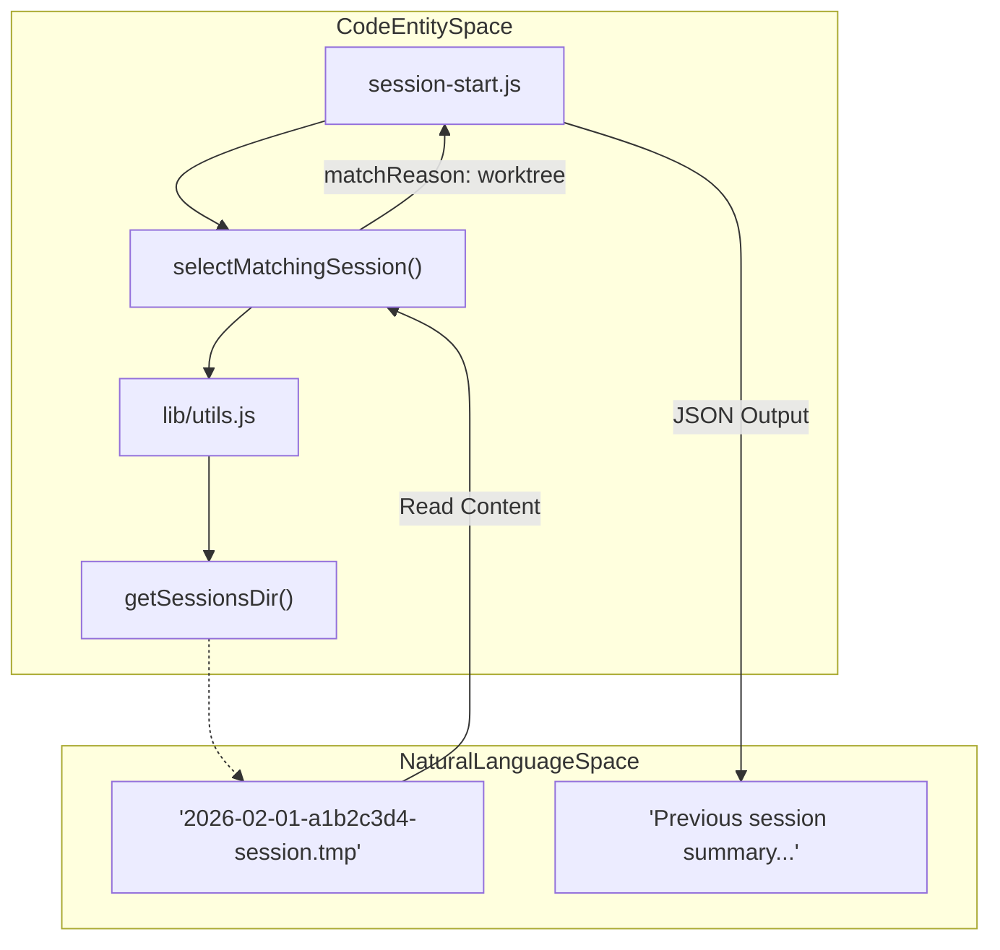
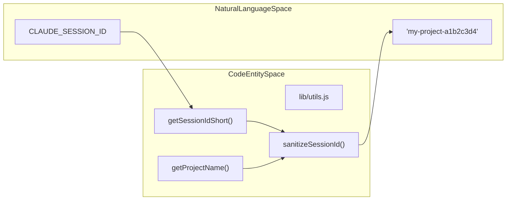

<!-- source: DeepWiki mcp.deepwiki.com · repo affaan-m/everything-claude-code · page 11.3 Memory & Context Preservation · fetched 2026-10-26 -->

# Memory & Context Preservation

<details>
<summary>Relevant source files</summary>

The following files were used as context for generating this wiki page:

- [commands/resume-session.md](commands/resume-session.md)
- [commands/save-session.md](commands/save-session.md)
- [scripts/hooks/config-protection.js](scripts/hooks/config-protection.js)
- [scripts/hooks/governance-capture.js](scripts/hooks/governance-capture.js)
- [scripts/hooks/session-end.js](scripts/hooks/session-end.js)
- [scripts/hooks/session-start.js](scripts/hooks/session-start.js)
- [scripts/hooks/suggest-compact.js](scripts/hooks/suggest-compact.js)
- [scripts/lib/agent-compress.js](scripts/lib/agent-compress.js)
- [scripts/lib/inspection.js](scripts/lib/inspection.js)
- [scripts/lib/package-manager.js](scripts/lib/package-manager.js)
- [scripts/lib/session-aliases.js](scripts/lib/session-aliases.js)
- [scripts/lib/session-manager.js](scripts/lib/session-manager.js)
- [scripts/lib/utils.js](scripts/lib/utils.js)
- [tests/ci/validators.test.js](tests/ci/validators.test.js)
- [tests/hooks/governance-capture.test.js](tests/hooks/governance-capture.test.js)
- [tests/hooks/hooks.test.js](tests/hooks/hooks.test.js)
- [tests/integration/hooks.test.js](tests/integration/hooks.test.js)
- [tests/lib/agent-compress.test.js](tests/lib/agent-compress.test.js)
- [tests/lib/inspection.test.js](tests/lib/inspection.test.js)
- [tests/lib/package-manager.test.js](tests/lib/package-manager.test.js)
- [tests/lib/session-aliases.test.js](tests/lib/session-aliases.test.js)
- [tests/lib/session-manager.test.js](tests/lib/session-manager.test.js)
- [tests/lib/utils.test.js](tests/lib/utils.test.js)

</details>


## Purpose and Scope

This document details the system's mechanisms for maintaining state and continuity across independent Claude Code invocations. Because Claude Code starts with a fresh context in each session, Everything Claude Code (ECC) implements a multi-layered persistence architecture. This includes session file management for cross-session state, lifecycle hooks for automated summary extraction, counter-based compaction management, and the `SHARED_TASK_NOTES.md` pattern for explicit handoffs.

---

## Session File System

The system persists session state to `.tmp` files in `~/.claude/session-data/` (with legacy support for `~/.claude/sessions/`). These files serve as a "memory bridge," allowing a new Claude instance to ingest the state of the previous interaction.

### Directory Structure

```
~/.claude/
├── session-data/                # Canonical session storage
│   ├── 2026-02-01-a1b2c3d4-session.tmp  # Active session file (New Format)
│   └── 2026-02-01-session.tmp           # Legacy Format
├── session-aliases.json         # Human-readable names for sessions
└── skills/
    └── learned/                 # Extracted patterns and insights
```
**Sources:** [scripts/lib/utils.js:45-54](), [scripts/lib/session-manager.js:5-9]()

### Session Lifecycle Management

The preservation of context is handled by three primary hooks: `SessionStart`, `PreCompact`, and `SessionEnd`.

#### 1. SessionStart: Context Loading
When a new session begins, the `session-start.js` hook scans for recent session files (last 7 days) and injects the most relevant summary into the current context. It uses a priority-based matching algorithm to find the best session for the current working directory.

**Matching Priority:**
1. **Exact Worktree:** Matches the `**Worktree:**` header in the session file to `process.cwd()` [scripts/hooks/session-start.js:210-213]().
2. **Project Name:** Matches the `**Project:**` header to the current git repo name [scripts/hooks/session-start.js:215-225]().
3. **Recency Fallback:** Selects the most recently modified readable session [scripts/hooks/session-start.js:231-235]().

**Pruning:** The hook also automatically removes expired sessions based on `ECC_SESSION_RETENTION_DAYS` (default 30) [scripts/hooks/session-start.js:85-90]().


**Sources:** [scripts/hooks/session-start.js:185-238](), [scripts/hooks/session-start.js:56-83](), [scripts/hooks/session-start.js:119-157]()

#### 2. PreCompact: State Preservation
Claude Code automatically compacts (summarizes) context when it nears token limits. The `PreCompact` hook event allows ECC to preserve critical state before the model discards fine-grained history. This is often used to ensure that the current "plan" or "notes" are explicitly moved to the summary block so they survive the compaction.

#### 3. SessionEnd: Summary Extraction
When a session concludes, `session-end.js` parses the `transcript.jsonl` (provided via stdin JSON) to extract a meaningful summary of the work performed.

**Data Flow in session-end.js:**
1. **Read Stdin:** Parses JSON to find `transcript_path` [scripts/hooks/session-end.js:184-192]().
2. **Parse JSONL:** Iterates through entries to identify user tasks (`type: user`), tool usage (`type: tool_use`), and files modified via `Edit` or `Write` tools [scripts/hooks/session-end.js:50-93]().
3. **Extract Metadata:** Collects current git branch and project name [scripts/hooks/session-end.js:136-144]().
4. **Update Session File:** Writes a structured markdown file containing user messages, tools used, and files modified [scripts/hooks/session-end.js:105-111]().

**Sources:** [scripts/hooks/session-end.js:40-111](), [scripts/hooks/session-end.js:181-226]()

---

## Strategic Compaction Management

To prevent the context window from filling with repetitive edits, ECC tracks tool usage and recommends manual compaction.

### Counter-Based Suggestion (`suggest-compact.js`)
This hook increments a counter stored in a temporary file every time `Edit` or `Write` tools are used. When the counter hits a threshold (default 50), it suggests the user run `/compact` to clear the context window of stale diffs.

**Threshold Logic:**
- **Initial Suggestion:** At 50 tool calls [scripts/hooks/suggest-compact.js:52]().
- **Subsequent Reminders:** Every 25 calls after the threshold (75, 100, etc.) [scripts/hooks/suggest-compact.js:54]().

**Sources:** [scripts/hooks/suggest-compact.js:1-70]()

---

## Session Aliases & Management

The `session-aliases.js` library allows users to assign human-readable names to session files, stored in `~/.claude/session-aliases.json`.

| Function | File:Line | Role |
|----------|-----------|------|
| `setAlias()` | [scripts/lib/session-aliases.js:188-235]() | Maps a name (e.g., "fix-auth") to a session path. |
| `resolveAlias()` | [scripts/lib/session-aliases.js:158-179]() | Returns the session path for a given alias. |
| `listAliases()` | [scripts/lib/session-aliases.js:244-275]() | Lists all aliases sorted by recency. |

**Sources:** [scripts/lib/session-aliases.js:1-275]()

---

## Session File Format & Manual Persistence

The `save-session` command defines a standardized markdown format for session persistence. It captures what was built, what worked (with evidence), failed approaches, and exact next steps [commands/save-session.md:68-180]().

### Key Metadata Fields
Session files include a header block parsed by `session-manager.js`:
- `**Date:**` [scripts/lib/session-manager.js:228]()
- `**Project:**` [scripts/lib/session-manager.js:231]()
- `**Worktree:**` [scripts/lib/session-manager.js:233]()

**Sources:** [commands/save-session.md:70-77](), [scripts/lib/session-manager.js:225-245]()

---

## Utility Reference

The memory system relies on `scripts/lib/utils.js` for consistent file operations and identity resolution.

| Function | File:Line | Role |
|----------|-----------|------|
| `getSessionIdShort()` | [scripts/lib/utils.js:175-182]() | Extracts 8-char ID from `CLAUDE_SESSION_ID` or project name. |
| `getProjectName()` | [scripts/lib/utils.js:130-134]() | Identifies the project for scoping memory. |
| `sanitizeSessionId()` | [scripts/lib/utils.js:146-169]() | Normalizes strings for safe cross-platform filenames. |
| `findFiles()` | [scripts/lib/utils.js:204-240]() | Scans directories for recent `.tmp` session files. |



**Sources:** [scripts/lib/utils.js:126-240]()

---

