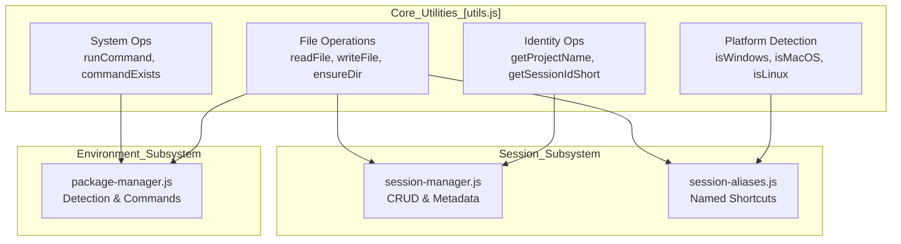
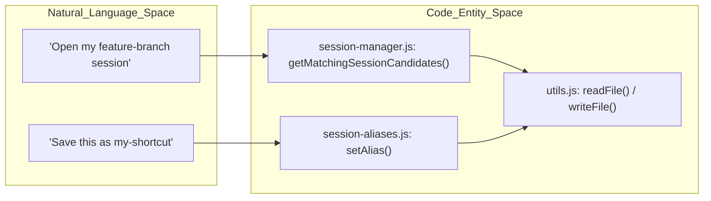
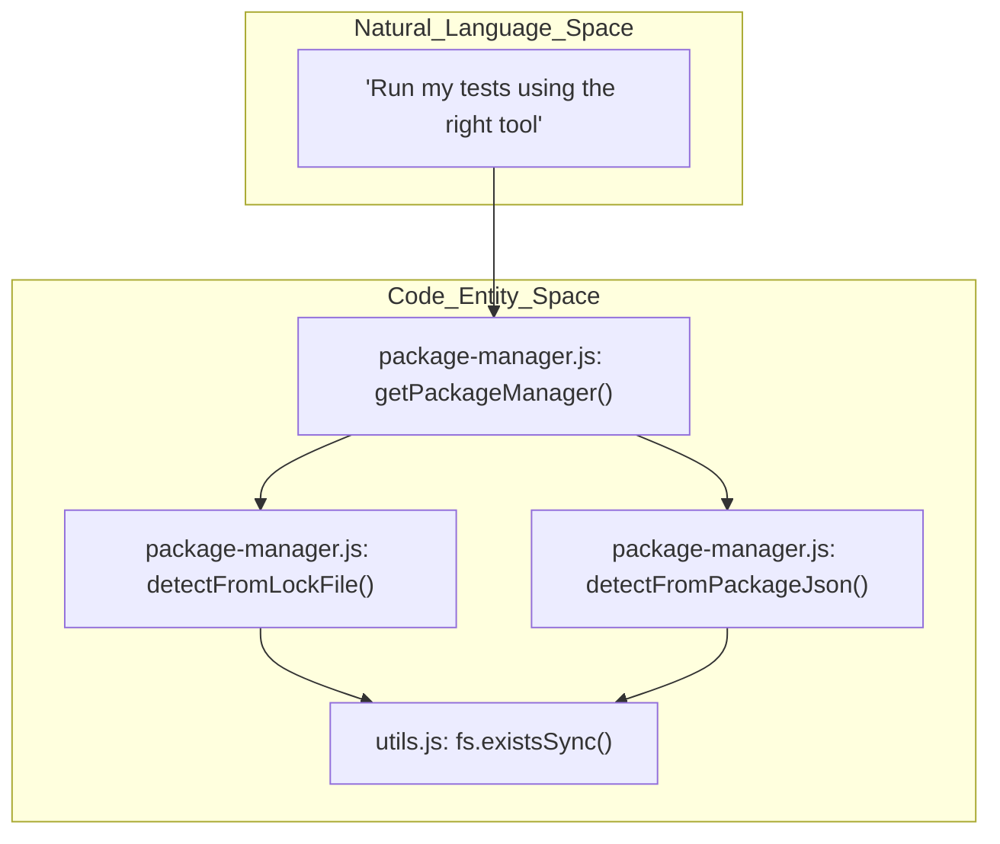

<!-- source: DeepWiki mcp.deepwiki.com · repo affaan-m/everything-claude-code · page 11.4 Utility Library Architecture · fetched 2026-10-26 -->

# Utility Library Architecture

Relevant source files

The following files were used as context for generating this wiki page:

- [scripts/hooks/session-end.js](scripts/hooks/session-end.js)
- [scripts/hooks/session-start.js](scripts/hooks/session-start.js)
- [scripts/hooks/suggest-compact.js](scripts/hooks/suggest-compact.js)
- [scripts/lib/package-manager.d.ts](scripts/lib/package-manager.d.ts)
- [scripts/lib/package-manager.js](scripts/lib/package-manager.js)
- [scripts/lib/session-aliases.d.ts](scripts/lib/session-aliases.d.ts)
- [scripts/lib/session-aliases.js](scripts/lib/session-aliases.js)
- [scripts/lib/session-manager.d.ts](scripts/lib/session-manager.d.ts)
- [scripts/lib/session-manager.js](scripts/lib/session-manager.js)
- [scripts/lib/utils.d.ts](scripts/lib/utils.d.ts)
- [scripts/lib/utils.js](scripts/lib/utils.js)
- [tests/ci/validators.test.js](tests/ci/validators.test.js)
- [tests/hooks/hooks.test.js](tests/hooks/hooks.test.js)
- [tests/integration/hooks.test.js](tests/integration/hooks.test.js)
- [tests/lib/package-manager.test.js](tests/lib/package-manager.test.js)
- [tests/lib/session-aliases.test.js](tests/lib/session-aliases.test.js)
- [tests/lib/session-manager.test.js](tests/lib/session-manager.test.js)
- [tests/lib/utils.test.js](tests/lib/utils.test.js)

The utility library (`scripts/lib/utils.js`) provides cross-platform abstractions for common operations used throughout the plugin's hooks and scripts. It ensures consistent behavior across Windows, macOS, and Linux by abstracting platform-specific differences in file paths, command execution, and system operations.

This page documents the utility functions, their implementation details, and the data flow between core library modules like `session-manager.js`, `session-aliases.js`, and `package-manager.js`.

---

## Module Architecture

The utility library is the foundation of the Everything Claude Code (ECC) system. It is organized into functional categories that provide a unified API for higher-level managers.

### Data Flow and Dependency Graph

The following diagram illustrates how `utils.js` serves as the base layer for the session and package management subsystems.

Title: ECC Library Dependency Graph

**Sources:** [scripts/lib/utils.js:1-11](), [scripts/lib/session-manager.js:14-19](), [scripts/lib/session-aliases.js:9-14](), [scripts/lib/package-manager.js:8-10]()

---

## Platform and Directory Management

The library exports constants and functions to handle the `~/.claude` directory hierarchy across different operating systems.

### Platform Detection
| Constant | Implementation | Source |
|----------|----------------|--------|
| `isWindows` | `process.platform === 'win32'` | [scripts/lib/utils.js:13-13]() |
| `isMacOS` | `process.platform === 'darwin'` | [scripts/lib/utils.js:14-14]() |
| `isLinux` | `process.platform === 'linux'` | [scripts/lib/utils.js:15-15]() |

### Directory Hierarchy
ECC relies on a specific structure within the user's home directory. The `ensureDir` function handles recursive creation and `EEXIST` race conditions common in concurrent hook executions [scripts/lib/utils.js:83-95]().

| Function | Path | Purpose |
|----------|------|---------|
| `getHomeDir()` | `process.env.HOME` \|\| `process.env.USERPROFILE` | Cross-platform home resolution [scripts/lib/utils.js:27-33]() |
| `getClaudeDir()` | `~/.claude` | Root config directory [scripts/lib/utils.js:38-40]() |
| `getSessionsDir()` | `~/.claude/session-data` | Canonical session storage [scripts/lib/utils.js:45-47]() |
| `getLegacySessionsDir()`| `~/.claude/sessions` | Backward compatibility [scripts/lib/utils.js:52-54]() |
| `getLearnedSkillsDir()` | `~/.claude/skills/learned` | Continuous learning output [scripts/lib/utils.js:66-68]() |

**Sources:** [scripts/lib/utils.js:13-75](), [scripts/lib/utils.js:83-95]()

---

## Session and Project Identity

The utility library provides the logic for identifying the current context, which is critical for session naming and project-scoped learning.

### Project Detection Logic
`getProjectName()` [scripts/lib/utils.js:130-134]() attempts to identify the project using a priority cascade:
1. **Git Root**: Calls `getGitRepoName()` which executes `git rev-parse --show-toplevel` [scripts/lib/utils.js:121-125]().
2. **CWD Basename**: Falls back to the current working directory's folder name [scripts/lib/utils.js:133-133]().

### Session ID and Sanitization
To ensure compatibility across filesystems (especially Windows), `sanitizeSessionId(raw)` [scripts/lib/utils.js:146-169]() performs extensive cleaning:
- **Reserved Names**: Appends a hash to Windows reserved names like `CON`, `PRN`, or `NUL` [scripts/lib/utils.js:158-160]().
- **Non-ASCII**: Generates a stable 8-character hash for non-ASCII inputs to prevent encoding issues [scripts/lib/utils.js:168-168]().
- **Normalization**: Replaces invalid characters with hyphens and collapses runs [scripts/lib/utils.js:151-154]().

`getSessionIdShort()` [scripts/lib/utils.js:175-182]() extracts the last 8 characters of the `CLAUDE_SESSION_ID` environment variable or falls back to a sanitized project name.

**Sources:** [scripts/lib/utils.js:121-182]()

---

## File and Search Operations

Beyond basic I/O, the library includes advanced text processing and search capabilities.

### Cross-Platform File Search
The `findFiles(dir, pattern, options)` function [scripts/lib/utils.js:204-268]() implements a glob-to-regex converter to provide a consistent alternative to the Unix `find` command. It supports:
- **Wildcards**: `*` and `?` conversion [scripts/lib/utils.js:217-221]().
- **Temporal Filtering**: `maxAge` filter based on file modification time [scripts/lib/utils.js:235-241]().
- **Recursive Search**: Depth-first traversal if `options.recursive` is true [scripts/lib/utils.js:245-247]().

### Date and Time Formatting
Consistent timestamping is provided for session headers and logging:
- `getDateString()`: `YYYY-MM-DD` [scripts/lib/utils.js:100-106]().
- `getTimeString()`: `HH:MM` [scripts/lib/utils.js:111-116]().
- `getDateTimeString()`: `YYYY-MM-DD HH:MM:SS` [scripts/lib/utils.js:187-196]().

**Sources:** [scripts/lib/utils.js:100-116](), [scripts/lib/utils.js:187-268]()

---

## Subsystem Integration: Session Management

The `session-manager.js` and `session-aliases.js` libraries leverage `utils.js` for metadata parsing and atomic file operations.

### Filename Parsing
`parseSessionFilename(filename)` [scripts/lib/session-manager.js:34-61]() uses `SESSION_FILENAME_REGEX` [scripts/lib/session-manager.js:27-27]() to extract the date and short ID. It includes calendar-accuracy validation to reject impossible dates like February 31st [scripts/lib/session-manager.js:42-47]().

### Atomic Write Pattern
When saving aliases in `saveAliases(aliases)` [scripts/lib/session-aliases.js:88-151]():
1. **Backup**: Creates a `.bak` of the current file [scripts/lib/session-aliases.js:106-108]().
2. **Temp Write**: Writes new data to a `.tmp` file [scripts/lib/session-aliases.js:111-111]().
3. **Atomic Rename**: Uses `fs.renameSync` to overwrite the original [scripts/lib/session-aliases.js:119-119]().
4. **Windows Handling**: Explicitly deletes the destination first as `renameSync` is not atomic across existing files on Windows [scripts/lib/session-aliases.js:116-118]().

Title: Mapping User Intent to Session Entities

**Sources:** [scripts/lib/session-manager.js:27-61](), [scripts/lib/session-aliases.js:88-151]()

---

## Subsystem Integration: Package Manager

The `package-manager.js` utility uses the file utilities to detect the project environment without causing performance bottlenecks.

### Detection Priority Cascade
`getPackageManager()` [scripts/lib/package-manager.js:163-236]() uses a 6-tier priority:
1. **Environment**: `CLAUDE_PACKAGE_MANAGER` [scripts/lib/package-manager.js:167-174]().
2. **Project Config**: `.claude/package-manager.json` [scripts/lib/package-manager.js:176-192]().
3. **Package.json**: The `packageManager` field [scripts/lib/package-manager.js:195-202]().
4. **Lock Files**: Detection via `detectFromLockFile()` [scripts/lib/package-manager.js:205-212]().
5. **Global Config**: `~/.claude/package-manager.json` [scripts/lib/package-manager.js:215-222]().
6. **Default**: Falls back to `npm` [scripts/lib/package-manager.js:231-235]().

Title: Package Manager Resolution Path

**Performance Note**: To avoid child process overhead during session startup, the system defaults to `npm` if no other source is found [scripts/lib/package-manager.js:231-235](). This prevents potential freezes on Windows where session-start hooks might otherwise exceed process spawn limits during initialization [scripts/lib/package-manager.js:225-230]().

**Sources:** [scripts/lib/package-manager.js:163-236](), [scripts/lib/package-manager.js:92-102](), [scripts/lib/package-manager.js:128-146]()

---

